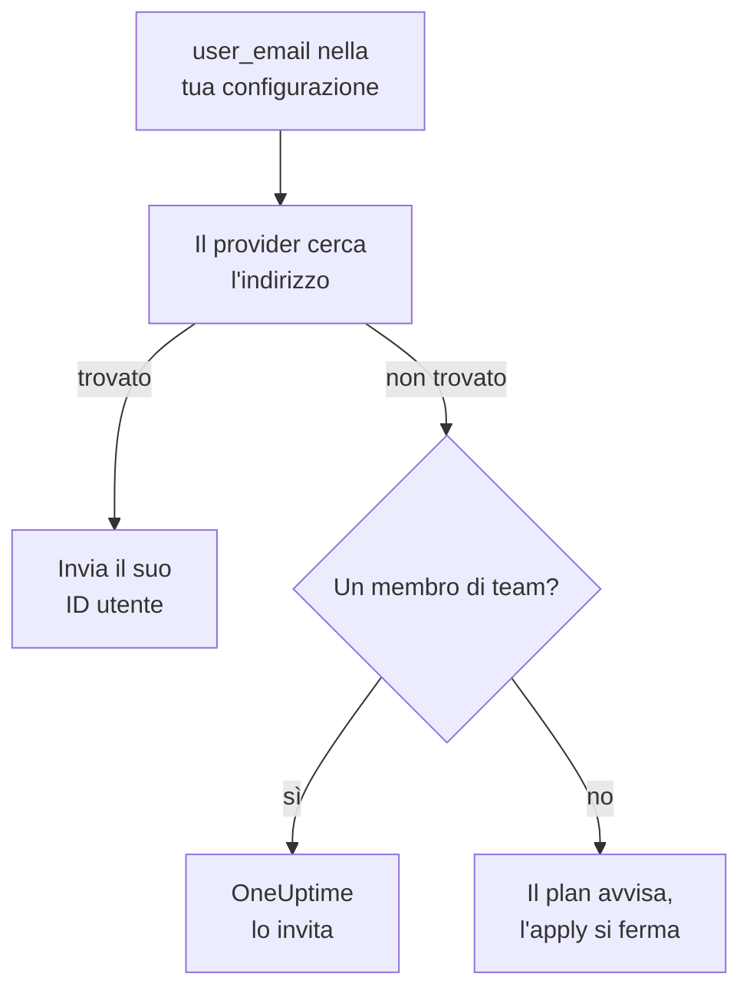

# Persone e team

Tieni nella tua configurazione Terraform chi fa parte del tuo progetto: i team e i loro membri, chi è reperibile e chi è proprietario di cosa. Indica ogni persona con il suo indirizzo email: il provider la trova e invita chiunque sia nuovo nel progetto.

:::cards
- [Indicare le persone con l'indirizzo email](#indicare-le-persone-con-lindirizzo-email): L'attributo accanto a ogni ID utente.
- [Far entrare qualcuno](#far-entrare-qualcuno): Invita qualcuno e dagli un team, turni di reperibilità e qualcosa di cui essere proprietario.
- [Far uscire qualcuno](#far-uscire-qualcuno): Rimuovi qualcuno, e ciò che OneUptime rimuove insieme a lui.
- [Importare i membri che hai già](#importare-i-membri-che-hai-già): Tramite il loro team e il loro indirizzo.
:::

## Come funziona

Il provider cerca l'indirizzo tra le persone del progetto della chiave API: i suoi membri e le persone invitate a farne parte. Invia all'API l'ID della persona che trova. Un membro di team indicato con un indirizzo che nessuno nel progetto ha invita invece quell'indirizzo.



Si cerca solo nel progetto della chiave API. Nessuno al di fuori viene mai trovato, e il provider non può sapere se un indirizzo ha un account altrove.

## Prima di iniziare

- **Una chiave API che può leggere i team del progetto.** Il provider trova le persone attraverso di essi.
- **Per aggiungere qualcuno di nuovo, una chiave che può invitare persone.** Vedi [Invitare persone](/docs/permissions/inviting-people).

## Indicare le persone con l'indirizzo email

Ogni risorsa che indica una persona accetta il suo indirizzo email accanto al suo ID utente. Indica uno dei due:

| ID utente | Indirizzo email |
| --- | --- |
| `user_id` | `user_email` |
| `owner_users` | `owner_user_emails` |
| `assigned_to_user_id` | `assigned_to_user_email` |
| `override_user_id` | `override_user_email` |

L'indirizzo viene trovato senza distinguere maiuscole e minuscole, e tenuto nello state come lo hai scritto. L'ID utente viene compilato, così altre risorse possono farvi riferimento.

## Far entrare qualcuno

Questa configurazione aggiunge a un team Alice, nuova nel progetto, le dà turni di reperibilità dal primo giorno e rende Bob, già nel progetto, proprietario di un monitor:

```hcl title="people.tf"
resource "oneuptime_team" "sre" {
  name        = "SRE"
  description = "Site reliability engineering"
}

# New to the project: OneUptime invites her.
resource "oneuptime_team_member" "alice" {
  team_id    = oneuptime_team.sre.id
  user_email = "alice@example.com"
}

resource "oneuptime_on_call_policy_schedule" "weekly" {
  name     = "SRE weekly"
  timezone = "UTC"
}

resource "oneuptime_on_call_schedule_layer" "weekly" {
  on_call_duty_policy_schedule_id = oneuptime_on_call_policy_schedule.weekly.id
  name                            = "Weekly"
  starts_at                       = "2030-01-07T09:00:00Z"
  hand_off_time                   = "2030-01-14T09:00:00Z"
}

# Named through her membership, so she is invited first.
resource "oneuptime_on_call_schedule_layer_user" "alice" {
  on_call_duty_policy_schedule_id       = oneuptime_on_call_policy_schedule.weekly.id
  on_call_duty_policy_schedule_layer_id = oneuptime_on_call_schedule_layer.weekly.id
  user_id                               = oneuptime_team_member.alice.user_id
}

resource "oneuptime_monitor" "api" {
  name         = "Public API"
  monitor_type = "Manual"
}

# In the project already: named by his address.
resource "oneuptime_monitor_user_owner" "api" {
  monitor_id = oneuptime_monitor.api.id
  user_email = "bob@example.com"
}
```

`terraform apply` invita Alice via email, come fa un invito dal pannello. OneUptime le crea un account se non ne ha uno. `has_accepted_invitation` resta `false` finché non accetta, e il fatto che accetti non è un cambiamento nel plan. Chi è già nel progetto entra subito in un nuovo team.

Per mettere in reperibilità qualcuno che questa configurazione invita, o renderlo proprietario, fai riferimento alla sua appartenenza con `user_id = oneuptime_team_member.<name>.user_id`: così Terraform lo invita prima di indicarlo altrove. Un indirizzo che nessuno nel progetto ha è un avviso nel plan e un errore nell'apply.

## Trovare qualcuno

La sorgente dati `oneuptime_user` cerca qualcuno per `email`, `name` o `id`, e legge il suo ID utente, il suo nome, se è entrato nel progetto e i team di cui fa parte:

```hcl
data "oneuptime_user" "alice" {
  email = "alice@example.com"
}

output "alice_teams" {
  value = data.oneuptime_user.alice.team_ids
}
```

Altre sorgenti dati trovano un record tramite l'indirizzo della persona che indica, accanto al suo ID. Questa legge l'appartenenza di Alice al team SRE:

```hcl
data "oneuptime_team_member" "alice" {
  team_id    = oneuptime_team.sre.id
  user_email = "alice@example.com"
}
```

## Far uscire qualcuno

Rimuovi le appartenenze della persona dalla tua configurazione e applicala. Uscita dal suo ultimo team del progetto, è uscita dal progetto, e OneUptime la toglie da ogni calendario di reperibilità, regola di escalation e sostituzione, e da ciò di cui è proprietaria: da tutto, tranne gli incidenti, gli avvisi e gli eventi di manutenzione conclusi. Rimuovi nella stessa modifica i blocchi che la indicano, o il plan successivo li ricrea per qualcuno che non è più nel progetto.

Il suo account OneUptime resta suo: lascia solo il progetto. Un team che deve tenere un membro non lascia andare l'ultimo che ha accettato.

## Importare i membri che hai già

Nessuna schermata mostra l'ID di un'appartenenza, quindi importala con l'ID del suo team e l'indirizzo della persona:

```bash
terraform import oneuptime_team_member.alice 6b1d1c2e-4f3a-4b5c-8d6e-7f8091a2b3c4/alice@example.com
```

L'indirizzo resta come lo hai scritto, quindi scrivilo come nella tua configurazione. Anche l'ID dell'appartenenza la importa, e allora l'indirizzo viene letto da OneUptime, in minuscolo.

I proprietari e le righe di reperibilità si importano allo stesso modo, tramite ciò a cui appartengono. Il proprietario di un monitor prende l'ID del monitor e l'indirizzo della persona. Una riga che nomina un team o un calendario, come un team proprietario o il team che una regola di escalation avvisa, prende entrambi gli ID:

```bash
terraform import oneuptime_monitor_user_owner.api 68a1b2c3-d4e5-4f6a-8b9c-0d1e2f3a4b01/bob@example.com
terraform import oneuptime_escalation_rule_team.sre 68a1b2c3-d4e5-4f6a-8b9c-0d1e2f3a4b06/6b1d1c2e-4f3a-4b5c-8d6e-7f8091a2b3c4
```

## Quando qualcuno cambia indirizzo

Una persona che cambia indirizzo in OneUptime resta la stessa persona per Terraform: non cambia nulla finché non scrivi il nuovo indirizzo, e allora cambia solo `user_email`.

## Risoluzione dei problemi

:::details Il plan dice che un indirizzo non è ancora in questo progetto
Nessuno nel progetto, né tra gli invitati, ha quell'indirizzo. Invita prima la persona con un `oneuptime_team_member`. Se quell'appartenenza è nella stessa configurazione, fai riferimento a essa con `user_id = oneuptime_team_member.<name>.user_id` invece che all'indirizzo. Se ha cambiato indirizzo in OneUptime, usa quello nuovo.
:::

:::details L'apply dice che l'utente è già stato invitato in questo team
La persona è già nel team. Importa quell'appartenenza invece di crearla, come in [Importare i membri che hai già](#importare-i-membri-che-hai-già).
:::

## Prossimi passi

:::cards
- [Importare risorse](/docs/terraform/importing-resources): Porta il resto del tuo progetto sotto Terraform.
- [Invitare persone](/docs/permissions/inviting-people): Come funzionano gli inviti in OneUptime.
- [Esempi](/docs/terraform/examples): Configurazioni pronte all'uso per le risorse più comuni.
:::
