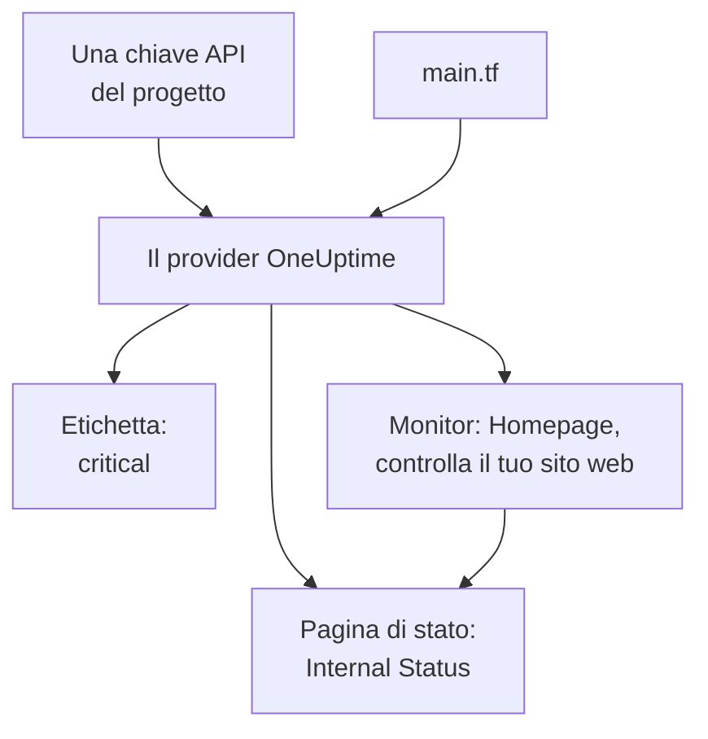

# Avvio rapido

Questa guida ti porta da zero a un progetto OneUptime gestito da Terraform in una decina di minuti. Crei una chiave API, indirizzi Terraform al tuo progetto e applichi un'etichetta, un monitor che controlla il tuo sito web e una pagina di stato privata che lo mostra. Poi ne modifichi uno e fai pulizia.

:::cards
- [Prima di iniziare](#prima-di-iniziare): Terraform, un progetto e un piano con le chiavi API.
- [Creare le prime risorse](#creare-le-prime-risorse): Da una chiave API a un piano applicato, in sei passaggi.
- [Modificare una risorsa](#modificare-una-risorsa): Modificare la configurazione, pianificare e applicare.
- [Risoluzione dei problemi](#risoluzione-dei-problemi): Gli errori su cui può fermarsi una prima esecuzione.
:::



## Prima di iniziare

- **Terraform 1.5 o successivo, oppure OpenTofu 1.6 o successivo.** Con OpenTofu, esegui `tofu` ovunque questa guida esegue `terraform`.
- **Un progetto OneUptime** su [oneuptime.com](https://oneuptime.com) o sulla tua istanza OneUptime, in cui puoi creare chiavi API.
- **Su OneUptime Cloud, il piano Growth o superiore.** Le chiavi API di un progetto funzionano solo con quello.

## Creare le prime risorse

:::steps
### Creare una chiave API del progetto

Nella dashboard di OneUptime, apri **Impostazioni del progetto → Avanzato → Chiavi API** e fai clic su **Crea: Chiave API**. Dalle un **Nome**, come `terraform`, e in **Accesso** scegli **Amministratore del progetto**: Terraform crea, legge, modifica ed elimina ogni tipo di record che gestisce, e **Amministratore del progetto** può fare tutto questo. Per una chiave più limitata, scegli **Scegli le autorizzazioni più tardi** e aggiungi nella pagina della chiave solo le autorizzazioni che ti servono.

La chiave scade tra un anno. Per scegliere un'altra data, apri **Altri campi** prima di crearla, oppure cambia la data più tardi nella pagina della chiave. Una volta creata la chiave, si apre la sua pagina: copia la **Chiave API** dalla scheda **Dettagli chiave API**.

### Rendere la chiave disponibile a Terraform

Metti la chiave nella variabile d'ambiente `ONEUPTIME_API_KEY` della shell in cui esegui Terraform, così non finisce mai in un file:

:::tabs
@tab Linux
```bash
export ONEUPTIME_API_KEY="<your-api-key>"
```
@tab macOS
```bash
export ONEUPTIME_API_KEY="<your-api-key>"
```
@tab Windows
```powershell
$env:ONEUPTIME_API_KEY = "<your-api-key>"
```
:::

### Indirizzare Terraform a OneUptime

Crea una cartella vuota e, al suo interno, un file chiamato `main.tf`:

```hcl title="main.tf"
terraform {
  required_providers {
    oneuptime = {
      source  = "oneuptime/oneuptime"
      version = "{{TERRAFORM_PROVIDER_VERSION}}"
    }
  }
}

provider "oneuptime" {
  # The API key comes from ONEUPTIME_API_KEY.
  # On a self-hosted OneUptime, add your OneUptime's address:
  # oneuptime_url = "https://oneuptime.example.com"
}
```

Su un'istanza OneUptime self-hosted, leggi la [Configurazione self-hosted](/docs/terraform/self-hosted) prima di scegliere una versione del provider.

### Descrivere le risorse

Aggiungi questi blocchi a `main.tf`. Leggono due degli stati del monitor con cui ogni progetto inizia, e creano un'etichetta, un monitor che controlla `https://example.com` ogni cinque minuti (mettici il tuo sito web) e una pagina di stato privata che mostra il monitor:

```hcl title="main.tf"
data "oneuptime_monitor_status" "operational" {
  name = "Operational"
}

data "oneuptime_monitor_status" "offline" {
  name = "Offline"
}

resource "oneuptime_label" "critical" {
  name        = "critical"
  description = "Resources that page on-call when down"
  color       = "#FF5733"
}

resource "oneuptime_monitor" "homepage" {
  name                = "Homepage"
  description         = "Checks that the homepage responds"
  monitor_type        = "Website"
  monitoring_interval = "*/5 * * * *"
  labels              = [oneuptime_label.critical.id]

  monitor_steps = [{
    monitor_destination      = "https://example.com"
    monitor_destination_type = "URL"
    request_type             = "GET"

    criteria = [
      {
        name                  = "Offline"
        description           = "The homepage does not respond"
        filter_condition      = "Any"
        change_monitor_status = true
        monitor_status_id     = data.oneuptime_monitor_status.offline.id

        filters = [
          {
            check_on    = "Is Online"
            filter_type = "False"
          }
        ]
      },
      {
        name                  = "Online"
        description           = "The homepage responds"
        filter_condition      = "All"
        change_monitor_status = true
        monitor_status_id     = data.oneuptime_monitor_status.operational.id

        filters = [
          {
            check_on    = "Is Online"
            filter_type = "True"
          }
        ]
      }
    ]
  }]
}

resource "oneuptime_status_page" "internal" {
  name                  = "Internal Status"
  description           = "Status of our internal services"
  page_title            = "Service Status"
  is_public_status_page = false
}

resource "oneuptime_status_page_resource" "homepage" {
  status_page_id = oneuptime_status_page.internal.id
  monitor_id     = oneuptime_monitor.homepage.id
  display_name   = "Homepage"
}

output "monitor_id" {
  value = oneuptime_monitor.homepage.id
}
```

I `monitor_steps` del monitor dicono cosa controlla e cosa significa ogni risultato: dopo ogni controllo, il primo criterio che corrisponde imposta il suo stato. [Passaggi del monitor](/docs/terraform/monitor-steps) spiega ogni parte.

### Pianificare e applicare

:::tabs
@tab Terraform
```bash
terraform init
terraform plan
terraform apply
```
@tab OpenTofu
```bash
tofu init
tofu plan
tofu apply
```
:::

`init` scarica il provider. Il piano termina con `Plan: 4 to add, 0 to change, 0 to destroy.` Digita `yes` per applicarlo; quando ha finito, Terraform stampa l'ID del nuovo monitor.

### Controllare la dashboard

Nella dashboard di OneUptime:

- **Monitor** elenca `Homepage`, con l'etichetta `critical`. Il suo primo controllo arriva entro pochi minuti.
- **Pagine di stato** elenca `Internal Status`, che mostra `Homepage`.
- **Impostazioni del progetto → Base → Etichette** elenca `critical`, nel colore che hai impostato.

Esegui di nuovo `terraform plan`. Risponde `No changes.`: OneUptime contiene esattamente ciò che dice la configurazione.
:::

## Modificare una risorsa

Modifica la configurazione, non la dashboard. Imposta il `color` dell'etichetta su `"#2ECC71"` in `main.tf`, poi pianifica e applica:

```bash
terraform plan
terraform apply
```

Il piano termina con `Plan: 0 to add, 1 to change, 0 to destroy.`: l'etichetta viene modificata sul posto. Una modifica che qualcuno fa nella dashboard a una risorsa gestita da Terraform compare nel piano successivo, e applicarlo rimette ciò che dice la configurazione.

## Fare pulizia

Se era una prova, elimina ciò che la configurazione ha creato:

```bash
terraform destroy
```

Questo elimina l'etichetta, il monitor, la pagina di stato e la sua risorsa. I due stati del monitor restano: le sorgenti dati li leggono soltanto.

## Risoluzione dei problemi

:::details Messaggio «Missing API Key»
Il provider non ha trovato nessuna chiave API. Esporta `ONEUPTIME_API_KEY` nella shell in cui esegui Terraform, oppure imposta `api_key` nel blocco del provider, e riesegui il comando.
:::

:::details Messaggio «the OneUptime API returned status 400: Invalid API Key»
La chiave è scritta male, scaduta o eliminata, oppure appartiene a un'istanza OneUptime diversa da quella a cui punta `oneuptime_url`. Copia di nuovo la chiave dalla sua pagina, oppure creane una nuova.
:::

:::details Messaggio «the OneUptime API returned status 402: API keys need the Growth plan»
Su OneUptime Cloud, le chiavi API di un progetto funzionano solo con il piano Growth o superiore. Passa il progetto a un piano superiore in **Impostazioni del progetto → Fatturazione e fatture → Fatturazione**, e la stessa chiave torna a funzionare.
:::

:::details Messaggio «the OneUptime API returned status 422: You do not have permissions to create Monitor»
La chiave non ha alcuna autorizzazione per quel tipo di record. Nella pagina della chiave, assegnale **Amministratore del progetto**, oppure l'autorizzazione che nomina il messaggio.
:::

:::details Messaggio «No monitor status matches {name = "Offline"}»
Gli stati del monitor del tuo progetto hanno altri nomi. Usa i nomi che vedi in **Monitor → Impostazioni → Stato del monitor**, oppure cerca lo stato con `is_offline_state = true`.
:::

## Prossimi passi

:::cards
- [Guida completa](/docs/terraform/complete-guide): Autenticazione, struttura del progetto, sorgenti dati, stato e aggiornamenti.
- [Passaggi del monitor](/docs/terraform/monitor-steps): Decidere cosa controlla un monitor e cosa significa ogni risultato.
- [Esempi](/docs/terraform/examples): Configurazioni pronte all'uso per le risorse più comuni.
- [Importare risorse](/docs/terraform/importing-resources): Portare sotto Terraform ciò che hai creato nella dashboard.
:::
