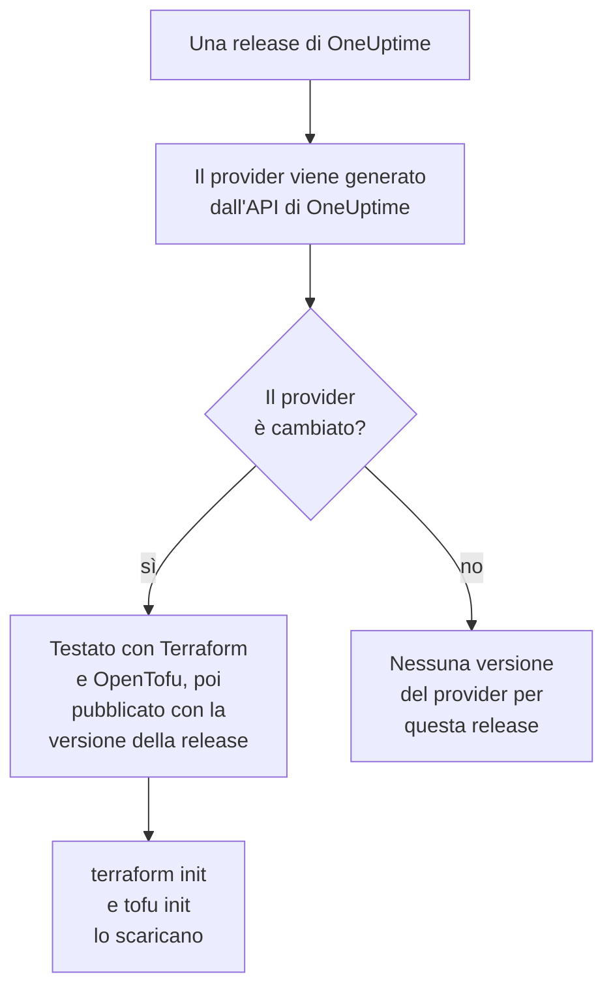

# Utilizzo del registro

Il provider OneUptime è pubblicato nel [Terraform Registry](https://registry.terraform.io/providers/oneuptime/oneuptime) e nell'[OpenTofu Registry](https://search.opentofu.org/provider/oneuptime/oneuptime/latest). `terraform init` e `tofu init` lo scaricano da lì: non c'è nulla da installare a mano. Questa pagina spiega cosa viene pubblicato, come sono numerate le versioni e come passare a una versione più recente.

:::cards
- [Cosa viene pubblicato](#cosa-viene-pubblicato): Il provider per ogni piattaforma, il suo riferimento e le sue versioni.
- [Come sono numerate le versioni](#come-sono-numerate-le-versioni): La versione di un provider è la release di OneUptime che lo ha pubblicato.
- [Il file di lock](#il-file-di-lock): La versione e i checksum che ogni macchina installa.
- [Passare a una versione più recente](#passare-a-una-versione-più-recente): Leggere cosa è cambiato, scaricarla e pianificare.
:::

## Cosa viene pubblicato

Ogni release di OneUptime genera il provider dall'API stessa di OneUptime. Quando il provider è cambiato, la release lo pubblica, con la versione della release, dopo che ha superato i suoi test end-to-end con Terraform e con OpenTofu:



| Cosa | Dove |
| --- | --- |
| Il provider, per Linux, macOS, Windows, FreeBSD, OpenBSD e Solaris | Scaricato da `terraform init` e `tofu init`, con checksum che OneUptime firma |
| Il riferimento di ogni risorsa e sorgente dati, con ognuno dei suoi attributi | La documentazione del registro, raggruppata per prodotto: monitor, pagine di stato, incidenti, reperibilità e gli altri |
| Una guida all'uso del provider con OpenTofu | Le guide del registro |
| Ogni versione, la più recente per prima | L'elenco delle versioni del registro |

Il riferimento dice cos'è ogni attributo. Questa documentazione mostra come usarli insieme: inizia dalla [Panoramica di Terraform](/docs/terraform/index).

## Come sono numerate le versioni

La versione di un provider è la versione della release di OneUptime che lo ha pubblicato: il provider {{TERRAFORM_PROVIDER_MAJOR}}.0.20 è arrivato con OneUptime {{TERRAFORM_PROVIDER_MAJOR}}.0.20. Una release il cui provider non è cambiato non ne pubblica nessuno, quindi le versioni hanno dei buchi, e un vincolo che nomina una sola versione esatta può nominare una versione che non esiste. Scrivi invece un intervallo:

| Usi | Vincolo | Terraform installa |
| --- | --- | --- |
| OneUptime Cloud | `{{TERRAFORM_PROVIDER_VERSION}}` | Il provider {{TERRAFORM_PROVIDER_MAJOR}}.x più recente |
| Un'istanza OneUptime self-hosted | Un intervallo che termina alla versione della tua istanza OneUptime, come `>= {{TERRAFORM_PROVIDER_MAJOR}}.0, <= {{TERRAFORM_PROVIDER_MAJOR}}.0.40` | Il provider più recente che non sia più recente della tua istanza OneUptime |

Su un'istanza OneUptime self-hosted, un provider più recente della tua istanza può inviare impostazioni che la tua istanza non ha ancora: [Configurazione self-hosted](/docs/terraform/self-hosted#scegliere-la-versione-del-provider) mostra come scriverne l'intervallo.

```hcl title="main.tf"
terraform {
  required_providers {
    oneuptime = {
      source  = "oneuptime/oneuptime"
      version = "{{TERRAFORM_PROVIDER_VERSION}}"
    }
  }
}
```

L'indirizzo sorgente non nomina nessun registro: Terraform lo legge nel Terraform Registry, e OpenTofu nell'OpenTofu Registry, che pubblicano le stesse versioni.

## Il file di lock

`terraform init` registra la versione che ha scelto, e i checksum dei suoi download, in `.terraform.lock.hcl`. Esegui il commit di questo file: ogni macchina ed esecuzione di CI installa allora esattamente quella versione, finché non ne scegli un'altra. I checksum coprono ogni piattaforma che il registro pubblica, quindi un solo file di lock serve allo stesso modo macchine Linux, macOS e Windows.

```hcl title=".terraform.lock.hcl"
provider "registry.terraform.io/oneuptime/oneuptime" {
  version     = "{{TERRAFORM_PROVIDER_MAJOR}}.0.20"
  constraints = "{{TERRAFORM_PROVIDER_VERSION}}"
  hashes = [
    "h1:...",
    "zh:...",
  ]
}
```

Il file di lock nomina il registro. OpenTofu scrive `registry.opentofu.org/oneuptime/oneuptime` dove Terraform scrive `registry.terraform.io/oneuptime/oneuptime`, quindi cambiare motore modifica il file di lock: `init` sostituisce la voce, e ti chiede di eseguire il commit della modifica.

## Passare a una versione più recente

:::steps
### Leggere cosa è cambiato

[Le release di OneUptime](https://github.com/OneUptime/oneuptime/releases) dicono cosa ha cambiato ogni release, provider compreso. [Le release del provider](https://github.com/OneUptime/terraform-provider-oneuptime/releases) rimandano alle modifiche rispetto alla precedente.

### Scaricarla

```bash
terraform init -upgrade
```

`init -upgrade` prende la versione più recente che il tuo vincolo permette, la stampa e aggiorna `.terraform.lock.hcl`. Il vincolo `{{TERRAFORM_PROVIDER_VERSION}}` prende ogni release {{TERRAFORM_PROVIDER_MAJOR}}.x; una nuova versione principale richiede un nuovo vincolo.

### Pianificare prima di applicare

Esegui `terraform plan`, e applica solo quando è vuoto o mostra le modifiche che ti aspetti. Esegui il commit del file di lock aggiornato.
:::

Su un'istanza OneUptime self-hosted, aggiorna prima OneUptime, poi sposta in avanti la fine dell'intervallo del provider.

## Dove si trova il codice

Il provider è generato dall'API di OneUptime nel [repository principale di OneUptime](https://github.com/OneUptime/oneuptime), e ogni versione viene compilata dalla release che l'ha pubblicata. Il suo repository, [OneUptime/terraform-provider-oneuptime](https://github.com/OneUptime/terraform-provider-oneuptime), contiene ciò che il generatore ha scritto, quindi le modifiche si fanno nel repository principale: segnala i problemi, compresi quelli della documentazione, su [github.com/OneUptime/oneuptime/issues](https://github.com/OneUptime/oneuptime/issues).

## Prossimi passi

:::cards
- [Configurazione self-hosted](/docs/terraform/self-hosted): L'intervallo di versioni per la tua istanza OneUptime, e un mirror per le macchine offline.
- [OpenTofu](/docs/terraform/opentofu): Lo stesso provider e la stessa configurazione, con `tofu`.
- [Guida completa](/docs/terraform/complete-guide): Autenticazione, struttura del progetto, sorgenti dati, stato e aggiornamenti.
- [Risoluzione dei problemi](/docs/terraform/troubleshooting): Gli errori comuni e come correggerli.
:::
