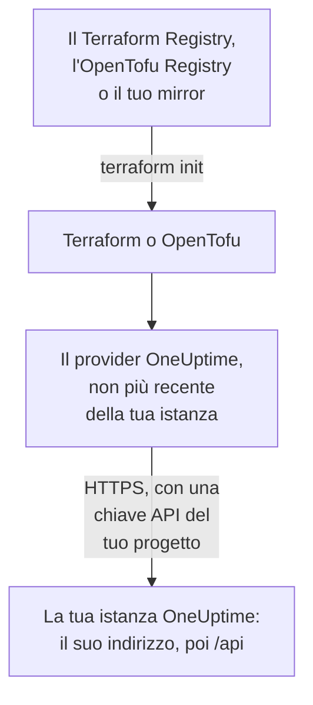

# Configurazione self-hosted

Il provider funziona con la tua istanza OneUptime come funziona con OneUptime Cloud: le stesse risorse, gli stessi attributi e le stesse chiavi API del progetto. Ciò che spetta a te impostare: l'indirizzo della tua istanza OneUptime, la versione del provider che le corrisponde e, dove ti servono, un mirror per le macchine senza accesso a internet e la fiducia verso un'autorità di certificazione privata.

:::cards
- [Puntare il provider alla tua istanza OneUptime](#puntare-il-provider-alla-tua-istanza-oneuptime): Il suo indirizzo, e una chiave API del tuo progetto.
- [Scegliere la versione del provider](#scegliere-la-versione-del-provider): Il provider più recente che non sia più recente della tua istanza OneUptime.
- [Senza accesso a internet](#senza-accesso-a-internet): Crea un mirror del provider nella tua rete.
- [TLS e certificati](#tls-e-certificati): Un'autorità di certificazione privata, i proxy e l'HTTP semplice.
:::



## Puntare il provider alla tua istanza OneUptime

Imposta `oneuptime_url` con l'indirizzo a cui apri la dashboard: lo schema e l'host, senza percorso. Il provider aggiunge `https://` quando l'indirizzo non ha uno schema, e `/api` alla fine, quindi `https://oneuptime.example.com` invia ogni richiesta a `https://oneuptime.example.com/api`.

```hcl title="main.tf"
terraform {
  required_providers {
    oneuptime = {
      source  = "oneuptime/oneuptime"
      version = "{{TERRAFORM_PROVIDER_MATCHING}}"
    }
  }
}

provider "oneuptime" {
  oneuptime_url = "https://oneuptime.example.com"
  # The API key comes from the ONEUPTIME_API_KEY environment variable.
}
```

L'indirizzo può venire invece dalla variabile d'ambiente `ONEUPTIME_URL`, così una configurazione può puntare a diverse installazioni:

```bash
export ONEUPTIME_URL="https://oneuptime.example.com"
export ONEUPTIME_API_KEY="<your-api-key>"
```

L'indirizzo è l'host su cui viene servita la tua installazione: `HOST` e `HTTP_PROTOCOL` in `config.env` con Docker Compose, e `host` e `httpProtocol` nei valori del chart Helm.

La chiave è una chiave API del progetto che gestisci, creata nella dashboard della tua istanza OneUptime in **Impostazioni del progetto → Avanzato → Chiavi API**, come su OneUptime Cloud. La chiave API master di un'istanza OneUptime self-hosted non appartiene a nessun progetto, quindi una creazione fatta con essa fallisce con `ProjectId required`.

> [!TIP]
> La tua istanza OneUptime scrive questo blocco per te. Apri una risorsa o un elenco qualsiasi nella dashboard, poi **Sviluppatori** e **Terraform** nel suo menu laterale: il blocco del provider che mostra ha l'indirizzo della tua istanza OneUptime, e un intervallo di versioni che le corrisponde.

## Scegliere la versione del provider

Usa il provider pubblicato più recente che non sia più recente della tua istanza OneUptime. Le versioni del provider seguono quelle di OneUptime: una release di OneUptime che modifica il provider lo pubblica con il proprio numero di versione, e un provider più recente della tua istanza OneUptime può inviare impostazioni che la tua istanza non ha ancora.

Scrivi quindi un intervallo che termini alla versione della tua istanza OneUptime, come fa la dashboard. Il blocco qui sopra usa `{{TERRAFORM_PROVIDER_MATCHING}}`, l'intervallo per l'istanza OneUptime da cui proviene questa documentazione: quando la leggi sulla tua istanza OneUptime, quell'intervallo è il tuo. Altrimenti, scrivi la tua versione:

:::steps
### Trovare la versione della tua istanza OneUptime

Chiedila alla tua istanza OneUptime:

```bash
curl https://oneuptime.example.com/version
```

La risposta è JSON, come `{"version":"{{TERRAFORM_PROVIDER_MAJOR}}.0.40","commit":"..."}`. Come amministratore principale, puoi anche aprire l'etichetta dell'edizione nell'intestazione del pannello amministratore: vedi [Trovare la versione attuale](/docs/installation/upgrading#trovate-la-vostra-versione-attuale).

### Scriverla nell'intervallo

L'intervallo inizia dalla versione principale e termina alla tua. Per un'istanza OneUptime {{TERRAFORM_PROVIDER_MAJOR}}.0.40:

```hcl title="main.tf"
terraform {
  required_providers {
    oneuptime = {
      source  = "oneuptime/oneuptime"
      version = ">= {{TERRAFORM_PROVIDER_MAJOR}}.0, <= {{TERRAFORM_PROVIDER_MAJOR}}.0.40"
    }
  }
}
```

Terraform prende il provider più recente dell'intervallo. Una release di OneUptime che non ha modificato il provider non ne pubblica nessuno, e l'intervallo salta le versioni che non esistono.

### Scaricare il provider

Esegui `terraform init`. Stampa la versione che ha installato e la registra in `.terraform.lock.hcl`.
:::

Quando aggiorni, aggiorna prima OneUptime. Poi sposta la fine dell'intervallo alla sua nuova versione, ed esegui `terraform init -upgrade`.

## Senza accesso a internet

Quando le macchine che eseguono Terraform non possono raggiungere il registro, copia una volta il provider nella tua rete, e punta Terraform alla copia.

:::steps
### Creare un mirror del provider

Su una macchina con accesso a internet, in una cartella con la tua configurazione, scarica il provider per ogni piattaforma su cui girano le tue macchine. Senza `-platform`, il comando scarica il provider solo per la propria piattaforma:

:::tabs
@tab Terraform
```bash
terraform providers mirror -platform=linux_amd64 -platform=darwin_arm64 /srv/terraform-mirror
```
@tab OpenTofu
```bash
tofu providers mirror -platform=linux_amd64 -platform=darwin_arm64 /srv/terraform-mirror
```
:::

La cartella contiene il provider sotto l'indirizzo del registro, come `registry.terraform.io/oneuptime/oneuptime/`. Copiala nella tua rete.

### Puntare Terraform al mirror

Scrivi un file di configurazione della CLI che installi il provider OneUptime dalla cartella, e tutto il resto come al solito:

:::tabs
@tab Terraform
```hcl title="mirror.tfrc"
provider_installation {
  filesystem_mirror {
    path    = "/srv/terraform-mirror"
    include = ["registry.terraform.io/oneuptime/oneuptime"]
  }
  direct {
    exclude = ["registry.terraform.io/oneuptime/oneuptime"]
  }
}
```
@tab OpenTofu
```hcl title="mirror.tfrc"
provider_installation {
  filesystem_mirror {
    path    = "/srv/terraform-mirror"
    include = ["registry.opentofu.org/oneuptime/oneuptime"]
  }
  direct {
    exclude = ["registry.opentofu.org/oneuptime/oneuptime"]
  }
}
```
:::

Indicalo in `TF_CLI_CONFIG_FILE`, che leggono sia Terraform sia OpenTofu: `export TF_CLI_CONFIG_FILE=/etc/terraform/mirror.tfrc`.

### Inizializzare

Esegui `terraform init`: installa il provider dal mirror. Avverte che il file di lock ora ha i checksum solo per questa piattaforma. Per registrarli per ogni piattaforma, esegui `terraform providers lock` con le stesse opzioni `-platform` sulla macchina che ha accesso a internet, ed esegui il commit di `.terraform.lock.hcl` con la tua configurazione.
:::

Crea di nuovo il mirror ogni volta che sposti l'intervallo di versioni.

## TLS e certificati

Il provider verifica il certificato della tua istanza OneUptime con l'archivio attendibile della macchina che esegue Terraform, e nessuna impostazione permette di saltare la verifica. Quando il certificato viene da un'autorità di certificazione privata, aggiungi quell'autorità all'archivio attendibile di ogni macchina e runner di CI che esegue Terraform:

:::tabs
@tab Debian / Ubuntu
```bash
sudo cp my-ca.crt /usr/local/share/ca-certificates/
sudo update-ca-certificates
```
@tab RHEL / Fedora
```bash
sudo cp my-ca.crt /etc/pki/ca-trust/source/anchors/
sudo update-ca-trust
```
:::

Su Linux, dove non puoi modificare l'archivio attendibile, come in un container di CI, imposta `SSL_CERT_FILE` con un file che contenga la tua autorità e quelle pubbliche. Su macOS e Windows, aggiungi l'autorità all'archivio dei certificati del sistema.

- **Proxy.** Il provider invia le sue richieste tramite il proxy in `HTTPS_PROXY`, tranne verso gli host in `NO_PROXY`. Un reverse proxy davanti a OneUptime deve lasciar passare invariati ogni percorso `/api` e l'header `APIKey`.
- **HTTP semplice.** Un indirizzo `http://` funziona, per un'installazione di prova. La chiave API viaggia con ogni richiesta, quindi usa HTTPS per tutto il resto.

## Risoluzione dei problemi

:::details Messaggio «x509: certificate signed by unknown authority»
La macchina che esegue Terraform non si fida del certificato della tua istanza OneUptime: aggiungi la tua autorità di certificazione come mostra [TLS e certificati](#tls-e-certificati).
:::

:::details Messaggio «invalid character '<' looking for beginning of value»
Ha risposto una pagina web al posto dell'API: `oneuptime_url` contiene un percorso, oppure ha risposto un proxy. Impostalo con il solo indirizzo della tua istanza OneUptime.
:::

:::details Messaggio «no available releases match the given constraints»
Nessun provider pubblicato soddisfa il vincolo di versione, per esempio un vincolo che nomina una sola versione che OneUptime non ha mai pubblicato. Scrivi un intervallo, come mostra [Scegliere la versione del provider](#scegliere-la-versione-del-provider).
:::

:::details Messaggio «ProjectId required»
La chiave è la chiave API master, che non appartiene a nessun progetto. Crea una chiave API del progetto, in **Impostazioni del progetto → Avanzato → Chiavi API**.
:::

[Risoluzione dei problemi](/docs/terraform/troubleshooting) contiene gli altri errori, e cosa significa ciascuno.

## Prossimi passi

:::cards
- [Avvio rapido](/docs/terraform/quick-start): Crea una chiave API e applica le tue prime risorse.
- [Utilizzo del registro](/docs/terraform/registry): Dove viene pubblicato il provider, e come sono numerate le versioni.
- [Risoluzione dei problemi](/docs/terraform/troubleshooting): Gli errori comuni e come correggerli.
- [Aggiornamento](/docs/installation/upgrading): Aggiorna la tua istanza OneUptime, prima di spostare l'intervallo del provider.
:::
