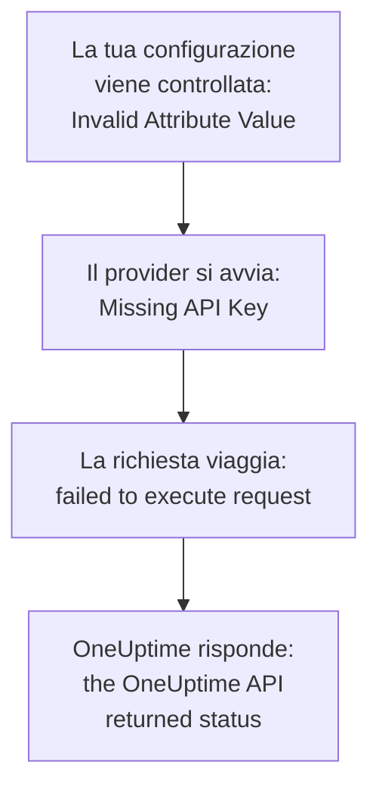

# Risoluzione dei problemi

Cerca nella tabella qui sotto il messaggio che Terraform ha stampato, o ciò che hai visto succedere: ogni riga porta alla sua soluzione. Le sezioni dopo la tabella spiegano ogni errore, raggruppate secondo la loro origine.

:::cards
- [Trovare il tuo errore](#trovare-il-tuo-errore): Ogni messaggio e sintomo di questa pagina, con la sua soluzione.
- [Chiavi API, autorizzazioni e piani](#chiavi-api-autorizzazioni-e-piani): Quando OneUptime rifiuta la chiave del provider.
- [Piani che non si stabilizzano](#piani-che-non-si-stabilizzano): Modifiche che ritornano, e risorse che lasciano lo stato.
- [Connettersi a un'istanza OneUptime self-hosted](#connettersi-a-unistanza-oneuptime-self-hosted): L'indirizzo, i certificati e i proxy.
:::

## Trovare il tuo errore

| Messaggio o sintomo | Cosa fare |
| --- | --- |
| `Missing API Key` | Dai al provider la sua chiave: vedi [`Missing API Key` o `Invalid API Key`](#missing-api-key-o-invalid-api-key) |
| `Invalid API Key` | Copia di nuovo la chiave, o creane una nuova: vedi [`Missing API Key` o `Invalid API Key`](#missing-api-key-o-invalid-api-key) |
| `ProjectId required` | Usa una chiave API del progetto, non una chiave master: vedi [`ProjectId required`](#projectid-required) |
| `You do not have permissions to create Monitor` | Dai alla chiave l'autorizzazione che il messaggio nomina: vedi [Alla chiave manca un'autorizzazione](#alla-chiave-manca-unautorizzazione) |
| `API keys need the Growth plan` | Riporta il progetto al piano Growth: vedi [Pagamento richiesto](#pagamento-richiesto) |
| `402` per una risorsa o un'impostazione | Passa a un piano superiore, o lascia l'impostazione al suo valore predefinito: vedi [Pagamento richiesto](#pagamento-richiesto) |
| `This project has been blocked` | Chiedi a un amministratore principale di sbloccare il progetto: vedi [Un progetto bloccato](#un-progetto-bloccato) |
| `references records that are not in this project` | Usa l'ID di un record del tuo stesso progetto: vedi [ID di un altro progetto](#id-di-un-altro-progetto) |
| `Not Found` o `Ambiguous Match` da una sorgente dati | Correggi gli argomenti della ricerca: vedi [Ricerche che non trovano nulla o ne trovano diversi](#ricerche-che-non-trovano-nulla-o-ne-trovano-diversi) |
| `Cannot import non-existent remote object` | Controlla l'ID e le autorizzazioni della chiave: vedi [Importare risorse](/docs/terraform/importing-resources#risoluzione-dei-problemi) |
| `Provider produced inconsistent result after apply` | Aggiorna il provider: vedi [Risultato incoerente dopo l'apply](#risultato-incoerente-dopo-lapply) |
| Un piano crea una risorsa che non hai aggiunto | La chiave non può più leggerla, e OneUptime ha risposto `404`: restituisci alla chiave l'accesso in lettura, poi importa la risorsa con `terraform import`: vedi [Una risorsa lascia lo stato, e l'apply successivo la crea di nuovo](#una-risorsa-lascia-lo-stato-e-lapply-successivo-la-crea-di-nuovo) |
| Una `priority` o un `order` cambia dopo l'apply | Dai a ciascuno un numero che nessun altro ha: vedi [Una priorità o un ordine che si sposta](#una-priorità-o-un-ordine-che-si-sposta) |
| `Invalid Configuration for Read-Only Attribute` | Togli l'attributo dalla configurazione: vedi [Attributi di sola lettura](#attributi-di-sola-lettura) |
| `has been renamed to` | Rinomina il tipo di risorsa, con un blocco `moved`: vedi [Un tipo di risorsa rinominato](#un-tipo-di-risorsa-rinominato) |
| Un monitor creato con Terraform non mostra mai i suoi controlli | Aggiorna OneUptime: vedi [Monitor creati prima degli ID dei passaggi](#monitor-creati-prima-degli-id-dei-passaggi) |
| `must contain at least 1 elements` | Ometti l'attributo invece di lasciarlo vuoto: vedi [Valori vuoti](#valori-vuoti) |
| JSON della dashboard in un file `.tf` | Scrivilo in HCL: vedi [Il JSON della dashboard](#il-json-della-dashboard) |
| `no available releases match the given constraints` | Usa un intervallo di versioni, non una sola versione esatta: vedi [Una versione mai pubblicata](#una-versione-mai-pubblicata) |
| `x509: certificate signed by unknown authority` | Dai fiducia alla tua autorità di certificazione: vedi [Certificati](#certificati) |
| `invalid character '<' looking for beginning of value` | Punta `oneuptime_url` alla tua istanza OneUptime stessa: vedi [Una pagina web al posto dell'API](#una-pagina-web-al-posto-dellapi) |
| `connection refused` o `Client.Timeout exceeded` | Controlla l'indirizzo, la rete e qualsiasi proxy: vedi [Connessioni che falliscono](#connessioni-che-falliscono) |

## Come leggere un errore

Un errore nomina il passaggio che è fallito, e il suo messaggio dice da dove viene:



- Un errore che arriva prima di qualsiasi richiesta, come `Invalid Attribute Value`, riguarda la tua configurazione: il provider la controlla prima di parlare con OneUptime.
- `failed to execute request` significa che la richiesta non ha mai ricevuto risposta: vedi [Connettersi a un'istanza OneUptime self-hosted](#connettersi-a-unistanza-oneuptime-self-hosted).
- `the OneUptime API returned status` è la risposta di OneUptime: lo stato e il messaggio che lo segue dicono cosa OneUptime ha rifiutato.

Il provider nomina ciò che stava facendo: `Unable to create monitor` e `Unable to update monitor` per una modifica, e `Unable to parse label response` quando legge una risorsa. Una lettura che OneUptime rifiuta viene segnalata con il riepilogo `Parse Error`, ma il messaggio che segue è la risposta di OneUptime, non un problema di analisi.

## Chiavi API, autorizzazioni e piani

### `Missing API Key` o `Invalid API Key`

`Missing API Key` ferma il provider prima che faccia qualsiasi richiesta: né `api_key` nel blocco del provider né la variabile d'ambiente `ONEUPTIME_API_KEY` sono impostate. Esporta la variabile nella shell in cui esegui Terraform, oppure passa la chiave in una variabile contrassegnata come `sensitive`.

`Invalid API Key` è la risposta di OneUptime a una chiave che non conosce: una chiave scritta male, scaduta o eliminata, oppure una di un'altra istanza OneUptime rispetto a quella a cui punta `oneuptime_url`. Copia di nuovo la chiave dalla sua pagina in **Impostazioni del progetto → Avanzato → Chiavi API**, oppure creane una nuova.

### `ProjectId required`

Il provider ha bisogno di una chiave API del progetto che gestisce: è da lì che viene il progetto. La chiave API master di un'istanza OneUptime self-hosted non appartiene a nessun progetto, quindi ogni creazione fatta con essa fallisce con `ProjectId required`. Crea una chiave API del progetto, come in [Creare una chiave API del progetto](/docs/terraform/quick-start#creare-una-chiave-api-del-progetto), e usa quella.

### Alla chiave manca un'autorizzazione

`You do not have permissions to create Monitor` e i messaggi simili arrivano con lo stato `422`: la chiave non può fare quell'operazione con quel tipo di record. Nominano le autorizzazioni che la permetterebbero. Apri la pagina della chiave in **Impostazioni del progetto → Avanzato → Chiavi API** e assegnale una di esse, oppure **Amministratore del progetto**. Un'importazione richiede solo l'autorizzazione di lettura.

### Pagamento richiesto

- **402 Payment Required a ogni richiesta** — `API keys need the Growth plan...`: su OneUptime Cloud, il progetto è sotto **Growth**, e le chiavi API di un progetto - compresa quella del provider - smettono di funzionare sotto quel piano. Ogni chiamata del provider viene rifiutata, anche `terraform plan`, finché il progetto non torna su Growth; allora la stessa chiave funziona di nuovo, senza nulla da cambiare nella tua configurazione. Passa a un piano superiore in **Impostazioni del progetto → Fatturazione e fatture → Fatturazione**, oppure gestisci il progetto nella dashboard nel frattempo. Vedi [Chiavi API e SCIM sotto il loro piano](/docs/api-reference/api-reference#chiavi-api-e-scim-sotto-il-loro-piano).
- **402 Payment Required** — hai raggiunto un limite del tuo piano OneUptime, oppure la configurazione attiva un'impostazione che il tuo piano non include (una pagina di stato privata, i report via email, una dashboard pubblica, una lista di IP consentiti...), sia che `terraform apply` crei la risorsa con essa sia che la modifichi in seguito. Terraform mostra il messaggio di OneUptime così com'è. Passa a un piano superiore, oppure riduci la configurazione.

Riportare un'impostazione di questo tipo al suo valore predefinito, cioè disattivare la funzione, funziona con ogni piano, quindi una configurazione che disattiva le funzioni a pagamento si applica dopo la fine di una prova o il passaggio a un piano inferiore.

Lo stesso vale per le risorse vendute dal tuo piano che un progetto conserva dopo essere sceso di piano - provider SSO, connessioni SCIM, chiavi API, pianificazioni di reperibilità, e regole e riepiloghi di Slack e Microsoft Teams: sotto il piano (finché il progetto resta su Growth, che serve alla chiave API stessa del provider), quelle che il progetto ha già si possono ancora leggere (quindi `terraform plan` e `import` funzionano), eliminare (quindi toglierle dalla configurazione, o `terraform destroy`, si applica), e disattivare dove hanno un attributo `is_enabled`. Crearle, modificarle o riattivarle risponde ancora 402.

Altre risorse vendute dal tuo piano, come i modelli, i campi personalizzati e i gruppi di monitor, richiedono ancora il piano per essere lette, quindi un piano che le aggiorna risponde 402; si possono comunque eliminare, per esempio con `terraform destroy -refresh=false`.

Le autorizzazioni di una chiave API non si eliminano una per una sotto Growth, perché eliminare un'autorizzazione di blocco darebbe alla chiave più accesso: esegui `terraform state rm` sulle risorse delle autorizzazioni, poi distruggi la chiave, e le sue autorizzazioni se ne vanno con lei.

### Un progetto bloccato

`This project has been blocked. Please contact your administrator.` arriva con lo stato `403`: un amministratore principale ha bloccato il progetto, e finché non lo sblocca, nessuno tranne un amministratore principale agisce al suo interno, nemmeno le chiavi API del progetto.

## Record e ricerche

### ID di un altro progetto

Ogni ID che una risorsa nomina - le etichette di un monitor, la pagina di stato di un gruppo di pagina di stato, il sito di un dispositivo di rete, i team di una regola di escalation - deve essere un record del progetto a cui appartiene la tua chiave API. L'ID di un record di un altro progetto, un ID che non esiste e l'ID di un record che la chiave non può leggere ricevono tutti la stessa risposta, che nomina il campo e l'ID:

```text
This network device references records that are not in this project: Network Site "…". Please pick values from this project and try again.
```

Di solito significa che un ID è stato copiato dalla configurazione o dallo stato di un altro progetto, oppure che il record è stato eliminato fuori da Terraform. Fai riferimento al record tramite la sua risorsa o una sorgente dati nella stessa configurazione (`oneuptime_label.critical.id`) invece di un ID letterale, e applica di nuovo. Una persona indicata come utente deve essere membro del progetto.

### Ricerche che non trovano nulla o ne trovano diversi

Una sorgente dati trova esattamente un record, oppure ferma il piano. `Not Found` dice che nessun record ha l'`id`, o che nessuno corrisponde agli argomenti che hai impostato; `Ambiguous Match` dice che ne corrispondono diversi. Correggi gli argomenti, impostane altri per restringere la ricerca a uno solo, oppure cerca il record per `id`. [Leggere ciò che esiste già](/docs/terraform/complete-guide#leggere-ciò-che-esiste-già) ne dà le regole.

## Piani che non si stabilizzano

### Risultato incoerente dopo l'apply

`Provider produced inconsistent result after apply` significa che il provider ha restituito valori diversi da quelli che aveva pianificato. I provider più vecchi lo facevano con valori che il server calcola: i valori predefiniti che il server aggiunge dentro `monitor_steps`, orari che il server scriveva in un altro modo, valori incapsulati come `probe_version`, e attributi che il server tiene aggiornati, come quando un monitor delle richieste in arrivo ha ricevuto il suo ultimo heartbeat. Leggevano anche un numero decimale come null quando l'API lo inviava come testo, quindi ogni apply di una regola di colore delle barre di una pagina di stato falliva su `uptime_percent_greater_than_or_equal_to`. I provider attuali gestiscono tutto questo: gli orari vengono confrontati come istanti, gli elenchi di etichette sono insiemi, i numeri vengono riletti come li hai scritti, e un attributo che non hai impostato mantiene il suo valore pianificato finché il prossimo aggiornamento non legge quello del server.

:::steps
1. Aggiorna il provider: mantieni `version = "{{TERRAFORM_PROVIDER_VERSION}}"` nel requisito del provider, ed esegui `terraform init -upgrade`.
2. Applica di nuovo. Una risorsa che l'apply fallito ha lasciato contrassegnata come tainted viene sostituita una volta, e dopo i piani sono vuoti. Per conservare invece la risorsa così com'è, togli prima il contrassegno tramite il suo indirizzo: `terraform untaint oneuptime_status_page_history_chart_bar_color.operational`.
:::

Se un provider attuale fallisce ancora in questo modo, segnalalo su [github.com/OneUptime/oneuptime/issues](https://github.com/OneUptime/oneuptime/issues), con la versione del provider, il tipo di risorsa, il più piccolo blocco `resource` che fallisce, e l'errore completo. L'errore nomina l'attributo il cui valore è cambiato, che è la cosa più utile da inviare.

### Una risorsa lascia lo stato, e l'apply successivo la crea di nuovo

Una lettura per ID risponde `404` sia per un record che non esiste sia per uno che la chiave API non può leggere: l'API non dice nulla di un record che non ti mostra. Terraform interpreta un `404` durante l'aggiornamento come una risorsa eliminata fuori da Terraform. La toglie dallo stato, e il `terraform apply` successivo la crea di nuovo, accanto a quella che c'è ancora.

Succede quando la chiave che gestisce una risorsa non può più leggerla: la sua autorizzazione di lettura è stata limitata a etichette che la risorsa non porta, o alle risorse di cui i suoi team sono proprietari, o un blocco le sottrae la risorsa - oppure sono cambiati le etichette o i proprietari della risorsa.

**Prima di pianificare:**

- Dai alla chiave, per ogni tipo di risorsa che gestisce, un'autorizzazione di lettura che raggiunga ogni risorsa che gestisce: con ambito **Tutti**, o limitata alle etichette che quelle risorse portano. Le autorizzazioni di modifica ed eliminazione di una chiave raggiungono solo ciò che può leggere.
- Leggi il piano prima di applicarlo: una risorsa pianificata per la creazione che non hai aggiunto è una risorsa che la chiave non può più leggere.

**Quando lo stato ha già perso una risorsa:** restituisci alla chiave il suo accesso in lettura, poi [importa](/docs/terraform/importing-resources) la risorsa invece di applicare, così Terraform adotta quella che esiste invece di crearne una seconda. Se una copia è già stata creata, elimina quella che non vuoi.

### Una priorità o un ordine che si sposta

Gli stati dei monitor, gli stati e le gravità di incidenti e avvisi, e gli altri elenchi che metti in ordine nella dashboard tengono ogni numero una sola volta. Un numero che nessun altro ha viene mantenuto come scritto. Un numero che un altro ha già viene preso, e quelli che si trovano in mezzo scendono di un posto, come fa un trascinamento nella dashboard. Così due di essi configurati con lo stesso numero si scambiano di posto a ogni apply.

Dai a ciascuno il proprio numero con degli spazi tra l'uno e l'altro, come `101`, `102` e `103`, e riordina quelli che Terraform gestisce in Terraform, non trascinandoli nella dashboard.

### Attributi di sola lettura

`Invalid Configuration for Read-Only Attribute` ferma il piano quando una configurazione imposta un attributo che solo OneUptime scrive. Chi ha creato un record, e chi lo ha archiviato, risolto o preso in carico, viene registrato dalla richiesta: la persona che ha effettuato l'accesso, e nessuno per una richiesta fatta con una chiave API, che è il modo in cui Terraform accede. Quindi `created_by_user_id`, e ogni altro attributo che termina con `_by_user_id`, si può leggere da una risorsa o da una sorgente dati, ma non impostare. Lo stesso vale per `archived_at`: impostare `is_archived` registra quando la risorsa è stata archiviata, e applicarlo di nuovo senza modifiche mantiene quell'orario. Togli l'attributo dal blocco della risorsa; nient'altro cambia nella risorsa.

### Un tipo di risorsa rinominato

`has been renamed to` avverte che un tipo di risorsa ha un nuovo nome. I tipi di risorsa ora mantengono interi parole come IoT e vCenter: `oneuptime_iot_fleet` e `oneuptime_vcenter`, dove i provider più vecchi le dividevano (`oneuptime_io_t_fleet`, `oneuptime_v_center`). I vecchi nomi continuano a funzionare come alias deprecati. Per passare al nuovo nome senza sostituire nulla, rinomina la risorsa nella tua configurazione e di' a Terraform che è stata spostata:

```hcl
resource "oneuptime_iot_fleet" "factory" {
  name = "Factory floor"
}

moved {
  from = oneuptime_io_t_fleet.factory
  to   = oneuptime_iot_fleet.factory
}
```

`terraform plan` mostra allora lo spostamento e nessun'altra modifica. Lo spostamento tra tipi di risorsa richiede Terraform 1.8 o successivo, oppure OpenTofu 1.12 o successivo; con una versione più vecchia, mantieni il vecchio nome, che continua a funzionare. Le sorgenti dati sono state rinominate allo stesso modo: cambia il nome, e nient'altro.

### Monitor creati prima degli ID dei passaggi

Gli ID dentro i passaggi di un monitor - di ogni passaggio, criterio, e modello di incidente e di avviso - li assegna il server. Le versioni più vecchie di OneUptime assegnavano ID solo ai criteri, e una nuova serie a ogni scrittura, quindi un monitor scritto tramite l'API, come lo era ogni monitor creato dal provider, veniva salvato con un passaggio senza ID. Le sue sonde lo controllavano ancora e il suo stato cambiava ancora, ma la pagina del monitor non trovava i suoi controlli, i suoi incidenti non potevano risolversi da soli, e ogni `terraform apply` che modificava `monitor_steps` staccava gli incidenti aperti dai loro criteri.

L'attuale OneUptime assegna a ciascuno di essi un ID alla creazione, li mantiene a ogni apply, e completa quelli mancanti dei monitor esistenti quando viene aggiornato. Nulla cambia nella tua configurazione: non ci sono ancora ID da scrivere. Un incidente che il vecchio comportamento ha lasciato aperto si chiude al prossimo ripristino del monitor, purché il criterio che lo ha aperto ci sia ancora; uno il cui criterio è stato sostituito da un apply precedente va risolto una volta a mano.

## Configurazione che il provider rifiuta

### Valori vuoti

Il provider rifiuta un elenco, una mappa o un testo vuoti in `monitor_steps` e nelle sue parti, come `monitor_steps = []`, `request_headers = {}` o `request_body = ""`:

```text
Attribute monitor_steps list must contain at least 1 elements, got: 0
```

Ometti invece l'attributo: un attributo che non c'è non è impostato. [Passaggi del monitor](/docs/terraform/monitor-steps) elenca cosa accetta ogni parte.

### Il JSON della dashboard

Il JSON che la dashboard e l'API mostrano per una risorsa è ciò che l'API invia, non una configurazione Terraform: in Terraform i nomi degli attributi sono in snake_case, i valori si scrivono in un altro modo, e molti campi appartengono al server. Incollato in un file `.tf`, non funziona.

- Per adottare la risorsa, [importala](/docs/terraform/importing-resources): la pagina **Terraform** della dashboard scrive la configurazione per te.
- Per scriverne una nuova, parti dagli [Esempi](/docs/terraform/examples).
- Per i passaggi di un monitor, scrivi l'attributo tipizzato `monitor_steps` che [Passaggi del monitor](/docs/terraform/monitor-steps) descrive: togli gli involucri `{_type, value}`, scrivi le chiavi camelCase in snake_case, e ometti ogni `id`.

## Versioni e registro

### Una versione mai pubblicata

`no available releases match the given constraints` significa che nessuna versione pubblicata soddisfa il vincolo di versione. Non tutte le release di OneUptime pubblicano un provider: una release il cui provider non è cambiato non ne pubblica nessuno, quindi un vincolo che nomina una sola versione esatta può nominare una versione che non esiste. Usa invece un intervallo:

```hcl
terraform {
  required_providers {
    oneuptime = {
      source  = "oneuptime/oneuptime"
      version = "{{TERRAFORM_PROVIDER_VERSION}}"
    }
  }
}
```

Su un'istanza OneUptime self-hosted, limita l'intervallo alla versione della tua istanza OneUptime, come mostra [Configurazione self-hosted](/docs/terraform/self-hosted#scegliere-la-versione-del-provider). [Utilizzo del registro](/docs/terraform/registry#come-sono-numerate-le-versioni) spiega come sono numerate le versioni.

## Connettersi a un'istanza OneUptime self-hosted

### Certificati

`x509: certificate signed by unknown authority` significa che la macchina che esegue Terraform non si fida del certificato che la tua istanza OneUptime presenta, di solito uno di un'autorità di certificazione privata. Il provider lo verifica con l'archivio attendibile di quella macchina. Aggiungi lì la tua autorità di certificazione, su ogni macchina e runner di CI che esegue Terraform: vedi [TLS e certificati](/docs/terraform/self-hosted#tls-e-certificati). Non esiste un'impostazione per saltare la verifica.

### Una pagina web al posto dell'API

`invalid character '<' looking for beginning of value` significa che ha risposto una pagina web dove il provider si aspettava l'API: `oneuptime_url` ha un percorso dopo l'host, come `/dashboard`, oppure ha risposto un proxy davanti a OneUptime. Imposta `oneuptime_url` con il solo indirizzo della tua istanza OneUptime, come `https://oneuptime.example.com`: il provider aggiunge `/api` da solo.

### Connessioni che falliscono

`failed to execute request` con `connection refused`, `no such host` o `Client.Timeout exceeded` significa che non è tornata nessuna risposta. Controlla che l'indirizzo e la porta siano giusti e raggiungibili da dove gira Terraform, e imposta `HTTPS_PROXY` se la macchina raggiunge internet tramite un proxy. Il provider attende fino a 60 secondi ogni risposta. Riprova una lettura o un'eliminazione fino a tre volte quando non arriva nessuna risposta, o la risposta è `429`, `502`, `503` o `504`, ma mai una creazione o una modifica: dopo che una creazione fallisce così, guarda nella dashboard prima di applicare di nuovo, nel caso sia stata fatta.

## Ottenere più dettagli

Il provider scrive i suoi avvisi nel log di Terraform. Esegui il comando con `TF_LOG_PROVIDER=WARN` per vederli, e con `TF_LOG_PATH` per conservarli in un file:

```bash
TF_LOG_PROVIDER=WARN TF_LOG_PATH=terraform.log terraform plan
```

`OneUptime rejected a column in the select; dropping it and retrying` nomina una colonna che OneUptime non ha voluto inviare alla chiave del provider, di solito per mancanza di un'autorizzazione. Quell'attributo resta vuoto nello stato, quindi può apparire come una modifica a ogni piano.

## Sei ancora bloccato?

Apri una issue su [github.com/OneUptime/oneuptime/issues](https://github.com/OneUptime/oneuptime/issues) con la versione del provider (`terraform version` la stampa dopo `init`), il blocco della risorsa e l'errore completo. Il provider è generato dal codice di OneUptime, quindi le sue issue sono tenute nel repository principale.

## Prossimi passi

:::cards
- [Importare risorse](/docs/terraform/importing-resources): Adottare ciò che hai creato nella dashboard, e correggere gli errori di importazione.
- [Configurazione self-hosted](/docs/terraform/self-hosted): L'indirizzo, la versione e i certificati della tua istanza OneUptime.
- [Guida completa](/docs/terraform/complete-guide): Autenticazione, sorgenti dati, stato e aggiornamenti.
- [Passaggi del monitor](/docs/terraform/monitor-steps): Ogni attributo dei controlli di un monitor.
:::
