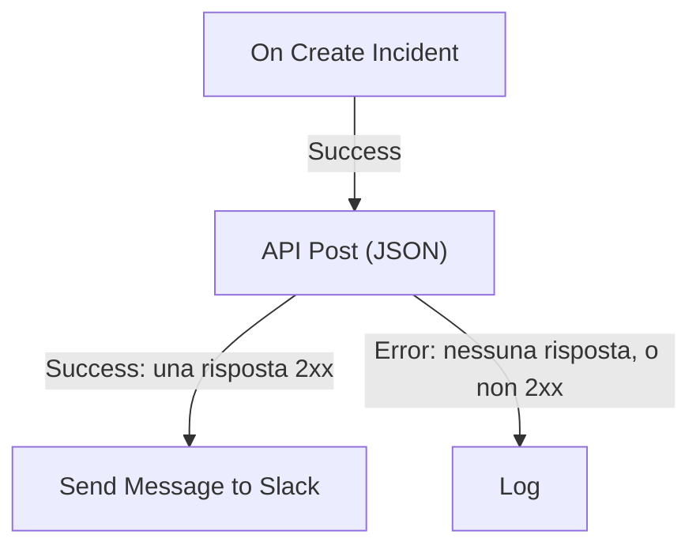

# Componenti del workflow

I componenti sono i blocchi che aggiungi dopo il trigger. Ognuno fa una sola cosa — invia un messaggio, chiama un'API, verifica una condizione, modifica un record di OneUptime — e poi prende una delle sue uscite verso i blocchi collegati. Questa pagina è il catalogo: di cosa ha bisogno ogni blocco, cosa restituisce e quando prende ciascuna uscita.

Raramente ti servirà tenerla aperta mentre costruisci. Le impostazioni di ogni blocco terminano con **How to use**: cosa fa il blocco, i passaggi per configurarlo, un esempio costruito dal tuo workflow e gli errori più comuni. Per aggiungere e collegare i blocchi, vedi [Creare un workflow](/docs/workflows/authoring).

:::cards
- [Inviare un messaggio](#slack): Slack, Microsoft Teams, Discord, Telegram, IRC, Mattermost ed email.
- [Chiamare un'API](#api): Invia una richiesta a qualsiasi API HTTP e leggi la risposta.
- [Aggiungere logica](#conditions): Dirama in base a un valore, trasforma i dati, attendi o registra.
- [Lavorare con i record di OneUptime](#componenti-dati-di-oneuptime): Trova, crea, aggiorna ed elimina monitor, incidenti e altro.
:::

## Quale componente usare?

| Per…                                                          | Usa                                                               |
| ------------------------------------------------------------- | ----------------------------------------------------------------- |
| Pubblicare in uno strumento di chat                           | [Slack](#slack), [Microsoft Teams](#microsoft-teams), [Discord](#discord), [Telegram](#telegram), [IRC](#irc) o [Mattermost](#mattermost) |
| Inviare un'email tramite il tuo server di posta               | [Email](#email)                                                   |
| Chiamare una persona, un team o chi è reperibile | [Paging](#paging) |
| Chiamare qualsiasi altra API o un tuo servizio                | [API](#api)                                                       |
| Riassumere, classificare o scrivere testo                     | [Generate Text with AI](#generate-text-with-ai)                   |
| Prendere un percorso o un altro in base a un valore           | [Conditions](#conditions)                                         |
| Prendere uno di più percorsi in base a un valore              | [Switch / Case](#switch-case)                                     |
| Proseguire solo quando poche righe di JavaScript lo dicono | [Check With JavaScript](#check-with-javascript) |
| Trasformare i dati tra due blocchi                            | [JSON](#json) o [Custom Code](#custom-code)                       |
| Attendere prima del blocco successivo                         | [Sleep](#sleep)                                                   |
| Avviare un altro workflow                                     | [Execute Workflow](#execute-workflow)                             |
| Leggere o modificare incidenti, monitor e altri record        | [Componenti dati di OneUptime](#componenti-dati-di-oneuptime)        |
| Aprire, prendere in carico e risolvere incidenti o avvisi per i problemi di un altro strumento | [Incidenti e avvisi da altri strumenti](#incidenti-e-avvisi-da-altri-strumenti) |
| Prendere in carico o chiudere un problema di Zabbix | [Zabbix](#zabbix) |

Un blocco dedicato è meglio di uno generico: il blocco Slack conosce i limiti di Slack, e un blocco record conosce i campi del record, così ottieni errori e registri più chiari che con un blocco **API** che fa lo stesso lavoro.

## Come funziona ogni blocco

Un blocco viene eseguito quando il blocco precedente prende l'uscita collegata a esso. Legge le sue impostazioni, fa il suo lavoro e poi prende una delle sue uscite. Vengono eseguiti solo i blocchi collegati a quell'uscita.



- Le **Impostazioni** sono ciò che compili. Le impostazioni contrassegnate con **(Facoltativo)** possono restare vuote. Le impostazioni meno usate sono raccolte sotto **Altri campi**.
- Gli **Outputs** sono i punti sul bordo inferiore. La maggior parte dei blocchi ha **Success** ed **Error**; [Conditions](#conditions) ha **Yes** e **No**, e [Switch / Case](#switch-case) ne ha una per ciascuno dei suoi casi, più **Default**.
- I **Returns** sono i valori che un blocco passa ai blocchi successivi, come il **Response Body** di un'API. Un blocco successivo ne legge uno con `{{local.components.<block ID>.returnValues.<value ID>}}`; il pulsante **{ }** di un'impostazione lo inserisce per te. Vedi [Variabili](/docs/workflows/variables#output-dei-componenti-i-dati-dei-blocchi-precedenti).

Un blocco che prende **Error** passa l'errore ai blocchi collegati a **Error**, e l'esecuzione prosegue lì. Se a **Error** non è collegato nulla, l'esecuzione fallisce: quello che stava facendo per il resto continua, poi termina con lo stato **Error**, e la voce del blocco nei **Passaggi** dell'esecuzione dice perché. Un'impostazione obbligatoria lasciata vuota, o un'impostazione che non può mai funzionare, ferma invece l'esecuzione con un errore.

## API

Fai una richiesta HTTP a qualsiasi URL. C'è un blocco per metodo: **API Get (JSON)**, **API Post (JSON)**, **API Put (JSON)**, **API Patch (JSON)** e **API Delete (JSON)**.

| Impostazione        | Cosa fa                                                                                                                              |
| ------------------- | ------------------------------------------------------------------------------------------------------------------------------------ |
| **URL**             | L'indirizzo da chiamare, `http` o `https`.                                                                                           |
| **Request Body**    | Il JSON da inviare. Di solito ne hanno bisogno solo le richieste `POST`, `PUT` e `PATCH`.                                            |
| **Request Headers** | Gli header da inviare, come una chiave API. Sotto **Altri campi**. I loro valori sono nascosti nel registro dell'esecuzione.         |

| Uscita      | Quando                                                                                         |
| ----------- | ---------------------------------------------------------------------------------------------- |
| **Success** | Il server ha risposto con uno stato 2xx.                                                       |
| **Error**   | La richiesta non è riuscita: il server non era raggiungibile, o ha risposto con un altro stato. |

In entrambi i casi il blocco restituisce **Response Status**, **Response Headers** e **Response Body**, più **Error** con il motivo quando non è riuscito. Leggi un campo di una risposta JSON aggiungendo il suo nome al riferimento, come in `{{local.components.api-get-1.returnValues.response-body.id}}`.

I reindirizzamenti non vengono seguiti, quindi punta il blocco all'indirizzo che risponde. Le richieste partono da OneUptime: un URL che si risolve in un indirizzo di rete privata viene rifiutato a meno che un amministratore self-hosted non lo consenta, e l'esecuzione si ferma con il motivo. Vedi [Accesso alla rete in uscita](/docs/workflows/configuration#accesso-alla-rete-in-uscita).

**API Get By ID (JSON)** legge un elemento tramite un ID arrivato da altrove, come la chiave del ticket inviata da un webhook. Metti `{id}` nel suo **URL** dove va l'ID, come in `https://your-domain.atlassian.net/rest/api/3/issue/{id}`, e l'ID in **ID**. Il blocco inserisce l'ID solo quando è un ID semplice, al massimo 200 lettere, cifre, trattini e trattini bassi, e lo codifica comunque in percentuale: qualsiasi altra cosa, come `x/../users`, prende **Error** prima che parta qualsiasi richiesta, così un testo arrivato da fuori non può indirizzare la richiesta altrove. Per il resto funziona come **API Get (JSON)** e restituisce gli stessi valori.

## AI

### Generate Text with AI

Genera una risposta testuale da un prompt e da un contesto JSON facoltativo. Il blocco usa il provider LLM predefinito del progetto, o il provider globale dell'installazione quando il progetto non ne ha uno. I provider si configurano in modo centralizzato in **Impostazioni del progetto → IA → Provider LLM**; le loro chiavi e i loro endpoint non sono mai impostazioni del blocco.

| Impostazione              | Cosa fa                                                                                                                                                           |
| ------------------------- | ----------------------------------------------------------------------------------------------------------------------------------------------------------------- |
| **System Instructions**   | Indicazioni facoltative sul ruolo, il tono e i vincoli del modello.                                                                                              |
| **Prompt**                | Il compito. Viene inviato esattamente come lo scrivi, quindi il Markdown va bene, e può includere variabili e valori dei blocchi precedenti.                    |
| **Context**               | JSON facoltativo che invii di proposito. Viene aggiunto dopo un marcatore esplicito di fine messaggio e trattato come dati non attendibili.                     |
| **Temperature**           | Sotto **Altri campi**. La variabilità, da `0` a `1`; il valore predefinito è `0.2`, per un'automazione prevedibile. I modelli Claude attuali, Opus 4.7 e successivi e tutti i modelli Claude 5, scelgono da soli il proprio campionamento: OneUptime omette **Temperature** dalle loro richieste, quindi su di loro non ha alcun effetto. |
| **Maximum Output Tokens** | Sotto **Altri campi**. Da `1` a `4096`; il valore predefinito è `1024`.                                                                                          |

System Instructions, Prompt e il Context serializzato sono limitati insieme a 50.000 caratteri. Un'immagine incorporata in base64, come lo screenshot di un monitor sintetico nella descrizione di un incidente, viene sostituita da una breve nota come `[image omitted: PNG, 340 KB]` prima della misurazione, perché il modello legge testo, non immagini. Il registro dell'esecuzione dice cosa è stato omesso. La richiesta al provider dura al massimo 60 secondi e viene tentata una sola volta. Per progetto possono girare contemporaneamente al massimo tre richieste di IA dei workflow.

Restituisce **Response** (il testo generato), **Provider** e **Model** (cosa ha risposto), **Total Tokens** e **Completion Tokens** (l'utilizzo riportato dal provider), **LLM Log ID** (la voce della chiamata nei registri IA) ed **Error**.

Collega **Success** ai blocchi che usano la risposta, ed **Error** a un'alternativa: gli errori di convalida, di accesso, del provider, di budget, di fatturazione e di timeout lo prendono tutti. Il blocco non invia strumenti, quindi il modello non può interrogare OneUptime, chiamare API o modificare dati da solo.

> [!WARNING]
> L'output del modello è testo non attendibile. Rivedilo prima che arrivi ai clienti, e non lasciare mai che un testo libero generato dall'IA decida da solo un'azione distruttiva. Vedi [Componenti AI](/docs/workflows/configuration#componenti-ai) per sapere cosa viene inviato al provider, cosa viene registrato e quanto costa.

## Slack

Pubblica un messaggio in un canale Slack tramite un webhook in entrata.

| Impostazione                   | Cosa fa                                                                                                                                                                                                      |
| ------------------------------ | ------------------------------------------------------------------------------------------------------------------------------------------------------------------------------------------------------------ |
| **Slack Incoming Webhook URL** | Il webhook del canale in cui pubblicare. Deve iniziare con `https://hooks.slack.com/services/`. La guida di Slack per [crearne uno](https://api.slack.com/messaging/webhooks) richiede un paio di minuti.     |
| **Message Text**               | Il testo da inviare. Viene inviato esattamente come lo scrivi, quindi usa la formattazione di Slack: `*bold*`, `_italic_`, `~strikethrough~` e `<https://example.com|a link>`. Un testo più lungo di una sezione Slack (3.000 caratteri) parte in più sezioni; oltre dieci sezioni viene tagliato e termina con "… (truncated — see OneUptime for the full text)". |

**Success** scatta quando Slack ha accettato il messaggio ed **Error** quando l'ha rifiutato, con il motivo di Slack in **Error**. Questi blocchi pubblicano tramite il webhook delle loro impostazioni, non tramite la connessione Slack del tuo progetto.

## Microsoft Teams

Pubblica un messaggio in un canale di Microsoft Teams. Il blocco si chiama **Send Message to Teams**.

| Impostazione                   | Cosa fa                                                                                                                                                                                                                                       |
| ------------------------------ | --------------------------------------------------------------------------------------------------------------------------------------------------------------------------------------------------------------------------------------------- |
| **Teams Incoming Webhook URL** | Il webhook del canale in cui pubblicare, un URL `https` su `office.com`, `office365.com`, `logic.azure.com` o `environment.api.powerplatform.com`. La guida di Microsoft mostra come [crearne uno con i Workflows di Teams](https://support.microsoft.com/en-us/teams/apps-service/create-incoming-webhooks-with-workflows-for-microsoft-teams). |
| **Message Text**               | Il testo da inviare. Un messaggio più grande di quanto accetta un webhook in entrata (circa 12.000 caratteri, misurati come vengono inviati) viene tagliato e termina con "… (truncated — see OneUptime for the full text)".                     |

## Discord

Pubblica un messaggio in un canale Discord tramite un webhook in entrata.

| Impostazione                     | Cosa fa                                                                                                                                            |
| -------------------------------- | -------------------------------------------------------------------------------------------------------------------------------------------------- |
| **Discord Incoming Webhook URL** | Il webhook del canale, un URL `https` su `discord.com` o `discordapp.com`.                                                                         |
| **Message Text**                 | Il testo da inviare. Un messaggio di oltre 2.000 caratteri, il limite di Discord, viene tagliato e termina con "… (truncated — see OneUptime for the full text)". |

## Telegram

Invia un messaggio a una chat di Telegram con un bot.

| Impostazione           | Cosa fa                                                                                                                                            |
| ---------------------- | -------------------------------------------------------------------------------------------------------------------------------------------------- |
| **Telegram Bot Token** | Il token che BotFather ha dato al tuo bot, come `123456789:ABCdef…`. Un token di qualsiasi altra forma ferma l'esecuzione, senza che il token venga scritto nel registro. |
| **Chat ID**            | La chat in cui pubblicare: il suo ID, o lo `@username` di un canale. Aggiungi prima il bot al gruppo o al canale. Per scrivere a una persona, questa deve aver avviato una chat con il bot. |
| **Message Text**       | Il testo da inviare. Un messaggio di oltre 4.096 caratteri, il limite di Telegram, viene tagliato e termina con "… (truncated — see OneUptime for the full text)". |

Quando Telegram rifiuta il messaggio, **Error** scatta con il motivo di Telegram.

## IRC

Pubblica un messaggio in un canale IRC su qualsiasi rete IRC: Libera.Chat, OFTC o un tuo server. IRC non ha webhook, quindi il blocco si collega da solo al server, entra nel canale, invia il messaggio ed esce.

| Impostazione     | Cosa fa                                                                                                                                                                                                                                            |
| ---------------- | -------------------------------------------------------------------------------------------------------------------------------------------------------------------------------------------------------------------------------------------------- |
| **IRC Server**   | Il nome host del server, come `irc.libera.chat`. Solo il nome: niente `ircs://` e niente porta.                                                                                                                                                    |
| **Channel**      | Il canale in cui pubblicare, come `#ops`. Deve essere un canale: un nickname scritto qui viene rifiutato invece di ricevere un messaggio privato.                                                                                                  |
| **Message Text** | Il testo da inviare. Ogni riga parte come un messaggio IRC a sé, e una riga lunga viene divisa per starci. Un messaggio viene inviato al massimo come 15 righe IRC: uno più lungo viene accorciato, e la sua ultima riga lo dice. IRC non ha Markdown, quindi il testo viene inviato così com'è; i codici di formattazione di IRC, come il grassetto e i colori, funzionano. |

Sotto **Altri campi**:

| Impostazione                             | Cosa fa                                                                                                                                                                                                            |
| ---------------------------------------- | ------------------------------------------------------------------------------------------------------------------------------------------------------------------------------------------------------------------ |
| **Nickname**                             | Chi invia il messaggio. Predefinito `OneUptime`. Se il nickname è occupato, il blocco lo prova con un trattino basso o un numero aggiunto, e poi con uno al posto dei suoi ultimi caratteri, per un server che non accetta nickname più lunghi. |
| **Port**                                 | La porta del server. Predefinita `6697`, o `6667` con **Disable TLS** attivo.                                                                                                                                      |
| **Disable TLS**                          | Il blocco si collega via TLS e verifica il certificato del server. Attivalo solo per un server che non offre TLS; qualsiasi password viene allora inviata in chiaro. Per fidarsi di un certificato della tua autorità di certificazione, un'installazione self-hosted imposta invece `NODE_EXTRA_CA_CERTS`. |
| **Channel Key**                          | La chiave di un canale che ne ha una (modalità `+k`).                                                                                                                                                              |
| **Send Without Joining**                 | Pubblica senza entrare nel canale, così il canale non vede il blocco entrare e uscire. Funziona solo dove il canale accetta messaggi dall'esterno (niente modalità `+n`).                                           |
| **Server Password**                      | Una password che il server o il tuo bouncer chiedono al collegamento.                                                                                                                                             |
| **SASL Username** e **SASL Password**    | Accedi al tuo account sulle reti che usano SASL, come Libera.Chat, che lo richiede per le connessioni da alcuni indirizzi cloud e VPN. Compila entrambi o nessuno.                                                 |

**Success** scatta quando il server ha accettato ogni riga. Il blocco lo verifica chiedendo al server di rispondere a un ping dopo l'ultima riga: un server risponde in ordine, quindi qualsiasi rifiuto del messaggio arriva prima. Un bouncer come ZNC risponde da solo al ping, quindi il blocco ascolta un secondo in più per la risposta della rete che sta dietro.

**Error** scatta quando il server non è raggiungibile, rifiuta la connessione, il nickname, una password o il canale, o rifiuta il messaggio. Riporta il motivo, con le parole del server quando le ha fornite. Un **IRC Server**, un **Channel** o un **Message Text** mancante, o un'impostazione che non potrebbe mai funzionare, ferma invece l'esecuzione.

Ogni esecuzione del blocco è una connessione a sé, e le reti IRC limitano la frequenza con cui uno stesso indirizzo può collegarsi: una raffica di messaggi può essere rifiutata con un motivo come "Reconnecting too fast", e prende **Error** come qualsiasi altro rifiuto. Per un workflow che può scattare molte volte al minuto, raccogli ciò che deve dire in un unico messaggio, o invialo tramite un tuo server.

Tieni le password in [variabili globali segrete](/docs/workflows/variables#variabili-globali) e usa la variabile nell'impostazione; sono comunque nascoste nei registri delle esecuzioni. Le connessioni agli indirizzi di loopback (`localhost`, `127.0.0.1`), link-local e di metadati cloud vengono rifiutate. Su OneUptime Cloud, anche un server su un indirizzo di rete privata, o un nome che si risolve in uno, viene rifiutato. Le installazioni self-hosted possono raggiungere un server IRC sulla propria rete, a meno che `DATA_SOURCE_BLOCK_PRIVATE_ADDRESSES` non sia impostato su `true`.

## Mattermost

Pubblica un messaggio in un canale Mattermost tramite un webhook in entrata, su Mattermost Cloud o su un tuo server.

| Impostazione                        | Cosa fa                                                                                                                                                                                                                                                                            |
| ----------------------------------- | ---------------------------------------------------------------------------------------------------------------------------------------------------------------------------------------------------------------------------------------------------------------------------------- |
| **Mattermost Incoming Webhook URL** | Il webhook tramite cui pubblicare, come lo mostra Mattermost sotto Integrations, Incoming Webhooks: l'indirizzo del server, poi `/hooks/` e l'ID del webhook. La guida di Mattermost mostra come [crearne uno](https://docs.mattermost.com/developers/integrate/webhooks/incoming). |
| **Message Text**                    | Il testo da inviare. Viene inviato esattamente come lo scrivi, e Mattermost interpreta il Markdown: `**bold**`, `_italic_`, link, tabelle ed emoji come `:rotating_light:`. Un post di Mattermost può contenere 16.383 caratteri: un messaggio più lungo viene tagliato per starci e termina con "… (truncated — see OneUptime for the full text)". |

Sotto **Altri campi**:

| Impostazione | Cosa fa                                                                                                                                                                                                       |
| ------------ | ------------------------------------------------------------------------------------------------------------------------------------------------------------------------------------------------------------- |
| **Channel**  | Pubblica altrove rispetto al canale del webhook stesso: il nome del canale come compare nel suo URL, come `town-square`, oppure `@` seguito da un nome utente per un messaggio diretto. Un webhook bloccato sul proprio canale rifiuta qualsiasi altro canale. |
| **Username** | Il nome con cui pubblicare. Mattermost lo usa solo dove un amministratore di sistema consente alle integrazioni di sovrascrivere i nomi utente.                                                               |
| **Icon URL** | L'immagine con cui pubblicare, un indirizzo `https`. Mattermost la usa solo dove un amministratore di sistema consente alle integrazioni di sovrascrivere le icone dell'immagine del profilo.                 |

**Success** scatta quando Mattermost ha accettato il messaggio. **Error** scatta quando il server non è raggiungibile o Mattermost rifiuta il messaggio, e riporta il motivo di Mattermost. Un **Mattermost Incoming Webhook URL** o un **Message Text** mancante, un URL che non è quello di un webhook in entrata, o un'impostazione che non potrebbe mai funzionare, ferma invece l'esecuzione.

Tieni l'URL del webhook in una [variabile globale segreta](/docs/workflows/variables#variabili-globali): chiunque lo abbia può pubblicare nel canale. È comunque nascosto nei registri delle esecuzioni. Il messaggio parte da OneUptime e i reindirizzamenti non vengono seguiti. Un webhook su un indirizzo di loopback (`localhost`, `127.0.0.1`), link-local o di metadati cloud viene rifiutato, e lo stesso vale per uno su un indirizzo di rete privata, a meno che un amministratore self-hosted non lo consenta con `ALLOW_PRIVATE_NETWORK_WEBHOOKS` o `PRIVATE_NETWORK_WEBHOOK_ALLOWLIST`. Vedi [Accesso alla rete privata](/docs/self-hosted/private-network-access).

## Email

Invia un'email tramite un server SMTP che indichi sul blocco. Il blocco si chiama **Send Email**.

| Impostazione                            | Cosa fa                                                                                               |
| --------------------------------------- | ----------------------------------------------------------------------------------------------------- |
| **From Email**                          | Il mittente, ad esempio `Alerts <alerts@company.com>`.                                                |
| **To Email**                            | L'indirizzo del destinatario. Separa più indirizzi con virgole o punti e virgola.                     |
| **Subject**                             | L'oggetto.                                                                                            |
| **Email Body**                          | Il messaggio, inviato come HTML.                                                                      |
| **SMTP HOST** e **SMTP Port**           | Il server di posta a cui collegarsi.                                                                  |
| **SMTP Username** e **SMTP Password**   | Facoltativi. Compila entrambi o nessuno.                                                              |
| **Use Implicit TLS**                    | Attivalo per il TLS implicito, di solito sulla porta 465. Lascialo spento per STARTTLS, di solito sulla porta 587. |

**Success** scatta quando il server SMTP ha accettato il messaggio. **Error** scatta quando l'host SMTP viene rifiutato, il server non è raggiungibile o rifiuta il messaggio, e riporta il messaggio di errore. Un **To Email**, un **From Email**, uno **SMTP HOST** o uno **SMTP Port** mancante ferma invece l'esecuzione.

Il blocco si collega direttamente al server indicato nelle sue impostazioni. Non usa le impostazioni [SMTP](/docs/emails/smtp) del tuo progetto né il server di posta di OneUptime, e le email che invia non compaiono nei registri delle notifiche. Per controllare cosa ha fatto, guarda le [Esecuzioni](/docs/workflows/runs-and-logs) del workflow.

Le connessioni agli indirizzi di loopback (`localhost`, `127.0.0.1`), link-local e di metadati cloud vengono rifiutate. Su OneUptime Cloud, anche un host SMTP su un indirizzo di rete privata, o un nome che si risolve in uno, viene rifiutato. Le installazioni self-hosted possono raggiungere un server di posta sulla propria rete, a meno che `DATA_SOURCE_BLOCK_PRIVATE_ADDRESSES` non sia impostato su `true`. Un host rifiutato prende l'uscita **Error**, e non viene inviato nulla.

## Paging

Chiama delle persone da un workflow: ognuna riceve una telefonata, un SMS, una notifica push o un'email, come dicono le sue regole di reperibilità, finché qualcuno conferma. C'è un blocco per ogni modo di dire chi chiamare. Nel pannello **Aggiungi componente**, cerca `page`.

| Blocco                      | Chi chiama |
| --------------------------- | ---------- |
| **Page Users**              | Le persone che indichi. |
| **Page a Team**             | Ogni membro di un team. |
| **Page Whoever Is On Call** | Chi è reperibile in una pianificazione di reperibilità quando il blocco viene eseguito. |
| **Page an On-Call Policy**  | Una policy di reperibilità, che chiama seguendo le sue regole di escalation e si ripete come è impostata. |

I primi tre chiamano insieme tutte le persone che indicano, e nessun altro dopo. Per un'escalation, usa **Page an On-Call Policy**.

Per chiamare solo quando qualcosa è vero, metti [If / Else](#conditions) davanti al blocco e collegagli l'uscita che deve chiamare. Con più di due percorsi, [Switch / Case](#switch-case) prende un percorso per ogni valore, e ogni percorso può chiamare qualcun altro.

```mermaid title="Chiamare chi è reperibile, ma solo per gli incidenti critici"
flowchart TB
    trigger["On Create Incident"] -->|"Success"| check["If / Else"]
    check -->|"Yes"| page["Page Whoever Is On Call"]
```

Quando crei un workflow, i modelli sotto **Reperibilità** hanno questo già pronto, e uno che chiama in base alla gravità con **Switch / Case**. La finestra **Crea un flusso di lavoro** chiede chi chiama ciascun blocco di chiamata di un modello, così il workflow si apre con queste scelte già fatte. Un blocco di chiamata che aggiungi nel Costruttore dice **Click to set up** finché non scegli chi chiama.

| Impostazione | Cosa fa |
| ------------ | ------- |
| **Users**, **Teams**, **On-Call Schedules** o **On-Call Policies** | Chi chiamare: ogni blocco ha quella che va con il suo nome. Scegli per nome, oppure premi **{ }** alla fine della riga per aggiungere un valore da un blocco precedente. Un valore può contenere un ID o più di uno e, per **Users**, un indirizzo email. |
| **Page About** | Di cosa tratta la chiamata: **A new alert**, **An incident** o **An alert**. Confermare la chiamata conferma anche quello. |
| **Title** e **Message** | Per un nuovo avviso. OneUptime ne crea un avviso, che resta tra i tuoi avvisi come qualsiasi altro. |
| **Incident ID** o **Alert ID** | Per un incidente o un avviso che esiste già, di solito quello da cui è partito il workflow: `{{local.components.incident-on-create-1.returnValues.model._id}}`. |
| **Severity** | Per un nuovo avviso, sotto **Altri campi**. Decide quali regole di reperibilità di ciascuna persona la chiamano. Lasciata vuota, è la più grave del progetto. |

Un blocco aggiunto a un workflow che parte da un incidente o da un avviso è già impostato per chiamare riguardo a quel record, quindi chiede soltanto chi chiamare.

**Success** viene eseguito appena almeno una persona è stata chiamata, o una policy è partita. **Error** viene eseguito quando non è stato chiamato nessuno, e il valore **Error** del blocco dice perché, ad esempio che nella pianificazione nessuno è reperibile. **Summary** dice in una frase chi è stato chiamato e chi è stato escluso, pronta da pubblicare in un canale, e **Paged Users** elenca le persone chiamate.

Chi è assente non viene chiamato: al suo posto viene chiamato chi la sua sostituzione utente indica per sostituirlo. Una chiamata indica al massimo 100 persone, team e pianificazioni. Vedi [Come viene raggiunta ogni persona](/docs/on-call/escalation-rules#come-viene-raggiunta-ogni-persona).

Una chiamata senza una policy di reperibilità alle spalle è elencata con le esecuzioni delle policy come **Chiamata diretta**: nei log di reperibilità dell'incidente o dell'avviso, nel suo feed e nel suo canale Slack o Microsoft Teams, e nei log di ogni persona chiamata. Resta aperta per 30 minuti, e poi finché partono ancora chiamate. Se per allora nessuno ha confermato, finisce senza chiamare nessun altro.

> [!WARNING]
> **Esegui flusso di lavoro** chiama delle persone per davvero, che il workflow sia attivo o no, e così fa **Run just this step**. Indica te stesso mentre fai le prove.

## Custom Code

Esegui qualche riga di JavaScript quando gli altri blocchi non possono fare ciò che ti serve. Il blocco si chiama **Run Custom JavaScript**.

| Impostazione        | Cosa fa                                                                                                                              |
| ------------------- | ------------------------------------------------------------------------------------------------------------------------------------ |
| **JavaScript Code** | Il tuo codice. Ciò che restituisce con `return` diventa il **Value** del blocco. Può usare `await`.                                 |
| **Arguments**       | Un oggetto JSON di valori da passare al codice, che li legge come `args`. Mettici le variabili e i valori dei blocchi precedenti; il codice da solo non può leggerli. |

```json title="Arguments"
{ "title": "{{local.components.incident-on-create-1.returnValues.model.title}}" }
```

```javascript title="JavaScript Code"
const words = args.title.split(" ");

return {
  shortTitle: words.slice(0, 5).join(" "),
  wordCount: words.length,
};
```

Un blocco successivo legge il titolo breve come `{{local.components.javascript-1.returnValues.returnValue.shortTitle}}`.

Il codice viene eseguito in una sandbox con `args`, `console.log` (scritto nel registro dell'esecuzione), `axios` per le richieste HTTP, `crypto` e `sleep`. Non ha file system né processo, e le sue richieste seguono le stesse regole sugli indirizzi del blocco API. Ha 5 secondi per impostazione predefinita; un'installazione self-hosted lo cambia con `WORKFLOW_SCRIPT_TIMEOUT_IN_MS`.

**Success** scatta con il **Value** restituito, ed **Error** quando il codice lancia un'eccezione o esaurisce il tempo, con il messaggio in **Error**. Per script più pesanti, usa invece un [Runbook](/docs/runbooks/index).

## Check With JavaScript

Esegui qualche riga di JavaScript, poi prendi **Yes** o **No** in base a ciò che restituisce: un blocco [Custom Code](#custom-code) e un [If / Else](#conditions) dopo di esso, in un unico blocco. Usalo quando un solo confronto non basta per decidere, per esempio per leggere ciò che ha inviato un altro strumento e saltare ciò che il workflow deve lasciar stare.

| Impostazione        | Cosa fa |
| ------------------- | ------- |
| **JavaScript Code** | Il tuo codice. `return true` prende **Yes**. Per passare anche dei valori, restituisci un oggetto con `proceed: true`, i valori e una `reason`. |
| **Arguments**       | Un oggetto JSON di valori da passare al codice, che li legge come `args`, come in **Run Custom JavaScript**. |

```javascript title="JavaScript Code"
if (args.environment !== "production") {
  return { proceed: false, reason: "Not production, so nothing was sent." };
}

return { proceed: true, title: args.title.toUpperCase() };
```

Solo `true`, o un oggetto il cui `proceed` è `true`, prende **Yes**: qualsiasi altra cosa prende **No**, anche un numero o un testo. Il blocco restituisce **Value**, ciò che il codice ha restituito, che un blocco successivo legge come `{{local.components.javascript-check-1.returnValues.returnValue.title}}`, e **Reason**, la `reason` del codice o ciò che ha restituito, in una frase, che la scheda **Passaggi** dell'esecuzione mostra accanto all'uscita presa.

Il codice viene eseguito come lo esegue **Run Custom JavaScript**: nella stessa sandbox, con gli stessi `args`, `console.log` e `axios`, e con lo stesso limite di tempo. Quando lancia un'eccezione o esaurisce il tempo, il blocco prende **Error**.

## JSON

Converti tra testo e JSON, o combina due oggetti JSON.

| Blocco           | Riceve                                   | Restituisce                                                                                                |
| ---------------- | ---------------------------------------- | ---------------------------------------------------------------------------------------------------------- |
| **JSON to Text** | **JSON**, un oggetto                     | **Text**: l'oggetto come stringa. Utile quando il blocco successivo si aspetta testo.                      |
| **Text to JSON** | **Text**, che può occupare più righe     | **JSON**: l'oggetto analizzato, così puoi leggerne i campi. Usalo sul JSON arrivato come testo.            |
| **Merge JSON**   | **JSON 1** e **JSON 2**                  | **JSON**: un oggetto con le chiavi di entrambi. Quando entrambi hanno una chiave, vince **JSON 2**.        |

**Text to JSON** prende **Error** quando il testo non è JSON. Un input mancante, o un input di **Merge JSON** che non è un oggetto, ferma l'esecuzione.

## Conditions

Dirama in base a un confronto. Nel pannello **Aggiungi componente** questo blocco si chiama **If / Else**, sotto **Popolari**. Per scegliere tra più di due percorsi, usa [Switch / Case](#switch-case).

Le sue impostazioni si leggono come una frase: **Se** *valore da verificare* *confronto* *valore di confronto*, continua su **Yes**, altrimenti su **No**. Sotto le impostazioni, la condizione viene riletta a parole, così puoi vedere che dice ciò che intendi. Sulla tela il blocco mostra anche la sua condizione, ad esempio *Se environment is equal to “production”*.

| Impostazione       | Cosa fa                                                                                                                                  |
| ------------------ | ---------------------------------------------------------------------------------------------------------------------------------------- |
| **Valore da verificare** | Di solito un valore di un blocco precedente. Premi **{ }** nella casella per sceglierne uno, oppure scrivi `{{`.                          |
| **Confronto**     | Come confrontare, a parole. I confronti sono elencati qui sotto.                                                                         |
| **Confronta con**   | Con cosa confrontare, scritto o scelto allo stesso modo. **è vuoto**, **non è vuoto**, **è vero** e **è falso** non lo usano.          |
| **Confronta come**     | Raccolto sotto il confronto: **Text**, **Numero** o **Vero / Falso**. Scegli **Text** per ordinare date scritte `2026-10-01`, oppure **Numero** per rendere uguali `200` e `200.0`. |

I confronti:

- **è uguale a** e **è diverso da**;
- per il testo: **contiene**, **non contiene**, **inizia con** e **termina con**;
- per i numeri: **è maggiore di**, **è maggiore o uguale a**, **è minore di** e **è minore o uguale a**;
- **è vuoto** e **non è vuoto**, che verificano se il valore c'è;
- **è vero** e **è falso**.

I confronti numerici confrontano numeri e quelli testuali confrontano testo, quindi raramente ti serve **Confronta come**. Come vengono confrontati i valori:

- Come testo, le maiuscole contano: `Error` non è `error`.
- Come numeri, un testo che non è un numero vale `0`. Le impostazioni segnalano un valore scritto così.
- Come vero o falso, solo `true` conta come vero.
- **è vuoto** è soddisfatto dall'assenza di un valore, da un testo vuoto, da una lista o un oggetto vuoti, o da un valore che il blocco precedente non aveva, come un campo che il webhook non ha inviato. `0` e `false` sono valori, quindi non sono vuoti.

**Yes** viene eseguito quando la condizione è soddisfatta e **No** quando non lo è. I blocchi configurati prima che le impostazioni avessero questi nomi funzionano esattamente come prima. Una vecchia scelta non è più offerta: confrontare un valore come **Nullo** o **Non definito**, che ignorava ciò che il valore conteneva. Un blocco che la usa ancora lo dice quando lo apri; scegli **è vuoto** per verificare un valore mancante.

## Switch / Case

Prendi uno di più percorsi in base a un valore. Nel pannello **Aggiungi componente** questo blocco si chiama **Switch / Case**, sotto **Popolari**.

Confronta un valore con ciascuno dei suoi casi a turno, dall'alto, e prosegue dal primo caso che corrisponde, oppure da **Default** se nessuno corrisponde. Viene eseguito un solo percorso: un valore che corrisponde a due casi prende il primo dei due.

| Impostazione       | Cosa fa |
| ------------------ | ------- |
| **Valore da verificare** | Il valore con cui viene confrontato ogni caso, di solito da un blocco precedente. Premi **{ }** nella casella per sceglierne uno, oppure scrivi `{{`. |
| **Cases**          | Un confronto e un valore per ogni percorso, controllati dall'alto. Premi **Aggiungi caso** per aggiungerne un altro, e trascina un caso dalla sua maniglia per spostarlo. Un blocco contiene al massimo 25 casi. |

Ogni caso è un'uscita sulla tela, con il nome del suo valore: un caso che chiede **è uguale a** `production` è l'uscita *production*, e uno che chiede **è maggiore di** `500` è *is greater than 500*. **Default** è sempre l'ultima uscita. Collega ogni uscita a ciò che deve essere eseguito dopo.

Un caso corrisponde esattamente quando un [If / Else](#conditions) con lo stesso confronto e lo stesso valore prenderebbe **Yes**: i confronti sono gli stessi, e i valori vengono confrontati allo stesso modo. **Confronta come** è raccolto sotto i casi, con una scelta per ogni caso.

Quando rimuovi un caso che ha un collegamento, le impostazioni dicono a quali blocchi portava, e **Ripristina** riporta il caso. Il salvataggio rimuove il collegamento insieme al caso. I controlli del Costruttore segnalano un caso a cui non è collegato nulla, e un caso che non viene mai scelto perché uno sopra di esso chiede la stessa cosa.

Un'esecuzione che prende un'uscita a cui non è collegato nulla, **Default** compreso, finisce lì senza errori. La scheda **Passaggi** dell'esecuzione dice quale caso ha corrisposto e perché, ad esempio *Case 2 matched: the value is equal to “staging”. Case 1 did not.*

## Sleep

Metti in pausa l'esecuzione prima del blocco successivo, per dare a un altro sistema il tempo di mettersi in pari o per fare un controllo più tardi.

**Days**, **Hours**, **Minutes** e **Seconds** si sommano. L'attesa più lunga è di 30 giorni: una più lunga viene ridotta a 30 giorni, e il registro dell'esecuzione lo dice.

Durante l'attesa, l'esecuzione viene messa da parte con lo stato **In attesa** e ripresa quando il tempo è scaduto, quindi un'attesa lunga non blocca nulla. Un'esecuzione il cui workflow è stato disattivato o archiviato nel frattempo viene annullata al risveglio. Un'esecuzione di prova, avviata mentre il workflow era disattivato, non viene annullata perché lo è.

## Log

Scrivi un valore nel registro dell'esecuzione. Non cambia nient'altro, il che lo rende il modo più semplice per vedere cosa conteneva un valore.

**Value** è ciò che va scritto. Può occupare più righe e includere valori dei blocchi precedenti, come `{{local.components.webhook-1.returnValues.request-body}}`. Il blocco prende **Out** quando ha finito.

## Execute Workflow

Avvia un altro workflow dello stesso progetto. Il tuo workflow prosegue senza aspettare che l'altro finisca.

| Impostazione  | Cosa fa                                                                                                                                   |
| ------------- | ----------------------------------------------------------------------------------------------------------------------------------------- |
| **Workflow**  | Il workflow da avviare. Deve essere abilitato e, per ricevere argomenti, avere un trigger **Manual**.                                     |
| **Arguments** | Il JSON da passare. Il trigger Manual dell'altro workflow passa ogni chiave come un valore a sé: con `{"customerId": "42"}`, legge `{{local.components.manual-1.returnValues.customerId}}`. |

**Out** scatta non appena l'altro workflow è in coda. **Error** scatta quando non può esserlo: non viene trovato, è disattivato o archiviato, o avviarlo creerebbe un ciclo.

Usalo per condividere logica comune: costruisci una volta un workflow «pubblica nel canale dell'incidente» e avvialo da ogni workflow che ne ha bisogno. Una catena di workflow che si avviano a vicenda non può tornare su sé stessa ed è profonda al massimo 10 livelli. Vedi [Configurazione e sicurezza](/docs/workflows/configuration#limite-alle-chiamate-tra-workflow).

## Incidenti e avvisi da altri strumenti

Tieni un incidente, o un avviso, per ogni problema che un altro strumento ti segnala, abbinato tramite l'ID che quello strumento gli dà. **Incident From Another Tool** e **Alert From Another Tool** sono la base dei modelli per Zabbix, Huntress, Jira e Dynamics 365, e funzionano con qualsiasi strumento che possa chiamare il [trigger Webhook](/docs/workflows/triggers#webhook) di un workflow. Nel pannello **Aggiungi componente** si trovano sotto **From Other Tools**.

Ogni esecuzione passa al blocco un evento: **What Happened**, e **Outside ID**, l'ID del problema nello strumento. Il blocco cerca il record che conserva quell'ID e fa ciò che dice **What Happened**:

| What Happened | Cosa fa il blocco |
| ------------- | ----------------- |
| `open`, `problem`, `firing`, `triggered` o `created` | Apre un incidente, o crea un avviso, da **Title**, **Description** e **Severity**, a meno che un record conservi già l'ID. |
| `acknowledge` o `acknowledged` | Porta il record al tuo primo stato di presa in carico, con **Note** come motivo nella sua cronologia. |
| `resolve`, `resolved`, `recovery`, `ok` o `closed` | Porta il record al tuo primo stato risolto, con **Note** come motivo nella sua cronologia. |
| `note`, `update` o `comment` | Aggiunge **Note** al record come nota privata. |
| Il nome di uno dei tuoi stati | Porta il record a quello stato. Scrivi `state:` prima di un nome che è una di queste parole, come `state: Open`. |

| Uscita | Quando |
| ------ | ------ |
| **Opened**, o **Created** sul blocco degli avvisi | Ha aperto un nuovo record. Collega qui un blocco di chiamata, così chiama solo un problema nuovo. |
| **Updated** | Ha cambiato lo stato del record, o ha aggiunto la nota. |
| **Unchanged** | Non c'era nulla da fare: nessun record conserva l'ID, il record è già a quello stato o oltre, oppure **What Happened** è vuoto. |
| **Error** | Non è riuscito a leggere o modificare il record. Se qui non è collegato nulla, l'esecuzione fallisce. |

Un record va sempre e solo avanti, e uno risolto non si muove più, così quando entrambi gli strumenti lo cambiano nessuno dei due annulla ciò che ha fatto l'altro. Conserva l'ID in un campo personalizzato, `externalId` a meno che **Outside ID Field** non ne nomini un altro, e viene scritto solo quel campo, così gli altri campi personalizzati del record mantengono il loro valore. Per un ID che un record conserva non se ne apre mai un altro, anche quando quel record è risolto: usa un ID nuovo per ogni problema, come lo è un ID di evento di Zabbix o un numero di report di Huntress. Per agire invece su un record tramite il suo ID, come fanno i modelli Jira con l'ID portato dalle etichette di un ticket, mettilo in **Incident ID** o **Alert ID**.

**Severity** indica una delle tue gravità per nome o per ID, senza distinguere maiuscole e minuscole, oppure per la posizione che occupa tra di esse: `most severe`, `middle` o `least severe`. È così che i livelli propri di uno strumento vengono distribuiti sulle gravità che hai nominato tu. Lasciata vuota, o se non ne indica nessuna, è la tua più grave, e il registro dell'esecuzione lo dice. Un nuovo incidente viene tenuto fuori dalle tue pagine di stato, e i loro iscritti non vengono avvisati, perché il testo di un altro strumento è scritto per gli utenti di quello strumento: attiva **Show On Status Pages** per mostrarlo.

In **Altri campi**, **Reason** è il motivo nella cronologia del record quando cambia stato, e **Note** viene allora aggiunta accanto come nota privata, per uno strumento che dice qualcosa mentre prende in carico o risolve. **Custom Fields** dà a un nuovo record altri campi personalizzati, come oggetto JSON, **Labels** gli ID delle sue etichette, separati da virgole, e **Risorse interessate** le risorse di cui si occupa, come su **Create One Incident**. **Note Instead Of Resolving** aggiunge la nota e lascia che sia il tuo team a risolvere il record. Il blocco restituisce **Summary**, ciò che ha fatto in una frase, e il record, così un blocco successivo legge il suo ID come `{{local.components.incident-from-another-tool-1.returnValues.record._id}}`.

## Zabbix

Prendi in carico o chiudi un problema in Zabbix, o aggiungigli un messaggio, tramite l'API di Zabbix. Il blocco si chiama **Update Zabbix Problem**, e i [modelli Zabbix](/docs/integrations/zabbix) lo usano per rimandare a Zabbix ciò che succede in OneUptime.

| Impostazione | Cosa fa |
| ------------ | ------- |
| **Zabbix URL** | L'indirizzo a cui apri Zabbix, come `https://zabbix.example.com`. Le richieste vanno al suo `api_jsonrpc.php`. |
| **API Token** | Un token API di un utente Zabbix che può prendere in carico, commentare e chiudere problemi. Tienilo in una variabile segreta. |
| **Event ID** | L'ID evento del problema, di solito quello che un incidente o un avviso conserva nei suoi campi personalizzati. |
| **What To Do** | `acknowledge`, `close` o `message`. Lasciato vuoto, Zabbix non viene aggiornato. |
| **Message** | Ciò che Zabbix conserva sul problema, al massimo 2.048 caratteri: un messaggio più lungo viene tagliato. |
| **Zabbix 6.0** | In **Altri campi**. Zabbix 6.0 legge il token dal corpo della richiesta, non dalla sua intestazione `Authorization`: attivalo per questa versione, e disattivalo quando aggiorni, perché Zabbix 7.2 e successivi rifiutano un token nel corpo. |

Per prendere in carico o chiudere, il blocco legge prima il problema. Un problema che Zabbix ha già risolto, o già preso in carico quando è tutto ciò che chiedi, resta com'è, e il blocco prende **Unchanged**, come per un problema che Zabbix non ha o che l'utente del token non può vedere. Un problema il cui trigger non consente di chiudere i problemi a mano viene invece preso in carico, e il suo messaggio dice che resta aperto finché Zabbix non lo vede rientrare.

**Updated** scatta quando Zabbix ha accettato l'aggiornamento, ed **Error** quando Zabbix non era raggiungibile o l'ha rifiutato, con il motivo di Zabbix: Zabbix risponde a una richiesta rifiutata con uno stato di successo, quindi il blocco legge ciò che Zabbix ha risposto anziché il suo stato. Restituisce **Summary**, ciò che ha fatto in una frase.

## Componenti dati di OneUptime

Per ogni tipo di record in OneUptime (monitor, incidenti, avvisi, pagine di stato, policy di reperibilità e molti altri), il pannello **Aggiungi componente** ha questi componenti: sotto **Risorse OneUptime**, fai clic sul tipo di record (**Sfoglia tutte le risorse** contiene quelli non mostrati), oppure cerca per nome del tipo. Ogni titolo è generato dal tipo di record, quindi l'insieme di Monitor è questo:

| Componente               | Cosa fa                                                                        |
| ------------------------ | ------------------------------------------------------------------------------ |
| **Find One Monitor**     | Legge un record che corrisponde alla query.                                    |
| **Find Many Monitors**   | Legge un elenco di record che corrispondono alla query.                        |
| **Create One Monitor**   | Aggiunge un record da un oggetto JSON.                                         |
| **Create Many Monitors** | Aggiunge più record da un array JSON.                                          |
| **Update One Monitor**   | Applica i dati da scrivere a un record corrispondente.                         |
| **Update Many Monitors** | Applica i dati da scrivere ai record corrispondenti, fino a **Limit**.         |
| **Delete One Monitor**   | Elimina un record corrispondente.                                              |
| **Delete Many Monitors** | Elimina i record corrispondenti, fino a **Limit**.                             |

Lo stesso insieme ti dà quattro trigger: **On Create Monitor**, **On Update Monitor**, **On Create or Update Monitor** e **On Delete Monitor**. Vedi [Trigger](/docs/workflows/triggers#trigger-di-eventi-oneuptime).

Un tipo offre solo i componenti che il suo modello consente. Un tipo di sola lettura ha i due componenti Find e nient'altro, quindi se nel pannello non trovi **Delete One Monitor**, quel tipo non lo consente.

È così che un workflow legge e modifica i dati di OneUptime. Ad esempio, un webhook del tuo strumento di CI può usare **Create One Incident** per aprire un incidente con i dettagli dell'errore.

Questi componenti agiscono come Project Admin del progetto del workflow: ciò che un Project Admin non può fare, o che il tuo piano non include, viene rifiutato, e il registro dell'esecuzione dice perché. Vedi [Cosa possono fare i passaggi di un workflow](/docs/workflows/configuration#cosa-possono-fare-i-passaggi-di-un-workflow).

### Dichiarare un incidente da un modello

**Create One Incident** può dichiarare l'incidente da uno dei tuoi [modelli di incidente](/docs/incidents/settings#modelli-di-incidenti): sceglilo in **Incident Template**, la prima impostazione del passaggio. Il modello compila ogni campo che **JSON Object** lascia fuori — il titolo, la descrizione, la gravità, lo stato iniziale, i monitor e le altre risorse, le policy di reperibilità, le etichette, le pagine di stato e i campi personalizzati — e i suoi proprietari diventano i proprietari dell'incidente. Tutto ciò che imposti in **JSON Object** prevale sul modello, stato compreso, quindi con un modello scelto **JSON Object** deve contenere solo ciò che deve essere diverso, e può restare vuoto.

L'incidente registra il modello da cui è stato dichiarato in `createdIncidentTemplateId`. Quella colonna la imposta OneUptime: un passaggio che la invia in **JSON Object** viene rifiutato, e il suo registro dell'esecuzione ti rimanda a **Incident Template**. Un modello di un altro progetto, o uno eliminato, fa prendere al passaggio la sua uscita **Error**, e su un piano che non include i modelli di incidente il passaggio viene rifiutato indicando il piano necessario. Vedi [Come viene applicato un modello](/docs/incidents/settings#come-viene-applicato-un-modello).

### Collegare le risorse di cui si tratta

**Create One Incident** e **Create One Alert** hanno un'impostazione **Risorse interessate**: gli host, i dispositivi di rete, i cluster, i database o i servizi di cui tratta il record, per nome, indirizzo o ID, separati da virgole — digitati oppure presi da un passaggio precedente, come l'host che nomina un avviso arrivato da un altro strumento. Ogni voce viene cercata in tutti i tipi di risorsa che il record può contenere, come valore intero e senza distinguere maiuscole e minuscole: per nome, un dispositivo di rete anche per l'indirizzo a cui viene interrogato o per il suo nome DNS, un host per il nome che il suo agente riporta o per uno dei suoi indirizzi IP, e una risorsa cloud per l'ID del suo provider. Ogni risorsa a cui corrisponde una voce viene collegata, accanto a ciò che **JSON Object** e il modello collegano già, fino a 50 dalle prime 25 voci.

Una voce che non corrisponde a nulla non ferma il passaggio: il record viene creato comunque, e il registro dell'esecuzione dice che cosa ha collegato ogni voce e quali non corrispondevano a nulla. Le risorse archiviate non vengono collegate. I monitor non vengono cercati: indicali in **JSON Object** (`monitors` su un incidente, `monitorId` su un avviso), perché collegare un monitor a un incidente ne mette in pausa il monitoraggio.

## Lavorare con i record

Ogni campo di un componente dati si basa sui nomi delle **colonne** del record: gli stessi nomi usati dall'API, non le etichette del modulo della dashboard. La colonna dell'ID è `_id`. La grafia `id` è accettata come alias ovunque tu possa scrivere un nome di colonna, ma `_id` è ciò che un record restituisce, quindi è ciò che devi leggere in uscita:

```json
{ "_id": "00000000-0000-0000-0000-000000000000" }
```

**Query** decide su quali record agisce il componente. Le chiavi sono colonne, i valori ciò che deve corrispondere:

```json
{ "monitorType": "Website", "isEnabled": true }
```

Una query è sempre limitata al progetto in cui viene eseguito il workflow. Non puoi raggiungere i record di un altro progetto, e non devi aggiungere tu il progetto alla query.

**JSON Object** su Create One, **JSON Array** su Create Many e **Data (JSON Object)** sui componenti Update portano i campi da scrivere, con le stesse chiavi:

```json
{ "name": "Checkout API", "monitorType": "Website" }
```

Una chiave che non è una colonna viene ignorata invece che rifiutata: il registro dell'esecuzione nomina quelle scartate, quindi controlla lì quando un campo non arriva. **Fields to pass on**, sui componenti Find e sui trigger, si sceglie da un elenco; il suo **Modifica come JSON** mostra le stesse chiavi di colonna con valori `true`: `{"_id": true, "name": true}`.

I **campi personalizzati** sono un'unica colonna, `customFields`, che contiene il valore di ogni campo personalizzato sotto il nome del campo. I componenti Update modificano solo i campi personalizzati che nomini, e tutti gli altri mantengono il loro valore:

```json
{ "customFields": { "Notification Count": 1 } }
```

imposta **Notification Count** e lascia gli altri campi personalizzati del record come erano. Imposta un campo personalizzato a `null` per svuotarlo, oppure imposta `customFields` stesso a `null` per svuotarli tutti. Due workflow che aggiornano nello stesso momento campi personalizzati diversi dello stesso record vanno entrambi a buon fine. Questo vale solo per i componenti Update: l'API di OneUptime scrive `customFields` per intero, quindi una richiesta all'API deve contenere ogni campo personalizzato che vuoi conservare.

Raramente scrivi queste chiavi a mano. Nelle impostazioni del componente, **Add a field** (o **Add a condition** su una query) elenca le colonne del modello per nome, con il tipo di valore che ciascuna accetta. Cercale per nome, per chiave di colonna o per ciò che fa il campo, e premi **Enter** per aggiungere la corrispondenza migliore. In una creazione vengono prima i campi senza i quali il record non si può creare, poi i campi principali del modello (quelli che compila per te se li ometti), poi tutto il resto.

I campi che OneUptime compila da solo non vengono offerti quando scrivi un record: l'`_id` del record, **Creato il**, **Aggiornato il**, **Creato da utente**, gli slug, i numeri dei record e gli stati delle notifiche. Chi ha creato, archiviato o risolto un record, e quando, non spetta mai a un workflow: un record creato da un workflow non ha un creatore, un valore che un workflow invia per uno di quei campi insieme ad altri campi viene ignorato, e un Update che non invia nient'altro fallisce con un messaggio che li nomina. Un aggiornamento offre solo i campi che possono cambiare dopo che un record esiste. Una query offre comunque l'ID, gli orari e **Creato da utente**, perché sono utili per filtrare. **Deleted At** non viene offerto da nessuna parte: i record vengono eliminati del tutto, quindi è sempre vuoto.

**Skip** e **Limit** sono due campi numerici su Find Many, Update Many e Delete Many, sotto **Altri campi**: `Skip: 0` con `Limit: 100` prende le prime cento corrispondenze. **Limit** vale `10` per impostazione predefinita, e su Update Many e Delete Many limita quanti record vengono effettivamente scritti, non solo quanti vengono restituiti. Quindi `Items Deleted: 10` significa che sono stati eliminati dieci record, non che ne corrispondevano dieci. Aumenta **Limit** quando vuoi modificarne più di dieci.

Delete One e Delete Many per query non svuotano mai una cronologia. Sugli eventi di stato di un monitor, e sulle cronologie di stato di incidenti, avvisi, manutenzioni programmate ed episodi, non rimuovono mai lo stato attuale di un record, e conservano ogni evento di stato di un monitor che copre parte degli ultimi 90 giorni, così una pagina di stato non mostra mai un monitor in grigio. Il registro dell'esecuzione dice quanti ne sono stati conservati. Per eliminare un evento preciso, cercalo per il suo `_id`.

**Success** ed **Error** indicano se la query è stata eseguita, non cosa ha trovato. Una query che non corrisponde a nulla restituisce `0` ed esce comunque da **Success**: non è un errore. Per diramare in base al fatto che qualcosa corrisponda, leggi il conteggio restituito in un blocco **If / Else**.

## Prossimi passi

:::cards
- [Variabili](/docs/workflows/variables): Passa valori tra i blocchi e tieni i segreti fuori da essi.
- [Esecuzioni](/docs/workflows/runs-and-logs): Guarda cosa ha ricevuto e restituito ogni blocco in un'esecuzione.
- [Configurazione e sicurezza](/docs/workflows/configuration): Limiti, autorizzazioni e cosa possono fare i passaggi.
:::
