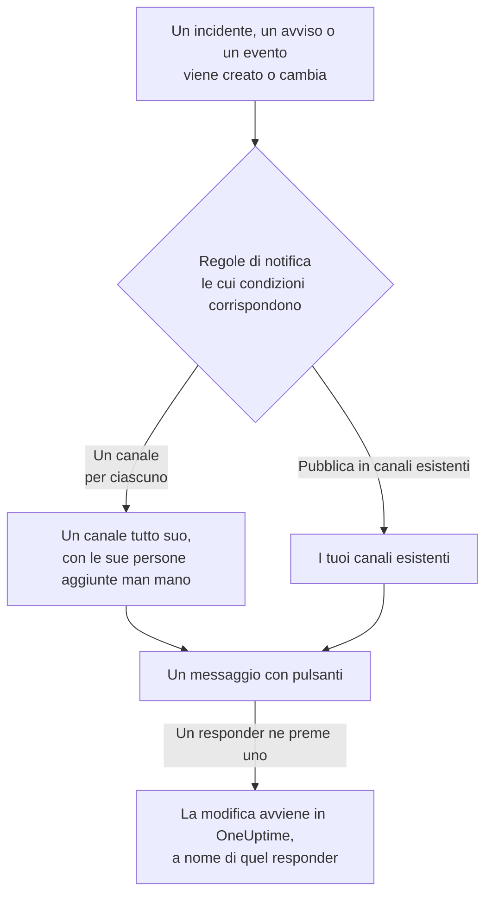

# Mattermost

Collega OneUptime al tuo server Mattermost per pubblicare nei tuoi canali incidenti, avvisi, episodi, manutenzioni programmate, monitor e aggiornamenti di reperibilità, dare a ogni incidente un canale tutto suo e lasciare che i responder riconoscano, risolvano, aggiungano note e cambino lo stato senza uscire da Mattermost.

:::cards
- [Collegare Mattermost](#collegare-mattermost): Crea un account bot per OneUptime, poi collega il progetto con il suo token.
- [Collegare il tuo account](#collegare-il-tuo-account-mattermost): Collega il tuo account Mattermost al tuo account OneUptime.
- [Regole di notifica](#regole-di-notifica): Decidi quali eventi vengono pubblicati dove, e quali hanno un canale tutto loro.
- [Chi è nel canale di un record](#chi-è-nel-canale-di-un-record): Vedi chi c'è, entra e aggiungi persone, dalla pagina del record.
- [Agire da Mattermost](#agire-su-incidenti-avvisi-ed-eventi-da-mattermost): I pulsanti dei messaggi di OneUptime.
- [Rete e self-hosting](#rete-e-self-hosting): Cosa deve poter raggiungere ciascun server.
:::

## Come funziona

Due collegamenti rendono tutto possibile:

- **Il collegamento del progetto**, fatto una volta: un account bot sul tuo server Mattermost, nei team in cui pubblica OneUptime. Pubblica i messaggi, crea i canali e vi aggiunge le persone.
- **Il collegamento di ogni persona**: il suo account Mattermost collegato al suo account OneUptime. I pulsanti agiscono a nome di quella persona, con i suoi permessi nel progetto.

Un team Mattermost può essere collegato a più di un progetto, per esempio produzione e staging. Un pulsante agisce nel progetto del record di cui parla il suo messaggio.

## Prima di iniziare

- **Un ruolo che può collegare il progetto:** **Proprietario del progetto**, **Amministratore del progetto** o **Membro del progetto**. Scollegare richiede **Proprietario del progetto** o **Amministratore del progetto**.
- **Un server Mattermost** in cui puoi creare un account bot, oppure un amministratore di Mattermost che possa crearne uno per te. Funzionano sia Mattermost Cloud sia Mattermost self-hosted.
- **Il piano Growth su OneUptime Cloud** per le regole di notifica e i riepiloghi.

Per Mattermost non serve configurare nulla sul server di OneUptime stesso: ogni progetto porta il proprio server Mattermost e il proprio account bot.

## Collegare Mattermost

:::steps
### Creare un account bot in Mattermost

In Mattermost, apri **System Console** > **Integrations** > **Bot Accounts** e assicurati che **Enable Bot Account Creation** sia attivo. Poi vai in **Integrations** > **Bot Accounts** > **Add Bot Account**, chiamalo `oneuptime` e salva. Mattermost mostra il token di accesso del bot una sola volta: copialo.

### Aggiungere il bot al tuo team

Aggiungi il bot a ogni team in cui OneUptime deve pubblicare, come aggiungeresti una persona: **Main Menu** > **Invite People**, e invita `@oneuptime`. OneUptime crea canali e pubblica solo nei team di cui il bot è membro.

### Collegare il progetto

In OneUptime, vai in **Impostazioni del progetto** > **Area di lavoro** > **Mattermost** e fai clic su **Collega Mattermost**. Inserisci l'indirizzo del tuo server, per esempio `https://chat.example.com`, e il token di accesso del bot. OneUptime verifica il token con il tuo server prima di conservare qualsiasi cosa. Se il bot è in più di un team, OneUptime ti chiede quale sia quello predefinito: il team in cui una regola di notifica che non indica alcun team crea i suoi canali. Finché nessun workspace è collegato, la sezione **Area di lavoro** dei menu Incidenti, Avvisi, Manutenzione programmata, Monitor e Reperibilità contiene **Collega un'area di lavoro**, che porta anch'esso qui.

### Aggiungere una regola di notifica

Vai in **Incidenti** > **Area di lavoro** > **Mattermost** e crea una regola. Per esempio, una che crea un canale Mattermost per ogni nuovo incidente con tutti quelli che ci lavorano. Vedi [Regole di notifica](#regole-di-notifica).
:::

Il token di accesso del bot viene conservato solo sul server di OneUptime, cifrato insieme agli altri segreti del progetto, e non viene mai più mostrato. L'indirizzo del server, i team e il nome utente del bot sono visibili a tutti nel progetto, nella pagina delle impostazioni di Mattermost.

Un progetto è collegato a un solo server Mattermost. Per spostarlo su un altro server, scollegalo prima: **Impostazioni del progetto** > **Area di lavoro** > **Mattermost**, poi **⋯** > **Scollega Mattermost**. Scollegarlo scollega anche l'account Mattermost di ogni membro e rimuove i suoi metodi di notifica Mattermost e le regole di reperibilità che li usano. Le tue regole di notifica e i tuoi riepiloghi vengono conservati per quando lo ricolleghi.

## Più di un team

OneUptime funziona in ogni team del tuo server Mattermost di cui il suo bot è membro:

1. In Mattermost, aggiungi il bot a ogni team che deve usare OneUptime, come aggiungeresti una persona: apri il team, poi **Main Menu** > **Invite People**.
2. La scheda **Team Mattermost** in **Impostazioni del progetto** > **Area di lavoro** > **Mattermost** elenca questi team, prima quello predefinito. Fai clic su **Aggiorna** dopo aver aggiunto il bot a un altro team.

- **Quale team usa una regola.** Le regole di notifica scelgono il **Team Mattermost** dei loro canali. Se resta vuoto, la regola crea il suo canale nel team predefinito, e cerca i canali che nomina prima lì, poi negli altri team del bot.
- **Quale team usa un riepilogo.** Anche i riepiloghi, nella scheda **Riepilogo** di **Incidenti** e **Avvisi**, scelgono il **Team Mattermost** dei loro canali. Se resta vuoto, un riepilogo cerca i suoi canali prima nel team predefinito, poi negli altri team del bot.
- **Il team predefinito.** È il team a cui hai collegato il progetto. **Imposta come predefinito** sulla scheda rende predefinito un altro team, per un ruolo che può collegare il progetto.
- **Dove funziona OneUptime.** I pulsanti dei messaggi di OneUptime, e i moduli che aprono, funzionano in ciascuno di questi team. In un team da cui il bot è stato rimosso, un pulsante dice solo che il team non è più collegato.
- **Un team predefinito da cui il bot è stato rimosso.** La scheda lo segnala. Aggiungi di nuovo il bot in Mattermost, oppure imposta un altro team come predefinito.
- **Un team indicato da una regola da cui il bot è stato rimosso.** La scheda della regola lo segnala, e la regola non usa un altro team al suo posto. Aggiungi di nuovo il bot al team in Mattermost, oppure scegli un altro team nella regola: il suo modulo mostra ancora la scelta precedente, così puoi cambiarla.

## Collegare il tuo account Mattermost

Mattermost non ha una pagina di accesso a cui OneUptime possa mandarti, quindi il bot di OneUptime invia invece al tuo account Mattermost un messaggio diretto con un link:

:::steps
1. Vai in **Impostazioni utente** > **Area di lavoro** > **Mattermost**. OneUptime cerca l'account Mattermost con il tuo indirizzo email. Se ne trova uno, fai clic su **Invia il link a @your-username**. Altrimenti, fai clic su **Inviami un link** e inserisci il tuo nome utente Mattermost.
2. Apri in Mattermost il messaggio diretto del bot di OneUptime e fai clic su **Connect my account**.
3. Il link apre OneUptime, che collega il tuo account.
:::

Apri il link nello stesso browser in cui l'hai richiesto: funziona solo lì, una sola volta e solo per 15 minuti. Questo dimostra che chi l'ha richiesto possiede entrambi gli account, così nessuno può collegare l'account Mattermost di un'altra persona. Se non hai richiesto un link, ignoralo: non viene collegato nulla finché non viene aperto nel browser che l'ha richiesto.

Il collegamento del tuo account appartiene a questo progetto. In un altro progetto collegato allo stesso team Mattermost, collegalo anche lì.

## Ricevere chiamate in Mattermost

Per essere chiamato con un messaggio diretto quando sei di reperibilità, aggiungi Mattermost ai tuoi metodi di notifica:

:::steps
1. Collega il tuo account Mattermost (vedi [Collegare il tuo account Mattermost](#collegare-il-tuo-account-mattermost)).
2. Vai in **Impostazioni utente** > **Metodi di notifica**, apri la scheda **App dell'area di lavoro** e fai clic su **Aggiungi account Mattermost**.
3. Fai clic su **Send Test Message** nella sua riga. Il messaggio arriva come messaggio diretto dal bot del progetto.
:::

Aggiungerlo lo inserisce subito nelle tue regole di reperibilità, quindi da quel momento le chiamate ti raggiungono in Mattermost. Cambia quali chiamate riceve in **Impostazioni utente** > **Come contattarmi**. Ogni chiamata contiene un link per riconoscerla e uno per escalarla. Scollegare il tuo account Mattermost rimuove questo metodo e le regole di reperibilità che lo usano.

## Regole di notifica

Una regola di notifica dice quali eventi vengono pubblicati in Mattermost, e dove. Ogni prodotto ha le sue regole, in **Area di lavoro** > **Mattermost** nel suo menu: **Incidenti** (con **Episodi di incidenti** e una scheda **Riepilogo**), **Avvisi** (con **Episodi di avvisi** e **Riepilogo**), **Manutenzione programmata**, **Monitor**, **Reperibilità**, **Eventi di sicurezza** e **SLOs**. Funzionano come quelle di Slack: vedi [Regole di notifica](/docs/workspace-connections/slack#regole-di-notifica) per condizioni, destinazioni e chi entra in un canale.

Un canale creato da una regola prende il nome dal suo record: l'incidente INC-42 riceve `inc-42`. Mattermost accetta lettere minuscole, numeri, `-` e `_`, fino a 64 caratteri, con una lettera o un numero all'inizio e alla fine, e il modulo della regola mostra il nome mentre scrivi. Se esiste già un canale con quel nome, per esempio uno archiviato, OneUptime aggiunge `-2`, `-3` e così via. Un incidente, un avviso o un episodio privato riceve un canale privato.

Per pubblicare in un canale esistente, inserisci il suo nome come compare nel suo indirizzo, per esempio `incidents` per `chat.example.com/team/channels/incidents`, oppure il suo nome visualizzato. OneUptime entra da solo in un canale pubblico la prima volta che vi pubblica. Aggiungi il bot a un canale privato in Mattermost prima che una regola vi pubblichi. Quando il bot è in più di un team, una regola sceglie anche il team in cui si trovano i suoi canali: vedi [Più di un team](#più-di-un-team).

Le persone entrano nel canale di una regola tramite l'account Mattermost che hanno collegato, altrimenti tramite l'account Mattermost con il loro indirizzo email, quando il tuo server mostra gli indirizzi email al bot (**System Console** > **Site Configuration** > **Users and Teams** > **Show Email Address**). OneUptime nomina chi non è riuscito ad aggiungere in un solo messaggio nel canale, con un link per collegare il proprio account.

Un incidente, un avviso, un episodio o un evento di manutenzione pianificata con un canale tutto suo ha **Apri in Mattermost** nell'intestazione della sua pagina in OneUptime, accanto ai pulsanti di stato. Apre quel canale in una nuova scheda, sul tuo server Mattermost. Un record con due canali suoi li elenca entrambi sotto il pulsante. Un record che ha canali anche in Slack o Microsoft Teams ha invece un solo pulsante **Apri canale**, che li elenca tutti. I canali esistenti in cui pubblicano le tue regole non vengono proposti.

**Testa la regola** nella riga di una regola pubblica un messaggio di prova di quella regola nei canali che indica, come fa per Slack.

I messaggi di OneUptime non notificano nessuno con ciò che citano: un nome o una descrizione che contiene `@channel`, `@here` o `@someone` viene mostrato così com'è scritto, e non avvisa nessuno.

## Chi è nel canale di un record

Un incidente, un avviso, un episodio o un evento di manutenzione pianificata con un canale Mattermost tutto suo ha una scheda **Canale Mattermost** nella sua pagina in OneUptime. La scheda mostra il canale, come link che lo apre sul tuo server Mattermost, se è privato e chi c'è, tu per primo. Dalla scheda, senza un amministratore di Mattermost:

- **Entra nel canale** ti aggiunge, quando non sei nel canale.
- **Aggiungi persone** apre un elenco delle persone e dei team del progetto: scegli una persona per aggiungerla, o un team per aggiungere tutti i suoi membri.

Il bot di OneUptime li aggiunge, come aggiunge le persone del canale di una regola. Il bot resta nei canali che crea, quindi funziona anche per un canale privato che tutti hanno lasciato. Un record che ha anche canali in Slack o Microsoft Teams li elenca tutti in un'unica scheda **Canali di chat**.

- **Chi può aggiungere persone.** Chi può modificare il record: **Proprietario del progetto**, **Amministratore del progetto**, **Membro del progetto**, **Amministratore degli incidenti** e **Membro degli incidenti** per un incidente, oppure **Edit Incident** in un ruolo personalizzato, e lo stesso permesso per un avviso, un episodio o un evento (per esempio **Edit Alert**). Gli altri vedono chi è nel canale e come entrarci.
- **Chi può essere aggiunto.** Qualcuno che OneUptime trova in Mattermost, dall'account che ha collegato oppure dal suo indirizzo email, quando il tuo server mostra gli indirizzi email al bot, e che è nel team del canale. Si può aggiungere anche un account ospite di quel team: Mattermost permette ai membri di un canale di aggiungere ospiti. La scheda nomina chi non ha potuto aggiungere, e perché.
- **Cosa viene registrato.** Chi è stato aggiunto, e da chi, nel feed del record (**Membro aggiunto al canale**) e in **Impostazioni del progetto** > **Notifiche** > **Registri di notifica**, nella scheda **Area di lavoro**.
- **Un canale archiviato.** La scheda continua a elencare chi c'è, e non aggiunge nessuno finché il canale non viene ripristinato dall'archivio in Mattermost.
- **Un canale da cui è stato rimosso il bot.** Mattermost mostra le persone di un canale solo a chi ne fa parte, anche per un canale pubblico, quindi la scheda dice che non riesce a vedere il canale. Qualcuno che ne fa parte può aggiungere di nuovo il bot in Mattermost. OneUptime rientra anche da solo in un canale pubblico la prossima volta che vi pubblica.
- **Togliere qualcuno.** OneUptime aggiunge soltanto: togli qualcuno dal canale in Mattermost.

## Agire su incidenti, avvisi ed eventi da Mattermost

I messaggi di OneUptime hanno pulsanti, e un menu **More actions** per ciò che serve a meno persone. Ognuno agisce a tuo nome, con i tuoi permessi nel progetto, e risponde in un messaggio che vedi solo tu.

| Record | Pulsanti e menu |
| --- | --- |
| **Incidente** | **Acknowledge**, **Resolve**, **Add Note** e nel menu **Change Severity** e **Change State** |
| **Avviso** | **Acknowledge**, **Resolve**, **Add Note**, **Change State**, **Execute On-Call Policy** |
| **Episodio di incidente, episodio di avviso** | **Acknowledge**, **Resolve**, **Add Note**, **Change State**, **Execute On-Call Policy** |
| **Manutenzione programmata** | **Mark as Ongoing**, **Mark as Complete**, **Add Note**, **Change State** |

**Add Note**, **Change State**, **Change Severity** ed **Execute On-Call Policy** aprono un modulo in Mattermost. Una nota su un incidente o su un evento di manutenzione programmata può essere pubblica, mostrata sulla pagina di stato, o privata; una nota su un incidente privato è sempre privata, e su un avviso è sempre privata anch'essa. Ogni messaggio ha anche un link che apre il suo record in OneUptime, per tutto il resto. Quando le note pubbliche del progetto richiedono un'approvazione, una nota pubblica inviata dal modulo la attende, e un messaggio che vedete solo voi dice chi attende: vedete [Approvazione delle note pubbliche](/docs/incidents/notes-owners-and-feed#approvazione-delle-note-pubbliche).

Se il tuo account Mattermost non è ancora collegato, un pulsante te lo dice, con un link a **Impostazioni utente** > **Area di lavoro** > **Mattermost**. Collega il tuo account, poi premi di nuovo il pulsante.

Ogni pressione di un pulsante viene registrata in **Impostazioni del progetto** > **Notifiche** > **Registri di notifica**, nella scheda **Area di lavoro**, insieme a chi l'ha premuto.

## Approvare una nota pubblica

Quando le note pubbliche del progetto richiedono approvazione e attivi Mattermost per **Approvazione delle note pubbliche** nelle impostazioni delle notifiche, ogni nota pubblica che attende un passaggio che approvi arriva nei tuoi messaggi diretti con il bot di OneUptime: chi l'ha inviata, il passaggio che attende, la nota, **Approve**, **Reject** e un link alla nota in OneUptime. **Approve** la approva per quel passaggio; all'ultimo passaggio si chiama **Approve and publish** e la nota viene pubblicata subito. **Reject** apre un modulo che chiede il motivo: il motivo è obbligatorio e l'autore della nota lo vede. I pulsanti agiscono come te, con le stesse regole di OneUptime, e rispondono in un messaggio che vedi solo tu. Un clic dopo che qualcun altro ha deciso, o dopo che la nota o i suoi passaggi sono cambiati, non decide nulla e dice che cosa è successo. Una volta decisa la nota, il messaggio di ogni approvatore che la riguarda, compreso il tuo, cambia per dire che cosa è successo: approvata per il suo passaggio e chi attende ora, pubblicata, rifiutata, modificata o inviata di nuovo per l'approvazione, pubblicata senza approvazione, o eliminata. Mantiene il suo link alla nota in OneUptime, e **Approve** e **Reject** spariscono. Se il tuo account Mattermost non è collegato, collegalo in **Impostazioni utente** > **Area di lavoro** > **Mattermost**, poi premi di nuovo il pulsante. Quando i passaggi di approvazione cambiano mentre una nota attende, anche il vostro messaggio che la riguarda cambia se la nota non attende più il vostro passaggio o non venite più interpellati, e le persone che attende ora ricevono un messaggio proprio. Vedi [Approvazione delle note pubbliche](/docs/incidents/notes-owners-and-feed#approvazione-delle-note-pubbliche).

## Rete e self-hosting

Due server comunicano tra loro:

- **OneUptime chiama il tuo server Mattermost**, per pubblicare, creare canali e aggiungere persone. Su OneUptime Cloud, il tuo server Mattermost deve essere raggiungibile da internet. Un OneUptime self-hosted può raggiungere un server Mattermost su una rete privata una volta che il suo operatore consente gli indirizzi privati con `ALLOW_PRIVATE_NETWORK_WEBHOOKS` o `PRIVATE_NETWORK_WEBHOOK_ALLOWLIST`. OneUptime non chiama mai un indirizzo sulla propria macchina né un indirizzo di metadati cloud, e non segue mai un reindirizzamento.
- **Il tuo server Mattermost chiama OneUptime** quando qualcuno preme un pulsante o invia un modulo: `https://<your OneUptime>/api/mattermost/interactive` e `/api/mattermost/dialog`. Se l'indirizzo di OneUptime è privato, aggiungi il suo host in **System Console** > **Environment** > **Developer** > **Allow untrusted internal connections to** in Mattermost, altrimenti i pulsanti non funzioneranno.

Ogni pulsante che OneUptime pubblica porta una firma, verificata quando viene premuto, per il team Mattermost in cui è stato pubblicato: una pressione che OneUptime non ha firmato, o che arriva da un altro team, non fa nulla.

## Risoluzione dei problemi

| Cosa vedi | Cosa fare |
| --- | --- |
| **Mattermost did not accept the access token** | Copia di nuovo il token del bot. Mattermost lo mostra una sola volta: se serve, creane uno nuovo in **Integrations** > **Bot Accounts**. |
| **The bot account is not a member of any team** | Aggiungi il bot al tuo team in Mattermost, poi collega di nuovo il progetto. |
| Un team a cui hai aggiunto il bot non compare nella scheda **Team Mattermost** | Fai clic su **Aggiorna** nella scheda. |
| **OneUptime's bot is not a member of this Mattermost team** | Hai scelto un team che il bot ha lasciato. Aggiungi il bot a quel team in Mattermost, poi fai clic su **Aggiorna**. |
| **OneUptime's bot may not create channels in the Mattermost team this rule names** | Aggiungi il bot a quel team in Mattermost, oppure scegli un altro team nella regola. |
| **OneUptime's bot is not a member of the Mattermost team chosen for the channel** | Aggiungi il bot a quel team in Mattermost, oppure scegli un altro team nella regola. |
| **OneUptime's bot is no longer a member of the project's default Mattermost team** | Aggiungi di nuovo il bot a quel team in Mattermost, oppure imposta un altro team come predefinito. |
| **OneUptime could not reach the Mattermost server** | Controlla l'indirizzo, e che OneUptime possa raggiungerlo. Vedi [Rete e self-hosting](#rete-e-self-hosting). |
| **The bot is not a member of the private Mattermost channel** | Aggiungi il bot al canale in Mattermost. |
| Un pulsante non fa nulla, oppure Mattermost dice che non è riuscito a completare l'azione | Mattermost non riesce a raggiungere OneUptime. Vedi [Rete e self-hosting](#rete-e-self-hosting). |
| Non arriva nessun messaggio diretto con il tuo link | Controlla il nome utente, e che il bot sia in un team di cui fai parte. |
| La scheda del canale dice che OneUptime non riesce a vedere il canale | Il canale è stato eliminato, oppure il bot ne è stato rimosso. Se esiste ancora, qualcuno che ne fa parte può aggiungere di nuovo il bot in Mattermost. |
| La scheda del canale dice che qualcuno non è nel team Mattermost | Aggiungilo in Mattermost al team del canale, poi aggiungilo di nuovo. |
