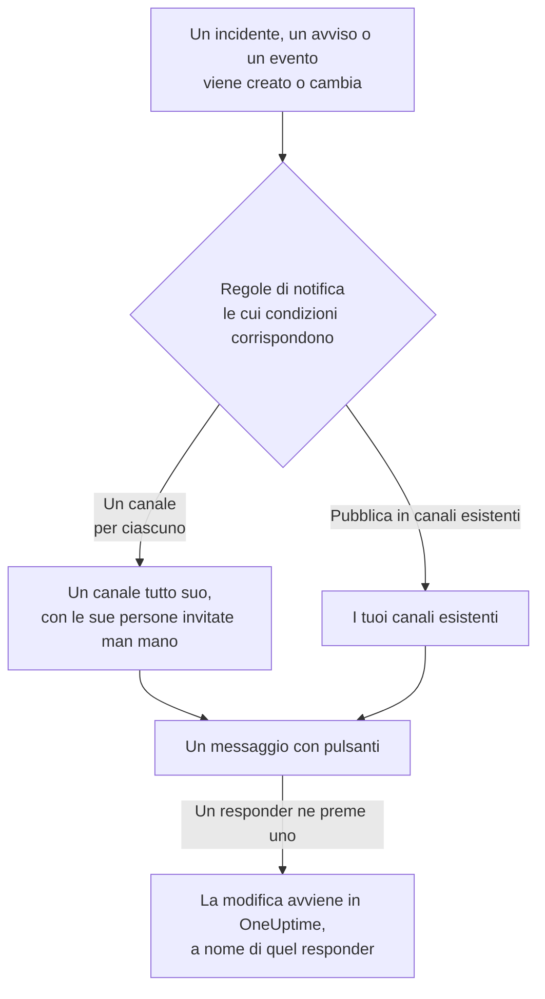

# Slack

Collega OneUptime a Slack per pubblicare nei tuoi canali incidenti, avvisi, episodi, manutenzioni programmate, monitor e aggiornamenti di reperibilità, dare a ogni incidente un canale tutto suo e lasciare che i responder agiscano senza uscire da Slack: riconoscere, risolvere, aggiungere note, chiamare la reperibilità e dichiarare incidenti.

:::cards
- [Collegare Slack](#collegare-slack): Installa OneUptime nel tuo workspace, poi collega il tuo account.
- [Chiedere a tutti di collegare il proprio account](#chiedere-a-tutti-di-collegare-il-proprio-account): Scrivi in un colpo solo a tutti i membri che non hanno ancora collegato il proprio account.
- [Regole di notifica](#regole-di-notifica): Decidi quali eventi vengono pubblicati dove, e quali hanno un canale tutto loro.
- [Chi è nel canale di un record](#chi-è-nel-canale-di-un-record): Vedi chi c'è, entra e aggiungi persone, dalla pagina del record.
- [Il comando /oneuptime](#il-comando-oneuptime): Dichiara incidenti, programma manutenzioni, vedi chi è reperibile e chiedi all'IA.
- [Gruppi di utenti di reperibilità](#gruppi-di-utenti-di-reperibilità): Mantieni un gruppo di utenti uguale a chi è reperibile, e chiamalo.
- [Agire su incidenti, avvisi ed eventi da Slack](#agire-su-incidenti-avvisi-ed-eventi-da-slack): I pulsanti dei messaggi di OneUptime.
:::

## Come funziona

Due collegamenti rendono tutto possibile:

- **Il collegamento del progetto**, fatto una volta: l'app di OneUptime installata nel tuo workspace Slack. Pubblica i messaggi, crea i canali e invita le persone.
- **Il collegamento di ogni persona**: il suo account Slack collegato al suo account OneUptime. Pulsanti, comandi e reazioni con emoji agiscono a nome di quella persona, con i suoi permessi nel progetto.

Un workspace Slack può essere collegato a più di un progetto, per esempio produzione e staging. Un pulsante o un modulo agisce nel progetto del record a cui si riferisce. Un comando o un messaggio a OneUptime agisce nel progetto del canale in cui è scritto, per esempio il canale di un incidente, altrimenti nell'unico progetto in cui è collegato il tuo account Slack. Quando niente lo indica, OneUptime ti chiede quale progetto intendi, con un pulsante per ogni progetto di cui fai parte, e prosegue lì appena scegli. In una conversazione con OneUptime AI, la tua scelta vale per il resto del thread.

## Prima di iniziare

- **Un ruolo che può collegare il progetto:** **Proprietario del progetto**, **Amministratore del progetto** o **Membro del progetto**. Disinstallare l'app richiede **Proprietario del progetto** o **Amministratore del progetto**.
- **Un workspace Slack** in cui puoi installare app.
- **Il piano Growth su OneUptime Cloud** per le regole di notifica e i riepiloghi. Vedi [Regole di notifica sotto il piano Growth](#regole-di-notifica-sotto-il-piano-growth).
- **Su un server self-hosted,** prima un'app Slack configurata per esso. Vedi [Integrazione Slack](/docs/self-hosted/slack-integration).

## Collegare Slack

:::steps
### Installare OneUptime nel tuo workspace Slack

Vai in **Impostazioni del progetto** > **Area di lavoro** > **Slack** e fai clic su **Connect with Slack**. Scegli il workspace e autorizza OneUptime. Slack ti riporta alla stessa pagina, che ora indica il workspace a cui è collegato il progetto. Finché nessun workspace è collegato, la sezione **Area di lavoro** dei menu Incidenti, Avvisi, Manutenzione programmata, Monitor e Reperibilità contiene **Collega Slack o Teams**, che porta anch'esso qui.

### Collegare il tuo account Slack

Installare l'app collega l'account di chi l'ha installata. Tutti gli altri collegano il proprio account Slack in **Impostazioni utente** > **Area di lavoro** > **Slack** con **Connect my account with Slack**, per agire sugli incidenti e ricevere messaggi diretti a proprio nome. Quella sezione compare non appena il progetto è collegato a Slack. Per coinvolgere un intero team in una volta sola, vedi [Chiedere a tutti di collegare il proprio account](#chiedere-a-tutti-di-collegare-il-proprio-account).

### Aggiungere una regola di notifica

Vai in **Incidenti** > **Area di lavoro** > **Slack**. La sezione **Area di lavoro** elenca solo gli spazi di chat che il tuo progetto ha collegato, quindi **Slack** vi compare non appena è collegato. Crea una regola, per esempio una che crea un canale Slack per ogni nuovo incidente con tutti quelli che ci lavorano: le persone allertate, il comandante dell'incidente e i proprietari. Vedi [Regole di notifica](#regole-di-notifica).

### Provare la regola

Fai clic su **Regola di test** nella riga della regola. Un messaggio di prova arriva nei canali indicati dalla regola. Vedi [Provare una regola](#provare-una-regola).
:::

## Chiedere a tutti di collegare il proprio account

Nessuno può collegare l'account Slack di un'altra persona, nemmeno un amministratore: ognuno accede al proprio. Per coinvolgere un intero team, un **Proprietario del progetto** o un **Amministratore del progetto** chiede a tutti in una volta di collegare il proprio account, in **Impostazioni del progetto** > **Area di lavoro** > **Slack**. La scheda **Members' Slack accounts** indica quanti membri hanno collegato il proprio account. **Ask everyone to connect** invia a ogni membro che non l'ha ancora fatto un messaggio diretto di OneUptime in Slack, con un pulsante **Connect Slack account** che collega il suo account con un clic.

- **Chi riceve un messaggio.** Ogni membro del progetto che non ha collegato il proprio account Slack, trovato in Slack tramite il suo indirizzo email. Chi ha ricevuto la richiesta nelle ultime 24 ore non la riceve di nuovo, quindi chiedere ancora il giorno dopo la ricorda solo a chi non ha ancora collegato il proprio account.
- **Cosa dice la scheda.** A che punto sono i messaggi mentre vengono inviati, poi chi ha fatto la richiesta e quanti membri hanno ricevuto un messaggio. I membri che OneUptime non ha trovato in Slack tramite il loro indirizzo email sono indicati per nome nella scheda: collegano il proprio account da soli in **Impostazioni utente** > **Area di lavoro** > **Slack**.
- **Cosa collega il pulsante.** L'account Slack di chi lo preme ed effettua l'accesso, al proprio account OneUptime. Un messaggio inoltrato a qualcun altro non collega nulla al membro a cui era stato inviato.

## Regole di notifica

Una regola di notifica dice quali eventi vengono pubblicati in Slack, e dove. Ogni prodotto ha le sue regole, in **Area di lavoro** > **Slack** nel suo menu:

| Prodotto | Schede della sua pagina **Slack** |
| --- | --- |
| **Incidenti** | **Incidenti**, **Incidente Episodi**, **Riepilogo** |
| **Avvisi** | **Avvisi**, **Avviso Episodi**, **Riepilogo** |
| **Manutenzione programmata** | Un elenco di regole |
| **Monitor** | Un elenco di regole |
| **Reperibilità** | Un elenco di regole |

Creare una regola passa per quattro passaggi:

| Passaggio | Cosa imposti |
| --- | --- |
| **Base** | **Nome della regola** e **Descrizione della regola**. |
| **Condizioni** | A quali eventi si applica la regola, per esempio per gravità, stato, etichetta, monitor o parole nel titolo. Vengono verificate quando un evento viene creato e di nuovo a ogni aggiornamento che OneUptime pubblica su di esso, quindi una regola per gli incidenti riconosciuti agisce quando un incidente viene riconosciuto. Una nuova regola vale per ogni evento, per esempio **Tutti gli incidenti**. Per restringerla, scegli **Solo gli incidenti che soddisfano le condizioni** e aggiungi le condizioni. Con due o più, **Condizione di corrispondenza** dice se devono corrispondere tutte o ne basta una. |
| **Destinazione** | Dove pubblica: **Pubblica in canali esistenti** con i nomi dei canali, **Crea un canale per ogni incidente** (o avviso, episodio, evento, monitor o policy di reperibilità) con chi ci entra, o entrambi. Sotto il passaggio, **Cosa fa questa regola** lo dice a frasi, come la scheda della regola. |
| **Video Call** | Solo incidenti e avvisi: avvia una chiamata per ciascuno. Vedi [Videochiamate](/docs/workspace-connections/video-calls). |

Un canale creato dalla regola prende il nome dal suo record: l'incidente INC-42 riceve `inc-42`, l'avviso ALT-7 riceve `alt-7` e, in un progetto senza prefissi di numero, l'incidente 42 riceve `incident-42`. Il testo in **Prefisso del nome del canale** va davanti, quindi `prod-` dà `prod-inc-42`, e il modulo mostra il nome mentre scrivi. Per un evento di manutenzione pianificata, il prefisso prende il posto del suo prefisso di numero: SM-5 riceve `sm-5` e `maint-` dà `maint-5`. Slack accetta lettere minuscole, numeri, `-` e `_`, fino a 80 caratteri. Se esiste già un canale con quel nome, come quello di un altro progetto o uno archiviato, OneUptime aggiunge `-2`, `-3` e così via.

Una regola crea il suo canale la prima volta che un evento le corrisponde: quando l'evento viene creato, o più tardi, quando un aggiornamento lo fa corrispondere mentre è ancora aperto. Una regola per gli incidenti riconosciuti crea il canale quando l'incidente viene riconosciuto. Un incidente, un avviso o un episodio privato riceve un canale privato.

**Chi entra nel canale** elenca chi la regola aggiunge al suo canale, ognuno man mano che entra nel record, non solo quando il canale viene creato: **Persone reperibili, man mano che vengono allertate**, **Comandante dell'incidente e altri ruoli dell'incidente, man mano che vengono assegnati** (incidenti ed episodi di incidente) e **Proprietari, man mano che vengono aggiunti**, tutti spuntati per una nuova regola, e le persone, i team e le pianificazioni di reperibilità in **Invita anche** quando il canale viene creato. Il comandante dell'incidente viene di solito assegnato quando qualcuno riconosce per primo l'incidente, ed entra nel suo canale in quel momento. Una regola salvata prima che i ruoli dell'incidente avessero una casella propria li aggiunge quando aggiunge i proprietari o le persone reperibili, e la sua casella appare spuntata. Un canale esistente in cui una regola pubblica non riceve nessuno.

Per una pianificazione di reperibilità in **Invita anche**, chi è reperibile in essa quando il canale viene creato vi entra, come indicato nella pagina della pianificazione, e non viene chiamato. Per aggiungere persone solo ai canali di alcuni incidenti, dai a una seconda regola quelle condizioni e quelle persone, con lo stesso **Prefisso del nome del canale** della prima: le regole a cui un incidente corrisponde quando il suo canale viene creato condividono quel canale, e ognuna aggiunge le proprie persone.

Ogni aggiornamento successivo del record — un cambio di stato, una nota, un nuovo proprietario — viene pubblicato nei suoi canali, e nei canali esistenti indicati dalle sue regole finché le loro condizioni corrispondono. Con **Archivia il canale quando l'incidente è risolto** attivo, o il suo equivalente per avvisi, episodi, eventi, monitor e policy di reperibilità, la regola che ha creato un canale lo archivia quando il record viene risolto, completato o eliminato, qualunque cosa dicano allora le sue condizioni. Un incidente, un avviso o un episodio creato già risolto non riceve un canale tutto suo; il suo messaggio di creazione va comunque nei canali indicati dalle tue regole. Vedi [Dichiarato già riconosciuto o risolto](/docs/incidents/declaring-incidents#dichiarato-già-riconosciuto-o-risolto).

Un incidente, un avviso, un episodio o un evento di manutenzione pianificata con un canale tutto suo ha **Apri in Slack** nell'intestazione della sua pagina in OneUptime, accanto ai pulsanti di stato. Apre quel canale in una nuova scheda, nell'app di Slack o nel browser. Un record con due canali suoi li elenca entrambi sotto il pulsante. Un record con canali sia in Slack sia in Microsoft Teams ha invece un solo pulsante **Apri canale**, che li elenca tutti. I canali esistenti in cui pubblicano le tue regole non vengono proposti.

Un canale resta leggibile: ogni evento viene pubblicato una volta sola, e il primo stato di un record è nel messaggio che annuncia il record, non in un messaggio a sé. Un'esecuzione di una policy di reperibilità è un solo messaggio, modificato man mano che l'esecuzione scala: chi è stato chiamato, quante volte e come, chi no e perché, e chi ha confermato. Un nuovo messaggio viene pubblicato solo quando qualcuno deve agire: una regola di escalation non ha raggiunto nessuno, o l'esecuzione è finita senza che nessuno confermasse. Chi non ha collegato il proprio account Slack a OneUptime viene aggiunto tramite l'account Slack con il suo indirizzo email. Chi non viene trovato in nessuno dei due modi, o è ospite in Slack, non può essere aggiunto a un canale; OneUptime lo dice una volta per canale, in un solo messaggio che li nomina tutti e viene modificato quando l'elenco cresce. Invia loro il link **Connect Slack account** di quel messaggio, così collegano il proprio account in un solo passaggio. Che i proprietari del record o gli iscritti alla pagina di stato siano stati informati resta nel suo feed in OneUptime.

**Impostazioni del progetto** > **Area di lavoro** > **Slack** elenca i canali che OneUptime può vedere, con **Invia prova** accanto a ciascuno. OneUptime entra da solo in un canale pubblico la prima volta che vi pubblica. Un canale privato viene elencato, e può ricevere messaggi, solo dopo che l'app di OneUptime vi è stata invitata in Slack.

## Chi è nel canale di un record

Un incidente, un avviso, un episodio o un evento di manutenzione pianificata con un canale Slack tutto suo ha una scheda **Canale Slack** nella sua pagina in OneUptime. La scheda mostra il canale, come link che lo apre in Slack, se è privato e chi c'è, tu per primo. Dalla scheda, senza un amministratore di Slack:

- **Entra nel canale** ti aggiunge, quando non sei nel canale.
- **Aggiungi persone** apre un elenco delle persone e dei team del progetto: scegli una persona per aggiungerla, o un team per aggiungere tutti i suoi membri.

L'app di OneUptime li aggiunge, come aggiunge le persone del canale di una regola. L'app resta nei canali che crea, quindi funziona anche per un canale privato che tutti hanno lasciato.

- **Chi può aggiungere persone.** Chi può modificare il record: **Proprietario del progetto**, **Amministratore del progetto**, **Membro del progetto**, **Amministratore degli incidenti** e **Membro degli incidenti** per un incidente, oppure **Edit Incident** in un ruolo personalizzato, e lo stesso permesso per un avviso, un episodio o un evento (per esempio **Edit Alert**). Gli altri vedono chi è nel canale e come entrarci.
- **Chi può essere aggiunto.** Qualcuno che OneUptime trova in Slack: dall'account Slack che ha collegato, oppure dall'indirizzo email che Slack ha per lui. La scheda nomina chi non ha potuto aggiungere, e perché, come un ospite che Slack tiene fuori dal canale.
- **Cosa viene registrato.** Chi è stato aggiunto, e da chi, nel feed del record (**Membro aggiunto al canale**) e in **Impostazioni del progetto** > **Notifiche** > **Registri di notifica**, nella scheda **Area di lavoro**.
- **Togliere qualcuno.** OneUptime aggiunge soltanto: togli qualcuno dal canale in Slack.

## Provare una regola

**Regola di test** nella riga di una regola pubblica un messaggio di prova di quella regola nei canali che indica, così puoi vederlo arrivare. Se la regola crea un canale per ogni evento, anche la prova ne crea uno e vi invita le persone della regola.

Come **Invia prova** accanto a un canale in **Impostazioni del progetto** > **Area di lavoro** > **Slack**, richiede il permesso di creare regole di notifica: **Proprietario del progetto**, **Amministratore del progetto**, **Membro del progetto**, **Amministratore delle impostazioni**, **Membro delle impostazioni**, oppure **Create Workspace Notification Rule** e **Read Workspace Notification Rule** in un ruolo personalizzato. Per chi può solo vedere le regole, come un **Visualizzatore**, **Regola di test** è bloccato, e il suo suggerimento dice cosa serve; l'API rifiuta la sua prova con "You do not have permission to send test notifications in this project." Su OneUptime Cloud, provare una regola richiede il piano **Growth**, come aggiungerne una.

Su OneUptime Cloud, anche **Invia prova** accanto a un canale richiede il piano **Growth**, perché pubblicare in un canale è ciò che fanno regole e riepiloghi. **Invia prova ora** su un riepilogo richiede il permesso di creare riepiloghi (**Create Workspace Notification Summary** e **Read Workspace Notification Summary** in un ruolo personalizzato) e, su OneUptime Cloud, il piano **Growth**; per chiunque altro è bloccato, e il suo suggerimento dice cosa serve. Un client MCP collegato con accesso in sola lettura non può inviare alcuna prova.

## Riepiloghi

La scheda **Riepilogo** di **Incidenti** > **Area di lavoro** > **Slack** (e di **Avvisi**) pubblica un riepilogo periodico nei canali che indichi: quanti incidenti o avvisi ci sono stati, quanto in fretta sono stati riconosciuti e risolti, e un elenco con i link. Un nuovo riepilogo esce ogni settimana e copre gli ultimi 7 giorni. Lascia vuoto **Invia il primo report alle** e il primo esce alle 09:00 all'inizio della settimana, del giorno o del mese successivo; il modulo dice quando.

Un riepilogo esce secondo l'orologio del suo **Fuso orario**, che parte dal tuo. Lì mantiene la sua ora del giorno tutto l'anno: uno impostato per le 09:00 a Berlino esce ancora alle 09:00 a Berlino dopo il cambio dell'ora legale, e anche le date del suo messaggio sono quelle di Berlino. Tramite l'API, invia `timezone` come nome di fuso orario IANA, come `Europe/Berlin`. Un riepilogo creato senza fuso orario prende quello del profilo di chi l'ha creato, oppure UTC quando lo crea una chiave API.

Il modulo di un riepilogo ha quattro passaggi: **Informazioni di base** (il nome e i canali), **Pianificazione**, **Contenuto** (**Cosa includere**) e **Filtri** (quali incidenti o avvisi conta).

## Regole di notifica sotto il piano Growth

Su OneUptime Cloud, le regole di notifica e i riepiloghi sono disponibili dal piano **Growth** in su. Un progetto al di sotto conserva le regole e i riepiloghi che ha già, e questi continuano a pubblicare in Slack. Per questo la pagina **Slack** di ogni prodotto (Incidenti, Avvisi, Manutenzione programmata, Reperibilità, Monitor) mostra la nota sul piano con questi elencati sotto (**Regole di notifica ancora configurate**, **Riepiloghi ancora configurati**): elimina una regola, oppure disattiva o elimina un riepilogo. Aggiungere o modificare regole e riepiloghi richiede **Growth**.

## Ricevere chiamate in Slack

Per essere chiamato con un messaggio diretto quando sei di reperibilità, aggiungi Slack ai tuoi metodi di notifica:

:::steps
1. Collega il tuo account Slack (vedi [Collegare Slack](#collegare-slack)).
2. Vai in **Impostazioni utente** > **Metodi di notifica**, apri la scheda **Workspace Apps** e fai clic su **Add Slack Account**.
3. Fai clic su **Send Test Message** nella sua riga. Il messaggio arriva nei tuoi messaggi diretti di Slack.
:::

Aggiungerlo lo inserisce subito nelle tue regole di reperibilità, quindi da quel momento le chiamate ti raggiungono in Slack. Cambia quali chiamate riceve in **Impostazioni utente** > **Regole di reperibilità**.

## Salvare i messaggi come note

Reagisci a un messaggio nel canale di un incidente, di un avviso, di un episodio o di un evento di manutenzione programmata, e OneUptime lo salva come nota su quel record, poi lo conferma con una risposta nel thread:

| Reazione | Salvato come |
| --- | --- |
| 📌 Un'emoji di puntina, o il comando **Pin to channel** di Slack | Una nota privata, visibile solo al tuo team |
| 📢 Un'emoji di megafono o di altoparlante | Una nota pubblica, mostrata sulla pagina di stato. Solo incidenti ed eventi di manutenzione programmata. Su un incidente privato, una nota privata, e la conferma dice perché. |

La nota riprende il messaggio così come Slack lo mostrava: la formattazione, i link e il codice, le persone e i canali che menziona con il loro nome, e i file e le immagini come link. Una nota pubblica lascia fuori i file e le immagini, perché si aprono solo per il tuo team.

Sono le parole di chi ha scritto il messaggio: il suo nome in OneUptime se il suo account Slack è collegato, altrimenti il nome che mostra Slack. Una nota privata viene collocata nella cronologia al momento in cui il messaggio è stato pubblicato, per quanto tempo dopo venga salvata. Una nota pubblica viene collocata al momento in cui viene salvata, cioè quando la pagina di stato la mostra. La cronologia dice chi l'ha salvata. La nota non viene ripubblicata nel canale, dove il messaggio c'è già.

La nota viene salvata a tuo nome, con i tuoi permessi. Se il tuo account Slack non è ancora collegato, OneUptime ti chiede di collegarlo, in un messaggio che vedi solo tu, con un pulsante che salva il messaggio non appena l'hai fatto. Un messaggio viene salvato una sola volta, per quante persone reagiscano.

## Il comando /oneuptime

OneUptime ha un solo comando in Slack, `/oneuptime`. La parola che scrivi dopo dice cosa fare; qualsiasi altra cosa dopo è una domanda per OneUptime AI.

| Comando | Cosa fa |
| --- | --- |
| `/oneuptime help` | Elenca i comandi, con esempi. |
| `/oneuptime incident [title or number]` | Apre il modulo dell'incidente, con il titolo compilato. Il numero di un incidente, come `42` o `INC-42`, mostra invece quell'incidente: vedi [Gestire un incidente da Slack](#gestire-un-incidente-da-slack). |
| `/oneuptime maintenance [title]` | Apre il modulo della manutenzione programmata, con il titolo compilato. |
| `/oneuptime oncall` | Elenca chi è reperibile in questo momento in ogni pianificazione di reperibilità che puoi vedere, fino a quando, e chi è il prossimo. |
| `/oneuptime page [who] [message]` | Chiama le persone che menzioni con @ per il tuo messaggio, oppure apre un modulo per scegliere chi chiamare. Vedi [Chiamare qualcuno da Slack](#chiamare-qualcuno-da-slack). |
| `/oneuptime ask [question]`, o qualsiasi domanda | OneUptime AI risponde su log, trace, metriche, incidenti e monitor. |

Le risposte a `help` e `oncall` sono messaggi che vedi solo tu, sotto il comando. Una prima parola che sembra un comando scritto male, come `incidnet`, riceve il comando a cui somiglia, non una risposta di OneUptime AI. I moduli di incidente e di manutenzione agiscono a tuo nome: vedi [Creare incidenti e manutenzioni da Slack](#creare-incidenti-e-manutenzioni-da-slack).

> [!NOTE]
> `/oneuptime incident` e `/oneuptime maintenance` sostituiscono `/incident` e `/maintenance`, che potevano entrare in conflitto con i comandi con lo stesso nome di altre app Slack. Un'app Slack creata da un manifest precedente li mantiene, e aprono gli stessi moduli, finché l'app non viene aggiornata: vedi [App create da un manifest più vecchio](/docs/self-hosted/slack-integration#app-create-da-un-manifest-più-vecchio).

## La home di OneUptime in Slack

Apri OneUptime da **Apps** nella barra laterale di Slack: la sua scheda **Home** mostra cosa succede nel progetto, come puoi vederlo tu, e viene riletta ogni volta che la apri.

- **La tua reperibilità.** Le pianificazioni di reperibilità in cui sei reperibile adesso, e fino a quando, oppure il tuo prossimo turno.
- **Cosa è aperto.** Gli incidenti e gli avvisi aperti più recenti che puoi leggere, ciascuno con un link alla sua pagina in OneUptime.
- **I suoi pulsanti.** **Declare incident**, **Schedule maintenance** e **Page someone** aprono gli stessi moduli di `/oneuptime incident`, `/oneuptime maintenance` e `/oneuptime page`, e **Who's on call** risponde come `/oneuptime oncall`.

La home legge come te, quindi richiede il tuo account Slack collegato. Finché non lo è, la home mostra un pulsante **Connect Slack account**, e ti mostra la tua home non appena lo hai collegato.

In un workspace Slack collegato a più di un progetto, la home mostra un progetto alla volta. Se il tuo account Slack è collegato in due o più di essi, il menu **Switch project**, accanto al nome del progetto, elenca gli altri di cui sei membro. Scegline uno per vederne la home, e da allora la home si apre su quello, finché ne sei ancora membro. Finché non ne scegli uno, mostra quello dei tuoi progetti che è stato collegato a Slack per primo.

Quando qualcuno aggiunge OneUptime a un canale, vi pubblica un saluto: come fargli una domanda e dove aggiungere una regola di notifica che pubblica nel canale. La prima volta che apri la sua scheda **Messages**, ti dà il benvenuto lì: cosa fa in Slack e come iniziare.

## Chiedere a OneUptime AI da Slack

Fai domande su log, trace, metriche, incidenti e monitor in linguaggio naturale. Menziona OneUptime con @ in un canale, o mandagli un messaggio diretto, e risponde nel thread. `/oneuptime ask which monitors are down?` pubblica la sua risposta nel canale. Entrambi richiedono il tuo account Slack collegato e l'IA attivata per il progetto. Le risposte in Slack si limitano a leggere: per cambiare qualcosa, usa i pulsanti. Vedi [Chiedi all'IA](/docs/ai/ask-ai).

OneUptime risponde solo a ciò che è rivolto a lui.

- **Nella tua conversazione, basta rispondere.** Una domanda che fai in un canale, non in un thread, apre una conversazione nel thread sotto di essa: rispondi lì per chiedere altro senza menzionare di nuovo OneUptime, e chiunque altro si unisce menzionandolo.
- **In qualsiasi altro thread, menziona OneUptime.** Sotto il messaggio di un incidente, per esempio, menzionalo ogni volta: ciò che le persone si scrivono lì tra loro non riceve risposta.
- **Se il tuo account Slack non è collegato.** OneUptime ti chiede una volta per conversazione di collegarlo, in un messaggio che vedi solo tu, con un pulsante **Connect Slack account**.

## Creare incidenti e manutenzioni da Slack

`/oneuptime incident` e `/oneuptime maintenance` aprono un modulo che compili e invii a tuo nome: come l'account OneUptime a cui è collegato il tuo account Slack (vedi [Collegare Slack](#collegare-slack)), con i permessi di quell'account nel progetto. Se il tuo account Slack non è collegato, o il tuo account OneUptime non è più membro del progetto, OneUptime ti dice cosa fare dove hai eseguito il comando, in un messaggio che vedi solo tu, e nessun modulo si apre. Le scorciatoie **Create New Incident** e **Create Scheduled Event** aprono gli stessi moduli.

- **Chi può usarli.** Le persone che possono dichiarare un incidente o creare un evento di manutenzione programmata in OneUptime: **Proprietario del progetto**, **Amministratore del progetto**, **Membro del progetto**, **Amministratore degli incidenti** e **Membro degli incidenti** per un incidente (**Create Incident** in un ruolo personalizzato), e **Amministratore della manutenzione programmata** e **Membro della manutenzione programmata** per un evento (**Create Scheduled Maintenance**). A chiunque altro viene detto dove lo ha eseguito, e nessun modulo si apre.
- **Cosa offre un modulo.** Ogni elenco — gravità, monitor, stati dei monitor, policy di reperibilità ed etichette — contiene ciò che puoi leggere, come lo stesso elenco in OneUptime: con un ruolo limitato ad alcune etichette, i monitor e le policy di reperibilità che portano quelle etichette. Un elenco che non puoi leggere affatto viene omesso dal modulo. Le policy di reperibilità archiviate non vengono mai offerte.
- **Cosa può indicare un modulo.** L'incidente o l'evento viene creato con i tuoi permessi e attribuito a te. Un monitor, una policy di reperibilità, un'etichetta, una gravità o uno stato che non puoi leggere, o uno di un altro progetto, viene rifiutato come uno che il progetto non ha, anche da un modulo aperto prima che il tuo accesso cambiasse, e non viene creato nulla. OneUptime ti spiega il motivo nel canale, in un messaggio che vedi solo tu.

**Execute On-Call Policy** su un incidente, un avviso o un episodio funziona allo stesso modo: richiede il permesso di eseguire una policy di reperibilità (**Proprietario del progetto**, **Amministratore del progetto**, **Membro del progetto**, **Amministratore della reperibilità** e **Membro della reperibilità**, oppure **Create On-Call Duty Policy Execution Log** in un ruolo personalizzato) e di leggere quell'incidente, avviso o episodio, e offre le policy di reperibilità attive che puoi leggere.

## Chiamare qualcuno da Slack

`/oneuptime page @nawaz The checkout API is throwing 500s` chiama subito Nawaz. OneUptime crea un avviso il cui titolo è il tuo messaggio, e ogni persona che menzioni con @ riceve una telefonata, un SMS, una notifica push o un'email, come dicono le sue regole di reperibilità, finché qualcuno non conferma l'avviso.

- **Chi viene chiamato subito.** Le persone che menzioni con @, e chi è reperibile nelle pianificazioni seguite da un gruppo di utenti che menzioni con @ (vedi [Gruppi di utenti di reperibilità](#gruppi-di-utenti-di-reperibilità)), quando le segue un messaggio. OneUptime riconosce una persona dall'account OneUptime a cui è collegato il suo account Slack, oppure dall'indirizzo email che Slack ha per lei. Nessuno al di fuori del progetto viene chiamato.
- **Tutto il resto apre un modulo.** Senza nessuno menzionato con @, senza messaggio, con `@here`, con un gruppo di utenti che non segue nessuna pianificazione di reperibilità che puoi vedere, o con una persona che OneUptime non riesce a riconoscere, si apre il modulo **Page someone** con quello che hai scritto già compilato, e dice chi non è riuscito a scegliere. Scegli persone, un team, una pianificazione di reperibilità, che chiama chi è reperibile in essa in quel momento, o una policy di reperibilità, che chiama tramite le sue regole di escalation, e invialo. Un nome che scrivi per primo, come in `/oneuptime page Primary The disk is full`, sceglie la pianificazione, il team o la policy con quel nome.
- **Dove si vede.** Il canale mostra la chiamata come un solo messaggio, tenuto aggiornato: chi è stato chiamato e come, e chi ha confermato. Dove OneUptime non può pubblicare, come in un canale privato in cui non è stato invitato, un messaggio che vedi solo tu dice chi è stato chiamato, con un link all'avviso.
- **Chi può chiamare.** Chiunque possa sia eseguire una policy di reperibilità sia creare un avviso: **Proprietario del progetto**, **Amministratore del progetto** e **Membro del progetto**, oppure **Membro della reperibilità** insieme ad **Membro degli avvisi** (**Create On-Call Duty Policy Execution Log** e **Create Alert** in un ruolo personalizzato). Chiamare direttamente persone, un team o una pianificazione, senza una policy di reperibilità dietro la chiamata, richiede anche l'accesso a tutte le policy di reperibilità del progetto. A chiunque altro viene detto dove ha eseguito il comando, e nessuno viene chiamato. Su OneUptime Cloud, chiamare richiede il piano Growth: al di sotto, OneUptime indica il piano necessario, e nessuno viene chiamato.

## Gruppi di utenti di reperibilità

Mantieni un gruppo di utenti Slack, come `@payments-oncall`, uguale a chi è reperibile in una o più pianificazioni di reperibilità, così chiunque può menzionarlo con @ per raggiungerli. OneUptime cambia i membri del gruppo a ogni passaggio di consegne e sostituzione, e lo controlla ogni 15 minuti.

:::steps
### Collegare un gruppo di utenti a una pianificazione

Apri la pianificazione in **Reperibilità** > **Pianificazioni di reperibilità**. Nella sua scheda **Gruppi di utenti Slack**, fai clic su **Collega gruppo di utenti**, poi scegli uno dei gruppi di utenti della tua area di lavoro, oppure **Crea un nuovo gruppo di utenti** con un nome e un handle. I suoi membri vengono sostituiti subito da chi è reperibile.

### Collegarlo anche alla pianificazione secondaria

Per un gruppo che contenga la reperibilità primaria e quella secondaria, collega lo stesso gruppo anche nella pagina della pianificazione secondaria. Un gruppo può seguire qualsiasi numero di pianificazioni.
:::

- **Cosa mostra la scheda.** Chi c'è ora in ogni gruppo, le altre pianificazioni che segue e se è **Aggiornato**. Chi è reperibile ma non può entrare nel gruppo viene indicato, con il motivo: OneUptime trova una persona dal suo account Slack collegato, oppure dall'indirizzo email che Slack ha per lei, e Slack esclude gli ospiti dai gruppi di utenti.
- **Nessuno reperibile.** Slack non può tenere un gruppo di utenti vuoto, quindi OneUptime disattiva il gruppo finché qualcuno non è reperibile, poi lo riattiva.
- **Chiamarlo.** `/oneuptime page @payments-oncall The checkout API is down` chiama chi è reperibile nelle pianificazioni seguite dal gruppo. Vedi [Chiamare qualcuno da Slack](#chiamare-qualcuno-da-slack).
- **Cosa serve a Slack.** I gruppi di utenti fanno parte dei piani a pagamento di Slack, e un'area di lavoro può permettere solo ai suoi proprietari e amministratori di modificarli: la scheda dice quale dei due, e cosa fare. Se Slack è stato collegato prima che OneUptime potesse mantenere i gruppi di utenti, collegalo di nuovo una volta in **Impostazioni del progetto** > **Area di lavoro** > **Slack**.
- **Chi può collegarne uno.** I ruoli che possono modificare le pianificazioni: **Proprietario del progetto**, **Amministratore del progetto**, **Membro del progetto**, **Amministratore della reperibilità** e **Membro della reperibilità**, oppure **Edit On-Call Duty Policy Schedule** in un ruolo personalizzato. Su OneUptime Cloud, collegarne uno richiede il piano **Growth**.
- **Scollegare.** OneUptime smette di modificare il gruppo. Il gruppo e i suoi membri restano in Slack come sono.

## Gestire un incidente da Slack

Il messaggio di un incidente ha quattro pulsanti, **Acknowledge Incident**, **Resolve Incident**, **Add Note** e **View Incident**, e il resto nel suo menu, il pulsante con tre puntini che li segue:

| Voce del menu | Cosa fa |
| --- | --- |
| **Change Severity** | Imposta la gravità dell'incidente. |
| **Change Incident State** | Porta l'incidente a uno stato successivo. |
| **Assign Role** | Dà a qualcuno un ruolo nell'incidente, come **Incident Commander**. Un ruolo per una sola persona passa a lei. |
| **Page Someone** | Chiama persone, un team, chi è reperibile in una pianificazione, o una policy di reperibilità per l'incidente, finché qualcuno non lo conferma. |
| **Edit Custom Fields** | Imposta i campi personalizzati dell'incidente, ognuno compilato con ciò che l'incidente contiene. Un campo lasciato vuoto viene svuotato. |

`/oneuptime incident 42` mostra l'incidente 42, con questi pulsanti e il suo menu, in un messaggio che vedi solo tu. Scrivi il numero come lo mostra OneUptime: `42`, `#42` o `INC-42`. Nel canale proprio di un incidente, `/oneuptime incident` da solo mostra quell'incidente.

- **Chi può usarli.** Le persone che possono fare la stessa modifica in OneUptime. **Change Severity** e **Edit Custom Fields** richiedono il permesso di modificare l'incidente: **Proprietario del progetto**, **Amministratore del progetto**, **Membro del progetto**, **Amministratore degli incidenti** e **Membro degli incidenti**, oppure **Edit Incident** in un ruolo personalizzato. **Assign Role** richiede **Create Incident Member**, e **Delete Incident Member** per passare un ruolo per una sola persona. **Page Someone** richiede ciò che richiede **Execute On-Call Policy**. A chiunque altro viene detto perché, e non si apre nessun modulo.
- **Cosa offrono i moduli.** Ciò che puoi leggere nel progetto. Un campo personalizzato copiato dal monitor dell'incidente resta fuori, perché verrebbe copiato di nuovo, e un modulo contiene 40 campi: modifica gli altri in OneUptime.
- **Cosa succede.** Il modulo si chiude, e la modifica viene fatta a tuo nome, come in OneUptime: il feed dell'incidente, e con esso i canali dell'incidente, dicono cosa è cambiato, ogni campo personalizzato con il suo nuovo valore. Un valore che non va bene per il suo campo, come del testo per un numero, viene indicato sotto il campo, e il modulo resta aperto. **Page Someone** dice chi è stato chiamato, o perché nessuno; un incidente già risolto non chiama nessuno.
- **Messaggi pubblicati prima del menu.** Mantengono il loro pulsante **Execute On-Call Policy**, che continua a funzionare: **Page Someone** chiama anche una policy di reperibilità. Avvisi ed episodi mantengono il loro.

## Agire su incidenti, avvisi ed eventi da Slack

Anche i pulsanti dei messaggi Slack di OneUptime agiscono a tuo nome: come l'account OneUptime a cui è collegato il tuo account Slack, con i permessi di quell'account nel progetto. **Acknowledge**, **Resolve**, **Change State**, **Add Note** ed **Execute On-Call Policy** su un incidente, un avviso o un episodio, e **Mark as Ongoing**, **Mark as Complete**, **Change State** e **Add Note** su un evento di manutenzione programmata, fanno ciascuno la modifica che la stessa azione fa in OneUptime, e lì viene attribuita a te: la cronologia degli stati e il feed del record mostrano che hai cambiato il suo stato, e la nota è tua. Una nota salvata da un messaggio con una reazione emoji viene pubblicata allo stesso modo.

- **Chi può usarli.** Le persone che possono fare la stessa modifica in OneUptime. Riconoscere, risolvere o cambiare lo stato di un incidente richiede il permesso di cambiarne lo stato: **Proprietario del progetto**, **Amministratore del progetto**, **Membro del progetto**, **Amministratore degli incidenti** e **Membro degli incidenti**, oppure **Create Incident State Timeline** in un ruolo personalizzato. Un avviso, un episodio o un evento di manutenzione programmata richiede lo stesso permesso per il proprio tipo (**Create Alert State Timeline**, per esempio), e una nota richiede il permesso di pubblicare quel tipo di nota. A chiunque altro viene detto, e non cambia nulla.
- **Quali record.** Quelli che puoi leggere, come in OneUptime: con un ruolo limitato ad alcune etichette, gli incidenti, gli avvisi, gli episodi e gli eventi che le portano. Un pulsante su qualsiasi altro record dice perché, e non cambia nulla: su un incidente che il tuo ruolo non raggiunge, "your access in this project does not include this incident. Ask a project admin for access to it."; su un incidente privato di cui non sei proprietario, "this incident is private, so only its owners and the project's owners and admins can see it. Ask one of them to add you as an owner."; e su uno eliminato nel frattempo, "the incident was not found. It may have been deleted." Su OneUptime Cloud, una modifica che il piano del progetto non include viene rifiutata indicando il piano che richiede.
- **Cosa offre Change State.** Gli stati che puoi leggere in cui il record può passare dopo, nell'ordine del progetto: nessuno precedente allo stato in cui si trova, per un episodio come per un incidente, un avviso o un evento di manutenzione programmata, poiché un cambio di stato non fa mai risalire un record nel suo elenco (vedi [L'ordine è un vincolo reale, non una preferenza di visualizzazione](/docs/incidents/states-and-severities#lordine-è-un-vincolo-reale-non-una-preferenza-di-visualizzazione)). Se non puoi leggerne nessuno, ti viene detto "No incident states are available to you in this project. Ask a project admin for access to them."; quando il record è nell'ultimo stato che può raggiungere, ti viene detto "There is no later state to move this incident to." Nessuno dei due apre un modulo vuoto.
- **Add Note su un incidente o episodio privato.** Un incidente o episodio privato non accetta note pubbliche, quindi il suo modulo non chiede il tipo di nota e aggiunge una nota privata. Anche un modulo aperto prima che diventasse privato aggiunge una nota privata, e lo dice. Vedi [Gli incidenti privati accettano solo note private](/docs/incidents/notes-owners-and-feed#gli-incidenti-privati-accettano-solo-note-private).
- **Dove ricevi la risposta.** Sotto il messaggio con il pulsante, in un messaggio che vedi solo tu; in un messaggio diretto solo se Slack lo rifiuta. Un pulsante premuto troppo tardi dice chi è arrivato prima, e quando, per esempio "Incident INC-2 was already acknowledged by Simon Lee at 6:07 PM."
- **Se il tuo account Slack non è collegato.** La risposta ti chiede di collegarlo, con un pulsante **Connect Slack account**. Il pulsante apre le tue impostazioni Slack in OneUptime e collega il tuo account in un solo passaggio, dopo che hai effettuato l'accesso a OneUptime se serve. Poi OneUptime completa ciò che hai premuto, a tuo nome, e risponde sotto lo stesso messaggio; per un pulsante che apre un modulo, o un comando, ti chiede di premerlo o di eseguirlo di nuovo. Il pulsante funziona una volta, per 30 minuti, e solo per l'account Slack che lo ha premuto: con l'accesso a Slack di un'altra persona, non collega nulla.

## Scollegare

- **Disconnetti** scollega solo il tuo account Slack, e rimuove con esso il tuo metodo di notifica Slack.
- **Uninstall OneUptime from Slack**, in **Impostazioni del progetto** > **Area di lavoro** > **Slack**, scollega il progetto. OneUptime smette di pubblicare in Slack, e i menu **Area di lavoro** smettono di elencarlo. Le regole di notifica e i riepiloghi vengono conservati per quando lo ricolleghi.

> [!WARNING]
> Disinstallare scollega anche l'account Slack di ogni membro del progetto, e rimuove i metodi di notifica Slack e le regole di reperibilità che li usavano. Chi veniva chiamato in Slack viene chiamato sugli altri suoi metodi di notifica finché non aggiunge di nuovo Slack.

## I tuoi dati di Slack

OneUptime legge da Slack solo ciò che serve a queste funzioni, con le autorizzazioni che concedi quando lo installi:

- **Messaggi rivolti a OneUptime.** Un messaggio che lo menziona con @, uno che gli mandi in un messaggio diretto e le tue risposte in una conversazione con lui, insieme ai messaggi precedenti di quel thread o messaggio diretto, perché OneUptime AI possa rispondere. Slack gli invia anche gli altri messaggi dei canali e dei messaggi diretti di gruppo in cui si trova; OneUptime non vi risponde e non li conserva.
- **Messaggi che salvi come note.** Un messaggio a cui reagisci con 📌 o 📢, o che fissi, nel canale di un incidente, di un avviso, di un episodio o di un evento di manutenzione programmata, salvato come nota su quel record con il nome del suo autore.
- **Nomi di canali e persone.** I canali in cui può pubblicare, così puoi sceglierli, i nomi delle persone, per mostrare chi ha scritto o fatto qualcosa, e chi è nel canale di un record, letto quando la pagina del record lo mostra.
- **Indirizzi email.** L'indirizzo email che Slack ha per una persona, per abbinare il suo account Slack al suo account OneUptime quando non lo ha collegato: per chiamarla, per inserirla in un gruppo di utenti di reperibilità, per aggiungerla al canale di un record o per chiederle di collegarlo.
- **Gruppi di utenti.** I gruppi di utenti della tua area di lavoro, per sceglierne uno per una pianificazione di reperibilità, e le persone di uno che colleghi, per mantenerlo uguale a chi è reperibile.

Ciò che OneUptime ne conserva — il nome dell'area di lavoro, i suoi canali, gli account Slack che le persone collegano, le note e i gruppi di utenti — viene archiviato con il tuo progetto. L'[Informativa sulla privacy](https://oneuptime.com/legal/privacy) spiega come OneUptime tratta i tuoi dati.

## Risoluzione dei problemi

:::details Una regola non pubblica nulla
Controlla le condizioni della regola con **Regola di test**: se la prova arriva, le condizioni della regola non corrispondevano all'evento. Se non arriva, la pagina Slack dice perché. Per un canale privato, invita prima l'app di OneUptime in Slack. Ogni messaggio che OneUptime pubblica, e ognuno che Slack ha rifiutato, è elencato in **Impostazioni del progetto** > **Notifiche** > **Registri di notifica**, nella scheda **Area di lavoro**.
:::

:::details Manca qualcuno nel canale di una regola
La scheda della regola dice sotto **Poi** chi invita la regola. Ogni tipo di persona entra man mano che entra nel record: le persone allertate quando vengono allertate, il comandante dell'incidente quando viene assegnato, un proprietario quando viene aggiunto, e chi era già nel record quando il canale è stato creato. Chi OneUptime non trova in Slack, né dall'account che ha collegato né dal suo indirizzo email, non può essere aggiunto; OneUptime lo nomina nel canale, con un link per collegare il suo account. Per aggiungere qualcuno subito, premi **Aggiungi persone** nella scheda **Canale Slack** del record.
:::

:::details Tutti hanno lasciato un canale privato
Apri l'incidente, l'avviso, l'episodio o l'evento in OneUptime e premi **Entra nel canale** nella sua scheda **Canale Slack**, poi **Aggiungi persone** per riportare dentro gli altri. Serve il permesso di modificare il record, non un amministratore di Slack: l'app di OneUptime è ancora nel canale ed è lei ad aggiungerli. Se la scheda dice che OneUptime non vede il canale, il canale è stato eliminato o l'app ne è stata rimossa: qualcuno nel canale può aggiungere di nuovo l'app digitando `/invite @OneUptime`.
:::

:::details Slack non è stato collegato
Quando Slack ti riporta indietro senza un collegamento, la pagina da cui sei partito dice **Slack non è stato connesso**, e una frase dice perché: ti manca il permesso, il link è stato già usato o è scaduto, hai effettuato l'accesso a un altro workspace, oppure il server non è configurato per Slack. Vedi [La connessione non è stata completata](/docs/self-hosted/slack-integration#la-connessione-non-è-stata-completata) per ogni frase e cosa fare.
:::

:::details Un pulsante o un comando dice che il mio account Slack non è collegato
Premi **Connect Slack account** in quella risposta per collegarlo in un solo passaggio, oppure collegalo in **Impostazioni utente** > **Area di lavoro** > **Slack** con **Connect my account with Slack**. Se non sei più membro del progetto, OneUptime lo dice invece, e non agisce su nulla per te.
:::

:::details OneUptime non risponde a una risposta in un thread
Una risposta senza menzione riceve risposta solo nella tua conversazione con OneUptime AI: il thread sotto una domanda che gli hai fatto in un canale. In qualsiasi altro thread, come quello sotto il messaggio di un incidente, menziona OneUptime con @. Se il tuo account Slack non è collegato, OneUptime ti chiede di collegarlo una volta per conversazione, non a ogni messaggio: premi **Connect Slack account** in quel messaggio, oppure collegalo in **Impostazioni utente** > **Area di lavoro** > **Slack**. Vedi [Chiedere a OneUptime AI da Slack](#chiedere-a-oneuptime-ai-da-slack).
:::

:::details Le notifiche arrivano, ma pulsanti e comandi non fanno nulla
Su un server self-hosted, Slack deve poter raggiungere OneUptime per pulsanti, moduli e comandi; le notifiche richiedono solo l'accesso in uscita. Vedi [Accesso di rete per le installazioni self-hosted](/docs/self-hosted/slack-integration#accesso-di-rete-per-le-installazioni-self-hosted).
:::

## Passaggi successivi

:::cards
- [Microsoft Teams](/docs/workspace-connections/microsoft-teams): Le stesse notifiche e azioni in Microsoft Teams.
- [Videochiamate](/docs/workspace-connections/video-calls): Dai a ogni incidente una chiamata, pubblicata con i suoi aggiornamenti.
- [Integrazione Slack](/docs/self-hosted/slack-integration): Configurare l'app Slack su un server self-hosted.
- [Dichiarare un incidente](/docs/incidents/declaring-incidents): Tutti i modi in cui inizia un incidente, e cosa viene eseguito allora.
:::
