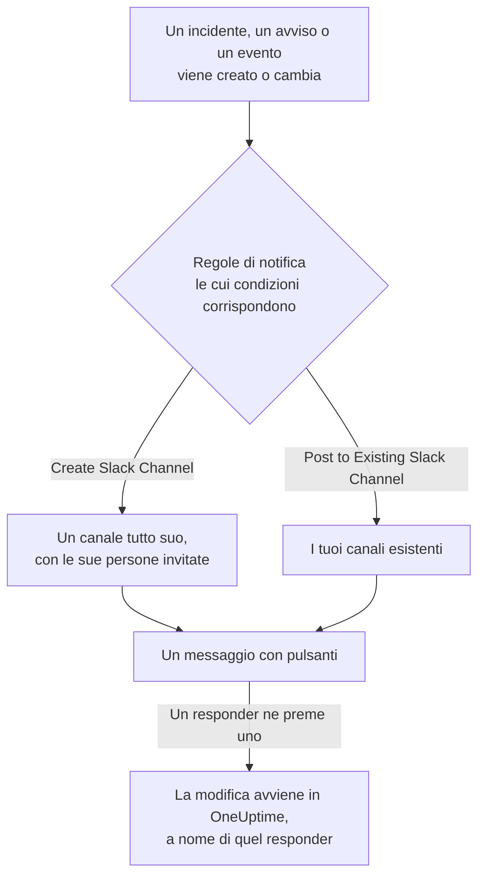

# Slack

Collega OneUptime a Slack per pubblicare nei tuoi canali incidenti, avvisi, episodi, manutenzioni programmate, monitor e aggiornamenti di reperibilità, dare a ogni incidente un canale tutto suo e lasciare che i responder agiscano senza uscire da Slack: riconoscere, risolvere, aggiungere note, chiamare la reperibilità e dichiarare incidenti.

:::cards
- [Collegare Slack](#collegare-slack): Installa OneUptime nel tuo workspace, poi collega il tuo account.
- [Regole di notifica](#regole-di-notifica): Decidi quali eventi vengono pubblicati dove, e quali hanno un canale tutto loro.
- [Creare incidenti e manutenzioni da Slack](#creare-incidenti-e-manutenzioni-da-slack): `/incident` e `/maintenance`, a tuo nome.
- [Agire su incidenti, avvisi ed eventi da Slack](#agire-su-incidenti-avvisi-ed-eventi-da-slack): I pulsanti dei messaggi di OneUptime.
:::

## Come funziona

Due collegamenti rendono tutto possibile:

- **Il collegamento del progetto**, fatto una volta: l'app di OneUptime installata nel tuo workspace Slack. Pubblica i messaggi, crea i canali e invita le persone.
- **Il collegamento di ogni persona**: il suo account Slack collegato al suo account OneUptime. Pulsanti, comandi e reazioni con emoji agiscono a nome di quella persona, con i suoi permessi nel progetto.

## Prima di iniziare

- **Un ruolo che può collegare il progetto:** **Project Owner**, **Project Admin** o **Project Member**. Disinstallare l'app richiede **Project Owner** o **Project Admin**.
- **Un workspace Slack** in cui puoi installare app.
- **Il piano Growth su OneUptime Cloud** per le regole di notifica e i riepiloghi. Vedi [Regole di notifica sotto il piano Growth](#regole-di-notifica-sotto-il-piano-growth).
- **Su un server self-hosted,** prima un'app Slack configurata per esso. Vedi [Integrazione Slack](/docs/self-hosted/slack-integration).

## Collegare Slack

:::steps
### Installare OneUptime nel tuo workspace Slack

Vai in **Impostazioni del progetto** > **Area di lavoro** > **Slack** e fai clic su **Connect with Slack**. Scegli il workspace e autorizza OneUptime. Slack ti riporta alla stessa pagina, che ora indica il workspace a cui è collegato il progetto. Finché nessun workspace è collegato, la sezione **Area di lavoro** dei menu Incidenti, Avvisi, Manutenzione programmata, Monitor e Reperibilità contiene **Collega Slack o Teams**, che porta anch'esso qui.

### Collegare il tuo account Slack

Installare l'app collega l'account di chi l'ha installata. Tutti gli altri collegano il proprio account Slack in **Impostazioni utente** > **Area di lavoro** > **Slack** con **Connect my account with Slack**, per agire sugli incidenti e ricevere messaggi diretti a proprio nome. Quella sezione compare non appena il progetto è collegato a Slack.

### Aggiungere una regola di notifica

Vai in **Incidenti** > **Area di lavoro** > **Slack**. La sezione **Area di lavoro** elenca solo gli spazi di chat che il tuo progetto ha collegato, quindi **Slack** vi compare non appena è collegato. Crea una regola, per esempio una che crea un canale Slack per ogni nuovo incidente e invita i proprietari dell'incidente. Vedi [Regole di notifica](#regole-di-notifica).

### Provare la regola

Fai clic su **Regola di test** nella riga della regola. Un messaggio di prova arriva nei canali indicati dalla regola. Vedi [Provare una regola](#provare-una-regola).
:::

## Regole di notifica

Una regola di notifica dice quali eventi vengono pubblicati in Slack, e dove. Ogni prodotto ha le sue regole, in **Area di lavoro** > **Slack** nel suo menu:

| Prodotto | Schede della sua pagina **Slack** |
| --- | --- |
| **Incidenti** | **Incidenti**, **Incidente Episodi**, **Summary** |
| **Avvisi** | **Avvisi**, **Avviso Episodi**, **Summary** |
| **Manutenzione programmata** | Un elenco di regole |
| **Monitor** | Un elenco di regole |
| **Reperibilità** | Un elenco di regole |

Creare una regola passa per quattro passaggi:

| Passaggio | Cosa imposti |
| --- | --- |
| **Base** | **Nome della regola** e **Descrizione della regola**. |
| **Condizioni** | Per quali eventi scatta la regola, per esempio per gravità, stato, etichetta, monitor o parole nel titolo. Senza condizioni scatta per ogni evento. Con due o più, **Condizione di corrispondenza** dice se devono corrispondere tutte o ne basta una. |
| **Destinazione** | Dove pubblica: **Post to Existing Slack Channel** con i nomi dei canali, **Create Slack Channel** con il nome del nuovo canale e chi viene invitato, o entrambi. |
| **Video Call** | Solo incidenti e avvisi: avvia una chiamata per ciascuno. Vedi [Videochiamate](/docs/workspace-connections/video-calls). |

Un canale creato dalla regola prende il nome da **New Slack Channel Name** seguito dal numero del record, come `oneuptime-incident-42`, e solo un canale creato riceve le persone che la regola invita: i proprietari del record, i team e gli utenti scelti e, per incidenti e avvisi, le persone di reperibilità man mano che vengono chiamate. Un incidente, un avviso o un episodio privato riceve un canale privato. Ogni aggiornamento successivo del record — un cambio di stato, una nota, un nuovo proprietario — viene pubblicato nei suoi canali e nei canali esistenti indicati dalle sue regole. Un incidente, un avviso o un episodio creato già risolto non riceve un canale tutto suo; il suo messaggio di creazione va comunque nei canali indicati dalle tue regole. Vedi [Dichiarato già riconosciuto o risolto](/docs/incidents/declaring-incidents#dichiarato-già-riconosciuto-o-risolto).

**Impostazioni del progetto** > **Area di lavoro** > **Slack** elenca i canali che OneUptime può vedere, con **Invia prova** accanto a ciascuno. OneUptime entra da solo in un canale pubblico la prima volta che vi pubblica. Un canale privato viene elencato, e può ricevere messaggi, solo dopo che l'app di OneUptime vi è stata invitata in Slack.

## Provare una regola

**Regola di test** nella riga di una regola pubblica un messaggio di prova di quella regola nei canali che indica, così puoi vederlo arrivare. Se la regola crea un canale per ogni evento, anche la prova ne crea uno e vi invita le persone della regola.

Come **Invia prova** accanto a un canale in **Impostazioni del progetto** > **Area di lavoro** > **Slack**, richiede il permesso di creare regole di notifica: **Project Owner**, **Project Admin**, **Project Member**, **Settings Admin**, **Settings Member**, oppure **Create Workspace Notification Rule** e **Read Workspace Notification Rule** in un ruolo personalizzato. Per chi può solo vedere le regole, come un **Viewer**, **Regola di test** è bloccato, e il suo suggerimento dice cosa serve; l'API rifiuta la sua prova con "You do not have permission to send test notifications in this project." Su OneUptime Cloud, provare una regola richiede il piano **Growth**, come aggiungerne una.

Su OneUptime Cloud, anche **Invia prova** accanto a un canale richiede il piano **Growth**, perché pubblicare in un canale è ciò che fanno regole e riepiloghi. **Invia prova ora** su un riepilogo richiede il permesso di creare riepiloghi (**Create Workspace Notification Summary** e **Read Workspace Notification Summary** in un ruolo personalizzato) e, su OneUptime Cloud, il piano **Growth**; per chiunque altro è bloccato, e il suo suggerimento dice cosa serve. Un client MCP collegato con accesso in sola lettura non può inviare alcuna prova.

## Riepiloghi

La scheda **Summary** di **Incidenti** > **Area di lavoro** > **Slack** (e di **Avvisi**) pubblica un riepilogo periodico nei canali che indichi: quanti incidenti o avvisi ci sono stati, quanto in fretta sono stati riconosciuti e risolti, e un elenco con i link. Un nuovo riepilogo esce ogni settimana e copre gli ultimi 7 giorni. Lascia vuoto **Invia il primo report alle** e il primo esce alle 09:00 all'inizio della settimana, del giorno o del mese successivo; il modulo dice quando.

Un riepilogo esce secondo l'orologio del suo **Fuso orario**, che parte dal tuo. Lì mantiene la sua ora del giorno tutto l'anno: uno impostato per le 09:00 a Berlino esce ancora alle 09:00 a Berlino dopo il cambio dell'ora legale, e anche le date del suo messaggio sono quelle di Berlino. Tramite l'API, invia `timezone` come nome di fuso orario IANA, come `Europe/Berlin`. Un riepilogo creato senza fuso orario prende quello del profilo di chi l'ha creato, oppure UTC quando lo crea una chiave API.

Il modulo di un riepilogo ha quattro passaggi: **Informazioni di base** (il nome e i canali), **Pianificazione**, **Contenuto** (**Cosa includere**) e **Filtri** (quali incidenti o avvisi conta).

## Regole di notifica sotto il piano Growth

Su OneUptime Cloud, le regole di notifica e i riepiloghi sono disponibili dal piano **Growth** in su. Un progetto al di sotto conserva le regole e i riepiloghi che ha già, e questi continuano a pubblicare in Slack. Per questo la pagina **Slack** di ogni prodotto (Incidenti, Avvisi, Manutenzione programmata, Reperibilità, Monitor) mostra la nota sul piano con questi elencati sotto (**Regole di notifica ancora configurate**, **Riepiloghi ancora configurati**): elimina una regola, oppure disattiva o elimina un riepilogo. Aggiungere o modificare regole e riepiloghi richiede **Growth**.

## Ricevere chiamate in Slack

Per essere chiamato con un messaggio diretto quando sei di reperibilità, aggiungi Slack ai tuoi metodi di notifica:

:::steps
1. Collega il tuo account Slack (vedi [Collegare Slack](#collegare-slack)).
2. Vai in **Impostazioni utente** > **Metodi di notifica**, apri la scheda **Workspace Apps** e fai clic su **Add Slack Account**.
3. Fai clic su **Send Test Message** nella sua riga. Il messaggio arriva nei tuoi messaggi diretti di Slack.
:::

Aggiungerlo lo inserisce subito nelle tue regole di reperibilità, quindi da quel momento le chiamate ti raggiungono in Slack. Cambia quali chiamate riceve in **Impostazioni utente** > **Regole di reperibilità**.

## Salvare i messaggi come note

Reagisci a un messaggio nel canale di un incidente, di un avviso, di un episodio o di un evento di manutenzione programmata, e OneUptime lo salva come nota su quel record, poi lo conferma con una risposta nel thread:

| Reazione | Salvato come |
| --- | --- |
| 📌 Un'emoji di puntina, o il comando **Pin to channel** di Slack | Una nota privata, visibile solo al tuo team |
| 📢 Un'emoji di megafono o di altoparlante | Una nota pubblica, mostrata sulla pagina di stato. Solo incidenti ed eventi di manutenzione programmata. |

La nota viene salvata a tuo nome, con i tuoi permessi, quindi il tuo account Slack deve essere collegato. Un messaggio viene salvato una sola volta, per quante persone reagiscano.

## Chiedere a OneUptime AI da Slack

Fai domande su log, trace, metriche, incidenti e monitor in linguaggio naturale. Menziona OneUptime con @ in un canale, o mandagli un messaggio diretto, e risponde nel thread; rispondi lì per chiedere altro. `/oneuptime ask which monitors are down?` pubblica la sua risposta nel canale. Entrambi richiedono il tuo account Slack collegato e l'IA attivata per il progetto. Le risposte in Slack si limitano a leggere: per cambiare qualcosa, usa i pulsanti. Vedi [Chiedi all'IA](/docs/ai/ask-ai).

## Creare incidenti e manutenzioni da Slack

`/incident` e `/maintenance` aprono un modulo che compili e invii a tuo nome: come l'account OneUptime a cui è collegato il tuo account Slack (vedi [Collegare Slack](#collegare-slack)), con i permessi di quell'account nel progetto. Se il tuo account Slack non è collegato, o il tuo account OneUptime non è più membro del progetto, OneUptime ti dice in un messaggio diretto cosa fare, e nessun modulo si apre. Le scorciatoie **Create New Incident** e **Create Scheduled Event** aprono gli stessi moduli.

- **Chi può usarli.** Le persone che possono dichiarare un incidente o creare un evento di manutenzione programmata in OneUptime: **Project Owner**, **Project Admin**, **Project Member**, **Incident Admin** e **Incident Member** per un incidente (**Create Incident** in un ruolo personalizzato), e **Scheduled Maintenance Admin** e **Scheduled Maintenance Member** per un evento (**Create Scheduled Maintenance**). A chiunque altro viene detto in un messaggio diretto, e nessun modulo si apre.
- **Cosa offre un modulo.** Ogni elenco — gravità, monitor, stati dei monitor, policy di reperibilità ed etichette — contiene ciò che puoi leggere, come lo stesso elenco in OneUptime: con un ruolo limitato ad alcune etichette, i monitor e le policy di reperibilità che portano quelle etichette. Un elenco che non puoi leggere affatto viene omesso dal modulo. Le policy di reperibilità archiviate non vengono mai offerte.
- **Cosa può indicare un modulo.** L'incidente o l'evento viene creato con i tuoi permessi e attribuito a te. Un monitor, una policy di reperibilità, un'etichetta, una gravità o uno stato che non puoi leggere, o uno di un altro progetto, viene rifiutato come uno che il progetto non ha, anche da un modulo aperto prima che il tuo accesso cambiasse, e non viene creato nulla. OneUptime ti spiega il motivo in un messaggio diretto.

**Execute On-Call Policy** su un incidente, un avviso o un episodio funziona allo stesso modo: richiede il permesso di eseguire una policy di reperibilità (**Project Owner**, **Project Admin**, **Project Member**, **On-Call Admin** e **On-Call Member**, oppure **Create On-Call Duty Policy Execution Log** in un ruolo personalizzato) e di leggere quell'incidente, avviso o episodio, e offre le policy di reperibilità attive che puoi leggere.

## Agire su incidenti, avvisi ed eventi da Slack

Anche i pulsanti dei messaggi Slack di OneUptime agiscono a tuo nome: come l'account OneUptime a cui è collegato il tuo account Slack, con i permessi di quell'account nel progetto. **Acknowledge**, **Resolve**, **Change State**, **Add Note** ed **Execute On-Call Policy** su un incidente, un avviso o un episodio, e **Mark as Ongoing**, **Mark as Complete**, **Change State** e **Add Note** su un evento di manutenzione programmata, fanno ciascuno la modifica che la stessa azione fa in OneUptime, e lì viene attribuita a te: la cronologia degli stati e il feed del record mostrano che hai cambiato il suo stato, e la nota è tua. Una nota salvata da un messaggio con una reazione emoji viene pubblicata allo stesso modo.

- **Chi può usarli.** Le persone che possono fare la stessa modifica in OneUptime. Riconoscere, risolvere o cambiare lo stato di un incidente richiede il permesso di cambiarne lo stato: **Project Owner**, **Project Admin**, **Project Member**, **Incident Admin** e **Incident Member**, oppure **Create Incident State Timeline** in un ruolo personalizzato. Un avviso, un episodio o un evento di manutenzione programmata richiede lo stesso permesso per il proprio tipo (**Create Alert State Timeline**, per esempio), e una nota richiede il permesso di pubblicare quel tipo di nota. A chiunque altro viene detto in un messaggio diretto, e non cambia nulla.
- **Quali record.** Quelli che puoi leggere, come in OneUptime: con un ruolo limitato ad alcune etichette, gli incidenti, gli avvisi, gli episodi e gli eventi che le portano. Un pulsante su qualsiasi altro record, o su uno di un altro progetto, riceve come risposta che il record "was not found in this project, or you do not have access to it.", e non cambia nulla. Su OneUptime Cloud, una modifica che il piano del progetto non include viene rifiutata indicando il piano che richiede.
- **Cosa offre Change State.** Gli stati che puoi leggere in cui il record può passare dopo, nell'ordine del progetto: nessuno precedente allo stato in cui si trova, per un episodio come per un incidente, un avviso o un evento di manutenzione programmata, poiché un cambio di stato non fa mai risalire un record nel suo elenco (vedi [L'ordine è un vincolo reale, non una preferenza di visualizzazione](/docs/incidents/states-and-severities#lordine-è-un-vincolo-reale-non-una-preferenza-di-visualizzazione)). Se non puoi leggerne nessuno, ti viene detto "No incident states are available to you in this project. Ask a project admin for access to them."; quando il record è nell'ultimo stato che può raggiungere, ti viene detto "There is no later state to move this incident to." Nessuno dei due apre un modulo vuoto.

## Scollegare

- **Disconnect** scollega solo il tuo account Slack, e rimuove con esso il tuo metodo di notifica Slack.
- **Uninstall OneUptime from Slack**, in **Impostazioni del progetto** > **Area di lavoro** > **Slack**, scollega il progetto. OneUptime smette di pubblicare in Slack, e i menu **Area di lavoro** smettono di elencarlo. Le regole di notifica e i riepiloghi vengono conservati per quando lo ricolleghi.

> [!WARNING]
> Disinstallare scollega anche l'account Slack di ogni membro del progetto, e rimuove i metodi di notifica Slack e le regole di reperibilità che li usavano. Chi veniva chiamato in Slack viene chiamato sugli altri suoi metodi di notifica finché non aggiunge di nuovo Slack.

## Risoluzione dei problemi

:::details Una regola non pubblica nulla
Controlla le condizioni della regola con **Regola di test**: se la prova arriva, le condizioni della regola non corrispondevano all'evento. Se non arriva, la pagina Slack dice perché. Per un canale privato, invita prima l'app di OneUptime in Slack. Ogni messaggio che OneUptime pubblica, e ognuno che Slack ha rifiutato, è elencato in **Impostazioni del progetto** > **Notifiche** > **Registri di notifica**, nella scheda **Area di lavoro**.
:::

:::details Slack non è stato collegato
Quando Slack ti riporta indietro senza un collegamento, la pagina da cui sei partito dice **Slack non è stato connesso**, e una frase dice perché: ti manca il permesso, il link è stato già usato o è scaduto, hai effettuato l'accesso a un altro workspace, oppure il server non è configurato per Slack. Vedi [La connessione non è stata completata](/docs/self-hosted/slack-integration#la-connessione-non-è-stata-completata) per ogni frase e cosa fare.
:::

:::details Un pulsante o un comando dice che il mio account Slack non è collegato
Collegalo in **Impostazioni utente** > **Area di lavoro** > **Slack** con **Connect my account with Slack**. Se non sei più membro del progetto, OneUptime lo dice invece, e non agisce su nulla per te.
:::

:::details Le notifiche arrivano, ma pulsanti e comandi non fanno nulla
Su un server self-hosted, Slack deve poter raggiungere OneUptime per pulsanti, moduli e comandi; le notifiche richiedono solo l'accesso in uscita. Vedi [Accesso di rete per le installazioni self-hosted](/docs/self-hosted/slack-integration#accesso-di-rete-per-le-installazioni-self-hosted).
:::

## Passaggi successivi

:::cards
- [Microsoft Teams](/docs/workspace-connections/microsoft-teams): Le stesse notifiche e azioni in Microsoft Teams.
- [Videochiamate](/docs/workspace-connections/video-calls): Dai a ogni incidente una chiamata, pubblicata con i suoi aggiornamenti.
- [Integrazione Slack](/docs/self-hosted/slack-integration): Configurare l'app Slack su un server self-hosted.
- [Dichiarare un incidente](/docs/incidents/declaring-incidents): Tutti i modi in cui inizia un incidente, e cosa viene eseguito allora.
:::
