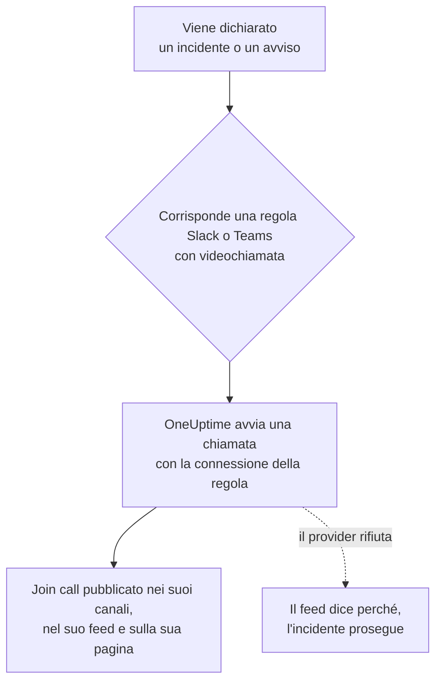

# Videochiamate

Dai a ogni incidente e a ogni avviso la sua chiamata. Quando una regola di notifica di Slack o Microsoft Teams scatta per un nuovo incidente o avviso, OneUptime avvia una riunione dedicata (una riunione Zoom, un Google Meet, una riunione di Microsoft Teams o l'huddle del canale Slack dell'incidente) e pubblica un pulsante **Join call** ovunque vadano gli aggiornamenti dell'incidente. I responder si uniscono con un clic, e nessuno deve creare una riunione alle 3 di notte e far girare il link.

:::cards
- [Come funziona](#come-funziona): Una regola avvia la chiamata, e i responder si uniscono da dove si trovano.
- [Collegare con un clic](#collegare-con-un-clic): Zoom, Google Meet o Microsoft Teams, effettuando l'accesso.
- [Provider](#provider): L'identità di servizio della tua app, un link di riunione permanente o un huddle di Slack.
- [Avviare una chiamata a mano](#avviare-una-chiamata-a-mano): Dalla pagina di un incidente o di un avviso.
:::

## Come funziona



:::steps
### Collegare un provider

Vai in **Impostazioni del progetto** > **Area di lavoro** > **Video Calls** e collega Zoom, Google Meet o Microsoft Teams, oppure aggiungi un link di riunione permanente. Su OneUptime Cloud, collegare Zoom, Google Meet o Microsoft Teams è un clic: accedi e consenti a OneUptime di creare riunioni (vedi [Collegare con un clic](#collegare-con-un-clic)). Gli huddle di Slack non richiedono altro che il collegamento Slack del progetto.

### Attivarla in una regola

Apri una regola di notifica di Slack o Microsoft Teams per incidenti o avvisi (**Incidenti** > **Area di lavoro** > **Slack**, per esempio). Nel passaggio **Video Call** della regola, attiva **Start a video call for the incident** e scegli dove si tiene la chiamata.

### Unirsi con un clic

Quando la regola scatta, OneUptime avvia una chiamata per l'incidente e la pubblica con un pulsante **Join call** nei canali in cui vanno gli aggiornamenti dell'incidente e nel feed dell'incidente. La pagina dell'incidente mostra la chiamata nella sua scheda **Video Call** e un pulsante **Join call** nella sua intestazione.
:::

Le condizioni della regola decidono quali incidenti ricevono una chiamata. Per un bridge solo sugli incidenti Sev1, dai alla regola una condizione **Gravità**. Le chiamate partono per gli incidenti e gli avvisi dichiarati in corso. Un incidente creato già risolto non riceve chiamate.

### Una chiamata per incidente

Una chiamata viene avviata una volta per incidente per ogni luogo in cui si tiene una chiamata. Le regole che scelgono la stessa connessione condividono una chiamata, e una regola non avvia mai una seconda chiamata per un incidente che ne ha già una da quella connessione. Le regole che scelgono luoghi diversi avviano ciascuna la propria chiamata, per esempio una riunione Zoom per i responder e l'huddle del canale Slack dell'incidente.

### Quando una chiamata non può partire

Dichiarare un incidente non aspetta mai un provider di videochiamate. La chiamata viene avviata dopo la creazione dell'incidente, quindi un provider lento o in errore non ritarda mai l'incidente né le sue notifiche di reperibilità.

Se il provider rifiuta (un segreto scaduto, un permesso mancante, un host eliminato), il feed dell'incidente dice che la chiamata della regola non è potuta partire, con il motivo del provider, così i responder sanno di avviarne una dalla pagina dell'incidente. L'esecuzione della regola compare nei registri di notifica del workspace come **Avvia videochiamata**, e la riga della connessione in **Impostazioni del progetto** > **Area di lavoro** > **Video Calls** mostra l'errore finché una chiamata non riparte.

### Incidenti privati

Una riunione prende il nome dell'incidente per cui è creata, con il suo numero e il suo titolo, e la sua descrizione rimanda all'incidente. Per un incidente privato il titolo viene omesso, perché tutte le persone invitate alla riunione possono leggerne il nome.

## Collegare con un clic

Su OneUptime Cloud, collegare Zoom, Google Meet o Microsoft Teams richiede un clic e niente da configurare presso il provider:

:::steps
1. Vai in **Impostazioni del progetto** > **Area di lavoro** > **Video Calls** e fai clic su **Collega** su Zoom, Google Meet o Microsoft Teams.
2. Fai clic su **Continue to Zoom** (o Google, o Microsoft), accedi e consenti a OneUptime di creare riunioni.
3. Torni alla pagina delle videochiamate con la connessione fatta. **Start a test meeting** la verifica da capo a fondo; poi scegli la connessione in una regola di notifica di Slack o Microsoft Teams.
:::

Ogni riunione viene creata a nome dell'account con cui accedi, che ne è l'host. Accedi con un account condiviso, come incidents@example.com, invece che con il tuo, così le chiamate continuano a partire quando qualcuno se ne va. La riga della connessione mostra con quale account ha effettuato l'accesso.

| Provider | Accedere con | Cosa può fare OneUptime |
| --- | --- | --- |
| Zoom | Un utente Zoom. Le riunioni ospitate da un utente Basic (gratuito) terminano dopo 40 minuti. | Creare riunioni per quell'utente (`meeting:write:meeting`) e leggere chi è (`user:read:user`). |
| Google Meet | Un account Google che può usare Google Meet. | Creare spazi Meet a nome di quell'account (`meetings.space.created`) e leggerne l'indirizzo email. |
| Microsoft Teams | Un account aziendale o dell'istituto con Microsoft Teams. Gli account Microsoft personali non possono creare riunioni di Teams. | Creare riunioni online a nome di quell'account (il permesso delegato `OnlineMeetings.ReadWrite`) e restare connesso (`offline_access`). |

Una connessione fatta effettuando l'accesso ha comunque le impostazioni che decidono chi aspetta: **Who can join** per Google Meet e **Who skips the lobby** per Microsoft Teams. Cambiale con **Modifica** nella riga della connessione.

### Restare connessi

OneUptime conserva il token di aggiornamento dell'accesso, cifrato, e lo rinnova almeno una volta a settimana, quindi non scade mai per inutilizzo, per quanto a lungo il progetto resti senza incidenti. Se l'accesso smette di funzionare (l'account ha rimosso OneUptime, è stato eliminato o sospeso, oppure i criteri della tua organizzazione gli chiedono di accedere di nuovo), la riga della connessione mostra **Not working** con il motivo il giorno in cui OneUptime se ne accorge, non al prossimo incidente. **Reconnect** nella riga effettua di nuovo l'accesso.

Le connessioni che hanno effettuato l'accesso con lo stesso account condividono un solo accesso, in tutti i progetti: Zoom conserva un solo accesso per account, quindi collegare di nuovo lo stesso utente Zoom lo sostituisce per tutte.

### Ricollegare e rimuovere

**Reconnect** nella riga di una connessione effettua di nuovo l'accesso, con lo stesso account o con un altro. Usalo dopo che l'account ha rimosso OneUptime, o per spostare le riunioni degli incidenti su un altro account.

Eliminare una connessione revoca l'accesso di OneUptime presso Zoom e Google non appena nessun'altra connessione usa quell'accesso. Per Microsoft, rimuovi OneUptime in **My Apps** (myapps.microsoft.com) dell'account. Rimuovere OneUptime dal tuo account Zoom nello Zoom App Marketplace elimina il suo accesso da tutte le connessioni che lo usavano con quell'account, che mostrano **Not working** finché non vengono ricollegate.

### Se Microsoft chiede un amministratore

Alcune organizzazioni Microsoft 365 consentono solo agli amministratori di approvare le app. Se Microsoft dice che serve l'approvazione di un amministratore, chiedi a un amministratore di Microsoft 365 di collegare Microsoft Teams, oppure di approvare OneUptime nell'[interfaccia di amministrazione di Microsoft Entra](https://entra.microsoft.com/) in **Enterprise applications** > **Admin consent requests**.

### Usare invece la tua app

Per collegarti con un'identità di servizio invece che con l'accesso di una persona — un'app Zoom Server-to-Server OAuth, un account di servizio Google con delega a livello di dominio o una registrazione di app di Microsoft Entra — fai clic su **Use your own Zoom app** (o Google, o Microsoft) nella finestra Collega. [Provider](#provider) spiega ciascuno. Su un server self-hosted senza app con un clic configurate, **Collega** apre direttamente questo modulo; vedi [Collegare con un clic su un server self-hosted](#collegare-con-un-clic-su-un-server-self-hosted) per configurarle.

## Avviare una chiamata a mano

La scheda **Video Call** sulla pagina di un incidente o di un avviso ha **Start call** (o **Start another** quando ce n'è già una). Scegli una delle connessioni del progetto, l'huddle del canale Slack dell'incidente, oppure incolla un tuo link di riunione. La chiamata viene pubblicata nei canali e nel feed dell'incidente come una avviata da una regola.

**Rimuovi** sulla scheda toglie una chiamata dalla pagina dell'incidente. La riunione in sé non viene eliminata, e chiunque abbia il link può ancora unirsi.

Avviare e rimuovere chiamate richiede il permesso di lavorare sugli incidenti (o sugli avvisi): **Project Owner**, **Project Admin**, **Project Member**, **Incident Admin** o **Incident Member**, oppure **Create Incident Video Call** e **Delete Incident Video Call** in un ruolo personalizzato. Tutti quelli che possono leggere l'incidente vedono le sue chiamate.

## Provider

Questa sezione riguarda il collegamento di un provider con l'identità di servizio della tua app: un'app Zoom Server-to-Server OAuth, un account di servizio Google, una registrazione di app di Microsoft Entra. Un'identità di servizio non dipende mai da una persona, quindi continua a funzionare chiunque se ne vada. Per collegarti effettuando l'accesso, vedi invece [Collegare con un clic](#collegare-con-un-clic).

Le credenziali sono cifrate a riposo e l'API non le restituisce mai. Quando modifichi una connessione, una credenziale lasciata vuota mantiene quella salvata.

**Start test meeting** nel modulo della connessione, e **Test** nella riga di una connessione, creano una vera riunione con le impostazioni della connessione e ne mostrano il link. È l'unica verifica che dimostra che le credenziali, il permesso presso il provider e l'host funzionano insieme. Non viene pubblicato nulla da nessuna parte.

Collegare un provider richiede **Project Owner**, **Project Admin** o **Settings Admin**, oppure **Create Video Call Connection** ed **Edit Video Call Connection** in un ruolo personalizzato.

### Zoom

OneUptime crea una riunione Zoom per ogni incidente tramite un'app Zoom **Server-to-Server OAuth**, ospitata da un utente Zoom con licenza a tua scelta.

:::steps
1. Nello [Zoom App Marketplace](https://marketplace.zoom.us/), scegli **Develop** > **Build App** e crea un'app **Server-to-Server OAuth**. Crearne una richiede un amministratore dell'account Zoom, o un ruolo che consenta le app Server-to-Server OAuth.
2. Nella pagina **Scopes** dell'app, aggiungi **meeting:write:meeting:admin** (creare una riunione per un utente). Un'app creata prima degli scope granulari può usare invece **meeting:write:admin**.
3. Fai clic su **Activate** per attivare l'app, poi copia **Account ID**, **Client ID** e **Client secret** dalla sua pagina **App Credentials** nel modulo della connessione.
4. Inserisci il **Meeting host**: l'email di un utente Zoom con licenza, idealmente un account di servizio come incidents@example.com, così le riunioni continuano a funzionare quando qualcuno se ne va. Le riunioni ospitate da un utente Basic (gratuito) terminano dopo 40 minuti.
5. I responder si uniscono senza aspettare l'host, perché l'host è un account di servizio che non si unisce mai. Assicurati che l'impostazione **Waiting room** del tuo account Zoom non sia bloccata su attivo, altrimenti nessuno può entrare.
:::

| Campo | Dove trovarlo |
| --- | --- |
| Account ID | La pagina **App Credentials** dell'app |
| Client ID | La pagina **App Credentials** dell'app |
| Client secret | La pagina **App Credentials** dell'app |
| Meeting host | L'email dell'utente Zoom con licenza che ospita ogni riunione |

### Google Meet

OneUptime crea un Google Meet per ogni incidente con la Google Meet REST API, tramite un account di servizio Google Cloud che agisce come un utente Google Workspace grazie alla delega a livello di dominio.

:::steps
1. Nella [console Google Cloud](https://console.cloud.google.com/), scegli o crea un progetto e abilita per esso la **Google Meet REST API**.
2. In **IAM & Admin** > **Service accounts**, crea un account di servizio. Aprilo, vai in **Keys** > **Add key** > **Create new key**, scegli **JSON** e incolla il file scaricato nel modulo della connessione come **Service account JSON key**.
3. Nella [Console di amministrazione Google](https://admin.google.com/), apri **Security** > **Access and data control** > **API controls** > **Manage Domain Wide Delegation** e fai clic su **Add new**. Inserisci il **Client ID** numerico dell'account di servizio e lo scope `https://www.googleapis.com/auth/meetings.space.created`.
4. Inserisci in **Create meetings as** l'utente Google Workspace a nome del quale agisce l'account di servizio: un account dedicato come incidents@example.com. Ogni riunione appartiene a questo utente.
:::

**Who can join** decide chi si unisce senza chiedere: con **People in your organization join directly, others ask to join** (il valore predefinito), le persone esterne al tuo Google Workspace chiedono di unirsi e qualcuno nella chiamata le ammette. Con **Anyone with the link joins directly**, nessuno aspetta.

La delega a livello di dominio può richiedere qualche minuto per entrare in funzione. Se subito dopo aver aggiunto la delega la prova segnala che Google non ha consentito all'account di servizio di agire come l'utente, aspetta qualche minuto e riprova.

### Microsoft Teams

OneUptime crea una riunione di Microsoft Teams per ogni incidente con Microsoft Graph, tramite una registrazione di app di Microsoft Entra che organizza le riunioni per conto di un utente di Teams con licenza.

:::steps
1. Nell'[interfaccia di amministrazione di Microsoft Entra](https://entra.microsoft.com/), apri **App registrations** > **New registration** e registra un'app a tenant singolo. Copia il suo **Directory (tenant) ID** e il suo **Application (client) ID**.
2. In **API permissions**, aggiungi il permesso Microsoft Graph di tipo **application** **OnlineMeetings.ReadWrite.All**, poi fai clic su **Grant admin consent**.
3. In **Certificates & secrets**, crea un segreto client e incolla il suo **Value**, non il suo Secret ID, nel modulo della connessione come **Client secret**.
4. Scegli l'organizzatore: un utente di Teams con licenza, idealmente un account di servizio. Copia il suo **Object ID** da **Users** nell'interfaccia di amministrazione di Entra in **Organizer object ID**.
5. Consenti all'app di creare riunioni per l'organizzatore con un criterio di accesso alle applicazioni. In Teams PowerShell, dopo `Connect-MicrosoftTeams`, esegui i due comandi qui sotto.
:::

```powershell
New-CsApplicationAccessPolicy -Identity OneUptime-Meetings -AppIds "<application-client-id>"
Grant-CsApplicationAccessPolicy -PolicyName OneUptime-Meetings -Identity "<organizer-object-id>"
```

Il criterio può richiedere fino a 30 minuti per essere applicato. Fino ad allora, la prova segnala che l'app non è autorizzata a creare riunioni per l'organizzatore.

**Who skips the lobby** decide chi si unisce senza aspettare: con **People in your organization skip the lobby** (il valore predefinito), chiunque altro aspetta nella sala d'attesa finché qualcuno nella riunione non lo ammette. Con **Everyone skips the lobby**, nessuno aspetta.

### Link di riunione

Un link di riunione permanente è la stessa stanza per ogni incidente: una stanza riunioni personale di Zoom, una riunione ricorrente di Microsoft Teams o Google Meet, una stanza personale di Webex o una stanza Jitsi. Non viene creato nulla per incidente, quindi non c'è nulla da autorizzare.

:::steps
1. Crea una riunione che non scade mai nello strumento che il tuo team usa già.
2. Incolla il suo link https per partecipare nel modulo della connessione come **Meeting link**.
:::

Ogni incidente e ogni avviso avviati con questa connessione condividono la stanza, quindi anche due incidenti contemporanei la condividono. Assicurati che la riunione permetta di unirsi senza l'host.

### Huddle di Slack

Una regola Slack può invece avviare l'huddle del canale Slack dell'incidente. Non c'è nulla da collegare: scegli **Slack huddle** nel passaggio **Video Call** della regola.

L'huddle si tiene nel canale che la regola crea per l'incidente oppure, quando la regola pubblica invece in canali esistenti, nel primo di essi. Quindi la regola deve creare un canale o pubblicare in uno esistente. Il pulsante **Join huddle** apre l'huddle del canale in Slack. Il primo responder che lo apre avvia l'huddle, e tutti quelli dopo vi si uniscono. Slack non offre a un'app alcun modo di avviare un huddle, quindi nell'huddle non c'è nessuno finché qualcuno non lo apre.

Un huddle di Slack è solo per le regole Slack. Una regola di Microsoft Teams avvia le sue chiamate con una delle connessioni di videochiamata del progetto.

## Usare l'API

Una chiamata è un record sull'incidente (`IncidentVideoCall`) o sull'avviso (`AlertVideoCall`). Creane uno con l'`_id` dell'incidente e uno di questi:

- `videoCallConnectionId`: avvia una nuova riunione con quella connessione.
- `provider` impostato su `SlackHuddle`: l'huddle del canale Slack dell'incidente.
- `joinUrl` (e facoltativamente `title`): un tuo link di riunione.

```json
{
  "data": {
    "projectId": "<project-id>",
    "incidentId": "<incident-id>",
    "videoCallConnectionId": "<connection-id>"
  }
}
```

`POST /api/video-call-connection/test` avvia una riunione di prova con una connessione salvata (`{ "connectionId": "..." }`) o con impostazioni non ancora salvate (`{ "provider": "Zoom", "config": { ... }, "secrets": { ... } }`), e restituisce il suo `joinUrl`.

L'`authMethod` di una connessione dice come effettua l'accesso: `OAuth` per una fatta effettuando l'accesso, `AppCredentials` per una con le credenziali della tua app, e niente per un link di riunione. Una connessione fatta effettuando l'accesso si crea solo effettuando l'accesso, nella dashboard. Tramite l'API puoi rinominarla e cambiarne il `config`, e il suo `connectedAccount` dice con quale account ha effettuato l'accesso.

## Collegare con un clic su un server self-hosted

OneUptime Cloud ha le proprie app Zoom, Google e Microsoft per il collegamento con un clic. Un server self-hosted lo offre per ogni provider di cui configuri l'app. Senza, **Collega** apre il modulo per la tua app.

Crea un'app OAuth per provider e registra in essa questo URI di reindirizzamento, con l'host del tuo server:

| Provider | URI di reindirizzamento | Variabili d'ambiente | Valori Helm |
| --- | --- | --- | --- |
| Zoom | `https://<host>/api/video-call-oauth/zoom/callback` | `ZOOM_APP_CLIENT_ID`, `ZOOM_APP_CLIENT_SECRET`, `ZOOM_APP_WEBHOOK_SECRET_TOKEN` | `zoomApp.clientId`, `zoomApp.clientSecret`, `zoomApp.webhookSecretToken` |
| Google Meet | `https://<host>/api/video-call-oauth/google-meet/callback` | `GOOGLE_MEET_APP_CLIENT_ID`, `GOOGLE_MEET_APP_CLIENT_SECRET` | `googleMeetApp.clientId`, `googleMeetApp.clientSecret` |
| Microsoft Teams | `https://<host>/api/video-call-oauth/microsoft-teams/callback` | `MICROSOFT_TEAMS_MEETINGS_APP_CLIENT_ID`, `MICROSOFT_TEAMS_MEETINGS_APP_CLIENT_SECRET` | `microsoftTeamsMeetingsApp.clientId`, `microsoftTeamsMeetingsApp.clientSecret` |

- **Zoom**: nello [Zoom App Marketplace](https://marketplace.zoom.us/), scegli **Develop** > **Build App** e crea una **General App**, gestita dagli utenti. In **Basic Information**, aggiungi l'URI di reindirizzamento come OAuth Redirect URL nelle schede **Development** e **Production** e nella lista consentita OAuth, e nella scheda **Production** imposta l'URL dell'endpoint **Deauthorization Notification** su `https://<host>/api/video-call-oauth/zoom/events`. In **Scopes**, aggiungi `meeting:write:meeting` e `user:read:user`. Il **Secret Token** in **Features** > **Access** è `ZOOM_APP_WEBHOOK_SECRET_TOKEN`. Le credenziali **Development** funzionano solo per gli utenti del tuo account Zoom; le credenziali **Production** funzionano per tutti una volta che Zoom ha esaminato e pubblicato l'app.
- **Google Meet**: nella [console Google Cloud](https://console.cloud.google.com/), abilita la **Google Meet REST API**, configura la schermata di consenso OAuth (**Google Auth Platform**) con gli scope `openid`, `email` e `https://www.googleapis.com/auth/meetings.space.created`, e crea un client OAuth di tipo **Web application** con l'URI di reindirizzamento. Pubblica l'app in produzione: un'app lasciata in test perde i suoi accessi dopo sette giorni. Google esamina le app che chiedono lo scope Meet; finché non l'ha fatto, le persone vedono un avviso prima di accedere.
- **Microsoft Teams**: nell'[interfaccia di amministrazione di Microsoft Entra](https://entra.microsoft.com/), registra un'app per **Accounts in any organizational directory**, aggiungi l'URI di reindirizzamento come URI di reindirizzamento **Web**, aggiungi i permessi delegati Microsoft Graph `openid`, `profile`, `email`, `offline_access` e `OnlineMeetings.ReadWrite`, e crea un segreto client. Usa una registrazione a sé, non quella del bot di Microsoft Teams (`MICROSOFT_TEAMS_APP_CLIENT_ID`). Finché l'app non ha un editore verificato, la maggior parte delle organizzazioni ha bisogno che un amministratore dia il consenso.

Gli ID client sono pubblici: vengono inviati alla dashboard perché sappia quali provider si collegano con un clic. Mantieni segreti i segreti e il token segreto del webhook. Il worker rinnova ogni accesso ogni giorno, quindi gli servono gli stessi valori dell'app.

## Risoluzione dei problemi

:::details Non è partita nessuna chiamata per un incidente
Controlla che la regola corrispondesse all'incidente (**Regola di test**), che il suo passaggio **Video Call** sia attivo e che l'incidente sia stato dichiarato in corso: un incidente creato già risolto non riceve chiamate. Una regola che ha già avviato una chiamata per l'incidente con quella connessione non ne avvia un'altra.
:::

:::details Il feed dice che la chiamata non è potuta partire
Il provider ha rifiutato, e il feed ne indica il motivo. Nel frattempo avvia una chiamata dalla pagina dell'incidente. Poi esegui **Test** nella riga della connessione: mostra lo stesso motivo mentre correggi la configurazione presso il provider, come un segreto client scaduto o un permesso mancante.
:::

:::details Una connessione mostra Not working
Il suo accesso ha smesso di funzionare: l'account ha rimosso OneUptime, è stato eliminato o sospeso, oppure deve accedere di nuovo. Fai clic su **Reconnect** nella sua riga. Fino ad allora, le chiamate che dovrebbe avviare non possono partire.
:::

:::details Le persone aspettano in una sala d'attesa
Cambia **Who can join** (Google Meet) o **Who skips the lobby** (Microsoft Teams) con **Modifica** nella riga della connessione. Per Zoom, assicurati che l'impostazione **Waiting room** dell'account non sia bloccata su attivo.
:::

## Passaggi successivi

:::cards
- [Slack](/docs/workspace-connections/slack): Le regole che avviano le chiamate, e i canali in cui pubblicano.
- [Microsoft Teams](/docs/workspace-connections/microsoft-teams): Le stesse regole e chiamate in Microsoft Teams.
- [Integrazione Microsoft Teams](/docs/self-hosted/microsoft-teams-integration): Configurare il bot di Teams su un server self-hosted.
- [Dichiarare un incidente](/docs/incidents/declaring-incidents): Cosa succede quando inizia un incidente.
:::
