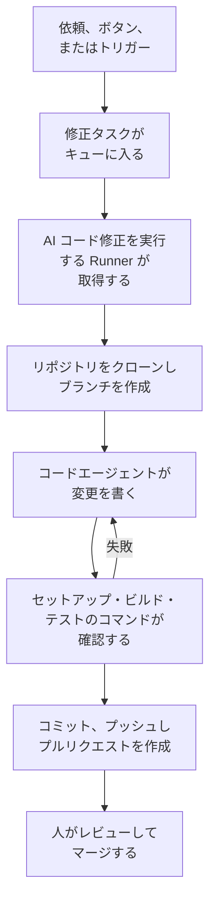

# コード

コードは、コーディングエージェントに頼むのと同じように、OneUptime AI にリポジトリでの作業を頼む場所です。バグの修正、テストの作成、コードの説明、変更の実施などを頼めます。コードを開くと、依頼を書く欄が表示され、その中でリポジトリとブランチを選び、下にすべてのタスクが並びます。タスクのページは返信できる会話です。OneUptime も、例外、トレース、調査から自動でタスクを開始します。[Runner](/docs/runbooks/agents) がリポジトリをクローンし、新しいブランチに変更を書き、ビルドとテストを行って、プルリクエストを作成します。どのプルリクエストも人がレビューしてマージします。Runner にできるのはブランチのプッシュとプルリクエストの作成だけです。

:::cards
- [リポジトリで AI に頼む](#リポジトリで-ai-に頼む): 自分の言葉で書いた依頼と、それに必要なコンテキスト。
- [タスクの会話](#タスクの会話): AI が行ったこと、変更したこと、そしてあなたの返信。
- [修正の実行の流れ](#修正の実行の流れ): クリックからプルリクエストまで、順を追って説明します。
- [修正タスクの開始場所](#修正タスクの開始場所): OneUptime が開始するタスクと、各プルリクエストの内容です。
- [修正での本番テレメトリ](#修正での本番テレメトリ): 修正が変更を書く間に、本番環境から何を読むかを説明します。
- [プルリクエストの本番レビュー](#プルリクエストの本番レビュー): 各プルリクエストが変更するコードについて、本番環境が示すことを説明します。
- [始める前に](#始める前に): モデル、接続済みのリポジトリ、Runner が必要です。
- [修正が失敗したとき](#修正が失敗したとき): エラーになった、止まった、または待っている実行がどうなるかを説明します。
:::

> [!TIP]
> これは GitHub から開始することもできます。issue やプルリクエストで OneUptime GitHub App にメンションすると、その場で実装、修正、レビューを行います。[GitHub App](/docs/ai/github-app) を参照してください。同じエージェント、同じ Runner、同じ予算で、違うのはきっかけだけです。

## リポジトリで AI に頼む

:::steps
### コードを開く

**製品 → コード** を開きます。**AI に何をしてもらいますか？** という見出しの下に依頼を書く欄があり、その下にすべてのタスクが新しい順に並びます。リポジトリがまだない場合は、代わりに **GitHub を接続** が表示されます([始める前に](#始める前に) を参照)。サイドメニューの **リポジトリ** には AI が作業できるリポジトリが一覧表示され、GitHub App がもう届かないリポジトリは **未接続** の下にまとめられます。各リポジトリのページにも、そのリポジトリ用の同じ欄があります。

### リポジトリとブランチを選ぶ

欄は、最後に選んだリポジトリで始まります。欄の下の行で別のリポジトリを選び、その横でタスクの起点となるブランチを選びます。別のブランチを選ぶまでは、**デフォルト** と表示されたリポジトリのメインブランチです。AI は選んだブランチから自分のブランチを作り、そのブランチに向けてプルリクエストを作成します。

### やりたいことを書く

変更、バグ、質問を自分の言葉で書きます。まだ何も依頼していない間は、**依頼の例** にいくつかの例が表示されます。

### コンテキストを追加する

**コンテキストを追加** をクリックして、AI に必要なものを渡します。リポジトリのファイルやフォルダー、メモ、リンク、プロジェクトのレコードを追加できます。OneUptime は依頼を送信した時点で、あなたの権限で各レコードを読み取り、AI に渡した内容を保存します。

### タスクを開始する

**タスクを開始** をクリックするか、Enter キーを押します。タスクのページが開き、AI の作業がその場で表示されます。
:::

| コンテキスト | AI に渡されるもの |
| --- | --- |
| **ファイルまたはフォルダー** | リポジトリ内のパス。AI が最初に読みます。 |
| **メモ** | 貼り付けたテキスト。エラー、仕様、ログ行など。 |
| **リンク** | 参考としての Web アドレス。 |
| **インシデント** または **アラート** | 依頼を送信した時点での状態、説明、根本原因。 |
| **例外** | メッセージとスタックトレース。 |
| **モニター** | 種類、ステータス、説明。 |
| **トレース** | スパンの名前、所要時間、エラー。 |
| **ログ** | 検索語を含む最新のログ 20 行。期間は直近の一時間、一日、一週間から選べます。 |
| **パフォーマンスプロファイル** | サービスのプロファイルで関数の時間がどこに使われているか：呼び出し元、呼び出し先、最もホットな行。 |

1 つの依頼に追加できるコンテキストは最大 10 個です。OneUptime が読み取った内容に含まれるトークン、キー、パスワード、メールアドレスは、OneUptime AI がデータを読むほかの場所と同じく、AI に渡す前に伏せられます。

## タスクの会話

タスクのページは会話です。依頼の内容と追加されたコンテキストの後に、AI のターンが続きます。AI が進めるステップ(読んだファイルと編集したファイル、検索した内容、実行したコマンド)がその場で表示され、続いて AI の返信、変更したファイルとその diff、プルリクエストが表示されます。ページの上部には、タスクの作業場所(リポジトリと開始元のブランチ)、変更した行数、プルリクエストへのボタン、タスクの状況が表示されます。

| 状態 | 意味 |
| --- | --- |
| **キュー投入済み** | Runner が取得するのを待っています。 |
| **処理中…** | AI が作業中です。**停止** で止められます。プッシュ済みの内容はブランチに残ります。 |
| **あなたの対応待ち** | AI が質問しました。下の欄で答えてください。 |
| **完了** | AI の作業が終わりました。返信と、コードを変更した場合はプルリクエストが表示されます。 |
| **失敗** | ターンを完了できず、その理由が表示されます。**再試行** で同じ依頼をもう一度行います。 |
| **停止** | 誰かが止めました。**再試行** で同じ依頼をもう一度行います。 |

続けるには、会話をスクロールしても表示されたままの下の欄に書きます。AI の質問に答えたり、コンテキストを追加したり、変更を頼んだりできます。返信はそれぞれ同じタスクの次のターンになり、プルリクエストが開いている間は同じブランチで作業して同じプルリクエストにプッシュします。タスクは一度に 1 ターンずつ進むので、AI の作業中は欄が待機します。各ターンの **ログ** は、そのターンで行ったことをそのまま記録したものです。

リポジトリを読める人は、そのタスクも読めます。AI への依頼、返信、タスクの停止にはリポジトリを編集する権限が必要で、変更の diff を見る場合も同じです。それ以外の人には、どのファイルが変わったかだけが表示されます。OneUptime が自動で開始するタスク(下記)もそのリポジトリに入っており、返信できる会話になっています。

## 修正の実行の流れ



1. コードで **タスクを開始** をクリックするか、未解決の例外で **AI で修正** をクリックするか、別のボタンやトリガーがタスクを開始します([修正タスクの開始場所](#修正タスクの開始場所) を参照)。
2. タスクはそのリポジトリのキューに入り、リポジトリが選んだ Runner がそれを取得します。自社の Runner のいずれか、または何も選んでいない場合はグローバル Runner です([リポジトリの Runner を選ぶ](#リポジトリの-runner-を選ぶ) を参照)。
3. Runner がタスクのコンテキストを取得します。依頼の場合は、その文面、追加されたコンテキスト、それまでの会話です。例外の場合は、その種類、メッセージ、スタックトレースです。
4. リポジトリを専用のワークスペースにクローンし、ブランチを作成します。例外の修正のブランチ名は、`oneuptime-fix-exception-` の後に実行 ID の先頭の文字が続くものです。依頼は、依頼したときに選んだブランチから始まり、プルリクエストはそのブランチに向けて作成されます。返信の場合は、代わりにタスクの開いているプルリクエストのブランチで作業します。
5. プロジェクトの LLM プロバイダーで動くコードエージェントが、コードを読んで変更を書きます。LLM の呼び出しは OneUptime サーバーが行うため、Runner がプロバイダーの API キーを持つことはありません。また、すべての呼び出しは計測され、AI ログに表示されます。例外、遅いトレース、インシデントの修正は、作業しながら本番環境も読みます。読むのは、リポジトリのサービスの例外、トレース、ログ、メトリクスです([修正での本番テレメトリ](#修正での本番テレメトリ) を参照)。
6. 独自の Runner では、コードエージェントは何かがコミットされる前に、リポジトリの `AGENTS.md` が示すとおりに変更をビルドしてテストし、失敗したところを修復します([プルリクエスト前の検証](#プルリクエスト前の検証) を参照)。
7. Runner がコミットし、ブランチをプッシュし、プルリクエストを作成して(依頼の場合はコードを変更したときだけ)、ワークスペースを削除します。

タスクを開始したページに、その状態がリアルタイムで表示されます。すべてのタスクは **製品 → コード** のリポジトリごとに一覧表示されます。タスクのページはその会話で、各ターンの **ログ** には、Runner が読み書きしたファイルと実行したコマンドごとに 1 行が記録されます。

各実行には、サーバーが強制する予算があります。上限は **LLM 呼び出し 40 回** と **出力トークン 100,000 個** です。実行が本番テレメトリに対して行うクエリも、同じ 40 回の呼び出しに数えられます。いずれかに達した実行は、ループし続けるのではなく、それまでの作業のまとめで終了します。プロジェクトが 1 日あたりの AI の上限を設定している場合は、修正の実行もその上限に数えられます。

## 修正タスクの開始場所

| 場所 | クリック | プルリクエストの内容 |
| --- | --- | --- |
| 例外の **AI アシスタンス** ページ | **AI で修正** | 例外の原因となっているバグを修正します。 |
| 例外の **AI アシスタンス** ページ | **回帰テストを生成** | 例外を再現し、バグが修正されるまで失敗するテストを追加します。 |
| 例外の **AI アシスタンス** ページ | **エラー処理を改善** | 無効な入力などの想定内のエラーに対して、メッセージからユーザーデータを取り除き、入力をより早い段階で検証し、エラーを処理済みとしてマークします。動作は変えません。 |
| インシデントまたはアラートの **AI 調査** カード | **この分析から修正 PR を作成** | 調査が投稿した根本原因を修正します([調査からの自動コード修正](#調査からの自動コード修正) を参照)。 |
| 修正する価値のあるトレース | **AI でパフォーマンスを修正** | N+1 クエリや並列に実行できる呼び出しなど、ボタンが示す遅いパターンを修正します。 |
| サービスの **ログ** ページ | **ログ出力を改善** | 動作を変えずに、サービスのログを構造化し、適切な重大度にして、トレースと結び付けます。 |
| サービスの **トレース** ページ | **トレースを改善** | 動作を変えずに、サービスのトレースが欠けている箇所にスパンと属性を追加します。 |
| **パフォーマンスプロファイル** の関数 | **AI で修正** | プロファイルを根拠に、同じ処理をより少ない時間やメモリで行うよう関数を変えます。 |

これらのボタンは、タスクを開始できる場所にだけ表示されます。プロジェクトの AI がオフのときはどれも表示されず、例外のサイドメニューに **AI アシスタンス** はありません。**ログ出力を改善** と **トレースを改善** はリポジトリが接続されると表示され、**AI でパフォーマンスを修正** は修正する価値のあるトレースにだけ表示されます（[トレースエクスプローラー](/docs/telemetry/traces-explorer) を参照）。関数の **AI で修正** は、プロファイルの時間またはメモリの 5% 以上を占めるか、比較対象の期間から割合が 3 ポイント以上増えた、アプリケーション自身のコードにだけ表示されます（[継続的プロファイリング](/docs/telemetry/profiles) を参照）。

例外の **AI アシスタンス** ページを開くには、**製品 → オブザーバビリティ → 例外** で例外を開き、サイドメニューで **AI アシスタンス** を選びます。解決済みまたはアーカイブ済みの例外は、先に未解決としてマークする必要があります。

OneUptime AI は修正タスクを自ら開始することもあります。コードの変更を見つけた調査から、テレメトリが不足していたために結論が出ずに終わった調査から、そして例外や遅いトレースについての AI Insights からです。それぞれに専用のスイッチがあります。[自動コード修正](/docs/ai/ai-sre#自動コード修正) を参照してください。

## 修正での本番テレメトリ

OneUptime はコードが本番環境で何をしているかを把握しているので、修正はスタックトレースだけを頼りに作業する必要がありません。コードエージェントは作業中に、リポジトリに対応するサービスの本番テレメトリをクエリできます:

| 読むもの | 用途 |
| --- | --- |
| **例外** | 指定したファイルや関数で発生した例外グループ。直近の数日間の発生頻度、どのリリース以降に発生しているか、最近の発生時のトレースがわかります。 |
| **トレース** | エンドポイントや操作のレイテンシとエラーの傾向、そして特定のトレースのスパン。 |
| **ログ** | サービスのログ行。時刻、重大度、テキスト、トレースで絞り込めます。 |
| **メトリクス** | サービスが報告するメトリクスの推移。名前を指定しない場合は、そのサービスが報告するメトリクスの一覧。 |
| **インシデント** | サービスに影響したインシデント、またはこのリポジトリで OneUptime の修正のきっかけになったインシデント。その根本原因とポストモーテムも含みます。 |
| **デプロイ** | サービスの最近のデプロイとその他の変更。それぞれに、そのサービスを悪化させたかどうかについての OneUptime の判定が付きます。 |

| タスク | 確認すること |
| --- | --- |
| 例外での **AI で修正** | 現在の発生頻度とどのリリース以降に発生しているか、ログ、そして発生時のトレース。 |
| **AI でパフォーマンスを修正** | 分析したトレースだけでなく、その操作のすべてのトレースにわたって、どれだけ呼び出され、どれだけ遅いか。操作がもう遅くなければ、何も変更しません。 |
| **この分析から修正 PR を作成**、および調査から自動で作成される修正 | インシデント前のデプロイ、そのエラー、ログ、遅い操作、そして同じ原因が以前にも起きていたかどうか。 |
| GitHub からの `@oneuptime review` | 変更されたコードについて本番環境が示していること([本番環境を踏まえたレビュー](/docs/ai/github-app#本番環境を踏まえたレビュー) を参照)。 |

プルリクエストの説明には、エージェントが何をクエリし、何がわかったかが書かれます。回帰テストやログ出力・トレースの改善など、ほかのタスクは本番環境をクエリしません。

エージェントが何を読めるかは、タスク自体をもとに OneUptime サーバーが決めます:

- **読み取り専用。** クエリは Runner ではなく OneUptime サーバーで実行されます。Runner はテレメトリを読む認証情報を持っていません。クエリによってプロジェクトが変更されることは一切ありません。
- **このプロジェクトの、このリポジトリに対応するサービスだけ。** 対応付けを設定する必要はありません。対象は、OneUptime が修正のリポジトリを見つけるのと同じ方法で、このリポジトリに対応すると判断したサービスです。つまり、サービスの例外のスタックトレースがこのリポジトリのファイルを通っている、サービスの名前がリポジトリと同じ、またはこれがプロジェクトで唯一のリポジトリである、のいずれかです。ほかのサービスのテレメトリは読めません。
- **非公開のインシデントは対象外**で、トークン、キー、パスワード、メールアドレスは、OneUptime AI がデータを読むほかの場所と同じく、エージェントが結果を見る前に伏せられます。
- **上限あり。** クエリは実行ごとに最大 **12** 回で、それぞれが実行の 40 回の呼び出しに数えられます。

リポジトリに対応するサービスがない場合、タスクはこれまでどおり本番テレメトリなしで実行されます。

## プルリクエストの本番レビュー

OneUptime はコードが本番環境で何をしているかを把握しているので、差分を読むだけではわからないことをもとにプルリクエストをレビューできます。コードのリポジトリの **設定** ページの **その他の設定** で **本番環境のデータでプルリクエストをレビュー** をオンにすると、書き込み権限のある人がプルリクエストを作成またはプッシュするたびに、変更されるコードについて本番環境が示すことを伝えるコメントがひとつ付きます。コメントはプッシュのたびにその場で更新され、コードのリポジトリの **本番レビュー** ページには各レビューが **再レビュー** とともに残ります。

| 読むもの | プルリクエストが変更するコードについて |
| --- | --- |
| **例外** | 過去 7 日間に、変更された行、関数、ファイルで発生した例外。新しい例外と未処理の例外には印が付きます。 |
| **操作** | 直近一時間に変更されたコードを実行した、トレース済みの操作。スパン数、エラー数、p95 がわかります。 |
| **負荷の高い関数** | 直近一時間のサービスのプロファイルで一定の割合を占める、変更されたコードの関数。 |
| **インシデント** | 過去 30 日間のサービスのインシデントのうち、まだ未解決のもの、または根本原因やポストモーテムで変更されたコードに触れているもの。非公開のインシデントは含みません。 |
| **デプロイ** | 過去 7 日間のサービスのデプロイのうち、OneUptime が劣化を疑っているもの。 |

本番環境が何かを示している場合、OneUptime AI がそれを差分と並べて読み、**注意すべき点** を加えます。それぞれ事実に基づく、短いポイントがいくつか並びます。これはプロジェクトで AI がオンのときだけ、プルリクエストごとに一日 10 回、リポジトリごとに一日 100 回までしか実行されず、ほかの AI 呼び出しと同じように計測されます。事実は AI なしで毎回読み取られます。本番環境が変更について何も示していない場合、OneUptime は何も投稿しません。

- **集計値のみ。** コメントに含まれるのは件数、所要時間、コードの名前だけです。例外のメッセージ、ログ行、インシデントのタイトル、個人データは決して含まれません。
- **公開リポジトリにはリンクだけ。** 公開リポジトリのプルリクエストは誰でも読めるため、そこではコメントは OneUptime のレビューへのリンクだけになり、レビューはプロジェクトのメンバーだけが開けます。リポジトリの **設定** ページの **その他の設定** にある **本番レビューのコメント** では、すべてのリポジトリで **レビューへのリンクのみ** を投稿するか、**公開リポジトリでもレビューを表示** を選べます。
- **外部のコントリビューターは開始できません。** プルリクエストが自動でレビューされるのは、作成者とプッシュした人がリポジトリに書き込める場合だけです。それ以外の人 - 外部のコントリビューター、フォーク、ボット - のプルリクエストは、書き込み権限のある人が `@oneuptime production review` とコメントするか、コードで **再レビュー** を押したときにレビューされます。
- **読み取り専用。** レビューは何もクローンせず、プルリクエストのものは何も実行しません。差分とタイトルは OneUptime AI にとってデータであり、指示ではありません。AI はツールを持たず、AI が書いたものはテキストとしてコメントに入ります。

このスイッチは、これから GitHub App が接続するリポジトリではオンになります。この機能より前に接続されたリポジトリでは、オンにするまでオフのままです。

## プルリクエスト前の検証

リポジトリは、ルートにある `AGENTS.md`(コーディングエージェントが読むファイル)に、ビルドとテストの方法を書いています。コードエージェントは何かを変更する前に、タスクの起点となるブランチからリポジトリの `AGENTS.md`(`AGENTS.md` がない場合は `CLAUDE.md`)を読み、そこに書かれたとおりに作業します。どちらもない場合は、リポジトリの `CONTRIBUTING.md`、README、パッケージのスクリプト、`Makefile`、CI のワークフローから方法を把握します。OneUptime で設定することは何もありません。

| AI が作業する場所 | リポジトリのビルドとテストをどう扱うか |
| --- | --- |
| 自社の Runner | プルリクエストを作成する前に変更をビルドしてテストし、失敗したところを直して再確認し、実行したチェックを要約に書きます。実行するコマンドはそれぞれ最大 2 分で、その環境には Runner 自身の認証情報が含まれません。 |
| **グローバル Runner** | コマンドは実行しません。変更を書いてプルリクエストを作成し、リポジトリ自身の CI が確認します。 |

フォークから来たプルリクエストの内容が、リポジトリの指示として読まれることはありません。修正はそのようなプルリクエストを拒否し、レビューはベースブランチを読みます。

### リポジトリに設定されたコマンド

コードはもうセットアップ・ビルド・テストのコマンドを求めませんが、以前に、または API や Terraform で設定されたコマンドを持つリポジトリは、それを保持します。リポジトリの **設定** ページの **その他の設定** にある **ビルド・テストのコマンド** カードに読み取り専用で表示され、**コマンドを削除** で 3 つとも削除できます。いずれかが設定されている間は、独自の Runner での各修正の実行は、プルリクエストを作成する前にそれらでも変更を確認します。

1. コードエージェントが終わると、コマンドが順番に、Runner 上のクローンしたワークスペースで、リポジトリのルートから実行されます。各コマンドには最大 15 分が与えられ、`CI=true` で実行されるため、入力待ちになることはありません。最初の失敗でその回は止まります。
2. 失敗した場合、失敗したコマンドの出力の末尾が修復タスクとして同じコードエージェントに戻され、テストを弱めたりスキップしたりせずに自分の変更を直すよう指示されて、コマンドがもう一度実行されます。修復は最大 **2** 回までです。修復は実行の LLM 予算を共有し、その編集は修正と同じコミットに入ります。
3. 結果(合格、失敗、またはコマンド未設定かグローバル Runner によるスキップ)は、プルリクエストの説明の Verification セクションに書かれ、タスクのプルリクエストに記録されます。

検証に通らないままの変更は捨てられません。プルリクエストはそれでも作成され、失敗したコマンドを示してその出力で終わる、はっきりと目立つ "Verification failed" セクションが付きます。作業は残り、判断するのはレビュアーです。コマンドが設定されていないリポジトリは、ビルドが成功したかのように見せるのではなく、スキップとして報告されます。

コマンドはチームが書くリポジトリの設定で、あなた自身の Runner 上で実行されます。Runbook の Bash ステップと同じ信頼モデルです。AI がそれらを書いたり変えたりすることはありません。OneUptime がすべてのプロジェクトのために動かすグローバル Runner は、これらを実行しません。グローバル Runner では、修正は書かれてレビューのために開かれ、検証はスキップとして報告され、リポジトリ自身の CI が変更を確認します。プルリクエストが開く前に修正をビルドしてテストするには、[独自の Runner を実行してください](#独自の-runner-を実行する)。

## 修正がマージされた後

修正はマージしただけでは何も直さず、動いて初めて直します。修正のプルリクエストがマージされると、OneUptime はそれを含む記録済みのデプロイを待ち([デプロイと変更](/docs/telemetry/change-events) を参照)、そのデプロイで修正の目的を見守ります。結果は Code のタスクのプルリクエストに表示され、例外の **AI アシスタンス** ページ、インシデントの AI ログ、修正のもとになった AI インサイトにも表示されます。

| 修正の対象 | 見守るもの | 効いた | 効かなかった |
| --- | --- | --- | --- |
| 例外 | 例外が再び発生するか | **本番環境で修正済み** | **修正後も発生している** |
| 遅いトレースやレイテンシのインサイト | 修正が名指しする処理の p99 | **本番環境で高速化** | **修正後も遅いまま** |
| インシデントやアラートの根本原因 | そのモニターが次を発生させるか | **本番環境で修正済み** | **修正後に再発** |
| 不足していたテレメトリ、ログ、トレーシング | 修正が追加するものと、サービスのそのほかのテレメトリ | **本番環境で受信中** | **修正後にテレメトリが途絶** |

デプロイで届けられるまでは **マージ済み、デプロイ待ち** と表示され、見守っている間は **デプロイ済み、本番環境で監視中** と表示されます。14 日以内にどの記録済みデプロイにも含まれなかった修正や、本番環境から判断できない修正は **本番環境で未検証** と表示されます。ルールは [自動コード修正](/docs/ai/ai-sre#自動コード修正) にあります。回帰テスト、エラー処理の改善、レビュー、Code での依頼は見守りません。本番環境では、それらが何を変えたかを示せないためです。

## 始める前に

タスクには 3 つのものが必要です。コードの依頼欄と、例外の **AI アシスタンス** ページは、開始を提案する前に 3 つすべてを確認し、何が足りないかを示します。

| 必要なもの | OneUptime Cloud | セルフホスト |
| --- | --- | --- |
| LLM プロバイダー | 設定は不要です。独自のプロバイダーがないプロジェクトはグローバルプロバイダーを使い、その料金はプロジェクトの AI クレジットから支払われます。**プロジェクト設定 → AI → LLM プロバイダー** で追加した独自のプロバイダーが優先されます。 | サーバーで環境変数 `GLOBAL_LLM_PROVIDER_*` を一度設定するか、プロジェクトにプロバイダーを追加します。 |
| GitHub App で接続されたリポジトリ | **製品 → コード**、次に **GitHub を接続**。GitHub アカウントにアプリがすでにインストールされている場合は、代わりに **既存のインストールを接続** をクリックします。もう一度インストールしても接続されません。Growth プランが必要です。 | 同じです。インスタンスに GitHub App があれば使えます([GitHub 連携](/docs/self-hosted/github-integration) を参照)。 |
| AI コード修正を実行する Runner | 運用は不要です。何も選んでいないリポジトリは OneUptime のグローバル Runner で作業します。 | Docker Compose の `runner` サービス、または Helm チャートの Runner(`runner.enabled`、既定でオン)が自身を登録し、Runner を選んでいないすべてのリポジトリで AI コード修正を実行します。 |

セルフホストのインスタンスでは、グローバルプロバイダーは `config.env`(Docker Compose)または Helm の values の 1 ブロックです。セルフホストの Ollama の場合:

```bash
GLOBAL_LLM_PROVIDER_TYPE=Ollama
# An address the OneUptime server can reach, never localhost.
GLOBAL_LLM_PROVIDER_BASE_URL=http://ollama:11434
GLOBAL_LLM_PROVIDER_MODEL_NAME=llama3.1
# No GLOBAL_LLM_PROVIDER_API_KEY needed — Ollama is keyless.
```

サポートされているどのプロバイダーでも動作します。すべてのプロバイダーと各環境変数については [LLM プロバイダー](/docs/ai/llm-provider) を参照してください。

リポジトリをサービスに対応付ける必要はありません。タスクが開始すると、OneUptime は例外のスタックトレースのファイルパスを接続済みのリポジトリと照合してリポジトリを見つけます。一致するものがなければ、サービスと同じ名前のリポジトリを使い、それもなければ、プロジェクトにリポジトリが一つしかない場合はそれを使います。**AI アシスタンス** ページに、見つかったリポジトリが表示されます。

### リポジトリの Runner を選ぶ

各リポジトリは、AI がそこで作業する Runner を選びます。コードのリポジトリの **設定** ページで **その他の設定** を開き、**Runner** カードの **編集** をクリックして選択します。GitHub App がインポートしたリポジトリは、プロジェクトに [デフォルトの Runner](/docs/runbooks/agents#プロジェクトのデフォルト-runner) があれば、それで始まります。何も選んでいないリポジトリは、OneUptime がすべてのプロジェクトのために動かす **グローバル Runner** で作業します。

| Runner | タスクで行うこと |
| --- | --- |
| **グローバル Runner** | 変更を書いてプルリクエストを作成しますが、ビルドもテストもしません。リポジトリ自身の CI が変更を確認します。 |
| 自社の Runner | さらに、あなたが管理するホストで、リポジトリの `AGENTS.md` が示すとおりに変更をビルドしてテストします。 |

リポジトリのタスクとそのトークンを受け取るのは、そのリポジトリが選んだ Runner だけです。**Runbook → Runner** で **グローバル Runner を使用** をオフにしたプロジェクトでは、すべてのリポジトリにプロジェクト自身の Runner が必要です。Runner のページには、それを選んでいるリポジトリが一覧表示されます。

### 独自の Runner を実行する

Runner を別の場所、たとえばリポジトリに近いマシンで実行するには:

:::steps
### Runner を作成する

**Runbook → Runner** で Runner を作成し、その行の **セットアップ手順を表示** をクリックします。コマンドには Runner のシークレットキーが含まれており、これを読めるのは Project Owner、Project Admin、Runbook Admin だけです。次のようになります:

```bash
docker run --name oneuptime-runner --restart unless-stopped \
  -e ONEUPTIME_RUNNER_ID=<runner-id> \
  -e ONEUPTIME_RUNNER_KEY=<runner-key> \
  -e ONEUPTIME_URL=<your-oneuptime-url> \
  -d oneuptime/runner:release
```

### リポジトリ用に選ぶ

コードのリポジトリの **設定** ページで **その他の設定** を開き、**Runner** カードの **編集** をクリックして Runner を選びます。Runner は次の heartbeat で変更を反映します。およそ 1 分以内で、再起動は不要です。

### 接続を確認する

1、2 分以内に、Runner は **Runbook → Runner** ページで接続済みとして表示されます。表示されない場合は、コンテナのログ(`docker logs oneuptime-runner`)で認証情報やネットワークのエラーを確認してください。
:::

コンテナの実行方法は問いません(Docker Compose、Kubernetes など)。これらの変数があり、HTTPS で OneUptime インスタンスに到達できれば動作します:

| 変数 | 内容 |
| --- | --- |
| `ONEUPTIME_RUNNER_ID` | ダッシュボードで確認できる Runner の ID。 |
| `ONEUPTIME_RUNNER_KEY` | Runner のシークレットキー。 |
| `ONEUPTIME_URL` | OneUptime インスタンスのアドレス(OneUptime Cloud では `https://oneuptime.com`)。 |

> [!NOTE]
> OneUptime 12 より前は、AI コード修正は別の AI Agent コンポーネント(`AI_AGENT_*` 変数を使う `oneuptime/ai-agent` イメージ)で実行されていました。これは Runner に統合されました。まだ実行している場合は、[v11 から v12 へのアップグレードガイド](/docs/installation/upgrading) で置き換え方を確認してください。

## 調査からの自動コード修正

[AI 調査](/docs/ai/ai-sre) がインシデントやアラートに根本原因の分析を投稿し、その慎重な分類がコードの変更を勧めた場合、調査カードに **この分析から修正 PR を作成** が表示されます。投稿された分析をコンテキストのすべてとする修正タスクです。対策が運用上のもの、インフラだけのもの、外部のもの、想定内の拒否、ユーザーのミス、または結論が出ていない場合、このボタンは表示されません。**インシデント → AI → 設定** の **新しいインシデントを自動的に修正する** (および **アラート → AI → 設定** の **新しいアラートを自動的に修正する**) がオンの間は、対象となる修正がクリックなしで行われます。修正は最初はオフで、新しいプロジェクトでも同じです。自動修復ルールがなければ対象となる修正はすべて作成され、ルールがある場合は、ルールに一致したものについて、そのルールで **修正のプルリクエスト** がオンのとき(新しいルールではオンです)、ルールが指定したコードリポジトリにだけ作成されます。

修正がオンの間、コードの変更で直せる、確かで根拠のある根本原因で終わった調査は、ボタンが作成するのと同じ修正タスクをキューに入れます。この判断はサーバーが確認する制約付きの分類であり、分析のテキストに対するパターン照合ではありません。プルリクエストを作成するのは、コード修正についての肯定的な判定だけです。根拠の不足、コード以外の対策、分類の失敗は、いずれも何もせずに終わります。

それ以外はボタンと同じです:

- プルリクエストはレビュー可能な状態で作成され、投稿された分析をもとに書かれます。GitHub App で接続されたリポジトリ(一致したルールが指定している場合はそのいずれか)と、そこで作業するためにオンラインの Runner(リポジトリが選んだもの、またはグローバル Runner)が必要です。
- そのシグナルの 1 日あたりの修正タスクの上限(**1 日あたりのインシデントの AI 修正タスクの上限** または **1 日あたりのアラートの AI 修正タスクの上限**、AI 設定ページの **その他の設定** にあります)と、リポジトリのオープンなプルリクエストの上限に、設定されていれば数えられます。未設定なら、どちらも何も制限しません。
- 各トリガーはまず、同じインシデントまたはアラートについて、すでにキューにある、または実行中の修正タスクを探します。そのため、自動トリガーとクリックは通常、2 つのプルリクエストではなく 1 つのタスクになります。この確認は書き込み前の読み取りであり、ロックではないため、まったく同じ瞬間の 2 つのトリガーが両方とも通ることはあり得ます。
- 実行はシステムによって作成され、誰の功績にもならず、何も自動ではマージされません。

## 修正が失敗したとき

:::details 実行がエラーになる
修正を適用できなかった、リポジトリまたは依頼の開始元のブランチに到達できなかった、または LLM の呼び出しが失敗しました。タスクの会話と、タスクを開始したページに理由が表示され、再試行を提案します。ターンの **ログ** に実行ログ全体があります。
:::

:::details Runner が実行の途中で止まる
heartbeat が 12 分を超えて途絶えた実行は、エラーで失敗になります。Runner が修正ブランチの一部をすでにプッシュしている可能性があるため、自動で再度キューに入ることはありません。開始したところからもう一度開始してください。
:::

:::details どの Runner もタスクを取得しない
タスクを取得すべき Runner(リポジトリが選んだもの、または何も選んでいないリポジトリではグローバル Runner)が接続されていない状態で 30 分を超えて待ったタスクは、どの Runner かを示すメッセージとともに失敗します。そのため、いつまでも進行中と表示されることはありません。Runner がオンラインでも処理中の場合、キュー内のタスクは順番を待ちます。コードより前の Runner には、コードからの依頼は渡されません。自分で運用している Runner は、サーバーと一緒に更新してください。
:::

## プライバシー

リポジトリのクローンは Runner のコンテナ内のワークスペースに置かれ、実行が終わると成功・失敗にかかわらず削除されます。Runner が LLM プロバイダーの API キーを持つことはなく、LLM の呼び出しは OneUptime サーバーが代わりに行い、本番テレメトリのクエリもサーバーが実行します。OneUptime はリポジトリを保持せず、コードで学習することもありません。タスクのログには各ステップの出力の先頭 300 文字が残り、Runner が何をしたか確認できますが、そこにはコードの一部が含まれることがあります。独自の LLM プロバイダー(ローカルの Ollama を含む)でセルフホストの Runner を実行すれば、コードがインフラの外に出ることはありません。

## ロードマップ

予定されており、**現時点では利用できません**:

- **GitLab のサポート。** リポジトリの接続は GitHub App のみです。

## 次のステップ

:::cards
- [GitHub App](/docs/ai/github-app): GitHub 上から直接、変更、修正、レビューを依頼します。
- [AI SRE](/docs/ai/ai-sre): 修正タスクがその分析をプルリクエストに変えられる調査です。
- [Runbook エージェント](/docs/runbooks/agents): すべての修正の実行を担うワーカーです。
:::
