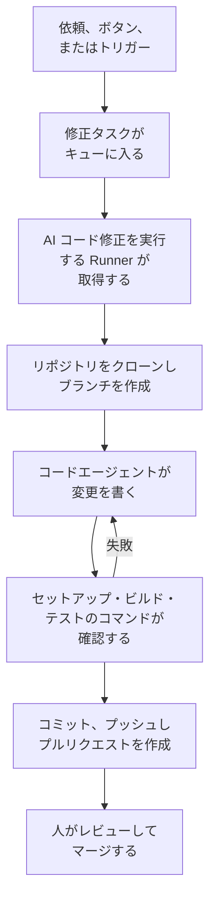

# コード

コードは、コーディングエージェントに頼むのと同じように、OneUptime AI にリポジトリでの作業を頼む場所です。バグの修正、テストの作成、コードの説明、変更の実施などを頼めます。コードを開くと、接続済みのリポジトリが表示されます。リポジトリのページにはそのタスクと依頼を書く欄があり、タスクのページは返信できる会話です。OneUptime も、例外、トレース、調査から自動でタスクを開始します。[Runner](/docs/runbooks/agents) がリポジトリをクローンし、新しいブランチに変更を書き、ビルドとテストを行って、プルリクエストを作成します。どのプルリクエストも人がレビューしてマージします。Runner にできるのはブランチのプッシュとプルリクエストの作成だけです。

:::cards
- [リポジトリで AI に頼む](#リポジトリで-ai-に頼む): 自分の言葉で書いた依頼と、それに必要なコンテキスト。
- [タスクの会話](#タスクの会話): AI が行ったこと、変更したこと、そしてあなたの返信。
- [修正の実行の流れ](#修正の実行の流れ): クリックからプルリクエストまで、順を追って説明します。
- [修正タスクの開始場所](#修正タスクの開始場所): OneUptime が開始するタスクと、各プルリクエストの内容です。
- [始める前に](#始める前に): モデル、接続済みのリポジトリ、Runner が必要です。
- [修正が失敗したとき](#修正が失敗したとき): エラーになった、止まった、または待っている実行がどうなるかを説明します。
:::

> [!TIP]
> これは GitHub から開始することもできます。issue やプルリクエストで OneUptime GitHub App にメンションすると、その場で実装、修正、レビューを行います。[GitHub App](/docs/ai/github-app) を参照してください。同じエージェント、同じ Runner、同じ予算で、違うのはきっかけだけです。

## リポジトリで AI に頼む

:::steps
### リポジトリを開く

**製品 → コード** を開きます。プロジェクトのリポジトリが一覧表示され、それぞれに AI が作業中のタスク、あなたの対応を待っているタスク、開いているプルリクエストが表示されます。リポジトリがまだない場合は、**GitHub を接続** が表示されます([始める前に](#始める前に) を参照)。

### やりたいことを書く

リポジトリのページで、変更、バグ、質問を自分の言葉で書きます。まだタスクがないリポジトリでは、**依頼の例** にいくつかの例が表示されます。

### コンテキストを追加する

**コンテキストを追加** をクリックして、AI に必要なものを渡します。リポジトリのファイルやフォルダー、メモ、リンク、プロジェクトのレコードを追加できます。OneUptime は依頼を送信した時点で、あなたの権限で各レコードを読み取り、AI に渡した内容を保存します。

### タスクを開始する

**タスクを開始** をクリックするか、Enter キーを押します。タスクのページが開き、AI の作業がその場で表示されます。
:::

| コンテキスト | AI に渡されるもの |
| --- | --- |
| **ファイルまたはフォルダー** | リポジトリ内のパス。AI が最初に読みます。 |
| **メモ** | 貼り付けたテキスト。エラー、仕様、ログ行など。 |
| **リンク** | 参考としての Web アドレス。 |
| **インシデント** または **アラート** | 依頼を送信した時点での状態、説明、根本原因。 |
| **例外** | メッセージとスタックトレース。 |
| **モニター** | 種類、ステータス、説明。 |
| **トレース** | スパンの名前、所要時間、エラー。 |
| **ログ** | 検索語を含む最新のログ 20 行。期間は直近の一時間、一日、一週間から選べます。 |

1 つの依頼に追加できるコンテキストは最大 10 個です。OneUptime が読み取った内容に含まれるトークン、キー、パスワード、メールアドレスは、OneUptime AI がデータを読むほかの場所と同じく、AI に渡す前に伏せられます。

## タスクの会話

タスクのページは会話です。依頼の内容と追加されたコンテキストの後に、AI のターンが続きます。AI が進めるステップ(読んだファイルと編集したファイル、検索した内容、実行したコマンド)がその場で表示され、続いて AI の返信、変更したファイルとその diff、プルリクエストが表示されます。ページの上部にはタスクの状況が表示されます。

| 状態 | 意味 |
| --- | --- |
| **キュー投入済み** | Runner が取得するのを待っています。 |
| **処理中…** | AI が作業中です。**停止** で止められます。プッシュ済みの内容はブランチに残ります。 |
| **あなたの対応待ち** | AI が質問しました。下の欄で答えてください。 |
| **完了** | AI の作業が終わりました。返信と、コードを変更した場合はプルリクエストが表示されます。 |
| **失敗** | ターンを完了できず、その理由が表示されます。**再試行** で同じ依頼をもう一度行います。 |
| **停止** | 誰かが止めました。**再試行** で同じ依頼をもう一度行います。 |

続けるには、下の欄に書きます。AI の質問に答えたり、コンテキストを追加したり、変更を頼んだりできます。返信はそれぞれ同じタスクの次のターンになり、プルリクエストが開いている間は同じブランチで作業して同じプルリクエストにプッシュします。タスクは一度に 1 ターンずつ進むので、AI の作業中は欄が待機します。各ターンの **ログ** は、そのターンで行ったことをそのまま記録したものです。

リポジトリを読める人は、そのタスクも読めます。AI への依頼、返信、タスクの停止にはリポジトリを編集する権限が必要で、変更の diff を見る場合も同じです。それ以外の人には、どのファイルが変わったかだけが表示されます。OneUptime が自動で開始するタスク(下記)もそのリポジトリに入っており、返信できる会話になっています。

## 修正の実行の流れ



1. リポジトリで **タスクを開始** をクリックするか、未解決の例外で **Fix with AI** をクリックするか、別のボタンやトリガーがタスクを開始します([修正タスクの開始場所](#修正タスクの開始場所) を参照)。
2. タスクがキューに入り、**AI コード修正を実行** がオンになっている空いている Runner がそれを取得します。
3. Runner がタスクのコンテキストを取得します。依頼の場合は、その文面、追加されたコンテキスト、それまでの会話です。例外の場合は、その種類、メッセージ、スタックトレースです。
4. リポジトリを専用のワークスペースにクローンし、ブランチを作成します。例外の修正のブランチ名は、`oneuptime-fix-exception-` の後に実行 ID の先頭の文字が続くものです。返信の場合は、代わりにタスクの開いているプルリクエストのブランチで作業します。
5. プロジェクトの LLM プロバイダーで動くコードエージェントが、コードを読んで変更を書きます。LLM の呼び出しは OneUptime サーバーが行うため、Runner がプロバイダーの API キーを持つことはありません。また、すべての呼び出しは計測され、AI ログに表示されます。
6. リポジトリに検証コマンドがある場合、独自の Runner は何かをコミットする前に変更をビルドしてテストし、失敗をコードエージェントに戻して修復させます([プルリクエスト前の検証](#プルリクエスト前の検証) を参照)。
7. Runner がコミットし、ブランチをプッシュし、プルリクエストを作成して(依頼の場合はコードを変更したときだけ)、ワークスペースを削除します。

タスクを開始したページに、その状態がリアルタイムで表示されます。すべてのタスクは **製品 → コード** のリポジトリごとに一覧表示されます。タスクのページはその会話で、各ターンの **ログ** には、Runner が読み書きしたファイルと実行したコマンドごとに 1 行が記録されます。

各実行には、サーバーが強制する予算があります。上限は **LLM 呼び出し 40 回** と **出力トークン 100,000 個** です。いずれかに達した実行は、ループし続けるのではなく、それまでの作業のまとめで終了します。プロジェクトが 1 日あたりの AI の上限を設定している場合は、修正の実行もその上限に数えられます。

## 修正タスクの開始場所

| 場所 | クリック | プルリクエストの内容 |
| --- | --- | --- |
| 例外の **AI アシスタンス** ページ | **Fix with AI** | 例外の原因となっているバグを修正します。 |
| 例外の **AI アシスタンス** ページ | **回帰テストを生成** | 例外を再現し、バグが修正されるまで失敗するテストを追加します。 |
| 例外の **AI アシスタンス** ページ | **エラー処理を改善** | 無効な入力などの想定内のエラーに対して、メッセージからユーザーデータを取り除き、入力をより早い段階で検証し、エラーを処理済みとしてマークします。動作は変えません。 |
| インシデントまたはアラートの **AI 調査** カード | **この分析から修正 PR を作成** | 調査が投稿した根本原因を修正します([調査からの自動コード修正](#調査からの自動コード修正) を参照)。 |
| トレース | **AI でパフォーマンスを修正** | N+1 クエリや一つの支配的な遅いスパンなど、トレースで見つかった遅いパターンを修正します。 |
| サービスの **ログ** ページ | **ログ出力を改善** | 動作を変えずに、サービスのログを構造化し、適切な重大度にして、トレースと結び付けます。 |
| サービスの **トレース** ページ | **トレースを改善** | 動作を変えずに、サービスのトレースが欠けている箇所にスパンと属性を追加します。 |

例外の **AI アシスタンス** ページを開くには、**製品 → オブザーバビリティ → 例外** で例外を開き、サイドメニューで **AI アシスタンス** を選びます。解決済みまたはアーカイブ済みの例外は、先に未解決としてマークする必要があります。

OneUptime AI は修正タスクを自ら開始することもあります。コードの変更を見つけた調査から、テレメトリが不足していたために結論が出ずに終わった調査から、そして例外や遅いトレースについての AI Insights からです。それぞれに専用のスイッチがあります。[自動コード修正](/docs/ai/ai-sre#自動コード修正) を参照してください。

## プルリクエスト前の検証

リポジトリには、コードの **設定** ページで、最大 3 つの検証コマンドを設定できます。

| コマンド | 例 | 実行されるタイミング |
| --- | --- | --- |
| **セットアップコマンド** | `npm ci` | 最初に、依存関係をインストールするため。 |
| **ビルドコマンド** | `npm run build` | セットアップの後。 |
| **テストコマンド** | `npm test` | 最後。 |

いずれかが設定されていると、各修正の実行はプルリクエストを作成する前に変更を確認します。

1. コードエージェントが終わると、コマンドが順番に、Runner 上のクローンしたワークスペースで、リポジトリのルートから実行されます。各コマンドには最大 15 分が与えられ、`CI=true` で実行されるため、入力待ちになることはありません。最初の失敗でその回は止まります。
2. 失敗した場合、失敗したコマンドの出力の末尾が修復タスクとして同じコードエージェントに戻され、テストを弱めたりスキップしたりせずに自分の変更を直すよう指示されて、コマンドがもう一度実行されます。修復は最大 **2** 回までです。修復は実行の LLM 予算を共有し、その編集は修正と同じコミットに入ります。
3. 結果(合格、失敗、またはコマンド未設定か共有 Runner によるスキップ)は、プルリクエストの説明の Verification セクションに書かれ、タスクのプルリクエストに記録されます。

検証に通らないままの変更は捨てられません。プルリクエストはそれでも作成され、失敗したコマンドを示してその出力で終わる、はっきりと目立つ "Verification failed" セクションが付きます。作業は残り、判断するのはレビュアーです。コマンドが設定されていないリポジトリは、ビルドが成功したかのように見せるのではなく、スキップとして報告されます。

コマンドはチームが書くリポジトリの設定で、あなた自身の Runner 上で実行されます。Runbook の Bash ステップと同じ信頼モデルです。AI がそれらを書いたり変えたりすることはありません。OneUptime の共有 Runner はこれらを実行しません。共有 Runner では、修正は書かれてレビューのために開かれ、検証はスキップとして報告され、リポジトリ自身の CI が変更を確認します。プルリクエストが開く前に修正をビルドしてテストするには、[独自の Runner を実行してください](#独自の-runner-を実行する)。

## 始める前に

タスクには 3 つのものが必要です。コードのリポジトリのページと、例外の **AI アシスタンス** ページは、開始を提案する前に 3 つすべてを確認し、何が足りないかを示します。

| 必要なもの | OneUptime Cloud | セルフホスト |
| --- | --- | --- |
| LLM プロバイダー | 設定は不要です。独自のプロバイダーがないプロジェクトはグローバルプロバイダーを使い、その料金はプロジェクトの AI クレジットから支払われます。**プロジェクト設定 → AI → LLM プロバイダー** で追加した独自のプロバイダーが優先されます。 | サーバーで環境変数 `GLOBAL_LLM_PROVIDER_*` を一度設定するか、プロジェクトにプロバイダーを追加します。 |
| GitHub App で接続されたリポジトリ | **製品 → コード**、次に **GitHub を接続**。GitHub アカウントにアプリがすでにインストールされている場合は、代わりに **既存のインストールを接続** をクリックします。もう一度インストールしても接続されません。Growth プランが必要です。 | 同じです。インスタンスに GitHub App があれば使えます([GitHub 連携](/docs/self-hosted/github-integration) を参照)。 |
| AI コード修正を実行する Runner | 運用は不要です。OneUptime の共有 Runner が担います。 | Docker Compose の `runner` サービス、または Helm チャートの Runner(`runner.enabled`、既定でオン)が自身を登録し、AI コード修正を実行します。 |

セルフホストのインスタンスでは、グローバルプロバイダーは `config.env`(Docker Compose)または Helm の values の 1 ブロックです。セルフホストの Ollama の場合:

```bash
GLOBAL_LLM_PROVIDER_TYPE=Ollama
# An address the OneUptime server can reach, never localhost.
GLOBAL_LLM_PROVIDER_BASE_URL=http://ollama:11434
GLOBAL_LLM_PROVIDER_MODEL_NAME=llama3.1
# No GLOBAL_LLM_PROVIDER_API_KEY needed — Ollama is keyless.
```

サポートされているどのプロバイダーでも動作します。すべてのプロバイダーと各環境変数については [LLM プロバイダー](/docs/ai/llm-provider) を参照してください。

リポジトリをサービスに対応付ける必要はありません。タスクが開始すると、OneUptime は例外のスタックトレースのファイルパスを接続済みのリポジトリと照合してリポジトリを見つけます。一致するものがなければ、サービスと同じ名前のリポジトリを使い、それもなければ、プロジェクトにリポジトリが一つしかない場合はそれを使います。**AI アシスタンス** ページに、見つかったリポジトリが表示されます。

### 独自の Runner を実行する

Runner を別の場所、たとえばリポジトリに近いマシンで実行するには:

:::steps
### Runner を作成する

**Runbook → Runner** で Runner を作成し、その行の **セットアップ手順を表示** をクリックします。コマンドには Runner のシークレットキーが含まれており、これを読めるのは Project Owner、Project Admin、Runbook Admin だけです。次のようになります:

```bash
docker run --name oneuptime-runner --restart unless-stopped \
  -e ONEUPTIME_RUNNER_ID=<runner-id> \
  -e ONEUPTIME_RUNNER_KEY=<runner-key> \
  -e ONEUPTIME_URL=<your-oneuptime-url> \
  -d oneuptime/runner:release
```

### AI コード修正を有効にする

Runner で **AI コード修正を実行** をオンにします。既定ではオフで、Runner は次の heartbeat で変更を反映します。およそ 1 分以内で、再起動は不要です。

### 接続を確認する

1、2 分以内に、Runner は **Runbook → Runner** ページで接続済みとして表示されます。表示されない場合は、コンテナのログ(`docker logs oneuptime-runner`)で認証情報やネットワークのエラーを確認してください。
:::

コンテナの実行方法は問いません(Docker Compose、Kubernetes など)。これらの変数があり、HTTPS で OneUptime インスタンスに到達できれば動作します:

| 変数 | 内容 |
| --- | --- |
| `ONEUPTIME_RUNNER_ID` | ダッシュボードで確認できる Runner の ID。 |
| `ONEUPTIME_RUNNER_KEY` | Runner のシークレットキー。 |
| `ONEUPTIME_URL` | OneUptime インスタンスのアドレス(OneUptime Cloud では `https://oneuptime.com`)。 |

> [!NOTE]
> OneUptime 12 より前は、AI コード修正は別の AI Agent コンポーネント(`AI_AGENT_*` 変数を使う `oneuptime/ai-agent` イメージ)で実行されていました。これは Runner に統合されました。まだ実行している場合は、[v11 から v12 へのアップグレードガイド](/docs/installation/upgrading) で置き換え方を確認してください。

## 調査からの自動コード修正

[AI 調査](/docs/ai/ai-sre) がインシデントやアラートに根本原因の分析を投稿し、その慎重な分類がコードの変更を勧めた場合、調査カードに **この分析から修正 PR を作成** が表示されます。投稿された分析をコンテキストのすべてとする修正タスクです。対策が運用上のもの、インフラだけのもの、外部のもの、想定内の拒否、ユーザーのミス、または結論が出ていない場合、このボタンは表示されません。スイッチ **調査でコードの変更が見つかったら修正のプルリクエストを作成する** がオンの間は、対象となる修正がクリックなしで行われます。このスイッチは修正の一部です。**インシデント → AI → 設定** の **新しいインシデントを自動的に修正する** の下(および **アラート → AI → 設定** の **新しいアラートを自動的に修正する** の下)にあり、修正をオンにするとオンになり、修正がオンの間だけプルリクエストを作成します。どちらも最初はオフで、新しいプロジェクトでも同じです。

オンの間、コードの変更で直せる、確かで根拠のある根本原因で終わった調査は、ボタンが作成するのと同じ修正タスクをキューに入れます。この判断はサーバーが確認する制約付きの分類であり、分析のテキストに対するパターン照合ではありません。プルリクエストを作成するのは、コード修正についての肯定的な判定だけです。根拠の不足、コード以外の対策、分類の失敗は、いずれも何もせずに終わります。

それ以外はボタンと同じです:

- プルリクエストはレビュー可能な状態で作成され、投稿された分析をもとに書かれます。GitHub App で接続されたリポジトリと、**AI コード修正を実行** がオンの Runner が必要です。
- そのシグナルの 1 日あたりの修正タスクの上限(**1 日あたりのインシデントの AI 修正タスクの上限** または **1 日あたりのアラートの AI 修正タスクの上限**、AI 設定ページの **その他の設定** にあります)と、リポジトリのオープンなプルリクエストの上限に、設定されていれば数えられます。未設定なら、どちらも何も制限しません。
- 各トリガーはまず、同じインシデントまたはアラートについて、すでにキューにある、または実行中の修正タスクを探します。そのため、自動トリガーとクリックは通常、2 つのプルリクエストではなく 1 つのタスクになります。この確認は書き込み前の読み取りであり、ロックではないため、まったく同じ瞬間の 2 つのトリガーが両方とも通ることはあり得ます。
- 実行はシステムによって作成され、誰の功績にもならず、何も自動ではマージされません。

## 修正が失敗したとき

:::details 実行がエラーになる
修正を適用できなかった、リポジトリに到達できなかった、または LLM の呼び出しが失敗しました。タスクの会話と、タスクを開始したページに理由が表示され、再試行を提案します。ターンの **ログ** に実行ログ全体があります。
:::

:::details Runner が実行の途中で止まる
heartbeat が 12 分を超えて途絶えた実行は、エラーで失敗になります。Runner が修正ブランチの一部をすでにプッシュしている可能性があるため、自動で再度キューに入ることはありません。開始したところからもう一度開始してください。
:::

:::details どの Runner もタスクを取得しない
**AI コード修正を実行** の Runner が一つも接続されていない状態で 30 分を超えて待ったタスクは、Runner を確認するようにというメッセージとともに失敗します。そのため、いつまでも進行中と表示されることはありません。Runner がオンラインでも処理中の場合、キュー内のタスクは順番を待ちます。コードより前の Runner には、コードからの依頼は渡されません。自分で運用している Runner は、サーバーと一緒に更新してください。
:::

## プライバシー

リポジトリのクローンは Runner のコンテナ内のワークスペースに置かれ、実行が終わると成功・失敗にかかわらず削除されます。Runner が LLM プロバイダーの API キーを持つことはなく、LLM の呼び出しは OneUptime サーバーが代わりに行います。OneUptime はリポジトリを保持せず、コードで学習することもありません。タスクのログには各ステップの出力の先頭 300 文字が残り、Runner が何をしたか確認できますが、そこにはコードの一部が含まれることがあります。独自の LLM プロバイダー(ローカルの Ollama を含む)でセルフホストの Runner を実行すれば、コードがインフラの外に出ることはありません。

## ロードマップ

予定されており、**現時点では利用できません**:

- **GitLab のサポート。** リポジトリの接続は GitHub App のみです。
- **修正でのテレメトリの拡充。** スタックトレースに加え、例外の前後のトレース、ログ、メトリクスを修正に取り込みます。

## 次のステップ

:::cards
- [GitHub App](/docs/ai/github-app): GitHub 上から直接、変更、修正、レビューを依頼します。
- [AI SRE](/docs/ai/ai-sre): 修正タスクがその分析をプルリクエストに変えられる調査です。
- [Runbook エージェント](/docs/runbooks/agents): すべての修正の実行を担うワーカーです。
:::
