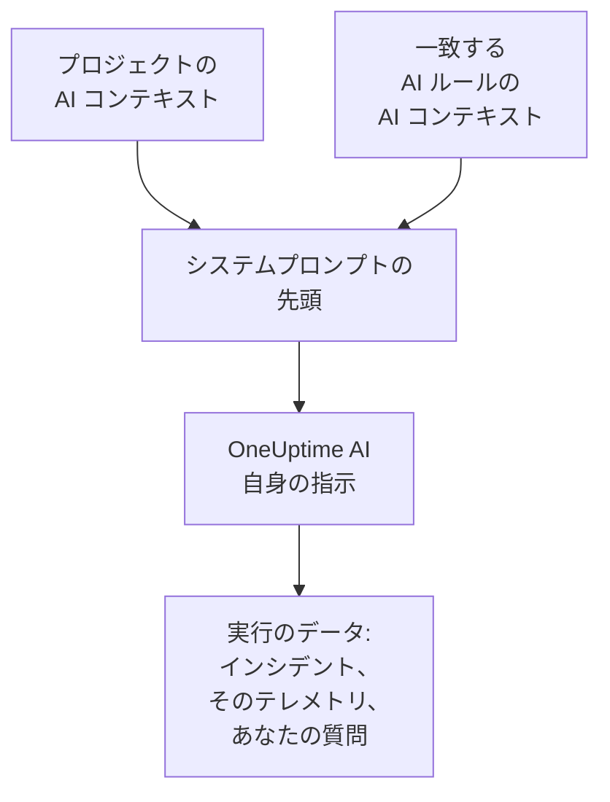

# AI コンテキスト

AI コンテキストは、チームが自分たちのシステムについて OneUptime AI のために書き留めておくものです。システム同士のつながり、どの症状を誰が担当しているか、ログの場所、チームで使っている言葉などを書きます。OneUptime AI は、調査、修正、ポストモーテムの下書き、AI に質問の会話のたびに最初にこれを読むので、チームがすでに知っていることから始められます。

:::cards
- [AI コンテキストを書く](#ai-コンテキストを書く): プロジェクトの AI 設定にあるカード 1 枚です。
- [AI ルール自身のメモ](#ai-ルール自身のメモ): 1 つのルールが一致するものについてのメモです。
- [これを読む機能](#これを読む機能): これを読む機能と、読まない機能です。
- [実行が読んだもの](#実行が読んだもの): どの実行も、渡されたメモを表示します。
:::

## 仕組み

OneUptime AI は、AI コンテキストをシステムプロンプトのいちばん先頭に、自身の指示や実行のデータよりも前に置きます。最初にプロジェクトのメモ、次に一致する AI ルールのメモです。OneUptime AI はこれをチームからの背景知識として読みます。今何が起きているかの証拠ではなく、OneUptime AI 自身のルールを変えることもありません。

メモは最初に置かれ、実行ごとに変わらないため、プロバイダーがキャッシュするプロンプトの先頭部分に含まれます。Anthropic の場合は OneUptime がシステムプロンプトにキャッシュの印を付けます。OpenAI、Azure OpenAI、そして繰り返されるプロンプトの先頭をキャッシュするほかのプロバイダーは、自動でキャッシュします。変わっていないメモは、読み直すコストが下がります。

## AI コンテキストを書く

:::steps
### AI 機能を開く
**プロジェクト設定 → AI → AI 機能** を開きます。**AI コンテキスト** のカードは **AI を有効化** の下にあります。

### メモを書く
**AI コンテキストを追加** をクリックします。メモがすでにある場合は **編集** をクリックします。Markdown で書くか、**見出しのひな形から始める** をクリックすると、メモの種類ごとに見出しが入ります。

### 保存する
**変更を保存** をクリックします。カードにメモと、その長さ、モデルがおよそ何トークンとして読むかが表示されます。
:::

チームに新しく加わった人に話すことを書きます:

| メモの種類 | 例 |
| --- | --- |
| システム同士のつながり | `checkout-api` はチェックアウトページを提供し、`payments-db` に依存しています。 |
| どの症状を誰が担当するか | チェックアウトページの 502 は決済チームの担当です。まず `payments-db` を確認してください。 |
| ログの場所 | チェックアウトのログは Loki の `app=checkout` にあります。 |
| チームで使う言葉 | PSP は決済代行サービスのことです。 |

> [!WARNING]
> 秘密情報は書かないでください。AI の実行が何をしたかを見られる人は誰でも、その実行に渡されたメモを読めます。

## AI ルール自身のメモ

AI ルールには、そのルールが一致するインシデントやアラートについての独自のメモを持たせられます。1 つの製品のサービス、その担当者、ログの場所などです。ルールの **その他の項目** の中、**LLM プロバイダー** の後にある **AI コンテキスト** に書きます。毎回ランブックを実行するだけのルールは OneUptime AI に何も尋ねないので、書く AI コンテキストはありません。

- 調査は、プロジェクトのメモを読んだ後、そのインシデントやアラートに一致して調査を行う有効な AI ルールすべてのメモを、ルール名の順に読みます。
- 修正は、プロジェクトのメモを読んだ後、修正のもとになったルールのメモを読みます。
- インシデントやアラートについての会話は、その調査と同じメモを読みます。

## これを読む機能

| 機能 | 読むもの |
| --- | --- |
| AI SRE の調査と、新しいアラートが開いたときの再確認 | プロジェクトのメモと、一致する AI ルールのメモ |
| AI ルールが開始する修正(その計画、コマンド、MCP サーバー) | プロジェクトのメモと、そのルールのメモ |
| AI に質問と、インシデントやアラートについての会話 | プロジェクトのメモ。インシデントやアラートでは、一致する AI ルールのメモも |
| Slack と Microsoft Teams での回答 | プロジェクトのメモ |
| インシデントとエピソードのポストモーテムの下書き | プロジェクトのメモ |
| AI Insights のトリアージとセキュリティケースのトリアージ | プロジェクトのメモ |

渡されたものを言い換えたり評価したりするだけの呼び出しは、これを読みません。メモや公開メモの下書き、通話の要約、調査の要約・確信度・評価、会話のタイトルがそうです。ワークフローやランブックの AI ステップのように、人が自分で書くプロンプトも読みません。

## 上限

| 対象 | 上限 |
| --- | --- |
| プロジェクトの AI コンテキスト | 20,000 文字 |
| AI ルールの AI コンテキスト | 5,000 文字 |
| 一度の実行で読む AI コンテキストの合計 | 30,000 文字 |

フォームは入力中に文字数を数え、上限を超えると保存を拒否します。API も同じです。実行は最初にプロジェクトのメモを読み、次に一致する各ルールのメモをルール名の順に読みます。メモを加えると実行の合計が 30,000 文字を超えるルールは丸ごと除外され、実行のアクティビティにそのことが表示されます。

トークン数は推定値で、メモの UTF-8 でのバイト数を 4 で割り、切り上げたものです。トークンの数え方はモデルごとに違うため、プロバイダーの数とは異なることがあり、英語以外のテキストでは特に差が出ます。

## 実行が読んだもの

どの実行も、読んだメモを一字一句記録します。実行のアクティビティには **プロジェクトの AI コンテキストを読み取りました**、またはほかにいくつの AI ルールのメモを読んだかが、おおよそのトークン数とともに表示されます。**表示** をクリックすると、実行が読んだとおりのメモが開きます。最初にプロジェクトのメモ、次に各ルールのメモがルール名の下に表示され、メモがその後変更されていてもそのままです。実行の上限のためにルールのメモが除外された場合は、警告でそのことが示されます。

## 変更できる人

- **プロジェクト所有者** と **プロジェクト管理者** はプロジェクトの AI コンテキストを変更できます。**プロジェクトメンバー**、**閲覧者**、**Read Project** は読むことができます。
- AI ルールのメモはルールの一部です。ルールを変更できる人は、そのメモも変更できます。
- メモはそのメモのプロジェクトでしか読まれません。どの実行も、ほかのプロジェクトの AI コンテキストを読むことはありません。

API や Terraform では、プロジェクトのメモはプロジェクトの `aiContext`、AI ルールのメモはそのルール自身の `aiContext` です。

## 次のステップ

:::cards
- [AI SRE](/docs/ai/ai-sre): 新しいインシデントとアラートをすべて OneUptime AI に調査させます。
- [AI に質問](/docs/ai/ask-ai): 会話の中でプロジェクトのデータについて質問します。
- [LLM プロバイダー](/docs/ai/llm-provider): メモを読むモデルを選びます。
:::
