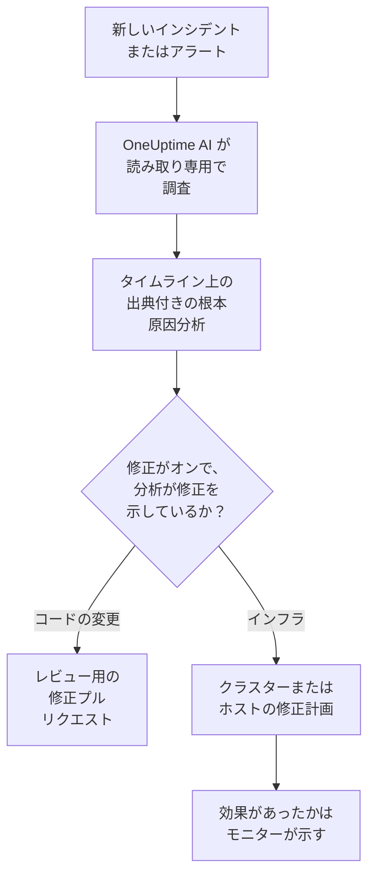
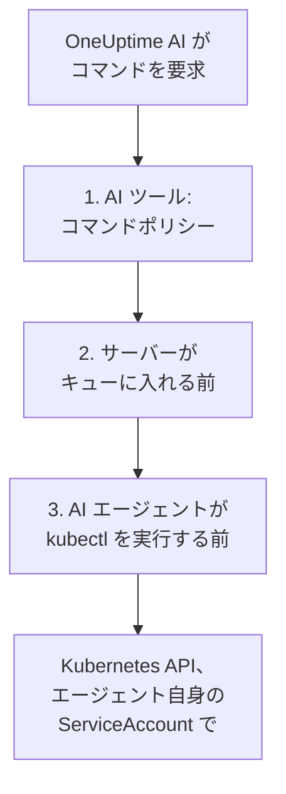

# AI SRE

OneUptime AI は、あなたの AI サイト信頼性エンジニアです。新しいインシデントやアラートが宣言されるとすぐに起動し、あなた自身のテレメトリ(ログ、メトリクス、トレース、例外、モニター、最近の変更)を使って調査し、出典付きの根本原因分析をインシデントやアラートのタイムラインに投稿します。たいていはオンコール担当者が呼び出しを読み終える前に完了します。

分析のすべての主張には、それを裏付ける正確なデータへ直接リンクする出典が付いています。調査そのものは **厳密に読み取り専用** です。調査中に OneUptime AI がプロジェクト内の何かを変更することは決してできません。

:::cards
- [仕組み](#仕組み): 新しいインシデントから出典付きの分析へ、そして許可すれば修正へ。
- [AI 調査を有効にする](#ai-調査を有効にする): スイッチと、それに必要なもの。
- [クラスターへのアクセス — OneUptime AI に kubectl を実行させる](#クラスターへのアクセス-oneuptime-ai-に-kubectl-を実行させる): Kubernetes の内部で調査し、修正します。
- [コスト管理](#コスト管理): インシデント、アラート、プロジェクト全体の上限。
:::

## 仕組み

OneUptime AI は新しいインシデントやアラートに対して三つのことを行い、それぞれに専用のスイッチがあります:

- **調査する** (既定でオン)。テレメトリと、AI エージェントが動作しているクラスターやホストを読み取り、出典付きの根本原因分析を投稿します。調査は何も変更しません。
- **修正する** (既定でオフ)。修正がオンのとき、確信のある分析は修正になります。コード変更のプルリクエスト、またはクラスターやホスト向けのコマンドの計画で、そのクラスターやホストの AI エージェントが許可する方法で実行されます。
- **学習する。** AI インサイトのページは、記録されたすべてから導き出した、繰り返し起きている問題を示します。



原因が見つからなかった分析は、誰も呼び出さずに静かに投稿されます([サイレントモード](#サイレントモード) を参照)。原因がなければ何も修正されません。

## 調査が投稿する内容

調査が完了すると、OneUptime AI は次のセクションを含む根本原因分析を投稿します:

- **Summary** — 呼び出されたエンジニアが 5 秒で読める一、二文。
- **Most likely root cause** — 証拠が裏付ける範囲の確信度だけを持つ仮説で、事実に関する主張にはすべて出典が付きます。テレメトリが不十分な場合、AI は推測せずにそう明言し、確認した内容を一覧にします。
- **Evidence** — 仮説を裏付ける、または否定する主要な発見で、それぞれに出典が付きます。
- **Suggested next steps** — オンコール担当者向けの具体的な対応。

インシデントの場合、分析はインシデントのフィード **と** インシデントの内部メモ(対応者が共同作業する場所)の両方に投稿されます。アラートの場合はアラートのフィードに投稿されます。

調査の実行中、インシデントやアラートのページには各ステップを伝えるライブの **AI 調査** パネルが表示されます。どのツールが実行され、何が見つかり、どれだけ時間がかかったかがわかるので、考えている様子を見守れます。調査が失敗した場合、パネルは無言の空白ではなく失敗の理由を表示します。

調査は完了するまで実行されます。**時間制限はなく**、小さなクエリ予算もないため、必要なクエリや kubectl、インフラのコマンドをすべて実行できます。長いコマンド出力(負荷の高いノードの `kubectl describe node`、ポッドのログ)が切り捨てられることはなく、OneUptime AI は 1 ページずつ読みます。確実に止めたい場合は、シグナルの種類ごとに **調査の時間制限** を設定してください(下の **コスト管理** を参照)。

### ログに手がかりがなかったとき

原因を特定できず、どの検索でもログの行を見つけられなかった調査は、その理由をレポートの下の **AI 調査** カードに表示し、次にすべきことを示します:

- **読めるログがありません**: インシデントまたはアラートが始まる 1 時間前から、OneUptime にログが 1 件も届いていません。**ログをセットアップ** でログのセットアップガイドが開きます。サービスのログを OneUptime に送ると、次回の調査で使えます。
- **このインシデントに関するログがありません** (アラートの場合は **このアラートに関するログがありません**): OneUptime にログは届いていますが、調査のどの検索でもそれに関するものは見つかりませんでした。**ログをセットアップ** は関係するサービスがまだログを送っていないときに役立ち、**ログに記録されない失敗を探す** で **ログ → AI** が開きます。ここではコードがログに記録しない失敗を見つけ、プルリクエストでログ出力を追加します。

OneUptime はこれを分析の文面からではなく、自分が知っていることから判断します: [サイレントモード](#サイレントモード) と同じサーバーで検証された判定、調査自身のログ検索、そしてその期間にプロジェクトへログが届いたかどうかを 1 回調べた結果です。原因やログの行を見つけた調査は、このようなことは表示しません。

## 調査が読むもの

調査は、インシデントやアラートと、それがリンクされたインフラから始まります。モニターが監視するホスト、Docker ホストと Podman ホスト、Kubernetes クラスター、データベース、サービスです。ウェブサイト、API、合成モニターは、**モニター → 概要 → リンクされたリソース** でリンクしたものを監視します。チェック対象を提供しているホストにリンクしておけば、そのインシデントの調査はすべてそこから始まります。これらすべてより先に、調査はプロジェクトの [AI コンテキスト](/docs/ai/ai-context) を読みます。チームが自分たちのシステムについて OneUptime AI のために書き留めたもので、一致する AI ルールのメモも含みます。

- そのインフラで、インシデントの前 30 分間に発生したアラート、またはまだ未解決のアラートを、新しい順に読みます。遅いサイトの背後にあるホストの CPU 高負荷アラートなどです。プライベートなアラートは含めません。
- インフラ自体のメトリクスを、人が読むのと同じように読みます。`system.cpu.utilization` や `system.memory.utilization` などのホストメトリクスは状態ごとに報告され、状態の合計は 100% になるため、全体の平均には意味がありません。OneUptime AI は状態ごとに読み (使用中の CPU は user と system の合計)、どのメトリクスもコンテナごと、マウントポイントごと、その他の任意の属性ごとに読みます。
- Docker ホストや Podman ホストのコンテナ。CPU、メモリ、再起動の多い順と、データの送信が止まったコンテナです。停止したコンテナはゼロではなく何も送らないため、ホスト全体の数値には表れません。
- インシデントやアラートの前 2 時間に記録された変更(デプロイ、Kubernetes のロールアウト、設定変更、OneUptime が実行した修正)と、そのうちどれがサービスのテレメトリから疑わしいと判断されるかを読みます。疑わしい変更とは、その直後にサービスが測定できるほど悪化した変更です。[デプロイと変更](/docs/telemetry/change-events) を参照してください。

**AI 調査** カードの調査アクティビティには、未解決または最近のアラートを何件読んだか、どのリソースについてかが表示されます。

### 新しいアラートが発生したときの再確認

調査はインシデントが宣言された瞬間に始まり、数分分のメトリクスを必要とするホストのアラートはその後に発生することがあります。インシデントから 30 分以内に、調査がインフラを読んだ後で、そのインシデントのリンクされたインフラでアラートが発生し、インシデントがまだ未解決なら、OneUptime AI はそのアラートを手がかりにインシデントをもう一度確認します。新しい分析は **Checked again** と、確認のきっかけになったアラートで始まり、アクティビティにもそう表示されます。AI ルールによって OneUptime AI がインシデントの調査前に待機した場合、この時間は代わりにその調査が終わった時点から数えます([調査前の待機](#調査前の待機) を参照)。

これはインシデントごとに最大 1 回で、新しい調査と同じスイッチと制限に従います。**AI を有効化**、_新しいインシデントを調査する_、AI クレジット、1 日の制限と同時実行の制限です。オンにする設定はありません。フォローアップの確認が自動修復を再び実行することはなく、それ自体が再確認されることもありません。アラートの調査は再確認されません。

## インシデントについて OneUptime AI と話す

**AI 調査** カードの最後には会話 **OneUptime AI に質問** があり、インシデントやアラートを見られる全員が共有します。上で何が起きていても一枚のカードです。レポートの下ではフォローアップの質問ができ、自動調査が実行されなかった場合(またはレポートの前に止まった場合)、最初の提案は **根本原因は何ですか？** で、OneUptime AI にその場で調査させます。提案はインシデントやアラートの状態に合わせて変わります。確認済みになると確認を勧める提案はなくなり、解決済みになると、対応がどう進んだか、何をすれば再発を防げるかを尋ねます。

- **フォローアップの質問をする** — 「どのポッドが一番メモリを使っている？」「これが始まる直前に何が変わった？」「ほかに影響を受けているものは？」。OneUptime AI は自分のレポートを踏まえ、新しいデータを照会し(アクセスできる場所では、あなたが閲覧できるクラスターとリソースに対して読み取り専用の kubectl やインフラのコマンドを実行し)、すべての主張に出典を付けます。
- **操作を頼む** — 「このインシデントを確認して」「調査中というステータス更新を投稿して」「データベースのオンコールを呼び出して」「重大度を上げて」。AI に質問 と同じアクションを使い、常に **あなた自身の権限で** 操作するため、あなたにできる以上のことは決してできません。
- **操作のしかたを選ぶ** には、メッセージ欄のスイッチを使います。横に、選んだモードの意味が表示されます: _自動実行_ (既定。明確な依頼にはすぐに操作します)、_操作前に確認_ (まず承認カードを表示し、インシデントの誰でも承認または拒否できます)、または _読み取り専用_。
- **一つの共有スレッド。** 各質問には質問者が表示され、全員が同じ会話をリアルタイムで見られ、誰でも回答の途中で止められます。回答内のグラフや表は質問した人に表示され、ほかの人には出典付きの回答が表示されます。各回答には **ソース** が一覧表示され、専用のページがあるソース(ログ、メトリクス、モニター)はそのページを開きます。長いスレッドは最新のメッセージで開き、その上のボタン(例: **以前のメッセージを 6 件表示**)で残りを読み込みます。

AI がオフだったために OneUptime AI が調査も修正もしなかったインシデントやアラートでは、カードが一行になります: **AI 調査はオフです** (プロジェクトで AI がまだオフの間は **このプロジェクトでは AI がオフです** 、再びオンになった後は **AI 調査はオフでした** )と、その理由です。理由は、プロジェクトで AI がオフ、作成時に _新しいインシデントを調査する_ (またはアラートの同等の設定)がオフ、調査する AI ルールに一致しない、または重大度が最小値を下回った、のいずれかです。その矢印 **できること** を開くと、オンにするものが表示されます。変更できる人には変更する場所へのリンク、それ以外の人には誰が変更できるかが表示され、変更は新しいインシデントとアラートにのみ適用され、このインシデントには適用されません。AI がオンの間は、行の **OneUptime AI に質問** で会話が開き、誰かがすでに始めた会話は行の下に自動的に表示されます。そのとき **修復** カードは表示されません: 行が、何も修正されなかった理由を伝えます。

## AI 調査を有効にする

自律的な調査は **新しいプロジェクトでは既定でオン** です。ポストモーテムの下書きと AI インサイトも同様です。修正はオフで始まり、その一部であるプルリクエストは修正がオンの間だけ作成されます([自動コード修正](#自動コード修正) を参照)。この既定値より前に作成されたプロジェクトは設定を維持します。手順 3 のように調査をオンにするか、任意の Kubernetes クラスターの **AI エージェント** ページで **オンにする** を使います(Project Owner または Project Admin)。確認または変更するには:

:::steps
1. **LLM プロバイダーを設定する。** セルフホストのインストールは独自のキーを使います(またはローカルの Ollama で完全にエアギャップで動かします) — [LLM プロバイダー](/docs/ai/llm-provider) を参照してください。OneUptime Cloud のユーザーは事前設定されたグローバルプロバイダーを使え、従量制の AI トークンとして課金されるため、プロジェクトには AI クレジットが必要です。プロジェクトのオーナーまたは **Manage Billing** を持つ人が **プロジェクト設定 → AI → AI クレジット** で追加し、そこで **自動チャージ** を使えば不足を防げます。
2. **プロジェクトで AI が有効になっていることを確認する** (既定で有効です): **プロジェクト設定 → AI → AI 機能** の **AI を有効化**。
3. **シグナルの種類ごとに選ぶ** (新しいプロジェクトでは両方オン):
   - インシデント: **インシデント → AI → 設定** — _新しいインシデントを調査する_ をオンにします。
   - アラート: **アラート → AI → 設定** — _新しいアラートを調査する_ をオンにします。
:::

これらのページの AI の動作はそれぞれスイッチで、切り替えた時点で保存されます。保存ボタンはありません。インシデントのページには **OneUptime AI が行うこと** の下に三つあります: _新しいインシデントを調査する_、_新しいインシデントを自動的に修正する_、_インシデントが解決したらポストモーテムの下書きを作成する_。アラートのページにも同じものがあり、ポストモーテムだけがありません。_新しいインシデントを自動的に修正する_ (と _新しいアラートを自動的に修正する_) は新しいプロジェクトでも **オフ** で始まります。OneUptime AI にインフラを変更させるものなので、プロジェクトが自分でオンにします — [調査・修正されるインシデント](#調査修正されるインシデント) を参照してください。修正が作成するプルリクエスト、つまりコードの修正と、調査で不足していたテレメトリも修正の一部で、AI ルールごとに設定します。ルールがなければ両方が作成され、ルールは **その他の項目** でどちらもオフにできます([自動コード修正](#自動コード修正) を参照)。Project Owners と Project Admins は変更でき、それ以外の人には各スイッチがロックされ、必要な権限が表示されます。

これらのページは、二つのことを当てはまる場合にだけ表示します。**AI を有効化** がオフの場合、ページ上では何も実行されず、ページの上部にその旨が表示されます。変更できる人(Project Owners と Manage Billing を持つすべての人)には AI を有効化 スイッチそのものが表示され、それ以外の人には誰が変更できるかが表示されます。OneUptime AI が使える LLM プロバイダーがプロジェクトにない場合(まったくない、またはあっても既定に設定されたものがない場合)もページにその旨が表示され、**プロジェクト設定 → AI → LLM プロバイダー** へのリンクが付きます。OneUptime Cloud ではグローバルプロバイダーが数に入るため、何も表示されません。

インシデントとアラートは個別に設定されるため、シグナルの種類ごとに同時実行数の上限、1 日のトークン予算、修正タスクの予算、独自のルールを設定できます。これらの上限は設定するまで適用されません。各ページ下部の **その他の設定** に折りたたまれています。下の **コスト管理** を参照してください。アラートの AI 設定を変更しても、対応するインシデントの設定は変わらず、その逆も同様です。

修正は調査の上に成り立っています。**新しいインシデントを自動的に修正する** (またはアラートの同等の設定) がオンの間、リポジトリのコード変更を確信を持って特定した調査は、修正のプルリクエストを自動的に作成します — 下の **自動コード修正** を参照してください。

## クラスターへのアクセス — OneUptime AI に kubectl を実行させる

初期状態では、調査はエージェントが送信するテレメトリしか使えません。Kubernetes のシグナルではそれだけでは足りないことがよくあります。「ポッドが Pending のまま」はスケジューリングの問題で、メトリクスを見るのではなく、ポッドを describe してイベントを読むことで診断します。**Kubernetes AI エージェント** を使うと、OneUptime AI がまさにそれを行い、許可すれば見つけたものを修正できます。

各クラスターのページのサイドメニューには **AI** セクションがあります:

- **エージェント** — クラスターの **AI エージェント** ページ: エージェントが接続されているか、クラスター上で AI に何が許可されているか、注意が必要なことすべてを、それを解決する手順とともに示します。AI が OneUptime のデータだけで調査しなければならなかった場合、同じ説明がインシデントの調査パネルにも表示されます。
- **インサイト** — クラスターの **AI インサイト** ページ: OneUptime AI がクラスターについてわかったこと、つまり繰り返し起きている問題とその理由、そしてどう対処するか([AI がクラスターで学んだこと](#ai-がクラスターで学んだこと) を参照)。
- **ログ** — クラスターの **AI ログ** ページ: OneUptime AI がクラスター上で行ったすべてのことを新しい順に表示します([AI がクラスターで行ったすべてのこと](#ai-がクラスターで行ったすべてのこと) を参照)。

クラスターの **概要** の最後には、AI エージェントのページをまとめた **AI エージェント** カードがあります: エージェントが接続されているか、**kubectl で調査** がオンか、修正がどう実行されるか(**オフ**、**承認を求める**、**自動**、**承認をバイパス**)、注意が必要なことは何かを示し、これらを変更する AI エージェントのページへのリンクが付きます。

### Kubernetes AI エージェント — 既定でオン、読み取り専用

[OneUptime Kubernetes エージェント](/docs/telemetry/kubernetes-agent) のチャートは、既定で Kubernetes AI エージェントを実行します。**読み取り専用** の ServiceAccount を持つ小さなポッド一つ(`component=ai-agent`、イメージ `oneuptime/kubernetes-ai-agent`)です。チャートがすでに使っている API キーで接続するため、ダッシュボードで設定することは何もありません。1 分以内にクラスターの AI エージェントのページに **接続済み** と表示され、**kubectl で調査** がオンになります。ただし、誰かがすでにそこでクラスターの AI 設定を選んでいる場合は、その設定がそのまま維持されます。

Kubernetes AI エージェントが登場する前にインストールしたエージェントでは、まずチャートのインデックスを更新してから、アップグレードします:

```bash
helm repo update
helm upgrade kubernetes-agent oneuptime/kubernetes-agent \
  --namespace oneuptime-agent --reset-then-reuse-values \
  --set aiAgent.enabled=true
```

`kubernetes-agent` と `oneuptime-agent` は、ダッシュボードのインストール手順が使うリリース名と名前空間です。別の名前でエージェントをインストールした場合は、その名前を使ってください(`helm list -A | grep kubernetes-agent` で確認できます)。`helm repo update` を実行しないと、Helm はインストール元のチャートを解決することがあり、そのチャートは `aiAgent` を知らないため `Additional property aiAgent is not allowed` で失敗します。セルフホストの OneUptime では、チャートより先に OneUptime をアップグレードしてください — [エージェントのアップグレード](/docs/telemetry/kubernetes-agent#エージェントのアップグレード) を参照してください。AI エージェントなしでチャートを実行するには、`--set aiAgent.enabled=false` を渡します。

AI エージェントのページでエージェントのステータスの横にある **⋯** メニューの **接続をテスト** は、エージェント経由で `kubectl version` と `kubectl auth can-i --list` を実行して結果を表示します。何に到達でき、何が許可されているかがわかります。ページにエージェントが接続されていないと表示された場合は、`kubectl logs -n oneuptime-agent -l component=ai-agent --tail=100` でログを読んでください。**固定されたサービス名** が設定されたキーではエージェントを登録できないため、設定のないキーをチャートに渡してください。サーバーが登録を拒否した場合、ログには、その拒否が自然に解消されるか(まだ報告を続けている以前のエージェントのポッドや、アップグレード中にまだ停止処理中の古いクラスター内 Runner)、何を変更すべきかが示されます。同じメニューの **エージェントをリセット** は、確認すると、サーバーにエージェントのキーを忘れさせます。ポッドは数分以内に自動的に再接続します。

Kubernetes AI エージェントは Runner ではなく、Runbook → Runner の下に表示されることはありません。常に自身の ServiceAccount だけを使うため、OneUptime が認証情報を渡すことはなく、Runbook の Bash/SSH ホストとして使われることも、AI ルールのコマンド Runner として受け付けられることもありません。

### AI に許可する操作 — エージェントが設定

OneUptime AI がクラスター上で何をしてよいかは、エージェントが動作する場所、つまりチャートの二つの値で設定します:

- `aiAgent.investigation` — `true`: AI は調査中にクラスター上で読み取り専用の kubectl を実行できます。`false`: OneUptime がすでに持っているデータで調査は続けます。
- `aiAgent.fixes` — AI が修正を適用する方法: `off`、`ask-for-approval`、`automatic`、または `bypass-approval`([修正の仕組み](#修正の仕組み) を参照)。`off` 以外のすべてのレベルは AI エージェントに書き込みアクセスを与えます。`off` では書き込みアクセスはなく、エージェント自身があらゆる書き込みを拒否します。

AI エージェントはハートビートのたびに両方を OneUptime に報告し、OneUptime はそれをクラスターに適用します。クラスターの AI エージェントのページの **AI に許可する操作** にはそれらが表示されます(**オン** と修正のレベルで、オンのときは緑色)が、そこで変更する方法はありません。**変更** は、各オプションを設定する正確な `helm upgrade` とともに表示します。エージェントが設定している間、AI エージェントのページ、API、Terraform など、ほかの場所での変更は拒否されます。

どちらの値も設定していないリリースでは、エージェントは既定値を使います(調査はオン、修正はオフ、または古い `aiAgent.remediation.enabled=true` なら ask-for-approval)。OneUptime がこれらの既定値を適用するのは、誰も AI エージェントのページで AI 設定を選んでいないクラスターだけです。そこで選ばれた設定はそのまま維持され、ページにはそれをチャートに移すコマンドが表示されます。AI エージェントが古くて値を報告できないクラスターも同様で、二つの値を付けてチャートをアップグレードすれば移せます。

### 見つけたものを AI に修正させる

修正は `aiAgent.fixes` でオンにするまでオフです。これは AI エージェントに書き込みアクセスも与えます。できれば AI が修正してよい名前空間だけに限り、ノード操作はオフにしてください:

```bash
helm repo update
helm upgrade kubernetes-agent oneuptime/kubernetes-agent \
  --namespace oneuptime-agent --reset-then-reuse-values \
  --set aiAgent.enabled=true \
  --set aiAgent.investigation=true \
  --set aiAgent.fixes=ask-for-approval \
  --set "aiAgent.remediation.namespaces={web,api}" \
  --set aiAgent.remediation.nodeOperations=false
```

またはクラスター全体に:

```bash
helm repo update
helm upgrade kubernetes-agent oneuptime/kubernetes-agent \
  --namespace oneuptime-agent --reset-then-reuse-values \
  --set aiAgent.enabled=true \
  --set aiAgent.investigation=true \
  --set aiAgent.fixes=ask-for-approval \
  --set-json 'aiAgent.remediation.namespaces=[]'
```

`{web,api}` を AI が修正してよい名前空間に置き換えます。一覧の名前空間はすべて事前に存在している必要があります。チャートは各名前空間に RoleBinding を一つ作成しますが、名前空間を作成することはないため、存在しないものが一つでもあると、インストールまたはアップグレード全体(コレクターを含む)が `namespaces "api" not found` で失敗します。先に作成するか、一覧から外してください。名前空間を削除する前には一覧から外してください。アップグレードでフラグを省略すると、リリースに保存された一覧が維持されます。クラスター全体に戻すには、2 番目のコマンドのように `--set-json 'aiAgent.remediation.namespaces=[]'` (Helm 3.10+) を渡してください。`={}` は使わないでください。Helm はこれを空の名前一つとして読み、チャートが拒否します。`--set aiAgent.remediation.namespaces=null` は、`--reuse-values` のもとでは保存された一覧をリセットしません。Helm は保存された一覧を維持します。`aiAgent.remediation.nodeOperations=false` は修正をノードから遠ざけます。AI にノードの cordon、uncordon、drain、taint を許可するには `true` に設定します(ノードの drain、taint、patch は引き続き人の承認を待ちます)。

より自律的にするには `ask-for-approval` の代わりに `automatic` または `bypass-approval` を使い、修正を再びオフにするには `--set aiAgent.fixes=off` を使います。これにより書き込みアクセスも取り除かれます。修正にはさらに二つのプロジェクトスイッチが必要です。**新しいインシデントを自動的に修正する** (**インシデント → AI → 設定** にあります) と **新しいアラートを自動的に修正する** (**アラート → AI → 設定** にあります) はオフで始まります。どちらかがオンになるまで、その種類の新しいものは何も修正されません。**AI を有効化** (**プロジェクト設定 → AI → AI 機能**) は誰かがオフにしない限りオンです。エージェントの設定がどうであれ、プロジェクトの AI をすべてオフにします。

### クラスターの修正が作用するインシデント

**新しいインシデントを自動的に修正する** がオンで、AI ルールが一つも設定されていない間、OneUptime AI はクラスターがリンクされているすべての新しいインシデントを、その AI エージェントのページが設定するモードで修正します。アラートも **新しいアラートを自動的に修正する** で同様です。ルールがある場合は、OneUptime AI で修正するルールに一致したインシデントだけを修正します([調査・修正されるインシデント](#調査修正されるインシデント) を参照)。リンクされていないものには、原因がどれほど明らかにクラスターにあっても手を触れません。インシデントやアラートがクラスターにリンクされるのは、次の場合です:

- 発生元のテレメトリがクラスターを示している(クラスターのデータに対するメトリクス、ログ、トレースのモニター)。
- そのモニターがクラスターの Kubernetes モニターである。
- そのモニターが **モニター → 概要 → リンクされたリソース** でクラスターにリンクされている。ウェブサイト、API、合成モニターを、チェック対象を提供しているクラスターにリンクする方法です。
- AI に質問 がクラスターのページで宣言した、または頼まれてクラスターにリンクした。
- 宣言時に誰かが **その他の影響を受けるリソース** でクラスターを選んだ(リンクされたモニターを選ぶと、そこに自動的に追加されます)。

各インシデントとアラートは、**修復** カードに、クラスターにリンクされていたかどうかと、クラスターの修正が何をしたかを表示します。[自動修復が行ったこと](#自動修復が行ったこと) を参照してください。インフラリソースとその AI エージェントについても同じです。

### 変更できる人

Kubernetes AI エージェントが調査と修正を設定している間は、クラスターでチャートの値を変更できる人がそれらを変更します。OneUptime はほかの場所で行われた変更を拒否します。以下のルールは、OneUptime に残るもの(kubectl の許可リスト、クラスターの以前のクラスター内 Runner への紐付け)と、設定がまだ OneUptime で行われているクラスターの調査と修正に適用されます([AI に許可する操作 — エージェントが設定](#ai-に許可する操作-エージェントが設定) を参照)。

修正をオンにすること(**オフ** からほかのモードへのあらゆる変更)と緩めること(**自動** または **承認をバイパス** への切り替え、kubectl の許可リストの書き込み、Runner の紐付け)には、Project Owner、Project Admin、または **Edit AI Rule** の権限が必要です。確認せずに修正する AI ルールを作成できる人と同じです。**エージェントをリセット** には、修正をオンにするのと同じ人が必要です。厳しくすること(**オフ**、**承認を求める** への戻し、許可リストや Runner の紐付けのクリア)は、クラスターを編集できる誰でも行えます。**接続をテスト** と、OneUptime AI がそのクラスターに提案した修正の承認も同様です。これらはすべて、そのクラスター自体を編集する権限を必要とします。一部のラベルや、あなたまたはあなたのチームが所有するクラスターに制限された権限は、それらのクラスターにしか及ばず、ラベル付きのブロック項目は、そのラベルが付いたクラスターを取り上げます。

### 調査で実行できるもの

アクセスがある場合、調査は AI エージェントを通じて **読み取り専用** の kubectl(`get`、`describe`、`logs`、`events`、`top`、`rollout status/history`、`auth can-i`)を必要なだけ実行し、ほかの証拠と同じように各コマンドを出典として示します。出力が切り捨てられることはありません。エージェントは最大 1 メガバイトを保持し、OneUptime AI は長い出力を 1 ページずつ読みます。三つの独立したチェックが読み取り専用を守ります: 各コマンドを分類するポリシー、調査のためにそれ以外のものをキューに入れることを拒否するサーバー、そして kubectl を起動する前に同じポリシーを再確認する AI エージェントです。「読み取り専用 — システムでは何も変更されていません」は文字どおり真実のままです。



### 修正の仕組み

AI エージェントのページの **修正** には四つの設定があります(チャートの `aiAgent.fixes`: `off`、`ask-for-approval`、`automatic`、`bypass-approval`):

- **オフ** — AI は調査だけを行います。
- **承認を求める** — 根本原因分析の後、OneUptime AI は kubectl で診断し、原因に対処する最小の kubectl の計画を作成します。たとえば `kubectl rollout restart deployment/web -n web` です。計画は根拠、期待される効果、ロールバックとともにインシデントに表示され、人がワンクリックで承認すると、OneUptime はそのコマンドだけを正確に実行します。モニターが回復しない場合はロールバックが実行され、OneUptime AI は失敗した試みを踏まえてもう一つの計画を作成し(これも承認が必要)、別の方法を取るか、人が何を確認すべきかを伝えます。
- **自動** — 安全な変更は自動で実行され、よりリスクの高い変更は決して自動では実行されません。ラウンドでよりリスクの高い修正しか見つからなかった場合は、それをそのままワンクリック承認用に提案して終わります。安全な修正も実行した場合、よりリスクの高い修正は分析に残り、安全な修正でモニターが回復しなかったことが検証で示された場合にだけ、承認を求めるフォローアップのラウンドで提案されます。よりリスクの高いコマンドの形を AI エージェントのページで許可リストに入れると、それも自動で実行されます。自動モードは、検証でモニターの回復が確認されるとシグナルも解決します。また、クラスターごとに 1 時間あたり無人の修正三回というサーキットブレーカーがあります。それを超えた場合、または OneUptime AI の別の無人ラウンドが同じクラスターをまだ変更・検証している間は、ラウンドは計画を実行せずに承認用に提案します。
- **承認をバイパス** — AI は確認しません。ポリシーが許可するすべての変更が、よりリスクの高いものも含めて自動で実行され、検証が失敗した後のフォローアップのラウンドも同様です。検証で回復が確認されると、シグナルは自動的に解決します。どのモードでも人が必要なもの(下記)は、引き続き人を待ちます。次の場合も、ラウンドは計画を実行せずに承認用に提案し、その理由をインシデントに記載します:
  - 1 時間ごとのサーキットブレーカー(クラスターごとに 1 時間あたり無人の修正三回)が作動した、または確認できない。
  - OneUptime AI の別の無人ラウンドが同じクラスターをまだ変更している、または修正をまだ検証している(同じモニターのアラートとインシデントがよくある例です)、あるいはそれを確認できない。
  - ロールバックが完了しなかった修正の後のフォローアップのラウンドである。

**まずロールバック。** OneUptime がクラスター上の Kubernetes のロールアウトをインシデントの疑わしい変更としてマークした場合([デプロイと変更](/docs/telemetry/change-events) を参照)、OneUptime AI はほかのどの修正よりも先に、そのロールバックを試みます。OneUptime は `kubectl rollout undo` を、モデルが書いた内容からではなく、記録された変更から必ず組み立てます。このコマンドは、クラスターのモードでのほかの安全な変更と同じように、実行されるか承認を待ちます。そのロールアウトの後に Deployment が再び変更されている場合は提案されません。取り消すと、その後の変更まで取り消してしまうからです。

**Argo CD、Flux、Helm が宣言しているワークロード。** 多くのクラスターはワークロードを git で宣言して Argo CD や Flux に適用させるか、Helm でインストールしています。そこで宣言されている内容を kubectl で変更しても、その変更は長続きしません。Application で self-heal が有効なら Argo CD は数秒以内に(無効なら次の同期で)、Flux は次のリコンシリエーションで、Helm リリースは次のアップグレードで元に戻します。そのため OneUptime AI が kubectl の変更を実行または提案する前に、OneUptime はクラスターの AI エージェントを通じて読み取り専用の kubectl で、変更対象のオブジェクト(ReplicaSet ならその Deployment)と、それを宣言しているものを読み取ります: Argo CD(`argocd.argoproj.io/tracking-id` アノテーション、`argocd.argoproj.io/instance` ラベル、またはそのフィールドマネージャー)、Flux(`kustomize.toolkit.fluxcd.io/*` または `helm.toolkit.fluxcd.io/*` ラベル)、Helm リリース(`meta.helm.sh/release-name` アノテーションまたは `app.kubernetes.io/managed-by: Helm` ラベル)。Argo CD や Flux が元に戻す変更 — `rollout undo`(まずロールバックを含む)、`scale`(git がレプリカ数を定めている場合)、`set image/env/resources`、`patch`、ワークロードの削除 — は、承認をバイパスや許可リストを含め、どのモードでも自動では実行されません。**一時的な修正** としてワンクリックの承認用に提案され、計画には恒久的な修正として git での同じ変更(ワークロードの元になるマニフェスト、Helm の values、Kustomize のオーバーレイ)が示されます。`rollout restart`、`rollout pause`、追加したアノテーションのように git が宣言していないものには Argo CD と Helm は手を付けないため、そうした変更はクラスターのモードどおりに実行されます。Flux の Kustomization は次のリコンシリエーションでそれさえも取り除くため、そこでは pause、ラベル、アノテーションも一時的な修正になります。それでも Flux で再起動はモードどおりに実行されます。Flux が再起動のアノテーションを取り除くと Pod はもう一度再起動しますが、再起動が取り消されるわけではないためです。失敗している Pod の削除は、ワークロードを誰が宣言していてもモードどおりに実行されます。git が Pod を宣言することはなく、その ReplicaSet が Pod を置き換えるためです。Helm リリースが変更を元に戻すのは次のアップグレードのときだけなので、その場合も変更はクラスターのモードどおりに実行され、計画にはそれが一時的なものだと記載されます。

**検証は元に戻された修正に気付きます。** OneUptime は、kubectl による修正が変更するオブジェクトを実行の直前と直後に読み取り、検証ウィンドウが開いている間は数分ごとに再び読み取ります。古い値に戻っている修正(Argo CD、Flux、Helm のアップグレード、オペレーター、オートスケーラーによって元に戻されたもの)は直ちに検証に失敗し、メモには誰が元に戻したかと、恒久的な変更をどこで行うべきかが記載されます。そのロールバックは実行されません。クラスターがすでに取り消しており、取り消すと修正が再適用されるおそれがあるためです。Argo CD や Flux が元に戻す変更は、モニターが回復した時点ではなく、ウィンドウの終わりに判定されます。再起動には監視するものが残りません。その後アノテーションがどうなっても、Pod はすでに置き換えられています。

**安全な** 変更は、名前付きのオブジェクトをちょうど一つだけ対象にします: `rollout restart/undo/pause/resume`、`scale`(0 以外の任意の値へ)、名前付きのポッドの削除、`cordon`/`uncordon`、そして名前付きの Pod、Deployment、StatefulSet、DaemonSet、ReplicaSet、Job、CronJob 一つに対する、通常のキー(`*.kubernetes.io/…` や `*.k8s.io/…` のような予約済みのキーではないもの)での `label`/`annotate` です。ポリシーが許可するそれ以外はすべて **よりリスクが高い** ものです: 名前のない種類に対する同じ動詞(`rollout restart deployment`)、複数のオブジェクトに対するもの、セレクターや `--all` を使うもの、0 への `scale`、ジョブの削除、`taint`、`drain`、`patch`、`set image/env/resources`、`create`、`--force` での削除、そしてほかの種類に対する、または予約済みのキーでのラベルやアノテーションです。

一部の線引きは、承認をバイパス を含む **すべての** モードで守られ、許可リストのどのエントリでも変えられません:

- **kube-system**、**kube-public**、**kube-node-lease** への書き込みには常に人が必要です。カスタムリソースは、書き込まれる名前空間で判断されます。名前が組み込みのクラスタースコープの種類に見えるもの(`nodes.example.com`、`namespaces.example.com`)も同様です。
- ノードの `drain`、`taint`、`patch` には常に人が必要です。ノードの drain はすべての名前空間(上の三つとエージェント自身の名前空間を含む)のポッドを退避させ、`NoExecute` の taint も、`kubectl taint` で設定しても、ノードの `patch` で設定しても、同じように退避させます。
- AI エージェントは、自身の名前空間では決して何も変更しません(そこでの修正は Kubernetes エージェントや AI エージェント自身をスケールダウンさせかねません)。チャートが書き込みを許可する名前空間(`aiAgent.remediation.namespaces`)の外のものも変更せず、チャートがノード操作をオフにしている場合(`aiAgent.remediation.nodeOperations=false`)はノードも変更しません。OneUptime はこの範囲を AI エージェントの報告から読み取り、OneUptime AI がそのような修正を提案したとき、そして誰かが承認したときにもう一度拒否するため、失敗した修正として AI エージェントに届くことはありません。AI エージェントも、`kubectl` を起動する前にそれを拒否します。
- 破壊的なコマンド(下記)は、人が承認しても決して実行されません。

自動モードの許可リストは、自由なテキストとしてではなく、解析されたコマンドと単語ごとに照合されます: `*` はちょうど一つの単語(イメージ、名前)を表し、余分なオブジェクトやフラグ、二つ目の `-n` を表すことはありません。また、コマンドが使うすべてのフラグをエントリに書き出す必要があります。`kubectl set image deployment/web * -n web` は `web` の `web` に新しいイメージを許可するだけで、ほかには何も許可しません。エントリは動詞(と `rollout`、`set`、`create` のサブコマンド)を `*` で代用せずに書き出す必要があり、先頭の省略可能な `kubectl` の後に二語以上が必要です。`scale` や `kubectl *` のようにこれらの規則に反するエントリは、変更を事前承認できないため、保存時に拒否されます。

:::details 決して実行されないコマンドと、コマンドの読み取り方
一部のコマンドは、モードに関係なく、人が承認しても **決して** 実行されません。コマンドポリシーがそれらを拒否し、そのポリシーはサーバーのツール、サーバーがキューに入れる関門、`kubectl` を起動する前の AI エージェントの三か所で適用されます: `exec`、`attach`、`cp`、`port-forward`、`proxy`、`debug`、`run`、`edit`、`apply`、`replace`、`diff`、kubectl のプラグイン、そのほかリストにない動詞すべて、ファイル入力(`-f`、`-k`)やファイルを読む出力形式(`-o jsonpath-file=`、`-o go-template-file=`、`-o custom-columns-file=`、`--template`、そしてインラインのテンプレートなしの `-o jsonpath`/`go-template`/`custom-columns` 単体)、認証情報、なりすまし(`--as`、`--as-group`、`--as-uid`、`--as-user-extra`)、クラスターの選択、`--kuberc`、生の API、詳細ログのフラグ、**あらゆる** 動詞での Secret オブジェクト(OneUptime AI は Secret を読み取ることも、変更することも、削除することも、作成することもなく、`create secret`、`create token`、`set env --resolve` もあわせて拒否されます)、RBAC を付与するもの(`create role`、`create clusterrole`、`create rolebinding`、`create clusterrolebinding`、`set subject`)、`certificate approve`、`set serviceaccount`、`--image` を伴う `create deployment`、`create cronjob`、`create job`(`create job --from=cronjob/…` はよりリスクの高い変更のままです)、`expose --overrides` または `--override-type`(オーバーライドによって kubectl が Service の代わりに Job、ClusterRoleBinding、そのほか任意の種類のオブジェクトを作成しかねません)、JSON ではない `patch` の本文(kubectl はそれを YAML として読み、そのタグはどのチェックにも見えないフィールドを書けます)、ポッドテンプレートの ServiceAccount、ボリューム、セキュリティ設定を変更するパッチ(ホストポート、ユーザー名前空間のオプトアウト `hostUsers`、ランタイムクラス `runtimeClassName` を含む)、ポッドテンプレートの一部を、その中のフィールドを設定するのではなく丸ごと置き換えるパッチ(strategic-merge の `$patch: replace`、`containers` の一覧全体を設定する merge patch、ポッドの spec を置き換えたり削除したりする JSON patch)— これはそれらの設定を名前を挙げずに落としてしまいます —、名前ではなく `--all` やセレクターで選ばれた Namespace オブジェクトへのラベルやアノテーション、RBAC オブジェクト、CustomResourceDefinitions、APIServices、アドミッション Webhook の設定、アドミッションポリシーへのあらゆる書き込み(`patch`、`label`、`annotate`、`set`)、`--all-namespaces` での書き込み、`delete --all`、そして名前空間、ノード、ボリューム、CRD、クラスターロールの削除です。フラグは kubectl と同じ方法で解析されるため、禁止されたフラグや種類が別のものの陰に隠れることはできません。組み合わされた短いフラグは一文字ずつ分割され(`-As` は検出されます)、値が省略可能なフラグ(`--cascade`、`--dry-run`、`--validate`)が次の単語を飲み込むことはなく、`-n`/`--namespace`、`--request-timeout`、`--match-server-version` 以外のすべてのフラグは動詞の後(および `rollout`、`set`、`create`、`auth`、`cluster-info`、`top` のサブコマンドの後)に置く必要があります。kubectl はフラグを解析する前にコマンドを選ぶからです。AI エージェントはバージョンを固定した独自の kubectl(v1.36.5)を同梱して kuberc をオフにするため、ポリシーがチェックした後で kuberc ファイルがコマンドに既定値やエイリアスを追加することはできません。各コマンドには、マウントされたトークンファイルを指す、自身の ServiceAccount 用の専用 kubeconfig を渡し、トークンのコピーを渡すことはありません。
:::

### AI エージェントの RBAC が制限するもの、しないもの

:::details チャートの RBAC が付与するもの
チャートの RBAC はポリシーとは別の層で、AI エージェントが **どこに** 書き込めるかを制限するものであり、書き込みで何ができるかを制限するものではありません。読み取り専用のアクセス(get/list/watch、ポッドのログ)はクラスター全体に付与されます。`aiAgent.remediation.enabled` は、Deployments、StatefulSets、DaemonSets、ReplicaSets とその scale サブリソース、Jobs、CronJobs、Pods、HPA に対する patch/update、Jobs と HPA に対する create、そして Pods と Jobs だけに対する delete を追加します。`aiAgent.remediation.nodeOperations`(既定でオン)は、クラスター全体のノードに対する cordon、uncordon、taint、drain を追加します。`false` に設定すると、チャートはノードの RBAC を付与せず、AI エージェントにそれを伝えます(`ONEUPTIME_KUBECTL_ALLOW_NODE_OPERATIONS=false`)。AI エージェントは、kubectl を起動する前にノードへの cordon、uncordon、drain、taint、label/annotate/patch を拒否します。また、AI エージェントがこのスイッチを報告するため、OneUptime はそのような修正を提案や承認の時点ですでに拒否します。Secrets、`exec`、`attach`、`port-forward`、ServiceAccount のトークン、なりすまし、CRD、RBAC の書き込みは決して付与しないため、ほかの種類の削除や、Service、ConfigMap、Ingress、Namespace、PVC へのラベル付けは、人が承認した場合でも API サーバーで `Forbidden` として失敗します。二つの層は互いのコピーではありません。RBAC にとって、`apply`、`edit`、`replace`、`--all-namespaces` での書き込み、`delete --all` は通常の patch、update、delete の呼び出しであり、それらを止めるのはポリシーだけです。
:::

:::warning 書き込みアクセスが意味すること
ただし、その書き込みアクセスが何を意味するかははっきり理解しておいてください: **名前空間内のワークロード、ポッド、CronJobs に対する patch/update と Jobs に対する create は、その名前空間の任意の ServiceAccount として任意のイメージを実行し、その Secrets を読み取ることと同等です。** ポッドテンプレートは任意のイメージ、ServiceAccount、Secret のボリュームを指定でき、RBAC には「patch はできるがポッドテンプレートはできない」という動詞はありません。`exec` や Secrets を挙げるルールがないことは、これを変えません。だからこそポリシーは、ポッドが実行される ServiceAccount、セキュリティ設定、ボリューム、コマンド、Secret の配線の変更を拒否し(ポッドテンプレートのセキュリティパッチ、ポッドの spec や `containers` の一覧全体を置き換えるパッチ、`set serviceaccount`、`create … --image`、`expose --overrides`、JSON ではないパッチの本文)、保護された名前空間には常に人を必要とし、`aiAgent.remediation.namespaces` が存在するのです。ポリシーはイメージの変更を拒否 **しません**: `set image` やイメージのフィールドのパッチは、よりリスクの高い変更で(新しいイメージはワークロード自身の ServiceAccount として、その Secrets とともに実行されます)、クラスターが承認をバイパスしているか許可リストがそのコマンドを指定していない限り、人が承認します。`aiAgent.remediation.namespaces` がない場合、書き込みロールはクラスター全体に紐付けられます(RBAC はクラスター全体の紐付けから名前空間を除外できないため、kube-system、kube-public、kube-node-lease、エージェント自身の名前空間も含まれます)。そこで一線を守るのは RBAC ではなく、ポリシーと AI エージェントです。これがある場合、チャートは指定した名前空間だけにロールを紐付け、OneUptime はそれ以外の場所への書き込みを提案や承認の時点で拒否し、AI エージェントは kubectl を起動する前にもう一度拒否します。
:::

### AI がクラスターで学んだこと

クラスターの **AI インサイト** ページ(AI → インサイト)は、過去 30 日間からクラスターについて知っておく価値のあることを伝えます。AI が何をしたかの記録ではなく、何がわかったかです:

- **OneUptime AI が見つけたこと** — 最も重要な少数の事柄を重要な順に、それぞれの背後にあるインシデントとアラート、そして次の一手とともに示します:
  - 繰り返し起きる問題: 頻度(調査されたかどうかにかかわらず、それが引き起こしたインシデントとアラートをすべて数えます)と全体に占める割合、今週新しく発生したのか悪化しているのか、起きやすい時間帯(あなたのタイムゾーンで)、影響を受けるクラスターの部分、最新の調査で見つかったことと、そのレポートが提案する最初の一手。
  - 問題を解決できなかった修正と、承認待ちの修正。
  - 呼び出し前に検出されたリスク: クラスター自身のテレメトリに関する、重大度 High または Medium の未解決の [インサイト](#インサイト-先回りの検出)。
  - 複数の異なる問題の背後にあるノード、ポッド、名前空間、ワークロード。クラスター内のそれぞれのページにリンクします。
  - AI が自分で修正したことと、その修正が持続したかどうか。さらに、AI が提案したすべての修正をチームが承認してきた場合は、こうした修正を AI が自分で適用できること。
  - 繰り返し起きていたが、修正の後で止まった問題。

  目立つものがない場合は、ページにそう表示されます。
- **その他の問題** — AI が調べたそれ以外のすべてを、発生させたもの(一つのモニターは、何個のポッドやノードで発火しても一つの問題です)ごとにまとめ、頻度の高い順に示します: 頻度、影響を受ける名前空間、ワークロード、ポッド、ノード、最新の調査で見つかったことと提案、AI が提案した修正の結末、そして発見に対するチームと採点の評価です。二回以上起きた問題には **繰り返し**、**今週の新規**、**悪化中** のいずれかが付きます。
- **問題が起きている場所** — 最も多く登場したクラスターの部分と、それがいくつの異なる問題に関わっていたか。
- **呼び出し前に検出** — 検出器がクラスター自身のテレメトリについて登録した、そのほかの未解決のインサイト。
- **OneUptime AI がここで行ったこと** — 脚注: 調査、修正、コマンドの数とそのうち失敗した数、1 日あたりの調査、AI が提案した修正の結末と適用した修正が問題を解決したかどうか、そして AI 自身の作業でうまくいかなかったこと(失敗した調査、エージェントが受け取らなかったコマンド、チームが却下した発見)を、それぞれ確認先とともに示します。

プロジェクトで **AI を有効化** がオフの場合、または OneUptime AI が使える LLM プロバイダーがない場合は、ページの上部にその旨が表示されます。新しく調査されるものがないため、新しく表示されるものもありません。

ページ上のすべては、OneUptime がすでに記録したもの(インシデントとアラート、その調査と結論、それらに対する評価、修正とコマンド)から作られ、ページの作成にモデルは呼び出されません。AI 自身の言葉(発見、提案された手順)は、それを見つけた調査が書いたもので、その調査の言葉として表示されます。クラスターを見られる人は誰でもこのページを見られ、そこにはその人が読むことを許可されたインシデントとアラートだけが表示されます。

### AI がクラスターで行ったすべてのこと

クラスターの **AI ログ** ページ(AI → ログ)は、OneUptime AI がそこで行ったすべてのことの記録で、新しい順に並びます: 各調査とそのインシデントまたはアラート、要約、提案または実行した各修正とそのステータス、そして各 kubectl コマンド(調査用でも修正用でも)とそのコマンド、ステータス、実行日時です。調査の要約は、その TL;DR か、TL;DR を書けなかった場合はレポートの冒頭の要約です。このページは以前 AI インサイトと呼ばれていました。古いアドレスのブックマークは今は AI インサイトのページを開き、そこからこのページにリンクしています。

### 以前のクラスター内 Runner を経由する

以前のチャート(`aiAccess.enabled=true`)で設定したクラスターは、チャートをアップグレードするまで、以前のクラスター内 Runner を通じて OneUptime AI に接続します。アップグレードするとその Runner は Kubernetes AI エージェントに置き換わり、設定も引き継がれます — [エージェントのアップグレード](/docs/telemetry/kubernetes-agent#エージェントのアップグレード) を参照してください。

クラスター外の Runner はもうクラスターに届きません。Kubernetes の Runbook 認証情報を使って届いていましたが、Runbook の認証情報は削除されました。Kubernetes エージェントのチャートを実行していないクラスターは、それをインストールすることで OneUptime AI の kubectl を使えるようになります。チャートの Kubernetes AI エージェントが入り口です。

## インフラへのアクセス — Docker、Podman、Swarm、Proxmox、VMware、Ceph、データベース、ホスト

同じ種類のアクセスは、インフラのほかの部分にもあります。リソース AI エージェント(イメージ `oneuptime/resource-ai-agent`)は、Docker または Podman のホスト、Docker Swarm クラスター、Proxmox クラスター、VMware vCenter、Ceph クラスター、データベースサーバーのコレクターの隣で(または Linux ホスト上で単独で)動作し、調査中に OneUptime AI にそこで読み取り専用のコマンドを実行させます(`docker logs`、`pvesh get`、`govc vm.info`、`ceph health detail`、データベース診断の固定カタログ、`systemctl status`、`journalctl` など)。そして、`ONEUPTIME_AI_ALLOW_WRITES=true` と修正のレベル(`ONEUPTIME_AI_FIXES`)を付けてエージェントを起動した場合に限り、Kubernetes クラスターと同じ四つのモードと同じ三つのチェックで修正を適用します。クラスターと同様に、そのようなリソースで AI が何をしてよいかは、エージェントが動作する場所で設定され(`ONEUPTIME_AI_INVESTIGATION`、`ONEUPTIME_AI_FIXES`)、AI エージェントのページに読み取り専用で表示されます。こうしたリソースにはそれぞれ同じ **AI エージェント**、**インサイト**、**ログ** のページがあります。クラウド アカウント(AWS アカウント、Azure サブスクリプション、Google Cloud プロジェクト)は、OneUptime が読み取り専用の接続を通じてリアルタイムで読み取るため、調査にエージェントは要りません。修正は、アカウントのページからコマンド一つでアカウント内に起動するクラウド AI エージェントが行います。インストール方法、それぞれが実行できるもの、セキュリティモデルについては [インフラストラクチャの AI エージェント](/docs/ai/infrastructure-ai-agents) を参照してください。

## サイレントモード

原因を特定できなかった調査は、Slack/Teams のワークスペースやオンコールに通知 **せずに** 分析をタイムラインに投稿します。答えのない結果で誰かを呼び出すべきではありません。分析は誰かが見たときにそこにありますが、「結論が出ない」ために誰かが起こされることはありません。確信のある分析は通常どおりワークスペースに通知します。

分析が確信のあるものと見なされるかどうかは、分析の文面ではなく、サーバーが検証したシグナルによって決まります。証拠を集められなかった調査(成功したテレメトリのクエリも出典もない調査)は常に結論が出ないものとして扱われ、それ以外の場合は、別の制約付きのチェックが分析を分類します。そのチェック自体が失敗した場合、OneUptime AI は通知するほうに倒します。サイレントモードは失敗したときに静かになるのではなく、より騒がしくなります。

## 自動コード修正

リポジトリのコード変更を推奨する確信のある分析は、通知の一歩先まで進み、修正を作成できます。修正のプルリクエストは修正の一部です。**新しいインシデントを自動的に修正する** (**インシデント → AI → 設定**) または **新しいアラートを自動的に修正する** (**アラート → AI → 設定**) がオンの間だけ作成され、修正は新しいプロジェクトを含めて **オフ** で始まります。AI ルールがなければ、条件を満たすすべての調査で作成されます。ルールがある場合は、各ルールが一致したものについて決め、**その他の項目** の **修正のプルリクエスト** は新しいルールではオンです。プロジェクトに 接続されたリポジトリと、コード修正の機能を持つ Runner ができるまでは、何も作成されません。条件を満たす調査では、調査パネルの **この分析から修正 PR を作成** ボタンと同じ修正タスクが自動的にキューに入ります。投稿された分析をレビュー可能なプルリクエストに変える AI エージェントのタスクです。ボタンは同じ推奨を使い、対処が運用上のもの、インフラだけのもの、外部のもの、想定内の拒否、ユーザーのミス、または結論が出ないものである分析では非表示になります。

その隣、ルールの **その他の項目** にある **テレメトリのプルリクエスト** も新しいルールではオンで、必要なログ、トレース、メトリクスがなかったために結論が出ずに終わった調査のためのものです。OneUptime AI は、関係するコードパスにその計装を追加するプルリクエストを作成し、チームのレビューに回します。接続されたリポジトリが必要で([リポジトリを接続する](/docs/ai/ai-agent#リポジトリを接続する) を参照)、これも修正がオンの間だけ作成されます。

プルリクエストはチームがマージするまで何も変えませんが、修正はプルリクエストを作成する以上のことを行います。OneUptime AI にクラスターやホストを変更させずにプルリクエストだけを受け取るには、修正をオンにし、各 Kubernetes クラスターと各ホストの **AI エージェント** ページで **修正** をオフのままにし(オフがそれらの既定です)、AI ルールを追加しないでください。修正がオンでルールがない場合、OneUptime AI は AI エージェントのページが許可する場所でだけ修正します。ルールがある場合、プルリクエストはルールに一致したインシデント(またはアラート)についてだけ、一致したルールでそのプルリクエストがオンのときに、一致したルールが指定したコードリポジトリにだけ作成されます。一致したルールが何も指定していなければ、接続済みのすべてのリポジトリが対象です。

API や Terraform では、修正はプロジェクトの `enableAutomaticIncidentRemediation`(アラートでは `enableAutomaticAlertRemediation`)で、各 AI ルールには `openCodeFixPullRequests` と `openTelemetryPullRequests`(設定しなければどちらも `true`)、および `codeRepositories`(空なら接続済みのすべてのリポジトリ)があります。以前この二つのプルリクエストを保持していたプロジェクトのフィールドはなくなりました。[アップグレードの注記](/docs/installation/upgrading#プルリクエストのスイッチは自動修復ルールに移りました) を参照してください。

確信度を決めるのと同じ、サーバーが検証する制約付きの分類が、リポジトリの変更が適切かどうかも決めます。コード修正として肯定的に分類された場合にだけ、プルリクエストが提案されたり自動的に作成されたりします。サーバーが検証した証拠を集められなかった調査、コード以外の対処を推奨する調査、分類に失敗した調査は、決してプルリクエストを作成しません。PR の作成は、失敗した場合は常に何もしない側に倒れます。それ以外はすべて手動のボタンと同じです: プルリクエストはレビュー可能な状態で作成され、接続されたリポジトリとコード修正の機能を持つ Runner が必要で、どちらかが設定されていれば、そのシグナルの種類の 1 日あたりの修正タスクの上限とリポジトリのオープン PR の上限に数えられ、インシデントやアラートごとに同時に有効にできる修正タスクは最大一つです。調査そのものは読み取り専用のままで、修正は別の、完全にログが記録されるエージェントのタスクとして実行されます。修正のプルリクエストの仕組み(各プルリクエストを作成する前に実行されるビルドとテストの検証を含む)については、[コード](/docs/ai/ai-agent) を参照してください。

**本番環境で検証済み。** 修正はマージしただけでは例外を解決せず、実際に動いて初めて解決します。例外の AI 修正がマージされると、OneUptime は、その修正のコミットを含む、例外のサービスの記録されたデプロイを待ち([デプロイと変更](/docs/telemetry/change-events) を参照)、そのデプロイで例外を見守ります。例外が再び発生すると、修正は **修正後も発生している** とマークされ、例外は再び開かれます。例外が少なくとも一日、しかも修正前の一週間の発生率なら少なくとも 3 回は発生していたはずの期間にわたって発生しなければ、修正は **本番環境で修正済み** とマークされ、例外は解決済みになります。14 日以内にどの記録されたデプロイにも含まれない修正や、7 日間静かでも何も意味しないほどまれな例外は、**本番環境で未検証** とマークされます。どれに当たるかは、例外の修正タスクに表示されます。

**ほかの修正は、何を直すかで判定されます。** 遅いトレースやレイテンシのインサイトの修正、調査が見つけた根本原因の修正、テレメトリの改善は、同じデプロイを待ち、その後で何のための修正だったかによって判定されます。

- **遅い処理** — 修正が少なくとも 100 個のスパンで 1 日動いた後の、デプロイされた修正での p99 を、マージ前の 1 週間と比べます。サービスのテレメトリがデプロイのバージョンを報告していれば、そのバージョンで読みます。5 分の 1 以上速くなれば **本番環境で高速化** となり、修正を求めたレイテンシのインサイトは解決されます。まったく速くならなければ **修正後も遅いまま** となり、インサイトは再び対応が必要になります。
- **インシデントやアラートの根本原因** — それを発生させたモニター。デプロイ後にモニターが発生させたインシデントやアラートがあれば **修正後に再発** となり、両方のフィードに記録されます。1 日静かで、修正前の 30 日間の頻度なら 3 件発生していたはずの期間が経てば **本番環境で修正済み** となり、調査したインシデントのフィードに記録されます。モニターのインシデントが 1 件でも開いている間は、モニターは次のインシデントを発生させないため、その時間は数えません。
- **不足していたテレメトリ、ログ、トレーシング** — 修正の変更が追加し、マージ前の 1 週間にはなかったもの、つまりスパンの名前、属性のキー、ログのメッセージです。そのいずれかがデプロイされた修正から届くか、スパンやログを送っていなかったサービスが送り始め、修正が 1 日動けば **本番環境で受信中** となります。スパンやログを安定して送っていたサービスが、デプロイ後に何も送らなくなれば **修正後にテレメトリが途絶** となります。

デプロイから 7 日以内(インシデントの根本原因なら 14 日以内)に判断できない修正は **本番環境で未検証** となります。修正のプルリクエストごとの判定は Code に表示され、インシデントの AI ログと修正を求めたインサイトにも表示されます。

## 調査・修正されるインシデント

各シグナルの種類の AI 設定ページにある二つのスイッチが、OneUptime AI が新しいインシデントに対して自分で何をするかを決めます: _新しいインシデントを調査する_ (既定でオン) と _新しいインシデントを自動的に修正する_ (既定でオフ) です。アラートには専用の組があります。同じページの **その他の設定** に折りたたまれた **AI ルール** で、OneUptime AI がどの新しいインシデントに取り組み、それぞれに何をするかという両方を絞り込めます。ほとんどのプロジェクトには必要ありません。

- ルールがなければ、OneUptime AI はすべての新しいインシデントをすぐに調査し、_新しいインシデントを自動的に修正する_ がオンの間は、リンクされた Kubernetes クラスターとホスト上でそれぞれの AI エージェントのページが設定するモードですべてを修正し、プロジェクトの Runbook から合うものを選んで承認のために提案することもあります。
- ルールがある場合、OneUptime AI は有効なルールの少なくとも一つに一致したインシデントだけを調査し、修正するルールに一致したものだけを、一致したルールの指示どおりに修正します。それ以外はその旨を表示します。ルールの対象外のインシデントは **AI 調査** カードに(**This incident was outside the AI rules that investigate at creation**)表示し、それでも OneUptime AI に質問できます。修正しないルールにだけ一致したインシデントは **修復** カードに表示します。読み取れないルールが調査を止めることはなく、インシデントはルールがないものとして調査されます。有効なルールがすべて **修正しない** の場合は何も修正されず、_新しいインシデントを自動的に修正する_ のスイッチの下にそのことが表示されます。

AI ルールは三つの問いを、ステップごとに一つずつ立てます:

1. **一致** — どのインシデントに一致するか: 新しいルールの最初の選択である **すべてのインシデント** か、モニター、重大度、ラベル、モニターのラベル、タイトルと説明についての **条件に一致するインシデントのみ** で、プロジェクトのほかのインシデントやアラートのルールと同じ条件です。
2. **調査** — ルールに一致したものを OneUptime AI がいつ調査するか: **すぐに** か **待機後もまだ未解決の場合のみ** です([調査前の待機](#調査前の待機) を参照)。
3. **修正** — 調査の後に OneUptime AI が何をするか。**修正しない**: 見つけたことを投稿し、何も変更しません。**修正前に確認する**: 誰かがワンクリックで修正を承認するまで何も実行されません。**確認せずに修正する**: OneUptime AI は AI エージェントの設定が許す場所ではどこでもすぐに修正し(承認を求めるよう設定されたクラスターやホストは、それでも確認します)、選んだ Runbook を開始します。新しいルールは修正前に確認します。

調査なしに修正はないので、ダッシュボードで作るルールはすべて調査します。二種類のルールが一つになる前に自動修復ルールだったルールや、API や Terraform のクライアントが指定せずに作成したルールは、修正だけをすることがあります。その **調査と修正** 列は **調査しない** と表示し、**調査** ステップもその旨を示し、**調査もする** でほかのルールと同じルールになります。このようなルールは、どのインシデントを調査するかを決めることはありません。OneUptime AI は、ほかのルールが調査するとき、または調査する有効なルールが一つもないときに、それが一致したものを調査します。調査も修正もしないルールは拒否されます。

OneUptime AI は、インシデントの影響を受けるクラスターやホストの AI エージェントを通じて、合うものがあればプロジェクトの Runbook を使って、また修正がコードの変更であればプルリクエストで修正します。ほとんどのルールで変えることのない設定は、ルールの最後のステップの末尾にある **その他の項目** に折りたたまれています。Runbook、Runner、二つのプルリクエストは修正するルールにだけあります:

- **コードリポジトリ** — OneUptime AI が調査中と修正中に読み取り、プルリクエストを作成できるリポジトリ。何も選ばない場合(**接続済みのすべてのリポジトリ**)、プロジェクトに接続されたすべてのリポジトリを使えます。
- **MCP サーバー** — OneUptime AI がそのルールで使える[外部 MCP サーバー](/docs/ai/external-mcp-servers)。調査中は読み取るツールだけを、修正するときはほかのツールも使います。何も選ばない場合(**すべての MCP サーバー**)、プロジェクトのオンになっているすべてのサーバーを使え、それらを通じた変更はすべて承認を待ちます。一部を選ぶと、それだけを使うようになり、確認せずに修正するルールではそれらの変更を自ら行えるようになります。
- **LLM プロバイダー** — OneUptime AI がそのルールに使う LLM プロバイダー。調査と、選ぶ Runbook、組み立てるコマンド、MCP サーバーを通じた修正、プルリクエスト、クラスターやホストでの AI エージェントの作業に使われます。何も選ばない場合は、プロジェクトの既定のプロバイダー、なければグローバルプロバイダーです([ルールが使う LLM プロバイダー](#ルールが使う-llm-プロバイダー) を参照)。修正だけをして **毎回実行する** に設定したルールは AI を使わないため、プロバイダーを持ちません。
- **Runbook** — OneUptime AI がそのルールで実行できる Runbook。何も選ばない場合(**任意の Runbook**)、プロジェクトの有効な Runbook のどれでも選べます。いくつか選ぶと、それだけを実行します。すべての Runbook から選んだものは、常に承認のために提案されます。ルール自身の Runbook から選んだものは、確認せずに修正するルールではすぐに開始されます。ただし、一致した別のルールが先に確認する場合、AI エージェントがすでにクラスターやホストでインシデントを修正している場合、またはルールが 1 時間に開始できる上限まで Runbook をすでに開始している場合を除きます。
- **毎回実行する** — OneUptime AI に判断させず、ルールが一致したインシデントごとに、指定したすべての Runbook を毎回同じ方法で開始します。ルールが Runbook を指定すると表示されます。
- **Runner** — OneUptime AI がそのルールのために Bash コマンドを実行する場所。自分の Runner と **グローバル Runner** が表示されます。新しいルールは、先頭に表示されるプロジェクトの既定の Runner で始まり、既定の Runner がない場合は **グローバル Runner** で始まります。グローバル Runner はすべてのプロジェクトが共有し、シェルを実行することはないため、**グローバル Runner** では OneUptime AI はそのルールのために独自の Bash コマンドを実行しません。ネットワーク内で実行させるには、自分の Runner を一つ選んでください。グローバル Runner を使用しないプロジェクトや、グローバル Runner を実行していないサーバーでは、代わりに **Runner なし** と表示されます。影響を受けた Kubernetes クラスターやホストでのコマンドは、ルールの選択にかかわらず常にその AI エージェントを通じて実行されます。自分の Runner を一つ選ぶことで、OneUptime AI はその Runner でコマンドを実行できるようになります。Runner にはそのためのスイッチはありません。
- **修正のプルリクエスト** と **テレメトリのプルリクエスト** — ルールに一致したインシデントについて、OneUptime AI が修正のプルリクエストや、不足しているテレメトリを追加するプルリクエストを作成するかどうか([自動コード修正](#自動コード修正) を参照)。新しいルールではどちらもオンです。

複数のルールが一致した場合は、それぞれが実行されます。OneUptime AI はそれらの待機のうち最も短いものの後でインシデントを一度だけ調査し、一度だけ修正します。Runbook を毎回実行する各ルールはそれぞれの Runbook を実行します。OneUptime AI で修正する一致したルールのいずれかが修正前に確認する設定なら、そのインシデントに対する OneUptime AI のすべての修正はまず確認し、**修復** カードのその行にはそのルールの名前が表示されます。修正しない一致したルールは、修正に何も加えません。

ルールが簡素化される前に保存されたルールは、それまでどおりの動作を続けます。AI に Runner 上のコマンドを作成させていたルールや、プロジェクトの Runbook の一つを選ばせていたルールは、**OneUptime AI: Runner でのコマンド** または **OneUptime AI: Runbook を選択** と表示され、引き続きそのとおりに動作します。クラスターやホストの修正をオンにしたり、確認させたりはしません。ほかの設定(コマンドの許可リスト、コマンドの Runner、検証の時間枠)は維持され、API または Terraform で設定します。 編集すると動作が表示され、**新しいルールのように修正** を押すと新しいルールと同じように修正するようになります。別の設定を選ぶまでは先に確認します。

API では、AI ルールは `/api/auto-remediation-rule` にある `AutoRemediationRule` です。自動修復ルールが持っていたルート、権限、ID をそのまま引き継いでいます。`investigates` と `fixes` がルールの動作を表し(設定しなければ `false` と `true` なので、古いクライアントは引き続き修正だけをするルールを作成します)、`onlyIfOpenAfterMinutes` が待機時間です。Terraform では `oneuptime_ai_rule` です。`oneuptime_auto_remediation_rule` も引き続き使えますが、非推奨です。調査ルール専用のルートと Terraform リソースはなくなりました: [アップグレードの注意](/docs/installation/upgrading#調査ルールと自動修復ルールは-ai-ルールになりました) を参照してください。

**Runner 上のコマンド。** **Runner** を選ぶルール、または Runner 上でコマンドを組み立てるように保存されたルールのために OneUptime AI が組み立てるコマンドは、その Runner 自身のホストで、そのホストが届く範囲で実行される Bash コマンドです。OneUptime AI はもう SSH コマンドを組み立てません。SSH コマンドは Runbook の認証情報で別のホストに届いていましたが、Runbook の認証情報は削除されたため、まだ SSH コマンドを含む保存済みのプランは承認されず、実行されることもありません。kubectl コマンドは、クラスターの Kubernetes AI エージェント、または以前のクラスター内 Runner を通じて、その ServiceAccount で実行されます([クラスターへのアクセス](#クラスターへのアクセス-oneuptime-ai-に-kubectl-を実行させる) を参照)。

### ルールが使う LLM プロバイダー

OneUptime AI のすべてのルール(AI ルールとポストモーテムルール)は、ルールの **その他の項目** で、そのルールが開始するものに OneUptime AI が使う **LLM プロバイダー** を選べます。プロジェクト独自のプロバイダーのいずれか、またはグローバルプロバイダーです。ほとんどのルールは何も選びません。ルールが開始するものは、次の順にプロバイダーを使います:

1. ルールが選んだプロバイダー。
2. それがない場合は、プロジェクトの既定のプロバイダー(**プロジェクト設定 → AI → LLM プロバイダー** で既定に設定したもの)。
3. 既定もない場合は、グローバルプロバイダー。

空のフィールドには、その代わりに使われるプロバイダーの名前が表示され、選べるプロバイダーが複数あるときは、ルールの折りたたまれた **その他の項目** の行にも表示されます。

- **ルールが開始するすべてのもの。** AI ルールのプロバイダーは、調査、新しいアラートが開いたときの再確認、インシデントが解決したときの評価を書きます。**今すぐ調査** と、OneUptime AI に調査の開始を頼む場合も、このプロバイダーを使います。修正するルールでは、このプロバイダーがルールの修正も組み立ててプルリクエストを開きます。修正の次のラウンドは、前のラウンドのプロバイダーを使います。ポストモーテムルールのプロバイダーは、下書きを書き、そのテンプレートを選びます。
- **複数のルール。** 調査する複数のルールが一致した場合は、名前順で最初にプロバイダーを選んでいるルールが決めます。修正する複数のルールが一致した場合は、それぞれが自分のプロバイダーで自分の修正を組み立て、共有するもの(クラスターやホストでの AI エージェントの作業と、プルリクエスト)には、名前順で最初にプロバイダーを選んでいるルールのプロバイダーを使います。プロバイダーを選んでいない一致したルールが、ほかのルールの選択を隠すことはありません。ポストモーテムでは、テンプレートを決めるルールがプロバイダーも決めます。
- **使えなくなったプロバイダー。** プロバイダーを削除すると、それを選んでいたすべてのルールから外れます。それより前にキューに入った作業と、プロジェクトがもう使えないプロバイダーは、プロジェクトの既定のプロバイダー、なければグローバルプロバイダーに戻ります。AI クレジットで支払うグローバルプロバイダーは、クレジットを使い切ったとき、またはプロジェクトの毎日の AI 支出上限で止められたとき、プロジェクト独自の既定のプロバイダーにだけ戻ります。独自の既定がなければ、作業は止まります。
- **実行は使ったプロバイダーを示します。** ルールがプロバイダーを選んでいた実行は、どのプロバイダーを使ったか、または代わりにどれを使い、その理由は何かを、アクティビティに表示します。ポストモーテムの下書きは、インシデントのフィードでそれを示します。
- **選べる人。** プロバイダーを選ぶには、プロジェクトの LLM プロバイダーを読む権限が必要です。ルールを編集できてもプロバイダーを読めないカスタムロールはプロバイダーを選べず、そのロールによる編集では、ルールが選んでいるプロバイダーがそのまま残ります。

API や Terraform では、各ルールのプロバイダーは `llmProviderId` で、選ばない場合は空です。AI の実行は、ルールが選んだプロバイダーを自身の `llmProviderId` に記録します。

### 調査前の待機

多くのインシデントは数分で終わります。不安定に切り替わるチェックや、自然に回復するデプロイなどです。AI ルールを使うと、ルールに一致したインシデントを調査する前に OneUptime AI を待機させ、待機が終わった時点でまだ未解決のものだけを調査させられます。各ルールは **調査するタイミング** で次の二つのどちらかを選びます:

- **すぐに** — インシデントが宣言されるとすぐに OneUptime AI が開始します。新しいルールはこの設定で始まり、ルールが待機できるようになる前に保存されたルールもすべてこの設定のままです。
- **待機後もまだ未解決の場合のみ** — OneUptime AI はルールの **待機時間（分）** だけ待機します。1 から 1440 (1 日) までで、インシデントが宣言された時点から数えます。待機中に解決されたインシデントは調査されず、その **AI 調査** カードに理由が表示されます: **Resolved before the investigation started**。API と Terraform では、待機時間はルールの `onlyIfOpenAfterMinutes` で、空なら待機しません。

インシデントの待機中は、その **AI 調査** カードに **待機中** と、まだ未解決なら OneUptime AI が調査する時刻が表示され、ルールの表の **調査と修正** 列には各ルールがいつ調査するかが表示されます。インシデントを編集できる人は、カードの **今すぐ調査** か、OneUptime AI に開始を頼むことで、調査を早めに始められます。AI がオンで、LLM プロバイダーと AI クレジットがあり、上限に達していない限り、ルール、重大度の下限、クールダウンの設定にかかわらず、すぐに始まります。

- **複数のルール。** 有効なルールが複数一致した場合は最も短い待機時間が優先され、すぐに調査するルールが一致していればすぐに調査します。
- **待機中の変更。** 待機中にインシデントの重大度、ラベル、モニター、タイトル、説明が変わると、待機時間はその時点で一致するルールに従います。待機時間が短いルール、または待機しないルールの重大度になれば、待機は早く終わります。
- **待機が終わったとき。** インシデントは新しいインシデントと同じように確認されます: スイッチ、ルール、重大度の下限、クールダウン、上限です。現在一致するルールの待機時間がもっと長ければ、そのときまで待機を続けます。どのルールにも一致しなくなった場合や、ほかの理由で止められた場合は調査されず、カードに理由が **待機終了時に記録された判断** という表示付きで示されます。
- **修正は待機しません。** 自動修復は、調査がキューに入らない場合と同じく、インシデントが宣言された時点で始まり、待機後の調査が自動修復をもう一度始めることはありません([自動修復は分析を待つ](#自動修復は分析を待つ) を参照)。
- **その後の新しいアラート。** フォローアップの確認は、インシデントが宣言された時点ではなく、調査が終わった時点から 30 分を数えます([新しいアラートが発生したときの再確認](#新しいアラートが発生したときの再確認) を参照)。

アラートも同じように動作し、**アラート → AI → 設定** で設定します。待機時間はアラートが作成された時点から数えます。

## 自動修復は分析を待つ

プロジェクトが新しいインシデントやアラートを自動的に修正する場合(**新しいインシデントを自動的に修正する** と **新しいアラートを自動的に修正する**、および **インシデント → AI → 設定** と **アラート → AI → 設定** の **その他の設定** にある AI ルール)、修正は調査を待ちます — **まず根本原因分析**:

- 新しいインシデントやアラートが **AI 調査をキューに入れる** と、そのインシデントやアラートの自動修復は、調査が **決着する** まで延期されます。決着とは最終的な結果のいずれかです: 分析が投稿される、再試行の後で実行がエラーになる、キューで期限切れになる、古くなる。その後で初めてAI ルールが実行されるため、修復のプランナーは分析と競争するのではなく、投稿された根本原因分析を常に入力として受け取ります。
- **調査がキューに入らない** 場合(調査がオフ、または設定した重大度の下限、クールダウン、予算によってスキップされた場合)は、インシデントやアラートが作成された時点ですぐに修復が実行されます。これまでとまったく同じです。自動修復が AI 調査のレーンの有効化に依存することはありません。
- AI ルールによって OneUptime AI が **調査前に待機する** 場合([調査前の待機](#調査前の待機) を参照)、修復は一緒に待機しません。調査がキューに入らない場合と同じく、インシデントやアラートが作成された時点で実行されます。
- **すでに解決済みの状態で作成された** インシデントやアラートは、調査も修復もされません。記録される前に終わっていたからです。その **AI 調査** カードにその旨が表示され、それでも OneUptime AI に質問できます。[確認済みまたは解決済みとして宣言](/docs/incidents/declaring-incidents#確認済みまたは解決済みの状態で宣言されたインシデント) を参照してください。

失敗、期限切れ、または古くなった調査も修復を解放します。延期は結果がわかるまで修復を遅らせるだけで、決して取り消しません。

修復が待機している間は、インシデントやアラートの **修復** カードにその旨が表示され、調査が決着すると何が起きたかが表示されます。

自動修復は二つのスイッチに依存します。**新しいインシデントを自動的に修正する**(またはアラートの同等の設定)は、プロジェクトがオンにするまでオフです。オフの場合、新しいインシデント(またはアラート)は修正されません。そして **AI を有効化**(**プロジェクト設定 → AI → AI 機能**)は、プロジェクトの AI のマスタースイッチです。オフの場合、AI ルールは一つも実行されず(AI を使わずに Runbook を開始するルールも含みます)、クラスターやリソースも修正されません。

## 自動修復が行ったこと

すべてのインシデントとアラートには、自動修復がそれに対して何をしたか(何もしなかった場合も含む)を示す **修復** カードがあります。エンジンがインシデントやアラートを評価するたびに、修正できる方法ごとに一行を記録します:

- **リンクされている各 Kubernetes クラスター** — OneUptime AI が修正を開始した(承認を求めるか、自動で実行されるか);クラスターでは修正がオフ;修正はオンだがブロックされている(理由と、クラスターの AI エージェントのページが示す次の手順付き);クラスターにはすでにその修正がある;または修正を開始できなかった。
- **リンクされている各インフラリソース** — 同じ内容と、インシデントが受けられる一つの AI 修正をリンクされた別のリソースが受けたこと。
- **AI ルール** — ルールが設定されている場合: どれも一致しなかった(いくつを確認したか)か、修正しないルールだけが一致したため何も修正されなかった;または一致した各ルールが行ったこと: OneUptime AI にインシデントを修正させた(先に確認したかどうか)、Runbook を提案または開始した、AI にコマンドを作成させたり Runbook を選ばせたりした、またはできなかったこととその理由。
- **プロジェクト** — **新しいインシデントを自動的に修正する**(またはアラートの同等の設定)がオフ;**AI を有効化** がオフのため何も実行されない;インシデントはすでに受けられる最大数の修正を受けている;または評価がエラーで停止した。

インシデントがどのクラスターにもインフラリソースにもまったくリンクされていない場合、カードはそれを一行で示し(何も修正されなかった最も一般的な理由です)、何をすべきかも伝えます: 関係するホスト、クラスター、データベースを **影響を受けるリソース** に追加すると、インシデントが開いている間、OneUptime AI は新しいインシデントと同じようにもう一度試します。モニターのあるインシデントには各モニターへのリンクも付きます。そこでモニターを監視対象にリンクすれば、次にそのモニターが発生させるインシデントはリンクされます。各行は変更する場所にリンクしています: クラスターまたはリソースの AI エージェントのページ、修正のスイッチとルールがあるインシデント(またはアラート)の AI 設定、**AI を有効化**、または LLM プロバイダーです。これが記録されるようになる前に作成されたインシデントとアラートは、何かが提案された場合にだけカードを表示します。AI がインシデントで完全にオフだった場合は、**AI 調査** カードの一行が何も修正されなかった理由を伝え、**修復** カードは表示されません。

## OneUptime AI が最初に対応

インシデントまたはアラートのオンコールルールでは、OneUptime AI に最初に呼び出しを受けさせることができます。 **その他の項目** で、 **このルールはいつ呼び出しますか？** に **OneUptime AI が試した後** を選びます。一致したインシデントやアラートの内容を OneUptime AI が修正できる場合、ルールのポリシーは AI が調査、修正、修正の確認を行うあいだ、最長で **OneUptime AI を待つ最大時間 (分)** に設定した時間まで待ちます（既定は 10 分、1 から 30）。AI の修正が確認されると、OneUptime AI がレコードを解決し、誰も呼び出されません。

次の場合、ルールはすぐに呼び出し、レコードのフィードに理由が表示されます。人がレコードを作成した場合、プロジェクトで最も高い重大度の場合、直前の 5 分間にほかのアラートとインシデントが 3 件以上開いた場合、OneUptime AI が調査または自動修正できない場合、モニターがリンクされていない場合、またはリンクされた Kubernetes クラスターやリソースに **自動** または **承認をバイパス** に設定された AI エージェントがない場合です。

AI が呼び出しを保留しているあいだ、 **AI 調査** カードに呼び出しの開始時刻が表示され、すぐに人に対応してほしい人は **今すぐ呼び出す** を押せます。OneUptime は毎分、AI が保留している各呼び出しを確認し、次の場合はすぐに呼び出しを始め、理由を示します:

- 調査が始まらない、AI ルールを待っている、または完了しない場合。
- AI が自分で実行できる修正を見つけられない、または修正に人の承認が必要な場合。
- AI の修正でモニターが回復しない場合。
- 誰かが **今すぐ呼び出す** を押した、レコードが最も高い重大度になった、または多くのレコードが同時に開いた場合。
- AI または自動修正がオフになった、またはルールが AI に最初の対応を任せなくなった場合。

ポリシーの実行ログに、各保留がどう終わったかが表示されます。API や Terraform では、ルールの `whenToPage` が `After OneUptime AI`、`aiHoldTimeInMinutes` が保留時間です。

## OneUptime AI が学んだことと、行ったすべてのこと

インシデントとアラートのサイドメニューの **AI** セクションは、そのシグナルの種類について OneUptime AI が行ったことを振り返る二つのページで開きます。どちらも何も変更しません。どちらも記録されたものだけを、閲覧が許可されたインシデント(またはアラート)についてだけ表示します。

- **インサイト**(**インシデント → AI → インサイト**、**アラート → AI → インサイト**) — クラスターが持つのと同じ AI インサイトのページ([AI がクラスターで学んだこと](#ai-がクラスターで学んだこと) を参照)で、過去 30 日間のインシデント(またはアラート)について、記録されたものからサーバー上で算出されます:
  - **OneUptime AI が見つけたこと** — 最も重要な少数の事柄を、それぞれの背後にあるインシデントと次の一手とともに示します: 繰り返し起きるインシデント(頻度と全体に占める割合、今週新しく発生したのか悪化しているのか、起きやすい時間帯、それを発生させたモニター、AI が見つけたことと提案する手順)、役に立たなかった修正や承認待ちの修正、AI が調べなかったインシデントとその理由(それを決める設定への道筋付きで、変更できる人向け)、複数の異なる問題の背後にあるサービスやモニター、AI が自分で修正したこと、そして AI が提案したすべての修正をチームが承認してきた場合は、こうした修正を AI に自分で適用させる方法。
  - **その他の問題** — AI が調べたそのほかのものを、発生させたモニター(モニターがない場合はタイトル)ごとにまとめ、頻度の高い順に示します: 頻度、背後にあるモニター、影響を受けるホスト、ポッド、そのほかの部分、最新の調査で見つかったことと提案、AI が提案した修正の結末、そして発見に対するチームと自動採点の評価です。
  - **繰り返し失敗するモニター** と **繰り返し失敗するサービス** — 30 日間で最も多くのインシデントの背後にあったモニターと、最も多くのインシデントの影響を受けたサービス。調査されたかどうかは問いません。
  - **OneUptime AI がここで行ったこと** — 脚注: 調査の数と、30 日間に作成されたインシデントのうち AI が調査した数、修正とコマンドとそのうち失敗した数、1 日あたりの調査、修正と修正のプルリクエストの結末、そして AI がほかのインシデントを調査しなかった理由を、それを決める AI 設定への道筋とともに示します。

  修正の数を見るには、自動修復の提案を読み取る権限が必要です。権限がない場合、数はゼロとして表示されるのではなく、省略されます。
- **ログ**(**インシデント → AI → ログ**、**アラート → AI → ログ**) — すべての調査、修正、修正のプルリクエスト、コマンドを新しい順に、それぞれのインシデントやアラートへのリンク付きで示します。調査の要約は、その TL;DR か、TL;DR を書けなかった場合はレポートの冒頭の要約です。一つの種類で絞り込み、**古いエントリを読み込む** でさかのぼれます。コマンドを見るには Runner のジョブを読み取る権限が、修正を見るには自動修復の提案を読み取る権限が必要です。ページには、あなたのロールで省略される種類が表示されます。

AI 設定と AI ルールは以前 `…/settings/ai` と `…/settings/auto-remediation-rules` にあり、その後ルールは `…/ai/auto-remediation-rules` にありました。これらのアドレスは今も使え、ルールが現在置かれている **AI → 設定** の **その他の設定** を開きます。

## コスト管理

以下の上限はすべて任意で、設定するまでどれも適用されません。自動調査がオンの場合、重大度にかかわらずすべての新しいインシデントとアラートが調査され、実行される調査や修正タスクの数には何の上限もありません。アラートの量はインシデントよりはるかに多くなることがあるため、上限が必要なときに使うのがこれらの管理機能です。

これらは、各シグナルの種類の AI 設定ページ下部の **その他の設定** に、AI ルール、インシデントのページではポストモーテムルールとともに折りたたまれています([調査・修正されるインシデント](#調査修正されるインシデント)、[自動ポストモーテム](#自動ポストモーテム) を参照)。場所は **インシデント → AI → 設定** と **アラート → AI → 設定** で、それぞれ一つのページで編集する三つのセクションに分かれています: **調査するインシデント**(またはアラート: 重大度の下限とクールダウン)、**調査の上限**(同時実行数の上限と時間制限)、**1 日あたりの上限**(トークンと修正タスクの上限)。折りたたまれた状態の **その他の設定** は、ルールの表と三つのセクションを挙げ、既定で何が起きるか(重大度にかかわらずすべてのインシデントやアラートが調査され、修正がオンの間はすべてが修正され、解決したすべてのインシデントにポストモーテムの下書きが作成され、OneUptime AI の作業量には上限がないこと)を示し、ルールや上限が設定されると、それを含む表やセクションを表示します。開くと一枚のカードになります。各表と各上限の組はそのセクションで、それぞれ独自のタイトルと **編集** または **作成** ボタンを持ち、次のセクションとは区切り線で分けられています。

| 管理項目 | 動作 |
| --- | --- |
| 重大度の下限 | 最低限の重大度以上のインシデントやアラートだけが調査されます。未設定(既定)は **すべての重大度** を意味します。 |
| 再調査のクールダウン | クールダウン期間内に調査されたモニターからの、繰り返しのインシデントやアラートは再調査されず、最初の分析がそのまま使われます。未設定(既定)または 0 は **クールダウンなし** を意味し、すべてのインシデントとアラートが調査されます。最大 1440 分(一日)。 |
| 同時実行数の上限 | このシグナルの種類の調査を同時にいくつ実行するか。インシデントとアラートのプールは別々です。未設定(既定)は **上限なし** を意味し、すべての調査がすぐに開始されます。設定する上限は 1 以上で、最大値はありません。上限を設定した場合にのみ、キュー内の調査は空きを待ち、30 分後に期限切れになります。 |
| 調査の時間制限 | 任意。この分数が経過したら調査を停止し、見つかったことを報告します。未設定(既定)は **時間制限なし** を意味し、調査は完了するまで実行されます。暴走を防ぐ上限として LLM 呼び出し 100 回とツール呼び出し 300 回があるだけです。完了した調査では、さらにごく小さな確信度の分類呼び出し(最大 20 出力トークン)が一回行われ、これも計測されて 日次トークン上限に数えられます。 |
| 日次トークン上限 | このシグナルの種類に関連する自律的な AI 作業(調査、修復、フォローアップの修正タスクを含む)の UTC 日あたりの最大トークン数(任意)。インシデントとアラートの使用量は別々に数えられます。上限に達すると、そのシグナルの種類の AI 作業だけが翌日まで一時停止し、対話型の AI チャットはブロックされません。未設定(既定)は **上限なし** を意味します。そのレーンを一時停止するには **0** を設定します。 |
| 日次修正タスク上限 | UTC 日あたりに作成される、インシデントやアラートに関連する修正タスクの最大数。シグナルの種類ごとに独自の上限があります。未設定(既定)は **上限なし** を意味します。そのレーンの修正タスクを一時停止するには 0 を設定します。 |

インシデントとアラート以外の AI 作業(インサイトのトリアージと、例外、インサイト、パフォーマンスの劣化の修正タスク)には独自の設定がなく、表の上限もどれも適用されません。適用されるのはプロジェクト自身の 1 日あたりの上限(下記)だけです。そのプルリクエストは、リポジトリの **設定** ページの **その他の設定** にある **オープンにできる修正プルリクエストの最大数** に数えられます。**AI の修正プルリクエスト** は **上限あり** を選ぶまで **制限なし** で、 **なし** を選ぶとそのリポジトリでの AI 修正のプルリクエストを止めます。

### トークンの数え方

このページのトークンの上限はどれも、呼び出しのトークンをそのコストに応じて数えます。AI ログと、OneUptime Cloud では AI クレジットも同じです。モデルが新たに読むトークンと、モデルが書くトークンはどれも 1 つとして数えます。調査や AI に質問の回答は多くの呼び出しからなり、呼び出しのたびに会話全体が送り直されます: プロバイダーはすでに見た部分を自身のプロンプトキャッシュから、わずかな料金で返します。そのキャッシュから読まれたトークンや書き込まれたトークンは、新しいトークンと比べて呼び出しのモデルが請求する割合で数えます: Claude と OpenAI の現在のモデルでは、読まれたトークンは 10 分の 1 トークン (Claude Opus 5.5 と Sonnet 5.5 では 20 分の 1、gpt-4o では 2 分の 1)、Anthropic のキャッシュ、または GPT-5.6 以降の OpenAI のキャッシュに書き込まれたトークンは 1.25 トークンとして数えます。OneUptime がキャッシュ料金を知らないモデルでは、読まれたトークンを 10 分の 1 トークン、書き込まれたトークンを 1.25 トークンとして数えます。

AI ログ(**プロジェクト設定 → AI → AI ログ**)には、各呼び出しが数えられたトークンとともに表示され、その下に、使ったトークンの合計と、そのうちキャッシュから来たトークンとキャッシュに入ったトークンの数が表示されます。Anthropic(Microsoft Foundry の Claude を含む)では、OneUptime がシステムプロンプト、ツール、会話をキャッシュの対象として示すため、調査の各呼び出しは最新のツール結果より前のすべてをキャッシュから読みます。OpenAI と Azure OpenAI は、繰り返されるプロンプトを自動でキャッシュします。

### プロジェクト自身の 1 日あたりの上限

表のすべての上限のさらに上で、プロジェクトは、OneUptime AI が何をしていても 1 日に使う量に上限を設定できます: AI に質問、調査、ポストモーテムの下書き、修正のプルリクエスト、インサイトのトリアージ、ワークフロー、Runbook、Slack や Microsoft Teams での質問のすべてが対象です。上限は **プロジェクト設定 → AI → AI 機能** の **その他の設定** に折りたたまれた **1 日あたりの上限** セクションにあります:

- **1 日あたりの AI トークンの上限**: プロジェクトの AI が、どの LLM プロバイダーを通じてでも 1 日に使える最大のトークン数。
- **1 日あたりの AI の支出上限 (USD)**(OneUptime Cloud): プロジェクトの AI が 1 日に使える AI クレジットの最大額(米ドルの整数)。プロジェクトの AI クレジットに課金される AI だけが数えられるため、プロジェクト独自の LLM プロバイダーで動く AI が止まることはありません。セルフホストのインストールは AI を課金しないため、この上限はありません。

未設定(既定)は **上限なし** を意味します。上限は 1 以上の整数です。AI をオフにするには **AI を有効化** を使います。1 日とは、インシデントとアラートの上限と同じく UTC の 1 日です。使用量は UTC の午前 0 時から数えられ、次の UTC の午前 0 時に数え直しが始まります。折りたたまれた状態のセクションには、何が適用されているかと、今日 AI が使った量が表示されます。たとえば「1 日あたり最大 200,000 トークン。今日の使用量: 45,210 トークン。」です。上限を変更できるのは、プロジェクトのオーナーか **Manage Billing** を持つ人だけで、AI をオフにできる人と同じです。

上限に達すると、新しい AI 作業は UTC の午前 0 時まで停止します。すでに実行中の呼び出しは完了し、その後のすべての呼び出しは、どの上限に達したか、どれだけ使われたか、誰がどこで変更できるかを伝える一文とともに拒否されます: 「A project owner or someone with Manage Billing can raise or remove the limit in Project Settings → AI → AI Features → More settings.」AI に質問、**AI で生成** ボタン、ワークフロー、Runbook のステップ、Slack と Microsoft Teams はその一文で応答し、拒否された呼び出しはすべて AI ログ(**プロジェクト設定 → AI → AI ログ**)にステータス **Budget Exceeded** で表示されます。自動調査、ポストモーテムの下書き、インサイトのトリアージはまったく開始されません。その間に作成されたインシデントやアラートは AI 調査カードにその旨を表示し、変更できる人には上限へのリンクが表示されます。インシデントとアラートの 1 日のトークン上限は、プロジェクト自身の上限の下でも引き続き適用され、AI は先に達したほうで停止します。

#### 上限に達したとき

**プロジェクトのオーナーにメールが送られます。** UTC の 1 日のうちで初めて上限が OneUptime AI を止めると、プロジェクトのオーナー全員にメールが一通届きます: どの上限か、プロジェクトが今日そのうちどれだけ使ったか、いつリセットされるか、そして上限を引き上げたり削除したりできる **プロジェクト設定 → AI → AI 機能** へのリンクです。メールは上限ごとに 1 日一回届きます。トークンの上限と支出の上限はそれぞれ独自のメールを送り、その日はどれだけ呼び出しが拒否されてもそれ以上は送られません。オーナーが請求について受け取るのと同じメールで、それと同じくプロジェクトのメールログに表示されます。

**スキップされたインシデントとアラートは、リセット後に調査されます。** 上限に達していたために調査されなかったインシデントやアラートは、上限が AI を止めなくなった時点で調査されます。UTC の午前 0 時を過ぎたとき、またはオーナーが上限を引き上げたり削除したりしたときです。ただし、まだ未解決で作成から 1 日未満の場合に限り、一回だけです。新しいインシデントやアラートと同じく、その時点の設定が適用されます。AI を有効化 や自動調査がオフの間、LLM プロバイダーや AI クレジットがない間、またはインシデントやアラートの 1 日のトークン上限に達している間は待ち続けます。重大度の下限とクールダウンによって引き続きスキップされることがあり、その場合はカードに理由が表示されます。その間に解決されたレコードや、その間に誰かが OneUptime AI に調査を頼んだレコードは、再び調査されません。5 分ごとに少数ずつ、新しいものから順に、プロジェクトの調査キューにほかに待っているものがない間だけ取り上げられるため、新しいインシデントとアラートが優先されます。上限に再び達した場合、残りは次のリセットを待ちます。

### AI クレジットがなくなったとき

OneUptime Cloud では、グローバルプロバイダーで動く OneUptime AI の費用は、**プロジェクト設定 → AI → AI クレジット** にあるプロジェクトの AI クレジットから支払われます。クレジットがなくなったときに何が起きるかは、同じページの **自動チャージ** によって決まります:

- **自動チャージがオン**: クレジットが尽きたことを最初に見つけた AI 呼び出しが、自動チャージで設定された金額をプロジェクトのカードに請求して追加し、その後で実行されます。同時に届いた呼び出しがカードに請求するのは一回だけです。クレジットがしきい値を下回っているときに自動チャージをオンにすると、SMS と通話の残高の自動チャージと同じように、すぐに追加されます。
- **自動チャージがオフ**: OneUptime AI は停止します。すべての AI 呼び出しは、誰がどこでクレジットを追加できるかを伝えて拒否されます: 「A project owner or someone with Manage Billing can add AI credits in Project Settings → AI → AI Credits.」拒否された呼び出しはすべて AI ログ(**プロジェクト設定 → AI → AI ログ**)にステータス **Insufficient Balance** で表示されます。自動調査とポストモーテムの下書きは開始されず、AI エージェントのページとコードには、プロジェクトの AI クレジットがなくなったことが表示されます。
- **自動チャージでカードに請求できなかった**(支払い方法がない、またはカードが拒否された): OneUptime AI は同じように停止し、オーナーにはチャージに失敗したことを伝えるメールが届きます。自動チャージは 1 時間後にカードへの請求を再試行します。手動でクレジットを追加するか、自動チャージを再度保存すると、すぐに再試行します。それまで **AI クレジット** は、開いたすべての人に上部でその旨を表示します。プロジェクトのオーナーまたは **Manage Billing** を持つ人には支払い方法の確認かクレジットの追加が求められ、それ以外の人には誰が対応できるかが表示されます。

**プロジェクトのオーナーにメールが送られます。** クレジット不足で OneUptime AI が初めて停止したとき、つまり最後のクレジットを使い切った呼び出しが完了したとき、または AI 呼び出しが拒否されたり調査がスキップされたりしたときです。メールには対応方法が書かれ、**AI クレジット** へのリンクがあります。クレジットがなくなるたびに一回届き、クレジットを追加した後で再びなくなると、もう一通届きます。

## 信頼と安全性

- **常に読み取り専用。** 自律的な調査は、厳選された読み取り専用のツール群で実行されます(メトリクス、ログ、トレース、例外、変更のクエリで、メトリクスを学習済みの曜日・時間帯ごとの正常範囲と比較して判断する `baseline_anomaly` も含みます)。AI は調査から何かを確認、解決、呼び出し、変更することはできません。
- **出典はサーバー側で生成されます**。実際に実行されたツール呼び出しから作られるため、モデルが読んでいないデータへの出典をでっち上げることはできません。
- **完全な監査証跡。** すべての調査は、順序付きのイベント証跡(すべての LLM 呼び出しとツール呼び出し)を持つ AI 実行として記録され、すべての LLM 呼び出しは AI ログのページ(**プロジェクト設定 → AI → AI ログ**)でトークン数とコストとともに計測されます。
- **シークレットは編集されます**。LLM に何かが送られる前に、ツールの結果から取り除かれます(トークン、認証情報、キーのパターン)。
- **画像はモデルが読む内容から除外されます。** インシデントやアラートのテキストに埋め込まれた画像 - 説明内の合成モニターのスクリーンショット、メモに貼り付けた画像 - は、モデルが読めず、呼び出しのたびに課金される数百キロバイトの base64 です。代わりに `[image omitted: JPEG, 340 KB]` のような短い注記が置かれ、調査のアクティビティには何が除外されたかが表示されます。4,000 文字を超える説明、根本原因、メモも同じように切り詰められ、どれだけ欠けているかを示す注記で終わります(下書きのポストモーテムやメモでは 16,000 文字)。人には引き続きすべての画像が表示されます。変わるのはモデルが読む内容だけです。
- **セルフホスト = 第三者への送信ゼロ。** 独自の LLM プロバイダー(ローカルの Ollama を含む)を使えば、テレメトリがインフラの外に出ることはありません。
- **書いた内容は何にも作用しません。** OneUptime AI はテレメトリをもとに書きますが、テレメトリには AI を操ろうとするテキストが含まれることがあります。その Markdown がどこに届いても - フィードのレポートと内部メモ、下書きのポストモーテム、AI が書くメモ、ステータス更新、インシデントの説明、Slack と Microsoft Teams での回答 - 見出し、リスト、表、コードは保たれますが、その中の `<!channel>` のような Slack のメンションは誰にも通知せず、画像はリンクとして表示され、リンクは書かれたとおりの言葉とアドレスを表示し(裸のアドレスは行き先を示すリンクのままです)、HTML タグはテキストとして表示されます。

## 自動ポストモーテム

調査とは別に、OneUptime AI はインシデントが解決されたときにポストモーテムを自動で下書きできます。専用のスイッチ **インシデントが解決したらポストモーテムの下書きを作成する** がインシデントの AI 設定ページ(**インシデント → AI → 設定**)にあるため、下書きせずに調査することも、調査せずに下書きすることもできます。**新しいプロジェクトでは既定でオン** です。この既定値より前に作成されたプロジェクトは設定を維持します。下書きが既存のポストモーテムのメモを上書きすることはなく、**ステータスページに公開** がすでにオンになっているポストモーテムにも書き込まれません。そこに書き込むと、レビューされないままステータスページに載り、購読者に通知されてしまうからです。下書きはプロジェクトの LLM プロバイダー、または一致したポストモーテムルールが選んだプロバイダーで書かれ([ルールが使う LLM プロバイダー](#ルールが使う-llm-プロバイダー) を参照)、人がレビューできるようにインシデントのポストモーテムのタブに表示されます。

同じページの **その他の設定** に折りたたまれている **ポストモーテムルール** は、解決したどのインシデントに下書きを作成するかと、下書きが従ってよいポストモーテムテンプレートを決めます。ルールがなければ、解決したすべてのインシデントに OneUptime AI の標準の構成で下書きが作成されます。ルールがある場合は、一覧の上から順に見て、インシデントに一致する最初の有効なルールが決めます。どのルールにも一致しないインシデントには下書きは作成されず、ルールを読み取れない間はどのインシデントにも作成されません。[下書きを作成するインシデントとそのテンプレートを選ぶ](/docs/incidents/postmortems#下書きを作成するインシデントとそのテンプレートを選ぶ) を参照してください。

## インサイト — 先回りの検出

調査はインシデントとアラートに反応します。**AI インサイト** は、誰かが呼び出される前に問題を見張ります。15 分ごとに決定論的な検出器がテレメトリを走査し、(まだ)モニターを作動させていない問題を探します。**監視ループに AI はありません**。検出器は固定のしきい値を持つ統計的なチェックなので、常時動作している部分はトークンを使わず、発見をでっち上げることもできません。しきい値は意図的に控えめです。インサイトは、数値が揺れたのではなく、何かが本当に動いたことを意味します。

検出器が見張るもの:

| 検出器 | 発火する条件 | 重大度 |
| ------------------------- | ------------------------------------------------------------------------------------------------------------------------------------------------------------------------------------------------------------------------------------------------------------------------------------------ | ------------------------------------------------------------------------------------------------------- |
| 新しい例外 | 過去 24 時間以内に初めて確認された例外が、すでに 3+ 回発生している | Medium、50+ 回の発生で High |
| 例外の急増 | 既知の例外が直近一時間で 10+ 回に跳ね上がり、通常の毎時の発生率の 5×+ になっている(長く休眠していた例外が再び現れた場合を含む) | Medium、10× で High |
| エラーログの急増 | プロジェクト全体の Error/Fatal ログの量が直近一時間で 100+ に達し、前日の毎時平均の 3×+ になっている。インサイトは最も寄与しているサービスを示す | Medium、10× で High |
| トレースのレイテンシの悪化 | 直近一時間のサービスの p99 レイテンシが 1 秒以上で、かつ過去 24 時間の p99 の 2×+ であり、意味のある十分なトラフィックがある。検出器は代表的な遅いトレースを掘り下げ、見つけたもの(N+1 クエリのパターン、支配的な遅いスパン)をインサイトの証拠として記録する | Medium、4× で High |
| メトリクスのドリフト | 今週のメトリクスの平均が、先週の同じメトリクスと比べて 50%+ 変動している | 常に Low。ドリフトの方向は変化の良し悪しを何も示さないため、ドリフトが自動で修正されることはない |
| デプロイによる悪化 | 記録されたデプロイの後の 30 分間に、サービスがその前の 30 分間より測定できるほど悪化した。判定には、調査が変更を疑わしいと判断するのと同じしきい値を使う([デプロイと変更](/docs/telemetry/change-events) を参照)。インサイトはそのデプロイを、バージョン、コミット、何が動いたかとともに示す | Medium、二つのシグナルが動いたか、スパンの十分の一が失敗したときは High |

各発見は、静かな受信トレイの **インサイト** になります — ダッシュボードの **製品 → AI → インサイト** です。受信トレイは最初に見るべきものから始まります: 最も重要な未解決の発見(最も重大で、最も最近確認されたもの)とそのトリアージの結論、未解決の発見の大半の背後にあるサービス(目立つものがある場合)、そして今週新しく発生した数です。インサイトは **誰も呼び出さず、インシデントも作成しません**。誰かが見るまで待ちます。繰り返し発生する発見は、重複を積み上げるのではなく既存のインサイト(最終確認日時、発生回数)を更新し、閉じた発見は 7 日間受信トレイに表示されず、一回の走査で登録される新しいインサイトはプロジェクトごとに最大 10 件です。

LLM プロバイダーが設定されている場合、各新しいインサイトには **トリアージ分析** も行われます。読み取り専用で出典付きの AI 調査で、自律的な調査と同じエンジン、同じ監査証跡、同じ実行ごとの予算を使い、可能性の高い根本原因、影響範囲、取る価値のある次の一手を評価します。インサイトのトリアージはインシデントやアラートに紐付かないため、インシデントやアラートのトークン予算を消費することはありません。結果はインサイトのページに保存されます。プロバイダーがなくてもインサイトは得られ、AI のトリアージが省かれるだけです。

任意で、OneUptime AI は証拠が最も強いインサイトの種類について **修正のプルリクエスト** も作成できます: 新しい例外と急増している例外(既存の例外修正のパイプラインを通じて)と、トレースのレイテンシの悪化(インサイトに記録されたスパンの証拠に基づいて)です。エラーログの急増、メトリクスのドリフト、デプロイによる悪化は自動で修正されることはありません。自動で作成される修正 PR はすべてレビュー可能な状態で作成され、人のレビューが必要です。自動マージは存在しません。インシデントとアラート以外の AI 作業には 1 日あたりの修正タスクの上限がないため、これらのプルリクエストに適用される上限は、設定していればリポジトリのオープン PR の上限だけです。例外の AI セクションがオンの間は、新しい例外や急増する例外は代わりにそちらで、その AI ルールに従って調査・修正されます。[例外トラッキング](/docs/telemetry/exceptions#ai-で新しい例外や急増する例外を見つけて修正する) を参照してください。

三つの設定はすべて **新しいプロジェクトでは既定でオン** で(この既定値より前に作成されたプロジェクトは設定を維持します)、**製品 → AI → インサイト → 設定** にあります。それぞれ切り替えた時点で保存されるスイッチです:

1. **テレメトリの問題を監視する** — 監視ループ、受信トレイ、トリアージをオンにします。
2. **インサイトがコードの問題を示したら修正のプルリクエストを作成する** — 条件を満たすインサイトについて修正タスクの作成をオンにします。手動の「Fix with AI」フローと同じセットアップが必要です: 接続されたリポジトリと LLM プロバイダーです。
3. **想定内の例外をアーカイブする** — トリアージが想定内の拒否(拒否されたサインイン、プランの制限、意図的な検証に引っかかるスキャナー)と分類した例外グループはアーカイブされ、未解決として表示されなくなります。ユーザーのミスやインフラの状態がアーカイブされることはなく、アーカイブされたグループは **アーカイブ済み** タブから戻せます。

**AI を有効化** がオフでもインサイトは引き続き検出されます(検出器は AI を使いません)が、トリアージ、アーカイブ、修正は行われず、設定ページの上部にその旨が表示されます。OneUptime AI が使える LLM プロバイダーがない場合は、インサイトがトリアージされないことが表示されます。

すべてのインサイトには **確認** と **非表示** のボタンがあります。発見に対応しない場合でも使ってください。確認と閉じるの投票は各検出器の精度の測定に使われ、その測定された精度が、どの種類のインサイトに時間とともにより多くの自動化を任せるかを決めます。閉じると、同じ発見が次の 7 日間受信トレイに表示されなくなります。

## 要件と制限

- LLM プロバイダーが設定されている必要があります(プロジェクト固有、またはクラウドのグローバルプロバイダー)。
- 調査は **新しく作成された** インシデントとアラートでのみ開始されます。スイッチをオンにしても過去のシグナルは調査されません。
- `baseline_anomaly` のチェックは、曜日・時間帯ごとのベースラインが信頼できるようになるまでに約 2 週間分のメトリクスの履歴が必要です。それまでは推測せずに「insufficient baseline data」と報告します。
- グローバルプロバイダーを使う OneUptime Cloud では、調査は従量制の AI トークンを消費します(**プロジェクト設定 → AI → AI クレジット** を参照)。従量制でない利用には独自のプロバイダーのキーを使うか、1 日あたりの AI の支出上限(プロジェクト設定 → AI → AI 機能 → その他の設定)で AI が 1 日に使える額を制限してください。

## トラブルシューティング

:::details インシデントが調査されなかった
その **AI 調査** カードに理由が表示されます: プロジェクトで AI がオフ、LLM プロバイダーまたは AI クレジットがない、上限に達した、インシデントが AI ルールの対象外か重大度の下限を下回った、そのモニターがクールダウン期間内に調査された、すでに解決済みの状態で作成された、または AI ルールの待機中に解決された、のいずれかです。ルールによって OneUptime AI が待機している間は、代わりにいつ調査するかがカードに表示されます。カードで OneUptime AI に今すぐ調査するよう頼んでください。AI がオフで何も修正されなかった場合、カードは一行になります: その **できること** を開くと、オンにするものがわかります。
:::

:::details 分析で原因が見つからなかったと表示される
調査で見つかった証拠が少なすぎました。何を確認したかが表示されます。原因が現れるはずのログ、トレース、メトリクスをサービスが送信していることを確認し、OneUptime AI が内部を見られるようにクラスターやホストに AI エージェントを導入してください。修正がオンの間、OneUptime AI は不足していたものを追加するプルリクエストを作成します。ただし、一致した AI ルールが **テレメトリのプルリクエスト** をオフにしている場合は作成しません。
:::

:::details 何も修正されなかった
インシデントの **修復** カードには、修正できたはずの方法ごとに一行があり、修正されなかった理由と、それを変更する場所へのリンクが付いています: 修正がオフ、インシデントにリンクされたクラスターやホストがない、AI エージェントのページで修正がオフ、または一致する AI ルールがない、のいずれかです。AI がインシデントで完全にオフだった場合は、代わりに **AI 調査** カードの一行がそれを伝えます。
:::

:::details OneUptime AI がその日の作業を停止した
1 日あたりの上限に達したか、AI クレジットがなくなりました。拒否の内容に、どちらなのかと誰が変更できるかが示されます。[コスト管理](#コスト管理) を参照してください。
:::

## 次のステップ

:::cards
- [インフラストラクチャの AI エージェント](/docs/ai/infrastructure-ai-agents): OneUptime AI に Docker、Proxmox、VMware、Ceph、データベース、ホストの内部を見せます。
- [コード](/docs/ai/ai-agent): 修正のプルリクエストがどのように書かれ、検証されるか。
- [AI に質問](/docs/ai/ask-ai): プロジェクトのことなら何でも、どのページからでも質問できます。
:::
