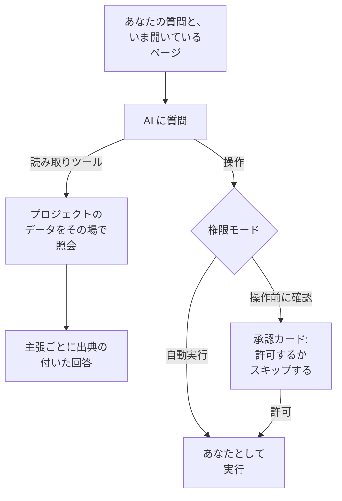

# AI に質問

AI に質問は、プロジェクトのデータを対象にした OneUptime のチャットです。ログ、トレース、メトリクス、例外、インシデント、アラート、モニター、オンコール、ステータスページ、SLO、Runbook、ワークフローについて質問すると、プロジェクトをその場で照会し、すべての主張に出典を付けて答えます。許可すれば、あなたに代わって操作も行います。

:::cards
- [AI に質問を開く](#ai-に質問を開く): ヘッダー、キーボード、グラフ、または製品メニューから。
- [見えるもの](#見えるもの): 回答のために読むデータ。
- [操作と権限モード](#操作と権限モード): 操作してよいか、いつ先に確認するかを選びます。
- [操作はあなたとして行われる](#操作はあなたとして行われる): あなたの権限で、すべての変更にあなたの名前が残ります。
:::

## AI に質問の答え方

AI に質問は、ツールが返した結果だけをもとに答えます。記憶から答えるのではなく、プロジェクトに対してクエリを実行します。回答のそれぞれの事実には出典チップが付き、その裏にあるクエリを示して、読んだデータを開きます。何かの変更を頼むと、会話の権限モードによって、先にあなたに確認するかどうかが決まります。質問より先に、プロジェクトの [AI コンテキスト](/docs/ai/ai-context) を読みます。チームが自分たちのシステムについて OneUptime AI のために書き留めたものです。

**読み取り専用** モードでは操作がモデルに一切提示されないため、会話は読み取りだけを行います。

## OneUptime についての質問

AI に質問は、OneUptime そのものについての質問にも答えます。「サイトがダウンしたときに SMS を受け取るには？」「エピソードとは？」「2 つ目の電話番号はどこで追加する？」などです。答えはこのドキュメント、つまりお使いの OneUptime が配信しているコピーから作られるため、インターネットに接続できなくても動き、新しい送信先には何も送りません。翻訳されたページはあなたの言語で読み、手順ごとにページとセクションを示し、ドキュメントに書かれていないことは推測せずにそう伝えます。

「どうすれば」への答えの最後には、それを行うプロジェクトのページを開くボタンが付きます（**モニターを作成** や **通知方法** など）。開くのは OneUptime にあるページ、つまり検索（`Ctrl` + `K`）で見つかるページだけです。

## AI に質問を開く

| 場所 | 方法 |
| --- | --- |
| どのページでも | ヘッダーの **AI に質問** をクリックするか、`Ctrl` + `I`(Mac では `Cmd` + `I`)を押します。テキストボックスやエディターで入力している間は、このキーはエディターの斜体のショートカットのままです。 |
| コマンドパレット | `Ctrl` + `K`(Mac では `Cmd` + `K`)を押して **AI に質問** を選びます。 |
| ログのエラーパターン、またはグラフの所見 | **AI で説明** をクリックすると、証拠を含む質問が入力された状態で AI に質問が開き、送信前に編集できます。 |
| 製品メニュー | **製品 → AI → チャット** を開きます。AI に質問は、それまで見ていたページの横に開きます。会話ごとに固有のアドレスがあるため、ブックマークしておけば後から戻れます。 |

AI に質問はウィンドウの端に開き、ページはその分の場所を空けます。後ろに隠れるものはないので、ページでの作業を続けたり、別のページに移動したりしながら、また質問できます。端をドラッグすると、幅を広げたり狭めたりできます。パネル内で `Esc` を押すか、もう一度 **AI に質問** をクリックすると、ウィンドウ全体がページに戻ります。開いている間は、`Ctrl` + `I`（Mac では `Cmd` + `I`）でページから入力欄に移動し、入力欄からはパネルを閉じます。会話は閉じたときのまま残るので、もう一度 AI に質問を開けば続けられます。回答の途中で閉じた場合は、回答の準備ができると隅の通知が知らせ、クリックするとその回答が開きます。両方を並べる余裕がないタブレットやスマートフォンではページの上に開き、スマートフォンでは画面全体に広がります。

インシデントやアラートでは、**OneUptime AI** カードに専用の会話 **OneUptime AI に質問** があり、そのインシデントやアラートを見られる全員で共有されます。[インシデントについて OneUptime AI と話す](/docs/ai/ai-sre#インシデントについて-oneuptime-ai-と話す) を参照してください。

## 見えるもの

AI に質問は、あなた自身の権限でプロジェクトを読みます。そのため、あなたが見てよいものだけが見え、それ以上は見えません。

| 領域 | AI に質問が読むもの |
| --- | --- |
| テレメトリー | ログの検索とヒストグラム、トレースの集計とスパンツリー、メトリクス、例外、セキュリティイベント、リアルユーザーモニタリングと Web Vitals、最近の変更、学習済みベースラインに対する異常チェック。 |
| インフラストラクチャ | ホスト、Docker、Podman、Kubernetes、Docker Swarm、Proxmox、VMware vCenter、Ceph、ストレージアレイ、サーバーレス関数、クラウド環境、IoT フリート、ネットワーク機器。インベントリにあるもの、報告された接続状態、メトリクスの傾向、重大度ごとのログ件数、トレースの操作の要約を読みます。一つのクエリで、サービスを名指しするテレメトリーとインフラストラクチャリソースを名指しするテレメトリーの両方を扱います。 |
| インシデント対応 | インシデントとアラート(状態フィルター付き。「いま何がアクティブ?」)、そのアクティビティのタイムライン(状態の変化、内部メモと公開メモ、フィード)と所有者、そして過去の解決方法を再利用するための過去のインシデントの検索。 |
| オンコール | いま誰がオンコールか、ポリシーとエスカレーションの流れ、最近の呼び出しが届いて確認されたかどうか。 |
| AI 自身の作業 | AI SRE の調査と AI Insights の結果。「AI は何を見つけた?」には、改めて調べ直すのではなく、投稿済みの分析から答えます。 |
| プラットフォーム | モニター(状態フィルター付き)、定期メンテナンス、ステータスページとそのお知らせ、SLO、Runbook、ワークフローの実行、プローブの状態、チーム、GitHub、GitLab、Forgejo、Gitea、Azure DevOps の接続済みリポジトリのコード([Git リポジトリで AI が読むもの](/docs/ai/ai-agent#git-リポジトリで-ai-が読むもの) を参照)。 |

## ページのコンテキスト

AI に質問は、どのページから開かれたかを知っています。インシデントのページで「なぜこれが起きた?」と聞けば、そのインシデントのことになります。入力欄にはページの対象を示すチップが表示され、提案される質問もそのページに合ったものです。プロジェクト全体について聞くときはチップを外し、同じ方法で元に戻せます。別のページで AI に質問を開くと、コンテキストもそのページに合わせて変わります。会話は最初の対象をサーバー側でも覚えているため、何日か後の追加の質問でも「このインシデント」が正しく伝わります。

インシデント、アラート、モニター、メンテナンスイベントでは、提案される質問はそのレコードの現在の状態にも合わせられます。状態は AI に質問を開くたびに読み取られます。解決済みのインシデントでは対応がどう進んだかと再発を防ぐ方法を、解決済みのアラートでは本当の問題だったかと同様のアラートがどのくらい発火しているかを、稼働していないモニターではその理由を尋ねます。開始前のメンテナンスイベントでは開始前に対象モニターが正常かを、終了したイベントでは正常に戻ったかを尋ねます。

インフラストラクチャの一覧やリソースのページでは、見ている種類のリソース向けの質問が提案されます。Kubernetes クラスターを開いて「過去 24 時間で変化したメトリクスは?」と聞いたり、Docker ホストを開いて「過去 6 時間のログの重大度とトレースのエラーを要約して」と聞いたりできます。証拠のリンクはリソースのページに戻ります。読み取りは、プロジェクト、リソース、テレメトリーに対するあなたの権限に従い、所有者やラベルによる制限も守ります。

子のページでは、選択した Pod、コンテナー、VM、プロセスなどの子もコンテキストに記録されます。インフラストラクチャのツールは親リソースのテレメトリーを読むため、名前だけから特定の子を測ることはできません。AI に質問はそのことを伝え、ページが示していない Kubernetes の名前空間を推測しません。接続状態はワークロードのヘルスではなく、テレメトリーがないことはリソースが健全であることを意味しません。

## インフラストラクチャでのコマンド

AI エージェントが接続されているリソース(ホスト、Docker または Podman のホスト、Docker Swarm クラスター、Proxmox クラスター、VMware vCenter、Ceph クラスター、データベースサーバー、Kubernetes クラスター)のページで開くと、AI に質問は頼まれたときにそのエージェントを通じてリソース上でコマンドを実行します。たとえば「このホストで `uptime` を実行して」や「`journalctl -u nginx` の最後の 100 行を見せて」と頼むと、返ってきた内容で答え、ほかの根拠と同じように引用します。インシデントやアラートで開くと、それに紐づくリソースに届きます。

- 実行するのは、AI 調査がその種類のリソースで実行できる読み取り専用のコマンドだけで([インフラストラクチャの AI エージェント](/docs/ai/infrastructure-ai-agents)を参照)、回答に必要な数だけ、どの権限モードでも OneUptime が確認し、エージェントがもう一度確認します。サービスの再起動のような、エージェントを通じた変更は AI に質問からは決して実行されず、代わりに正確なコマンドを示します。エージェントが変更を行うのは OneUptime AI がインシデントやアラートを修復するときだけで、リソース自身の修正の設定に従います。Runbook の実行など、AI に質問自身の操作は、下で説明する会話の権限モードに従います。
- 届くのは、あなたが閲覧できるリソースだけで、そのリソースの AI 調査がオンの間だけです。
- そこでコマンドを実行できないとき(エージェントが接続されていない、エージェントがオフライン、そのリソースの AI 調査がオフのとき)は、そのことと変更すべき点を伝え、代わりにプロジェクトのデータから答えます。

## 操作と権限モード

会話にはそれぞれ権限モードがあり、入力欄のテキストボックスの横で選びます。

| モード | 動作 |
| --- | --- |
| **操作前に確認** | 既定のモードです。AI に質問は各操作を承認カードで提案し、それぞれに **許可** か **スキップ** を選ぶか、**すべて拒否** を選ぶまで、何も実行されません。 |
| **自動実行** | モデルが求めた時点で操作が実行されます。それでも、あなたのロールに許された範囲に限られます。慎重に使ってください。 |
| **読み取り専用** | 操作はモデルに一切提示されません。AI に質問は読むことしかできません。 |

モードが許す場合に AI に質問ができること:

- インシデントやアラートの作成、インシデントとアラートの確認や解決、インシデントの重大度の変更。
- インシデントやアラートを、それが関係するインフラストラクチャやサービスにリンクすること。ホストなどのリソースのページで作成したインシデントやアラートはそのリソースにリンクされ、承認カードには各アクションのリンク先が表示されます。OneUptime AI は、インシデントやアラートがリンクされているものを調査して修正します。
- すでに誰かが対応している、またはすでに終わった問題の記録。作成するインシデントやアラートは確認済みまたは解決済みの状態で始められ、その場合は誰も呼び出しません。どちらで始まるかは承認カードに表示されます。[確認済みまたは解決済みの状態で宣言されたインシデント](/docs/incidents/declaring-incidents#確認済みまたは解決済みの状態で宣言されたインシデント) を参照してください。
- インシデントやアラートへの内部メモの投稿。内部メモがステータスページに表示されることはありません。
- インシデントへの公開ステータス更新の投稿。ステータスページの購読者に通知されるため、別の操作になっています。
- オンコールポリシーの呼び出し、Runbook の実行、インシデントやアラートの AI 調査の開始。
- 一文からの設定。Web サイトや API のモニター、呼び出す相手、ステータスページとそこに表示するモニターを、1 枚の承認カードでまとめて設定します。[設定を任せる](#設定を任せる)を参照してください。
- コード変更の提案。GitHub、GitLab、Forgejo、Gitea のリポジトリの新しいブランチにコミットし、pull request(GitLab ではマージリクエスト)を開きます。既定のブランチや保護されたブランチには書き込まないため、変更をマージするのは必ず人です。Ask AI は、最後に読んだ時点のファイルをもとに、各ファイルを丸ごと書き込みます。また、別のブランチを頼まれない限り、リポジトリのメインブランチを読みます。Ask AI が読んだ後にブランチ上でファイルが変更されていた場合は、コミットや pull request を承認する前にカードがそのファイルを示します。たとえば「AI が読んだ後に fix/login で 1 個のファイルが変更されたため、AI のバージョンはその変更を元に戻します: src/billing/charge.ts。」と表示されます。Ask AI が別のブランチでしか読んでおらず、そこでは内容が異なるファイル、Ask AI が一度も読まずに置き換えるファイル、OneUptime が照合できなかったファイルも示します。Ask AI は長いファイルを少しずつ読むため、カードは Ask AI が一部しか読んでいないファイルも示します。たとえば「AI は 1 個のファイルの一部しか読んでいませんが、AI のバージョンはファイル全体を置き換えます: src/billing/charge.ts。」と表示されます。Ask AI がファイル全体を一度に、または何回かに分けて読んだ後は、カードはそのファイルについて何も示しません。後の回答には以前の回答の文章はありますが、それらが読んだファイルはありません。そのため、カードは Ask AI が以前の回答でしか読んでいないファイルも示します。たとえば「AI は 1 個のファイルを以前の回答で読みましたが、もうその内容を持っておらず、AI のバージョンはファイル全体を置き換えます: src/billing/charge.ts。」と表示されます。とても長い回答では、モデルが一度に扱える量に収めるため、古い結果から省かれます。そのため、カードは Ask AI が同じ回答の中で先に読み、その結果が省かれたファイルも示します。たとえば「AI は 1 個のファイルをこの回答の中で先に読みましたが、もうその内容を持っておらず、AI のバージョンはファイル全体を置き換えます: src/billing/charge.ts。」と表示されます。Ask AI がファイルを何回かに分けて読み、そのうち一部をもう持っていない場合も、カードはそのことを示します。たとえば「AI は 1 個のファイルを読みましたが、もうその内容の一部を持っておらず、AI のバージョンはファイル全体を置き換えます: src/billing/charge.ts。」と表示されます。Ask AI がそのファイルを変更する回答でもう一度読むと、カードはそのファイルについて何も示しません。新しいファイルは対象になりません。他の人が変更した内容を残すには、操作をスキップして、Ask AI にファイルをもう一度読むよう頼んでください。誰も操作を承認しない自動実行では、Ask AI はそのような変更を行いません。ファイルをもう一度読み、現在のファイルに対して変更を行います。カードが承認を待っている間にファイルが変更された場合、承認しても何も変更されず、Ask AI が変更をもう一度提案します。それでも承認した pull request には、レビューする人のために、説明にそれらのファイルが記載されます。Ask AI には、IP アドレス、メールアドレス、鍵など、秘密情報や個人データのように見える値は表示されず、その代わりに `[redacted-ip]` のようなプレースホルダーを読みます。そのため、カードは Ask AI のバージョンがそのようなプレースホルダーを書き込むファイルも示します。たとえば「秘密情報や個人データのように見える値は AI から隠されており、1 個のファイルの AI のバージョンはその代わりにプレースホルダーを書き込みます: config/servers.ts。」と表示されます。ブランチ上のファイルにもともとあるプレースホルダーは対象になりません。Ask AI はそれらの値を書き戻せないため、自動実行ではその変更を行わず、代わりに何を変更すればよいかを伝えます。

ユーザーに影響が出ているときはインシデントを、ホストのメモリが上がり続けているなど、まずチームが確認すべきことがあるときはアラートを依頼してください。どちらも一度だけ作成され、何も監視しません。ホストのメモリが 75% を超えるたびにアラートを受け取るには、メモリのテンプレートから[ホスト モニター](/docs/monitor/host-monitor#既製のアラートテンプレート)を作成し、しきい値を 75% にします。AI に質問が設定できるモニターは Web サイトと API のものだけです（[設定を任せる](#設定を任せる)を参照）。ほかの種類を頼まれるとそう伝え、現在の値を確認し、すでに超えていればアラートの作成を提案します。

## 操作はあなたとして行われる

AI に質問が行う操作は、すべてあなたとして行われます。同じ操作でダッシュボードが行うのと同じ変更を、プロジェクト内でのあなた自身の権限で行い、その変更はあなたの名前で記録されます。チャットからインシデントを確認すると、インシデントの状態パネルと同じ状態変化が作られるため、インシデントのタイムラインとフィードには、あなたが状態を変えたと表示されます。チャットから送った呼び出しでは、あなたが発信者として表示されます。

- **各操作に必要なもの。** 同じ変更でダッシュボードが求めるのと同じ権限です。インシデントやアラートを作成するには、それを作成する権限が必要です。作成できるロール、またはカスタムロールの **Create Incident** や **Create Alert** です。インシデントの確認や解決には、その状態を変える権限が必要です。**プロジェクト所有者**、**プロジェクト管理者**、**プロジェクトメンバー**、**インシデント管理者**、**インシデントメンバー**、またはカスタムロールの **Create Incident State Timeline** です。アラートには、アラート用の同じ権限(**Create Alert State Timeline**)が必要です。確認済みまたは解決済みの状態で始まるインシデントやアラートを作成するには、作成する権限と状態を変える権限の両方が必要です。オンコールポリシーの呼び出しには、それを実行する権限(**Execute On-Call Policies**)が必要です。Runbook の実行には Runbook の実行を開始する権限が必要で、Runbook を実行するロール(そのラベルが届く Runbook に限る)か、プロジェクトのすべての Runbook に届くカスタムロールの **Create Runbook Execution** です。インシデントの重大度の変更、インシデントやアラートの AI 調査の開始、接続済みリポジトリへのコードの書き込みには、そのインシデント、アラート、リポジトリを変更する権限が必要です。許されていない操作は拒否され、AI は必要な権限を伝えます。権限はあっても所属するチームがそれをブロックしている場合は、AI はそのことを伝えます。一部のラベルに対するブロックは、そのラベルを持つレコードに限らず、すべてのレコードについて AI に質問でのその操作を拒否します。
- **対象になるレコード。** OneUptime のほかの場所と同じく、あなたが変更できるレコードです。一部のラベルや自分が所有するレコードに限られたロールでは、それ以外のレコードへの操作は何も変えません。Runbook は、Runbook の実行を開始するあなたの権限が届く場合にだけ実行されます。OneUptime Cloud では、プロジェクトのプランに含まれない操作は、必要なプランを示して拒否されます。
- **操作が拒否されたとき。** 何も変わりません。AI は、操作が行われなかったことと、その理由をはっきり伝え、やり直そうとはしません。回答のステップのうち、その操作のステップに、行われなかったことと理由が表示されます。ロールが許可していない、所属するチームがブロックしている、またはプロジェクトのプランに含まれていない、のいずれかです。
- **Slack、Microsoft Teams、AI 調査。** Slack と Microsoft Teams での AI の回答と、自律的な AI 調査は、読むだけです。これらの操作は一切行いません。そこで変更を頼まれると、AI はチャットからの変更方法を伝えます。`/oneuptime incident` はインシデントを宣言し、`/oneuptime incident 42` はインシデント 42 をボタン付きで表示し、`/oneuptime page` は誰かを呼び出します (Microsoft Teams では、同じ言葉を OneUptime ボットに送ります)。OneUptime のメッセージのボタンもあなたとして動作します([Slack](/docs/workspace-connections/slack#slack-からインシデントアラートイベントを操作する) と [Microsoft Teams](/docs/workspace-connections/microsoft-teams#microsoft-teams-からインシデントアラートイベントを操作する) を参照)。それ以外の変更には AI に質問へのリンクを示し、そこで変更が提案され、あなたが承認します。インシデントやアラート専用のチャネルで質問すると、そのインシデントやアラートのことだと受け取ります。

## 設定を任せる

AI に質問は、ガイド付きセットアップが設定するものを一文から設定します。たとえば「example.com を毎分チェックして、ダウンしたら SMS で知らせて」。

- **1 つの計画に 1 回の承認。** AI に質問は各部分を 1 枚の承認カードにわかりやすい言葉で提案します。Web サイトや API のモニター、プロジェクト最初のオンコールポリシー、ステータスページとそこに表示するモニターです。カードの最後には「ほかには何も変わりません。」と表示されます。不要な部分では **スキップ** を選び、残りを実行します。それまでは何も作成されません。
- **常に確認します。** 設定は **自動実行** を含むすべてのモードであなたの承認を待ちます。人を呼び出すものや顧客が目にするものを作成するからです。**読み取り専用** では提案されません。
- **ガイド付きセットアップと同じレコード。** モニターは、**Web サイトや API のダウンを知る** が同じアドレスに対して作成するものと同じです。モニター作成の既定値で、アドレスが応答しないかエラーで応答するとインシデントを開き、モニター作成のほかの間隔を頼まない限り 5 分ごとにチェックされます。所有者はあなたなので、ステータスが変わるとメールが届きます。ステータスページは **ステータスページを公開** が作成するものと同じで、作成した時点で公開され、各モニターのステータス、稼働率、履歴を表示します。
- **呼び出される人。** まだ誰も呼び出していないプロジェクトでは、AI に質問はプロジェクト最初のオンコールポリシー「Default on-call policy」を提案します。新しいインシデントやアラートのたびに、あなたと、あなたが挙げたメンバーやチームを呼び出します。すでに人を呼び出しているプロジェクトは独自のオンコールポリシーとルールを保ち、AI に質問は新しく作らずにそう伝えます。
- **足りないもの。** AI に質問が電話番号やモバイルアプリを追加することはありません。**ユーザー設定 → 通知方法** であなた自身が追加し、確認します。確認済みの番号がないまま SMS での連絡を頼むと、カードにそう表示され、回答からそのページへ移動できます。AI に質問が作成できない部分は提案されません。たとえば、ロールで許可されていない、アドレスが正しくない、モニターが存在しない場合で、回答には必要なものが示されます。
- **各部分に必要な権限。** モニターにはモニターを作成する権限が必要です。呼び出しには、オンコールポリシー、そのエスカレーションルール、インシデントとアラートのオンコールルールを作成する権限が必要です。ステータスページには、ステータスページを作成してモニターを追加する権限が必要です。ガイド付きセットアップと同じく、プロジェクトのプランの上限が適用されます。
- **最後にテスト。** 計画が実行されると、各カードから作成されたものを開けます。回答の下の **このポリシーをテスト**（モニターだけの場合は **自分にテスト呼び出しを送信**）でテスト呼び出しを送り、メッセージから確認応答します。失敗した部分がある場合は、何が作成され、何が作成されなかったかを回答が伝えます。
- **誰に通知されるか。** 「example.com がダウンしたら誰に通知される？」と尋ねると、AI に質問はモニターのページが示すのと同じ連鎖から答え、途切れている箇所をすべて挙げます。

## 会話の進め方

- **止める。** AI に質問が作業している間、送信ボタンは停止ボタンに変わります。いつでも実行を止めて、すぐに別の質問ができます。
- **作業の様子を見る。** 回答中は、ログの検索など、いま何をしているかを 1 行で示します。横にあるステップ数をクリックすると、各ステップを確認できます。
- **モデルを選ぶ。** プロジェクトで複数の LLM プロバイダーを使える場合、入力欄のプロバイダー選択には、プロジェクトの LLM プロバイダーとグローバルなプロバイダーが並び、既定のものに印が付きます。新しい会話では既定のものが使われます。
- **回答を評価する。** **良い回答** と **不十分な回答** はメッセージとともに保存され、回答の品質を時間をかけて測れます。
- **コストを見る。** 各回答の下では、出典を開くと実行したクエリが表示されます。最新の回答では、実行したクエリの数、トークン数、コストも表示されます。回答内の出典チップはそれぞれ、その裏のデータを開きます。
- **コピーを残す。** **会話をダウンロード** で、スレッドを **Markdown としてダウンロード**(読んだりチケットに貼ったりする用)または **PDF としてダウンロード**(誰かに渡す用)で保存できます。
- **続きから再開する。** AI に質問のヘッダーにある **すべての会話** には、会話が新しい順に並び、開き直したり削除したりできます。新しい会話の開始画面には、直近の 3 件が表示されます。

## 要件

- **LLM プロバイダー。** AI に質問は、プロジェクトの既定の LLM プロバイダーを使います([LLM プロバイダー](/docs/ai/llm-provider) を参照)。OneUptime Cloud では、プロジェクトの AI クレジットで支払われるグローバルプロバイダーで、設定なしですぐに使えます。セルフホストのインストールでは、プロバイダーか、グローバルプロバイダーの環境変数を設定します。回答の質はモデル次第です。ツール呼び出しが安定しない小さなセルフホストのモデルでは、良い回答は得られません。
- **OneUptime Cloud では Growth プラン。** それより下のプランのプロジェクトには、AI がプランに含まれていないことが **プロジェクト設定 → 請求と請求書 → 請求** へのリンクとともに表示されます。
- **プロジェクトで AI がオン。** **プロジェクト設定 → AI → AI 機能** の **AI を有効化** は、AI に質問を含むプロジェクトのすべての AI 機能をオフにします。誰かがオフにしない限り、オンになっています。

プロジェクトが独自の 1 日あたりの AI 上限を設定している場合、AI に質問もそれに数えられます(プロジェクト設定 → AI → AI 機能 → その他の設定)。上限に達すると、AI に質問は、どの上限に達したか、OneUptime AI が UTC の午前 0 時に再開すること、誰が上限を引き上げたり外したりできるかを示す一文を表示します。プロジェクトのオーナーには、その日に初めて上限に達したときにメールが届きます。インシデントとアラートの 1 日あたりの上限で AI に質問が止まることはありません。[プロジェクト独自の 1 日あたりの上限](/docs/ai/ai-sre#プロジェクト自身の-1-日あたりの上限) を参照してください。

## トラブルシューティング

:::details AI に質問が「AI を利用できない」と表示する
AI に質問は、入力する前に理由を示します。プロジェクトのプランに AI が含まれていない、**AI を有効化** がオフ、またはプロジェクトに LLM プロバイダーがない、のいずれかです。各メッセージは、それを変更するページにリンクしています。
:::

:::details 操作が拒否された
AI に質問は、その操作に必要な権限や、それをブロックしているチームを示します。変更してよい人に頼むか、プロジェクトのオーナーにあなたのロールへその権限を付けてもらってください。何も変更されていません。
:::

:::details 回答があいまい、またはデータをまったく使わない
プロバイダーの背後にあるモデルを確認してください。AI に質問には、ツールを確実に呼び出せるモデルが必要です。小さなローカルモデルは、1 つもクエリを実行せずに答えることがよくあります。[LLM プロバイダー](/docs/ai/llm-provider) を参照してください。
:::

## 次のステップ

:::cards
- [AI SRE](/docs/ai/ai-sre): 新しいインシデントとアラートをすべて OneUptime AI に調査させます。
- [LLM プロバイダー](/docs/ai/llm-provider): AI に質問やほかの AI 機能が使うモデルを選びます。
- [MCP サーバー](/docs/ai/mcp-server): 代わりに Claude、Cursor、VS Code から OneUptime について質問します。
:::
