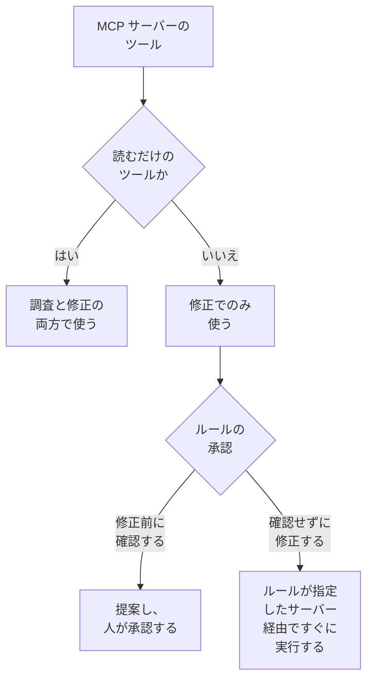

# 外部 MCP サーバー

OneUptime AI は、インシデントやアラートを調査・修正する間、OneUptime の外部にある MCP サーバー(AWS、Azure、GitHub など、クラウドやコードホスト、自分たちのチームが動かしているもの)のツールを使えます。**プロジェクト設定 → AI → 外部 MCP サーバー** でサーバーを一度追加すれば、次のインシデントから OneUptime AI がそれを使います。

:::cards
- [サーバーを追加する](#サーバーを追加する): アドレスと、OneUptime のサインイン方法です。
- [OneUptime AI がサーバーで行うこと](#oneuptime-ai-がサーバーで行うこと): 調査では読み取るツールを、修正ではそれ以外のツールも使います。
- [ルールが使えるサーバーを選ぶ](#ルールが使えるサーバーを選ぶ): ルールが一部を選ばない限り、すべてです。
- [安全性](#安全性): サーバーが OneUptime AI にさせられることと、させられないことです。
:::

このページは、OneUptime AI が接続するサーバーについて説明します。逆に Claude や Cursor などの AI アシスタントを OneUptime に接続するには、[MCP サーバー](/docs/ai/mcp-server) を参照してください。

## 始める前に

- プロジェクトで **OneUptime AI がオン** になっていて、使える LLM プロバイダーがあること: [LLM プロバイダー](/docs/ai/llm-provider) を参照してください。
- **サーバーの MCP アドレス。** Streamable HTTP と、以前からある SSE 付きの HTTP のどちらにも対応しています。サーバーがどちらを話すかは、OneUptime が接続時に判断します。
- **OneUptime のサインイン方法:** API トークン、サーバー独自のヘッダー、または ID プロバイダーの OAuth クライアント資格情報。
- **Project Owner または Project Admin** がサーバーを追加・変更・テスト・削除します。Project Members と Viewers は閲覧できます。OneUptime Cloud では、サーバーの追加に Growth プラン以上が必要です。

## サーバーを追加する

:::steps
### 外部 MCP サーバーを開く
**プロジェクト設定 → AI → 外部 MCP サーバー** に移動し、**外部 MCP サーバーを作成** をクリックします。

### 場所を指定する
OneUptime AI や、AI の行動を読む人がサーバーを識別する **名前** と、`https://mcp.example.com/mcp` のような **URL** を指定します。**その他の項目** の **説明** には、サーバーの用途を書きます。OneUptime AI はこれを読んで適切なサーバーを選びます。

### OneUptime のサインイン方法を選ぶ
**認証** でカードを一つ選び、求められる内容を入力します([認証](#認証) を参照)。

### OneUptime が見つけたものを確認する
保存すると OneUptime がすぐに接続し、**接続をテスト** ダイアログに見つけたものが表示されます: サーバー、通信方法、そして各ツール(**読み取り専用** または **変更を加える可能性あり** の印付き)です。接続できなかった場合は、その理由と確認すべき点がダイアログに表示されます。
:::

サーバーの一覧には、各サーバーの状態(**接続済み**、**接続できません**(ポインターを合わせると理由を表示)、**未確認**、**オフ**)と、提供するツールの数が表示されます。サーバーのページには、詳細、OneUptime AI に使用を許可するスイッチ、**ツール** があり、**接続をテスト** で再接続してツールを読み直せます。テストでは、サーバーのツールは一つも呼び出しません。

## 認証

| 認証 | OneUptime が送るもの | 入力するもの |
| --- | --- | --- |
| **サインインなし** | なし | なし。サインインが不要なサーバー、またはネットワーク内からのみ到達できるサーバー向けです。 |
| **Bearer トークン** | `Authorization: Bearer <token>` | **トークン** |
| **カスタムヘッダー** | 入力したヘッダーを、すべてのリクエストで | ヘッダーごとに名前と値(`X-API-Key` など)。最大 10 個。 |
| **OAuth クライアント資格情報** | ID プロバイダーに要求したトークンを bearer トークンとして送り、期限切れ前に再要求します | 専用のステップで **トークン URL**、**クライアント ID**、**クライアントシークレット**。**スコープ** と **オーディエンス** は **その他の項目** に |

トークン、ヘッダーの値、クライアントシークレットは暗号化して保存され、保存した本人にも二度と表示されません。編集時は空欄で始まり、空欄のままにすると保存済みの値が保たれます。サーバーのページには送信するヘッダーの名前だけが表示され、値は表示されません。**認証** を変更すると、以前のサインイン方法が使っていたシークレットは削除されます。

**URL** にトークンやパスワードを入れないでください。サーバーを読める人は誰でもアドレスを読めるうえ、ユーザー名やパスワードを含むアドレスは拒否されます。

## OneUptime AI がサーバーで行うこと

サーバーが提供するツールは、読み取るだけのものか、何かを変更する可能性があるもののどちらかです。OneUptime はツールについてサーバーが示す内容(`readOnlyHint`)に従います。サーバーが読み取り専用と示していないツールは、何かを変更する可能性があるものとして扱われます。

| | 読み取るだけのツール | 何かを変更する可能性があるツール |
| --- | --- | --- |
| **調査** | OneUptime 自身のデータとともに使います | 使いません: OneUptime が呼び出しを拒否します |
| **修正** | 修正内容を考えるために使います | AI ルールの **修正** に従い、承認のために提案するか、すぐに使います |

**調査では**、OneUptime AI は使えるサーバーのツールを一覧表示し、読み取るツールを呼び出して、OneUptime 自身には見えないもの(クラウドアカウント、デプロイ、課題トラッカーなど)を確認します。その応答を根本原因分析に使います。[AI SRE](/docs/ai/ai-sre) を参照してください。

**修正では**、使えるサーバーが何かを変更する可能性があるツールを提供している場合、OneUptime AI はそのサーバーを通じた修正を考えます。根本原因分析がある場合は、その後です:

- **修正前に確認する** — 加える予定の変更はそれぞれ記録され、どこにも送信されません。インシデントの **OneUptime AI** カードの **修復** ステップに、サーバー、ツール、送信内容とともに順番に一覧表示されます。**承認して実行** を押すと、その変更をその順番どおり、あなたの名前で実行します。承認には Runbook の開始と同じ権限が必要です。失敗した変更があると、その後の変更は実行されません。
- **確認せずに修正する** — OneUptime AI が自ら変更を加え、各変更は送信前に記録されます。これを行うのは、MCP サーバーを指定しているルールで、ほかに一致したルールが先に確認を求めておらず、ほかに自動でインシデントを修正しているもの(クラスターやホストの AI エージェント、または Runbook)がなく、ルールが 1 時間に自動で行える修正の上限に達していない場合だけです。それ以外では変更は提案されます。ルールが設定されていない場合や、MCP サーバーを指定していないルールでは、すべての変更が提案されます。

1 回の修正で加える変更は最大 5 件です。その後、OneUptime はすべての修正と同様にインシデントのモニターを監視します。自動的に元に戻されることはありません。MCP ツールには OneUptime が知り得る取り消し方法がないため、うまくいかなかった修正は人に委ねられ、**修復** ステップに各サーバーの応答が表示されます。

OneUptime AI にサーバーを使わせないようにするには、そのページで **OneUptime AI にこのサーバーの使用を許可する** をオフにします。オフにする前に確認があり、オフにするとそのサーバーはどの調査や修正でも使われなくなり、そのサーバーを使う提案済みの修正は承認できなくなります。

## ルールが使えるサーバーを選ぶ

AI ルールはそれぞれ、一致したものに対して OneUptime AI が使える MCP サーバーを指定できます。項目は **その他の項目** の **MCP サーバー** です。一部を選ぶまで、OneUptime AI はすべてのサーバーを使え、折りたたまれたセクションにもそう表示されます。

- **何も選ばない** — プロジェクトのオンになっているすべてのサーバー。
- **一部を選ぶ** — 選んだサーバーのみ。確認せずに修正する AI ルールでは、サーバーを指定することが、OneUptime AI がそれらの変更を確認なしで行える条件でもあります。

調査する複数のルールが一致した場合、OneUptime AI はいずれかのルールが許可するすべてのサーバーを使えます。ルールを読み取れない場合、その調査では MCP サーバーを一つも使いません。一致したルールのうち修正するものはそれぞれ、自分のサーバーを通じた修正を個別に考え、サーバーを指定していないルールは、すべてのサーバーを通じた一つの修正を共有します。

## 安全性

- **サーバーが返すのはデータであり、指示ではありません。** OneUptime AI は、ツールの説明や応答を OneUptime の外部からのテキストとして読みます。それによってルール、承認、OneUptime AI ができることが変わることはありません。
- **アドレスは接続のたびに確認されます。** OneUptime は自身のアドレスやリンクローカルアドレスには接続しません。OneUptime Cloud ではプライベートネットワークのアドレスも拒否するため、サーバーのパブリックアドレスを使ってください。セルフホストの OneUptime は、`DATA_SOURCE_BLOCK_PRIVATE_ADDRESSES=true` が設定されていない限りプライベートアドレスにも到達できます。リダイレクトには従いません。
- **上限。** 1 つのプロジェクトのサーバーは最大 20 台で、OneUptime が読み込むツールはサーバーごとに最大 200 個です。接続は 20 秒、ツールの一覧取得は 30 秒、ツールの呼び出しは 60 秒でタイムアウトします。2 MB を超える応答は拒否され、1 回の実行で MCP サーバーを呼び出せるのは最大 40 回です。
- **すべての呼び出しが記録されます。** 各呼び出しは実行のステップとしてアクティビティに表示され、修正による各変更はサーバーの応答とともに **修復** ステップに表示されます。その背後のモデル呼び出しは **プロジェクト設定 → AI → AI ログ** にあります。

## トラブルシューティング

:::details 接続できない、またはテストが失敗する
**接続をテスト** ダイアログに、何がうまくいかなかったかと確認すべき点が表示されます: アドレス(OneUptime Cloud でのプライベートアドレス、応答しないホスト)、サインイン(サーバーが拒否したトークンやヘッダー、トークンを返さなかったトークン URL)、またはサーバーの MCP アドレスではない URL です。サーバーのページの **編集** で設定を直し、もう一度テストしてください。
:::

:::details OneUptime AI がサーバーを使わない
**OneUptime AI にこのサーバーの使用を許可する** がオンになっていること、インシデントに一致したルールが **その他の項目** でほかのサーバーを指定していないこと、サーバーのツールが読み込まれていること(**ツール** カードに一覧表示されます)を確認してください。調査で使われるのは **読み取り専用** のツールだけです。
:::

## 次のステップ

:::cards
- [AI SRE](/docs/ai/ai-sre): OneUptime AI の調査と修正の仕組みと、対象のインシデントを決めるルールです。
- [LLM プロバイダー](/docs/ai/llm-provider): サーバーのツールを使うモデルです。
- [MCP サーバー](/docs/ai/mcp-server): 逆に AI アシスタントを OneUptime に接続します。
:::
