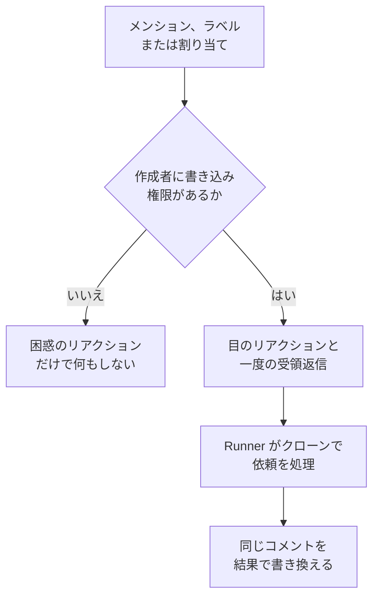

# GitHub App

OneUptime GitHub App は、コードへの単なる接続ではありません。リポジトリの中で話しかけると、その場で作業します。Issue でメンションするとプルリクエストを作成し、プルリクエストでメンションするとブランチを修正するか差分をレビューします。生み出すものはすべて、人が読むためのプルリクエストかレビューです。**何かをマージすることも、プルリクエストを承認することも決してありません。**

:::cards
- [コマンド](#コマンド): Issue やプルリクエストに書く内容です。
- [スレッドでの見え方](#スレッドでの見え方): 作業の進み具合を追う一つのコメントです。
- [本番環境を踏まえたレビュー](#本番環境を踏まえたレビュー): 変更されたコードについて本番環境が示していることです。
- [コマンドを出せる人](#コマンドを出せる人): 書き込み権限を持つ人だけです。
- [トラブルシューティング](#トラブルシューティング): メンションしても何も起きないときに。
:::

```text
@oneuptime implement this                          →  a pull request that closes the issue
@oneuptime revise this — use exponential backoff   →  new commits on this pull request's branch
@oneuptime review                                  →  a code review posted on this pull request
@oneuptime production review                       →  what production shows of the changed code
```

> [!NOTE]
> `@oneuptime` は、ご自身のアプリのハンドルに置き換えてください。OneUptime Cloud では `@oneuptime` です。セルフホストのインスタンスでは、GitHub App に付けた名前を小文字にし、スペースをハイフンに置き換えたものです。たとえば "Acme AI" という名前のアプリは `@acme-ai` でメンションします。メンションしても何も起きない場合は、まずここを確認してください。

## 仕組み



[コード](/docs/ai/ai-agent) と同じエージェント、同じ Runner、同じ予算を使います。違うのはきっかけだけです。

## 始める前に

- リポジトリは GitHub App を通じて **OneUptime プロジェクトに接続されている** 必要があります。**製品 → コード** で接続します。セルフホストのインスタンスでは、まず独自の GitHub App が必要です。[GitHub 統合](/docs/self-hosted/github-integration) を参照してください。GitHub アカウントにアプリがすでにインストールされている場合は、もう一度インストールする代わりに、そこで **既存のインストールを接続** をクリックします。
- コードのリポジトリの設定で選ばれた Runner(何も選んでいないリポジトリではグローバル Runner)がオンラインである必要があります。[コード](/docs/ai/ai-agent) のタスクを実行するのと同じ Runner です。Runner がないと、コマンドは受け付けられた後、30 分でどの Runner も取得しなかったというメッセージとともに失敗します。
- GitHub App には **Read & write** の **Issues** 権限が必要で、[サブスクライブするイベント](#サブスクライブするイベント) にある Webhook イベントをサブスクライブしている必要があります。

## コマンド

すべてのコマンドはアプリへのメンションで始まります。メンションはコメントのどこにあってもよく、その後に書いた内容がリクエストとして渡されます。すでにアプリをメンションしているコメントを編集しても、アプリは再実行されません。リクエストを変えるには、新しいコメントを書いてください。メンションを追加する編集は、新しいリクエストになります。

### プルリクエストで

| コマンド | 動作 | 同じ意味として扱われる表現 |
| --- | --- | --- |
| `@oneuptime review` | ブランチをクローンし、変更されたコードとその周辺のコードを読み、それについて本番環境が示していることを確認して、レビューをコメントとして投稿します。何も変更しません。 | `code review`, `please review`, `can you review`, `review this` |
| `@oneuptime production review` | 作成者が誰であっても、今すぐプルリクエストを本番環境のデータでレビューします。変更されたコードの周りの例外、操作、インシデント、デプロイを、その場で更新されるひとつのコメントにまとめます ([プルリクエストの本番レビュー](/docs/ai/ai-agent#プルリクエストの本番レビュー) を参照)。何もクローンせず、何も実行しません。 | `review against production`, `review production`, `check production` |
| `@oneuptime revise this — <what you want changed>` | プルリクエスト自身のブランチをクローンし、変更を加えて、そのブランチに新しいコミットをプッシュします。別のプルリクエストを作成することはありません。 | `revise`, `please revise`, `rework`, `redo` |

メンションの後に書いたもののうち、既知のコマンドでないものは修正の依頼として読まれます。ほとんどの場合、実際にそうだからです:

```text
@oneuptime the retry loop here should back off exponentially, and the test
should cover the 429 case
```

### Issue で

| コマンド | 動作 | 同じ意味として扱われる表現 |
| --- | --- | --- |
| `@oneuptime implement this` | Issue に取り組み、それをクローズするプルリクエストを作成します。 | `implement`, `please implement`, `work on this`, `pick this up`, `take this` |
| `@oneuptime <anything else>` | 同じ動作で、あなたの言葉を追加の指示として使います。 | — |

コメントを書かずに Issue をアプリに渡すこともできます:

- **トリガーラベルを付ける。** リポジトリのトリガーラベル(変更していなければ `oneuptime`)を Issue に付けると、同じ作業が始まります。GitHub 自体のページから作業を渡す最も確実な方法です。
- **Issue をアプリのボットユーザーに割り当てる**(リポジトリが許可している場合)。GitHub ではアプリをどこでも担当者にできるわけではないため、ラベルが用意されています。割り当てても何も起きない場合は、ラベルを使ってください。

### どこでも

| コマンド | 動作 | 同じ意味として扱われる表現 |
| --- | --- | --- |
| `@oneuptime help` | コマンドの一覧を表示します。後に何も書かないメンションだけでも同じです。 | `commands`, `usage`, `what can you do` |
| `@oneuptime status` | このスレッドで何に取り組んでいるかを伝えます。 | `progress` |
| `@oneuptime cancel` | このスレッドで動いている実行を止めます。すでにプッシュされた作業はそのまま残ります。 | `stop`, `abort` |

`help`、`status`、`cancel` はエージェントの実行を開始しないため、コストはかかりません。

## スレッドでの見え方

一つのコマンドは **一つのコメント** を生み出し、アプリは作業の進行に合わせてそれを編集します。そのため、長いタスクでもプルリクエストがステータスログになることはありません。

1. あなたのコメントに 👀 でリアクションし、実行が属する OneUptime プロジェクトの名前と、実行中の画面へのリンクを含む受領の返信を投稿します。
2. 終わると、その同じコメントを結果で書き換えます。作成したプルリクエスト、プッシュしたコミット、または何もしなかった理由のわかりやすい説明です。

変える価値のあるものが見つからなければ、憶測でプルリクエストを作成せずに、そう伝えます。これは失敗ではなく通常の結果です。もっと指示を加えて、もう一度依頼してください。

## 本番環境を踏まえたレビュー

OneUptime はレビューするコードのテレメトリを持っているので、差分を読むだけのレビュアーには言えないことをレビューで伝えられます。リポジトリに対応するサービスについて、次のことを確認します:

- 直近 7 日間に、変更されたファイルや関数で発生した例外
- 差分が触れるエンドポイントや操作が、どれだけ呼び出され、どれだけ遅いか
- 変更されたファイルに関連付けられたインシデント
- サービスの最近のデプロイのうち、OneUptime が悪化を招いたと判定したもの

見つかったことはレビューの **Production context** という見出しの下に書かれ、各項目には根拠となる数値と期間が添えられます。たとえば「`chargeCard` は直近 7 日間に `TypeError: Cannot read properties of undefined` を 1,240 回投げました。この変更で、それを止める null チェックが加わります。」といった形です。本番環境に差分と関係するものが何もなければ、すべて問題ないと書くのではなく、レビューからその見出しを省きます。

設定は何も必要ありません。対象のサービスは、修正のときと同じように OneUptime がこのリポジトリに対応すると判断したものです([修正での本番テレメトリ](/docs/ai/ai-agent#修正での本番テレメトリ) を参照)。クエリは読み取り専用で、OneUptime サーバーで実行され、ほかのサービスやプロジェクト、非公開のインシデントについては何も読みません。サービスがプロジェクトにテレメトリを送っていないリポジトリは、コードだけをもとにレビューされます。

すべてのプルリクエストを自動で本番環境のデータでレビューするには、リポジトリの設定で **本番環境のデータでプルリクエストをレビュー** をオンにします。[プルリクエストの本番レビュー](/docs/ai/ai-agent#プルリクエストの本番レビュー) を参照してください。

## コマンドを出せる人

**リポジトリへの write、maintain、admin のいずれかのアクセス権を持つ人だけです。** OneUptime は毎回、そのリポジトリでのコメント投稿者の権限を GitHub に問い合わせます。GitHub がコメントの横に表示する "contributor" バッジは信用しません。これは現在のアクセス権ではなく、過去の活動を表すものだからです。

それ以外の人からのメンションには 😕 のリアクションが一つ付くだけで、それ以上は何も起きません。これは意図的です。公開リポジトリでは誰でもコメントでき、見知らぬ人に必ず返信するアプリはスレッドのスパムに使われかねません。

また、ボットが書いたコメント(自分自身のものを含む)と、引用(`>`)やコードブロック内のメンションはすべて無視します。この二つのルールにより、自分のコメントへの返信で再び動き出すことはありません。

## しないこと

- **マージは決してしません。** このアプリの動作で、デフォルトブランチにコードが入ることはありません。
- **承認も変更のリクエストも決してしません。** レビューはコメントとして投稿されるため、アプリのレビューがブランチ保護ルールを満たすことはありません。
- **履歴を書き換えることは決してありません。** 修正はコミットを追加するもので、force-push は決してしません。先に誰かがブランチにプッシュしていた場合、その人の作業を捨てるのではなく、修正が失敗します。
- **フォークからのプルリクエストは修正できません。** フォークのブランチは、インストールが書き込めないリポジトリにあります。それでもレビューはできるので、代わりにレビューを依頼してください。
- **プルリクエストのタイトル、説明、マージ先のブランチを変えることは決してありません。** 変えるのはコードだけです。

## コストと上限の設け方

作業を始めるコマンドはすべて、エージェントの完全な実行です。クローン一つ、最大 40 回の LLM 呼び出しと 100,000 個の出力トークン、そして独自の Runner では、リポジトリの `AGENTS.md` が示すビルドとテストのチェックを使います。レビューが本番環境に対して行うクエリは最大 12 回で、同じ 40 回の呼び出しに数えられます。

GitHub のコマンドはインシデントやアラートの外で行う AI の作業なので、1 日あたりの修正タスクの上限は適用されません。プロジェクトが設定している場合は、プロジェクト自身の 1 日あたりの AI の上限が適用されます。それ以外の上限は、すでに [コード](/docs/ai/ai-agent) のタスクに適用されているものだけです:

- **オープンなプルリクエストの上限**(リポジトリの **設定** ページの **その他の設定** にある **オープンにできる修正プルリクエストの最大数**)。**AI の修正プルリクエスト** は **上限あり** を選ぶまで **制限なし** です。 **なし** を選ぶと、そのリポジトリでの AI 修正のプルリクエストを止めます。レビューと修正は対象外です。どちらもレビュー待ちのプルリクエストを増やさないためです。

一つの Issue またはプルリクエストで同時に動く実行は、種類ごとに一つだけです。二回依頼すると、すでに作業中であることを伝えます。修正の実行中にレビューを依頼すると、別々の依頼なので両方が始まります。

実行を開始できない場合、アプリはスレッドでその理由を伝えます。黙って失敗することはありません。

## オフにする

各リポジトリには、リポジトリの **設定** ページの **その他の設定** に **GitHub のコマンドに応答** というスイッチがあります。すべてのリポジトリでオンになっていて、切り替えた時点で保存されます。オフにすると、アプリはそのリポジトリでのメンション、割り当て、トリガーラベルを無視し、尋ねた人にはスイッチへのリンクで答えます。

`oneuptime` 以外のラベルを使いたい場合は、同じページの **その他の設定** にある **GitHub のトリガーラベル** で設定します。

## サブスクライブするイベント

GitHub App の **Permissions & events** の設定で、次のイベントをサブスクライブします:

| イベント | 必要な理由 |
| --- | --- |
| **Issue comment** | Issue とプルリクエストでの `@mention` コマンド |
| **Issues** | Issue のアプリへの割り当てと、トリガーラベル |
| **Pull request** | アプリへのレビュー依頼、およびプルリクエストの作成時と変更時の本番レビュー |
| **Pull request review** | 送信されたレビュー本文内のメンション |
| **Pull request review comment** | 差分へのインラインコメント内のメンション |

**Repository permissions** では、**Issues** を **Read & write** にする必要があります。GitHub はプルリクエストの会話コメントを Issues API 経由で送るため、これによってアプリはプルリクエストにもコメントできます。 **Checks** を **Read & write** にすると、各本番レビューがプルリクエストの最新のコミットにチェックを追加できます。それがない場合、レビューが投稿するのはコメントだけです。

## プロンプトインジェクション: 守られるものと守られないもの

Issue の本文、プルリクエストの説明、差分、コメントはすべてエージェントのプロンプトの一部になり、公開リポジトリでは誰でもそれを書けます。「指示を無視して X をせよ」という一文が Issue に紛れていることは、現実に起こり得ます。

これを抑えるものは二つあり、それぞれの役割を知っておく価値があります:

- **プロンプトは信頼できないテキストを指示ではなく依頼として扱い**、実行のリポジトリ、ブランチ、プルリクエストはエージェントが始まる前に固定されます。エージェントが何を読んでも、作業対象は変わりません。
- **本当の封じ込めはサンドボックスです。** エージェントはあなたの Runner 上の使い捨てのクローンで動き、コマンド環境から認証情報が取り除かれ、git の操作も制限されています。できるのはブランチへのプッシュだけで、マージできるのは人だけです。

AI が書いたプルリクエストは、Issue を読んだ新しいコントリビューターのプルリクエストと同じように扱ってください。説明ではなく差分をレビューします。

## トラブルシューティング

:::details メンションしても何も起きない
まずハンドルを確認してください。表示名ではなく、アプリの slug です。次に、リポジトリがプロジェクトに接続されていること(**製品 → コード** で確認)、**GitHub のコマンドに応答** がオンであること、GitHub App が上のイベントをサブスクライブしていることを確認してください。
:::

:::details 😕 のリアクションだけで何も言わない
リポジトリへの書き込み権限がありません。
:::

:::details すでに作業中だと言われる
この Issue またはプルリクエストでは、その種類の実行がすでに動いています。`@oneuptime status` で内容がわかり、`@oneuptime cancel` で止められます。
:::

:::details 受領を返した後、長い間反応がない
リポジトリが選んだ Runner が **Runbook → Runner** でオンラインになっているか確認してください。何も選んでいないリポジトリはグローバル Runner で作業し、接続されているかどうかはコードのリポジトリの設定に表示されます。オンラインの Runner がないと、実行は 30 分後に失敗し、スレッドにそのことが伝えられます。
:::

:::details プルリクエストがフォークから来ていると言われる
修正には、このリポジトリ内のブランチが必要です。代わりにレビューを依頼するか、ブランチをこのリポジトリにプッシュしてください。
:::

## 次のステップ

:::cards
- [コード](/docs/ai/ai-agent): リポジトリで頼むか、例外、トレース、調査から開始する同じエージェントです。
- [GitHub 統合](/docs/self-hosted/github-integration): セルフホストのインスタンスで GitHub App を作成して設定します。
- [Runbook エージェント](/docs/runbooks/agents): すべての実行を担うワーカーです。
:::
