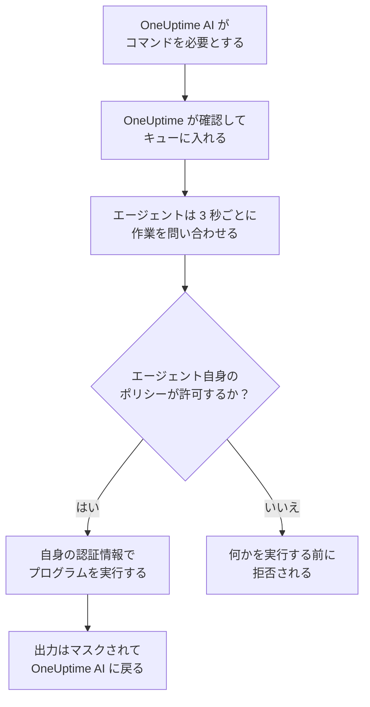

# インフラストラクチャの AI エージェント

OneUptime AI は、インシデントやアラートを調査するとき、テレメトリ以外のものも見ることができます。リソース(Docker または Podman のホスト、Docker Swarm クラスター、Proxmox クラスター、VMware vCenter、Ceph クラスター、データベースサーバー、Linux ホスト)の隣にインストールした小さなエージェントが、`docker logs --tail 200 web`、`pvesh get /cluster/status`、`ceph health detail`、`db long-queries --min-seconds 30`、`journalctl -u nginx -n 200 --no-pager` のように OneUptime AI が求める読み取り専用のコマンドを実行して出力を返すので、根本原因分析はリソース自身が示す内容を引用します。許可すれば、同じエージェントが修正(コンテナの再起動、VM の起動、OSD を in に戻すなど)も適用します。各修正はコマンドポリシーによって段階に分類され、別の設定を選ばない限り、まず人が承認します。リソースのページで開いた AI に質問も、頼めば同じ読み取り専用のコマンドを実行します([AI に質問](/docs/ai/ask-ai)を参照)。

これらのエージェントが **リソース AI エージェント** です。各リソースのダッシュボードページには、三つのページを持つ **AI** セクションがあります:

- **インサイト** — OneUptime AI が過去 30 日間にそのリソースについて把握したこと。繰り返し起きる問題とその理由(AI が見つけたことと提案する手順付き)、その大半の背後にあるリソースの部分、効果がなかった修正や承認待ちの修正、AI が自ら修正したもの、誰かが呼び出される前に見つかったリスクを示し、AI 自身がそこで行ったことを脚注として添えます。クラスターのページと同じように動作します。[AI がクラスターで学んだこと](/docs/ai/ai-sre#ai-がクラスターで学んだこと) を参照してください。
- **ログ** — OneUptime AI がそのリソースで行ったすべてのこと(新しい順)。各調査とそのインシデントまたはアラートと要約、提案または実行した各修正、エージェント経由で送った各コマンドです。(このページは以前、インサイトという名前でした。)
- **AI エージェント** — エージェントが接続されているかどうか、AI がそのリソースで何をしてよいか(調査と、修正の実行方法)、対応が必要なことと解決する手順、そしてエージェントの状態の隣にある **⋯** メニューの **接続をテスト** と **エージェントをリセット** です。

リソースの **概要** の末尾には、AI エージェントのページを要約する **AI エージェント** カードがあります。エージェントが接続されているか、調査がオンか、修正がどう実行されるか(**オフ**、**承認を求める**、**自動**、**承認をバイパス**)、対応が必要なことを示し、それらを変更する AI エージェントのページへのリンクがあります。

:::cards
- [サポートされるリソース](#サポートされるリソース): 八種類のリソースに、一つのイメージ。
- [AI エージェントのインストール](#ai-エージェントのインストール): すでに動かしているコレクターの隣か、Linux ホスト上に。
- [修正の仕組み](#修正の仕組み): 自動で実行してよいもの、人を待つもの、決して実行されないもの。
- [セキュリティモデル](#セキュリティモデル): すべてのコマンドに三つのチェックがあり、OneUptime から認証情報は届きません。
:::

## 仕組み

エージェントは OneUptime からの接続を待つことはありません。エージェントが OneUptime に接続して作業を問い合わせ、自身が持つコマンドポリシーのコピーが許可するものだけを、すでに持っている認証情報で実行します。



## Kubernetes AI エージェントとの関係

Kubernetes クラスターには独自のエージェントである Kubernetes AI エージェントがあり、Kubernetes エージェントの Helm チャートでインストールされます。[クラスターへのアクセス — OneUptime AI に kubectl を実行させる](/docs/ai/ai-sre#クラスターへのアクセス-oneuptime-ai-に-kubectl-を実行させる) を参照してください。このページの内容はそれを変更しません。リソース AI エージェントは同じ設計に従います:

- **同じ段階とモード。** すべてのコマンドは **Read**、**SafeWrite**、**RiskyWrite**、**Denied** のいずれかで、修正は **オフ**、**承認を求める**、**自動**、**承認をバイパス** のいずれかです。意味はクラスターの場合と同じです。
- **同じ三つのチェック。** 同じコマンドポリシーを、OneUptime の AI ツールが適用し、OneUptime がコマンドをキューに入れるときに再び適用し、さらにエージェントが何かを実行する前にもう一度適用します。
- **認証情報に関する同じルール。** エージェントは、自身の環境とマウントから与えられたものだけを使います。OneUptime がエージェントに認証情報を送ることはありません。
- **同じデフォルト。** AI の調査はデフォルトでオンです。リソースはクラスターと同じく調査オン、修正オフで始まるため、OneUptime AI はエージェントが接続するとすぐにそれを使って調査し、誰かが修正を許可するまで何も変更しません([OneUptime への接続](#oneuptime-への接続) を参照)。

異なる点:

- **すべてのリソースに一つのイメージ。** `oneuptime/resource-ai-agent` が八種類すべてのリソースに対応し、`ONEUPTIME_AI_AGENT_RESOURCE_TYPE` がエージェントの対応するリソースを示します。Helm チャートからではなく、リソースのコレクターの隣でもう一つのコンテナとして動作します。
- **書き込みアクセスは環境変数。** エージェントに `ONEUPTIME_AI_ALLOW_WRITES=true` があって初めて修正を適用でき、`ONEUPTIME_AI_WRITE_TARGETS` で修正が触れてよいコンテナ、サービス、VM、OSD、セッション、ユニットを制限します。クラスターでは、チャートの RBAC と `aiAgent.remediation.namespaces` がこの役割を担います。

Kubernetes AI エージェントと同じく、リソース AI エージェントは Runner ではありません。Runbook → Runner の下に表示されることはなく、Runbook の Bash または SSH ホストとして使われることもありません。

## サポートされるリソース

| リソース | `ONEUPTIME_AI_AGENT_RESOURCE_TYPE` | エージェント | 登録に使う名前(コレクターの変数) | 実行するもの | リソースへの到達方法 |
| -------------------- | ---------------------------------- | --------------------- | ----------------------------------------------------------------------------------------------- | -------------------------------------------------------------------------------------------------------------------------------------------------- | -------------------------------------------------------------------------- |
| Docker ホスト | `docker` | Docker AI エージェント | `DOCKER_HOST_NAME` | `docker` | Docker ソケット、`/var/run/docker.sock` |
| Podman ホスト | `podman` | Podman AI エージェント | `PODMAN_HOST_NAME` | `docker`(Podman の Docker 互換 API 経由) | Podman ソケット、`/run/podman/podman.sock` |
| Docker Swarm クラスター | `docker-swarm`(または `swarm`) | Docker Swarm AI エージェント | `DOCKER_SWARM_CLUSTER_NAME` | `docker` | マネージャーノードの Docker ソケット |
| Proxmox クラスター | `proxmox` | Proxmox AI エージェント | `PROXMOX_CLUSTER_NAME` | Proxmox VE API に送られる `pvesh` コマンド(エージェントに `pvesh` バイナリはありません) | `https://PVE_HOST:8006/api2/json`、Proxmox API トークンを使用 |
| VMware vCenter | `vmware`(または `vcenter`) | VMware AI エージェント | `VMWARE_VCENTER_NAME` | `govc` | vCenter の API、vSphere ユーザーを使用 |
| Ceph クラスター | `ceph` | Ceph AI エージェント | `CEPH_CLUSTER_NAME` | `ceph` | モニター、`ceph.conf` とエージェント専用クライアントのキーリングを使用 |
| データベースサーバー | `database`(または `db`) | データベース AI エージェント | `DATABASE_SERVER_ID`、または `DATABASE_SYSTEM` + `DATABASE_SERVER_ADDRESS` + `DATABASE_SERVER_PORT` | `db` — 固定の診断カタログの操作を一つ実行し、SQL は決して実行しない | データベース自身のドライバー、データベースのログインを使用 |
| ホスト | `host` | ホスト AI エージェント | `HOST_NAME`(空の場合はホスト自身のホスト名) | `systemctl`、`journalctl`、`df`、`free`、`uptime`、`ps`、`ss`、`ip`、`dmesg`、`lsblk`、`cat`、`top`、`uname`、`hostnamectl`、`timedatectl`、`kill` | 特権コンテナから `nsenter` でホストの名前空間に入る |

データベースサーバー: データベース AI エージェントには、PostgreSQL、MySQL(および MariaDB と Percona Server)、Redis(および Valkey、KeyDB、Dragonfly)、MongoDB 向けの診断があります。それ以外のエンジンでは何も実行せず、データベースの AI エージェントのページでその旨を表示します。

AI エージェントのページでエージェントの状態の隣にある **⋯** メニューの **接続をテスト** は、エージェント経由で次の読み取り専用コマンドを実行し、その出力をエージェントのカードに表示します:

| リソース | 接続をテストが実行するもの |
| -------------------- | ---------------------------------------------------- |
| Docker ホスト | `docker version`、`docker info` |
| Podman ホスト | `docker version`、`docker info` |
| Docker Swarm クラスター | `docker version`、`docker node ls` |
| Proxmox クラスター | `pvesh get /version`、`pvesh get /cluster/status` |
| VMware vCenter | `govc about` |
| Ceph クラスター | `ceph health`、`ceph versions` |
| データベースサーバー | `db ping`、`db version` |
| ホスト | `uptime`、`systemctl list-units --failed --no-pager` |

Docker Swarm のワーカーでは `docker node ls` が失敗します。Docker Swarm AI エージェントはマネージャーノードで実行する必要があります。ワーカーで起動したエージェントは、そのノードがマネージャーになるまでクラスターに登録されず、Docker Swarm のインストーラーはマネージャーでないノードにはエージェントを含めません。

## AI エージェントのインストール

リソース AI エージェントはすべて同じイメージ `oneuptime/resource-ai-agent:release` です。ダッシュボードでの設定は不要で、起動すると OneUptime に登録され、一分以内にリソースの AI エージェントのページに表示されます。

### コレクターの隣で

Docker、Podman、Docker Swarm、Proxmox、VMware、Ceph、データベースサーバーでは、エージェントはそのリソースですでに使っているコレクターの隣で動作し、その `.env` を共有します。`ONEUPTIME_URL`、取り込みキー、リソース名はすでに揃っています。各コレクターの `docker-compose.yml` にはエージェントがもう一つのサービスとして含まれており、その `install.sh` がエージェントを起動します。

| リソース | コレクター | AI エージェントのサービス(とコンテナ) | 設定場所 |
| -------------------- | ----------------------------------------------------------- | --------------------------------- | ------------------------------------------------------------------------------------- |
| Docker ホスト | [Docker エージェント](/docs/telemetry/docker-host#ai-エージェント) | `oneuptime-docker-ai-agent` | `agents/DockerAgent/docker-compose.yml`。`install.sh` が二つ目のコンテナとして起動 |
| Podman ホスト | [Podman エージェント](/docs/telemetry/podman-host#ai-エージェント) | `oneuptime-podman-ai-agent` | `agents/PodmanAgent/docker-compose.yml`。`install.sh` が二つ目のコンテナとして起動 |
| Docker Swarm クラスター | [Docker Swarm エージェント](/docs/telemetry/docker-swarm#ai-エージェント) | `oneuptime-docker-swarm-ai-agent` | `agents/DockerSwarmAgent/docker-compose.yml`、マネージャーノード上 |
| Proxmox クラスター | [Proxmox エージェント](/docs/telemetry/proxmox#ai-エージェント) | `oneuptime-proxmox-ai-agent` | `agents/ProxmoxAgent/docker-compose.yml` |
| VMware vCenter | [VMware エージェント](/docs/telemetry/vmware#ai-エージェント) | `oneuptime-vmware-ai-agent` | `agents/VMwareAgent/docker-compose.yml` |
| Ceph クラスター | [Ceph エージェント](/docs/telemetry/ceph#ai-エージェント) | `oneuptime-ceph-ai-agent` | `agents/CephAgent/docker-compose.yml`、エージェント専用の Ceph クライアントを `./ceph` に配置 |
| データベースサーバー | [データベースエージェント](/docs/telemetry/databases#ai-エージェント) | `oneuptime-database-ai-agent` | `agents/DatabaseAgent/docker-compose.yml` |

AI エージェントが存在する前にインストールしたコレクターは、まだエージェントを実行していません。その `install.sh` を再実行すると、AI エージェントも起動するようになります(Proxmox、VMware、Ceph、データベース、Docker Swarm のインストーラーは、AI エージェントのサービスを含む最新の `docker-compose.yml` をダウンロードします)。ファイルを自分で管理している場合は、コレクターの `docker-compose.yml` からサービスを自分のファイルに追加し、`docker compose up -d` を実行してください。リソースの AI エージェントのページには、そのリソース用の正確なサービスが、名前を入力済みの状態で表示されます。

インストーラーを使わない場合、Docker AI エージェントは `docker run` 一回で起動できます:

```bash
docker run -d \
  --name oneuptime-docker-ai-agent \
  --user 0:0 \
  --restart unless-stopped \
  --read-only --tmpfs /tmp \
  -v /var/run/docker.sock:/var/run/docker.sock:ro \
  -e ONEUPTIME_URL="https://oneuptime.com" \
  -e ONEUPTIME_SERVICE_TOKEN="YOUR_TELEMETRY_INGESTION_TOKEN" \
  -e ONEUPTIME_AI_AGENT_RESOURCE_TYPE=docker \
  -e DOCKER_HOST_NAME="my-docker-host" \
  oneuptime/resource-ai-agent:release
```

`DOCKER_HOST_NAME` は Docker エージェントが報告する名前と一致させる必要があります。Docker と Podman のインストーラーは、AI エージェントを含めないための `--no-ai-agent`(または `ONEUPTIME_INSTALL_AI_AGENT=false`)を受け付け、Docker Swarm のインストーラーも同様です。後でエージェントなしでコレクターを実行するには、`docker-compose.yml` から AI エージェントのサービスを削除するか、`docker rm -f` でそのコンテナを削除します。

### ホスト AI エージェント

[ホスト OpenTelemetry Collector](/docs/telemetry/host-otel-collector) 経由で報告する Linux ホストには、隣に置ける OneUptime のコンテナがないため、ホスト AI エージェントには専用のインストーラー(`agents/HostAIAgent`)があります:

```bash
curl -fsSL https://raw.githubusercontent.com/OneUptime/oneuptime/master/agents/HostAIAgent/install.sh -o install.sh
sudo bash install.sh
```

インストーラーは OneUptime の URL、プロジェクトのテレメトリ取り込みキー、ホスト名を尋ね、`/opt/oneuptime-host-ai-agent/.env` と `docker-compose.yml` を書き込み、コンテナ `oneuptime-host-ai-agent` を起動します。代わりに systemd ユニット `oneuptime-host-ai-agent` の下で実行するには `--systemd` を追加します。Compose プラグイン付きの Docker(rootless Docker ではなくシステムのエンジン)が必要です。rootful の Podman でも同じコンテナを実行できます。

ホスト AI エージェントは **ホスト自身の** プログラムを実行します。すべてのコマンドは `nsenter --target 1 --mount --uts --ipc --net --pid -- PROGRAM ARGS` として実行され、ホストの init の名前空間に入ります。そのためには `pid: host`、`privileged: true`、root が必要です。[Docker ソケットとホスト AI エージェントはホストの root に等しい](#docker-ソケットとホスト-ai-エージェントはホストの-root-に等しい) を参照してください。`HOST_NAME` を空にするとマシンのホスト名を使います。これは、変更していない限りコレクターが `host.name` として報告する値です。それ以外の場合は、**ホスト** の下に表示される名前を設定してください。

### OneUptime への接続

エージェントは **コレクターが報告するのと同じ識別子** (`DOCKER_HOST_NAME`、`PROXMOX_CLUSTER_NAME`、`CEPH_CLUSTER_NAME`、…。`ONEUPTIME_AI_AGENT_RESOURCE_NAME` で上書き可能)で登録するため、コレクターのテレメトリが作成したリソースにぴったり対応します。OneUptime にその名前のリソースがまだない場合は登録時に作成されるため、コレクターと異なる名前を使うと、エラーではなく空の二つ目のリソースができます。データベースは、`DATABASE_SERVER_ID` が設定されていればそれで、なければエンジン、アドレス、ポートで登録します。このプロジェクトのデータベースではない `DATABASE_SERVER_ID` は拒否されます。

コレクターがまだデフォルトの名前(`docker-host`、`podman-host`、`docker-swarm`、`proxmox-cluster`、`vmware-vcenter`、`ceph`)を使っている場合、そのデフォルトでインストールしたすべてのリソースが OneUptime の同じリソースに報告し、そのリソース向けのコマンドがどれにでも届く可能性があります。エージェントはこのことをログで警告します。コレクターとエージェントの両方で、各リソースに一意の名前を付けてください。

エージェントはプロジェクトのテレメトリ取り込みキー(`ONEUPTIME_API_KEY`、`ONEUPTIME_TELEMETRY_INGESTION_KEY`、`ONEUPTIME_SERVICE_TOKEN` のうち最初に設定されているもの。コレクターがすでに設定しています)で認証し、自身専用のキーを受け取ります。呼び出しはすべて `<ONEUPTIME_URL>/resource-ai-agent-ingest/…` への HTTPS の `POST` です。起動時に一度登録し、30 秒ごとにハートビートを送り(最後のハートビートから 5 分間はオンラインとみなされます)、3 秒ごとに作業を問い合わせ、停止時にサインオフします。同じ識別子を持つ二つ目のエージェントは、一つ目がオンラインの間は拒否されます。正常に停止したコンテナはサインオフするので代わりのエージェントはすぐに受け入れられますが、クラッシュや kill の後は、古いエージェントが 5 分間沈黙するまで代わりのエージェントは待機します。10 分後も拒否される場合は、別の稼働中のエージェントが同じ識別子を使っています。エージェントはその旨のエラーをログに記録し、各リソースに固有の名前を付けるか別のエージェントを停止するまで、5 分ごとにしか問い合わせません。一つのプロジェクトに置けるリソース AI エージェントは最大 250 個で、一時間に新しく登録できるのは最大 30 個です。250 個に達すると、7 日間応答のないエージェントが削除されて新しいエージェントのための枠が空きます(リソースは AI 設定を保持し、戻ってきたそのようなエージェントは単に再登録されます)。

**調査** はすべてのリソースで最初からオンなので、OneUptime AI はエージェントが接続するとすぐにそれを使って調査します。それ以上に AI がリソースで何をしてよいかは、エージェント自身の設定です([AI に許可すること(エージェントで設定)](#ai-に許可することエージェントで設定) を参照)。どちらの設定も指定しないエージェントはデフォルトを使います。自身のリソースの **調査** をオンにし、書き込みを許可している場合(`ONEUPTIME_AI_ALLOW_WRITES=true`)は **修正** を **承認を求める** に、そうでなければ **オフ** に設定します。このデフォルトは、AI エージェントのページで誰も AI 設定を選んでいないリソースにのみ適用されます。誰かがそこで保存した設定は、エージェントの構成で指定されるまでそのまま残るため、誰かが **調査** スイッチをオフにしたリソースはオフのままです。これらの設定より古いエージェントはどちらも報告せず、これまでどおり AI エージェントのページで設定します。

AI エージェントのページの同じ **⋯** メニューにある **エージェントをリセット** は、確認すると OneUptime にエージェントのキーを破棄させます。そのキーを持っていたものはすべて締め出され、本物のエージェントは数分以内に再登録されます。エージェントには、そのイメージと同じかそれより新しいバージョンの OneUptime サーバーが必要です。

### AI に許可すること(エージェントで設定)

調査と修正は、エージェントが動作する場所(コレクターと共有する `.env`、またはそのコンテナの環境)で設定し、OneUptime はそれに従います:

| 変数 | デフォルト | 動作 |
| ---------------------------- | ------- | ----------------------------------------------------------------------------------------------------------------------------------------------------------------------------------------------------------------------------------------------------- |
| `ONEUPTIME_AI_INVESTIGATION` | 空 | `true` にすると、AI は調査中に以下の読み取り専用コマンドを実行できます。`false` にすると、OneUptime がすでに持っているデータに限定されます。空の場合: オン。 |
| `ONEUPTIME_AI_FIXES` | 空 | AI が修正を適用する方法: `off`、`ask-for-approval`、`automatic`、`bypass-approval`([修正モード](#修正モード) を参照)。`off` 以外のモードには `ONEUPTIME_AI_ALLOW_WRITES=true` も必要で、`off` はそれがあってもエージェントを読み取り専用に保ちます。空の場合: エージェントが書き込みを許可していれば `ask-for-approval`、そうでなければ `off`。 |

たとえば、各修正を人が承認する形で AI に修正を適用させるには:

```bash
ONEUPTIME_AI_INVESTIGATION=true
ONEUPTIME_AI_FIXES=ask-for-approval
ONEUPTIME_AI_ALLOW_WRITES=true
```

その後、エージェントを再起動します(`docker compose up -d`、または Docker や Podman のホストでは、これらを設定してコレクターの `install.sh` を再実行します)。エージェントは登録時とハートビートのたびに両方を報告し、OneUptime はそれをただちにリソースに適用します。するとリソースの AI エージェントのページはそれらを読み取り専用で表示します。**変更** は何かを保存する代わりに、選んだオプションに対応するこれらの行を表示します。エージェントが設定している間、OneUptime はほかの場所(API、Terraform、マスター管理者)からの変更を拒否します。コマンド許可リストはページに残ります。エージェントが読み取れない値はその設定をオフのままにし、エージェントはどの設定かをログに記録します。

## 調査で実行できるもの

調査が実行するのは常に **Read** のコマンドだけです。これらはリソースを見るだけで、何も変更しません。OneUptime AI は、インシデントやアラートに(そのモニターとテレメトリを通じて、シグナルごとに最大 10 個)リンクされたリソースのうち、AI エージェントが接続されていて **調査** スイッチがオンのものを認識し、調査に必要なだけコマンドを実行します(暴走ループへの備えとして調査ごとに最大 200 個)。各コマンドはほかの証拠と同様に引用されます。各コマンドは引数付きの一つのプログラムで、シェルを経由することはありません。そのため、パイプ、リダイレクト、`;`、`&&`、`$(…)`、`sudo` はその旨のメッセージとともに拒否されます。コマンドの制限時間はデフォルトで 30 秒、最大 2 分で、出力はエージェント上で 1024 KB までに制限されます。その出力が OneUptime AI に渡る前に切り詰められることはありません。長い出力は一ページずつ表示されます(最初の 40,000 文字、その後は要求に応じて残り)。エージェントがコマンドを受け取らない場合、OneUptime AI は調査の残りの間、そのリソースへのコマンド送信を停止します。

各種類のリソースが読み取れるものを以下に示します。これは AI 自身に与えられるリストと同じで、ここにないものはすべて拒否されます。

### Docker と Podman のホスト

- コンテナ: `docker ps -a`(`-q`、`-n`、`-l`、`-s`、`--no-trunc`、`--filter`、`--format json` も可)、`docker container inspect web`、`docker inspect --type container web`、`docker top web`、`docker port web`、`docker diff web`。inspect の出力に含まれる環境変数の値はマスクされて返ります。
- ログとアクティビティ: `docker logs --tail 200 web` または `docker logs --since 30m web`。最大 2000 の `--tail` か `--since` が必須で(`--tail` がない場合、`--since` は最大 24h の期間でなければなりません)、`-f` は決して許可されません。`docker stats --no-stream`。`docker events --since 30m --until 0s`(両方の境界が必須で、`--until` は期間で指定するため、ウィンドウは常に過去で閉じます)。
- エンジン: `docker info`、`docker version`、`docker system df`(`-v` はテーブル形式のみ。`-v --format json` はすべてのビルドステップのコマンドラインを出力するため)、`docker images`、`docker image inspect nginx:1.27`、`docker network ls`、`docker network inspect bridge`、`docker volume ls`、`docker volume inspect data`。
- `--format json`(リストでは `table`)のみで、Go テンプレートは決して使わず、docker のグローバルフラグ(`-H`、`--context`、`--config`、…)も一切使いません。これらは CLI を別のエンジンに向けてしまうためです。

Podman ホストは、Podman の Docker 互換 API を通じて同じ `docker` CLI と同じポリシーを実行します。

### Docker Swarm クラスター

- ノード: `docker node ls`、`docker node ps node-1`、`docker node inspect node-1 --pretty`。
- サービス: `docker service ls`、`docker service ps web --no-trunc`、`docker service inspect web --pretty`(環境変数の値はマスクされて返ります)、`docker service logs --tail 200 web`(最大 2000 の `--tail` か `--since` が必須で、単独の場合は最大 24h の期間。`-f` は決して不可)。
- スタック: `docker stack ls`、`docker stack ps shop`、`docker stack services shop`。
- マネージャー自身のエンジン: `docker ps -a`、`docker container inspect web`、`docker logs --tail 200 web`、`docker stats --no-stream`、`docker info`、`docker version`、`docker network ls`、およびそのほかの Docker ホストの読み取り。

### Proxmox クラスター

エージェントに `pvesh` はありません。コマンドは `pvesh` の文法(`get` または `ls` と API パス、オプションは `--name value` の形)で書き、エージェントはそれを自身のトークンを使った Proxmox VE API への `GET` 一回に変換します。`--output-format json|json-pretty|text` で出力形式を選びます。クエリ文字列は受け付けず、書き込みではノードを指定する必要があります(`localhost` は決して不可)。

- クラスター: `pvesh get /version`、`pvesh get /cluster/status`、`pvesh get /cluster/resources --type vm`、`pvesh get /cluster/ha/status/current`、`pvesh get /cluster/log --max 50`、`pvesh get /cluster/tasks`、`pvesh get /nodes`、およびレプリケーション、バックアップ、プール、ストレージの一覧。
- ノード: `pvesh get /nodes/pve1/status`、`pvesh get /nodes/pve1/services`、`pvesh get /nodes/pve1/storage`、`pvesh get /nodes/pve1/disks/list`、`pvesh get /nodes/pve1/rrddata --timeframe hour`、さらにそのネットワーク、レプリケーション、APT の更新、Ceph の状態。
- タスクとログ: `pvesh get /nodes/pve1/tasks --errors 1 --limit 20`、タスクの状態とログ、`pvesh get /nodes/pve1/syslog --limit 200`、`pvesh get /nodes/pve1/journal --lastentries 200`。
- ゲスト(VM は `qemu`、コンテナは `lxc`): `pvesh get /nodes/pve1/qemu`、`pvesh get /nodes/pve1/lxc`、`pvesh get /nodes/pve1/qemu/101/status/current`、`pvesh get /nodes/pve1/qemu/101/config`(cloud-init のパスワードなどのシークレットはマスクされて返ります)、保留中の変更、スナップショット、`pvesh get /nodes/pve1/qemu/101/rrddata --timeframe hour`、および `pvesh get /nodes/pve1/qemu/101/agent/get-fsinfo` などの QEMU ゲストエージェントの情報。
- 決して不可: `/access` 配下のすべて(ユーザー、API トークン、ACL)、コンソール(`vncproxy`、`termproxy`、`spiceproxy`)、QEMU モニター、ゲストエージェントの exec とファイル呼び出し。

### VMware vCenter

コマンドを先に書き、次にフラグ、最後に名前またはインベントリパスを書きます(govc は引数の後に書かれたフラグを無視します)。`-dc DATACENTER` でデータセンターを選びます。

- `govc about`、`govc datacenter.info`、`govc ls /DC/vm`、`govc find . -type m -runtime.powerState poweredOff` — vCenter のバージョンとインベントリ(`find` は名前、種類、ヘルス、ランタイムプロパティでのみ絞り込みます。`ls -json` は一覧のすべてのオブジェクトの全プロパティを読み込むため拒否されます)。
- `govc vm.info web-01`、`govc host.info esx-01`、`govc datastore.info datastore1`、`govc pool.info /DC/host/cluster1/Resources` — 電源状態、ホスト、ゲスト OS、IP アドレス、VMware Tools、容量。`vm.info` はテキストのみです。`-json` と `-e` は、cloud-init のデータやパスワードが置かれる VM の `extraConfig` を出力するため拒否されます。
- `govc events -n 50 /DC/vm/web-01`、`govc tasks -n 50` — 最近のイベントとタスク(最大 500、`-f` は決して不可)。
- `govc metric.sample -n 12 /DC/vm/web-01 cpu.usage.average`、`govc metric.ls /DC/vm/web-01`、`govc object.collect -s /DC/vm/web-01 runtime.powerState`(ランタイムとヘルスのプロパティのみ)、`govc host.service.ls -host esx-01`、`govc host.date.info -host esx-01`、`govc tags.ls`。
- 決して不可: 接続、認証情報、TLS、デバッグのフラグ(`-u`、`-k`、`-cert`、`-debug`、`-dump`、…)、ゲスト操作(`guest.*`)、データストアのファイルアクセス、`esxcli`、`env`、および一覧にないすべてのコマンド。

### Ceph クラスター

- クラスター: `ceph status`(または `ceph -s`)、`ceph health detail`、`ceph df detail`、`ceph versions`、`ceph progress`、`ceph quorum_status`、`ceph log last 100`。
- OSD: `ceph osd tree`、`ceph osd df`、`ceph osd perf`、`ceph osd stat`、`ceph osd dump`、`ceph osd blocked-by`、`ceph osd find 3`、`ceph osd metadata 3`、`ceph osd ok-to-stop 3`、`ceph osd safe-to-destroy 3`。
- プールと配置グループ: `ceph osd pool ls detail`、`ceph osd pool stats`、`ceph osd pool get rbd size`、`ceph pg stat`、`ceph pg dump_stuck`、`ceph pg 1.2f query`、`ceph pg ls-by-osd 3`。
- デーモン、クラッシュ、cephadm: `ceph mon stat`、`ceph mgr services`、`ceph mgr module ls`、`ceph fs status`、`ceph mds stat`、`ceph balancer status`、`ceph crash ls`、`ceph crash stat`、`ceph orch ps`、`ceph orch ls`、`ceph orch host ls`、`ceph orch device ls`。
- 構造化された出力には `--format json`(または `-f json`、`json-pretty`、`plain`)を追加します。ほかのオプションは受け付けず(`-c`、`--keyring`、`--id`、`--admin-daemon`、`-i`、`-o`、`-w` は決して不可)、`auth`、`config-key`、`config`、`tell`、`daemon` は決して実行されません。

### データベースサーバー

`db` はプログラムではありません。固定の診断カタログの操作の名前で、エージェントはそれをデータベース自身のドライバーを通じて、各ステートメントに制限時間を設けた読み取り専用セッションで実行します。OneUptime AI が SQL、Redis のコマンド、MongoDB のシェルコードを書くことはありません。フラグはロング形式のみです(`--limit 20` または `--limit=20`)。

- `db ping`、`db version` — サーバーが応答するか、そのバージョンと稼働時間。
- `db sessions --limit 20`(`--state active`、`--user`、`--database` も可。`db current-ops` も同じ) — セッションと、それぞれが実行しているもの。
- `db long-queries --min-seconds 30`、`db blocking`、`db locks` — 遅いステートメントと、ロックを待っているのは誰で、保持しているのは誰か。
- `db replication`、`db connections`、`db database-sizes`、`db table-sizes --limit 20`、`db top-statements --limit 10` — レプリケーションの遅延、上限に対する接続数、容量と時間の使われ方。
- `db settings work_mem`(またはすべての設定) — `requirepass` のような認証情報の設定は決して読みません。
- エンジンのレポート: `db slowlog`、`db info memory`、`db innodb-status`、`db memory`、`db keyspace`。

出力内のクエリテキストは正規化される(文字列と数値のリテラルはすべて `?` になる)ため、ステートメントに含まれるお客様のデータが OneUptime に届くことはありません。

### ホスト

- サービス: `systemctl status nginx --no-pager -n 50`、`systemctl is-active nginx`、`systemctl list-units --failed --no-pager`、`systemctl list-timers --all`、`systemctl show nginx -p ActiveState,SubState,Result,NRestarts`(`-p` は必須で、ユニットの状態のプロパティだけが許可されます。`Environment` やユニットファイルは決して不可)。
- ログ: `journalctl -u nginx -n 200 --no-pager`。読み取りには必ず `-n`(最大 2000)か `--since` が必要で、`-f` は決して不可です。`-p err`、`-k`、`-b`、`--until`、`-g`、`-t`、`-o short-iso|json` も使えます。`journalctl --list-boots`、`journalctl --disk-usage`。
- リソース: `uptime`、`free -m`、`df -h`、`df -i`、`lsblk -f`、`uname -a`、`hostnamectl`、`timedatectl`、`dmesg -T --level=err,warn`。
- プロセス: `ps aux --sort=-%cpu`、`top -b -n 1 -o %MEM`。コマンドライン上のパスワードはマスクされて返ります。
- ネットワーク: `ss -tulpn`、`ss -s`、`ip -br addr`、`ip route`、`ip route get 1.1.1.1`。
- カーネルカウンター: `cat /proc/loadavg`、`cat /proc/meminfo`、`cat /proc/pressure/memory`、`cat /etc/os-release`。`cat` が読むのは `/proc` の短いファイルリストと `/etc/os-release` だけで、それ以外は読みません。
- コマンドごとに一つのプログラムで、パスなしの名前で指定します。シェル、`sudo`、そのほかのプログラムは決して使いません。

## 修正の仕組み

修正はオンにするまでオフのままで、オンにするにはエージェントに二つの設定が必要です。`ONEUPTIME_AI_FIXES` を `off` 以外のモードに設定すること([AI に許可すること(エージェントで設定)](#ai-に許可することエージェントで設定) を参照)と、`ONEUPTIME_AI_ALLOW_WRITES=true`([エージェントでの書き込みアクセス](#エージェントでの書き込みアクセス) を参照)です。どちらか一方だけでは何も変わりません。`ONEUPTIME_AI_FIXES` より古いエージェントは、代わりにリソースの AI エージェントのページから **修正** を取得します。修正には、プロジェクトで AI が有効になっていること(プロジェクト設定 → AI → AI 機能 の **AI を有効化**)も必要で、誰かがオフにしない限り有効です。

### 修正モード

修正には Kubernetes クラスターと同じ四つのモードがあります。`ONEUPTIME_AI_FIXES` ではそれぞれ `off`、`ask-for-approval`、`automatic`、`bypass-approval` と書きます:

- **オフ** — AI は調査だけを行います。
- **承認を求める** — 根本原因分析の後、OneUptime AI は読み取りコマンドで診断し、原因に対処する最小の計画を作成します。たとえば `docker restart web` です。計画は根拠、期待される効果、ロールバックとともにインシデントやアラートに表示され、人がワンクリックで承認すると、OneUptime はまさにそのコマンドを実行します。
- **自動** — 安全な変更(**SafeWrite**)は自動で実行され、よりリスクの高い変更(**RiskyWrite**)は、リソースのコマンド許可リストがその正確な形を指定していない限り、承認用に提案されます。
- **承認をバイパス** — ポリシーが許可するすべての変更が、よりリスクの高いものも含めて自動で実行されます。常に人を必要とするものは、引き続き人を待ちます。

修正の実行後、OneUptime はインシデントやアラートのモニターを監視します。回復しない場合は計画のロールバックが実行され、OneUptime AI は失敗した試みを踏まえてもう一つ計画を作成します。インシデントやアラートごとに最大で二ラウンドです。**自動** モードではその二ラウンド目は承認を求め、**承認をバイパス** ではそれも自動で実行されます。無人の修正にはリソースごと一時間あたり三件のサーキットブレーカーがあり、それを超えた場合や、OneUptime AI の別の無人ラウンドが同じリソースをまだ変更または検証している間は、ラウンドは計画を実行せずに承認用に提案します。

一つのインシデントやアラートには、AI の修正レーンが一つだけ割り当てられます。修正がオンの Kubernetes クラスターにリンクされている場合は、そのクラスターのラウンドが実行され、リソースのラウンドは実行されません。それ以外の場合は、修正がオンで準備のできたエージェントを持つ最初のリンク済みリソースが、次の順でラウンドを得ます: Docker ホスト、Podman ホスト、Docker Swarm クラスター、Proxmox クラスター、VMware vCenter、Ceph クラスター、データベースサーバー、ホスト。ラウンドが変更するのはそのリソースだけです。

### 安全、よりリスクが高い、決して不可

| 段階 | 意味 | 実行されるタイミング |
| -------------- | ------------------------------------------------------------------------------------------------------------------------------------- | ------------------------------------------------------------------------------------------------------------ |
| **Read** | リソースを見るだけで何も変更しない | 調査と修正ラウンドで、常に |
| **SafeWrite** | 名前で指定したただ一つのオブジェクトへの元に戻せる変更: コンテナを一つ再起動する、VM を一つ起動する、OSD を一つ in にする、ユニットを一つ再起動する | **自動** と **承認をバイパス** では自動で。**承認を求める** では承認後に |
| **RiskyWrite** | 何かを停止させたり、実行内容を変えたりしうる変更: 停止、kill、シャットダウン、ゼロへのスケール、新しいイメージ、複数オブジェクトの同時変更 | **承認をバイパス** では自動で。**自動** では許可リストが指定していれば自動で、そうでなければ承認後に |
| **Denied** | それ以外のすべて。とりわけ、コードを実行する、データを削除する、認証情報を読む、またはポリシーが知らないもの | 決して実行しない。人が承認しても同じ |

よりリスクの高い変更の一部は、承認をバイパスを含むすべてのモードで **常に人を必要とし**、許可リストのエントリでもそれは変わりません。下の表ではそのように示しています。

### Docker と Podman のホストでの修正

| | コマンド |
| ------------------- | ----------------------------------------------------------------------------------------------------------------------------------------------------------------------------------------------------------------------------------------------------------------------------------------------------- |
| **安全** | `docker restart web`(`-t 30` は可)、`docker start web`、`docker unpause web` — コンテナ一つ |
| **よりリスクが高い** | `docker stop web`、`docker kill -s TERM web`(TERM、INT、HUP、QUIT、USR1、USR2、KILL)、`docker pause web`、`docker update --memory 1g web`(`--memory-swap`、`--memory-reservation`、`--cpus`、`--cpu-shares`、`--restart`、`--pids-limit` も)、`docker restart web api`(複数のコンテナ) |
| **常に人が必要** | — |
| **決して不可** | `docker exec web sh`、`docker run nginx`、`docker rm web`、`docker system prune`、`docker cp web:/etc/passwd .`、`docker compose up -d`、create、build、pull、push、login、commit、save、load、ネットワークとボリュームの変更、swarm のコマンド、そのほかのすべての `update` フラグ |

### Docker Swarm クラスターでの修正

| | コマンド |
| ------------------- | --------------------------------------------------------------------------------------------------------------------------------------------------------------------------------------------------------------------------------------------------------------------------------------------------------------------------------------- |
| **安全** | `docker service update --force web`(ローリング再起動)、`docker service rollback web`、`docker service scale web=3`(1 以上) — サービス一つ |
| **よりリスクが高い** | `docker service scale web=0`、`docker service update --image nginx:1.27 web`、`docker service update --replicas 5 web`、`docker service update --limit-memory 1g web`(CPU の制限、予約、更新ポリシーも)、`docker node update --availability active node-1` |
| **常に人が必要** | `docker node update --availability drain node-1`、`docker node update --availability pause node-1` |
| **決して不可** | `docker service rm web`、`docker stack deploy -c stack.yml shop`、`docker secret ls`、`docker node rm node-1`、`docker service update --env-add A=b web`(環境変数、マウント、シークレット、ネットワーク、ポート、ユーザー)、config、ノードの昇格とラベル、`docker restart web` — マネージャー上のコンテナを一つ変更するのは Swarm の修正ではありません |

変更を実行する直前に、Docker、Podman、Docker Swarm の AI エージェントはエンジンでその対象を調べ、対象のせいで変更がその段階を超えるものになる場合は拒否します。`--rm` で起動したコンテナの停止や kill(docker がそのコンテナと匿名ボリュームを削除してしまう)、`docker compose run` が作成した停止中の使い捨てコンテナの起動(そのジョブが再び実行されてしまう)、Swarm のジョブサービス(`replicated-job` または `global-job`。いずれもジョブを再実行する)の更新、スケール、ロールバックです。このような変更は、誰が承認したかにかかわらず人に委ねられます。

### Proxmox クラスターでの修正

修正は `create` と API パスで、Proxmox VE API への `POST` 一回です。`{type}` は VM なら `qemu`、コンテナなら `lxc` です。エージェントは修正が開始したタスクを停止するまで追跡するため、起動に失敗したゲストはタスクのログとともに失敗した修正として報告されます。

| | コマンド |
| ------------------- | -------------------------------------------------------------------------------------------------------------------------------------------------------------------------------------------------------------------------------------------------------------------------------------------------------------------------------------------------------------------------------------------------------------------------------------------------------------------------------------------------------------------------- |
| **安全** | `pvesh create /nodes/pve1/qemu/101/status/start`、`pvesh create /nodes/pve1/lxc/102/status/start`、`pvesh create /nodes/pve1/qemu/101/status/resume`、`pvesh create /nodes/pve1/qemu/101/status/reboot` — ゲスト一つ |
| **よりリスクが高い** | `pvesh create /nodes/pve1/qemu/101/status/shutdown`、`pvesh create /nodes/pve1/qemu/101/status/stop`、`pvesh create /nodes/pve1/qemu/101/status/suspend`、`pvesh create /nodes/pve1/qemu/101/status/reset`、`pvesh create /nodes/pve1/services/pveproxy/restart`(pveproxy、pvedaemon、pvestatd、pve-ha-lrm、pve-ha-crm、spiceproxy、pvescheduler、pve-firewall、chrony、cron、postfix の起動、再起動、リロード) |
| **常に人が必要** | `pvesh create /nodes/pve1/qemu/101/migrate --target pve2`、`pvesh create /nodes/pve1/services/corosync/restart`(`pve-cluster` の起動、再起動、リロードも) |
| **決して不可** | `pvesh set /nodes/pve1/qemu/101/config --memory 4096`(あらゆる構成変更)、`pvesh delete /nodes/pve1/qemu/101`、`pvesh create /nodes/pve1/services/pveproxy/stop`(ノードサービスの停止)、`pvesh create /nodes/pve1/status --command reboot`(ノードの再起動やシャットダウン)、`pvesh create /nodes/pve1/stopall`、`pvesh create /nodes/pve1/qemu/101/snapshot --snapname before`、`pvesh get /access/users`、`pvesh create /nodes/pve1/qemu/101/vncproxy`、`pvesh create /nodes/pve1/qemu/101/agent/exec --command ls` |

### VMware vCenter での修正

VM はすべて正確に名前で指定します。govc は単なる名前を、どのフォルダーにあってもその名前を持つすべての VM に適用するため、完全なインベントリパスで指定するのが最善です。ESXi ホストは名前だけで指定します。パスはクラスター全体を指すことがあるためです。ワイルドカードや管理対象オブジェクト参照(`vm-42`)は使えず、フラグは名前の前に置きます。

| | コマンド |
| ------------------- | -------------------------------------------------------------------------------------------------------------------------------------------------------------------------------------------------------------------------------------------------------------------------------------------------------------------------------------------------------------- |
| **安全** | `govc vm.power -on /DC/vm/web-01`、`govc vm.power -r /DC/vm/web-01`(VMware Tools によるゲストの正常な再起動) — インベントリパスで指定した VM 一つ |
| **よりリスクが高い** | `govc vm.power -s web-01`(ゲストのシャットダウン)、`govc vm.power -off web-01`、`govc vm.power -reset web-01`、`govc vm.power -suspend web-01`(`-force` は `-off` か `-reset` とのみ)、`govc vm.power -on web-01 web-02`(複数の VM)、`govc vm.power -on web-01`(単なる名前: web-01 という名前のすべての VM)、`govc host.maintenance.exit esx-01` |
| **常に人が必要** | `govc vm.migrate -host esx-02 web-01`、`govc host.maintenance.enter esx-01` |
| **決して不可** | `govc vm.destroy web-01`(create、clone、change、register も)、`govc snapshot.create -vm web-01 before`、`govc guest.run -vm web-01 ls`、`govc vm.info -e web-01`、`govc env`、`govc host.esxcli -host esx-01 system version get`、デバイスとディスク、データストアのファイルアクセス、ホストの追加、削除、再起動、シャットダウン、権限、ロール、セッション、ライセンス |

### Ceph クラスターでの修正

修正はすべて、OSD(`3` または `osd.3`)、PG(`1.2f`)、デーモン(`ceph orch ps` が一覧表示する形)、サービス、クラッシュレポートのいずれか一つを指定します。

| | コマンド |
| ------------------- | -------------------------------------------------------------------------------------------------------------------------------------------------------------------------------------------------------------------------------------------------------------------------------------------------------------------------------------------- |
| **安全** | `ceph osd in 3`、`ceph osd unset noout`(norebalance、nobackfill、norecover、noscrub、nodeep-scrub、pause も)、`ceph orch daemon restart osd.3`、`ceph pg scrub 1.2f`、`ceph pg deep-scrub 1.2f`、クラッシュレポート一つのアーカイブ |
| **よりリスクが高い** | `ceph osd out 3`、`ceph osd down 3`、`ceph osd set noout`、`ceph osd reweight 3 0.8`、`ceph pg repair 1.2f`、`ceph mgr fail`、`ceph orch daemon stop osd.3`、`ceph orch restart rgw.default`、`ceph crash archive-all`、`ceph balancer on` |
| **常に人が必要** | `ceph osd set pause`(クライアントの I/O をすべて停止します)、`ceph osd pool set rbd size 3`(`min_size` も) |
| **決して不可** | `ceph osd purge 3`(destroy、rm、lost、CRUSH の変更も)、`ceph osd pool delete rbd`(プールの作成、名前変更、そのほかのプール設定も)、`ceph auth ls`、`ceph config-key ls`、`ceph tell osd.3 injectargs --debug-osd 20`、`ceph --id admin status`、`config`、`daemon`、fs と mon の変更、`mgr module enable`、`orch apply`、`crash rm` |

### データベースサーバーでの修正

以下の `12345` は、`db sessions` が出力するセッション ID です。PostgreSQL の pid、MySQL の processlist ID、Redis のクライアント ID、MongoDB の opid に当たります。エージェントはまずセッションを確認し、自身の接続、サーバーやレプリケーションのスレッド、存在しないセッションには決して触れません。

| | コマンド |
| ------------------- | ----------------------------------------------------------------------------------------------------------------------------------------------------------------------------------------------------- |
| **安全** | `db cancel-query 12345` — あるセッションが実行中のステートメントをキャンセルします。セッションは接続されたままです(PostgreSQL、MySQL/MariaDB、MongoDB) |
| **よりリスクが高い** | `db terminate-session 12345` — セッションを一つ切断し、その未完了のトランザクションをロールバックします(PostgreSQL、MySQL/MariaDB、Redis) |
| **常に人が必要** | — |
| **決して不可** | `db query "SELECT 1"`、`db sql DROP TABLE users` — SQL、設定の変更(`ALTER SYSTEM`、`SET GLOBAL`、`CONFIG SET`)、`FLUSHALL`、`SHUTDOWN`、スキーマ、データ、ユーザー、レプリケーションの変更は一切なし |

### ホストでの修正

ユニットは完全な名前で指定します。`systemctl restart nginx` は `nginx.service` を再起動します。

| | コマンド |
| ------------------- | -------------------------------------------------------------------------------------------------------------------------------------------------------------------------------------------------------------------------------------------------------------------------------------------------------------------------------------------------------------------- |
| **安全** | `systemctl restart nginx`、`systemctl start nginx`、`systemctl reload nginx`、`systemctl reset-failed nginx`(`try-restart` と `reload-or-restart` も) — service、socket、timer、path のいずれかのユニット一つ |
| **よりリスクが高い** | `systemctl stop nginx`、`systemctl restart nginx php-fpm`(複数のユニット)、`journalctl --vacuum-size=500M`(`--vacuum-time`、`--vacuum-files` も)、ユニットを指定しない `systemctl reset-failed` |
| **常に人が必要** | `systemctl restart sshd` と、保護されたユニット(ssh、`systemd-*`、udev、dbus、polkit、NetworkManager、networking、getty と autovt、docker、containerd、podman、kubelet、ファイアウォール、`user@`、`apt-daily-upgrade` や `unattended-upgrades` などのパッケージ更新ユニット)へのそのほかのすべての変更、`systemctl restart docker`、`systemctl restart local-fs.target`(あらゆる `.target`、`.mount`、`.automount`、`.swap` ユニット)、`kill -TERM 4242`(プロセスへのシグナル送信) |
| **決して不可** | `systemctl enable nginx`(disable、mask、edit も)、`systemctl daemon-reload`、`systemctl reboot`(poweroff、halt、suspend、rescue と、`reboot.target` や `runlevel6.target` などのそれらのユニットも)、`systemctl start debug-shell`(パスワードなしの root シェル)、`systemctl cat nginx`、`systemctl show nginx -p Environment`、`journalctl -f -u nginx`、`ip link set eth0 down`、`kill -9 1`、`cat /etc/shadow`、`bash -c uptime`、`sudo systemctl restart nginx`、`dmesg --clear`、`ss -K` |

### コマンド許可リスト

**自動** モードでは、AI エージェントのページにあるリソースの **コマンド許可リスト** によって、指定したよりリスクの高いコマンドを承認なしで実行できます。照合はテキストとしてではなく、コマンドと単語ごとに行われます:

- `*` はちょうど **一つの単語全体** (名前、ID、値)を表し、単語の一部や、余分な単語やフラグを表すことはありません。`docker update --memory * web` は `web` に対する任意のメモリ制限を許可します。`docker stop web-*` は何にも一致しません。`*` が単語の一部を表すことはないためです。
- コマンドのすべての単語がフラグも含めてエントリに含まれている必要があり、エントリにはプログラムの後に少なくとも二つの単語が必要です。`*` で動詞を表すことはできず、`docker *` と `docker * web` は保存時に拒否されます。
- 変更を事前承認することが決してできないエントリは拒否されます。読み取り専用のコマンド(読み取りに承認は不要)、ポリシーが拒否するコマンド、別の種類のリソース向けのコマンドです。一つのリストには最大 500 文字のエントリを最大 50 個まで含められます。
- 対象の位置に `*` があるエントリ(`docker stop *` は **すべての** コンテナの停止を事前承認します)は、保存前に確認を求めます。
- Proxmox のパスは一つの単語なので、`*` を含めることはできません。ゲストごとに一つずつ、`pvesh create /nodes/pve1/qemu/100/status/shutdown` のようなエントリを書いてください。
- 許可リストのどのエントリも、常に人を必要とする変更や、ポリシーが拒否するコマンドを覆すことはできません。

リソースごとの有効なエントリの例: `docker stop web`(Docker と Podman)、`docker service update --image nginx:1.27 web`(Docker Swarm)、`pvesh create /nodes/pve1/qemu/100/status/shutdown`(Proxmox)、`govc vm.power -off web-01`(VMware)、`ceph osd out 3`(Ceph)、`db terminate-session 12345`(データベース)、`systemctl stop nginx`(ホスト)。

### 変更できる人

エージェントが調査と修正を設定している間は、誰であってもそれらはエージェントが動作する場所で変更し、以下の説明はコマンド許可リストにのみ当てはまります。これらの設定より古く、設定を AI エージェントのページに委ねるエージェントの場合、修正をオンにすること(**オフ** からのあらゆる変更。**承認を求める** への変更も含む)と、修正を緩めること(**自動** や **承認をバイパス** への切り替え、許可リストへのエントリ追加)には、Project Owner、Project Admin、または **Edit AI Rule** 権限が必要です。これは確認せずに修正する AI ルールを作成できるのと同じ人たちです。**エージェントをリセット** にも同じ人たちが必要です。制限を強めること(**オフ**、より自律性の低いモード、許可リストのエントリ削除)と **調査** スイッチは、リソースを編集できる人なら誰でも操作でき、**接続をテスト** と、OneUptime AI がそのリソースに提案した修正の承認も同様です。これらはすべて、そのリソース自体を編集する権限を必要とします。一部のラベルや、あなたまたはあなたのチームが所有するリソースに制限された権限は、それらのリソースにしか及ばず、ラベル付きのブロック項目は、そのラベルが付いたリソースを取り上げます。

## エージェントでの書き込みアクセス

AI エージェントのページが何を示していても、エージェント自身は書き込みアクセス付きで起動されていない限り、あらゆる変更を拒否します。それを決めるのはエージェントの環境です:

| 変数 | デフォルト | 動作 |
| -------------------------------- | ------- | -------------------------------------------------------------------------------------------------------------------------------------------------------------------------------------------------------------------------------------------------- |
| `ONEUPTIME_AI_ALLOW_WRITES` | `false` | `true` にして初めて、エージェントは変更を実行できます。それ以外(未設定、`false`、入力ミス、`yes`)はすべて読み取り専用のままとし、`true` でも `false` でもない値に対してエージェントは警告をログに記録します。 |
| `ONEUPTIME_AI_WRITE_TARGETS` | 空 | 変更が触れてよい対象のカンマ区切りの glob。`*` は任意の文字の並びに一致し、照合では大文字と小文字を区別します。空の場合は、保護された対象を除くあらゆる対象を意味します。設定されている場合、対象を指定しない変更は拒否されます。 |
| `ONEUPTIME_AI_PROTECTED_TARGETS` | 空 | エージェントが自ら保護する対象に加えて、OneUptime AI が決して変更してはならない対象のカンマ区切りの glob。大文字と小文字を区別せずに比較します。 |

これらはエージェントがコレクターと共有する `.env`(またはそのコンテナの環境)に設定し、`docker compose up -d` でエージェントを再起動します。64 個を超えるエントリを含むリスト、または 256 文字を超えるエントリを含むリストがあると、修正されるまでエージェントは読み取り専用のままです。

エージェントはハートビートのたびにこれらの設定を OneUptime に報告するため、OneUptime は、その範囲外の修正を OneUptime AI が提案した時点で拒否し、誰かが承認した時点でも再び拒否します。そのため、失敗した修正としてエージェントに届くことはありません。エージェントも、何かを実行する前にそれを拒否します。

### リソースごとの書き込み対象

| リソース | `ONEUPTIME_AI_WRITE_TARGETS` から見た変更の対象 | 例 |
| ----------------------- | ---------------------------------------------------------------------------------------------------------------------------------------------------------------------------------------------------- | ----------------------- |
| Docker と Podman のホスト | コマンドに書かれたとおりのコンテナ名または ID | `web-*,api-*` |
| Docker Swarm クラスター | サービス名(`web=3` ではなく `web`)とノード名 | `web_*,api_*` |
| Proxmox クラスター | ゲストの VMID(`101`)。ノードサービスは `<node>/<service>` の形(`pve1/pveproxy`) | `100,101,pve1/pveproxy` |
| VMware vCenter | コマンドに書かれたとおりの VM 名とホスト名、またはインベントリパス。パスを使う場合は両方の形を列挙します | `web-*,/DC/vm/web/*` |
| Ceph クラスター | `osd.3`(コマンドが `3` と書いても `osd.3` と書いても同じ)、プール名、PG ID、デーモン名、サービス名、`mgr.NAME`、`crash/ID`、そして `ceph osd set noout` のようなクラスター全体の変更には `cluster` | `osd.*,cluster` |
| データベースサーバー | `session:<id>` | `session:*` |
| ホスト | 完全なユニット名(`nginx.service`)、プロセスには `pid:<pid>`、ジャーナルの削減には `journal` | `nginx.service,app-*` |

### エージェントが自ら保護するもの

`ONEUPTIME_AI_WRITE_TARGETS` の内容にかかわらず、OneUptime AI がエージェント自身やエージェントが動作している環境を変更することはありません:

- **Docker、Podman、Docker Swarm:** エージェント自身のコンテナ(名前と ID で識別)とその Swarm サービス、そして OneUptime の Docker、Podman、Docker Swarm エージェントのコンテナ(コレクター、Swarm のインベントリポーラー、それらの AI エージェント)。エージェントが自身のコンテナを見つけるまでは、あらゆる変更を拒否します。
- **VMware vCenter:** `VCENTER_ENDPOINT` のホストにちなんだ名前の VM(とその短い名前)。通常は vCenter アプライアンス自体で、コマンドがどのインベントリパスで指定しても保護されます。エージェントはアプライアンスをその名前でしか認識しません。`VCENTER_ENDPOINT` が IP アドレスの場合(このときエージェントは起動時に警告します)や、アプライアンスの VM が別の名前の場合は、その VM を `ONEUPTIME_AI_PROTECTED_TARGETS` に追加してください。
- **データベースサーバー:** エージェント自身のセッション。
- **ホスト:** OneUptime のすべてのユニット(ホスト AI エージェント自身のものを含む `oneuptime-*`)、OpenTelemetry コレクター(`otelcol-contrib.service`、`otelcol.service`)、エージェントが動作する Docker エンジン(`docker.service`、`docker.socket`、`containerd.service`)、そしてエージェント自身のプロセスとその上位のプロセス。
- **Proxmox:** エージェントは自分がどのゲストで動作しているかを判別できません。同じクラスターの VM やコンテナで動作している場合は、その VMID を `ONEUPTIME_AI_PROTECTED_TARGETS` に追加してください。VMware 上のエージェントの VM についても同様です。

## 認証情報と最小権限

エージェントが使うのは、自身の環境とマウントにある認証情報だけで、ほとんどは同じ `.env` にあるコレクターのものです。認証情報を含むジョブは拒否されます。OneUptime が認証情報を送ることはありません。コマンドポリシーが何を許可していても、リソース自体はその認証情報で許されることしかエージェントにさせないため、認証情報が絶対的な上限になります。調査には読み取り専用の ID を、修正には必要な権限だけを持つ別の ID を与えてください。

| リソース | エージェントが使うもの | 調査用 | 修正用 |
| ---------------------------- | --------------------------------------------------------------------------------------------------------------------------------------------------------------------------------------------------------------------------------------- | --------------------------------------------------------------------- | ---------------------------------------------------------------------------------------------------------------------------------------------------------------------------------------------------------------------------- |
| Docker、Podman、Docker Swarm | コンテナにマウントされたエンジンのソケット(`DOCKER_HOST` で場所を上書き可能) | 読み取り専用のソケットは存在しないため、`ONEUPTIME_AI_ALLOW_WRITES` は未設定のままにする | `ONEUPTIME_AI_WRITE_TARGETS` に AI が変更してよいコンテナやサービスを指定 |
| Proxmox クラスター | `PVE_API_TOKEN_ID` / `PVE_API_TOKEN_SECRET`(コレクターのトークン)、または設定されていれば `ONEUPTIME_AI_PVE_API_TOKEN_ID` / `ONEUPTIME_AI_PVE_API_TOKEN_SECRET`。`PVE_HOST`、`PVE_PORT`、`PVE_VERIFY_SSL`、`PVE_CA_FILE` | コレクターの `PVEAuditor` トークン | `/vms` 上(できればプールや個々の VMID 上)で `VM.PowerMgmt`(たとえば `PVEVMUser` ロール)を持つエージェント専用のトークン。ノードの `Sys.Modify` は AI にノードサービスの再起動を許す場合のみ |
| VMware vCenter | `VCENTER_USERNAME` / `VCENTER_PASSWORD`(コレクターのユーザー)、または設定されていれば `ONEUPTIME_AI_VCENTER_USERNAME` / `ONEUPTIME_AI_VCENTER_PASSWORD`。`VCENTER_ENDPOINT`、`VCENTER_INSECURE_SKIP_VERIFY`、`VCENTER_CA_FILE`、`GOVC_DATACENTER` | コレクターの **Read-Only** ユーザー | `VirtualMachine.Interact.PowerOn`、`PowerOff`、`Reset`、`Suspend` を、AI が修正してよいフォルダーにのみ付与したエージェント専用のユーザー。`Host.Config.Maintenance` と移行の権限は、それらの修正を望む場合のみ |
| Ceph クラスター | エージェント専用クライアント `client.oneuptime-ai` のキーリングと最小限の `ceph.conf` を `/etc/ceph` にマウント(`CEPH_CLIENT_ID`、`CEPH_CONF`、`CEPH_KEYRING`) | `mon 'allow r' mgr 'allow r' osd 'allow r'` — 管理者のキーリングは決して使わない | 読み取りの caps に加え、必要な修正だけの `allow command` エントリ(Ceph エージェントの README に一覧があります) |
| データベースサーバー | `DATABASE_USERNAME` / `DATABASE_PASSWORD`(コレクターのログイン)、または設定されていれば `ONEUPTIME_AI_DATABASE_USERNAME` / `ONEUPTIME_AI_DATABASE_PASSWORD`。`DATABASE_ENDPOINT` と TLS の設定 | コレクターの監視用ログイン(PostgreSQL では `pg_monitor`) | ほかのセッションにシグナルを送れるエージェント専用のログイン: `pg_signal_backend`(PostgreSQL)、`CONNECTION_ADMIN`(MySQL 8)、`+client\|kill`(Redis ACL)、`killop` アクション(MongoDB) |
| ホスト | なし。ホストの名前空間で root として特権実行される | `ONEUPTIME_AI_ALLOW_WRITES` は未設定のままにする | `ONEUPTIME_AI_WRITE_TARGETS` に AI が変更してよいユニットを指定 |

各コレクターの README には正確なコマンドが載っています。Proxmox の修正用トークンを作る `pveum` コマンド([ProxmoxAgent](https://github.com/OneUptime/oneuptime/tree/master/agents/ProxmoxAgent))、vSphere の修正用ロール([VMwareAgent](https://github.com/OneUptime/oneuptime/tree/master/agents/VMwareAgent))、Ceph の読み取り用と修正用の caps([CephAgent](https://github.com/OneUptime/oneuptime/tree/master/agents/CephAgent))、エンジンごとのデータベースの権限([DatabaseAgent](https://github.com/OneUptime/oneuptime/tree/master/agents/DatabaseAgent))です。

## セキュリティモデル

### 三つの適用ポイント

すべてのコマンドはシェルの行ではなく引数のリストで、同じコマンドポリシー(OneUptime に一つ、エージェントにバイト単位で同一のコピーが一つ)が、三つのポイントでその段階を判定します:

1. **OneUptime AI のツール。** 調査ツールは Read 以外をすべて拒否します。修正ツールは Denied のコマンドを拒否し、モード、許可リスト、エージェントが報告した書き込みアクセスを適用し、人を必要とする変更は承認に回します。
2. **OneUptime がキューに入れるとき。** すべてのコマンドが再びチェックされます。Denied のコマンドは拒否され、調査がキューに入れられるのは Read だけで、リソースはこのプロジェクトのものでエージェントはオンラインでなければならず、調査または修正のスイッチがオンでなければならず、ジョブは認証情報を含んではならず、変更はエージェントが報告した書き込みアクセスに収まっていなければなりません。一つのプロジェクトがキューに入れられるのは、一時間あたり調査コマンド最大 240 個と修正コマンド最大 30 個です。
3. **エージェント上で、何かを実行する前に。** エージェントは、自身のリソース(登録時の識別子と OneUptime の ID)向けの AI コマンドではないジョブ、自身のリソースが実行しないプログラム、自身のポリシーが拒否する、または OneUptime が送った段階より高く判定するコマンド、調査での Read 以外のすべて、そして `ONEUPTIME_AI_ALLOW_WRITES` が `true` でない間の変更や書き込み対象外の変更を拒否します。

### コマンドの実行方法

- プログラムは一つだけで、引数のリストとして実行し、シェルを経由することはありません。パイプ、リダイレクト、`;`、`&&`、`$(…)` は何かが実行される前に拒否され、`sudo` も同様です。
- そのコマンドのためだけに構築された環境。エージェント自身のもの(取り込みキーもプロキシ設定も)はプログラムに渡らず、`docker`、`govc`、`ceph` にはそのコマンドのためだけに `/tmp` 配下の空のプライベートなホームディレクトリが与えられます。`docker` CLI には空のプライベートな `DOCKER_CONFIG` が与えられるため、コンテキストや認証情報ヘルパーが接続先を変えることはできません。`govc` は認証情報をコマンドラインではなく環境で受け取ります。`ceph` はエージェント自身の `--conf`、`--keyring`、`--id` を受け取り、コマンドが別のものを選ぶことはできません。
- 制限時間(最大 2 分)。過ぎるとプログラムは強制終了されます。出力は 50 KB までに制限されます。
- 出力内のシークレット(`docker inspect` の環境変数の値、Proxmox の cloud-init のパスワード、ログやコマンドライン中のキー、トークン、パスワード)は、出力がエージェントを離れる前にエージェント上でマスクされ、保存またはモデルへの表示の前に OneUptime でも再びマスクされます。
- コンテナは読み取り専用のルートファイルシステムで動作します。Proxmox、VMware、Ceph、データベースの AI エージェントは、capability を一切持たない UID 1000 として動作します。

### Docker ソケットとホスト AI エージェントはホストの root に等しい

これらのエージェントのうち二つが手にしているものを、はっきり理解しておいてください:

- **Docker と Podman のソケットはホストの root に等しい。** ソケットと通信できる人は誰でも、ホストのファイルシステムをマウントする特権コンテナを起動できます。読み取り専用(`:ro`)でマウントしてもこれは変わりません。プロセスは読み取り専用のマウント上のソケットにも接続でき、すべての API 呼び出しが通ります。Docker Swarm のマネージャーでは、ソケットが swarm 全体を制御します。Docker、Podman、Docker Swarm の AI エージェントは、ソケットの所有者が root なので root として動作します。
- **ホスト AI エージェントはホストの root に等しい。** ホストの PID 名前空間で root として特権実行され、コマンドのたびにホストの名前空間に入ります。

どちらにもこれより細かい認証情報はないため、これら四つのエージェントでは、アカウントではなくコマンドポリシー、`ONEUPTIME_AI_ALLOW_WRITES`、`ONEUPTIME_AI_WRITE_TARGETS` が上限になります。ポリシーが `exec`、`run`、`rm`、`prune`、シェル、リスト外のプログラムを実行することは決してなく、エージェントが自身やそのコレクターを変更することもありません。それ以上の信頼を置きたくない場合は、`ONEUPTIME_AI_ALLOW_WRITES` を未設定のままにする(調査は引き続き機能します)か、そのホストではエージェントを実行しないでください。

### OneUptime が決して送らないもの

OneUptime がエージェントに送るのはコマンド(プログラム、引数、段階)だけです。パスワード、トークン、キー、接続設定を送ることは決してありません。それらを含むジョブは、キューに入れるとき、エージェントが受け取るとき、そしてエージェント自身によって拒否されます。エージェント自身のキーは登録時に発行され、保存されるのはそのハッシュだけです。OneUptime の API がエージェントを表示するのは、そのリソースを読み取れる人に対してだけです。

## トラブルシューティング

### ログと状態

まずエージェントのログを確認し、次に状態を確認します。各エージェントはポート `3877` で応答し(Kubernetes AI エージェントは 3876 を使うため、両方を一台のマシンで実行できます)、自身のネットワークの `127.0.0.1` でのみ待ち受けます(`ONEUPTIME_AI_AGENT_HEALTH_HOST=0.0.0.0` にするとすべてのインターフェースで提供し、ポートを公開できます)。`/status/live`、`/status/ready`(どちらも OneUptime を待ちません)、`/status` があり、最後のものは登録済みかどうか、対応しているリソース、最後のハートビートとエラー、リソースに到達できるかどうかとできない理由、OneUptime が古すぎないかを示します:

```bash
docker logs --tail 100 oneuptime-docker-ai-agent
docker exec oneuptime-docker-ai-agent wget -qO- http://127.0.0.1:3877/status
```

リソースのコンテナ名を使ってください: `oneuptime-docker-ai-agent`、`oneuptime-podman-ai-agent`(`docker` の代わりに `podman` を使用)、`oneuptime-docker-swarm-ai-agent`、`oneuptime-proxmox-ai-agent`、`oneuptime-vmware-ai-agent`、`oneuptime-ceph-ai-agent`、`oneuptime-host-ai-agent`。データベースエージェントのサービスには固定のコンテナ名がないため、`/opt/oneuptime-database-agent` で `docker compose logs --tail=100 oneuptime-database-ai-agent` と `docker compose exec oneuptime-database-ai-agent wget -qO- http://127.0.0.1:3877/status` を使います。ホスト AI エージェントはホストのネットワークを使うため、`curl -s http://127.0.0.1:3877/status` はホスト上でそのまま動作します。

設定が不足していてもエージェントはクラッシュしません。正常に動作し続け、不足しているものをログと `/status` に示し、それ以外は何もしないため、コンテナが再起動を繰り返すことはありません。

### よくあるエラー

| 表示される内容 | 対処方法 |
| ------------------------------------------------------------------------------------- | --------------------------------------------------------------------------------------------------------------------------------------------------------------------------- |
| `ONEUPTIME_AI_AGENT_RESOURCE_TYPE is not set`(またはほかの必須設定) | エージェントがコレクターと共有する `.env` に設定し、`docker compose up -d` を実行します。 |
| `This OneUptime server does not have the resource AI agent API` | OneUptime をアップグレードするか、サーバーに合ったバージョンのエージェントイメージを実行します。エージェントは 5 分ごとに再確認します。 |
| `OneUptime refused the agent's API key` | 固定されていない、プロジェクトのテレメトリ取り込みキーを使います。 |
| `OneUptime refused the registration: …` | 行の続きを読んでください。不明なリソースの種類、空または長すぎる識別子、別のプロジェクトの `DATABASE_SERVER_ID`、プロジェクトのエージェント数の上限のいずれかです。 |
| `Waiting for this …'s previous AI agent to go offline` | 古いコンテナがサインオフしなかったため(クラッシュまたは kill)、最後のハートビートから 5 分間はオンラインとみなされます。それより長く続く場合は、別のエージェントがこの識別子を使っています。 |
| 名前がコレクターのデフォルトであるという警告 | コレクターとエージェントで、リソースに一意の名前を付けます。 |
| `The agent cannot reach this … right now` | メッセージが示すソケットのマウント、アドレス、認証情報、キーリングを確認します。AI エージェントのページにも同じ理由が表示されます。 |
| `Refused by the …: … this agent is read-only` | `ONEUPTIME_AI_ALLOW_WRITES=true` を設定し、`ONEUPTIME_AI_FIXES` を `off` 以外のモードにして、エージェントを再起動します。 |
| `ONEUPTIME_AI_FIXES="…" is not one of …, so AI fixes stay off` | `off`、`ask-for-approval`、`automatic`、`bypass-approval` のいずれか(`ONEUPTIME_AI_INVESTIGATION` には `true` か `false`)を使います。それまで、その設定はオフのままです。 |
| `ONEUPTIME_AI_FIXES=…, but … is not "true": the agent stays read-only` | `ONEUPTIME_AI_ALLOW_WRITES=true` も設定するか、`ONEUPTIME_AI_FIXES=off` にします。 |
| OneUptime AI に許可することはエージェントが設定するため、保存が拒否された | 調査と修正はエージェントが設定します。エージェントが動作する場所で変更してください。AI エージェントのページの **変更** で、各オプションに対応する行を確認できます。 |
| 修正が `outside the targets` として、またはエージェントが対象を保護している(`protects`)ために拒否された | `ONEUPTIME_AI_WRITE_TARGETS` か `ONEUPTIME_AI_PROTECTED_TARGETS` を調整するか、その変更を人に任せます。 |
| `OneUptime sent … as …, but this agent's policy reads it as …` | エージェントと OneUptime のバージョンが異なります。サーバーに合ったバージョンのエージェントイメージを実行します。 |
| `pipes and redirects are not supported; run one command` | 想定どおりです。コマンドがシェルを経由することはありません。この拒否は、OneUptime AI にコマンドを一つずつ実行するよう伝えます。 |
| `Killed (timeout …)` | リソースが時間内に応答しませんでした。出力がまったくない場合、エージェントはリソースに到達できていません。両者の間のネットワークを確認します。 |
| 権限、ロール、cap が不足していることを示す Proxmox、vCenter、Ceph、データベースのエラー | 認証情報が絶対的な上限です。メッセージが示すものを付与する([認証情報と最小権限](#認証情報と最小権限) を参照)か、その変更を人に任せます。 |

[Proxmox](https://github.com/OneUptime/oneuptime/tree/master/agents/ProxmoxAgent)、[VMware](https://github.com/OneUptime/oneuptime/tree/master/agents/VMwareAgent)、[Ceph](https://github.com/OneUptime/oneuptime/tree/master/agents/CephAgent)、[データベース](https://github.com/OneUptime/oneuptime/tree/master/agents/DatabaseAgent) の各エージェントの README と、[ホスト AI エージェント](https://github.com/OneUptime/oneuptime/tree/master/agents/HostAIAgent) の README には、それぞれの接続エラーに関するトラブルシューティング表があります。

## 対象外のもの

Kubernetes クラスターでは Kubernetes AI エージェントを使います。サーバーレス関数やそのほかのクラウドリソース、IoT フリート、ネットワークデバイスには AI エージェントがありません。それらに対して操作するにはクラウドやデバイスの認証情報が必要で、OneUptime AI はそれをお客様が実行する Runner を通じてのみ使います。

## 次のステップ

:::cards
- [AI SRE](/docs/ai/ai-sre): OneUptime AI がインシデントに対して何を行い、修正がどのように決まるか。
- [Docker エージェント](/docs/telemetry/docker-host): Docker AI エージェントを隣で動かすコレクターをインストールします。
- [ホスト OpenTelemetry Collector](/docs/telemetry/host-otel-collector): Linux ホストから報告し、その後ホスト AI エージェントを追加します。
:::
