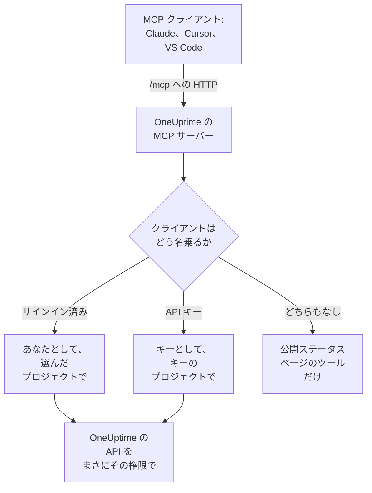

# MCP サーバー

OneUptime の MCP サーバーを使うと、AI アシスタントが OneUptime プロジェクトを直接操作できます。Claude、Cursor、GitHub Copilot 付きの VS Code など、Model Context Protocol(MCP)の任意のクライアントを接続し、インシデントの調査、ログやトレースの照会、アラートの確認、モニターの設定を依頼できます。クライアントは、あなたの権限、または API キーの権限で OneUptime のツールを呼び出します。

:::cards
- [クライアントを接続する](#クライアントを接続する): クライアントにサーバーのアドレスを渡し、サインインします。
- [OneUptime でサインインする](#oneuptime-でサインインする): 接続したクライアントにできることと、切断の方法です。
- [API キーを取得する](#api-キーを取得する): 人の監視なしで動くエージェント向けです。
- [トラブルシューティング](#トラブルシューティング): サインイン、権限、接続の問題です。
:::

このページは、OneUptime に接続する AI アシスタントについて説明します。逆に AWS や GitHub など、ほかの MCP サーバーのツールを OneUptime AI に使わせるには、[外部 MCP サーバー](/docs/ai/external-mcp-servers) を参照してください。

## 仕組み

MCP サーバーはすべての OneUptime インスタンスに含まれており、ダッシュボードと同じアドレスの `/mcp` にあり、streamable HTTP トランスポートを使います。インストールするものはありません。

- **OneUptime Cloud**: `https://oneuptime.com/mcp`
- **セルフホスト**: `https://your-oneuptime-domain.com/mcp`



サーバーはステートレスです。セッション ID を発行せず、各リクエストは独立しているため、ロードバランサーの背後でも、複数のレプリカでも動作します。

## ツールでできること

- **モニター**: モニターを作成・設定し、状態を確認し、履歴を見ます。
- **インシデント対応**: インシデントを作成・確認・解決し、内部メモや公開メモを追加して、解決まで追跡します。
- **アラート**: アラートを確認・解決し、メモを追加し、アラートの状態と重大度を管理します。
- **チームとオンコール**: チームとオンコールポリシーを管理します。
- **ステータスページ**: ステータスページを管理し、お知らせを投稿します。
- **定期メンテナンス**: メンテナンスイベントを作成・管理します。
- **テレメトリ**: ログ、メトリクス、トレース、例外、モニターログ、セキュリティイベントなどを照会します(読み取り専用)。

30 種類のレコードについて作成・取得・一覧・更新・削除・件数のツールがあり、9 種類のテレメトリについて一覧と件数のツールがあり、インシデント対応用のツールもあります。読み取り専用のツールには `readOnlyHint` が、何かを変更するすべてのツールには `destructiveHint` が、公開ステータスページのツールにだけ `openWorldHint` が付くため、クライアントは読み取り専用の呼び出しを自分で実行し、何かを変更する前にはあなたに確認できます。失敗したツール呼び出しは、MCP プロトコルのエラーではなく、`statusCode`、詳細、提案を含むツールの結果(`isError: true`)として返るため、エージェントは失敗を読んで自分で修正できます。

## 始める前に

- OneUptime インスタンス: OneUptime Cloud またはセルフホスト。
- Claude Code、Claude、GitHub Copilot 付きの VS Code、Cursor などの MCP クライアント。
- サインインに使う OneUptime アカウント、または人の監視なしで動くエージェント用の OneUptime の API キー。公開ステータスページのツールにはどちらも不要です。
- OneUptime Cloud では Growth プラン以上: MCP クライアントの接続は、API キーと同じプランで使えます。

## クライアントを接続する

クライアントにはサーバーのアドレスだけを渡します。初めてデータが必要になったとき、クライアントはサインイン用にブラウザーで OneUptime を開きます([OneUptime でサインインする](#oneuptime-でサインインする) を参照)。セルフホストのインスタンスでは、`https://oneuptime.com/mcp` の代わりに `https://your-oneuptime-domain.com/mcp` を使います。

:::tabs
@tab Claude Code
```bash
claude mcp add --transport http oneuptime https://oneuptime.com/mcp
```
その後、Claude Code の中で `/mcp` を実行し、**oneuptime** を選んでサインインします。
@tab Claude
Claude で **Customize → Connectors** を開き、**Add custom connector** を選んで、`https://oneuptime.com/mcp` を入力します。Claude は初めてデータが必要になったときに OneUptime へのサインインを求めます。
@tab VS Code
これを MCP の設定に追加します(設定の場所は [GitHub Copilot 付きの VS Code](#github-copilot-付きの-vs-code) を参照)。サーバーを起動すると、VS Code がサインイン用に OneUptime を開きます:
```json
{
  "servers": {
    "oneuptime": {
      "type": "http",
      "url": "https://oneuptime.com/mcp"
    }
  }
}
```
@tab Cursor
```json
{
  "mcpServers": {
    "oneuptime": {
      "url": "https://oneuptime.com/mcp"
    }
  }
}
```
:::

MCP の認可に対応したほかのクライアントも同じように動作します。アドレスを渡せば、残りはすべて自分で見つけます。プロトコルについては [サインイン(OAuth 2.1)](#サインインoauth-21) を参照してください。

ダッシュボードにも、インスタンスのアドレスが入った状態でこの手順があります: **プロジェクト設定 → AI → MCP サーバー**。また、どのリソース(モニター、インシデント、ステータスページなど)からでも、サイドメニューの **開発者** を開いて **AI アシスタント** を選べます。このページでは、リソースとその ID を含むプロンプトも提案されるので、アシスタントがすぐにリソースを見つけられます。ワークフローのように MCP サーバーにまだツールがないリソースについては、コマンドを実行できるアシスタントが代わりに REST API で操作する方法がページに表示されます。

## OneUptime でサインインする

最も簡単な接続方法は、MCP クライアントにサーバーのアドレスだけを渡すことです。クライアントが初めてデータを必要とすると、ブラウザーで OneUptime のページが開きます:

:::steps
1. まだサインインしていなければ、OneUptime にサインインします。
2. クライアントが作業するプロジェクトを選びます。
3. **読み取りと書き込み** または **読み取り専用** を選びます。
4. **許可する** をクリックします。
:::

その後、クライアントはそのプロジェクトであなたとして動作します。作成、コピー、ローテーションする API キーはなく、秘密情報が設定ファイルに保存されることもありません。

接続したクライアントにできること:

- **権限はあなたと同じで、それを超えることはありません。** プロジェクトでチームがあなたに許可していることが、クライアントにできることです。ロールが変わったり、プロジェクトを離れたりすると、クライアントの次のリクエストからそれが適用されます。プロジェクトを離れるとクライアントも切断されます。クライアントの認可は削除され、プロジェクトに戻ったときはクライアントをもう一度接続します。
- **読み取り専用は文字どおり読み取り専用です。** 読み取り専用として認可されたクライアントは、`get_`、`list_`、`count_` のツールを使えます。作成、更新、削除、確認、解決を行うツールは、MCP サーバーとその背後の OneUptime API の両方で拒否されます。クライアントが求めた以上のアクセスを与えることはできません。
- **対象は一つのプロジェクトです。** 別のプロジェクトを使うには、クライアントを接続し直してそのプロジェクトを選びます。
- **MCP サーバー経由でしか使えません。** クライアントのアクセストークンは MCP エンドポイントでのみ受け付けられ、ほかでは使えません。OneUptime の REST API を直接呼び出すことはできません。
- **インスタンス管理者も特別扱いされません。** マスター管理者が接続したクライアントの権限は、その人のチームがプロジェクトで与えているものだけで、インスタンス全体へのアクセスではありません。

### 接続したクライアントを管理する

サインインで接続したクライアントはすべて、**プロジェクト設定 → AI → MCP サーバー** の **接続済みの MCP クライアント** に、接続した人、できること、最後に使われた日時とともに一覧表示されます。自分が接続したクライアントが表示され、プロジェクトのオーナーと管理者には全員のクライアントが表示されます。

クライアントをサインアウトさせるには **切断** をクリックします。すぐに動作しなくなります。

クライアントは使われている限り接続されたままです。30 日間使われなかったクライアントは、もう一度サインインする必要があります。

### クライアントを接続できる人を制御する

既定では、プロジェクトのメンバーなら誰でも MCP クライアントを接続できます。あるチームのメンバーに接続させないようにするには、チームの **権限** ページを開き、下部の **その他の設定** を開いて、**ブロック権限** に **Authorize MCP Client** 権限を追加します。それらのメンバーがすでに接続していたクライアントは、すぐに動作しなくなります。

プロジェクトでシングルサインオンが必須の場合は、クライアントを認可する前にブラウザーで SSO を使ってプロジェクトにサインインしてください。クライアントの接続は、その SSO サインインが有効な間だけ続きます。期限が切れたり、サインインに使った SSO プロバイダーが無効化または削除されたりした場合は、クライアントを接続し直します。

OneUptime Cloud では、MCP クライアントの接続は API キーと同じプラン(Growth 以上)で使えます。

Enterprise Edition では、接続したクライアントが行った変更はすべて、接続した人の名前とクライアント名とともに監査ログに記録されます。API キーで行った変更には、キーの名前が表示されます。

## API キーを取得する

スケジュールされたジョブや CI パイプラインのように、サインインする人がいない、人の監視なしで動くエージェントには API キーを使います。

:::steps
### キーを作成する

**プロジェクト設定 → 詳細 → API キー** に移動し、**API キーを作成** をクリックします。"MCP Server" のような名前を付けます。

### できることを選ぶ

**アクセス** で、読み取るだけのエージェントには **閲覧者** を、作成・更新・削除も行うエージェントには **プロジェクト管理者** を選びます([API キーの権限](#api-キーの権限) を参照)。

### キーをコピーする

**API キーを作成** をクリックすると、キーのページが開きます。そこからキーをコピーします。
:::

API キーは一つのプロジェクトに属します。MCP サーバーはキーからプロジェクトを特定するため、作成ツールに `projectId` 引数は不要です。

> [!WARNING]
> AI エージェントにマスターキーを渡さないでください。OneUptime のマスター API キーもこのヘッダーで受け付けられ、インスタンス全体の管理者アクセスを与えます。必ず、エージェントに必要な最小限の権限を持つプロジェクトの API キーを使ってください。`get_`、`list_`、`count_` のツールなら、読み取り専用のキーで十分です。

## API キーで接続する

キーは `x-api-key` ヘッダーで送ります。API キーを含むリクエストがサインインを求められることはありません。セルフホストのインスタンスでは、`oneuptime.com` の代わりに自分のドメインを使います。

:::tabs
@tab Claude Code
```bash
claude mcp add --transport http oneuptime https://oneuptime.com/mcp --header "x-api-key: your-api-key-here"
```
@tab Claude Desktop
これを `claude_desktop_config.json` に追加します。macOS では `~/Library/Application Support/Claude/`、Windows では `%APPDATA%\Claude\`、Linux では `~/.config/Claude/` にあります:
```json
{
  "mcpServers": {
    "oneuptime": {
      "transport": "streamable-http",
      "url": "https://oneuptime.com/mcp",
      "headers": {
        "x-api-key": "your-api-key-here"
      }
    }
  }
}
```
@tab VS Code
`"password": true` を付けた入力変数は、キーを平文で保存する代わりに、サーバーの起動時にキーを尋ねます:
```json
{
  "servers": {
    "oneuptime": {
      "type": "http",
      "url": "https://oneuptime.com/mcp",
      "headers": {
        "x-api-key": "${input:oneuptime-api-key}"
      }
    }
  },
  "inputs": [
    {
      "type": "promptString",
      "id": "oneuptime-api-key",
      "description": "OneUptime API Key",
      "password": true
    }
  ]
}
```
@tab Cursor
```json
{
  "mcpServers": {
    "oneuptime": {
      "url": "https://oneuptime.com/mcp",
      "headers": {
        "x-api-key": "your-api-key-here"
      }
    }
  }
}
```
:::

## GitHub Copilot 付きの VS Code

VS Code 1.99 以降は、GitHub Copilot Chat で MCP サーバーをネイティブにサポートしています。

:::steps
### 必要なものを確認する

VS Code 1.99 以降、GitHub Copilot 拡張機能をインストールしてサインインし、GitHub Copilot Chat を有効にしておきます。

### MCP の設定を開く

`Ctrl+Shift+P`(macOS では `Cmd+Shift+P`)を押し、"MCP: Open User Configuration" と入力して Enter を押します。`mcp.json` ファイルが開くか、作成されます。一つのワークスペースだけで使う場合は、代わりにその中に `.vscode/mcp.json` を作成します。

### OneUptime を追加する

上の VS Code の設定を貼り付けます。サインイン用のキーなしの設定か、API キー付きの設定のどちらかです。

### サーバーを起動する

`Ctrl+Shift+P`(macOS では `Cmd+Shift+P`)を押し、"MCP: List Servers" と入力して、**oneuptime** を選んで起動します。VS Code は最初にサーバーを信頼するかを尋ね、次にサインインまたは API キーの入力を求めます。

### Copilot に質問する

エージェントモードで GitHub Copilot Chat を開き、たとえば「OneUptime にはどんなモニターがある?」「最近のインシデントを見せて」「https://example.com の新しいモニターを作成して」と質問します。
:::

## 認証

MCP サーバーの使い方は三つあります。

### 公開ツール(認証不要)

API キーもサインインもなしで、クライアントは公開ツールを使えます:

- **`oneuptime_help`**: OneUptime の MCP ツールについてのヘルプとガイダンス
- **`oneuptime_list_resources`**: リソースと、それぞれでできること
- **`get_public_status_page_overview`**: 公開ステータスページの概要
- **`get_public_status_page_incidents`**: 公開ステータスページのインシデント
- **`get_public_status_page_scheduled_maintenance`**: その定期メンテナンスイベント
- **`get_public_status_page_announcements`**: そのお知らせ

公開ステータスページのツールは、ステータスページの ID(UUID)かドメイン名を受け取ります。これらだけを使うには、アドレスだけで、認証情報なしで接続します:

```json
{
  "mcpServers": {
    "oneuptime": {
      "transport": "streamable-http",
      "url": "https://oneuptime.com/mcp"
    }
  }
}
```

ステータスページのオーナーは、そのページの MCP アクセスをオフにできます。ステータスページのサイドメニューの **AI** セクションで **MCP** を開き、**MCP サーバーを有効化** をオフにします。スイッチは切り替えた時点で保存されます。MCP アクセスは既定でオンです。オフの間、四つの `get_public_status_page_*` ツールはそのステータスページについてエラーを返します。ステータスページのウェブサイト、RSS フィード、公開 JSON API には影響がなく、サインインが必要なステータスページのツール(`get_status_page`、`list_status_pages` など)は、そのページのプロジェクトでは引き続き動作します。

### サインイン(OAuth 2.1)

それ以外のツールは、呼び出し元が誰かを知る必要があります。認証情報を送らずにそれらを呼び出したクライアントは、サーバーの保護リソースメタデータを指す `WWW-Authenticate` ヘッダー付きの `401 Unauthorized` を受け取ります。これが、MCP クライアントがあなたをサインインさせるきっかけとなる合図です。`initialize`、`tools/list`、公開ツールがそれを求めることはありません。

サーバーは [MCP の認可仕様](https://modelcontextprotocol.io/specification/latest/basic/authorization) を実装しています:

- **フロー**: PKCE(`S256` のみ)付きの OAuth 2.1 authorization code。アクセストークンは `Authorization: Bearer` として送られます。
- **検出**: 保護リソースメタデータ(RFC 9728)と認可サーバーメタデータ(RFC 8414)。発行者とリソースはどちらも `https://<host>/mcp` です。
- **クライアントの識別**: Client ID Metadata Document(クライアント ID はサーバーが取得する `https` の URL)、または動的クライアント登録(RFC 7591)。管理者がクライアントを登録する必要はありません。
- **スコープ**: `get_`、`list_`、`count_` のツールには `mcp:read`。`mcp:write` は何かを変更するすべてのツールを加え、`mcp:read` を含みます。読み取り専用のトークンで書き込みツールを呼び出すと、`error="insufficient_scope"` 付きの `403` が返ります。
- **トークンの有効期間**: アクセストークンは 1 時間有効です。リフレッシュトークンは 30 日間有効で、使うたびに置き換えられます。すでに置き換えられたリフレッシュトークンを使うと、接続は終了します。
- **リソースインジケーター**(RFC 8707): トークンは `https://<host>/mcp` に対して発行され、ほかでは受け付けられません。
- **失効**(RFC 7009): どちらかのトークンを失効させると、接続は終了します。

### API キー

人の監視なしで動くエージェントは、次のいずれかのヘッダーで OneUptime の API キーを送ります:

- `x-api-key`: OneUptime の API キー
- `Authorization`: API キーを含む bearer トークン(例: `Bearer your-api-key-here`)

`Bearer` スキームは大文字と小文字を区別しません。API キーを含むリクエストがサインインを求められることはありません。

OneUptime Cloud では、API キーはプロジェクトが **Growth** 以上のプランにある間だけ使えます。それより下のプランでは、キーが必要なツールはすべてプランを示すメッセージとともに `402` を返し、エージェントには再試行しないよう伝えられます。削除されるものはありません。プロジェクトが Growth に戻れば、何も接続し直さずにキーはそのまま再び使えます。サインインで接続したクライアントは人として動作するため、引き続き動作します([プランを下回ったときの API キーと SCIM](/docs/api-reference/api-reference#プラン未満の-api-キーと-scim))。

## 使用できるエンドポイント

| エンドポイント | メソッド | 説明 |
| --- | --- | --- |
| `/mcp` | POST | ツール呼び出しなどの操作のための JSON-RPC リクエスト |
| `/mcp` | GET | SSE の `Accept` ヘッダーがなければ、サーバーの短い JSON の説明。あれば `405`。ステートレスなサーバーは独立した SSE ストリームを提供しないためです(仕様に従うクライアントはそれなしで続行します) |
| `/mcp` | DELETE | 何もしません。サーバーはステートレスなので、終了するセッションがありません |
| `/mcp/health` | GET | ヘルスチェック |
| `/mcp/tools` | GET | ツールの一覧(通常の REST) |

サインインする MCP クライアントは、下の OAuth エンドポイントも使います。クライアントは自分で見つけるため、ここではクライアントを書く人やプロキシを設定する人のために一覧にしています。

| エンドポイント | メソッド | 説明 |
| --- | --- | --- |
| `/mcp/.well-known/oauth-protected-resource` | GET | 保護リソースメタデータ(RFC 9728)。`/.well-known/oauth-protected-resource/mcp` にもあります |
| `/.well-known/oauth-authorization-server/mcp` | GET | 認可サーバーメタデータ(RFC 8414)。`/mcp/.well-known/oauth-authorization-server` にもあります |
| `/mcp/oauth/authorize` | GET | 認可エンドポイント: クライアントがサインインのためにブラウザーを送る先 |
| `/mcp/oauth/token` | POST | トークンエンドポイント: 認可コードまたはリフレッシュトークンを交換します |
| `/mcp/oauth/register` | POST | 動的クライアント登録(RFC 7591) |
| `/mcp/oauth/revoke` | POST | トークンの失効(RFC 7009) |

サーバーが動いていることを確認し、ツールを一覧表示するには:

```bash
curl https://oneuptime.com/mcp/health
curl https://oneuptime.com/mcp/tools
```

## インシデント対応のためのツール

各種レコードのツールのほかに、サーバーにはインシデントやアラートへの対応のために作られたツールがあります:

- **`acknowledge_incident`** / **`resolve_incident`**: ダッシュボードのボタンと同じように、インシデントをプロジェクトの Acknowledged または Resolved の状態にします
- **`acknowledge_alert`** / **`resolve_alert`**: アラートについて同じことを行います
- **`add_incident_note`**: `visibility: "internal"`(チームのみ、既定)または `visibility: "public"`(ステータスページに投稿)でインシデントにメモを追加します。Markdown に対応しています
- **`add_alert_note`**: アラートに内部メモを追加します

典型的な流れ: `list_incidents` → `acknowledge_incident` → `list_logs` で調査 → `add_incident_note`(公開) → `resolve_incident`。

**`oneuptime_whoami`** ツールは、認証情報が属するプロジェクト(その ID と名前)を返します。サインインしたクライアントの場合は、誰としてサインインしているか、変更を加えられるかどうかも示します。エージェントが状況を把握するための最初の呼び出しに適しており、作成ツールは `projectId` を認証情報から取るため、エージェントがプロジェクト ID を渡す必要はありません。

## テレメトリを照会する

ログ、メトリクス、トレース(スパン)、例外、モニターログなどのテレメトリは、読み取り専用の `list_` と `count_` のツールとして提供されます(`list_logs`、`list_metrics`、`list_spans`、`list_exception_instances`、`list_monitor_logs` と、それぞれの `count_` の対)。テレメトリは OpenTelemetry で届くため、作成ツールはありません。

テレメトリは必ず時間範囲を指定して照会します。クエリのフィールドには値か、演算子オブジェクトを指定します:

```json
{
  "query": {
    "time": { "_type": "GreaterThan", "value": "2026-07-04T00:00:00.000Z" }
  },
  "sort": { "time": "DESC" },
  "limit": 50
}
```

演算子は `EqualTo`、`NotEqual`、`IsNull`、`NotNull`、`EqualToOrNull`、`GreaterThan`、`LessThan`、`GreaterThanOrEqual`、`LessThanOrEqual`、`InBetween`、`Search`、`Includes` です。並べ替えの値は `"ASC"` か `"DESC"` です。

## フィールドの選択とページング

`get_` と `list_` のツールは、フィールド名の配列 `select` を任意で受け取ります。既定では、重いもの(JSON、非常に長いテキスト、HTML の列)を除くすべての読み取り可能なフィールドが返り、重いものは `select` で指定する必要があります。

一覧ツールは `limit`(既定 10、最大 100)と `skip` でページングし、一覧の応答はそれぞれ何を返したかを正確に示します:

```json
{
  "returnedCount": 10,
  "totalCount": 42,
  "skip": 0,
  "limit": 10,
  "hasMore": true,
  "data": ["..."]
}
```

## 使用例

### 日々の質問

```text
"What's the current status of all my monitors?"
"Show me incidents from the last 24 hours"
"List the teams in this project"
"Show me our on-call policies"
```

### モニターとインシデント

```text
"Create a new website monitor for https://example.com that checks every 5 minutes"
"Set up an API monitor for https://api.example.com/health with a 30-second timeout"
"Disable the monitor for staging.example.com while we're doing maintenance"
"Create a high-priority incident for the database outage affecting user authentication"
"Add a note to incident #123 saying 'Database connection restored, monitoring for stability'"
"Mark incident #456 as resolved"
```

### ステータスページ

```text
"Update our status page to show 'Investigating Payment Issues' for the payment service"
"Create a status page announcement about scheduled maintenance this weekend"
```

### 公開ステータスページへの問い合わせ(API キー不要)

これらは認証情報なしで、公開ステータスページのツールだけで動作します:

```text
"What's the current status of status.example.com?"
"Show me recent incidents from the OneUptime status page"
"Are there any scheduled maintenance events on status.acme.com?"
"Get the latest announcements from my public status page with ID abc123-..."
```

### 複数のステップを一度に

```text
"Create a scheduled maintenance window for Saturday 2-4 AM, disable all monitors for api.example.com during that time, and update the status page"
"Show me all monitors that have been down in the last hour, create incidents for any that don't already have one"
```

## API キーの権限

| エージェントがすること | **アクセス** で選ぶもの |
| --- | --- |
| 読み取るだけ | **閲覧者**、またはキーのページで読み取り権限を追加 |
| 作成・更新・削除も行う | **プロジェクト管理者**、またはキーのページで Project Admin のロールを追加 |

各キーには必要最小限の権限を与え、キーを定期的にローテーションし、環境ごとに別のキーを使い、各キーが何をしているかを OneUptime で確認してください。

## セルフホストでの設定

セルフホストのインスタンスでは、サインインは設定なしで動作します。これを変える設定は二つあります:

| 環境変数 | Helm の値 | 動作 |
| --- | --- | --- |
| `DISABLE_MCP_OAUTH` | `mcpOAuth.disabled` | `true` にするとサインインをオフにします。OAuth エンドポイントは提供されなくなり、MCP サーバーは API キーだけを受け付けます。削除されるものはなく、元に戻すと接続済みのクライアントは再び動作します。 |
| `DISABLE_MCP_OAUTH_CLIENT_ID_METADATA_DOCUMENTS` | `mcpOAuth.disableClientIdMetadataDocuments` | インターネットに到達できないインスタンスでは `true` にします。クライアントは OneUptime が取得する URL で自分を識別できますが、この設定ではクライアントが代わりにインスタンスに直接登録するため、外向きのリクエストは不要です。 |

OneUptime の前に独自のリバースプロキシを置いている場合は、`/mcp` と一緒に `/.well-known/oauth-protected-resource` と `/.well-known/oauth-authorization-server`(とその配下すべて)を OneUptime に転送してください。同梱の ingress はすでにそうしています。

サーバーはすべての OAuth の URL を `HOST` と `HTTP_PROTOCOL` の設定から組み立てるため、これらは利用者がインスタンスにアクセスするアドレスと一致している必要があります。

## トラブルシューティング

### サインインの問題

- **クライアントがサインインを求めてこない**: クライアントが MCP の認可に対応していないか、優先される API キーのヘッダーが設定されている可能性があります。代わりにサインインするには、そのヘッダーを削除してください。
- **認可ページで自分のプロジェクトがグレー表示になっている**: プロジェクト名の横に理由が表示されます。プロジェクトのプランに MCP クライアントの接続が含まれていない、プロジェクトで SSO が必須なのにこのブラウザーで SSO サインインしていない、またはあなたのチームがクライアントの接続をブロックされている、のいずれかです。
- **ツールが "read-only" として拒否される**: クライアントが読み取り専用として認可されています。接続し直して **読み取りと書き込み** を選んでください。
- **クライアントが動かなくなった**: 切断された、30 日間使われなかった、プロジェクトから削除された、またはプロジェクトの SSO サインインの期限が切れたかプロバイダーが無効化された、のいずれかです。接続し直してください。
- **セルフホスト - クライアントが認可サーバーを見つけられないと言う**: `HOST` と `HTTP_PROTOCOL` が公開アドレスと一致していること、プロキシが `/.well-known/oauth-*` のパスを転送していることを確認してください。

### 権限のエラー

API キー、またはサインインしたクライアントの場合はあなた自身のアカウントに、適切な権限が必要です。レコードの一覧には読み取り権限、作成と更新には書き込み権限、削除には削除権限が必要です。

### 接続の問題

OneUptime のアドレスが正しく到達可能か、API キーが有効か、ヘルスエンドポイントが応答するかを確認してください([使用できるエンドポイント](#使用できるエンドポイント) を参照)。

### 無効な API キー

- OneUptime の設定で API キーを確認します。余分な空白や文字がないようにしてください
- キーの有効期限が切れていないことを確認します
- OneUptime Cloud で、API キーには Growth プランが必要だという `402` が返る場合は、プロジェクトがそのプランを下回っています。**プロジェクト設定 → 請求と請求書 → 請求** でプロジェクトをアップグレードすれば、同じキーが再び使えます

### セッションのエラー

MCP サーバーはステートレスで、セッション ID の発行も追跡もしないため、どのリクエストもどのレプリカに対しても動作します。古いバージョンのサーバーから受け取った `mcp-session-id` ヘッダーを送るクライアントは、それを省略してかまいません。無視されます。サーバーがセッション ID を返すことを前提にした古いクライアント設定は更新してください。

## 使用できるリソース

| 分野 | 作成・取得・一覧・更新・削除・件数のツールがあるレコード |
| --- | --- |
| 監視 | Monitor, Monitor Status, Monitor Status Event |
| インシデント | Incident, Incident State, Incident Severity, Incident State Timeline, Incident Public Note, Incident Internal Note, Incident Alert, Postmortem Status |
| アラート | Alert, Alert State, Alert Severity, Alert State Timeline, Alert Internal Note |
| ステータスページ | Status Page, Status Page Announcement |
| 定期メンテナンス | Scheduled Maintenance Event, Scheduled Maintenance State, Scheduled Maintenance State Timeline |
| チームとオンコール | Team, On-Call Policy |
| ラベル | Label |
| セキュリティ | Security Case, Security Case Note, Security Case Priority, Security Case Status, Security Detection, Security Playbook |

| 分野 | 一覧と件数のツールだけがあるテレメトリ |
| --- | --- |
| オブザーバビリティ | Log, Metric, Span, Exception Instance, Monitor Log |
| セキュリティ | Security Event, Threat Intel Indicator |
| 変更とコスト | Change Event, Kubernetes Cost Allocation |

ツールの名前はスネークケースです: `create_incident`、`get_incident`、`list_incidents`、`update_incident`、`delete_incident`、`count_incidents`。テレメトリなら `list_logs` や `count_spans` です。

## 次のステップ

:::cards
- [AI に質問](/docs/ai/ask-ai): OneUptime の中でプロジェクトについて質問します。
- [OneUptime API リファレンス](/docs/api-reference/api-reference): すべてのツールの背後にある REST API です。
- [権限](/docs/permissions/index): ロール、チーム、API キーにできることです。
:::
