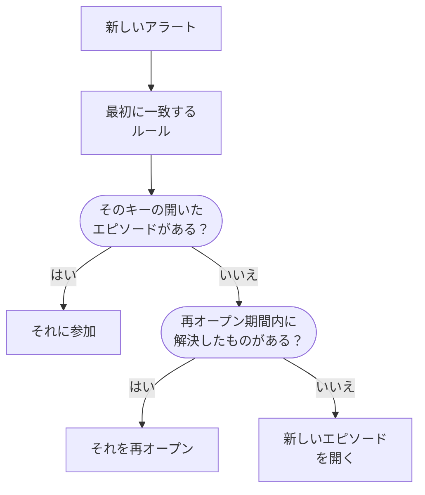
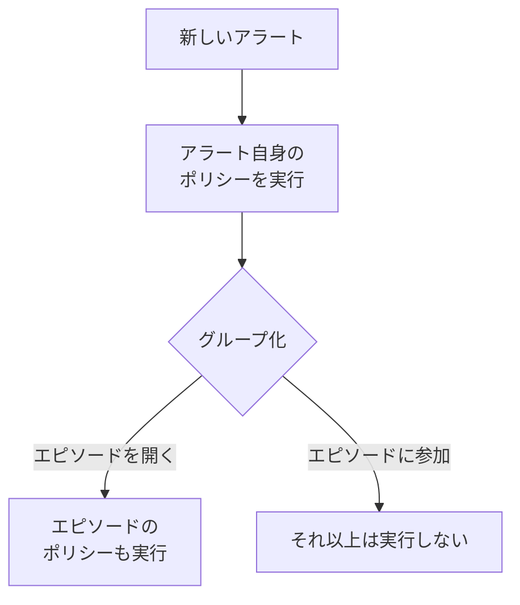

# アラートのエピソードとグループ化ルール

データベースがダウンすると、20 個のモニターが数分のうちに 20 件のアラートを発生させることがあります。エピソードはそれらを、チームがまとめて確認・解決する 1 つのレコードにまとめ、グループ化ルールがどのアラートを含めるかを決めます。このページでは、グループ化の仕組み、ルールの設定方法、開いたエピソードの振る舞いを説明します。

:::cards
- [グループ化の仕組み](#グループ化の仕組み): ルール、グループ化キー、時間枠。
- [グループ化ルールを作成する](#グループ化ルールを作成する): テンプレートからワンクリックで、または独自に。
- [エピソードの振る舞い](#エピソードの振る舞い): 重大度、状態、解決のタイミング。
- [エピソードが呼び出す相手](#エピソードが呼び出す相手): ルールのオンコールポリシーと、アラート自身のポリシー。
:::

## グループ化の仕組み

グループ化は新しいアラートごとに 1 回、そのオンコールポリシーが実行された直後に行われます。アラートは有効なグループ化ルールと一覧の上から順に照合され、最初に一致したルールがエピソードを決めます。どのルールにも一致しないアラートは単独のままです。

- **ルールの条件** は、ルールがどのアラートに適用されるかを決めます。条件のないルールはすべての新しいアラートに適用されます。
- **グループ化キー** は、どのアラートがエピソードを共有するかを決めます。同じモニター、同じ重大度、同じタイトル、またはルールがグループ化に使う組み合わせが同じアラートです。グループ化の基準を持たないルールは、一致したすべてのアラートを 1 つのエピソードに入れます。
- **時間枠** は、エピソードがどれだけの間アラートを受け入れ続けるかを決めます。オンのときは、エピソードの最後のアラートから時間枠内に届いたアラートだけが参加します。オフのときは、エピソードが解決されるまで一致するアラートが参加し続けます。

グループ化はアラートの作成時に行われます。今日追加したルールは、その後に作成されたアラートをグループ化し、既存のアラートを再グループ化することはありません。

> [!NOTE]
> 確認済みの状態で作成されたアラートは、開いているエピソードに参加できますが、エピソードを開くことはありません。解決済みの状態で作成されたアラートはまったくグループ化されません。[確認済みまたは解決済みの状態で作成](/docs/alerts/index#確認済みまたは解決済みの状態で作成) を参照してください。

## グループ化ルールを作成する

**アラート → ルール → グループ化ルール** に移動します。サイドメニューの **ルール** セクションは折りたたまれた状態で始まるので、まず展開します。

### テンプレートから始める

グループ化ルールのないプロジェクトでは、空の一覧の代わりに 4 つの既製ルールが表示されます。ルールがある場合は、カードの **テンプレートから作成** で開きます。**ルールを追加** はワンクリックで 1 つ保存し、有効な状態で一覧の末尾に置かれ、すべての新しいアラートに適用されます。その後は他のルールと同じように編集できます。

| テンプレート                               | グループ化                                                | 時間枠      |
| ------------------------------------------ | --------------------------------------------------------- | ----------- |
| **同じモニターのアラートをグループ化**     | モニターごとのエピソード                                  | 30 分       |
| **同時に起きたアラートをグループ化**       | モニターに関係なく共有するエピソード                      | 10 分       |
| **アラートを重大度でグループ化**           | 重大度ごとのエピソード                                    | 30 分       |
| **同じアラートの繰り返しをグループ化**     | アラートのタイトルごとのエピソード (数字と大文字小文字は無視) | 1 時間  |

### 独自に作成する

:::steps
#### グループ化の方法に答える

テンプレートの下の **カスタムルールを作成**、またはルールがある場合はカードの **アラートのグループ化ルールを作成** をクリックします。**グループ化** ステップでは、**アラートのグループ化の基準** が 1 つの質問をします。**モニター**、**すべてまとめる**、**重大度**、**タイトル**、**カスタム** のいずれかです。**名前** は、独自の名前を入力するまで回答に合わせて変わります。

#### 時間枠を設定する

**近い時間に発生したアラートのみをグループ化する** はオンで、時間枠は 30 分です。分数を変えるか、オフにして解決されるまで 1 つのエピソードを開いたままにします。

#### カスタムでフィールドを組み合わせる

**カスタム** は 5 つのスイッチを持つ **グループ化** ステップを追加します。**モニターでグループ化**、**アラートの重大度でグループ化**、**アラートのタイトルでグループ化**、**アラートラベルでグループ化**、**モニターラベルでグループ化** です。ラベルは正確な組み合わせでグループ化されます。

#### 対象を絞り込む

**対象のアラート** では、新しいルールの最初の選択である **すべてのアラート** が、すべての新しいアラートをグループ化します。絞り込むには **条件に一致するアラートのみ** を選び、モニター、重大度、ラベル、タイトル、説明についての条件を追加します。最後に **アラートのグループ化ルールを作成** をクリックします。
:::

ルールができるその他のことは、**グループ化** ステップの末尾にある **その他の項目** の下に、3 つのグループに分けて折りたたまれています。折りたたまれた状態でも、見出しに中身が示され、ルールが使っている各設定がその値とともに表示されるので、ルールを編集するときに動作が隠れることはありません。

| グループ                       | 設定                                                                                                       |
| ------------------------------ | ---------------------------------------------------------------------------------------------------------- |
| **オンコールと所有権**         | ルールがエピソードを開いたときに実行する **オンコールポリシー** と、**エピソードの所有者**。               |
| **エピソードのライフサイクル** | **最近解決したエピソードを再オープンする**、**エピソードを解決する前に待機する**、**動きのないエピソードを解決する**。それぞれ分数を指定するスイッチです。 |
| **詳細**                       | ルールの **説明**、**エピソードタイトルテンプレート**、**エピソード説明テンプレート**、**エピソードラベル**。 |

ルールは一覧の上から順に確認され、最初の一致が優先されます。位置を変えるにはルールをドラッグします。具体的なルールを広いルールより上に置きます。一覧の **グループ化** 列は、各ルールの動作を「モニターごとに 1 つのエピソード」のように 1 文で示します。

## エピソードのタイトル

テンプレートがない場合、エピソードには最初のアラートのモニター名が付き、モニターがなければアラートのタイトルの先頭 50 文字が使われます。**エピソードタイトルテンプレート** または **エピソード説明テンプレート** では、次の変数が埋め込まれます。どちらかのフィールドで `{{` と入力すると選べます。

| 変数                   | 埋め込まれる値                                                                                 |
| ---------------------- | ---------------------------------------------------------------------------------------------- |
| `{{alertTitle}}`       | 最初のアラートのタイトル。                                                                     |
| `{{alertDescription}}` | 最初のアラートの説明。                                                                         |
| `{{alertSeverity}}`    | 最初のアラートの重大度。                                                                       |
| `{{monitorName}}`      | 最初のアラートのモニター名。                                                                   |
| `{{alertCount}}`       | エピソードに含まれるアラートの数。アラートの参加や離脱に合わせて書き直されます。               |

最初のアラートに値がない変数や、この一覧にない変数は省かれます。最初のアラートが非公開の場合、エピソードは非公開ではないため、`{{alertTitle}}` と `{{alertDescription}}` は「Private alert」になります。

## エピソードの振る舞い

エピソードはアラートと同じアラートの状態のリストを進み、独自の所有者、メモ、根本原因、修復メモを持ちます。

- **重大度はアラートに合わせて上がる。** 最初のアラートの重大度で始まり、より重いアラートが参加するとその重大度になります。「より重い」とは、**アラート → 設定 → アラートの重大度** でより上にあることです。
- **状態がアラートを動かす。** エピソードを確認または解決するか、独自の状態に移すと、含まれるすべてのアラートも移ります。ただし、すでにその状態以降にあるアラートは除きます。
- **自動で解決する**。含まれるすべてのアラートが解決されたときです。**エピソードを解決する前に待機する** は、アラートが戻ってくる場合に備えて、その分数だけ先にエピソードを開いたままにします。
- **再オープンできる。** **最近解決したエピソードを再オープンする** がオンなら、エピソードの解決後その分数以内に届いた一致するアラートは、別のエピソードを開く代わりにそれを再オープンします。これは状態のリストを上に戻る唯一の移動で、エピソードのアラートは再オープンしません。

> [!WARNING]
> **動きのないエピソードを解決する** は、設定した分数の間に新しいアラートが参加しなかったエピソードを解決し、その中でまだ開いているすべてのアラートも解決します。応答が不要だと確信できるノイズに使ってください。

## エピソードが呼び出す相手

アラート自身のオンコールポリシーは、エピソードに参加するかどうかにかかわらず、作成時にグループ化より前に実行されます。エピソードはそれに独自のポリシーを加えます。

- **新しいエピソード** は、ルールの **オンコールポリシー** に加え、**アラート → ルール → オンコールルール** の **エピソードのルール** タブで一致したルールのポリシーを実行します。
- **開いているエピソードに参加するアラート** は、自身のポリシーだけを実行します。エピソードのポリシーは再実行されません。
- **エピソードの呼び出しに応答する** と、エピソードと、そこに含まれるすべてのアラートが確認されます。

> [!TIP]
> アラートごとではなく問題ごとに 1 回呼び出すには、オンコールポリシーをグループ化ルールに置き、アラートからは外します。モニターの条件、作成フォーム、アラートのオンコールルールから外してください。

エピソードの所有者にも知らされます。**アラートエピソードが作成されました**、**アラートエピソードの状態が変更されました**、**アラートがアラートエピソードに追加されました** は、**ユーザー設定 → 通知設定** の **アラート** タブで、既定でメールがオンになっています。ルールの **エピソードの所有者** は、ルールが開くすべてのエピソードの所有者になり、他の所有者と同じように通知されます。

## エピソードを手動で作成する

:::steps
### フォームを開く

**アラート → すべてのエピソード** に移動し、**エピソードを作成** をクリックします。**新しいアラートエピソードを作成** フォームが開きます。

### エピソードを説明する

**エピソードの詳細** で **タイトル** を入力し、必要なら **アラートの重大度** と **説明** も入力します。**初期状態** と **ラベル** は **その他の項目** の下にあります。

### 呼び出す相手と所有者を選ぶ

**オンコールと所有者** で、エピソードの作成時に実行する **オンコールポリシー** と、その **所有者** を選びます。次に **エピソードを作成** をクリックします。

所属する各チームは **所有者** の下からワンクリックで追加でき、概要には所有者をさらに追加する所有者ルールが表示されます。

### アラートを追加する

エピソードの **所属アラート** ページを開き、**アラートを追加** をクリックして、含めるアラートを必要なだけまとめてチェックします。アラートから始めたい場合は、**アラート** の一覧でアラートを選択し、**一括操作** から **新しいエピソードに追加** を選びます（[エピソード](/docs/incidents/episodes)を参照）。
:::

手動で作成したエピソードにはグループ化ルールがないため、一覧の **グループ化ルール** には **手動** と表示され、ライフサイクルの設定は適用されません。それでも、含まれるすべてのアラートが解決されると自動で解決されます。

## エピソードの各ページの内容

| サイドメニューのセクション | ページ                                                                      |
| -------------------------- | --------------------------------------------------------------------------- |
| **概要** | **概要**、**状態タイムライン** |
| **調査** | **説明**、**根本原因**、**修復メモ** |
| **チーム** | **所有者** |
| **アラート** | **所属アラート** |
| **メモ** | **非公開メモ** |
| **開発者** | **Terraform**、**API**、**AI アシスタント** |
| **詳細** | **監査ログ**、**エピソードを削除** |

**開発者** と **詳細** は折りたたまれた状態で始まります。**概要** のヘッダーにはエピソードの **所有者**（チームが先）が表示され、最初のタイル **作成** はエピソードが作成された日時を示します。グループ化ルールが開いたエピソードでは **自動** と表示されます。ページの先頭には **何が起きたか** カードがあり、エピソードの説明と **根本原因** を示します。その次に **このエピソードのアラート** と **エピソードフィード** が、**エピソードの詳細** カードの横に並びます。カードには番号、状態、重大度、アラート数、グループ化ルール、オンコールポリシーが表示されます。ヘッダーには **確認** と **解決** があり、**⋯** メニューに **エピソードの移動先** があります。

**アラート → アクティブなエピソード** には、まだ解決されていないエピソードが並び、隣のバッジがその数を示します。

## トラブルシューティング

:::details 新しいアラートが期待したエピソードに参加しなかった
次の順に確認してください。ルールが有効であること、それより上のルールが先にアラートに一致していないこと、アラートがルールの条件に一致していること、同じモニターなど、エピソードのアラートと同じグループ化キーを持っていること、そして時間枠がオンなら、エピソードの最後のアラートから時間枠内に届いたことです。確認済みの状態で作成されたアラートはエピソードを開かず、解決済みの状態で作成されたアラートはグループ化されません。
:::

:::details 1 つの問題で 2 回呼び出された
アラート自身のオンコールポリシーが実行され、新しいエピソードのポリシーも実行されました。ポリシーはグループ化ルールに置き、アラートの条件、フォーム、オンコールルールからは外してください。
:::

:::details エピソードが自動で解決された
含まれるすべてのアラートが解決されたため、待機時間が終わった時点でエピソードが解決されました。**動きのないエピソードを解決する** がオンの場合は、その時間の間に新しいアラートを受け取らなかったエピソードも解決されます。
:::

## 次のステップ

:::cards
- [アラートのルールと設定](/docs/alerts/settings): 新しいアラートとエピソードに作用するその他のルール。
- [アラートの状態と重大度](/docs/alerts/states-and-severities): エピソードがたどる状態。
- [エスカレーションルール](/docs/on-call/escalation-rules): エピソードが実行するポリシーが人を呼び出す方法。
- [インシデントの設定と自動化](/docs/incidents/settings): インシデントのグループ化ルール。
:::
