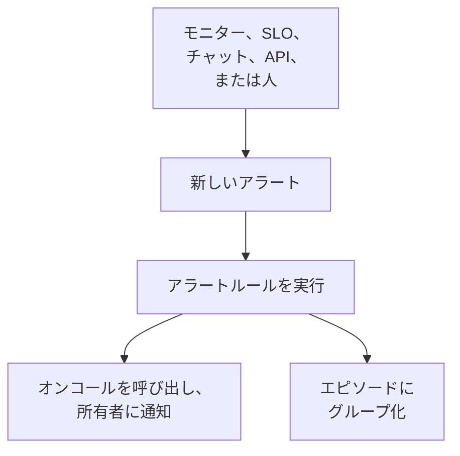

# アラートの概要

アラートは、ユーザーが気付く前に調べるべき問題をチームに知らせます。いっぱいになりつつあるディスク、期限切れが迫った証明書、じわじわ上がるエラー率などです。オンコール担当者を呼び出し、所有者に通知できますが、ステータスページに表示されることも、購読者に知らせることもありません。このページでは、アラートがどこから来るのか、ダッシュボードのどこにあるのか、チームがどのように対応するのかを説明します。

:::cards
- [アラートとインシデント](#アラートとインシデント): 問題をどちらとして扱うべきか、そして両者のつながり。
- [アラートの発生元](#アラートの発生元): モニター、SLO、チャット、API、または手動。
- [アラートを手動で作成する](#アラートを手動で作成する): ダッシュボードでの 2 つのステップ。
- [アラートに対応する](#アラートに対応する): 確認、解決、またはインシデントの宣言。
:::

## 仕組み

ほとんどのアラートは、条件に一致したモニターが発生させます。エラーバジェットを消費している SLO、セキュリティルール、Slack や Microsoft Teams から送られた呼び出し、または人から来るものもあります。どの経路で届いても、アラートは同じレコードであり、同じルールが実行されます。

- **ルールが形を整える。** プライバシー、所有者、ラベル、オンコールの各ルールはアラートの作成と同時に実行され、Runbook ルールは一致する手順を開始します。[アラートのルールと設定](/docs/alerts/settings) を参照してください。
- **オンコールポリシーが人を呼び出す。** アラートが指定するポリシーと、オンコールルールが追加するポリシーが、誰かがアラートを確認するまで担当者を呼び出します。
- **エピソードがノイズをまとめる。** グループ化ルールが関連するアラートを 1 つのエピソードにまとめるので、1 つの障害から出た 20 件のアラートが 1 つの対応になります。[アラートのエピソードとグループ化ルール](/docs/alerts/episodes) を参照してください。

## アラートとインシデント

どちらも問題を記録し、どちらもオンコール担当者を呼び出せます。違うのは、問題が誰に影響するかです。

|                              | アラート                                               | インシデント                                      |
| ---------------------------- | ------------------------------------------------------ | ------------------------------------------------- |
| **何であるか**               | ユーザーに影響が出る前にチームが調べるべき問題         | 障害など、ユーザーに影響する問題                  |
| **ステータスページ**         | 表示されない                                           | 表示でき、購読者に知らせる                        |
| **メモ**                     | 非公開メモ、チーム専用                                 | 顧客向けの公開メモと非公開メモ                    |
| **初期の状態**               | **原因特定**、**確認済み**、**解決済み**               | **原因特定**、**確認済み**、**解決済み**          |
| **初期の重大度**             | **高**、**低**                                         | Critical Incident、Major Incident、Minor Incident |
| **新しいプロジェクトでの番号** | `ALT-42`、エピソードは `AE-42`                       | `INC-42`、エピソードは `IE-42`                    |

外部の誰かが気付く前にチームが確認すべきときはアラートを発生させ、ユーザーに影響が出ているときはインシデントを宣言します。アラートが障害の一部だとわかったら、そのアラートからインシデントを宣言するか、原因を説明するインシデントにリンクします。[リンクされたアラート](/docs/incidents/linked-alerts) を参照してください。

## アラートの発生元

- **モニターの条件。** 条件の **アクション** で **フィルターが一致したとき、アラートを作成します。** をオンにし、作成されるアラートを入力します。**アラートタイトル** と **重大度**、そしてそれぞれ折りたたまれた **説明**、**所有権とラベル**、**オンコール**、**その他の項目** で、最後のものには **アラートを自動解決**、**プライベートアラート**、**修復メモ** があります。条件は一度に 1 件の未解決アラートを保持し、フィールドでグループ化するモニターではシリーズごとに 1 件で、**アラートを自動解決** は条件が一致しなくなるとそれを解決します。[モニターの作成](/docs/monitor/create-monitor) と [インシデント & アラート テンプレート](/docs/monitor/incident-alert-templating) を参照してください。
- **手動。** アラート一覧、またはモニター、ホスト、その他のリソースの **アラート** タブで **アラートを作成** をクリックします。後者ではそのリソースが自動で選択されます。[アラートを手動で作成する](#アラートを手動で作成する) を参照してください。
- **SLO のバーンレート。** バーンレートルールは、SLO がエラーバジェットを速く消費しすぎたときにアラートを作成できます。[バーンレートアラートとインシデント](/docs/slo/burn-rate-alerts) を参照してください。
- **ネットワークサイトとセキュリティイベント。** 異常時にアラートを出すよう設定したネットワークサイトは、集約が稼働中でなくなるとアラートを開きます。セキュリティイベントの検出ルールもアラートを開きます。[ネットワークサイト (ヘルスの集約と稼働率)](/docs/monitor/network-sites) と [セキュリティイベント (SIEM)](/docs/telemetry/security-events) を参照してください。
- **呼び出し。** Slack または Microsoft Teams の `/oneuptime page` は、メッセージをタイトルにしたアラートを開き、指名した人を呼び出します。ワークフローの呼び出しブロックも、渡したタイトルとメッセージで同じことを行います。[Slack から誰かを呼び出す](/docs/workspace-connections/slack#slack-から誰かを呼び出す) と [Paging](/docs/workflows/components#paging) を参照してください。
- **API、Terraform、ワークフロー。** アラートは通常のリソースです。`/api/alert`、Terraform リソース `oneuptime_alert`、そしてワークフローの **Create One Alert** ステップがあります。

## ダッシュボードでのアラートの場所

上部バーの **製品** メニューから **アラート** を開きます。アラート一覧は `/dashboard/{projectId}/alerts` にあり、そのサイドメニューにアラートに関するすべてがあります。

| セクション         | できること                                                                                                                |
| ------------------ | ------------------------------------------------------------------------------------------------------------------------- |
| **アラート**       | **すべてのアラート** と **アクティブなアラート**。赤いバッジはまだ解決されていないアラートの数です。                       |
| **エピソード** | **すべてのエピソード** と **アクティブなエピソード**: 関連するアラートを、取り組むひとつの問題にまとめたもの。 |
| **AI**             | **インサイト**、**ログ**、**設定**。OneUptime AI がアラートから学んだこと、行ったことすべて、許可されていること。          |
| **ワークスペース** | プロジェクトが接続しているほうの **Slack** と **Microsoft Teams**、どちらもなければ **Slack または Teams を接続**。        |
| **ルール**         | **グループ化ルール**、**オンコールルール**、**所有者ルール**、**Runbook ルール**、**プライバシールール**、**ラベルルール**、**リマインダールール**。 |
| **設定**           | **アラートの状態**、**アラートの重大度**、**メモテンプレート**、**カスタムフィールド**、**測定値**、**エピソードへの所属**、**採番**。 |

**アラート** と **エピソード** は開いています。**AI**、**ワークスペース**、**ルール**、**設定**、**開発者** は折りたたまれた状態で始まり、そのページにいるときはセクションが自動で開きます。アラートの設定はここにあり、**プロジェクト設定** にはありません。

一覧には **アラート番号**、**タイトル**、**状態**、**重大度**、**影響を受けるリソース**（先頭はアラートのモニター）、**作成**、**期間**、**ラベル**、**所有者** が表示されます。アラートを選択すると複数をまとめて操作できます。**確認**、**解決**、**状態を変更**、**重大度を変更**、**自分に割り当て**、**所有者を追加**、**所有者を削除**、**ラベルを追加**、**ラベルを削除**、**インシデントにリンク**、**インシデントを宣言**、または削除です。

各アラートの行末にある **⋯** メニューでは、そのアラートだけに同じ操作ができます。アラートがその段階に進めるあいだは **確認** と **解決**、そして **状態を変更**、**重大度を変更**、まだ所有者でなければ **自分に割り当て**、ほかの人に任せるには **所有者を追加** です。

## アラートを手動で作成する

:::steps
### フォームを開く

**アラート → すべてのアラート** に移動し、**アラートを作成** をクリックします。**新しいアラートを作成** フォームが最初のステップ **アラートの詳細** で開きます。

### アラートを説明する

**タイトル** を入力し、**アラートの重大度** を選びます。どちらも必須です。役立つなら **説明** を追加します。折りたたまれた **その他の項目** では、**初期状態** の選択、**ラベル** の追加、**プライベートアラート** のオンができます。**所有者** もここにあります。作成したアラートの所有者にはいずれにしてもあなたがなり、所属する各チームは選択欄の下からワンクリックで追加できます。インストール全体を管理するマスター管理者だけは例外で、作成したものの所有者になりません。

### 影響範囲と呼び出す相手を選ぶ

**次へ** をクリックして **リソースとオンコール** に進みます。対象の **モニター** と、ホスト、Kubernetes クラスター、サービスなどの **その他の影響を受けるリソース** を選びます。**オンコールポリシー** では、アラートの作成時に実行するポリシーを選びます。

### 作成する

**次へ** をクリックして概要を確認し、**アラートを作成** をクリックします。アラート自身のページが開き、ルールの実行が始まります。概要の **所有者** の行には、誰かを追加する各所有者ルールと、誰が追加されるかが表示されます。[誰が所有者になるか](/docs/incidents/declaring-incidents#誰が所有者になるか) を参照してください。
:::

**初期状態** を空のままにすると、アラートは新しいアラートと同じところから始まります。作成時の状態で、新しいプロジェクトでは **原因特定** です。後の状態を選ぶと、誰かがすでに対応している、またはすでに終わったアラートとして記録されます。[確認済みまたは解決済みの状態で作成](#確認済みまたは解決済みの状態で作成) を参照してください。

## アラート作成時に起きること

アラートが作成されると、OneUptime は次の手順をこの順で実行します。

1. **番号と状態が付く。** アラート番号はプロジェクトごとのカウンターから採番され、プレフィックス付きで表示されます (`ALT-42`)。フォーム、API、ワークフローが別の状態を選ばない限り、アラートは作成時の状態で始まります。
2. **プライバシールールが最初に実行される** ので、後続の処理はアラートが非公開かどうかを把握できます。
3. **フィードとチャットツールに伝わる。** **アラート作成** のエントリが **アラートのフィード** に書き込まれ、Slack と Microsoft Teams のルールが指定するチャンネルに通知されます。ルールによってはアラート用のチャンネルを作成できます。
4. **所有者とラベルが追加される**: モニターの条件やリクエストが指定するもの、続いて一致する所有者ルールとラベルルールのもの。
5. **オンコールルールがポリシーを追加し**、続いて Runbook ルールが一致する Runbook を開始します。
6. **オンコールポリシーが実行される。** アラートの各ポリシーが担当者を並行して呼び出します。1 つが失敗しても他は止まりません。
7. **一致するグループ化ルールがあれば、エピソードに入れる**。[アラートのエピソードとグループ化ルール](/docs/alerts/episodes) を参照してください。
8. **リマインダールールが一致すれば、リマインダーがスケジュールされる**。また **OneUptime AI** は、**アラート → AI → 設定** で **新しいアラートを調査する** がオンならアラートを調査し、**新しいアラートを自動的に修正する** がオンなら修正します。[AI SRE](/docs/ai/ai-sre) を参照してください。

バックグラウンドジョブが 1 分以内にアラートの所有者に知らせ、ワークフロートリガー **On Create Alert** がそれを使うワークフローを開始します。

### 確認済みまたは解決済みの状態で作成

後の状態で始まるアラートは、すでに誰かが対応している問題の記録なので、新しい緊急事態としては扱われません。

- **確認済みの状態以降** では、オンコールポリシーは実行されません。アラートはポリシーを保持し、誰も呼び出されなかった理由がフィードに 1 行で記録されます。開いているエピソードに参加することはできますが、エピソードを開くことはありません。開けばエピソードのポリシーで呼び出しが行われるためです。
- **解決済みの状態以降** では、アラートは終わっています。エピソードにグループ化されず、Runbook も自動修復も動かず、OneUptime AI も調査せず、Slack や Microsoft Teams のチャンネルも作成されません。

それでも、ルール、所有者、フィード、最初の状態はどちらの場合も記録されます。インシデントも同じルールに従います。[確認済みまたは解決済みの状態で宣言されたインシデント](/docs/incidents/declaring-incidents#確認済みまたは解決済みの状態で宣言されたインシデント) を参照してください。

## アラートに対応する

アラートを開きます。ヘッダーには状態、重大度、経過時間、所有者、属するモニターとエピソードが表示され、次の操作に必要なボタンが並びます。

- **確認** は誰かが対応中であることを示します。アラートのオンコールポリシーが次のレベルを呼び出すのを止めます。
- **解決** はアラートを閉じます。アラートは **アクティブなアラート** から外れ、リマインダーも止まります。
- 隣の **⋯** メニューにある **変更後の状態** は、「調査中」のような独自の状態にアラートを移します。
- **インシデントを宣言** は、問題がユーザーに影響するとわかったときに、アラートから事前入力された新しいインシデントを開きます。[リンクされたアラート](/docs/incidents/linked-alerts) を参照してください。

別の状態に移すときは確認を求められ、**非公開メモを追加** の下に折りたたまれた任意の非公開メモを付けられます。各状態の働きは [アラートの状態と重大度](/docs/alerts/states-and-severities) を参照してください。

対応中は、わかったことを **非公開メモ** に書き留め、**根本原因** と **修復** のページを埋め、**所有者** を追加します。**アラートのフィード** の **アクション** メニューからは、**Runbook を実行** で Runbook を実行したり、**オンコールポリシーを実行** でさらに人を呼び出したりもできます。

## アラートの各ページの内容

| サイドメニューのセクション | ページ                                                                                                    |
| -------------------------- | --------------------------------------------------------------------------------------------------------- |
| **概要** | **概要** と **状態タイムライン** |
| **調査** | **説明**、**根本原因**、**修復**、**Runbook**、**リンクされたインシデント** |
| **チーム** | **オンコールの実行** と **所有者**: アラートで誰が呼び出されたかと、アラートの所有者 |
| **通知**                   | **通知ログ** と **AI ログ**: アラートについて送られたすべてのメッセージと、AI が行ったすべてのこと       |
| **メモ**           | **非公開メモ**                                                                                            |
| **開発者**                 | **Terraform**、**API**、**AI アシスタント**: コードからのアラート管理                                     |
| **詳細** | **カスタムフィールド**、**設定**、**監査ログ**、**アラートを削除** |

**概要**、**調査**、**チーム**、**メモ** は開いています。他のセクションはクリックするまで折りたたまれています。

- **概要** — ヘッダーには、アラートのモニターとエピソードの横に、アラートの **所有者**（チームが先）が表示されます。3 つのタイルのうち **作成** は作成された日時と作成元を、残りの 2 つはアラートの確認と解決にかかった時間を示します。経過時間はヘッダーの最初の項目です。ページの先頭には **何が起きたか** カードがあり、アラートの説明と **根本原因** を示します。その次に **AI 調査** カードがあり、その下部に **OneUptime AI に質問** があります。**アラートのフィード** はアラートに起きたすべてを記録します。その横には **影響を受けるリソース** カード、**アラートの詳細** カード、アラートの測定値があります。
- **状態タイムライン** — アラートがいつ、どれだけの間、どの状態にあったか。[状態タイムライン](/docs/alerts/states-and-severities#状態タイムライン) を参照してください。
- **リンクされたインシデント** — このアラートが含まれるインシデント。**インシデントをリンク** と **インシデントを宣言** があります。
- **設定** — **プライベートアラート** スイッチのある **このアラートを閲覧できる人** と、**リマインダーを送信** のある **リマインダー**。各スイッチは切り替えた時点で保存されます。

## プライベートアラート

プライベートアラートを見られるのは、その所有者 (所有者ユーザーと所有者チームのメンバー) と、プロジェクトの管理者と所有者だけです。プロジェクト内の他の人は開けません。

作成フォームやモニターの条件の **その他の項目** にある **プライベートアラート**、**アラート → ルール → プライバシールール**、または後からアラートの **設定** ページでアラートを非公開にします。設定ページでは、アラートを隠す前に **このアラートを非公開にしますか？** と確認されます。あなたがそのいずれにも当たらない場合は、あなた自身もアクセスできなくなります。

プライベートアラートが開いたエピソードは非公開ではないため、アラートのタイトルや説明を表示することはありません。タイトルや説明にそれらが入るはずの場所には「Private alert」と表示されます。

## アラートを知らされる人

- **オンコール。** アラートのオンコールポリシーが担当者を呼び出します。各担当者は **ユーザー設定 → オンコールルール** の **アラート** タブで設定した方法で連絡を受けます。呼び出しに応答するとアラートが確認され、呼び出しは止まります。
- **所有者。** **ユーザー設定 → 通知設定** の **アラート** タブで別のチャンネルを選んでいない限り、メールで届きます。**アラートが作成されました**、**アラートの状態が変更されました**、**アラートのリマインダー** は既定でオン、**アラートのメモが投稿されました** と **アラートの所有者として追加されました** は誰かがオンにするまでオフです。所有者のいないアラートは、代わりにプロジェクトの所有者に通知します。
- **チャットツール。** **アラート → ワークスペース** には、アラートとエピソードをチャンネルに投稿する Slack と Microsoft Teams のルールがあります。[Slack](/docs/workspace-connections/slack) と [Microsoft Teams](/docs/workspace-connections/microsoft-teams) を参照してください。

## トラブルシューティング

:::details 新しいアラートで誰も呼び出されなかった
アラートの **オンコールの実行** ページを開きます。空なら、アラートにはオンコールポリシーがありませんでした。フォームでもモニターの条件でも選ばれておらず、一致するオンコールルールもありませんでした。アラートが確認済みまたは解決済みの状態で作成された場合は、誰も呼び出されなかったことと、その理由がフィードに記録されています。
:::

:::details モニターは失敗し続けているのに、新しいアラートが出ない
条件は一度に 1 件の未解決アラートを保持します。そのアラートが解決されるまで、モニターは同じ条件で新しいアラートを追加しません。アラートを解決するか、**アラートを自動解決** をオンにして、条件が一致しなくなったときにモニターが解決するようにします。
:::

:::details チームメイトが開けるアラートを自分は見つけられない
そのアラートはおそらく非公開です。プロジェクトの管理者に、あなたを所有者として追加するか、アラートの **設定** ページで **プライベートアラート** をオフにするよう依頼してください。
:::

## 次のステップ

:::cards
- [アラートの状態と重大度](/docs/alerts/states-and-severities): 確認と解決の働き、そして独自の状態の追加方法。
- [アラートのエピソードとグループ化ルール](/docs/alerts/episodes): 大量のアラートを 1 つの対応にまとめます。
- [アラートのルールと設定](/docs/alerts/settings): 呼び出し、所有者、ラベル、リマインダーを自動化します。
- [リンクされたアラート](/docs/incidents/linked-alerts): アラートを、その原因を説明するインシデントに結び付けます。
:::
