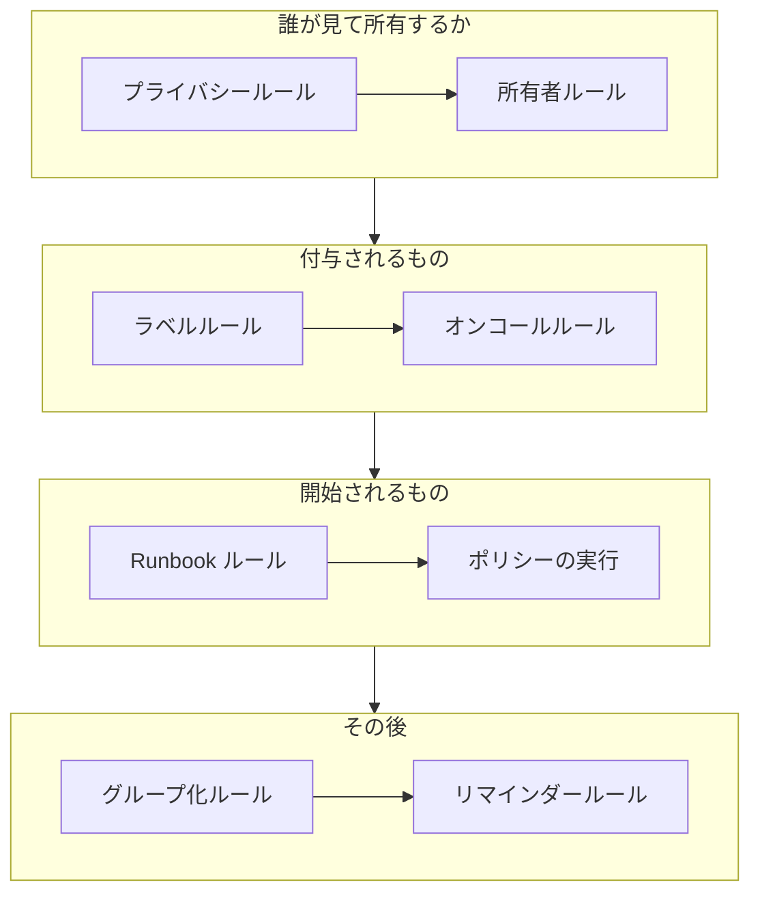

# アラートのルールと設定

アラートの設定は **プロジェクト設定** ではなく **アラート** の中にあります。新しいアラートごとに作用するルールと、プロジェクト内のすべてのアラートを形作る設定です。このページは、そのそれぞれと、アラートの作成時に自動で実行されるもののリファレンスです。

:::cards
- [新しいアラートが通るルール](#新しいアラートが通るルール): 順番と、それぞれの働き。
- [オンコールルール](#オンコールルール): 毎回ポリシーを選ばずに、適切な人を呼び出します。
- [リマインダールール](#リマインダールール): アラートが開いている間、所有者にリマインドします。
- [設定](#設定): メモテンプレート、カスタムフィールド、測定値、エピソードへの所属、採番。
:::

## アラートの設定の場所

上部バーの **製品** メニューから **アラート** を開きます。サイドメニューの **ルール** と **設定** のセクションは折りたたまれた状態で始まるので、まず展開します。ここにあるページはすべてプロジェクト全体に適用され、アドレスは `/dashboard/{projectId}/alerts/settings/` で始まります。

| ルールのページ          | 働き                                                                                           |
| ----------------------- | ---------------------------------------------------------------------------------------------- |
| **グループ化ルール**    | 関連するアラートをエピソードにまとめます。[アラートのエピソードとグループ化ルール](/docs/alerts/episodes) を参照してください。 |
| **オンコールルール**    | 一致するアラートとエピソードに対してオンコールポリシーを実行します。                           |
| **所有者ルール**        | 一致するアラートとエピソードに所有者を追加します。                                             |
| **Runbook ルール**      | 一致するアラートに対して Runbook を開始します。                                                |
| **プライバシールール**  | 一致するアラートとエピソードを非公開にします。                                                 |
| **ラベルルール**        | 一致するアラートとエピソードにラベルを追加します。                                             |
| **リマインダールール**  | アラートが開いている間、一定の間隔で所有者にリマインドします。                                 |

**設定** セクションには、[アラートの状態と重大度](/docs/alerts/states-and-severities) で説明する **アラートの状態** と **アラートの重大度**、そして以下で説明する **メモテンプレート**、**カスタムフィールド**、**測定値**、**エピソードへの所属**、**採番** があります。

アラートに作用するセクションがほかに 2 つあります。**アラート → AI → 設定** は OneUptime AI が自動で行うことを決めます。新しいプロジェクトではオンの **新しいアラートを調査する** と、オンにするまでオフの **新しいアラートを自動的に修正する** です。[AI SRE](/docs/ai/ai-sre) を参照してください。**アラート → ワークスペース** には、アラートとエピソードをチャンネルに投稿する Slack と Microsoft Teams のルールと、**概要** タブがあります。[Slack](/docs/workspace-connections/slack) を参照してください。

## 新しいアラートが通るルール

複数のルールが一致したときの扱いは、ルールによって異なります。

- **グループ化ルール** と **リマインダールール** は一覧の上から順に確認され、最初の一致が優先されます。位置を変えるにはルールをドラッグします。新しいルールは末尾に追加されます。
- **オンコールルール**、**所有者ルール**、**ラベルルール**、**プライバシールール**、**Runbook ルール** は、一致したものがすべて作用します。複数のルールが追加するオンコールポリシー、所有者、ラベルは 1 回だけ追加されます。

**オンコールルール**、**所有者ルール**、**ラベルルール**、**プライバシールール** には 2 つのタブがあります。アラート用の **アラートルール** と、新しいアラートエピソードに同じように作用する **エピソードのルール** です。新しいルールは有効な状態で始まります。一時停止するには編集フォームで **有効** をオフにします。一覧には各ルールについて緑の **有効** か赤の **無効** が表示されます。

ほとんどのルールは、保存後に作成されたアラートとエピソードに作用します。所有者、ラベル、プライバシーのルールを既存のものに適用するには、**今すぐ実行** を使います。[既存のリソースに対してルールを実行する](/docs/configuration/run-rules-now) を参照してください。リマインダールールは例外で、保存するとすべての開いているアラートが再照合されます。

### 条件

ルールの条件は、ルールがどのアラートに作用するかを決め、文のように読めます。「**アラートタイトル** が `database` を含む場合」「かつ **モニターラベル** が *Production* のいずれかを含む」のようにです。条件のないルールはすべてのアラートに一致します。

| 条件                                                          | 比較方法                                                                                                       |
| ------------------------------------------------------------- | -------------------------------------------------------------------------------------------------------------- |
| **モニター**、**アラートの重大度**、**アラートラベル**、**モニターラベル** | 選んだ値に対して **いずれかを含む**、**すべてを含む**、**いずれも含まない**。                          |
| **アラートタイトル**、**アラートの説明**、**モニター名**、**モニターの説明** | 大文字と小文字を区別せずに **含む**、**含まない**、**等しい**、**等しくない**、**で始まる**、**で終わる**、または正規表現や `*` ワイルドカード用の **パターンに一致** と **パターンに一致しない**。 |

条件が 2 つ以上ある場合は、すべてが成り立つ必要がある **すべてに一致** か、1 つで足りる **いずれかに一致** を選びます。エピソードのルールは、代わりにエピソードの重大度、ラベル、タイトル、説明に一致させます。

## オンコールルール

**アラート → ルール → オンコールルール** は呼び出しを自動化します。一致した各ルールが新しいアラートにポリシーを追加し、アラートはすでに持っていたポリシーとあわせて、それぞれ 1 回ずつ実行します。

:::steps
### アラートを選ぶ

**アラートのオンコールルールを作成** をクリックします。**一致** では、新しいルールの最初の選択である **すべてのアラート** が、すべての新しいアラートに一致します。絞り込むには **条件に一致するアラートのみ** を選び、アラートが満たすべき条件を追加します。

### ポリシーを選ぶ

**オンコールポリシー** で、ルールが呼び出す **オンコールポリシー** を選びます。独自の名前を入力するまで、**名前** は「Platform on-call を呼び出す」のようにそれに合わせて変わり、**説明** は **その他の項目** にあります。そのあとルールを作成します。
:::

重大度だけでは誰も呼び出されません。「高のアラートが出たらデータベースチームを呼び出す」を設定するには、**アラートの重大度** に一致するオンコールルールを使います。1 件のアラートで何が実行されたかを見るには、そのアラートの **オンコールの実行** ページを開きます。その後、各担当者には、**ユーザー設定 → オンコールルール** の **アラート** タブで設定した方法で連絡が届きます。[エスカレーションルール](/docs/on-call/escalation-rules) を参照してください。

ルールは、アラートが一致するとすぐに呼び出します。代わりに勤務時間まで待たせるには、 **その他の項目** にある **このルールはいつ呼び出しますか？** で **勤務時間中のみ** を選びます。 **勤務時間** は最初、あなたのタイムゾーンで月曜から金曜の 09:00 から 17:00 です。別の曜日、別の **開始時刻** や **終了時刻** 、別の **タイムゾーン** を選ぶと、選択肢の下の文が何が起きるかを示します。一覧では、ルール名の下に勤務時間が表示されます。勤務時間外に一致したアラートには、待機して誰も呼び出さない実行が作られ、勤務時間が始まるとポリシーが最初のエスカレーションルールを呼び出し、通常どおりエスカレーションします。その前にアラートが確認または解決されれば、誰も呼び出されません。待機中にアラートが変わり、たとえば重大度が上げられて、すぐに呼び出すルールに一致するようになった場合は、実行はその時点で呼び出しを始め、その理由がアラートのフィードに記録されます。同じポリシーを呼び出す 2 つのルールは、どちらかが許した時点でそのポリシーを呼び出します。最も高い重大度ですぐに呼び出すルールと、残りのために勤務時間を待つルールを並べれば、夜は静かに保たれます。

## 所有者ルールとラベルルール

**所有者ルール** は一致する新しいアラートに所有者のユーザーとチームを追加し、**ラベルルール** はラベルを追加します。作成は 2 ステップです。条件を指定する **一致** と、ルールが追加するものを指定する **所有者** または **ラベル** です。ルールの **名前** は、独自の名前を入力するまで選択内容に合わせて変わります。

- **ルールは継承できる。** **所有者を継承** または **ラベルを継承** の下に折りたたまれた 6 つのスイッチが、アラートのモニター、ホスト、Kubernetes クラスター、Docker ホスト、Podman ホスト、サービスの所有者やラベルを引き継ぎます。エピソードのルールにはこれらのスイッチはありません。所有者ルールの **所有者を継承** の最後には **作成者のチーム** があります。そこに並べたチームのうち、アラートを作成した人が所属するチームも所有者になります。
- **新しいルールは何かを追加する必要がある**。所有者かラベルを 1 つ以上選ぶか、スイッチをオンにします。インシデントまたはアラートの所有者ルールでは、**作成者のチーム** のチームだけでも十分です。
- 所有者ルールの **その他の項目** にある **所有者に通知** で、追加された人に知らせるかどうかを決めます。

[ラベルルールと所有者ルール](/docs/configuration/label-and-owner-rules) では、あらゆる種類のリソースについてフォームを順を追って説明しています。

## プライバシールールと Runbook ルール

**プライバシールール** は、一致する新しいアラートを、他の処理が実行される前に非公開にします。見られるのはその所有者と、プロジェクトの管理者と所有者だけです。ルールには 2 つのステップがあります。非公開にするアラートを決める **一致** と、「アラートをプライベートにする」とあらかじめ入力された **名前** です。[プライベートアラート](/docs/alerts/index#プライベートアラート) を参照してください。

**Runbook ルール** は、新しいアラートが一致したときに Runbook を開始します。ただし、アラートが解決済みの状態で作成された場合は除きます。[Runbook ルール](/docs/runbooks/rules) を参照してください。

## リマインダールール

**アラート → ルール → リマインダールール** は、アラートが開いている間、その所有者にリマインドします。新しいアラートには、一覧の上から順に見て最初に一致したルールが適用されます。

:::steps
### リマインドするアラートを選ぶ

**アラートのリマインダールールを作成** をクリックします。**一致** で **すべてのアラート** を選んだままにすると、すべてのアラートについてリマインドします。 **条件に一致するアラートのみ** を選ぶと、ルールを適用する **アラートの重大度** と **ラベル** を選べます。

### 間隔を設定する

**リマインダー** で、所有者にリマインドする頻度である **リマインダーの間隔（分）** と、**リマインダーを停止する条件** を設定します。既定の **解決済み** か、**確認済み** です。独自の名前を入力するまで、**名前** は「解決するまで 30 分ごとにリマインド」のようにそれに合わせて変わります。そのうえでルールを作成します。
:::

所有者は各リマインダーを **アラートのリマインダー** として受け取り、これは既定でメールがオンです。アラートの重大度やラベルが変わると、そのアラートのルールが再照合されます。1 件のアラートのリマインダーを止めるには、その **設定** ページで **リマインダーを送信** をオフにします。切り替えた時点で保存されます。

## 設定

### メモテンプレート

**アラート → 設定 → メモテンプレート** には、非公開メモ用の定型文があります。**アラート用の非公開メモテンプレート** カードに一覧があり、**アラートのメモテンプレートを作成** では **テンプレート名**、**テンプレートの説明**、**メモ** を入力します。テンプレートは、アラートやエピソードに非公開メモを書くときや、それを確認・解決するときに提示され、投稿前に本文を編集できます。アラートのメモテンプレートはプレーンテキストで、インシデントのメモテンプレートと違って変数は埋め込まれません。

### カスタムフィールド

**アラート → 設定 → カスタムフィールド** は、顧客ランクやチケット参照などの独自のフィールドをすべてのアラートに追加します。アラートの **カスタムフィールド** ページで入力するか、API で `customFields` として指定します。フィールドは、入力する代わりにモニターのカスタムフィールドから値をコピーすることもできます。[モニターからコピーするフィールド](/docs/incidents/settings#モニターからコピーするフィールド) を参照してください。アラートでも同じように動作します。

### 測定値

**アラート → 設定 → 測定値** は、すべてのアラートで物事にかかる時間を測ります。**確認までの時間** か **解決までの時間**、または **アラートが作成されたとき** と選んだ状態に入ったときのような 2 つの独自の時点を選びます。各測定値はアラートのページに表示され、`oneuptime.alert.measurement.<key>` としてグラフ化されます。[測定値](/docs/incidents/settings#測定値) を参照してください。アラートでも同じように動作します。

**呼び出し後の確認までの時間** は、アラートが作成されたときではなく、**最初に誰かが呼び出されたとき**、つまりオンコールポリシーまたは直接呼び出しがアラートについて初めて誰かに通知したときから数えます。夜に発生して朝に呼び出されたアラートに、夜の分は計上されません。誰も呼び出されなかったアラートには値がありません。[呼び出し後の確認までの時間](/docs/incidents/settings#呼び出し後の確認までの時間) を参照してください。

### エピソードへの所属

**アラート → 設定 → エピソードへの所属** では、アラートを複数のエピソードに入れられるかどうかを決めます。**アラートは 1 つのエピソードにのみ含められます** をオンにすると、エピソードに入っているアラートは、そのエピソードから外されるまで、ダッシュボード、API、ワークフロー、グループ化ルールのいずれからも他のエピソードに追加されません。スイッチはオンにするまではオフで、変更できるのは Project Owners と Project Admins だけです。オンにしても、エピソードからアラートが外れることはありません。[インシデントごとに 1 つのエピソード](/docs/incidents/episodes#インシデントごとに-1-つのエピソード) を参照してください。アラートでも同じように動作します。

### 採番

**アラート → 設定 → 採番** は、アラート番号とエピソード番号の前に付く文字列を設定します。新しいプロジェクトでは `ALT-` と `AE-` で、なければ `#` です。**更新** で **アラート番号のプレフィックス** と **アラートエピソード番号のプレフィックス** が開き、入力中にプレビューが表示されます。新しいプレフィックスが付くのは、その後に作成されたアラートとエピソードだけです。プレフィックスのルールは [番号プレフィックス](/docs/incidents/settings#番号プレフィックス) にあります。

その下の **次の番号** カードでは、別のツールの番号を引き継ぐために、次のアラートと次のエピソードに付く番号を設定します。**更新** で **次のアラート番号** と **次のアラートエピソード番号** が開き、どちらもこれまでの最大より大きくする必要があります。[次の番号](/docs/incidents/settings#次の番号) を参照してください。

> [!NOTE]
> OneUptime Cloud では、メモテンプレートとカスタムフィールドには **Growth** プラン以上が必要です。

## ワークフロー

アラートの各モデルには、その名前の付いたワークフローのトリガーとアクションがあります。**On Create Alert**、**On Update Alert**、**On Create or Update Alert**、**On Delete Alert**、**アラートエピソード** や **アラートの状態タイムライン** などにも同じものがあり、**Create One Alert** や **Update One Alert** のようなアクションもあります。唯一の例外はアラートのカスタムフィールドの定義で、ワークフローのトリガーはありません。[ワークフロー 概要](/docs/workflows/index) を参照してください。

## 変更できる人

ルール、カスタムフィールド、測定値には、Project Owner か Project Admin、またはそのルール固有の権限を持つカスタムロールが必要です。**アラートメンバー** はアラートとエピソード、そのメモ、所有者、状態タイムライン、およびメモテンプレートを扱え、**アラート管理者** はさらにアラートの状態と重大度を管理します。[ユーザー、チーム、権限](/docs/permissions/index) を参照してください。

## 次のステップ

:::cards
- [アラートのエピソードとグループ化ルール](/docs/alerts/episodes): グループ化ルールの詳細。
- [エスカレーションルール](/docs/on-call/escalation-rules): オンコールルールがポリシーを実行した後に起きること。
- [ラベルルールと所有者ルール](/docs/configuration/label-and-owner-rules): ルールのフォームを順を追って説明。
- [AI SRE](/docs/ai/ai-sre): 新しいアラートを自動で調査し、修正します。
:::
