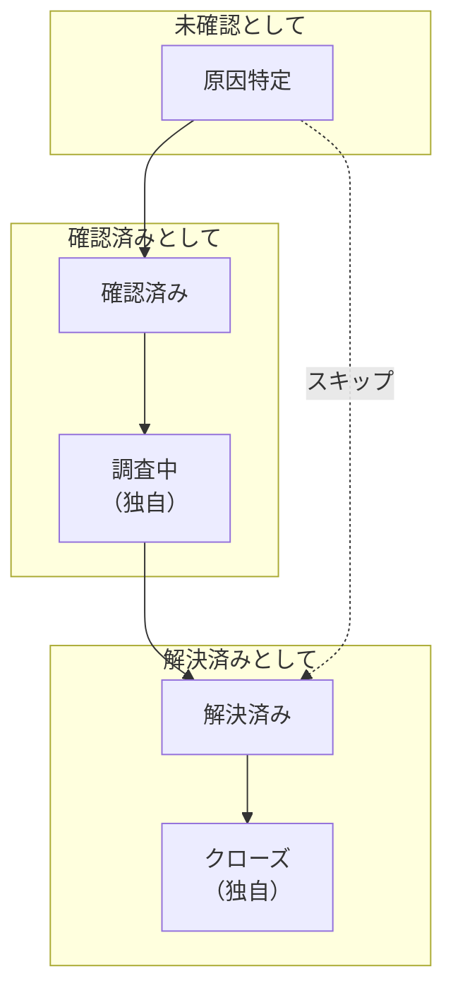

# アラートの状態と重大度

すべてのアラートには、チームがどこまで対応しているかを示す **状態** と、どれほど重要かを示す **重大度** があります。状態は OneUptime の動作を決めます。誰がまだ呼び出されるか、何がアクティブとして数えられるか、エピソードがいつ解決されるかです。重大度はアラートを順位付けし、ルールはそれに一致させることができます。このページは、これらを設定する人や、アラートがなぜ呼び出しを行った（または行わなかった）のかを知りたい人のためのものです。

:::cards
- [初期の状態](#初期の状態): 原因特定、確認済み、解決済みと、それぞれの働き。
- [独自の状態を追加する](#独自の状態を追加する): 「調査中」のような独自のステップ。
- [アラートの状態を進める](#アラートの状態を進める): 状態が変わるすべての方法。
- [重大度](#初期の重大度): 高と低、そして独自の重大度の追加。
:::

## 仕組み

プロジェクトのアラートの状態は 1 つの順序付きリストで、アラートはその中を下にしか進みません。状態の位置によって、そこにあるアラートの扱いが決まります。未確認、確認済み、解決済みのいずれかです。アラートのエピソードも同じリストを進みます。

`AlertState` モデルには `name`、`description`、`color`、`order` と、3 つのフラグ `isCreatedState`、`isAcknowledgedState`、`isResolvedState` があります。OneUptime が読むのはフラグと順序で、名前は読みません。そのため **解決済み** を「クローズ」に名前変更しても何も壊れません。`AlertSeverity` モデルには `name`、`description`、`color`、`order` があり、フラグはありません。

> [!TIP]
> どちらのリストも **アラート → 設定** にあります。サイドメニューでは折りたたまれた状態で始まるので、**設定** を展開すると **アラートの状態** と **アラートの重大度** が見つかります。

## 初期の状態

新しいプロジェクトは、次の順で 3 つのアラートの状態を持って始まります。

| 状態             | `order` | フラグ                | 色        | 意味                                              |
| ---------------- | ------- | --------------------- | --------- | ------------------------------------------------- |
| **原因特定**     | `1`     | `isCreatedState`      | `#fd625e` | 新しいアラートが始まる状態。                      |
| **確認済み**     | `2`     | `isAcknowledgedState` | `#ffbf53` | 誰かが対応中で、呼び出しは止まります。            |
| **解決済み**     | `3`     | `isResolvedState`     | `#2ab57d` | アラートは終わり、アクティブとして数えられなくなります。 |

フラグのある 3 つの状態には、設定ページで **組み込み** のタグが付きます。名前や色を変えたりドラッグしたりはできますが、作成、確認、解決という順序は保たれ、削除もできません。**削除** はロックされたままで、その理由が表示されます。

## 各フラグの働き

| フラグ                | OneUptime がそのフラグで行うこと                                                                                                                                                  |
| --------------------- | --------------------------------------------------------------------------------------------------------------------------------------------------------------------------------- |
| `isCreatedState`      | 誰も別の状態を選ばなければ、新しいアラートはここから始まります。モニターが発生させるすべてのアラートと、**初期状態** を空にして作成されたすべてのアラートです。                  |
| `isAcknowledgedState` | **確認** はアラートをここに移します。この状態以降では、アラートは確認済みとして扱われます。オンコールポリシーは呼び出しをやめ、**確認** は表示されなくなります。                  |
| `isResolvedState`     | **解決** はアラートをここに移します。この状態以降では、アラートは解決済みとして扱われます。**アクティブなアラート** から外れ、リマインダーが止まり、エピソードが解決できるようになります。 |

## 独自の状態を追加する

追加する状態は、チームがたどるステップのうち、初期の 3 つの状態が名前を持たないものです。「調査中」「緩和済み」「クローズ」などです。

:::steps
### 状態の一覧を開く

**アラート → 設定 → アラートの状態** に移動します。**アラートの状態** カードに状態が順に並びます。各行には色と名前、そこにあるアラートの **扱い**、説明が表示されます。

### 状態を作成する

**アラートの状態を作成** をクリックし、**名前**、**説明**、**色** を入力します。色はあらかじめ選ばれています。まだ他の状態が使っていない色です。新しい状態は解決済みの状態のすぐ上に追加されるので、アラートをアクティブに保ちます。

### 位置までドラッグする

行をグリップでドラッグして移動します。新しい順序はドロップした時点で保存されます。**扱い** 列もそれに合わせて変わります。確認済みの状態より上ではアラートは **未確認**、そこから下は **確認済み**、解決済みの状態から下は **解決済み** です。
:::

追加した状態にはフラグがないので、その位置が意味になります。緩和のステップは **確認済み** と **解決済み** の間に、トリアージのステップは **確認済み** の上に置きます。**解決済み** より下に置いた状態は、どこでも解決済みとして扱われます。

アラートを独自の状態に移すには、アラートのヘッダーの **⋯** メニューにある **変更後の状態** を使います。現在の状態より後のすべての状態が並びます。確認ダイアログのタイトルは **アラートを「{{state}}」にする** で、状態の名前が入ります。

> [!NOTE]
> OneUptime Cloud では、アラートの状態と重大度の追加や変更には **Growth** プラン以上が必要です。どのプランでも、閲覧、使用、追加した状態の削除はできます。

## 順序は強制される

アラートのすべての状態変更は、誰が行ってもリストと照合されます。ダッシュボード、Slack、Microsoft Teams、API、Terraform、ワークフロー、OneUptime 自身のいずれでもです。

- **逆方向の移動は拒否されます**。両方の状態を名指しするメッセージが表示されます: "Alert cannot transition to Acknowledged state from Resolved state because Acknowledged is before Resolved in the order of alert states."
- **すでにある状態への移動は拒否されます**: "Alert state cannot be same as previous state."
- **選択肢には現在の状態より後の状態だけが表示される** ので、拒否される移動が提示されることはありません。

アラートのエピソードも同じリストに従い、独自のメッセージ ("Episode cannot transition to …") が表示されます。リストを上に戻る唯一の移動は OneUptime 自身によるもので、最近解決したエピソードを再オープンするグループ化ルールです。誤って設定した状態を直すには、アラートの **状態タイムライン** ページでその行を削除します。アラートは残っている最新の行の状態に戻ります。

## 初期の重大度

新しいプロジェクトは 2 つのアラートの重大度を持って始まり、重いものが先です。

| 重大度   | `order` | 色        | 初期の説明                                                                        |
| -------- | ------- | --------- | --------------------------------------------------------------------------------- |
| **高**   | `1`     | `#b70400` | Issues causing very high impact to customers. Immediate attention is required.    |
| **低**   | `2`     | `#ffbf53` | Issues causing low impact to customers.                                           |

インシデントは 3 つの重大度、アラートは 2 つで始まります。モニターの推奨テンプレートが **重大** または **警告** と指定すると、OneUptime はそれを 1 番目と 2 番目のアラートの重大度に対応付けます。新しいプロジェクトでは **高** と **低** です。

## 重大度を編集する

**アラート → 設定 → アラートの重大度** に移動します。**アラートの重大度** カードには重いものから順に並びます。行をドラッグして順位を変えます。**アラートの重大度を作成** は、状態と同じ **名前**、**説明**、**色** を持つ重大度を、最も軽いものとしてリストの末尾に追加します。

OneUptime が重大度を比較する場面では、順位がどちらを優先するかを決めます。エピソードの重大度は、参加したアラートのうち最も重いものまで上がります。重大度にはフラグも削除ロックもなく、初期の 2 つを含め、どの重大度も削除できます。

重大度だけでは誰も呼び出されません。重大度に応じて呼び出すには、**アラートの重大度** が一致するオンコールルールを追加します。[アラートのルールと設定](/docs/alerts/settings) を参照してください。アラートの重大度を変更すると、フィードにエントリが書き込まれ、リマインダールールが再照合されます。

## 状態や重大度のアーカイブ

チームで使わなくなった状態や重大度は、削除する代わりにアーカイブします。アーカイブしてもアラートは何も変わりません。状態を削除すると、すべてのアラートの履歴からその行が消え、重大度はアラートが使っている間は削除できません。

- **アーカイブ** は行の **⋯** メニューにあります。最初に確認を求め、その値を使うように設定されているルール、測定、モニター条件、ワークフローを一覧表示します。これらは変更するまでその値を使い続けます。
- **誰も再び選択できません。** **状態を変更**、アラートのヘッダー、Slack、Microsoft Teams、ルール、モニター条件はその値を表示しません。API、Terraform、MCP は、値の名前とアーカイブを解除できる場所を示して拒否します。
- **アラートはその値を保持します。** その値を持つアラートは以後の編集でも保持し、状態タイムラインにも表示され、引き続きフィルターにも使えます。
- **アーカイブされた値は別に表示されます。** 表の下の折りたたまれたセクション **アーカイブ済みのアラートの状態** または **アーカイブ済みのアラートの重大度** に、誰がいつアーカイブしたかとともに表示されます。**アーカイブ解除** で元の状態に戻せます。
- **アーカイブできないものもあります。** 作成、確認、解決の各状態と、プロジェクトでアーカイブされていない最後の重大度です。これらの **アーカイブ** は理由とともにロックされています。

**削除** は実行前に何が起きるかを示します。アラートやエピソードがその値を持っている間は削除が拒否され、ダイアログにそれらが一覧表示されます。そうでなければ、削除で変わる内容を一覧表示し、**代わりにアーカイブ** を提示します。

## アラートの状態を進める

| 方法                 | 場所                                                                                      | 尋ねられること                                                                                                                       |
| -------------------- | ----------------------------------------------------------------------------------------- | ------------------------------------------------------------------------------------------------------------------------------------ |
| **ヘッダーのボタン** | アラートのヘッダー: **確認**、**解決**、そして **⋯** メニューの **変更後の状態**          | 短い確認ダイアログ (**アラートを確認**、**アラートを解決**、**アラートを「{{state}}」にする**) で、**非公開メモを追加** の下に任意のメモを付けられます。 |
| **状態タイムライン** | アラートのサイドメニューの **状態タイムライン**                                           | 手動で追加する行で、**アラートステータス** と **開始日時** を指定します。                                                            |
| **一覧の行** | アラート一覧の各行にある **⋯** メニュー: **確認**、**解決**、**状態を変更** | ヘッダーと同じ確認ダイアログで、アラートの名前が示されます。その間にほかの変更で先へ進んだアラートはそのまま残され、ダイアログに理由が表示されます。 |
| **一括変更**         | アラート一覧で選択したものに対する **確認**、**解決**、または **状態を変更**                                         | 状態と、各アラートに追加される非公開メモ。すでにその状態以降にあるアラートはスキップされます。                                 |
| **自動**             | モニター、エピソード、リンクされたインシデント、または独自のコード                        | モニターの条件の **アラートを自動解決**、エピソードの状態変更、[リンクされたアラート](/docs/incidents/linked-alerts) のインシデント側スイッチ、または `/api/alert-state-timeline` で作成された行。 |

ヘッダーには、アラートがまだ確認されていない間は **確認** と **解決** が、確認後は **解決** だけが表示されます。解決済みのアラートにはどちらも表示されません。ロールでアラートの状態を変更できない人には、ボタンがロックされた状態で表示され、ほかの状態のメニューは表示されません。ボタンにポインターを合わせると、それを許可する権限が表示されます。

## 確認の働き

アラートは、確認済みの状態、または解決済みを含むそれ以降の状態に移った時点から確認済みになります。その後は次のようになります。

- **オンコールはそのアラートの呼び出しをやめる。** オンコールポリシーは次のレベルを呼び出しません。
- **確認は表示されなくなる**。ヘッダーでも Slack と Microsoft Teams でも同様で、再度確認しようとすると "Alert is already acknowledged." または "Alert is already resolved." で拒否されます。その後に自分の呼び出しに応答した人は、呼び出しが確認済みになり、アラートはそのままです。
- **確認までの時間が確定する**。最初のそのような移動の時点で決まり、**概要** の最初のタイルと、**アラートが確認されたとき** に終わる測定値に使われます。

## 解決の働き

アラートは、解決済みの状態、またはそれ以降の状態に移ると解決済みになります。その後は次のようになります。

- **アクティブなアラートから外れ**、サイドメニューの件数からも外れます。
- **リマインダーが止まる**。リマインダールールの内容にかかわらずです。
- **エピソードが解決できるようになる。** エピソードは、含まれるすべてのアラートが解決されると自動で解決されます。[アラートのエピソードとグループ化ルール](/docs/alerts/episodes) を参照してください。
- **モニターが新しいアラートを発生させられるようになる。** 条件は一度に 1 件の未解決アラートを保持します。それが解決されると、次の一致で別のアラートが開きます。

**解決済み** からそれ以降の状態 (たとえば「クローズ」) に進んでも、これらは何も変わりません。アラートはすでに解決済みだからです。

## 状態タイムライン

アラートの **状態タイムライン** ページは、アラートがたどったすべての状態の記録です。そのカードは、それらをタイムラインとして描きます。各状態が続いた長さのバンドと、その下に新しい順に並ぶ各変更です。カードのヘッダーにある **テーブル** は、代わりにそれらを行として並べ、**アラートステータス**、**開始日時**、**終了日時**、**期間** を表示します。

- **原因を表示** は、その変更とともに記録された根本原因を表示します。
- **ログを表示** は、アラートが変わったときに OneUptime が記録した内容 (変更を引き起こしたモニターのチェックなど) を表示します。

行は追加と削除はできますが編集はできず、アラートには常に 1 行以上が残ります。最新の行を削除すると、アラートはその前の行の状態に戻ります。

> [!WARNING]
> 行を削除すると、アラートの履歴と、そこから算出されたすべての測定値が書き換わります。誤りを直すために使い、整理のためには使わないでください。

## アクティブなアラートの一覧

**アラート → アクティブなアラート** には、状態が解決済みの状態より上にあるすべてのアラートが含まれ、それ以外の要素では決まりません。重大度も、経過時間も、誰かが確認したかどうかも関係ありません。サイドメニューで隣にある赤いバッジは、同じアラートを数えます。

つまり、**解決済み** より上に置いた独自の状態はアラートを一覧に残し、下に置いた状態は解決と同じように一覧から外します。**アクティブなエピソード** もエピソードについて同じように動作します。

## 次のステップ

:::cards
- [アラートの概要](/docs/alerts/index): アラートの発生元と、チームの対応方法。
- [アラートのエピソードとグループ化ルール](/docs/alerts/episodes): エピソードの状態がアラートをどう動かすか。
- [アラートのルールと設定](/docs/alerts/settings): 重大度に応じた呼び出しとリマインダー。
- [インシデントの状態と重大度](/docs/incidents/states-and-severities): インシデントの同じライフサイクル。
:::
