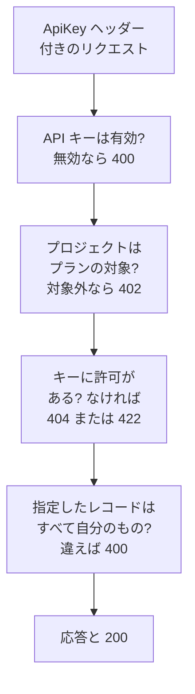

# OneUptime API リファレンス

OneUptime のダッシュボードでできることは、すべて REST API からも行えます。繰り返しの作業を自動化したり、OneUptime をほかのツールとつないだり、独自の連携を作ったりできます。このページでは、最初のリクエストの送り方と、すべてのリクエストが従うルールを説明します。すべてのエンドポイントとフィールドは [API リファレンスの全体](/reference) に載っています。

:::cards
- [最初のリクエストを送る](#最初のリクエストを送る): API キー、ヘッダー 1 つ、curl コマンド 1 つ。
- [リクエストと応答](#リクエストと応答): すべてのリソースにある 6 つのリクエストと、各ステータスコードの意味。
- [プランと API](#プランと-api): プランで提供されるものと、プラン未満でも使えるもの。
- [レコードの指定と書き込み](#レコードの指定と書き込み): ID、参照、スイッチ、OneUptime が設定するフィールド。
- [状態とエピソード](#状態とエピソード): レコードが始まる状態と、たどる状態。
- [リクエストが届く範囲](#リクエストが届く範囲): 読み取り、変更、削除は 1 回に 1 つのプロジェクト。
:::

## リクエストへの応答の流れ

API は REST に沿って設計されています。標準的な HTTP メソッドとステータスコードを使い、JSON を受け取って JSON を返します。各リクエストは API キーを伴い、いくつかのチェックを通ります。最初に通らなかったチェックが、ステータスコードと `{ "message": "..." }` で応答するので、何で止まったかはメッセージでわかります。



## 最初のリクエストを送る

API リクエストはすべて API キーで認証されます。キーは 1 つのプロジェクトに属し、その権限が許すことを行います。

:::steps
### API キーを作成する

**プロジェクト設定 → 詳細 → API キー** を開き、**API キーを作成** をクリックします。**名前** を付け、**アクセス** でキーにできることを選びます。**プロジェクト管理者**、**プロジェクトメンバー**、**閲覧者**、またはキーのページで個別の権限を追加する **権限は後で選択** です。キーは、**詳細** で別の日付を選ばない限り、1 年後に期限切れになります。

### キーをコピーする

キーのページが開きます。**API キーの詳細** カードから **API キー** をコピーし、コードには含めないでください。

```bash
export ONEUPTIME_API_KEY="your-api-key"
```

### リクエストを送る

最初の 10 個のモニターを一覧表示します。キーは自分のプロジェクトを読むので、リクエストでプロジェクトを指定する必要はありません。

```bash
curl -X POST 'https://oneuptime.com/api/monitor/get-list?skip=0&limit=10' \
  -H "ApiKey: $ONEUPTIME_API_KEY" \
  -H 'Content-Type: application/json' \
  -d '{ "select": { "name": true } }'
```

応答は `{ "data": [...], "count": ... }` で、モニターと、その総数です。セルフホストのインストールでは、`https://oneuptime.com` の代わりに自分の OneUptime のアドレスを使います。
:::

### リソースごとの例

OneUptime のダッシュボードのどのリソースにも、サイドメニューに **開発者** セクションがあり、開くまでは折りたたまれています。その **API** ページには、そのリソース用のすぐに実行できる `curl` コマンドがあり、あなたの OneUptime を宛先とし、あなたのプロジェクトの値が入っています。リソース自身のページからは読み取り、変更、削除を、一覧のページ (たとえば **モニター**) からは一覧表示、件数の取得、作成を行えます。コマンドは API キーを環境変数 `ONEUPTIME_API_KEY` から読み取ります。

例はリソースに合わせて書かれています。たとえば **インシデント** の一覧では、一覧のリクエストは最初のインシデントを使った応答を示し、フィルターでは未解決のインシデント、特定の重大度のインシデント、特定のモニターに関するインシデント、直近 7 日間のインシデントを、あなた自身の状態、重大度、モニターを使って探せます。作成のリクエストは、あなたの重大度の 1 つでインシデントを宣言し、各フィールドの用途を 1 行で説明します。インシデント自身のページでは、実際の応答で読み取り、別の重大度に変更でき、よく使う作業もそろっています。確認と解決 (プロジェクト独自の状態を使用)、そして内部メモや公開メモの追加です。どの API ページも、最後にそのリソースのエンドポイントを示します。

## リクエストと応答

どのリソースにも同じリクエストがあり、`https://oneuptime.com/api` にリソースのパス (`/monitor` や `/incident` など) を付けたアドレスで呼び出します。

| リクエスト | メソッドとパス | 本文の内容 |
| --- | --- | --- |
| 一覧 | `POST /api/<resource>/get-list` | `query`、`select`、`sort` |
| 件数 | `POST /api/<resource>/count` | `query` |
| 単一レコードの読み取り | `POST /api/<resource>/<id>/get-item` | `select` |
| 作成 | `POST /api/<resource>` | `{ "data": { ... } }` |
| 単一レコードの変更 | `PUT /api/<resource>/<id>` | `{ "data": { ... } }`、変更するフィールド |
| 単一レコードの削除 | `DELETE /api/<resource>/<id>` | なし |

`POST` しか送れないクライアントのために、`POST /api/<resource>/<id>/update-item` と `POST /api/<resource>/<id>/delete-item` でも 1 件のレコードを変更、削除できます。

### 絞り込み、並べ替え、ページ送り

一覧と件数は `query` を受け取ります。値を持つフィールドはその値に一致し、`_type` を持つオブジェクトは比較を行います。

| `_type` | 一致するもの |
| --- | --- |
| `Search` | `value` を含むテキスト |
| `NotEqual` | `value` 以外のすべて |
| `GreaterThan`、`LessThan` | より後の日付やより大きい数値、またはより前の日付やより小さい数値 |
| `InBetween` | `startValue` と `endValue` の間の日付や数値 |
| `Includes` | `value` に含まれるいずれかの値 |
| `IsNull`、`NotNull` | 値がないもの、または何らかの値があるもの |

リソースが指定するレコードのフィールドは、そのリレーションの下でフィルターします。`"user": { "name": { "_type": "Search", "value": "ada" } }` は、ユーザーの名前に「ada」を含むチームメンバーを見つけます。フィールドでフィルターするには、そのフィールドを読む権限が必要で、リレーション越しでもリソース自身でも同じです。読めないフィールドでのフィルターは、そのフィールドを示す `422` で拒否されます。

所有者を持つリソース (モニター、インシデント、オンコールポリシー、そのほかユーザーとチームの所有者を持つすべてのリソース) は、`owners` の下で、誰が所有しているかでもフィルターできます。`"owners": { "_type": "OwnedBy", "userIds": ["..."], "teamIds": ["..."] }` は、それらのユーザーやチームのいずれかが所有するレコードを見つけます。`match` は指定しない限り `AnyOf` です。`NoneOf` はそのどれも所有していないレコードを所有者のいないレコードも含めて見つけ、`AnyOwner` と `NoOwner` は誰も指定せずに、所有者がいるレコードと、いないレコードを見つけます。チームのメンバーは、チームが所有するものの所有者ではありません。フィルターひとつで指定できるのはユーザーとチームを合わせて最大 1,000 件です。所有者を持たないリソースはこのフィルターを `400` で拒否し、所有者を読む権限なしに所有者でフィルターすると `422` で拒否されます。

`select` は返すフィールドを指定し、`_id` は常に返されます。`sort` は `ASC` または `DESC` で並べ替えます。指定しないと新しいものから返ります。一覧は `limit` を指定しない限り 10 件のレコードを返します (指定できるのは最大 10,000 件)。`skip` は最初にその件数を飛ばします。`count` 件をすべて取得するまで、`skip` を `limit` ずつ増やしてください。一覧のリクエストに `?output-type=csv` を付けると、JSON の代わりに CSV が返ります。

たとえば、名前に「checkout」を含み、2026 年の初めから作成されたモニターを、新しい順に取得するには次のようにします。

```bash
curl -X POST 'https://oneuptime.com/api/monitor/get-list' \
  -H "ApiKey: $ONEUPTIME_API_KEY" \
  -H 'Content-Type: application/json' \
  -d '{
    "query": {
      "name": { "_type": "Search", "value": "checkout" },
      "createdAt": { "_type": "GreaterThan", "value": "2026-01-01T00:00:00.000Z" }
    },
    "select": { "name": true, "createdAt": true },
    "sort": { "createdAt": "DESC" },
    "limit": 100
  }'
```

日付と `_id` 以外の ID は、`{ "_type": "DateTime", "value": "..." }` や `{ "_type": "ObjectID", "value": "..." }` のように包まれて返るので、`value` から読み取ってください。

リクエストが絞り込みに使う ID や書き込む ID (`_id`、`monitorId` のようなフィールド、`"labels": [{ "_id": "..." }]` のようにリレーションが並べる各レコード) は UUID で、テキストとして送るか、返ってくるときと同じように包んで送ります。UUID ではないテキストや ID の代わりのオブジェクトなど、それ以外のものは、フィールドを示し、それが `query` と `data` のどちらにあったかを伝える `400` で拒否され、何も読み書きされません。

```text
Invalid ID for "currentIncidentStateId" in the query: "resolved". An ID is a UUID, such as "550e8400-e29b-41d4-a716-446655440000".
```

### ステータスコード

| コード | 意味 | 詳細 |
| --- | --- | --- |
| `200` | 成功しました。一覧と件数は読み取りを許可されたレコードで応答し、なければ何も返しません。 | [ID による単一レコードの読み取り](#id-による単一レコードの読み取り) |
| `400` | リクエストが正しくありません。API キーが無効、値が許可されていない、フィールドに書き込めない、指定したレコードが自分のものではない、または複数のプロジェクトを一度に変更しようとしています。メッセージが何が問題かを示します。 | [リクエストが指定するレコード](#リクエストが指定するレコード) |
| `402` | プロジェクトのプランに、リクエストが使うものが含まれていません。メッセージがプランを示します。 | [プランに含まれない機能](#プランに含まれない機能) |
| `404` | レコードが存在しない、別のプロジェクトにある、または読み取りを許可されていません。どの場合も同じ応答です。 | [読み取れないレコードの変更と削除](#読み取れないレコードの変更と削除) |
| `422` | その操作は許可されていません。API キーにその種類のレコードの権限がないか、レコードを読み取れても変更はできないか、権限のラベルがそのレコードを除外しています。メッセージが理由を示します。 | [読み取れないレコードの変更と削除](#読み取れないレコードの変更と削除) |
| `500` | サーバーで何かが失敗しました。新しいレコードの所有者を書き込めなかった場合はレコードが再び削除されるので、作成をやり直せます。 | [リクエストが指定するレコード](#リクエストが指定するレコード) |

## プランと API

### プランに含まれない機能

OneUptime Cloud では、一部のリソースはプランで提供されます。シングルサインオンのプロバイダーと SCIM 接続は **Scale**、API キー、オンコールスケジュール、Slack と Microsoft Teams の通知ルールとサマリーなどは **Growth** です。これらを作成、変更、有効化するにはそのプランが必要です。それより下のプランでは、リクエストは `402 Payment Required` で拒否され、メッセージがプランを示します。

リソースの一部の設定も、同じようにプランで提供されます。たとえば、非公開のステータスページ、一覧の 1 つを非表示にするステータスページ、独自の HTML、CSS、JavaScript、メールレポート、SMS・Slack・Microsoft Teams・Webhook の購読者、IP 許可リストを持つステータスページ、一般公開で共有するダッシュボードとその IP 許可リスト、フォームの IP 許可リスト、プロジェクトの監査ログです。それぞれのガイドと、設定の横にあるダッシュボードの表示が、必要なプランを示しています。こうした設定は、書き込まれるたびにそのプランを必要とします。リソースをその設定付きで作成するときも、後で変更するときも同じです。そのため、プラン未満で設定を有効にする作成も `402` で拒否されます。既定値のまま、または既定値に戻した設定はどのプランでも機能します。これらの設定に触れない作成は通り、それらを設定しない Terraform の構成も同じく通ります。

プロジェクトがすでに持っているものは、プランにかかわらず管理を続けられます。たとえば試用期間が終わったときやプランを下げたときです。

- それらのレコードは削除できます。
- `isEnabled` フィールドを持つリソースでは、`"isEnabled": false` だけを送れば無効にできます。
- プランを下げた後にプロジェクトが見つける必要のあるものは、一覧表示して読み取れます。無効にするため、または何が止まったかを確認するためです。シングルサインオンのプロバイダー、SCIM 接続、API キーとその権限、オンコールスケジュール、Slack と Microsoft Teams の通知ルールとサマリーが対象です。

誰が何をできるかは、プランにあるときと同じく通常の権限で決まります。テンプレート、カスタムフィールド、モニターグループ、オンコールログ、フォームの送信内容など、プランで提供されるほかのリソースの読み取りには、引き続きプランが必要です。それらを読むことが機能を使うことだからです。**Growth** 未満では API キーの権限を 1 つずつ削除することはできません。ブロック権限を削除するとキーのアクセスが広がってしまうためです。代わりにキーを削除してください。

### プラン未満の API キーと SCIM

OneUptime Cloud では、プロジェクトの API キーはプロジェクトが **Growth** 以上の間だけ機能し、SCIM 接続 (プロジェクト自身のものとステータスページのもの) は **Scale** 以上の間だけ完全に機能します。プロジェクトがそのプランを下回ると、次のようになります。

- プロジェクトの API キーを使ったリクエストは、内容にかかわらずすべて `402 Payment Required` で拒否されます。REST API、そして API キーで API を呼び出すすべてのもの、つまり Terraform、`oneuptime` CLI、API キーで接続した MCP クライアント、リクエストヘッダーでキーを送るワークフロー、そして独自のスクリプトが対象です。メッセージがプランを示します: `API keys need the Growth plan. This project's plan does not include them, so its API keys stopped working. The keys are kept: upgrade the project to Growth in Project Settings > Billing and Invoices > Billing and they work again.`
- SCIM 接続は人の削除だけを行います。人の無効化と削除、グループからの除外は引き続き機能するため、退職した人は確実にアクセスを失います。人やグループを追加または変更する SCIM リクエストは、ID プロバイダーが理由を表示できるよう、SCIM のエラー形式で `402` で拒否されます ([Scale プラン未満の場合](/docs/identity/scim#scale-プラン未満の場合))。

何も削除されず、無効にもされません。キーと接続は保持され、プロジェクトがプランに戻ればそのまま再び完全に機能します。新しいキーを作る必要も、ID プロバイダーで設定し直す必要もありません。プランの変更は 1 分以内に反映されます。

**Growth** 未満では、**プロジェクト設定** > **詳細** > **API キー** にプロジェクトに残っているキーが一覧表示され、停止していることが示されるので、どのプランでもキーを削除 (取り消し) できます。キーの作成や変更には **Growth** が必要です。**プロジェクト設定** > **請求と請求書** > **請求** には、選べる各プランについて、下位のプランで停止する API キーの数と制限される SCIM 接続の数、そしてプロジェクトのプランで停止したものが表示されます。プランの変更でそれらが停止すると、プロジェクトのオーナーにメールが届きます。この仕組みが始まった時点ですでにこれらのプランを下回っていたプロジェクトのオーナーには、何が停止したか、どうすれば元に戻せるかを伝えるメールが 1 通届きます。

影響を受けるのはプロジェクトの API キーと SCIM 接続だけです。人には影響しません。ダッシュボードへのサインインと、サインインで接続した MCP クライアントはこれまでどおり機能します。テレメトリの取り込みキー、プローブキー、エージェントキーは API キーではないため、引き続き機能します。セルフホストのインストールにはプランがないので、何も変わりません。

## レコードの指定と書き込み

### リソースの ID を見つける

1 つのリソースを読み取り、変更、削除するリクエストは、その ID (UUID) でリソースを指定します。リソース自身のページでは、詳細カードの最後に ID の先頭を示す小さな **ID** の行があります。ID かその横のコピーボタンをクリックすると、ID 全体をコピーできます。対応している一覧では、行の **⋯** メニューに **ID を表示** があり、ID はページのアドレスの最後の部分でもあります。プロジェクトの ID は、**プロジェクト設定 → プロジェクト** の **プロジェクトの詳細** カードの最初にあります。

### リクエストが指定するレコード

多くのリソースはほかのレコードを指定します。モニターはそのラベルとプローブを、ステータスページの購読者はそのステータスページを、ネットワークデバイスはそのサイトを、インシデントのメンバーはインシデントとロールを指定します。以下のルールは、API、Terraform、ワークフローのどれにも同じように適用されます。

| リクエストが | 満たすべき条件 | 満たさない場合 |
| --- | --- | --- |
| ID でレコードを指定する | 自分のプロジェクトのレコードを指定する | `400` |
| メモのように別のレコードを通じて読み取るレコードを作成する | 読み取りを許可されたレコードの下に作成する | `400`、またはその種類のレコードを読む権限がなければ `422` |
| レコードを別のレコードの下に移す | 読み取りを許可されたレコードの下に移す | `400` |
| レコードを並べる、または専用のフィールドで一つを指定する | 読み取り権限が届くレコードを指定する | `400` |
| 認証情報を保持する設定を指定する | その種類の設定を読み取れる人から送られる | `400` |
| ラベルで制限された権限でレコードを作成する、またはラベルを付け替える | そのラベルのいずれかをレコードに付ける | `422` |
| 一つのレコードを二つの方法で指定する | 両方で同じレコードを指定する | `400` |

#### ID はすべて自分のプロジェクトのもの

リソースが指定するレコードとして送る ID は、すべて自分のプロジェクトのレコードでなければなりません。ダッシュボードのピッカーはそれ以外を提示せず、Terraform やワークフローからのリクエストにも同じルールが適用されます。別のプロジェクトのレコードの ID と存在しない ID は、どちらも同じように、フィールドと ID を示す `400` で拒否されます。

```text
This network device references records that are not in this project: Network Site "…". Please pick values from this project and try again.
```

人はメンバーシップで確認されます。プロジェクトのメンバーでない人も同じように拒否されます。どのプロジェクトでも使えるグローバルプローブは、自分のプロジェクトのものとして扱われます。リソースを変更するときは、変更で追加される ID だけが確認されるため、その後になくなったものを指定しているリソースも引き続き保存できます。

#### 別のレコードを通じて読み取るレコード

別のレコードを通じて読み取るレコード (インシデントやアラートのメモと状態タイムライン、ステータスページのお知らせ、ドメイン、グループ) も、その読み取りが従うルールに沿って、読み取りを許可されたレコードを指定する必要があります。インシデントを読む権限が届くラベルや所有者の外にあるインシデント、インシデントの読み取りのブロックが外すラベルが付いたインシデント、または直接にもチーム経由でもあなたが所有者に含まれない非公開のインシデント (プロジェクトのオーナーと管理者は、非公開のインシデント、アラート、エピソードをすべて見られます) は、同じ `400` で拒否され、何も書き込まれません。お知らせが指定する各ステータスページは読み取りを許可されたものでなければならず、ステータスページを読む権限が一部にしか届かないキーは、少なくとも 1 つを指定する必要があります。こうしたレコードを作成する権限には、作成先のレコードを読む権限が必要です。それがなければ、作成は通過できる権限を示す `422` で拒否されます。

```text
You do not have permissions to create Incident Internal Note. It is read through its Incident, and you need one of these permissions to read Incidents: …
```

こうしたレコードを移す変更も同じルールに従います。変更が親として追加するレコード (お知らせの別のステータスページ、サービスを通じて読み取るレコードの別のサービス) は、どれも読み取りを許可されたものでなければなりません。そうでなければ変更は同じ `400` で拒否され、何も書き込まれません。レコードがすでに持っている親は改めて確認されません。また、どの親の下にも残さない変更には、何も指定しない作成と同じく、その種類のレコードを読む権限で、すべてに届くものが必要です。

#### 所有者

リソースの所有者 (モニター、オンコールポリシー、ダッシュボード、そのほか所有者を持つすべてのリソースのユーザーとチームの所有者レコード) も、同じように所有するリソースを通じて読み取られます。それらの一覧表示、読み取り、追加、削除には、そのリソースのラベルと所有者のもとで、そのリソースを読む権限が必要です。読み取れないリソースの所有者レコードは、存在しないものとして応答されます。それらの追加と削除も、それを許可する権限のスコープに従います。`Owned` スコープの権限が届くのは、あなたまたはあなたのチームのいずれかが所有するリソースの所有者だけで、それ以外のリソースへの所有者の追加は、その旨を伝える `422` で拒否されます。

#### 書き込みが並べるレコードと指定するレコード

作成や変更が並べるレコード (インシデントのモニターとオンコールポリシー、アラートのサービス、定期メンテナンスイベントのステータスページ、ルールの Runbook) は、その種類のレコードを読む権限があればそれに従い、いずれの場合もその読み取りに対するラベル付きのブロックに従います。その外にあるレコードは同じ `400` で拒否されます。変更では一覧に追加されるレコードだけが確認されるため、一覧にすでにあるレコードはそのまま残ります。

作成や変更が専用のフィールドで指定する 1 つのレコード (アラートのモニター、ステータスページのリソースが表示するモニター、コスト予算のサービス、Runbook の実行が結び付くインシデント) も、どちらの名前で送っても同じルールに従います。その種類のレコードを読む権限の外にあるレコードや、その読み取りのブロックが外すラベルが付いたレコードは、同じ `400` で拒否されます。変更では、フィールドがすでに持っているものとは別のレコードを指定したときだけ確認されます。どのプロジェクトでも使える OneUptime のグローバルプローブと AI エージェントは、引き続きすべてのプロジェクトに開かれています。テンプレートが代わりに入力するレコードも、入力された時点で、何かが保存される前に同じように確認されます。インシデントテンプレートが、そのテンプレートから宣言されたインシデントに追加するモニター、ステータスページ、オンコールポリシーは、自分で選んだ場合と同じく、読み取りを許可されたものでなければなりません。

#### 認証情報を保持する設定

認証情報を保持する設定 (SMTP サーバー、通話と SMS のプロバイダー、SNMP の認証情報、ビデオ通話の接続、API キー、外部 MCP サーバー) を指定できるのは、その種類の設定を読み取れる呼び出し元だけです。対象は、ステータスページの `smtpConfig` と `callSmsConfig`、着信ポリシーの `projectCallSMSConfig`、ネットワークデバイスやサイトの `snmpCredentialProfile`、インシデントやアラートのビデオ通話の `videoCallConnection`、API キーの権限の `apiKey`、そして AI ルールの `externalMcpServers` です。その種類の設定を読む権限なしに、またはラベルなしのブロックが外す権限で指定すると、どちらの名前でも同じ `400` で拒否されます。レコードがすでに指定している設定を保つ変更は確認されません。着信ポリシーの番号検索と所有番号の一覧には、指定する通話と SMS の構成について同じ読み取りが必要です。

#### 作成時のラベルと所有者

ラベルで制限された作成の権限は、そのラベルのいずれかを持つレコード (自身のラベルを持たないレコードの場合は、ラベルを持つレコードの下のレコード) だけを作成します。ただし、その種類のレコードを作成する別の権限がプロジェクト全体に届く場合は除きます。また、作成の権限に付いたラベル付きのブロックは、そのラベルのいずれかを持つレコードを拒否します。その外での作成は、ラベルを示す `422` で拒否されます。

```text
Your access lets you create Status Pages only with one of these labels: Production. Add one of them and try again.
```

**Owned** を範囲とする作成の権限は、モニター、ステータスページ、そのほか独自の所有者を持つレコードを、所有者の 1 人となる人のためにだけ作成します。メモのように属するレコードから所有者を受け継ぐレコードは、あなたかあなたのチームのいずれかが所有するレコードの下にだけ作成します。

作成者は、レコードが保存された直後、ほかに何かが起きる前に所有者になります。所有者の行を書き込めなかった場合はレコードが再び削除され、作成は `500` で拒否されます。そのため、作成者が届かないレコードが残ることはありません。

#### ラベルの変更

レコードが持つラベル (自身のラベル、または自身のラベルを持たないレコードではそれが指定するレコード) の変更も、その種類のレコードを変更する権限に同じように従います。ラベルで制限された権限では、レコードにそのラベルの少なくとも 1 つが残る必要があります。ただし、レコードを変更する別の権限がプロジェクト全体に届く場合は除きます。また、変更の権限に付いたラベル付きのブロックは、そのラベルのいずれかを付けることを拒否します。このような変更は、ラベルを示す `422` で拒否されます。

```text
Your access lets you change Monitors only with one of these labels: Production. Keep one of them and try again.
```

#### 2 つの方法によるレコードの指定

レコードは 2 つの方法で指定できます。ID フィールド (`monitorId`) か、ダッシュボードのフォームが送るリレーション (`"monitor": { "_id": "…" }`) です。どちらか一方を送ってください。リクエストが両方を送る場合は、同じレコードを指定していなければなりません。2 つが食い違うリクエスト (2 つの異なる ID、または ID と空の値) は、両方のフィールドを示す `400` で拒否されます。

```text
Conflicting Monitor references were provided. monitorId and monitor are names for the same field and must hold the same value: send only one of them, or the same id in each.
```

どちらの名前も同じように確認されます。指定したレコードに関するルールは、どちらの名前で送っても適用されます。ステータスページのグループの親グループは同じステータスページにある必要があり、ステータスページのヘッダーリンクは最大 3 つで、グループ名はそのステータスページ内で一意である必要があります。

### スイッチ

オンかオフのフィールド (`isEnabled`、`isVisibleOnStatusPage`、`isArchived`、そのほかすべての `true` または `false` のフィールド) は `true` か `false` を受け取ります。データベースがそのどちらかとして読むテキストと数値は、API、Terraform、ワークフローのどれでも同じように、その値として受け取られます。`"true"`、`"yes"`、`"on"`、`"1"`、`1` は `true`、`"false"`、`"no"`、`"off"`、`"0"`、`0` は `false` で、大文字と小文字は区別されません。OneUptime がそのレコードで行うことも、すべてその値として扱います。`"isVisibleOnStatusPage": "true"` で送られた定期メンテナンスイベントはステータスページに画像を表示し、`"isEnabled": "false"` はプラン未満のリソースを `false` と同じように無効にします。`"maybe"`、`""`、`2` のようなほかの値は、フィールドを示す `400` で拒否されます。

```text
isVisibleOnStatusPage must be true or false.
```

レコードの値を今と同じ値で書き込む更新は、何も変更しません。レコードの **On Update** ワークフローを開始せず、ライブ更新も送らず、監査ログにエントリーも追加しません。`false` の上に書き込んだ `false` は同じ値とみなされ、`false` の上に書き込んだ `"false"`、テキストとして書き込んだ数値、別の形式で書き込んだ同じ時点、順序の異なる同じラベルも同じです。更新が一部の値を変更し、ほかの値をそのまま書き戻した場合、その監査ログのエントリーには変更された値だけが記載され、ワークフローの **Fields to watch** もその値だけを受け取ります。

### プロジェクトの購入元

プロジェクトのリセラー、リセラープラン、リセラーライセンス (`resellerId`、`resellerPlanId`、`resellerLicenseId`、およびリレーションの `reseller` と `resellerPlan`) を設定するのは OneUptime だけです。リセラーのプロモーションコードでプロジェクトが作成されたときと、リセラーがプランを変更したときに設定されます。これらのいずれかを送るプロジェクトの作成や変更は、誰が送っても、フィールドを示す `400` で拒否されます。

```text
User is not allowed to create on resellerId column of Project. No permission allows it: the column is set by the server, not by a request.
```

### レコードを作成した人

OneUptime は、誰がレコードを作成したか (そして誰がアーカイブ、解決、確認、トリガーしたか) をリクエスト自体から記録します。サインインしている人、またはリクエストが API キーやワークフローから来た場合は誰も記録されません。これらのフィールド (`createdByUserId` と `ByUserId` で終わるほかのフィールド、および `createdByUser` などのリレーション) は読み取り専用です。レコードがアーカイブまたは解決された日時 (`archivedAt`、`markedAsResolvedAt`、`markedAsArchivedAt`) も同様です。`isArchived` や `isResolved` をオンにすると、誰がいつ行ったかが記録され、オフにすると両方が消去されます。スイッチを現在の状態のまま送ると、誰がいつ切り替えたかはそのまま保たれます。

API リファレンスでは、これらのフィールドは読み取り専用と示されています。ほかの変更と一緒にこれらのフィールドに送られた値は無視されるので、残りの変更は通ります。ほかに何も送らない更新は、フィールドを示すメッセージで拒否されます。OneUptime が誰かの代わりに作成するレコード (Slack や Microsoft Teams から投稿されたメモ、招待によって作成されたアカウント) は、その人を示します。

## 状態とエピソード

### 新しいレコードが始まる状態

インシデント、アラート、インシデントのエピソード、アラートのエピソードは、作成フォームの **初期状態** フィールドと同じように、プロジェクトのどの状態でも作成できます。`currentIncidentStateId` (インシデントとインシデントのエピソード) か `currentAlertStateId` (アラートとアラートのエピソード)、またはリレーションを送ってください。レコードはその状態で始まり、状態タイムラインもその状態から始まります。省略すると、`isCreatedState` のフラグが付いたプロジェクトの作成時の状態で始まります。初期状態を持つテンプレートから宣言されたインシデントの場合は、テンプレートの状態で始まります。別のプロジェクトの状態は、ほかのレコードと同じように拒否されます。Terraform の `current_incident_state_id` と `current_alert_state_id` も同じように機能します。確認済みの状態以降で作成されたレコードは誰も呼び出さず、解決済みで作成されたレコードはさらに、グループ化、自動修復、AI による調査の対象にならず、Slack や Microsoft Teams のチャンネルも作られません。[確認済みまたは解決済みの状態で宣言されたインシデント](/docs/incidents/declaring-incidents#確認済みまたは解決済みの状態で宣言されたインシデント) を参照してください。

### レコードの状態を変える

レコードの状態は、状態タイムラインの行 (`POST /api/incident-state-timeline`、`/api/alert-state-timeline`、`/api/incident-episode-state-timeline`、`/api/alert-episode-state-timeline`、`/api/scheduled-maintenance-state-timeline`)、または現在の状態 (`currentIncidentStateId`、`currentAlertStateId`、`currentScheduledMaintenanceStateId`、またはリレーション) を書き込む更新で変わり、後者も同じ行を記録します。どちらの場合も、エピソードにもインシデント、アラート、定期メンテナンスイベントにも、1 つのルールが遷移に適用されます。プロジェクトの順序でレコードの現在の状態より前にある状態は、何かが保存される前に拒否されます。すでにその状態にある場合も同じです。

```text
Episode cannot transition to Acknowledged state from Resolved state because Acknowledged is before Resolved in the order of incident states.
```

誤って設定した状態は、レコードの状態タイムラインからその行を削除して直します。[順序は表示上の好みではなく、実際の制約](/docs/incidents/states-and-severities#順序は表示上の好みではなく実際の制約) を参照してください。

### インシデントやアラートが属するエピソード

インシデントの `incidentEpisodeId` とアラートの `alertEpisodeId` (およびそのリレーションの `incidentEpisode` と `alertEpisode`) は、そのレコードが最後に追加され、今もメンバーであるエピソードを示します。該当がなければ何も示しません。これらは読み取り専用で、OneUptime がエピソードのメンバーから設定します。インシデントをエピソードに入れるには、Incident Episode Member を作成します (`incidentEpisodeId` と `incidentId` を指定した `POST /api/incident-episode-member`)。外すにはそのメンバーを削除します。するとインシデントは、まだ属している最新のエピソードを示すか、何も示さなくなります。アラートも Alert Episode Members (`alertEpisodeId` と `alertId` を指定した `/api/alert-episode-member`) を通じて同じように機能します。グループ化ルールも同じ方法でインシデントとアラートをエピソードに追加します。エピソードを送るインシデントやアラートの作成や更新は、API、Terraform、MCP ツール、ワークフローのどれから送られても拒否されます。Terraform では、`incident_episode_id` と `alert_episode_id` は読み取れますが設定はできません。メンバーシップは `oneuptime_incident_episode_member` と `oneuptime_alert_episode_member` のリソースで管理します。

## リクエストが届く範囲

### 読み取れないレコードの変更と削除

変更や削除が届くのは、API キー (またはサインインしている人) が読み取りを許可されたレコードだけです。ラベルや所有者の外にあるレコード、読み取りのブロックの向こうにあるレコード、読み取れない別のレコードを通じて読み取るレコード (インシデントのメモ、ステータスページのお知らせ) も、変更や削除はできません。ある種類のレコードを変更または削除する権限は、それを読む権限と組み合わせて機能し、インシデントのメモを変更する権限はインシデントを読む権限と組み合わせて機能します。

ID で 1 件のレコードを変更または削除するリクエスト (`PUT /api/<resource>/<id>` または `POST /api/<resource>/<id>/update-item`、`DELETE /api/<resource>/<id>` または `POST /api/<resource>/<id>/delete-item`) が何にも届かなかった場合の応答は次のとおりです。

- `404`: レコードが存在しない、別のプロジェクトにある、または読み取りを許可されていない場合。どの場合も同じ応答です。

```text
Incident not found.
```

- `422`: レコードを読み取れても変更や削除はできない場合。理由が示されます。

```text
You do not have permission to update this incident.
```

以前は、何にも届かなかった削除は `200` を返していました。クエリによる更新と削除 (ワークフローの更新ステップや削除ステップなど) は、変更したレコードの件数を返し、何にも届かなければ `0` を返します。Terraform は、`terraform destroy` での `404` を、すでに存在しないリソースとして扱います。

テレメトリも同じルールに従います。ログ、トレース、メトリクス、例外、プロファイル、セッションリプレイの削除は、テレメトリを読み取りと削除の両方ができるリソース (サービス、ホスト、クラスターなど) の行に届き、1 回に 1 つのプロジェクトで行われます。すべてのプロジェクトにまたがるリクエストは拒否されます。ID による 1 行の削除が何にも届かなかった場合は、上と同じく `404` または `422` を返します。

### 変更は 1 回に 1 つのプロジェクトで行われる

プロジェクトのレコードの更新や削除は、リクエストが指定するプロジェクトで行われます。指定は `tenantid` ヘッダーで、API キーの場合はキー自身のプロジェクトです。サインインしているユーザーによる更新や削除で、プロジェクトを指定しないもの、または `is-multi-tenant-query` ヘッダーで自分のすべてのプロジェクトにまたがって問い合わせるものは、`400` で拒否されます。

```text
Changes to incidents are made in one project at a time. Please pass the project ID in the 'tenantid' header.
```

以前、このようなリクエストは `500` で失敗していました。読み取りは引き続き、すべてのプロジェクトにまたがって問い合わせられます。

### ID による単一レコードの読み取り

ID による 1 件のレコードの読み取り (`POST /api/<resource>/<id>/get-item`) は、レコードが存在しない、別のプロジェクトにある、または読み取りを許可されていない場合に `404` を返します。どの場合も同じ応答です。

```text
Incident not found.
```

以前は、空の本文で `200` を返していました。一覧 (`get-list`) と件数は引き続き、読み取りを許可されたレコードで `200` を返し、なければ何も返しません。Terraform プロバイダーは、リフレッシュ時の `404` を存在しなくなったリソースとして扱い、state から削除するため、次の plan で再び作成されます。プロバイダーが使う API キーには、管理するすべてのリソースを読み取れる権限とラベルを与えてください。MCP ツールは `404` に対して、対応する一覧ツールを案内するエラーを返し、CLI はコード `3` で終了します。

## エンドポイントのリファレンス全体

すべてのリソース、エンドポイント、フィールドは [OneUptime API リファレンス](/reference) に載っています。複数の言語で利用でき、言語はブラウザーから選ばれます。ページ上部のセレクターでいつでも切り替えられます。

## トラブルシューティング

:::details すべてのリクエストが 400 Invalid API Key を返す
`ApiKey` ヘッダーが空か、キーではないか、期限切れまたはリセット済みのキーを示しています。**プロジェクト設定 → 詳細 → API キー** にあるキーのページからキーをもう一度コピーしてください。そのページには **有効期限** の日付もあります。
:::

:::details すべてのリクエストが 402 Payment Required を返す
OneUptime Cloud では、API キーはプロジェクトが **Growth** 以上のプランにある間だけ機能します。キーは保持され、プロジェクトがプランに戻ればそのまま再び機能します。[プラン未満の API キーと SCIM](#プラン未満の-api-キーと-scim) を参照してください。
:::

:::details すべてのリクエストが 422 You do not have permissions を返す
API キーに、その種類のレコードの権限がありません。**権限は後で選択** で作成したキーは、権限を得るまで何もできません。**プロジェクト設定 → 詳細 → API キー** でキーを開き、**ロールを追加** または **権限を追加** をクリックしてください。メッセージには、リクエストを通す権限が示されます。
:::

:::details ダッシュボードで見えるレコードが 404 を返す
API キーが読み取れるのは、その権限とラベルが届く範囲だけで、キーが届く範囲はあなた自身のアカウントより狭いことがあります。そのレコードに届く権限をキーに与えてください。[ID による単一レコードの読み取り](#id-による単一レコードの読み取り) を参照してください。
:::

:::details 更新が 400 Invalid request body を返す
更新では、変更するフィールドを `data` の中に入れて、`{ "data": { "name": "New name" } }` のように送ります。それがない本文は、`200` を返して何も変更しないのではなく、拒否されます。

```text
Invalid request body. The update payload should be an object of the form { "data": { ...fields to update... } }.
```
:::

:::details 書き込みが 400 を返し、フィールドと ID を示す
その ID は、別のプロジェクトのレコード、存在しないレコード、または権限が届かないレコードを示しています。[リクエストが指定するレコード](#リクエストが指定するレコード) を参照してください。
:::

## 次のステップ

:::cards
- [ユーザー、チーム、権限](/docs/permissions/index): API キーの権限とラベルが届く範囲。
- [Terraform プロバイダー](/docs/terraform/index): 同じ API を通じて、OneUptime のリソースをコードとして管理します。
- [OneUptime CLI](/docs/cli/index): ターミナルやスクリプトから API を呼び出します。
- [MCP サーバー](/docs/ai/mcp-server): AI アシスタントがプロジェクトを扱えるようにします。
:::
