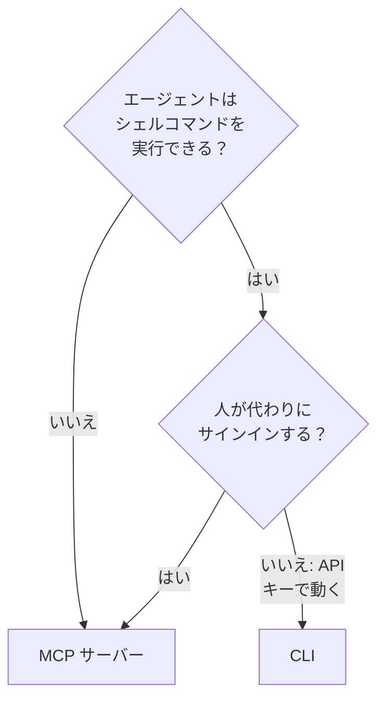

# AI エージェント向け CLI

エディターのコーディングエージェントやパイプラインのジョブのように、シェルコマンドを実行できる AI エージェントは、[MCP サーバー](/docs/ai/mcp-server)の代わりに CLI を通して OneUptime を扱えます。このページでは、それぞれが合う場面と、エージェントが CLI をインストールし、使い方を見つけ、応答を読む方法を説明します。

:::cards
- [CLI か MCP サーバーか](#cli-か-mcp-サーバーか): エージェントがどちらを使うべきか。
- [エージェント用に準備する](#エージェント用に準備する): インストールして、環境変数でキーを渡します。
- [エージェントが使い方を見つける方法](#エージェントが使い方を見つける方法): リソース、そのフィールド、ヘルプ。
- [応答を読む](#応答を読む): エラーも含め、すべてのコマンドが JSON で応答します。
:::

## CLI か MCP サーバーか

どちらも OneUptime の API にアクセスし、認証情報で許されたことを行います。違いは、エージェントがそれにアクセスするために何が必要かです。



| | CLI | MCP サーバー |
| --- | --- | --- |
| エージェントに必要なもの | シェルと Node.js 22 以降 | Claude や Cursor などの MCP クライアント |
| サインインに使うもの | `ONEUPTIME_API_KEY` に入れたプロジェクトの API キー | OneUptime のアカウント、または API キー |
| 扱える範囲 | API のすべてのリソース、450 以上 | ツールがあるレコードとテレメトリ、およびインシデント対応のツール |
| 向いている用途 | エージェントが書いて人が残すスクリプト、パイプラインでのチェック、多数のレコードの処理 | 会話: インシデントの調査、モニターの設定 |

コーディングエージェントのようにエージェントがすでにコマンドを実行している場合や、作ったものがエージェントなしで動き続けるべき場合(リポジトリのスクリプト、パイプラインのステップなど)は CLI を使ってください。人がチャットクライアントでエージェントと話す場合は MCP サーバーを使ってください。エージェントはその人の権限で動き、クライアントは変更の前に確認します。

## エージェント用に準備する

どの OneUptime も、自身のリリースに合った CLI のインストールスクリプトを提供しています。以下のコマンドは `https://oneuptime.com` からダウンロードするため、セルフホストの OneUptime ではこれをお使いの URL に置き換えてください。スクリプトはまず `install.sh` として保存されるので、実行する前に中身を読めます。

```bash
curl -fsSL https://oneuptime.com/install/cli -o install.sh
ONEUPTIME_URL=https://oneuptime.com bash install.sh
```

エージェントには、作業に必要なアクセスだけを持つプロジェクトの API キーを、コマンドラインではなく環境変数で渡し、まずキーを確認させてください。

```bash
export ONEUPTIME_API_KEY="your-api-key"
export ONEUPTIME_URL=https://oneuptime.com
oneuptime whoami --check -o json
```

キーは **プロジェクト設定 → 詳細 → API キー** で作成します。[API キーを作成する](/docs/api-reference/api-reference#api-キーを作成する)を参照してください。読み取りだけを許可したキーなら、エージェントは見ることしかできません。

## エージェントが使い方を見つける方法

CLI は、API キーもリクエストも使わずに、何ができるかを教えてくれます。

| コマンド | 応答の内容 |
| --- | --- |
| `oneuptime resources -o json` | すべてのリソース: コマンド、名前、API パス、操作、アクション |
| `oneuptime incident fields -o json` | リソースのフィールド: 用途、型、作成に必要かどうか、フラグ |
| `oneuptime incident create --help` | コマンドの引数とフラグ |

ID を持つフィールドは、どのリソースの ID を受け取るかを示すので、エージェントはまずそのリソースを一覧表示します。`incidentSeverityId` は `oneuptime incident-severity list` の ID を受け取ります。人を指定するフィールドは、`--user-email` のようにメールアドレスも受け付けます。

## 応答を読む

エージェントには、すべてのコマンドに `-o json` か `--json` を付けさせてください。そうすると、応答が文になるコマンドも含め、すべてのコマンドが JSON で応答し、エラーは標準エラー出力上の 1 つの JSON オブジェクトになります。

```bash
oneuptime incident acknowledge 6f1c2a40-3b1e-4c55-9a0b-3e2f8d7c1a11 -o json
```

```json
{
  "_id": "6f1c2a40-3b1e-4c55-9a0b-3e2f8d7c1a11",
  "action": "acknowledge",
  "changed": true,
  "state": {
    "_id": "0b7d5e2c-8f4a-4d1b-9c3e-5a6f7b8c9d0e",
    "name": "Acknowledged"
  }
}
```

終了コードは何が起きたかを示します。成功したときは `0`、API キーがないか拒否されたときは `2`、レコードがないときは `3` です。エラーの JSON では同じコードが `exitCode` に入り、次にすべきことが `hint` に入ります。[出力形式](/docs/cli/output-formats#json)と[終了コード](/docs/cli/scripting#終了コード)を参照してください。

## 次のステップ

:::cards
- [リソース操作](/docs/cli/resource-operations): すべての操作と、そのフラグとフィルター。
- [コマンド リファレンス](/docs/cli/command-reference): すべてのコマンド、オプション、既定値。
- [MCP サーバー](/docs/ai/mcp-server): 代わりにチャットクライアントを OneUptime に接続します。
:::
