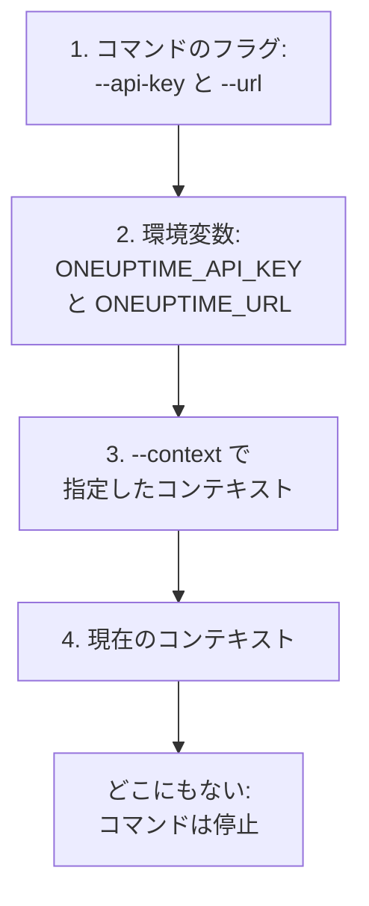

# 認証

CLI が送るすべてのリクエストには、プロジェクトの API キーが付きます。`oneuptime login` でキーを一度保存する(環境ごとに 1 つのコンテキスト)か、スクリプトのようにフラグや環境変数でコマンドに渡します。このページでは、それぞれの方法と、複数ある場合にコマンドがどれを使うかを説明します。

:::cards
- [ログインする](#ログインする): API キーと OneUptime のアドレスを保存します。
- [コンテキスト](#コンテキスト): プロジェクトや環境ごとに保存したログインと、その切り替え。
- [コマンドが使う認証情報](#コマンドが使う認証情報): まずフラグ、次に環境変数、次にコンテキスト。
- [トラブルシューティング](#トラブルシューティング): 認証情報が見つからない、無効なキー、拒否。
:::

## はじめる前に

プロジェクトの API キーが必要です。**プロジェクト設定 → 詳細 → API キー** で **API キーを作成** から作成し、コマンドに必要なアクセスを与えてください。[API キーを作成する](/docs/api-reference/api-reference#api-キーを作成する)を参照してください。キーは権限で許されたことを行います。レコードの読み取りだけが許されたキーは、一覧表示と読み取りはできますが、変更はできません。

OneUptime Cloud では、API キーはプロジェクトが **Growth** プラン以上の間だけ動作します。それ未満では、プロジェクトがアップグレードされるまで、すべてのコマンドがプランを示すメッセージとともに `API error (402)` を返します。アップグレードすれば同じキーが再び動作します。[プラン未満の API キーと SCIM](/docs/api-reference/api-reference#プラン未満の-api-キーと-scim)を参照してください。

## ログインする

`oneuptime login` は API キーと OneUptime のアドレスをコンテキストとして保存し、現在のコンテキストにします。

```bash
oneuptime login <api-key> <instance-url> [--context-name <name>]
```

| 引数またはオプション | 内容 |
| --- | --- |
| `<api-key>` | プロジェクトの API キー |
| `<instance-url>` | OneUptime のアドレス: `https://oneuptime.com`、または `https://oneuptime.example.com` のような自社サーバーのアドレス |
| `--context-name <name>` | コンテキストを保存する名前。既定値: `default` |

たとえば `production` という名前のコンテキストの場合:

```bash
oneuptime login <api-key> https://oneuptime.com --context-name production
```

`Logged in successfully. Context "production" is now active.` と応答します。アドレス末尾のスラッシュは取り除かれ、同じ名前でもう一度ログインするとそのコンテキストが置き換わります。

> [!NOTE]
> `login` はキーについて OneUptime に問い合わせずに保存します。キーが動作することを確かめるには、`oneuptime incident count` などのコマンドを実行してください。

## コンテキスト

コンテキストとは保存したログインのことで、名前、アドレス、API キーからなります。プロジェクトや環境ごとに 1 つ保存し、その後のすべてのコマンド、または 1 つのコマンドのために 1 つを選びます。

:::steps
### 環境ごとにコンテキストを保存する

```bash
oneuptime login <production-api-key> https://oneuptime.com --context-name production
oneuptime login <staging-api-key> https://oneuptime.example.com --context-name staging
```

ログインするたびにそのコンテキストが現在のコンテキストになるため、今は `staging` が現在のコンテキストです。

### 一覧表示する

```bash
oneuptime context list
```

```text
┌───┬────────────┬───────────────────────────────┐
│   │ Name       │ URL                           │
├───┼────────────┼───────────────────────────────┤
│   │ production │ https://oneuptime.com         │
├───┼────────────┼───────────────────────────────┤
│ * │ staging    │ https://oneuptime.example.com │
└───┴────────────┴───────────────────────────────┘
```

`*` は現在のコンテキストを示します。API キーが一覧に表示されることはありません。

### 別のコンテキストに切り替える

```bash
oneuptime context use production
```

`Switched to context "production".` と応答し、その後のコマンドはこのコンテキストを使います。

### 1 つのコマンドだけでコンテキストを使う

```bash
oneuptime incident list --context staging
```

現在のコンテキストは変わりません。
:::

| コマンド | 内容 |
| --- | --- |
| `oneuptime context list` | 保存したコンテキストを一覧表示します。`*` が現在のものを示します。`-o json` では各コンテキストの `name`、`apiUrl`、`isCurrent` を出力し、キーは出力しません |
| `oneuptime context use <name>` | 保存したコンテキストを現在のコンテキストにします |
| `oneuptime context current` | 現在のコンテキストの名前、URL、API キーを表示します。キーは先頭四文字と末尾四文字以外を伏せます |
| `oneuptime context delete <name>` | 保存したコンテキストを削除します。それが現在のコンテキストだった場合は、残ったうち最初のコンテキストが現在のコンテキストになります |

## コマンドが使う認証情報

コマンドには API キーと URL が必要です。それぞれを、次の場所のうち値を持つ最初の場所から取得します。



つまり組み合わせることができます。たとえば、API キーを環境変数から、URL を現在のコンテキストから取ることができます。環境変数は、保存したコンテキストを持たないスクリプトや CI ジョブに向いています。

:::tabs
@tab Linux
```bash
export ONEUPTIME_API_KEY=<api-key>
export ONEUPTIME_URL=https://oneuptime.com
oneuptime incident list
```
@tab macOS
```bash
export ONEUPTIME_API_KEY=<api-key>
export ONEUPTIME_URL=https://oneuptime.com
oneuptime incident list
```
@tab Windows
```powershell
$env:ONEUPTIME_API_KEY = "<api-key>"
$env:ONEUPTIME_URL = "https://oneuptime.com"
oneuptime incident list
```
:::

1 つのコマンドについては、フラグがほかのすべてより優先されます。

```bash
oneuptime --api-key <api-key> --url https://oneuptime.com incident list
```

> [!WARNING]
> フラグで渡したキーはシェルの履歴に残り、マシンのほかのユーザーはプロセス一覧でそれを見ることができます。共有マシンでは、代わりにコンテキストか環境変数を使ってください。

## CLI が使う値を確認する

`oneuptime whoami` は、次のコマンドが使う URL と API キー、およびそれらの取得元のコンテキストを表示します。

```bash
oneuptime whoami
```

```text
URL:     https://oneuptime.com
API Key: 4f1c****0a13
Context: production
```

キーは先頭の 4 文字と末尾の 4 文字だけが表示されます。`Context` の行は、URL とキーがそのコンテキスト自身の値であり、フラグや環境変数で置き換えられていない場合にだけ表示されます。`whoami` は OneUptime を呼び出さずに設定を読み取ります。表示するのはコマンドが送る内容であり、OneUptime がそれを受け入れるかどうかではありません。何も保存も設定もされていない場合は、次のように応答します。

```text
Not authenticated. Run `oneuptime login` to authenticate.
```

## 設定ファイル

`oneuptime login` はコンテキストをホームフォルダーの `~/.oneuptime/config.json` (Windows では `%USERPROFILE%\.oneuptime\config.json`)に保存します。CLI は、自分のユーザーだけが読み書きできるようにこのファイルを作成します(モード `0600`)。

```json title="~/.oneuptime/config.json"
{
  "currentContext": "production",
  "contexts": {
    "production": {
      "name": "production",
      "apiUrl": "https://oneuptime.com",
      "apiKey": "<api-key>"
    },
    "staging": {
      "name": "staging",
      "apiUrl": "https://oneuptime.example.com",
      "apiKey": "<api-key>"
    }
  }
}
```

このファイルには API キーがそのまま保存されます。共有フォルダー、バックアップ、リポジトリには入れないでください。1 つのコンテキストからログアウトするには `oneuptime context delete <name>` で削除し、すべてからログアウトするにはファイルを削除します。漏れたおそれのあるキーは、OneUptime の **プロジェクト設定 → 詳細 → API キー** で削除するまで有効なままです。

出力形式や一覧の件数はここには保存されません。各コマンドに `-o` と `--limit` を渡してください。

## トラブルシューティング

:::details 「No credentials found」というメッセージ
`Authentication error: No credentials found.` は、フラグ、環境変数、保存したコンテキストのどれもコマンドに API キーと URL を渡さなかったことを意味します。`oneuptime login` を実行するか、`ONEUPTIME_API_KEY` と `ONEUPTIME_URL` の両方を設定してください。コマンドは終了コード `2` で終了します。
:::

:::details 「API error (400): Invalid API Key」というメッセージ
キーが OneUptime の API キーではないか、期限切れか、リセットされています。**プロジェクト設定 → 詳細 → API キー** にあるキーのページからもう一度コピーし(**有効期限** の日付もそこにあります)、同じコンテキスト名でもう一度ログインしてください。コマンドは終了コード `2` で終了します。
:::

:::details 「API error (402): API keys need the Growth plan」というメッセージ
OneUptime Cloud でプロジェクトが **Growth** プラン未満になっているため、API キーが動作しなくなっています。プロジェクトをアップグレードすれば同じキーが再び動作します。CLI で変更することはありません。
:::

:::details 「API error (422): You do not have permissions」というメッセージ
キーの権限が、コマンドの求める範囲に届いていません。**プロジェクト設定 → 詳細 → API キー** にあるキーのページで、キーにロールか権限を与えてください。メッセージには、リクエストを通す権限が示されます。
:::

:::details 「Context "staging" does not exist」というメッセージ
その名前のコンテキストは保存されていません。`oneuptime context list` で存在する名前を確認できます。
:::

:::details whoami がコンテキストと違う URL やキーを表示する
環境変数かフラグがコンテキストの値を置き換えています。`env | grep ONEUPTIME` で設定されている変数がわかり、`unset ONEUPTIME_API_KEY ONEUPTIME_URL` でコンテキストに戻ります。
:::

:::details そのアドレスへのリクエストが失敗する
`Error: Request failed to https://...` は、CLI がそのアドレスで OneUptime に到達できなかったことを意味します。`oneuptime whoami` で URL を確認してください。OneUptime を開くときのアドレスに `https://` を付けたもの(`https://oneuptime.com` など)です。
:::

## 次のステップ

:::cards
- [リソース操作](/docs/cli/resource-operations): レコードの一覧表示、読み取り、作成、変更、削除、件数の取得。
- [スクリプト & CI/CD](/docs/cli/scripting): パイプラインに環境変数でキーを渡します。
- [OneUptime API リファレンス](/docs/api-reference/api-reference): API キーにできることと、各応答の意味。
:::
