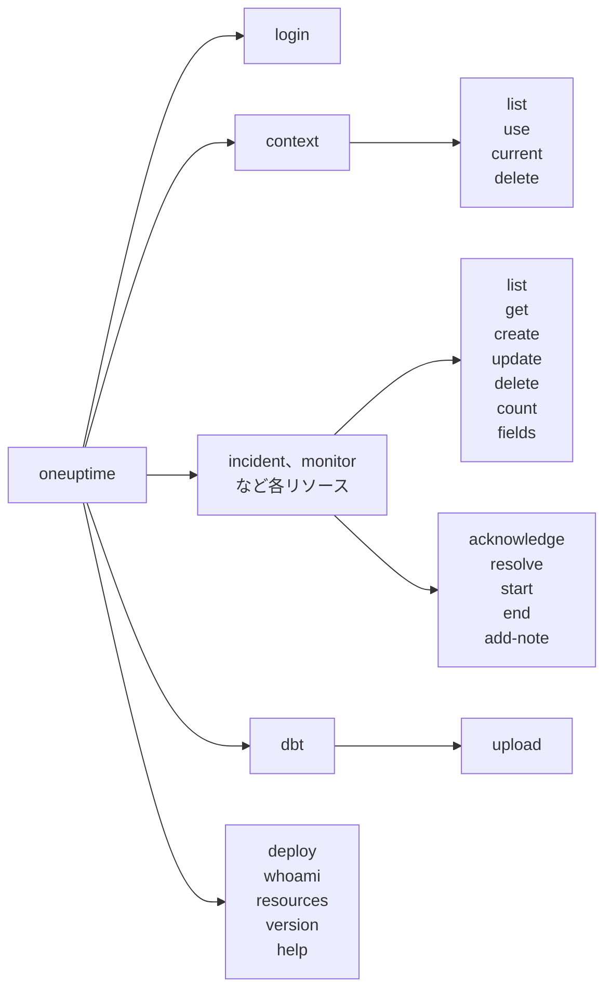

# コマンド リファレンス

`oneuptime` CLI のすべてのコマンドと、その引数、オプション、既定値です。どのコマンドにも `--help` を付けると、同じ内容をターミナルで確認できます。

:::cards
- [グローバルオプション](#グローバルオプション): すべてのコマンドが受け付けるオプション。
- [ログインとコンテキスト](#ログインとコンテキスト): login と context のコマンド。
- [リソースのコマンド](#リソースのコマンド): すべてのリソースの操作、フィールド、アクション。
- [その他のコマンド](#その他のコマンド): deploy、dbt upload、data-checks apply、whoami、resources、version、help。
:::

## コマンドの全体像



## グローバルオプション

| オプション | 内容 | 既定値 |
| --- | --- | --- |
| `--api-key <key>` | このコマンドで使う API キー | `ONEUPTIME_API_KEY`、次にコンテキストのキー |
| `--url <url>` | このコマンドで使う OneUptime のアドレス | `ONEUPTIME_URL`、次にコンテキストの URL |
| `--context <name>` | このコマンドで使う保存済みコンテキスト | 現在のコンテキスト |
| `-o, --output <format>` | `json`、`table`、`wide` | ターミナルでは `table`、パイプでは `json` |
| `--json` | `-o json` と同じです | |
| `--no-color` | 色なしで出力します | 色あり(`NO_COLOR` が設定されていない場合) |
| `-V, --version` | CLI のバージョンを表示します | |
| `-h, --help` | コマンドのヘルプを表示します | |

オプションはコマンドの前後どちらにも書けます。`oneuptime --context staging incident list` と `oneuptime incident list --context staging` は同じ動作をします。

すべてのコマンドが `-o` と `--json` を受け付けるため、以下の表では省略しています。`delete` のように応答が文になるコマンドは、`-o json` または `--json` で JSON を求めない限り文を出力します。[出力形式](/docs/cli/output-formats#json)を参照してください。

## ログインとコンテキスト

### `oneuptime login`

API キーとアドレスをコンテキストとして保存し、現在のコンテキストにします。[ログインする](/docs/cli/authentication#ログインする)を参照してください。

```bash
oneuptime login <api-key> <instance-url> [--context-name <name>]
```

| 引数またはオプション | 必須 | 内容 | 既定値 |
| --- | --- | --- | --- |
| `<api-key>` | はい | プロジェクトの API キー | |
| `<instance-url>` | はい | OneUptime のアドレス(`https://oneuptime.com` など) | |
| `--context-name <name>` | いいえ | コンテキストを保存する名前 | `default` |

### `oneuptime context list`

保存したコンテキストを一覧表示します。`*` は現在のコンテキストを示します。API キーは表示されず、JSON では各コンテキストの `name`、`apiUrl`、`isCurrent` が得られます。

```bash
oneuptime context list
```

### `oneuptime context use`

保存したコンテキストを現在のコンテキストにします。

```bash
oneuptime context use <name>
```

| 引数 | 必須 | 内容 |
| --- | --- | --- |
| `<name>` | はい | 保存したコンテキストの名前 |

### `oneuptime context current`

現在のコンテキストの名前と URL、そして先頭 4 文字と末尾 4 文字以外を伏せた API キーを表示します。

```bash
oneuptime context current
```

### `oneuptime context delete`

保存したコンテキストを削除します。それが現在のコンテキストだった場合は、残ったうち最初のコンテキストが現在のコンテキストになります。

```bash
oneuptime context delete <name>
```

| 引数 | 必須 | 内容 |
| --- | --- | --- |
| `<name>` | はい | 保存したコンテキストの名前 |

## リソースのコマンド

`<resource>` は、[リソース](#リソース)の表にあるレコードの種類のコマンド(`incident` や `monitor` など)です。リソースには API が受け付ける操作があり、ほとんどは 6 つすべてです。そのリソースの操作は `oneuptime <resource> --help` で一覧表示できます。例は[リソース操作](/docs/cli/resource-operations)を参照してください。

### `oneuptime <resource> list`

レコードを新しい順に一覧表示します。ラベルは代わりに名前順で、番号付きのラベルが先に並びます（`2. Team` は `10. Owner` の前）。

```bash
oneuptime <resource> list [--query <json>] [--limit <n>] [--skip <n>] [--sort <json>] [--fields <names>] [--all]
```

| オプション | 内容 | 既定値 |
| --- | --- | --- |
| `--query <json>` | JSON で書いたフィルター | キーが読み取れるすべてのレコード |
| `--limit <n>` | 返すレコードの最大件数(最大 10,000) | `10` |
| `--skip <n>` | 最初に飛ばすレコードの件数 | `0` |
| `--sort <json>` | JSON で書いた順序: `{"<field>":"ASC"}` または `{"<field>":"DESC"}` | 新しい順 |
| `--fields <names>` | 返すフィールド。カンマで区切り、関連レコードのフィールドは `currentIncidentState.name` のようにドットの後に書きます | キーが読み取れるすべてのフィールド |
| `--all` | 一致するすべてのレコードを、`--limit` と `--skip` の代わりに一度に 100 件ずつ、最大 100,000 件まで取得します。レコードのみ: テレメトリには `--all` がありません | |

### `oneuptime <resource> get`

レコードを一件読み取ります。

```bash
oneuptime <resource> get <id> [--fields <names>]
```

| 引数またはオプション | 必須 | 内容 |
| --- | --- | --- |
| `<id>` | はい | レコードの ID(UUID) |
| `--fields <names>` | いいえ | 返すフィールド。カンマで区切ります。既定: キーが読み取れるすべてのフィールド |

### `oneuptime <resource> create`

レコードを作成して表示します。

```bash
oneuptime <resource> create [--<field> <value>]... [--data <json>] [--file <path>]
```

| オプション | 必須 | 内容 |
| --- | --- | --- |
| `--<field> <value>` | 作成時に必須のフィールド | フィールドの値: `--title <text>`、`--incident-severity-id <id>`、`--labels <ids>`。`oneuptime <resource> create --help` で一覧表示できます。レコードのみ |
| `--data <json>` | いいえ | JSON のレコード |
| `--file <path>` | いいえ | レコードを含む JSON ファイル。`--data` と一緒に指定するとファイルが使われます |

フラグは `--data` や `--file` の上に適用されます。ユーザー ID で人を指定するフィールドには、メールアドレスで指定するフラグもあります。`--user-email` が `--user-id` と対になります。

### `oneuptime <resource> update`

指定したフィールドを変更します。

```bash
oneuptime <resource> update <id> [--<field> <value>]... [--data <json>] [--file <path>]
```

| 引数またはオプション | 必須 | 内容 |
| --- | --- | --- |
| `<id>` | はい | レコードの ID |
| `--<field> <value>` | いいえ | 変更するフィールド: `oneuptime <resource> update --help` で一覧表示できます。レコードのみ |
| `--data <json>` | いいえ | 変更するフィールドの JSON |
| `--file <path>` | いいえ | 変更するフィールドを含む JSON ファイル。`--data` と一緒に指定するとファイルが使われます |

### `oneuptime <resource> delete`

確認せずに、レコードをすぐに削除します。

```bash
oneuptime <resource> delete <id> [--force]
```

| 引数またはオプション | 必須 | 内容 |
| --- | --- | --- |
| `<id>` | はい | レコードの ID |
| `--force` | いいえ | 受け付けますが何も変わりません: `delete` は確認を求めません |

### `oneuptime <resource> count`

レコードの件数を数えて表示します。

```bash
oneuptime <resource> count [--query <json>]
```

| オプション | 必須 | 内容 |
| --- | --- | --- |
| `--query <json>` | いいえ | JSON で書いたフィルター。指定しなければ、キーが読み取れるすべてのレコード |

### `oneuptime <resource> fields`

リソースのフィールドを一覧表示します。用途、型、作成時に必須かどうか、それを設定するフラグがわかります。API キーもリクエストも使わずに、CLI 自身から読み取ります。

```bash
oneuptime <resource> fields
```

### `oneuptime <resource> acknowledge`

インシデント、アラート、またはそれらのエピソードを、ダッシュボードのボタンと同じようにプロジェクトの確認済み状態に移します。すでに確認済みか、それより先の状態にあるレコードはそのままです。

```bash
oneuptime <resource> acknowledge <id>
```

| 引数 | 必須 | 内容 |
| --- | --- | --- |
| `<id>` | はい | レコードの ID |

### `oneuptime <resource> resolve`

インシデント、アラート、またはそれらのエピソードをプロジェクトの解決済み状態に移します。

```bash
oneuptime <resource> resolve <id>
```

| 引数 | 必須 | 内容 |
| --- | --- | --- |
| `<id>` | はい | レコードの ID |

### `oneuptime <resource> start`

メンテナンスイベントをプロジェクトの進行中の状態に移します。

```bash
oneuptime <resource> start <id>
```

| 引数 | 必須 | 内容 |
| --- | --- | --- |
| `<id>` | はい | イベントの ID |

### `oneuptime <resource> end`

メンテナンスイベントをプロジェクトの終了状態に移します。

```bash
oneuptime <resource> end <id>
```

| 引数 | 必須 | 内容 |
| --- | --- | --- |
| `<id>` | はい | イベントの ID |

### `oneuptime <resource> add-note`

インシデント、アラート、それらのエピソード、またはメンテナンスイベントにメモを追加します。

```bash
oneuptime <resource> add-note <id> --note <markdown> [--public]
```

| 引数またはオプション | 必須 | 内容 |
| --- | --- | --- |
| `<id>` | はい | レコードの ID |
| `--note <markdown>` | はい | Markdown のメモ |
| `--public` | いいえ | レコードのステータスページにメモを載せ、購読者に知らせます。インシデント、そのエピソード、定期メンテナンスのみ |

### リソース

OneUptime の API のリソースはすべてコマンドになっており、API が受け付ける操作、`fields`、そしてアクションを持つレコードではそのアクションがあります。

{{CLI_RESOURCE_COMMANDS}}

CLI は OneUptime と一緒にリリースされるため、`oneuptime resources` はインストールしたバージョンのコマンドを一覧表示します。

### API リクエスト

各操作は API への 1 回のリクエストで、キーは `APIKey` ヘッダーで送られます。`<path>` は `oneuptime resources` が示すリソースの API パスです。`incident` なら `/incident`、`on-call-policy` なら `/on-call-duty-policy` です。

| 操作 | リクエスト | 本文 |
| --- | --- | --- |
| `list` | `POST /api/<path>/get-list` | `query`、`select`、`skip`、`limit`、`sort` |
| `get` | `POST /api/<path>/<id>/get-item` | `select` |
| `create` | `POST /api/<path>` | `{"data": ...}` |
| `update` | `PUT /api/<path>/<id>/` | `{"data": ...}` |
| `delete` | `DELETE /api/<path>/<id>/` | なし |
| `count` | `POST /api/<path>/count` | `query` |

アクションは、プロジェクトの状態とレコードを読み取ってから、ダッシュボードのボタンと同じようにレコードの状態タイムラインに行を作成します。インシデントに対する `acknowledge` は `incident-state-timeline` を作成します。`add-note` は `incident-internal-note` を作成し、`--public` を付けると `incident-public-note` を作成します。メールのフラグは、まずそのアドレスを持つプロジェクトのチームメンバーを一覧表示します。キーが読み取れないフィールドを OneUptime が拒否した場合、一覧や読み取りはそのフィールドを除いて要求し直します。

## その他のコマンド

### `oneuptime deploy`

パイプラインから、デプロイやその他の変更を記録します。記録した変更はサービスのグラフに描かれ、OneUptime AI がインシデントを調査するときに読み取ります。書き込みには、API キーではなくテレメトリ取り込みキーを使います。[デプロイと変更](/docs/telemetry/change-events)を参照してください。

```bash
oneuptime deploy [--service <name>] [--service-version <version>] [--previous-version <version>] [--commit <sha>] [--repository <url>] [--branch <name>] [--pull-request <number>] [--environment <name>] [--title <title>] [--description <text>] [--type <type>] [--time <time>] [--attribute <key=value...>] [--ingestion-key <key>]
```

| オプション | 必須 | 内容 | 既定値 |
| --- | --- | --- | --- |
| `--service <name>` | いいえ | デプロイされたサービス | プロジェクト全体の変更 |
| `--service-version <version>` | いいえ | デプロイされたバージョン | |
| `--previous-version <version>` | いいえ | 置き換えられたバージョン | |
| `--commit <sha>` | いいえ | デプロイされたコミット | |
| `--repository <url>` | いいえ | コミットがあるリポジトリ | |
| `--branch <name>` | いいえ | デプロイされたブランチ | |
| `--pull-request <number>` | いいえ | デプロイされたプルリクエスト | |
| `--environment <name>` | いいえ | デプロイ先の環境 | |
| `--title <title>` | いいえ | 変更のタイトル。デプロイ以外の種類の変更では必須です | `Deploy <version>` |
| `--description <text>` | いいえ | 変更の詳細 | |
| `--type <type>` | いいえ | 変更の種類(`config-change` や `rollback` など) | `deployment` |
| `--time <time>` | いいえ | 発生した日時(`2026-10-19T10:00:00Z` など) | 現在 |
| `--attribute <key=value...>` | いいえ | 追加の属性。`key=value` の形式で一つ以上 | |
| `--ingestion-key <key>` | いいえ | プロジェクトのテレメトリ取り込みキー | `ONEUPTIME_TELEMETRY_INGESTION_KEY` |

### `oneuptime dbt upload`

ビルドの後に、CI や dbt Cloud のジョブから、dbt プロジェクトのアーティファクトをデータオブザーバビリティに送ります。プロジェクトのモデルは、それが構築するテーブルにリネージとともに表示され、テストは OneUptime のチェックと並んで表示されてアラートを発生させることができ、各ビルドはプロジェクトのパイプラインの実行になります。dbt のターゲット フォルダーから `manifest.json` と `run_results.json` を読み取り、データオブザーバビリティが読み取る部分だけを送信します。書き込みには、API キーではなくテレメトリ取り込みキーを使います。ダッシュボードのデータオブザーバビリティにある「ドキュメント」ページに、CI ジョブでの使用例があります。

```bash
oneuptime dbt upload [--target-path <dir>] [--manifest <file>] [--run-results <file>] [--project <name>] [--ingestion-key <key>]
```

| オプション | 必須 | 内容 | 既定値 |
| --- | --- | --- | --- |
| `--target-path <dir>` | いいえ | dbt がアーティファクトを書き出したフォルダー | `target` |
| `--manifest <file>` | いいえ | 送信するマニフェスト | ターゲット フォルダー内の `manifest.json` |
| `--run-results <file>` | いいえ | 送信する実行結果 | ターゲット フォルダー内の `run_results.json` |
| `--project <name>` | いいえ | dbt プロジェクトの名前。マニフェストを送らないときにだけ必要です | マニフェストのプロジェクト |
| `--ingestion-key <key>` | いいえ | プロジェクトのテレメトリ取り込みキー | `ONEUPTIME_TELEMETRY_INGESTION_KEY` |

### `oneuptime data-checks apply`

プロジェクトのデータチェックを YAML ファイルに一致させます。チェックをリポジトリで管理し、コードと同じようにレビューできます。ファイル内のどこかに誤りがあると、何も適用されず、エラーで終了します。ファイルの形式は [チェックと照合](/docs/data-observability/checks) にあります。

```bash
oneuptime data-checks apply <file> [--dry-run] [--prune]
```

| オプション | 必須 | 内容 | 既定値 |
| --- | --- | --- | --- |
| `--dry-run` | いいえ | 何が変わるかを表示し、何も変更しません | オフ |
| `--prune` | いいえ | 以前の apply が作成したチェックのうち、ファイルに名前がなくなったものを削除します | オフ |

### `oneuptime whoami`

次のコマンドが使う URL と API キー(キーはマスクされます)と、それらの取得元のコンテキストを表示します。`--check` を付けない限り、OneUptime は呼び出しません。[CLI が使う値を確認する](/docs/cli/authentication#cli-が使う値を確認する)を参照してください。

```bash
oneuptime whoami [--check]
```

| オプション | 必須 | 内容 |
| --- | --- | --- |
| `--check` | いいえ | OneUptime にキーを受け付けるか問い合わせ、キーのプロジェクト、お使いの OneUptime のバージョンと CLI のバージョンを表示します |

### `oneuptime resources`

CLI にコマンドがあるすべてのレコードの種類を、コマンド、単数形と複数形の名前、種類、API パス、そして合計とともに一覧表示します。JSON では、それぞれの `name`、`singularName`、`pluralName`、`modelType`、`apiPath`、`operations`、`actions` が得られます。

```bash
oneuptime resources [--type <type>]
```

| オプション | 必須 | 内容 | 既定値 |
| --- | --- | --- | --- |
| `--type <type>` | いいえ | レコードなら `database`、テレメトリなら `analytics` | 両方 |

### `oneuptime version`

`oneuptime --version` と同じく、CLI のバージョンを表示します。

```bash
oneuptime version
```

### `oneuptime help`

CLI またはコマンドのヘルプを表示します。

```bash
oneuptime help [command]
```

## 環境変数

| 変数 | 内容 |
| --- | --- |
| `ONEUPTIME_API_KEY` | `--api-key` フラグで指定されていないときの API キー |
| `ONEUPTIME_URL` | `--url` フラグで指定されていないときの OneUptime のアドレス |
| `ONEUPTIME_TELEMETRY_INGESTION_KEY` | `--ingestion-key` フラグで指定されていないときに `oneuptime deploy` が書き込みに使うテレメトリ取り込みキー |
| `NO_COLOR` | 任意の値を設定すると色が消えます |

## ファイル

| ファイル | 内容 |
| --- | --- |
| `~/.oneuptime/config.json` | 保存したコンテキスト、その API キー、現在のコンテキスト |

## 終了コード

| コード | 意味 |
| --- | --- |
| `0` | 成功した |
| `1` | 失敗した: OneUptime がリクエストを拒否したか、コマンドが誤っていた |
| `2` | 使える API キーがない: 見つからない、無効、またはプラン未満 |
| `3` | 見つからない: OneUptime が `404` を返した |

例は[終了コード](/docs/cli/scripting#終了コード)を参照してください。

## 次のステップ

:::cards
- [CLI 概要](/docs/cli/index): CLI をインストールし、最初のコマンドを実行します。
- [リソース操作](/docs/cli/resource-operations): 各操作の例。
- [スクリプト & CI/CD](/docs/cli/scripting): スクリプトとパイプラインでの CLI。
:::
