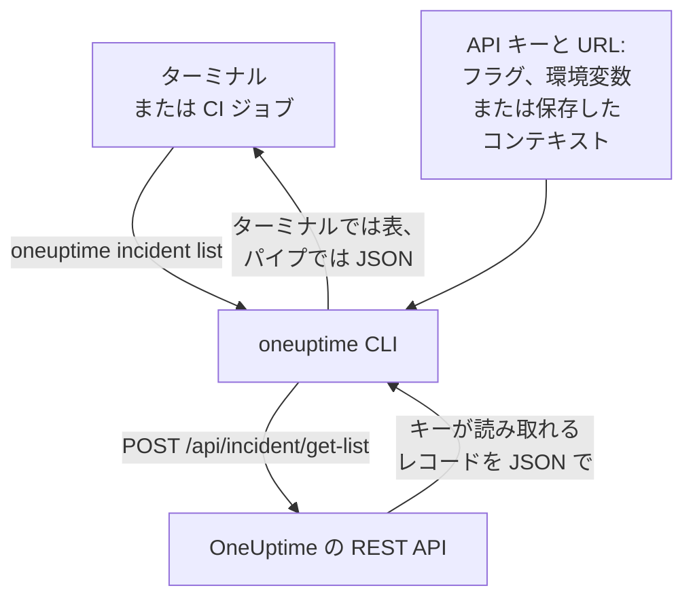

# CLI 概要

OneUptime の CLI である `oneuptime` は、ターミナルやスクリプトから OneUptime プロジェクトを管理します。プロジェクトの API キーを使って、モニター、インシデント、アラート、ステータスページなど、OneUptime の API が提供するレコードの一覧表示、読み取り、作成、変更、削除、件数の取得ができます。

:::cards
- [CLI のしくみ](#cli-のしくみ): 1 つのコマンドで、1 回の API リクエストと 1 つの応答。
- [CLI をインストールする](#cli-をインストールする): npm コマンド 1 つと、選ぶべきバージョン。
- [最初のコマンドを実行する](#最初のコマンドを実行する): API キーを保存し、インシデントを一覧表示します。
- [コマンド一覧](#コマンド一覧): すべてのコマンドと、それを説明するページ。
:::

## CLI のしくみ

各コマンドは OneUptime の REST API に 1 回リクエストを送り、応答を出力します。CLI は API キーと OneUptime のアドレスを、フラグ、環境変数、または `oneuptime login` が保存したコンテキストから取得します。コマンドが何を読み取り、何を変更できるかはキーが決めます。これは API とまったく同じです。



レコード用のコマンドは CLI に含まれています。OneUptime の API がツールに公開しているレコードの種類ごとに 1 つあり、[MCP サーバー](/docs/ai/mcp-server)がツールを持つレコードと同じです。一覧を見るには `oneuptime resources` を実行します。

## はじめる前に

- **Node.js と npm**: CLI をインストールするための、現在の LTS リリース。
- **プロジェクトの API キー。** **プロジェクト設定 → 詳細 → API キー** で **API キーを作成** から作成します。[API キーを作成する](/docs/api-reference/api-reference#api-キーを作成する)を参照してください。
- **OneUptime Cloud では Growth プラン以上。** プロジェクトの API キーはこのプランでのみ動作します。[プラン未満の API キーと SCIM](/docs/api-reference/api-reference#プラン未満の-api-キーと-scim)を参照してください。

## CLI をインストールする

npm から `@oneuptime/cli` パッケージをインストールします。`oneuptime` コマンドが追加され、`--version` でインストールしたバージョンが表示されます。

```bash
npm install -g @oneuptime/cli
oneuptime --version
```

CLI は OneUptime と一緒にリリースされ、同じバージョン番号を持ちます。セルフホストの OneUptime では、コマンドがサーバーのレコードと一致するように、お使いの OneUptime と同じバージョンの CLI をインストールしてください。

```bash
npm install -g @oneuptime/cli@<your-oneuptime-version>
```

> [!WARNING]
> 14.0.64 より前の CLI は、起動するとすぐに `Cannot find module 'Common/Models/DatabaseModels/Index'` のようなエラーで止まります。`npm install -g @oneuptime/cli@latest` で 14.0.64 以降をインストールしてください。14.0.64 より古いセルフホストの OneUptime では、先に [OneUptime をアップグレード](/docs/installation/upgrading#アップグレードの方法)してから、アップグレードしたバージョンの CLI をインストールしてください。

## 最初のコマンドを実行する

:::steps
### API キーを保存する

キーと OneUptime のアドレスでログインします。CLI はこれらを `default` という名前のコンテキストとして保存し、以降はそれを使います。

```bash
oneuptime login <your-api-key> https://oneuptime.com
```

`Logged in successfully. Context "default" is now active.` と応答します。セルフホストの OneUptime では、`https://oneuptime.com` の代わりにそのアドレスを使ってください。

### インシデントを一覧表示する

```bash
oneuptime incident list
```

最新の 10 件のインシデントが表として表示されます。`login` はキーを確認せずに保存するため、キーが動作することを最初に示すのはこのコマンドです。拒否された場合は[トラブルシューティング](/docs/cli/authentication#トラブルシューティング)を参照してください。

### ほかに何を管理できるかを確認する

```bash
oneuptime resources
```

一覧には、扱えるレコードの種類と、そのコマンド(`monitor`、`status-page`、`on-call-policy` など)が表示されます。
:::

## コマンド一覧

| コマンド | 内容 | 詳細 |
| --- | --- | --- |
| `oneuptime login <api-key> <instance-url>` | API キーとアドレスをコンテキストとして保存します | [認証](/docs/cli/authentication#ログインする) |
| `oneuptime context list`, `use`, `current`, `delete` | 保存したコンテキストの一覧表示、切り替え、表示、削除 | [認証](/docs/cli/authentication#コンテキスト) |
| `oneuptime whoami` | 次のコマンドが使う URL と API キーを表示します | [認証](/docs/cli/authentication#cli-が使う値を確認する) |
| `oneuptime deploy` | グラフと OneUptime AI のために、デプロイやその他の変更を記録します | [デプロイと変更](/docs/telemetry/change-events) |
| `oneuptime <resource> list`, `get`, `create`, `update`, `delete`, `count` | 一種類のレコードを扱います | [リソース操作](/docs/cli/resource-operations) |
| `oneuptime resources` | レコードの種類をそのコマンドとともに一覧表示します | [コマンド リファレンス](/docs/cli/command-reference#oneuptime-resources) |
| `oneuptime version` | CLI のバージョンを表示します | [コマンド リファレンス](/docs/cli/command-reference#oneuptime-version) |
| `oneuptime help [command]` | コマンドのヘルプを表示します | [ヘルプを表示する](#ヘルプを表示する) |

## グローバルオプション

これらのオプションは、すべてのコマンドで、コマンドの前後どちらにでも書けます。

| オプション | 内容 |
| --- | --- |
| `--api-key <key>` | このコマンドで使う API キー(保存したキーの代わり) |
| `--url <url>` | このコマンドで使う OneUptime のアドレス |
| `--context <name>` | このコマンドで使う保存済みコンテキスト(現在のコンテキストの代わり) |
| `-o, --output <format>` | `table`、`json`、`wide`: [出力形式](/docs/cli/output-formats)を参照 |
| `--no-color` | 色なしで出力します |
| `-V, --version` | CLI のバージョンを表示します |
| `-h, --help` | コマンドのヘルプを表示します |

## ヘルプを表示する

すべてのコマンドに、引数、オプション、既定値を示す独自のヘルプがあります。

```bash
oneuptime --help
oneuptime help incident
oneuptime incident list --help
```

## 次のステップ

:::cards
- [認証](/docs/cli/authentication): 環境ごとのコンテキストと、コマンドが使うキー。
- [リソース操作](/docs/cli/resource-operations): レコードの一覧表示、読み取り、作成、変更、削除、件数の取得。
- [出力形式](/docs/cli/output-formats): 人には表、スクリプトには JSON。
- [スクリプト & CI/CD](/docs/cli/scripting): 終了コード、jq、パイプライン。
- [コマンド リファレンス](/docs/cli/command-reference): すべてのコマンド、オプション、既定値。
:::
