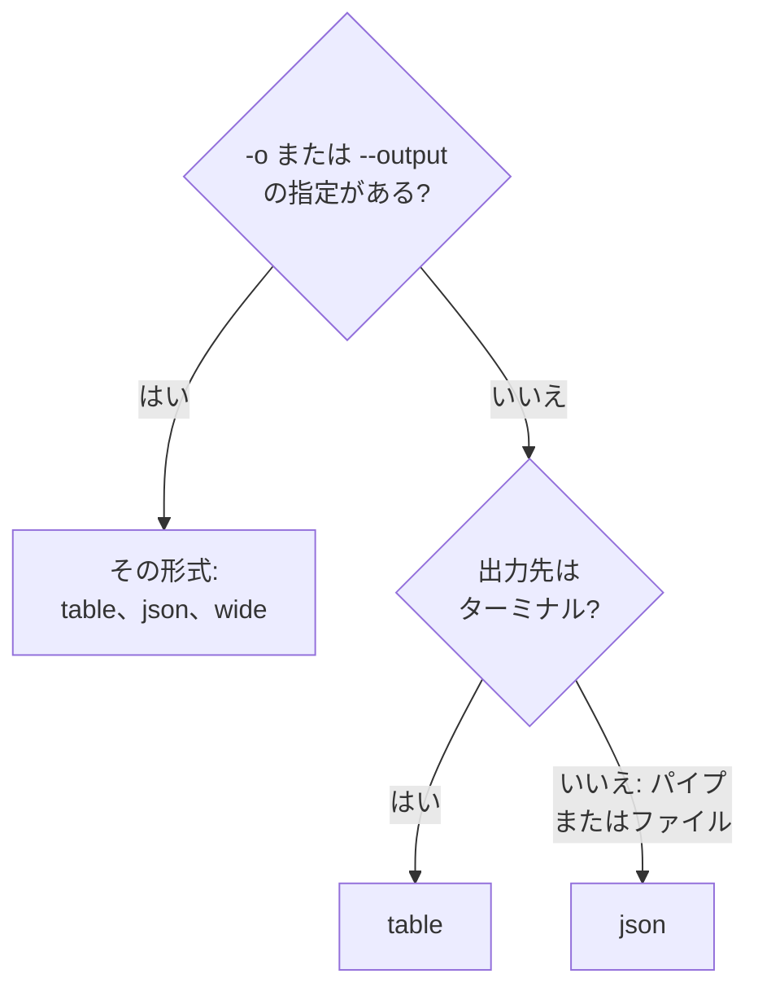

# 出力形式

CLI は、応答をターミナルで読むときは表を、スクリプトやほかのプログラムが読むときは JSON を出力します。どのコマンドでも `-o` または `--output` で形式を選べます。

:::cards
- [形式の決まり方](#形式の決まり方): ターミナルには表、パイプには JSON。
- [表](#表): 6 列、各値は 60 文字で切り詰め。
- [JSON](#json): すべてのフィールドを切り詰めずに、スクリプトと jq のために。
- [ワイド](#ワイド): すべての列を含む表。
:::

## 形式の決まり方



| 形式 | 出力内容 | 向いている用途 |
| --- | --- | --- |
| `table` | 最大六列の表。レコード一件はフィールドごとに一行 | ターミナルで読む |
| `json` | OneUptime が送ったままの応答を、二つの空白でインデント | スクリプト、`jq`、ファイル |
| `wide` | フィールドごとに列を持つ表 | 多くのフィールドを一度に見比べる |

`-o` は、レコードを出力するすべてのコマンド、つまりリソースの `list`、`get`、`create`、`update`、`count` と、`oneuptime resources`、`oneuptime context list` で使えます。コマンドラインのどこに書いてもかまいません。それ以外の値は、リクエストを送る前に拒否されます。

```text
error: option '-o, --output <format>' argument 'yaml' is invalid. Allowed choices are json, table, wide.
```

## 表

ターミナルでは表が既定です。たとえば `oneuptime resources --type analytics` は次の表を出力します。

```text
┌────────────────────────────┬────────────────────────────┬─────────────────────────────┬───────────┬─────────────────────────────┐
│ Command                    │ Singular                   │ Plural                      │ Type      │ API Path                    │
├────────────────────────────┼────────────────────────────┼─────────────────────────────┼───────────┼─────────────────────────────┤
│ log                        │ Log                        │ Logs                        │ analytics │ /logs                       │
├────────────────────────────┼────────────────────────────┼─────────────────────────────┼───────────┼─────────────────────────────┤
│ span                       │ Span                       │ Spans                       │ analytics │ /span                       │
├────────────────────────────┼────────────────────────────┼─────────────────────────────┼───────────┼─────────────────────────────┤
│ metric                     │ Metric                     │ Metrics                     │ analytics │ /metrics                    │
├────────────────────────────┼────────────────────────────┼─────────────────────────────┼───────────┼─────────────────────────────┤
│ exception-instance         │ Exception Instance         │ Exception Instances         │ analytics │ /exceptions                 │
├────────────────────────────┼────────────────────────────┼─────────────────────────────┼───────────┼─────────────────────────────┤
│ monitor-log                │ Monitor Log                │ Monitor Logs                │ analytics │ /monitor-log                │
├────────────────────────────┼────────────────────────────┼─────────────────────────────┼───────────┼─────────────────────────────┤
│ kubernetes-cost-allocation │ Kubernetes Cost Allocation │ Kubernetes Cost Allocations │ analytics │ /kubernetes-cost-allocation │
├────────────────────────────┼────────────────────────────┼─────────────────────────────┼───────────┼─────────────────────────────┤
│ security-event             │ Security Event             │ Security Events             │ analytics │ /security-events            │
├────────────────────────────┼────────────────────────────┼─────────────────────────────┼───────────┼─────────────────────────────┤
│ change-event               │ Change Event               │ Change Events               │ analytics │ /change-events              │
├────────────────────────────┼────────────────────────────┼─────────────────────────────┼───────────┼─────────────────────────────┤
│ threat-intel-indicator     │ Threat Intel Indicator     │ Threat Intel Indicators     │ analytics │ /threat-intel-indicators    │
└────────────────────────────┴────────────────────────────┴─────────────────────────────┴───────────┴─────────────────────────────┘

Total: 9 resources
```

レコードの一覧の場合、表には最大 6 列が表示されます。まず `_id`、`name`、`title`、`status`、`createdAt`、`updatedAt` のうちレコードにあるもの、次にレコードの残りのフィールドが順に並びます。列は最初のレコードから取られます。60 文字を超える値は先頭の 57 文字に切り詰められ、その後に `...` が付きます。

`get` や `create` が出力するレコード一件は、フィールド名と値の 2 列からなる表で、フィールドごとに 1 行です。

OneUptime は日付やほかのレコードの ID を `{"_type":"DateTime","value":"2026-10-14T09:12:44.000Z"}` のようなオブジェクトとして送り、表ではそのテキストのまま表示されます。値は `value` にあります。[JSON](#json) を参照してください。

## JSON

JSON は OneUptime が送ったままの応答で、2 つの空白でインデントされます。一覧はレコードの配列で、レコード一件はオブジェクトです。

```bash
oneuptime incident list --limit 1 -o json
```

```json
[
  {
    "_id": "6f1c2a40-3b1e-4c55-9a0b-3e2f8d7c1a11",
    "createdAt": {
      "_type": "DateTime",
      "value": "2026-10-14T09:12:44.000Z"
    },
    "title": "Checkout API is down",
    "currentIncidentStateId": {
      "_type": "ObjectID",
      "value": "0b7d5e2c-8f4a-4d1b-9c3e-5a6f7b8c9d0e"
    }
  }
]
```

レコードには、キーが読み取れるすべてのフィールドがあります。この例は 4 つに絞っています。レコード自身の `_id` はテキストで、ほかの ID と日付はオブジェクトであり、その `value` に値が入っています。

```bash
oneuptime incident list -o json | jq -r '.[] | "\(.createdAt.value)  \(.title)"'
```

`oneuptime incident list | jq '.[].title'` のように出力先がターミナルでない場合、CLI は `-o json` を付けなくても JSON を出力します。それでもスクリプトには `-o json` を書いて、この動作に依存しないようにしてください。

## ワイド

`-o wide` は、レコードのフィールドごとに列を持つ表です。各値は引き続き 60 文字で切り詰められ、レコードにはフィールドが多いため、ワイドの表はとても横長になります。`less -S` で表示してください。

```bash
oneuptime incident list -o wide | less -S
```

## 色

表の見出しはシアン、メッセージは成功時が緑、情報が青、エラーが赤です。`--no-color` を付けるか、`NO_COLOR` に任意の値を設定すると色が消えます。

```bash
oneuptime incident list --no-color
NO_COLOR=1 oneuptime incident list
```

## 各コマンドの出力

レコードと件数は標準出力に、エラーは標準エラー出力に出るため、パイプは応答だけを読み取ります。

| コマンド | 表の場合 | JSON の場合 |
| --- | --- | --- |
| 何も見つからない `list` | `No results found.` | `[]` |
| `get` または `create` | フィールドごとに一行 | レコード |
| `count` | 数値 | 数値 |
| `update` | 空の行 | `{}` |
| `delete` | `Monitor <id> deleted successfully.` | 同じ行 |

## 次のステップ

:::cards
- [スクリプト & CI/CD](/docs/cli/scripting): スクリプトやパイプラインで JSON を jq で読みます。
- [リソース操作](/docs/cli/resource-operations): これらの応答を返す操作。
- [コマンド リファレンス](/docs/cli/command-reference): すべてのコマンドとオプション。
:::
