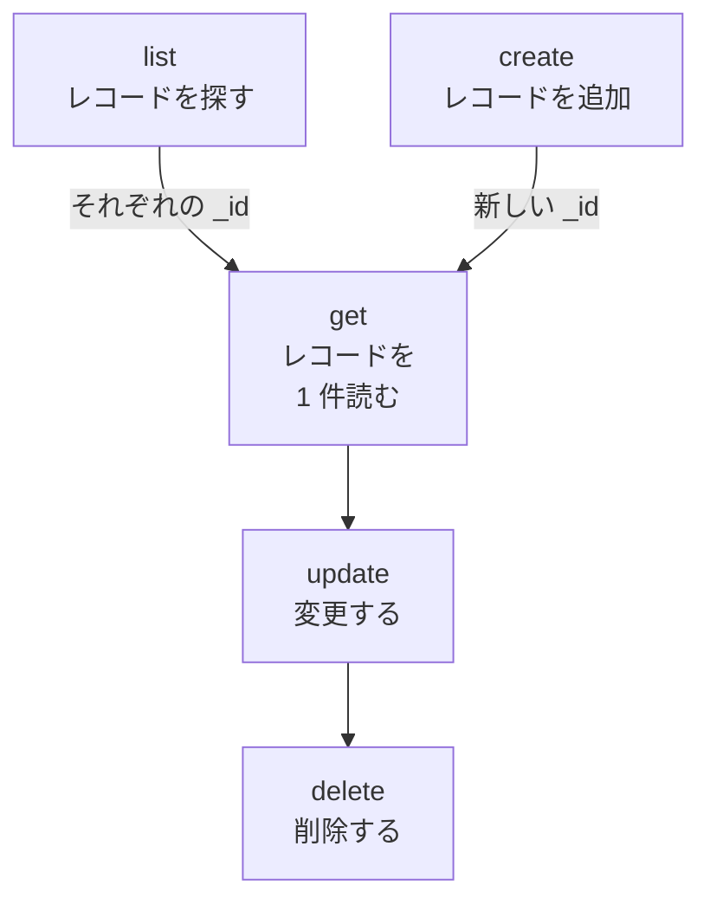

# リソース操作

レコードの種類ごとに `incident`、`monitor`、`status-page` のような独自のコマンドがあり、どれも同じ操作 `list`、`get`、`create`、`update`、`delete`、`count` を受け付けます。このページでは、フィルター、ページ送り、レコードを書く JSON とともに、各操作を説明します。

:::cards
- [レコードのコマンドを見つける](#レコードのコマンドを見つける): oneuptime resources ですべてを一覧表示します。
- [レコードを一覧表示する](#レコードを一覧表示する): 絞り込み、並べ替え、ページ送り。
- [レコードを作成する](#レコードを作成する): コマンドラインまたはファイルの JSON から作成します。
- [レコードを削除する](#レコードを削除する): すぐに削除され、元に戻せません。
:::

## 操作どうしの関係

レコードの読み取り、変更、削除にはその ID が必要です。一覧表示、件数の取得、作成には必要なく、一覧や作成の結果から、ほかの操作が使う ID が得られます。



ID は `6f1c2a40-3b1e-4c55-9a0b-3e2f8d7c1a11` のような UUID です。OneUptime のレコードのページからコピーすることもできます。[リソースの ID を見つける](/docs/api-reference/api-reference#リソースの-id-を見つける)を参照してください。

## レコードのコマンドを見つける

```bash
oneuptime resources
```

一覧には、レコードの種類ごとにコマンド、名前、タイプ、API パスが表示されます。タイプは二つあります。

| タイプ | 内容 | 操作 |
| --- | --- | --- |
| `database` | 管理するレコード: モニター、インシデント、アラート、ステータスページ、チームなど | `list`, `get`, `create`, `update`, `delete`, `count` |
| `analytics` | テレメトリ: ログ、スパン、メトリクス、例外、その他のイベント | `list`, `create`, `count` |

`oneuptime resources --type database` または `--type analytics` で一つのタイプだけを表示できます。[コマンド リファレンス](/docs/cli/command-reference#リソース)にすべてのコマンドがあります。

## レコードを一覧表示する

```bash
oneuptime <resource> list [--query <json>] [--limit <n>] [--skip <n>] [--sort <json>] [-o <format>]
```

| オプション | 内容 | 既定値 |
| --- | --- | --- |
| `--query <json>` | 一致するレコードだけを返します: [一覧を絞り込む](#一覧を絞り込む)を参照 | キーが読み取れるすべてのレコード |
| `--limit <n>` | 返すレコードの最大件数(最大 10,000) | `10` |
| `--skip <n>` | 最初に飛ばす一致レコードの件数 | `0` |
| `--sort <json>` | 順序。`{"createdAt":"ASC"}` のように指定し、新しい順は `"DESC"` | 新しい順 |
| `-o, --output <format>` | `table`、`json`、`wide` | ターミナルでは `table`、パイプでは `json` |

```bash
# The ten newest incidents
oneuptime incident list

# The oldest monitors first, 50 at a time: the second page
oneuptime monitor list --sort '{"createdAt":"ASC"}' --limit 50 --skip 50

# Every field of each incident, as JSON
oneuptime incident list -o json
```

一覧では、キーが読み取れる各レコードのすべてのフィールドを OneUptime に要求します。表にはそのうち 6 つが表示され、JSON にはすべてが表示されます([出力形式](/docs/cli/output-formats)を参照)。すべてのレコードをページ送りするには、ページが空で返るまで `--skip` を `--limit` ずつ増やします。件数は `count` でわかります。

### 一覧を絞り込む

`--query` は API と同じフィルターを受け付けます。値を持つフィールドはその値と一致し、`_type` を持つオブジェクトは比較を行います。

| フィルター | 一致するもの |
| --- | --- |
| `{"title":"Checkout API is down"}` | その値とまったく同じレコード |
| `{"title":{"_type":"Search","value":"checkout"}}` | 値を含むテキスト |
| `{"createdAt":{"_type":"GreaterThan","value":"2026-10-01T00:00:00.000Z"}}` | より後の日付、またはより大きい数値 |
| `{"currentIncidentState":{"isResolvedState":false}}` | リソースが参照するレコードのフィールド: この例では解決していないインシデント |

```bash
oneuptime incident list --query '{"title":{"_type":"Search","value":"checkout"}}'
```

すべての `_type` は API リファレンスの[絞り込み、並べ替え、ページ送り](/docs/api-reference/api-reference#絞り込み並べ替えページ送り)にあります。

## レコードを読み取る

```bash
oneuptime <resource> get <id> [-o <format>]
```

```bash
oneuptime incident get 6f1c2a40-3b1e-4c55-9a0b-3e2f8d7c1a11
```

表には、レコードのフィールドごとに 1 行が表示され、各値は 60 文字で切り詰められます。`-o json` では値が切り詰められずに表示されます。キーが読み取れるレコードを指さない ID には `Not found` が返り、コマンドは終了コード `3` で終了します。

## レコードを作成する

```bash
oneuptime <resource> create --data <json> [-o <format>]
oneuptime <resource> create --file <path> [-o <format>]
```

`--data` はレコードを JSON で受け取り、`--file` は JSON ファイルから読み取ります。どちらか一方を指定してください。両方を指定した場合はファイルが使われます。フィールドは API のものであり、各リソースのフィールドは [API リファレンス](/reference)にあります。プロジェクトは API キーから決まるため、レコードでプロジェクトを指定することはありません。

```bash
# A manual monitor
oneuptime monitor create --data '{"name":"Checkout API","monitorType":"Manual"}'

# An incident with one of your severities
oneuptime incident create --data '{"title":"Checkout API is down","incidentSeverityId":"<severity-id>"}'

# The same incident, from a file
oneuptime incident create --file incident.json
```

CLI は新しいレコードを `_id` とともに表示します。インシデントは、`currentIncidentStateId` で別の状態を指定しない限り、プロジェクトの作成済み状態で始まります。[新しいレコードが始まる状態](/docs/api-reference/api-reference#新しいレコードが始まる状態)を参照してください。重大度の ID を調べるには:

```bash
oneuptime incident-severity list -o json | jq -r '.[] | "\(._id)  \(.name)"'
```

> [!TIP]
> Windows では JSON をファイルに書いて `--file` を使ってください。PowerShell とコマンド プロンプトは、コマンドライン上の JSON を Bash とは異なる方法で引用符で囲みます。

## レコードを更新する

```bash
oneuptime <resource> update <id> --data <json> [-o <format>]
```

`--data` は必須で、変更するフィールドだけを含めます。

```bash
# Rename a monitor
oneuptime monitor update <monitor-id> --data '{"name":"Checkout API (EU)"}'

# Move an incident to your resolved state
oneuptime incident update <incident-id> --data '{"currentIncidentStateId":"<resolved-state-id>"}'
```

OneUptime は更新に空のオブジェクトで応答します。CLI は空の行を表示し、`-o json` では `{}` を表示します。現在のレコードを見るには `get` を実行してください。この方法でインシデントを別の状態に移すと、ダッシュボードと同じようにその変更がタイムラインに記録されます。現在の状態より前の状態は拒否されます。プロジェクトの順序で最初にある解決済み状態の ID を調べるには:

```bash
oneuptime incident-state list --query '{"isResolvedState":true}' --sort '{"order":"ASC"}' --limit 1 -o json | jq -r '.[0]._id'
```

## レコードを削除する

```bash
oneuptime <resource> delete <id>
```

```bash
oneuptime monitor delete 6f1c2a40-3b1e-4c55-9a0b-3e2f8d7c1a11
```

`Monitor 6f1c2a40-3b1e-4c55-9a0b-3e2f8d7c1a11 deleted successfully.` と応答します。

> [!CAUTION]
> `delete` はレコードをすぐに削除します。CLI は確認を求めず、元に戻すこともできません。そのフラグを付けて書かれたスクリプトのために `--force` を受け付けますが、`--force` は何も変えません。

## レコードの件数を取得する

```bash
oneuptime <resource> count [--query <json>]
```

```bash
# Every incident
oneuptime incident count

# Incidents that are not resolved
oneuptime incident count --query '{"currentIncidentState":{"isResolvedState":false}}'
```

CLI は数値を 1 つだけ表示します。表でも JSON でも同じなので、スクリプトはそのまま読み取れます。

## タイプごとにできること

| 操作 | `database` | `analytics` |
| --- | --- | --- |
| `list` | はい | はい |
| `get` | はい | いいえ |
| `create` | はい | はい |
| `update` | はい | いいえ |
| `delete` | はい | いいえ |
| `count` | はい | はい |

## トラブルシューティング

:::details 「Not found: API error (404)」というメッセージ
レコードが存在しないか、別のプロジェクトにあるか、キーが読み取れないレコードです。OneUptime はどの場合も同じ応答を返します。`list` で ID を、あわせてキーの権限を確認してください。コマンドは終了コード `3` で終了します。
:::

:::details 「API error (422): You do not have permissions to select on」というメッセージ
一覧や読み取りではレコードのすべてのフィールドを要求しますが、キーにはそのうちの 1 つを読み取る権限がありません。メッセージには、そのフィールドと、それを読み取れる権限が示されます。キーにそのいずれかの権限を与えてください。
:::

:::details 「Error: Invalid JSON」というメッセージ
`--query`、`--sort`、`--data` の値が JSON ではありません。Bash と zsh では一重引用符で囲み、Windows ではレコードをファイルに書いて `--file` を使ってください。
:::

:::details 作成または更新で API error (400) が返る
OneUptime がフィールドを拒否しました。メッセージにそのフィールドが示されます。`No fields to update` は、`--data` に変更するフィールドが含まれていなかったことを意味します。
:::

## 次のステップ

:::cards
- [出力形式](/docs/cli/output-formats): 応答を表または JSON として読みます。
- [スクリプト & CI/CD](/docs/cli/scripting): これらの操作をスクリプトやパイプラインで使います。
- [コマンド リファレンス](/docs/cli/command-reference): すべてのコマンド、オプション、既定値。
:::
