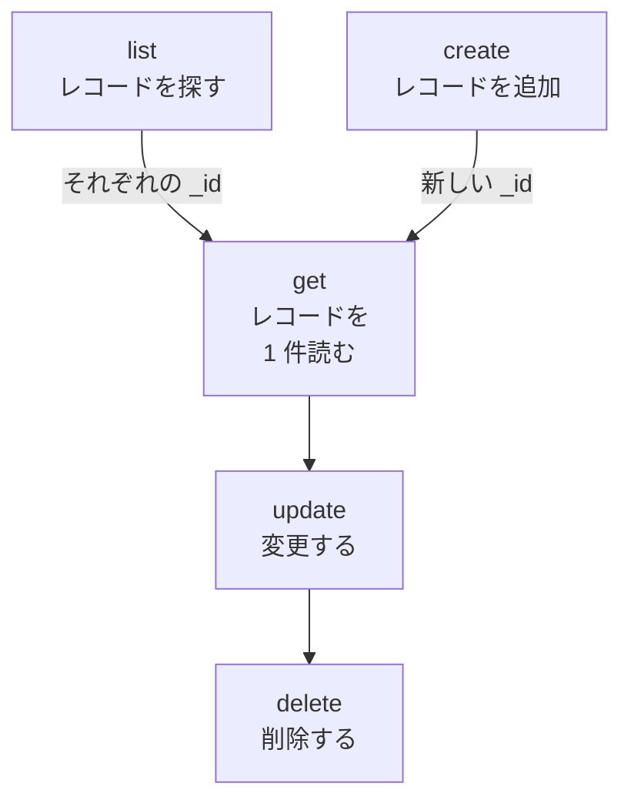

# リソース操作

レコードの種類ごとに `incident`、`monitor`、`status-page` のような独自のコマンドがあり、API がその種類に受け付ける操作を持ちます。ほとんどの種類では `list`、`get`、`create`、`update`、`delete`、`count` です。このページでは、フィルター、ページ送り、レコードを書くためのフラグとともに各操作を説明し、ダッシュボードのボタンと同じことをするコマンドも紹介します。

:::cards
- [レコードのコマンドを見つける](#レコードのコマンドを見つける): oneuptime resources ですべてを一覧表示します。
- [レコードを一覧表示する](#レコードを一覧表示する): 絞り込み、並べ替え、ページ送り。
- [レコードを作成する](#レコードを作成する): フィールドごとのフラグ、または JSON のレコード。
- [確認、解決、メモの追加](#確認解決メモの追加): ダッシュボードのボタンをコマンドで。
- [レコードを削除する](#レコードを削除する): すぐに削除され、元に戻せません。
:::

## 操作どうしの関係

レコードの読み取り、変更、削除にはその ID が必要です。一覧表示、件数の取得、作成には必要なく、一覧や作成の結果から、ほかの操作が使う ID が得られます。



ID は `6f1c2a40-3b1e-4c55-9a0b-3e2f8d7c1a11` のような UUID です。OneUptime のレコードのページからコピーすることもできます。[リソースの ID を見つける](/docs/api-reference/api-reference#リソースの-id-を見つける)を参照してください。

## レコードのコマンドを見つける

```bash
oneuptime resources
```

一覧には、レコードの種類ごとにコマンド、名前、タイプ、API パスが表示されます。タイプは二つあります。

| 種類 | 内容 |
| --- | --- |
| `database` | 管理するレコード: モニター、インシデント、アラート、ステータスページ、チームなど |
| `analytics` | テレメトリ: ログ、スパン、メトリクス、例外、その他のイベント |

`oneuptime resources --type database` または `--type analytics` で一つのタイプだけを表示できます。[コマンド リファレンス](/docs/cli/command-reference#リソース)にすべてのコマンドがあります。

リソースは、API がそのリソースに受け付ける操作を受け付けます。ほとんどは 6 つすべてを受け付けますが、メールログのように OneUptime 自身が書き込むリソースは読み取り専用です。`oneuptime <resource> --help` はリソースのサブコマンドを一覧表示します。

## リソースのフィールドを見る

`fields` は、API キーもリクエストも使わずに、CLI 自身からリソースのフィールドを一覧表示します。

```bash
oneuptime incident fields
```

各フィールドには、型、用途、作成時に必須かどうか、それを設定するフラグがあります。ID を持つフィールドは、その ID が属するリソースを示します。`incidentSeverityId` は `oneuptime incident-severity list` の ID を受け取ります。`-o json` を付けると、スクリプトや AI エージェントは同じ内容を、すべてのフィールドで同じキー `name`、`title`、`type`、`description`、`required`、`create`、`update`、`read`、`flag`、`emailFlag`、`relatedResource` で読み取れます。

## レコードを一覧表示する

```bash
oneuptime <resource> list [--query <json>] [--limit <n>] [--skip <n>] [--sort <json>] [--fields <names>] [--all] [-o <format>]
```

| オプション | 内容 | 既定値 |
| --- | --- | --- |
| `--query <json>` | 一致するレコードだけを返します: [一覧を絞り込む](#一覧を絞り込む)を参照 | キーが読み取れるすべてのレコード |
| `--limit <n>` | 返すレコードの最大件数(最大 10,000) | `10` |
| `--skip <n>` | 最初に飛ばす一致レコードの件数 | `0` |
| `--sort <json>` | 順序。`{"createdAt":"ASC"}` のように指定し、新しい順は `"DESC"` | 新しい順 |
| `--fields <names>` | 返すフィールド。`title,createdAt` のようにカンマで区切ります | キーが読み取れるすべてのフィールド |
| `--all` | 一致するすべてのレコードを、`--limit` と `--skip` の代わりにページごとに取得します。レコードのみ | |
| `-o, --output <format>` | `table`、`json`、`wide` | ターミナルでは `table`、パイプでは `json` |

```bash
# The ten newest incidents
oneuptime incident list

# The oldest monitors first, 50 at a time: the second page
oneuptime monitor list --sort '{"createdAt":"ASC"}' --limit 50 --skip 50

# Every field of each incident, as JSON
oneuptime incident list -o json

# The title, the state and the creation date of every incident
oneuptime incident list --all --fields title,currentIncidentState.name,createdAt -o json
```

一覧では、キーが読み取れる各レコードのすべてのフィールドを OneUptime に要求します。`--fields` を付けると、代わりに指定したフィールドを要求し、`currentIncidentState.name` のようにドットの後に書くと関連レコードのフィールドを要求します。表には 6 つのフィールドが表示され、JSON にはすべてが表示されます([出力形式](/docs/cli/output-formats)を参照)。`--all` はすべてのページを一度に 100 件ずつ、最大 100,000 件まで読み取ります。件数は `count` でわかります。

ラベルは新しい順ではなく名前順に並びます。名前が数字で始まるラベルが先に、その数字の順で並び（`2. Team` は `10. Owner` の前）、続いてほかのラベルがアルファベット順で並びます。別の順序で一覧表示するには、`--sort` を指定します。

### 一覧を絞り込む

`--query` は API と同じフィルターを受け付けます。値を持つフィールドはその値と一致し、`_type` を持つオブジェクトは比較を行います。

| フィルター | 一致するもの |
| --- | --- |
| `{"title":"Checkout API is down"}` | その値とまったく同じレコード |
| `{"title":{"_type":"Search","value":"checkout"}}` | 値を含むテキスト |
| `{"createdAt":{"_type":"GreaterThan","value":"2026-10-01T00:00:00.000Z"}}` | より後の日付、またはより大きい数値 |
| `{"currentIncidentState":{"isResolvedState":false}}` | リソースが参照するレコードのフィールド: この例では解決していないインシデント |

```bash
oneuptime incident list --query '{"title":{"_type":"Search","value":"checkout"}}'
```

すべての `_type` は API リファレンスの[絞り込み、並べ替え、ページ送り](/docs/api-reference/api-reference#絞り込み並べ替えページ送り)にあります。

## レコードを読み取る

```bash
oneuptime <resource> get <id> [--fields <names>] [-o <format>]
```

```bash
oneuptime incident get 6f1c2a40-3b1e-4c55-9a0b-3e2f8d7c1a11
```

表には、レコードのフィールドごとに 1 行が表示され、各値は 60 文字で切り詰められます。`-o json` では値が切り詰められずに表示されます。キーが読み取れるレコードを指さない ID には `Not found` が返り、コマンドは終了コード `3` で終了します。

## レコードを作成する

```bash
oneuptime <resource> create [--<field> <value>]... [--data <json>] [--file <path>] [-o <format>]
```

作成が受け付けるフィールドにはそれぞれフラグがあります。`--title <text>`、`--incident-severity-id <id>`、カンマ区切りの ID を受け取る `--labels <ids>`、はい・いいえのフィールドで単独で指定すると true になる `--is-visible-on-status-page [true|false]`、JSON を持つフィールドの `--monitor-steps <json>` などです。`oneuptime <resource> create --help` で一覧表示でき、各フィールドの用途は [`fields`](#リソースのフィールドを見る) でわかります。プロジェクトは API キーから決まるため、レコードでは指定しません。

```bash
# A manual monitor
oneuptime monitor create --name "Checkout API" --monitor-type Manual

# An incident with one of your severities
oneuptime incident create --title "Checkout API is down" --incident-severity-id <severity-id>

# The same incident, from a file
oneuptime incident create --file incident.json
```

`--data` はレコードを JSON で受け取り、`--file` は JSON ファイルから読み取ります。フィールドは API のものであり、各リソースのフィールドは [API リファレンス](/reference)にあります。両方を指定した場合はファイルが使われ、どちらの場合もフラグがその上に適用されます。

ユーザー ID で人を指定するフィールドには、メールアドレスで指定する 2 つ目のフラグがあります。`--user-email` が `--user-id` と、`--owner-user-emails` が `--owner-users` と対になります。CLI は、API キーのプロジェクトのメンバーと招待された人の中からその人を探します。プロジェクトの誰も持っていないアドレスで指定したチームメンバーは、ダッシュボードから招待した場合と同じようにプロジェクトに招待されます。

```bash
oneuptime team-member create --team-id <team-id> --user-email alice@example.com
```

CLI は新しいレコードを `_id` とともに表示します。インシデントは、`currentIncidentStateId` で別の状態を指定しない限り、プロジェクトの作成済み状態で始まります。[新しいレコードが始まる状態](/docs/api-reference/api-reference#新しいレコードが始まる状態)を参照してください。重大度の ID を調べるには:

```bash
oneuptime incident-severity list -o json | jq -r '.[] | "\(._id)  \(.name)"'
```

> [!TIP]
> Windows では、フィールドをフラグで指定するか、JSON をファイルに書いて `--file` を使ってください。PowerShell とコマンド プロンプトは、コマンドライン上の JSON を Bash とは異なる方法で引用符で囲みます。

## レコードを更新する

```bash
oneuptime <resource> update <id> [--<field> <value>]... [--data <json>] [--file <path>] [-o <format>]
```

変更するフィールドだけを、フラグまたは JSON で指定します。

```bash
# Rename a monitor
oneuptime monitor update <monitor-id> --name "Checkout API (EU)"

# Record an incident's root cause
oneuptime incident update <incident-id> --root-cause "A full disk on the primary database"
```

OneUptime は更新に空のオブジェクトで応答します。CLI は空の行を表示し、`-o json` では `{}` を表示します。現在のレコードを見るには `get` を実行してください。インシデントを別の状態に移すには `--current-incident-state-id` を指定します。ダッシュボードと同じようにその変更がタイムラインに記録され、現在の状態より前の状態は拒否されます。[`acknowledge` と `resolve`](#確認解決メモの追加) は状態を自動で見つけます。プロジェクトの順序で最初の解決済み状態の ID を調べるには、次のようにします。

```bash
oneuptime incident-state list --query '{"isResolvedState":true}' --sort '{"order":"ASC"}' --limit 1 -o json | jq -r '.[0]._id'
```

## 確認、解決、メモの追加

インシデント、アラート、それらのエピソード、メンテナンスイベントには、ダッシュボードのボタンと同じことをするコマンドがあります。

| コマンド | 内容 | リソース |
| --- | --- | --- |
| `acknowledge <id>` | レコードをプロジェクトの確認済み状態に移します | `incident`, `alert`, `incident-episode`, `alert-episode` |
| `resolve <id>` | プロジェクトの解決済み状態に移します | 同じ四つ |
| `start <id>` | イベントをプロジェクトの進行中の状態に移します | `scheduled-maintenance-event` |
| `end <id>` | プロジェクトの終了状態に移します | `scheduled-maintenance-event` |
| `add-note <id> --note <markdown>` | レコードを閲覧できる人だけが読めるメモを追加し、`--public` を付けるとレコードのステータスページにメモを載せます | 五つすべて |

```bash
oneuptime incident acknowledge 6f1c2a40-3b1e-4c55-9a0b-3e2f8d7c1a11
oneuptime incident add-note 6f1c2a40-3b1e-4c55-9a0b-3e2f8d7c1a11 --note "Rolled back the 14:05 deploy."
oneuptime incident resolve 6f1c2a40-3b1e-4c55-9a0b-3e2f8d7c1a11
```

`acknowledge` は `Incident 6f1c2a40-3b1e-4c55-9a0b-3e2f8d7c1a11 acknowledged: it is in Acknowledged now.` と応答します。すでにその状態にあるか、それより先の状態にあるレコードはそのままです。コマンドはその旨を伝え、`0` で終了します。`-o json` では、レコードの `_id`、`action`、何かが変わったかどうかの `changed`、レコードが今ある `state` で応答します。アラートとアラートのエピソードには内部メモだけを追加できます。

## レコードを削除する

```bash
oneuptime <resource> delete <id>
```

```bash
oneuptime monitor delete 6f1c2a40-3b1e-4c55-9a0b-3e2f8d7c1a11
```

`Monitor 6f1c2a40-3b1e-4c55-9a0b-3e2f8d7c1a11 deleted successfully.` と応答します。`-o json` では、レコードの `_id` と `"deleted": true` で応答します。

> [!CAUTION]
> `delete` はレコードをすぐに削除します。CLI は確認を求めず、元に戻すこともできません。そのフラグを付けて書かれたスクリプトのために `--force` を受け付けますが、`--force` は何も変えません。

## レコードの件数を取得する

```bash
oneuptime <resource> count [--query <json>]
```

```bash
# Every incident
oneuptime incident count

# Incidents that are not resolved
oneuptime incident count --query '{"currentIncidentState":{"isResolvedState":false}}'
```

CLI は数値を 1 つだけ表示します。表でも JSON でも同じなので、スクリプトはそのまま読み取れます。

## トラブルシューティング

:::details 「Not found: API error (404)」というメッセージ
レコードが存在しないか、別のプロジェクトにあるか、キーが読み取れないレコードです。OneUptime はどの場合も同じ応答を返します。`list` で ID を、あわせてキーの権限を確認してください。コマンドは終了コード `3` で終了します。
:::

:::details 「Left out fields this API key may not read」というメッセージ
一覧や読み取りではレコードのすべてのフィールドを要求し、OneUptime はキーが読み取れないフィールドを拒否します。CLI はそのフィールドを除いて要求し直し、除いたフィールドを標準エラー出力に示します。それらを読み取れる権限をキーに与えるか、必要なフィールドを `--fields` で指定してください。指定したフィールドをキーが読み取れない場合、コマンドは `API error (422)` で停止します。
:::

:::details 「Error: Invalid JSON」というメッセージ
`--query`、`--sort`、`--data` の値が JSON ではありません。Bash と zsh では一重引用符で囲み、Windows ではフィールドをフラグで指定するか、レコードをファイルに書いて `--file` を使ってください。
:::

:::details 作成または更新で API error (400) が返る
OneUptime がフィールドを拒否しました。メッセージにそのフィールドが示され、`oneuptime <resource> fields` でフィールドとそれを設定するフラグを一覧表示できます。フィールドを 1 つも指定しないコマンドは、送信前に、指定すべきフラグとともに拒否されます。
:::

:::details 「No one in this project, or invited to it, has the email address」というメッセージ
メールのフラグで、API キーのプロジェクトのメンバーでも招待された人でもない人を指定しました。`oneuptime team-member create --team-id <team-id> --user-email <email>` で招待するか、ユーザー ID で指定してください。
:::

## 次のステップ

:::cards
- [出力形式](/docs/cli/output-formats): 応答を表または JSON として読みます。
- [スクリプト & CI/CD](/docs/cli/scripting): これらの操作をスクリプトやパイプラインで使います。
- [コマンド リファレンス](/docs/cli/command-reference): すべてのコマンド、オプション、既定値。
:::
