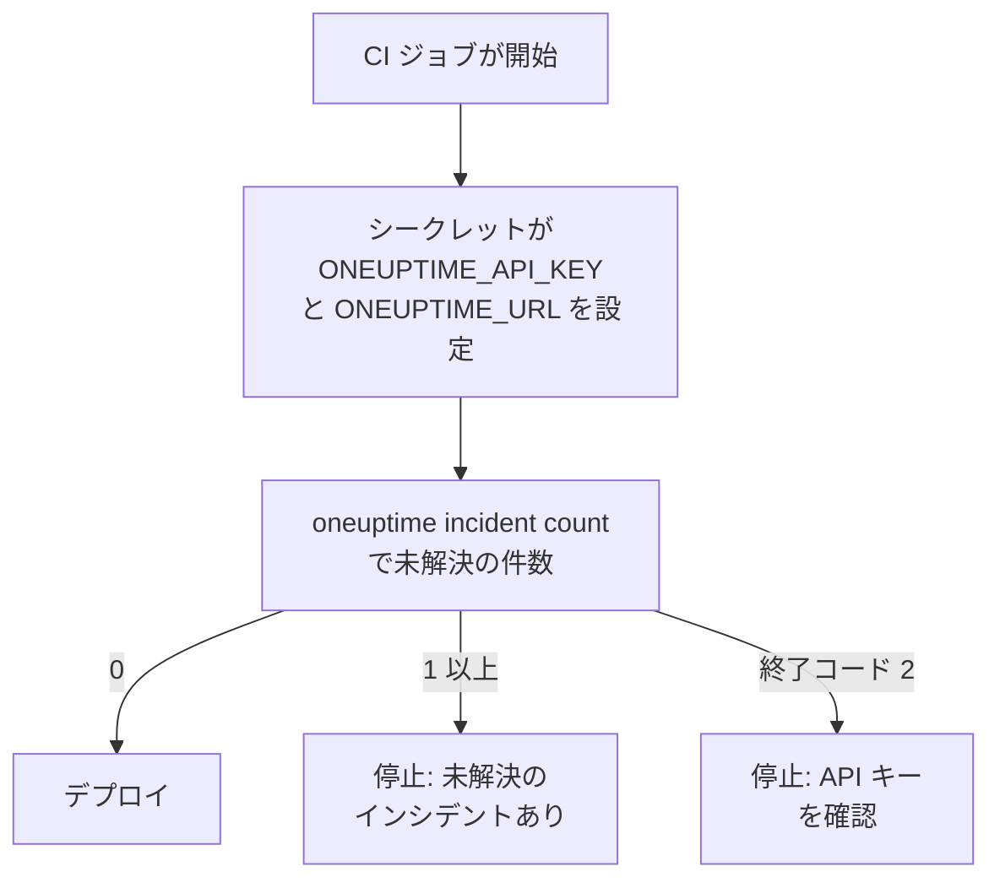

# スクリプト & CI/CD

CLI はスクリプトでもターミナルと同じように動作します。API キーを環境変数で渡し、応答を JSON として読み、何が起きたかを終了コードでスクリプトに伝えます。このページでは、それぞれの方法と、GitHub Actions、GitLab CI、Docker 用の完全なパイプラインを紹介します。

:::cards
- [スクリプトに API キーを渡す](#スクリプトに-api-キーを渡す): 環境変数を 2 つ設定し、保存したコンテキストは使いません。
- [終了コード](#終了コード): 成功時は 0、失敗時はその理由。
- [jq で応答を読む](#jq-で応答を読む): JSON から ID、タイトル、日付を取り出します。
- [パイプラインの例](#パイプラインの例): GitHub Actions、GitLab CI、Docker。
:::

## スクリプトでの CLI の使い方

デプロイは、まず OneUptime にインシデントが未解決かどうかを尋ね、未解決なら止めることができます。



## スクリプトに API キーを渡す

CI システムのシークレットから `ONEUPTIME_API_KEY` と `ONEUPTIME_URL` を設定します。そうすれば CLI に `login` も設定ファイルも必要ありません。1 つのコマンドについてはフラグがこれらより優先され、これらは保存したコンテキストより優先されます。

```bash
export ONEUPTIME_API_KEY="$CI_ONEUPTIME_API_KEY"
export ONEUPTIME_URL="https://oneuptime.com"
oneuptime incident count
```

> [!TIP]
> パイプラインごとに、必要なアクセスだけを持つ専用の API キーを用意してください。読み取るだけのチェックには、読み取るだけのキーが必要です。パイプラインを廃止したら、そのキーを OneUptime で削除してください。

1 台のマシンで複数のプロジェクトのジョブを実行する場合は、プロジェクトごとにコンテキストを保存し、すべてのコマンドでそれを指定して、ジョブがほかのジョブの現在のコンテキストを使わないようにします。

```bash
oneuptime --context production incident count
oneuptime --context staging monitor count
```

## 終了コード

| コード | 意味 | 例 |
| --- | --- | --- |
| `0` | 成功した | 一覧(何も見つからない場合も含む) |
| `1` | 失敗した | OneUptime がリクエストを拒否した(`API error (422)` など)、無効な JSON、オプションの不足または不明なオプション、保存されていないコンテキスト |
| `2` | 使える API キーがない | 認証情報が見つからない、無効な API キー、プラン未満のキー(`402`)、`401` |
| `3` | 見つからない | OneUptime が `404` を返した: レコードが存在しない、別のプロジェクトにある、またはキーが読み取れない |

`whoami` と `context current` は、何も保存されていなくても `0` で終了します。設定されている内容を報告するだけで、確認はしないためです。スクリプトはコードでそれぞれの場合を区別します。

```bash
oneuptime incident get "$INCIDENT_ID" -o json > incident.json
case $? in
  0) echo "Saved the incident to incident.json" ;;
  2) echo "Check ONEUPTIME_API_KEY and ONEUPTIME_URL" >&2; exit 1 ;;
  3) echo "There is no incident $INCIDENT_ID" >&2; exit 1 ;;
  *) echo "OneUptime refused the request" >&2; exit 1 ;;
esac
```

エラーメッセージは標準エラー出力に出るため、`incident.json` には応答だけが入ります。

## jq で応答を読む

スクリプトには `-o json` を書いてください。パイプの中では CLI はいずれにしても JSON を出力しますが、このフラグがあれば、どこで実行してもスクリプトが動作し続けます。

```bash
# The title of each incident
oneuptime incident list -o json | jq -r '.[].title'

# The ID of a new monitor
MONITOR_ID=$(oneuptime monitor create --data '{"name":"Checkout API","monitorType":"Manual"}' -o json | jq -r '._id')

# When each incident was created: dates come as objects
oneuptime incident list -o json | jq -r '.[] | "\(.createdAt.value)  \(.title)"'

# The newest 100 incidents as CSV
oneuptime incident list --limit 100 -o json | jq -r '.[] | [._id, .title, .createdAt.value] | @csv'
```

件数の取得は数値を 1 つだけ出力するので、そのまま比較できます。

```bash
OPEN=$(oneuptime incident count --query '{"currentIncidentState":{"isResolvedState":false}}')
echo "$OPEN incidents are open"
```

## ファイルからレコードを作成する

レコードを JSON ファイルとしてコードの隣に置き、そこから作成します。

```json title="monitors/checkout-api.json"
{
  "name": "Checkout API",
  "monitorType": "Manual"
}
```

```bash
oneuptime monitor create --file monitors/checkout-api.json
```

1 つの JSON 配列から多数のレコードを、1 件ずつ作成します。

```bash
jq -c '.[]' monitors.json | while IFS= read -r monitor; do
  oneuptime monitor create --data "$monitor" -o json | jq -r '._id'
done
```

> [!NOTE]
> 実行するたびに新しいレコードが作成されます。モニターやステータスページをファイルと同期させ、変わった部分だけを変更し、なくなったものを削除するには、[Terraform プロバイダー](/docs/terraform/index)を使ってください。

## パイプラインの例

:::tabs
@tab GitHub Actions
```yaml title=".github/workflows/deploy.yml"
name: Deploy
on:
  push:
    branches: [main]

jobs:
  deploy:
    runs-on: ubuntu-latest
    steps:
      - uses: actions/checkout@v4
      - uses: actions/setup-node@v4
        with:
          node-version: lts/*
      - name: Install the OneUptime CLI
        run: npm install -g @oneuptime/cli
      - name: Stop while an incident is open
        env:
          ONEUPTIME_API_KEY: ${{ secrets.ONEUPTIME_API_KEY }}
          ONEUPTIME_URL: https://oneuptime.com
        run: |
          OPEN=$(oneuptime incident count --query '{"currentIncidentState":{"isResolvedState":false}}')
          if [ "$OPEN" -gt 0 ]; then
            echo "$OPEN incidents are open: not deploying."
            exit 1
          fi
      - name: Deploy
        run: ./deploy.sh
```
@tab GitLab CI
```yaml title=".gitlab-ci.yml"
check-incidents:
  stage: test
  image: node:lts
  variables:
    ONEUPTIME_URL: https://oneuptime.com
  script:
    - npm install -g @oneuptime/cli
    - OPEN=$(oneuptime incident count --query '{"currentIncidentState":{"isResolvedState":false}}')
    - echo "$OPEN incidents are open"
    - test "$OPEN" -eq 0
```
@tab Docker
```dockerfile title="Dockerfile"
FROM node:lts-slim
RUN npm install -g @oneuptime/cli
ENTRYPOINT ["oneuptime"]
```
:::

GitHub Actions では、リポジトリの **Settings → Secrets and variables → Actions** に `ONEUPTIME_API_KEY` を追加します。GitLab では、マスクされた CI/CD 変数として追加します。Docker イメージでは、実行のたびに変数を渡します。

```bash
docker build -t oneuptime-cli .
docker run --rm -e ONEUPTIME_API_KEY -e ONEUPTIME_URL oneuptime-cli incident count
```

## 次のステップ

:::cards
- [認証](/docs/cli/authentication): 複数設定されているときにコマンドが使うキー。
- [出力形式](/docs/cli/output-formats): スクリプトが読む JSON。
- [リソース操作](/docs/cli/resource-operations): フィルター、ページ送り、レコードのフィールド。
- [Terraform プロバイダー](/docs/terraform/index): OneUptime の設定をファイルで管理します。
:::
