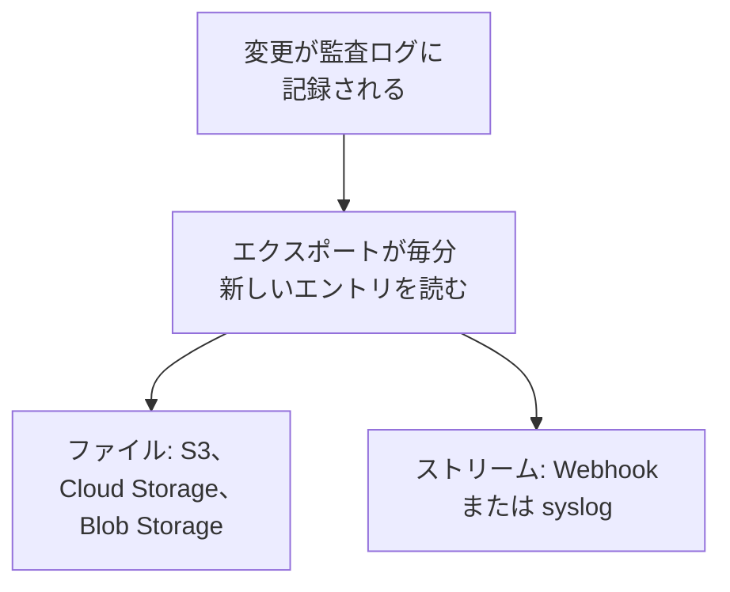

# 監査ログのエクスポート

監査ログを、記録されるたびに、選んだストレージやサービスに送信します。送信先は Amazon S3 または S3 互換ストレージ、Google Cloud Storage、Azure Blob Storage、Webhook、syslog です。コンプライアンス審査に必要なだけエントリをそこに保管し、SIEM で検索できます。プロジェクトのオーナーと管理者はプロジェクト設定からそのプロジェクトの監査ログをエクスポートし、マスター管理者は Admin Dashboard からすべてのプロジェクトの監査ログをエクスポートします。OneUptime Cloud では Enterprise プランに、セルフホストでは Enterprise Edition に含まれます。

:::cards
- [エクスポートを設定する](#エクスポートを設定する): 送信先を選び、テストして、保存します。
- [送信される内容](#送信される内容): エントリごとに JSON オブジェクトをひとつ、安定したスキーマで。
- [エントリが送信されるタイミング](#エントリが送信されるタイミング): 毎分、各エントリを一度ずつ、順番どおりに。
- [送信先が失敗したとき](#送信先が失敗したとき): 再試行とエラー表示。何も飛ばされません。
:::

## エントリが送信先に届くまで



- **ひとつのエクスポートに、ひとつの送信先。** プロジェクトは複数のエクスポートを持てます。各エクスポートはすべてのエントリをそれぞれの送信先に送信します。
- **プロジェクトのものか、インスタンスのものか。** プロジェクトのエクスポートは、そのプロジェクトのエントリを送信します。Admin Dashboard で設定したエクスポートは、監査ログを記録しているすべてのプロジェクトのエントリを送信します。
- **保存したときから。** エクスポートは、保存した後に記録されたものを送信します。**エクスポート開始日時** をそれより前の日付にした場合は別です。

## 始める前に

- **OneUptime Cloud では Enterprise プラン。** 他のプランでは、このページに機能の内容と入手方法が表示されます。
- **セルフホストでは Enterprise Edition** と、監査ログを含むライセンスが必要です。[エンタープライズ版](/docs/self-hosted/enterprise) を参照してください。
- **監査ログの有効化**。エクスポートする各プロジェクトで有効にします。[監査ログ](/docs/configuration/audit-logs) を参照してください。
- **Project Owner または Project Admin** がプロジェクトの監査ログをエクスポートします。インスタンスの監査ログをエクスポートするのはマスター管理者です。

## エクスポートを設定する

:::steps
### エクスポートのページを開く

プロジェクトの場合は **プロジェクト設定 → 監査ログ → エクスポート** に移動します。インスタンス全体の場合は、Admin Dashboard で **設定 → 監査ログのエクスポート** に移動します。

### 送信先を選ぶ

**エクスポートを追加** をクリックし、下の六つの送信先からひとつを選びます。エクスポートの送信先は後から変更できません。

### 接続方法を入力する

送信先が求める内容を入力します。ほとんどの人が変更しない設定は **その他の項目** の中にあり、**セットアップガイド** を押すとこのページの送信先のセクションが開きます。

### テストを送信する

**テストファイルを書き込む** または **テストエントリを送信** をクリックします。ストレージにはフォルダー内に `oneuptime-audit-log-export-test.ndjson.gz` というファイルが届き、Webhook や syslog にはアクションが `Test` のエントリがひとつ届きます。テストが失敗すると、何を直せばよいかが表示されます。

### エクスポートを開始する

**次へ** をクリックし、エクスポートに名前を付けて、**エクスポートを開始** をクリックします。最初のエントリは数分以内に届きます。
:::

エクスポートの行には状態が表示されます: **エクスポート中**、**失敗中**、**一時停止中**、**エントリ待ち**、**開始中**。**テストを送信する** は保存された設定でテストを送信し、**編集** は設定を変更します。空のままにした認証情報は、保存されているものがそのまま使われます。

## 送信先

| 送信先 | 届くもの | 認証 |
| --- | --- | --- |
| [Amazon S3](#amazon-s3) | 圧縮された NDJSON ファイル | アクセス キー |
| [S3 互換ストレージ](#s3-互換ストレージ) | 圧縮された NDJSON ファイル | アクセス キー |
| [Google Cloud Storage](#google-cloud-storage) | 圧縮された NDJSON ファイル | サービス アカウント キー |
| [Azure Blob Storage](#azure-blob-storage) | 圧縮された NDJSON ファイル | SAS トークンまたはアクセス キー |
| [Webhook](#webhook) | HTTPS リクエスト | 任意のヘッダーと署名シークレット |
| [Syslog](#syslog) | RFC 5424 メッセージ | なし |

### Amazon S3

| 項目 | 入力する内容 |
| --- | --- |
| **バケット** | ファイルを書き込むバケット。 |
| **リージョン** | バケットのリージョン。最初は `us-east-1` になっています。 |
| **アクセス キー ID** | バケットにオブジェクトを書き込めるアクセス キー。 |
| **シークレット アクセス キー** | そのキーのシークレット。 |
| **フォルダー** | **その他の項目** の中にあります。空のままにすると、ファイルは `oneuptime/audit-logs/` に書き込まれます。 |

キーに必要なのは、フォルダーに対する `s3:PutObject` だけです:

```json
{
  "Version": "2012-10-17",
  "Statement": [
    {
      "Effect": "Allow",
      "Action": "s3:PutObject",
      "Resource": "arn:aws:s3:::my-audit-logs/oneuptime/audit-logs/*"
    }
  ]
}
```

### S3 互換ストレージ

Amazon S3 と同じ項目に加えて、最初に **エンドポイント** を入力します。これはストレージの S3 アドレスで、たとえば `https://minio.example.com:9000` や `https://<account>.r2.cloudflarestorage.com` です。**リージョン** にはストレージが求めるものを設定します。MinIO と Wasabi の既定では `us-east-1`、Cloudflare R2 では `auto` です。

### Google Cloud Storage

**バケット** を入力し、バケットに対する Storage Object Creator ロールを持つサービス アカウントの **サービス アカウント キー** (JSON) を貼り付けます。**フォルダー** は **その他の項目** の中にあります。

### Azure Blob Storage

**ストレージ アカウント** と **コンテナ** を入力し、**サインイン方法** を選びます。コンテナに対する Create と Write の権限を持つ **SAS トークン** か、ストレージ アカウントの **アクセス キー** のどちらかです。SAS トークンはこのコンテナだけに限定できるため、より安全な選択です。**クラウド** と **フォルダー** は **その他の項目** の中にあります。

### Webhook

OneUptime は各バッチを **URL** に POST します。形式は **本文の形式** に従い、JSON 配列 (`application/json`) か、一行にひとつのエントリ (`application/x-ndjson`) のどちらかで、次のヘッダーが付きます:

| ヘッダー | 値 |
| --- | --- |
| `X-OneUptime-Event` | `audit-log-export` |
| `X-OneUptime-Batch-Id` | バッチの最初のエントリの ID。同じバッチを再送すると同じ ID になります。 |
| `X-OneUptime-Entry-Count` | 本文に含まれるエントリの数。 |
| `X-OneUptime-Signature` | **署名シークレット** が設定されている場合、`sha256=` に続けて、それを使った本文の HMAC-SHA256。 |

`Bearer <token>` のような **認証情報** は、**ヘッダー名** で選んだヘッダーで送信されます。変更しなければ `Authorization` です。**本文の形式**、**ヘッダー名**、**署名シークレット** は **その他の項目** の中にあります。2xx の応答はすべて配信成功とみなされます。`413` が返るとバッチを二つに分け、それ以外の拒否ではバッチ全体を後で再送します。

### Syslog

各エントリは **ホスト** と **ポート** に送られる RFC 5424 メッセージひとつです。**プロトコル** で TCP を選ばない限り、ポート `6514` で TLS を使います。facility は 13 (log audit)、severity は 6 (informational) です:

```text
<110>1 2026-10-24T09:15:03.000Z oneuptime.example.com oneuptime - audit-log - {"schemaVersion":1,"id":"..."}
```

メッセージはオクテットカウント (RFC 5425) で区切られます。**フレーミング** で一行にひとつのメッセージを選んだ場合は別です。プライベート CA が署名した証明書を使う受信側では、その CA の証明書を **CA 証明書** に入力します。どちらも **その他の項目** の中にあります。

## 送信される内容

各エントリは JSON オブジェクトひとつで、キーは常に次の順に並びます:

| キー | 内容 |
| --- | --- |
| `schemaVersion` | `1`。スキーマが変わるときは新しいバージョンになります。 |
| `id` | エントリの ID。同じエントリを二回送信しても ID は同じです。 |
| `createdAt` | 変更が記録された日時 (UTC)。 |
| `projectId` | 変更が行われたプロジェクト。 |
| `action` | `Create`、`Update`、`Delete`、`Download` のいずれか。 |
| `resourceType`, `resourceId`, `resourceName` | 変更されたもの。 |
| `rootResourceType`, `rootResourceId` | それが属するリソース。たとえばルールに対する SLO。 |
| `userId`, `userName`, `userEmail`, `userType` | 変更した人。 |
| `apiKeyId`, `apiKeyName` | 変更に使われた API キー (ある場合)。 |
| `mcpOAuthGrantId`, `mcpClientName` | 変更に使われた MCP クライアント (ある場合)。 |
| `workflowId`, `workflowName` | 変更したワークフロー (ある場合)。 |
| `changes` | 変更された各フィールド。`field` と、`oldValue` および `newValue`。 |

ファイルは一行にひとつのエントリを収めて gzip で圧縮され、最初のエントリの時間ごとに整理されます: `oneuptime/audit-logs/2026/10/24/09/20261024T091503Z_<first entry id>.ndjson.gz`。

キー、トークン、パスワードが外に出ることはありません。これらは `[REDACTED]` として記録され、誰も読めないフィールドはどのエントリにも含まれません。

## エントリが送信されるタイミング

- **毎分。** 一分以上前に記録されたエントリを古い順に読み、バッチで送信します。ファイルあたり最大 5,000 件または 16 MB、Webhook リクエストまたは syslog 接続あたり 500 件です。
- **ファイルはエントリごとには書き込まれません。** ファイルは、バッチがいっぱいになったとき、または最初のエントリから五分経ったときに書き込まれます。
- **各エントリを一度ずつ、順番どおりに。** 配信のたびに、エクスポートは最後に送信したエントリを記憶します。そのため、再起動しても別のワーカーでも、そこから続けます。
- **繰り返しを見分けられます。** クラッシュ後に再送されたバッチは同じファイル名で書き込まれるか、同じ `X-OneUptime-Batch-Id` を持ち、各エントリには `id` が付いています。

## 送信先が失敗したとき

バッチは数秒おきに三回試され、その後エクスポートは待ってから再試行します。待ち時間は一分、次に二分、四分と増え、最大で一時間です。行には **失敗中** と表示され、**エラーを表示** で送信先の応答と次の試行時刻を確認できます。

何も飛ばされません。エントリは監査ログの中で待ち、次に成功した配信が最も古いものから追いつきます。プロジェクトの監査ログの保持期間より古いエントリは送信される前に削除されるため、失敗しているエクスポートはその期間内に直してください。

エクスポートを一時停止するには、その行のメニューで **オフにする** を選びます。位置は保持され、**オンにする** とその間に記録されたものを送信します。OneUptime Cloud では、Enterprise プランから外れたプロジェクトはエクスポートを停止し、そのエクスポートはアップグレードカードの下で待機します。そこでオフにしたり削除したりできます。セルフホストでは、ライセンスに監査ログが含まれない間はエクスポートが止まり、含まれるライセンスになると止まったところから再開します。

## トラブルシューティング

:::details テストでアクセスが拒否される
キー、トークン、またはサービス アカウントに、エクスポートの書き込み先への書き込み権限がありません。上の各送信先のセクションにあるとおり、フォルダーにオブジェクトを作成する権限を付与してから、テストをもう一度送信してください。
:::

:::details テストがアドレスに到達できない
OneUptime Cloud のプロジェクトのエクスポートは、プライベート ネットワークのアドレスには到達できません。セルフホストでは、`DATA_SOURCE_BLOCK_PRIVATE_ADDRESSES` が `true` でない限り到達でき、Admin Dashboard で設定したエクスポートは常に到達できます。ループバックとリンクローカルのアドレスには決して到達しません。
:::

:::details 何も届かない
プロジェクトで監査ログが有効になっていること、そしてエクスポートの保存後に誰かが何かを変更したことを確認してください。ストレージにファイルが届くのは、バッチがいっぱいになるか、五分経ったときだけです。
:::

## 次のステップ

:::cards
- [監査ログ](/docs/configuration/audit-logs): 記録される内容と保持期間。
- [ユーザー、チーム、権限](/docs/permissions/index): エクスポートを設定できる人を決めます。
- [エンタープライズ版](/docs/self-hosted/enterprise): セルフホスト環境での監査ログ。
:::
