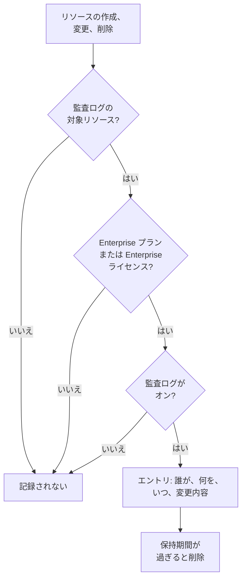

# 監査ログ

監査ログは、プロジェクトで誰が何を変更したかを記録します。対象となるリソースの作成、変更、削除のすべてを変更前と変更後の値とともに記録し、誰かがサインインまたはサインアウトするたびにも記録します。誰がモニターをオフにしたか、誰が API キーを変更したか、誰がどこからサインインしたかを調べたり、コンプライアンス審査のための記録を残したりするのに使います。OneUptime Cloud では Enterprise プランに、セルフホストでは Enterprise Edition に含まれます。

:::cards
- [監査ログを有効にする](#監査ログを有効にする): すべてのプロジェクトで最初はオフです。
- [監査ログを読む](#監査ログを読む): 誰が、何を、いつ変更したか。
- [記録される内容](#記録される内容): 対象となるリソースとアクション。
- [サインインとセッション](#サインインとセッション): 誰がサインインし、各セッションがどう終わったか。
- [エントリの保持期間](#エントリの保持期間): 7 日から 180 日まで。
:::

## 変更がエントリになるまで

- **最初はオフです。** 誰かが監査ログを有効にするまで、プロジェクトは何も記録せず、それ以前のことも記録しません。
- **人が行ったことを記録します。** 人、API キー、MCP クライアント、ワークフローによる変更が記録されます。バックグラウンドジョブなど OneUptime 自身による変更は、**システムイベントを保存** をオンにしない限り記録されません。
- **エントリは変更できません。** ダッシュボードでも API でも、エントリを編集または削除することはできません。エントリは保持期間が過ぎたときにだけ消えます。

## 始める前に

- **OneUptime Cloud では Enterprise プラン。** 他のプランでは、監査ログのページに機能の内容と入手方法が表示されます。
- **セルフホストでは Enterprise Edition** と、監査ログを含むライセンスが必要です。[エンタープライズ版](/docs/self-hosted/enterprise) を参照してください。
- **監査ログを読めるロール。** Project Owner、Project Admin、Settings Admin、または **Read Audit Log** 権限。監査ログを有効にして設定を変更するには、Project Owner、Project Admin、またはプロジェクトの編集権限が必要です。

## 監査ログを有効にする

:::steps
### 監査ログの設定を開く

**プロジェクト設定 → 監査ログ → 設定** に移動します。サイドメニューの **監査ログ** は最初は折りたたまれています。クリックして開いてください。

### 設定を編集する

**Edit Audit Log Settings** をクリックします。

### 有効にする

**監査ログを有効化** をオンにし、**保持期間（日）** を設定して、**システムイベントを保存** するかどうかを選びます。**変更を保存** をクリックします。
:::

| 設定 | 初期値 | 内容 |
| --- | --- | --- |
| **監査ログを有効化** | オフ | 今後、プロジェクトのリソースの変更を記録します。 |
| **保持期間（日）** | 7 | 各エントリを保持する日数: 7 から 180 まで。 |
| **システムイベントを保存** | オフ | 人やキーが開始したのではない、OneUptime 自身による変更も記録します。 |

これらの設定の変更は、一分以内に反映されます。

## 監査ログを読む

**プロジェクト設定 → 監査ログ → 監査ログ** には、プロジェクトのすべてのエントリが新しい順に表示されます。

| 列 | 表示される内容 |
| --- | --- |
| **タイミング** | どれくらい前か、および日付と時刻。 |
| **アクション** | `Create`、`Update`、`Delete`、ダウンロードされたパケットキャプチャファイルの `Download`、またはセッションの `Sign In`、`Sign Out`、`Session Timeout`、`Session Revoked`。 |
| **リソース** | リソースの名前 (存在する間はリソースを開けます) と種類。 |
| **アクター** | 変更した主体: 人、API キー、ワークフロー、または OneUptime 自身による変更の場合は `System`。MCP クライアント経由の人による変更では、どのクライアントかが示されます。 |
| **変更** | 変更されたフィールドの数、または作成・削除時に記録されたフィールドの数。セッションの場合は、どのようにサインインしたか、またはなぜ終了したか。クリックすると各フィールドが表示されます。 |

**リソースタイプ**、**リソース名**、**アクション**、**ユーザーのメール**、**時間** で絞り込めます。変更では、変更されたフィールドだけが変更前と変更後で表示され、何も変えない保存ではエントリは追加されません。

独自の名前を持たないリソースは、OneUptime でそれを指すものによって名付けられます。例外はその種類とメッセージの冒頭で（ID、アドレス、秘密情報のように見えるものはすべてマスクされます）、Runbook の実行はその Runbook で、着信ポリシーの電話番号はその番号で、テンプレートやドメインはそれ自身の名前で名付けられます。

モニター、インシデント、アラート、ステータスページ、SLO など多くのリソースにも、サイドメニューの折りたたまれたセクション (**詳細** など) に専用の **監査ログ** ページがあります。そのページにはそのリソースのエントリと、それに属するもののエントリだけが表示されます。SLO のページには、その SLO のルールとオーナーも表示されます。

## 記録される内容

プロジェクトで人が作成、変更、削除したものはすべて記録されます。モニター、インシデント、アラート、ステータスページ、ワークフローとそのステップ、キュー、ダッシュボード、オンコールポリシー、チームとそのメンバー、API キー、そしてすべての設定です。**リソースタイプ** は、`Monitor`、`Workflow`、`Queue` のように、エントリが何についてのものかを示します。

| 記録されないもの | 理由 |
| --- | --- |
| メッセージのログ | それぞれが、OneUptime が送信または受信したメール、SMS、電話、プッシュ通知、チャットメッセージの記録そのものです。 |
| 実行の記録 | それぞれが、ワークフローの実行、オンコールのエスカレーション、スキャン、インポート、AI の実行の記録そのものです。 |
| エージェントとテレメトリが報告する内容 | 検出されたリソース、計測値、使用量は、誰かが変更したからではなく、報告のたびに変わります。 |
| アクティビティフィード | フィードには、監査ログがすでに記録している変更が表示されます。 |
| OneUptime の作業状態 | ステータスページの閲覧者のセッション、キューにあるジョブなど、OneUptime が作業中に保持する状態です。 |
| 個人の通知設定 | 各個人のアドレス、番号、私への連絡方法は、その人だけのものです。 |
| 個人の好みの設定 | 各個人が自分の上部バーに固定した製品は、その人だけのもので、その人にしか表示されません。 |

管理者が他の人のアカウントで通知方法や私への連絡方法を追加または削除したときも記録されます。アドレスや番号そのものは記録されません。

ホストが最後に確認された時刻のように OneUptime だけが書き込むフィールドは、誰も読めないフィールドと同じく、どのエントリにも含まれません。誰かの依頼で OneUptime がそのようなフィールドを書き込んだ場合、たとえば例外を別の例外に統合したときや Webhook の URL をリセットしたときは、エントリにはその人の変更として記録されます。キー、トークン、パスワードは `[REDACTED]` として記録されます。エントリには変更されたことだけが示され、値は示されません。ワークフローのステップは、変更された内容として記録されます。ステップの設定の名前は記録されますが、そこに入力された内容は記録されず、キャンバス上でステップを動かしても記録されません。

誰かに頼まれて OneUptime が行った次のことも、プロジェクトがシステムイベントを保存するかどうかにかかわらず、その人の変更として記録されます。

- Runbook の実行の開始、承認、完了、スキップ、キャンセル。そのステップは、それぞれに対して行われたこととして記録されます（例: `Approved "Restart the API" (step 3)`）。ステップが出力した内容は記録されません。
- 誰かがルールを実行したときにルールが変更するもの: ルールが追加するラベルと所有者、プライバシールールが非公開にするレコード、サイト割り当てルールが移動するデバイス、自動インポートルールが作成するデバイスとモニター、ステータスページまたは SLO のモニタールールがそのページまたは SLO で変更する内容。
- 着信ポリシーの電話番号の購入、割り当て、解放。
- 誰かが想定どおりまたは問題なしとマークしたデータアラートの解決。
- カレンダーフィードのリンクのリセット。
- SSO でサインインしたときに参加するチーム。

ルールが自ら行うことは OneUptime 自身の変更で、**システムイベントを保存** がオンのときに記録されます。レコードの作成時にルールが追加するラベルと所有者とそのときに非公開にするレコード、自動インポートルールが新しいスキャン結果から作成するデバイスとモニター、ルール、モニター、ラベルが保存されたときにステータスページまたは SLO のモニタールールが変更する内容です。

ホスト、クラスター、クラウドアカウントの AI エージェントのリセットは、そのリソース自身の **監査ログ** ページに、リセットした人による `aiAgentResetAt` の変更として記録されます。誰が、いつリセットしたかがわかります。クラウドアカウントの AI エージェント用のキーの作成も同様です。キーは変更されたものとして表示され、キーやハッシュが含まれることはありません。エージェントが接続時やチェックイン時に報告する内容は、これまでどおり記録されません。

## サインインとセッション

プロジェクトのメンバーが OneUptime にサインインするたびに監査ログに記録され、そのセッションが終わったときにも再び記録されます。サインインは個々のプロジェクトではなく OneUptime に対して行われるため、その人がメンバーになっているすべてのプロジェクトに記録されます。

| アクション | 記録されるとき |
| --- | --- |
| `Sign In` | 誰かがサインインしたとき。パスワードかサインインリンク、パスキー、Google、Microsoft、Vercel、シングルサインオンのいずれでも記録されます。 |
| `Sign Out` | その人がサインアウトしたとき。 |
| `Session Timeout` | OneUptime が期限どおりにセッションを終了したとき。サーバー管理者が設定した操作がない時間かセッションの長さに達した場合と、30 日間使われなかった場合です。 |
| `Session Revoked` | パスワードが変更された、アカウントがブロックされた、またはサーバー管理者が二要素認証をリセットしたか必須にしたために、OneUptime がセッションを終了したとき。 |

エントリの **リソース** はセッションで、`Chrome 130 on macOS` のように、サインインに使われたデバイスで名付けられます。**アクター** はそのセッションの本人なので、**ユーザーのメール** で絞り込むと、その人のサインインとセッションをすべて見つけられます。詳細には、サインインの方法と使われた第二要素、IP アドレスと場所が示され、終了したセッションでは、サインインした時刻、最後に使われた時刻、タイムアウトした時刻も示されます。プロジェクト独自の SSO プロバイダーは、そのプロジェクトの監査ログにだけ表示されます。

サインインとセッションは、プロジェクトがシステムイベントを保存するかどうかにかかわらず記録されます。セッションの長さや 30 日間の未使用による終了は、期限が切れてから数分以内に記録されます。操作がない時間による終了は、その人の開いているタブかモバイルアプリが次に OneUptime に接続したときに記録されます。

## エントリの保持期間

各エントリは、記録された時点でプロジェクトに設定されていた **保持期間（日）** の間保持され、その後削除されます。新しい保持期間は新しいエントリに適用され、記録済みのエントリの日付は変わりません。API でも、保持期間は 7 から 180 までの整数の日数です。それ以外の値は拒否されます。

エントリを 180 日より長く保存するには、記録されるたびに自社のストレージや SIEM に送信します。[監査ログのエクスポート](/docs/configuration/audit-log-export) を参照してください。**Read Audit Log** を持つ API キーで API から読み取り、必要な場所に保存することもできます。[OneUptime API リファレンス](/docs/api-reference/api-reference) を参照してください。

## プランやライセンスに監査ログが含まれなくなったとき

- **OneUptime Cloud では**、Enterprise プランから外れたプロジェクトは記録を停止し、プランに戻るまで監査ログのページにアップグレードカードが表示されます。
- **セルフホストでは**、ライセンスなしで Enterprise の試用期間または猶予期間が終わったとき、またはライセンスに監査ログが含まれていないとき、監査ログは記録を停止します。監査ログには赤字でそう表示されます。記録済みのエントリは保持され、ライセンスを有効にするとすぐに同じ設定で記録が再開されます。[ライセンスの期限切れまたは未設定のとき](/docs/self-hosted/enterprise#ライセンスの期限切れまたは未設定のとき) を参照してください。

## トラブルシューティング

:::details 監査ログが空
監査ログは最初はオフで、オンにする前のことは記録しません。監査ログがオフであると一覧に表示されている場合は、そのリンクから設定を開いてオンにしてください。そうでない場合は、モニターかインシデントを変更してから一覧を更新してください。
:::

:::details 変更が監査ログにない
リソースが [記録される内容](#記録される内容) に含まれていること、そして監査ログをオンにした後に変更されたことを確認してください。OneUptime 自身による変更は、**システムイベントを保存** がオンのときだけ記録されます。
:::

## 次のステップ

:::cards
- [監査ログのエクスポート](/docs/configuration/audit-log-export): 監査ログを自社のストレージや SIEM に送信します。
- [ユーザー、チーム、権限](/docs/permissions/index): 監査ログを読める人を決めます。
- [プロジェクト設定](/docs/configuration/project-settings): プロジェクトのその他の設定。
- [請求と使用量](/docs/configuration/billing): プロジェクトのプランを変更します。
- [エンタープライズ版](/docs/self-hosted/enterprise): セルフホストのインストールでの監査ログ。
:::
