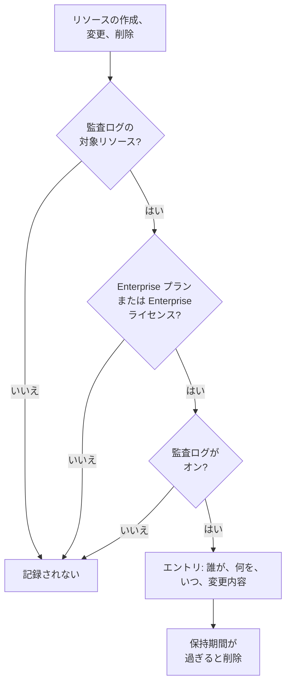

# 監査ログ

監査ログは、プロジェクトで誰が何を変更したかを記録します。対象となるリソースの作成、変更、削除のすべてを、変更前と変更後の値とともに記録します。誰がモニターをオフにしたか、誰が API キーを変更したかを調べたり、コンプライアンス審査のための記録を残したりするのに使います。OneUptime Cloud では Enterprise プランに、セルフホストでは Enterprise Edition に含まれます。

:::cards
- [監査ログを有効にする](#監査ログを有効にする): すべてのプロジェクトで最初はオフです。
- [監査ログを読む](#監査ログを読む): 誰が、何を、いつ変更したか。
- [記録される内容](#記録される内容): 対象となるリソースとアクション。
- [エントリの保持期間](#エントリの保持期間): 7 日から 180 日まで。
:::

## 変更がエントリになるまで

- **最初はオフです。** 誰かが監査ログを有効にするまで、プロジェクトは何も記録せず、それ以前のことも記録しません。
- **人が行ったことを記録します。** 人、API キー、MCP クライアント、ワークフローによる変更が記録されます。バックグラウンドジョブなど OneUptime 自身による変更は、**システムイベントを保存** をオンにしない限り記録されません。
- **エントリは変更できません。** ダッシュボードでも API でも、エントリを編集または削除することはできません。エントリは保持期間が過ぎたときにだけ消えます。

## 始める前に

- **OneUptime Cloud では Enterprise プラン。** 他のプランでは、監査ログのページに機能の内容と入手方法が表示されます。
- **セルフホストでは Enterprise Edition** と、監査ログを含むライセンスが必要です。[エンタープライズ版](/docs/self-hosted/enterprise) を参照してください。
- **監査ログを読めるロール。** Project Owner、Project Admin、Settings Admin、または **Read Audit Log** 権限。監査ログを有効にして設定を変更するには、Project Owner、Project Admin、またはプロジェクトの編集権限が必要です。

## 監査ログを有効にする

:::steps
### 監査ログの設定を開く

**プロジェクト設定 → 監査ログ → 設定** に移動します。サイドメニューの **監査ログ** は最初は折りたたまれています。クリックして開いてください。

### 設定を編集する

**Edit Audit Log Settings** をクリックします。

### 有効にする

**監査ログを有効化** をオンにし、**保持期間（日）** を設定して、**システムイベントを保存** するかどうかを選びます。**変更を保存** をクリックします。
:::

| 設定 | 初期値 | 内容 |
| --- | --- | --- |
| **監査ログを有効化** | オフ | 今後、プロジェクトのリソースの変更を記録します。 |
| **保持期間（日）** | 7 | 各エントリを保持する日数: 7 から 180 まで。 |
| **システムイベントを保存** | オフ | 人やキーが開始したのではない、OneUptime 自身による変更も記録します。 |

これらの設定の変更は、一分以内に反映されます。

## 監査ログを読む

**プロジェクト設定 → 監査ログ → 監査ログ** には、プロジェクトのすべてのエントリが新しい順に表示されます。

| 列 | 表示される内容 |
| --- | --- |
| **タイミング** | どれくらい前か、および日付と時刻。 |
| **アクション** | `Create`、`Update`、`Delete`、またはダウンロードされたパケットキャプチャファイルの `Download`。 |
| **リソース** | リソースの名前 (存在する間はリソースを開けます) と種類。 |
| **アクター** | 変更した主体: 人、API キー、ワークフロー、または OneUptime 自身による変更の場合は `System`。MCP クライアント経由の人による変更では、どのクライアントかが示されます。 |
| **変更** | 変更されたフィールドの数、または作成・削除時に記録されたフィールドの数。クリックすると各フィールドが表示されます。 |

**リソースタイプ**、**リソース名**、**アクション**、**ユーザーのメール**、**時間** で絞り込めます。変更では、変更されたフィールドだけが変更前と変更後で表示され、何も変えない保存ではエントリは追加されません。

モニター、インシデント、アラート、ステータスページ、SLO など多くのリソースにも、サイドメニューの折りたたまれたセクション (**詳細** など) に専用の **監査ログ** ページがあります。そのページにはそのリソースのエントリと、それに属するもののエントリだけが表示されます。SLO のページには、その SLO のルールとオーナーも表示されます。

## 記録される内容

| リソース | ログでの **リソースタイプ** |
| --- | --- |
| モニター | `Monitor` |
| インシデント | `Incident` |
| アラート | `Alert` |
| ステータスページ | `Status Page` |
| 定期メンテナンスイベント | `Scheduled Maintenance Event` |
| オンコールポリシー | `On-Call Policy` |
| サービスレベル目標 (SLO) | `Service Level Objective` |
| SLO のルールとオーナー | `SLO Burn Rate Rule`、`SLO Monitor Rule`、`Service Level Objective User Owner`、`Service Level Objective Team Owner` |
| チーム | `Team` |
| カスタムロールと、それを付与されたチームや API キー | `Custom Role`、`Team Custom Role`、`API Key Custom Role` |
| ラベル | `Label` |
| インシデントの状態と重大度 | `Incident State`、`Incident Severity` |
| アラートの状態と重大度 | `Alert State`、`Alert Severity` |
| モニターステータス | `Monitor Status` |
| 定期メンテナンスの状態 | `Scheduled Maintenance State` |
| インシデントロール | `Incident Role` |
| ポストモーテムのステータス | `Postmortem Status` |
| API キー | `API Key` |
| ユーザーが接続する MCP クライアント | `MCP Client Authorization` |
| インベントリ項目 | `Inventory Item` |
| コレクター設定 | `Collector Config` |
| vCenter サーバー | `vCenter` |
| パケットキャプチャとそのダウンロード | `Packet Capture` |
| セキュリティケース、プレイブックとその実行、保護対象のエンティティ | `Security Case`、`Security Playbook`、`Security Playbook Run`、`Protected Entity` |

管理者が他の人のアカウントで通知方法や個人のオンコールルールを追加または削除したときも記録されます。アドレスや番号そのものは記録されません。

それ以外のデータ、たとえばチームの所属メンバーや、チームに個別に追加された権限は、監査ログに含まれません。シークレットキーのように誰も読めないフィールドは、どのエントリにも含まれません。

## エントリの保持期間

各エントリは、記録された時点でプロジェクトに設定されていた **保持期間（日）** の間保持され、その後削除されます。新しい保持期間は新しいエントリに適用され、記録済みのエントリの日付は変わりません。

エントリを 180 日より長く保存するには、**Read Audit Log** を持つ API キーで API から読み取り、必要な場所に保存します。[OneUptime API リファレンス](/docs/api-reference/api-reference) を参照してください。

## プランやライセンスに監査ログが含まれなくなったとき

- **OneUptime Cloud では**、Enterprise プランから外れたプロジェクトは記録を停止し、プランに戻るまで監査ログのページにアップグレードカードが表示されます。
- **セルフホストでは**、ライセンスなしで Enterprise の試用期間または猶予期間が終わったとき、またはライセンスに監査ログが含まれていないとき、監査ログは記録を停止します。監査ログには赤字でそう表示されます。記録済みのエントリは保持され、ライセンスを有効にするとすぐに同じ設定で記録が再開されます。[ライセンスの期限切れまたは未設定のとき](/docs/self-hosted/enterprise#ライセンスの期限切れまたは未設定のとき) を参照してください。

## トラブルシューティング

:::details 監査ログが空
監査ログは最初はオフで、オンにする前のことは記録しません。監査ログがオフであると一覧に表示されている場合は、そのリンクから設定を開いてオンにしてください。そうでない場合は、モニターかインシデントを変更してから一覧を更新してください。
:::

:::details 変更が監査ログにない
リソースが [記録される内容](#記録される内容) に含まれていること、そして監査ログをオンにした後に変更されたことを確認してください。OneUptime 自身による変更は、**システムイベントを保存** がオンのときだけ記録されます。
:::

## 次のステップ

:::cards
- [ユーザー、チーム、権限](/docs/permissions/index): 監査ログを読める人を決めます。
- [プロジェクト設定](/docs/configuration/project-settings): プロジェクトのその他の設定。
- [請求と使用量](/docs/configuration/billing): プロジェクトのプランを変更します。
- [エンタープライズ版](/docs/self-hosted/enterprise): セルフホストのインストールでの監査ログ。
:::
