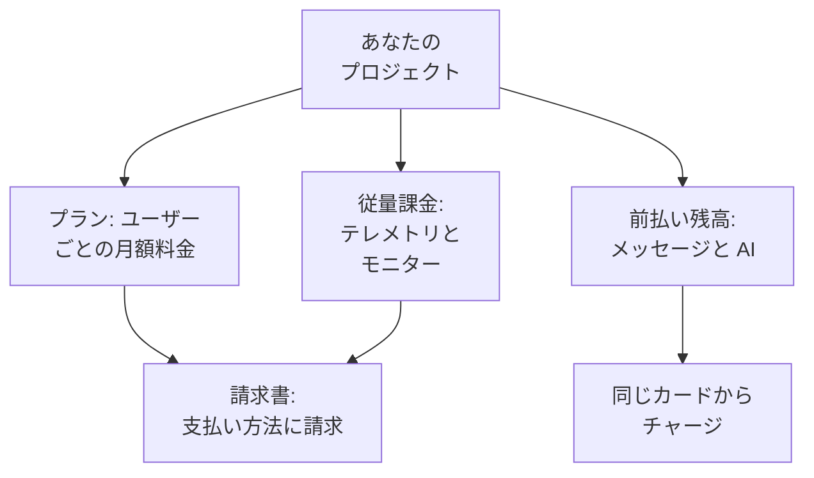

# 請求と使用量

OneUptime Cloud では、プロジェクトはユーザー単位のプラン料金と、使用した分の料金を支払います。使用した分とは、テレメトリ、アクティブなモニター、そして前払い残高から支払うメッセージと AI の処理です。このページでは、それぞれをどこで確認・変更できるか、誰が操作できるかを説明します。セルフホストのインストールには請求の仕組みも、これらのページもありません。

:::cards
- [プランとシート](#プランとシート): プランの料金と、シートとして数えられる人。
- [支払い方法](#支払い方法): 請求書の支払いに使うカード。
- [請求書](#請求書): 支払い、ダウンロード、使用量の確認。
- [前払い残高](#前払い残高): メッセージと AI。手動または自動でチャージします。
:::

## プロジェクトが支払うもの

| 項目 | 料金体系 |
| --- | --- |
| プラン | ユーザーごとの月額料金で、月払いまたは年払い。プロジェクトのメンバーは、それぞれシートとして数えられます。 |
| テレメトリ | 取り込んだ GB あたり $0.10、保持期間は 15 日です。保持期間を延ばすと料金が上がり、7 日未満の保持は 7 日として課金されます。[保持にかかる費用](/docs/telemetry/data-retention#保持にかかるコスト) を参照してください。 |
| セッションリプレイ | GB あたり $2、保持期間は 15 日です。 |
| アクティブなモニター | モニターあたり月額 $1。手動モニター以外のモニターはすべてアクティブで、オフにしていてもアクティブです。 |
| SMS、電話、WhatsApp、Telegram | 各メッセージの送信時に、プロジェクトの残高から支払われます。 |
| OneUptime AI | 独自の LLM プロバイダーで実行している場合を除き、プロジェクトの AI クレジットから支払われます。 |

[料金ページ](https://oneuptime.com/pricing) でプランを比較できます。

## 始める前に

- **OneUptime Cloud。** **プロジェクト設定** の **請求と請求書** セクションは OneUptime Cloud にのみあり、最初は折りたたまれています。タイトルをクリックして開きます。
- **請求を読めるロール。** Project Owner、**Manage Billing** を持つ人、そして請求用の三つのロールは、すべての請求ページを読めます。[誰が何をできるか](#誰が何をできるか) を参照してください。

## プランとシート

**プロジェクト設定 → 請求と請求書 → 請求** に移動します。**現在のプラン** カードには、プロジェクトのプランとユーザーあたりの料金、そして **シート** が表示されます。シートはプロジェクトのメンバー一人につき一つです。

招待した時点から、承諾される前であっても、削除するまでその人はシートとして数えられます。シート数を変えるには、メンバーを招待または削除します。[メンバーの招待](/docs/permissions/inviting-people) を参照してください。

## プランを変更する

:::steps
### 先に支払い方法を追加する

プランの変更には支払い方法が必要です。支払い方法がない場合、**プランを変更** を押すと代わりに **支払い方法を追加** が開きます。[支払い方法](#支払い方法) を参照してください。

### プランの変更を開く

**現在のプラン** カードで **プランを変更** をクリックします。**年間プラン** は最初はオンです。月額料金を見るにはオフにします。

### プランを選ぶ

各プランにはユーザーあたりの料金が表示されます。プランの下の注記には、試用期間がどうなるかが表示されます。プロジェクトがまだ試用期間中なら **Your free trial carries over**、そうでなければ **Changing plan does not start a free trial** です。

### 変更を保存する

**変更を保存** をクリックします。有料プランは変更した時点から課金され、そのプランで招待した人も招待した時点から課金されます。
:::

API キーには Growth プラン以上が必要で、Scale プラン未満では SCIM 接続はユーザーの削除しかできません。それらを停止するプランは、選ぶ前に対象の数を表示し、停止中は **請求** ページに **このプランには含まれません** と表示されます。何も削除されず、それらを含むプランに戻れば再び動作します。

> [!NOTE]
> OneUptime をリセラーやクラウドマーケットプレイス (AWS Marketplace、Microsoft Marketplace、Google Cloud Marketplace、Vercel Marketplace) 経由で購入しましたか? その場合は **請求** ページにそう表示されます。リセラーがプランを代わりに変更し、マーケットプレイスはプロジェクトのプランと使用量をクラウドの請求書に計上します。

## 支払い方法

**支払い方法** カードには、プロジェクトに登録されたカードが一覧表示されます。請求書はデフォルトのカードに自動で請求されます。

:::steps
### 追加ダイアログを開く

**支払い方法** カードで **支払い方法を追加** をクリックします。

### カード情報を入力する

支払い情報を入力し、**支払い方法を保存** をクリックします。追加した支払い方法がデフォルトになり、追加すると従量課金が有効になります。プランは変わりません。
:::

- **デフォルトに設定** は、一覧の別の支払い方法を請求先にします。
- デフォルトの支払い方法にある **自動支払いを再同期** は、まだ古いカードに請求している更新を修正します。
- プロジェクトには少なくとも一つの支払い方法が残ります。最後の一つを削除する前に、別の支払い方法を追加してください。

## 請求先住所と請求書の送付先メール

**ビジネス詳細 / 請求先住所** カードには、請求書に記載されるあなたの情報が入ります。**更新** をクリックし、二つのステップを入力します。

| ステップ | 項目 |
| --- | --- |
| **請求先住所** | **ビジネス詳細 / 請求先住所**: 会社の正式名称、住所、VAT または税番号。**国**: 請求先の国。 |
| **請求書** | **財務 / 経理メール**: 請求書、領収書、請求に関するメッセージの送信先。複数のアドレスはカンマで区切ります。**請求書をメールで送信**: 発行された請求書をすぐにそこへ送ります。 |

## 請求書

**プロジェクト設定 → 請求と請求書 → 請求書** には、プロジェクトの請求書が **請求書番号**、**請求書の日付**、**金額**、**請求書のステータス** とともに一覧表示されます。

- **請求書を支払う** で、未払いの請求書を支払います。
- **ダウンロード** で、請求書を PDF で開きます。未払いの請求書では、行メニュー **⋯** の中にあります。

銀行が支払いをまだ処理中の場合は、OneUptime がそう表示します。カード払いの確認に最大 2 日かかる銀行もあり、請求書は自動で更新されます。再度支払わないでください。

## 使用履歴

**プロジェクト設定 → 請求と請求書 → 使用履歴** には、プロジェクトが送信したテレメトリが、製品、サービス、日ごとに一行ずつ表示されます。

| 列 | 表示される内容 |
| --- | --- |
| **製品** | ログ、トレース、メトリクス、その他の種類のテレメトリ。 |
| **日** | 送信された日。 |
| **サービス** | 送信したサービス、またはホスト、クラスター、その他のリソース。 |
| **取り込まれたデータ（GB 単位）** | 取り込まれた量。 |
| **データ保持期間（日数）** | 保持される期間。 |
| **合計コスト** | かかった費用 (米ドル)。 |

その日の使用量は、日が終わると表示されます。**製品**、**日**、**サービス** で絞り込むと、増えたものを見つけられます。

## 前払い残高

SMS、電話、WhatsApp と Telegram のメッセージはプロジェクトの残高から、OneUptime AI は AI クレジットから支払われます。それぞれ事前にチャージします。

| 残高 | 場所 |
| --- | --- |
| SMS、電話、WhatsApp、Telegram | **プロジェクト設定 → 通知 → 通知設定** |
| OneUptime AI | **プロジェクト設定 → AI → AI クレジット** |

:::steps
### 今すぐチャージする

ページの **現在の残高** カードで **残高をチャージ** をクリックします。$20 から $1,000 までの金額を入力し、**チャージ** をクリックします。金額はプロジェクトのカードに請求されます。

### または自動でチャージする

**自動チャージ** カードで **自動チャージを編集** をクリックし、**自動チャージを有効化** をオンにします。最初はオフです。オンにすると、残高が $10 まで下がるたびに OneUptime が $20 を追加します。金額は変更できます。
:::

残高で支払えない場合、メッセージは送信されないか OneUptime AI が停止し、プロジェクトのオーナーにメールが届きます。[呼び出しが送信されない場合](/docs/on-call/escalation-rules#呼び出しが送信されない場合) と [AI クレジットがなくなったとき](/docs/ai/ai-sre#ai-クレジットがなくなったとき) を参照してください。

## 誰が何をできるか

| 操作 | 必要なもの |
| --- | --- |
| 請求ページを読む: プラン、請求書、使用量、残高、支払い方法 | Project Owner、**Manage Billing**、**請求管理者**、**請求メンバー**、または **請求閲覧者** |
| 請求書をダウンロードする | Project Owner、Project Admin、**Manage Billing**、**Read Invoices**、**請求管理者**、または **請求メンバー** |
| 請求先住所と請求書の送付先メールを変更する | Project Owner、**Manage Billing**、**請求管理者**、または **請求メンバー** |
| SMS、電話、WhatsApp、Telegram をオンまたはオフにする | Project Owner、**Manage Billing**、または **請求管理者** |
| 支払い方法を追加する | Project Owner、**Manage Billing**、または **Create Payment Method** |
| 請求書を支払う | Project Owner、**Manage Billing**、または **Edit Invoices** |
| プランの変更、残高のチャージ、自動チャージの変更 | Project Owner または **Manage Billing** |

使用できないボタンはロックされた状態で表示され、誰が使えるかが示されます。請求ロールについては [ユーザー、チーム、権限](/docs/permissions/index#チーム) を参照してください。

## プランが必要な設定

OneUptime Cloud では、次の管理設定にプランが必要です。そのプランを契約していないページには、機能の内容と必要なプランが表示されます。

| 設定 | 必要なプラン |
| --- | --- |
| ラベル | Growth |
| API キー | Growth |
| 独自の SMTP サーバーと Twilio アカウント | Growth |
| 独自の LLM プロバイダー | Growth |
| MCP クライアントの接続 | Growth |
| チームの作成 | Scale |
| SSO、OIDC、SCIM | Scale |
| 保持期間のオーバーライド | Scale |
| 監査ログ | Enterprise |

## プランを解約する

プロジェクトへの支払いをやめるには、プロジェクトを削除します。削除されると請求は止まります。[プロジェクトを削除する](/docs/configuration/project-settings#プロジェクトを削除する) を参照してください。リセラー経由で購入したプロジェクトはリセラーで、クラウドマーケットプレイス経由で購入したプロジェクトはマーケットプレイスで解約します。

## トラブルシューティング

:::details "Add a payment method in Project Settings > Billing and Invoices > Billing before using paid monitoring or telemetry"
Free プランのプロジェクトでアクティブなモニターを作成したりテレメトリを送信したりするには、支払い方法が必要です。これらは従量課金だからです。[支払い方法](#支払い方法) で追加してください。手動モニターは引き続き無料です。
:::

:::details 未払いの請求書があるという赤いバナーが表示される
未払いの請求書があるプロジェクトは非アクティブになり、未払いのままだと削除されます。**請求書** を開き、未払いの各請求書で **請求書を支払う** をクリックしてください。
:::

:::details プランを変更で支払い方法を追加が開く
プロジェクトにまだ支払い方法がありません。支払い方法を追加してから、プランを変更してください。
:::

:::details 使用履歴が空
使用量は日ごとに集計され、その日が終わると表示されます。テレメトリを送信していないプロジェクトには行がありません。
:::

## 次のステップ

:::cards
- [プロジェクト設定](/docs/configuration/project-settings): プロジェクト全体に適用されるその他の設定。
- [メンバーの招待](/docs/permissions/inviting-people): シートを使うメンバーを追加します。
- [データ保持](/docs/telemetry/data-retention): テレメトリを必要な期間だけ保持します。
- [破棄フィルターとスクラブルール](/docs/telemetry/drop-filters-and-scrub-rules): 使わないテレメトリへの支払いをやめます。
:::
