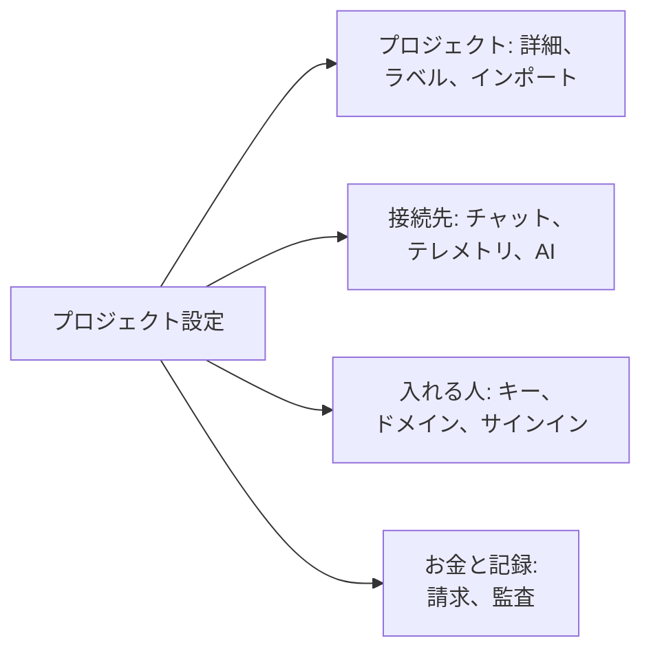

# プロジェクト設定

プロジェクト設定には、プロジェクト全体に適用されるものがまとまっています。名前、接続しているツール、キー、ユーザーのサインイン方法、請求、監査証跡です。ほとんどは一度設定すれば、あまり見直すことはありません。このページはその全体の地図であり、専用のページがない設定、つまりプロジェクトの詳細、ラベル、機能フラグ、プロジェクトの削除を扱います。

:::cards
- [設定を探す](#設定を探す): サイドメニューの各セクションの内容。
- [プロジェクトの詳細](#プロジェクトの詳細): 名前、ID、サポートのアクセス。
- [ラベル](#ラベル): リソース、権限、ルールのためのタグ。
- [プロジェクトを削除する](#プロジェクトを削除する): 必要なものと、一緒に消えるもの。
:::

## プロジェクト設定を開く

**製品 → 設定 → プロジェクト設定** に移動します。サイドメニューはページをセクションごとにまとめており、最初に開いているのは **基本** だけです。セクションのタイトルをクリックすると開きます。セクション内のどのページでも、そのセクションは自動的に開きます。

## 始める前に

- **プロジェクトを変更できるロール。** これらの設定のほとんどは Project Owner と Project Admin が変更します。請求、通知チャネル、プロジェクトの削除には、各セクションに記載のとおり、さらに権限が必要です。
- **OneUptime Cloud では、その設定を含むプラン。** 一部の設定にはプランが必要です。[プランが必要な設定](/docs/configuration/billing#プランが必要な設定) を参照してください。

## 設定を探す

| セクション | ページ | 詳しい説明 |
| --- | --- | --- |
| **基本** | **プロジェクト**、**ラベル** | [プロジェクトの詳細](#プロジェクトの詳細)、[ラベル](#ラベル) |
| **ワークスペース** | **Slack**、**Microsoft Teams**、**ビデオ通話** | [Slack](/docs/workspace-connections/slack)、[Microsoft Teams](/docs/workspace-connections/microsoft-teams)、[ビデオ通話](/docs/workspace-connections/video-calls) |
| **テレメトリと APM** | **取り込みキー**、**データ保持** | [取り込みキー](/docs/telemetry/ingestion-keys)、[データ保持](/docs/telemetry/data-retention) |
| **通知** | **通知設定**、**通知ログ**、**モバイルアプリ** | [通知](#通知) |
| **AI** | **AI 機能**、**LLM プロバイダー**、**外部 MCP サーバー**、**AI クレジット**、**AI ログ**、**MCP サーバー** | [LLM プロバイダー](/docs/ai/llm-provider)、[外部 MCP サーバー](/docs/ai/external-mcp-servers)、[MCP サーバー](/docs/ai/mcp-server)、[AI SRE](/docs/ai/ai-sre#コスト管理) |
| **詳細** | **ドメイン**、**API キー**、**機能フラグ**、**別のツールからインポート** | [カスタムドメイン](/docs/status-pages/branding-and-domains#カスタムドメイン)、[API キー](/docs/permissions/index#api-キー)、[機能フラグ](#機能フラグ)、[Opsgenie からの移行](/docs/moving-to-oneuptime/opsgenie) とその他の移行ガイド |
| **セキュリティ** | **SSO**、**SCIM** | [SSO](/docs/identity/sso)、[SCIM](/docs/identity/scim) |
| **請求と請求書** | **請求**、**使用履歴**、**請求書** | [請求と使用量](/docs/configuration/billing) |
| **監査ログ** | **監査ログ**、**設定**、**エクスポート** | [監査ログ](/docs/configuration/audit-logs)、[監査ログのエクスポート](/docs/configuration/audit-log-export) |
| **危険な操作** | **危険な操作** | [プロジェクトを削除する](#プロジェクトを削除する) |

**請求と請求書** と **AI クレジット** は OneUptime Cloud にしかありません。セルフホストのインストールには請求はありません。

## プロジェクトの詳細

**プロジェクト設定 → 基本 → プロジェクト** には、カードが二つあります。

**プロジェクトの詳細** には、プロジェクトの名前と ID が表示されます。

- **プロジェクト名**: プロジェクトの名前を変えるには **プロジェクトを編集** をクリックします。名前は 2 文字以上です。名前の変更には、Project Owner、またはプロジェクトの編集権限か請求の管理権限が必要です。
- **プロジェクト ID**: API、CLI、Terraform で使うとき、またはサポートに問い合わせるときにコピーします。
- **データレジデンシー**: OneUptime Cloud で、OneUptime が記録した、プロジェクトのデータを保存する場所。設定するのは OneUptime だけです。

**カスタマーサポートのアクセス** は、OneUptime Cloud で OneUptime のサポートチームがプロジェクトを開けるかどうかを決めます。サポートが必要なときは **OneUptime サポートにこのプロジェクトへのアクセスを許可** をオンにします。サポートはプロジェクト内のすべてを表示・変更できるようになるため、OneUptime が先に確認を求めます。**サポートを許可** をクリックしてください。終わったらオフにします。変更はすぐに保存されます。これを変更するのは Project Owner と Project Admin です。

## ラベル

ラベルは、モニター、インシデント、ステータスページなどのリソースに付けるタグです。一覧の絞り込みやグループ化に使うほか、チームの権限やプロジェクトのルールが及ぶ範囲を限定します。

:::steps
### ラベルを開く

**プロジェクト設定 → 基本 → ラベル** に移動します。

### ラベルを作成する

**ラベルを作成** をクリックします。**名前** と、必要なら **説明** を入力します。**ラベルの色** には、ページ上のどのラベルもまだ使っていない色がすでに選ばれています。好みに応じて別の色を選んでください。**ラベルを作成** をクリックして保存します。
:::

OneUptime Cloud でラベルを作成・変更するには Growth プランが必要です。ラベルで権限を限定する方法は [ラベル](/docs/permissions/index#ラベル)、作成時にリソースへラベルを付ける方法は [ラベルルールと所有者ルール](/docs/configuration/label-and-owner-rules) を参照してください。

一覧では、レコードのラベルが縦にひとつずつ並びます。四つを超えるときは、最初の三つと、残りを表示するリンクが表示されます。ラベルが並ぶ場所（一覧、レコードのページ、各ラベルの選択欄）では、ラベルは自然な順序で並びます。名前が数字で始まるラベルが先に、その数字の順で並び（`2. Team` は `10. Owner` の前）、続いてほかのラベルが大文字と小文字を区別せずにアルファベット順で並びます。ラベルの並び順を決めるには、`1. Category` や `2. Subcategory` のように、名前を数字で始めます。

### ラベルのアーカイブ

ラベルを使わなくするには、削除する代わりに行の **⋯** メニューからアーカイブします。ラベルが付いているものはそのまま保持し、引き続きフィルターにも使えますが、今後どこにも追加できなくなります。すべてのラベル選択からは除かれ、API、Terraform、MCP は拒否します。ダイアログには、そのラベルを使うように設定されているルールと権限が一覧表示され、これらは変更するまでラベルを使い続けます。アーカイブされたラベルは折りたたまれたセクション **アーカイブ済みのラベル** に別に表示され、**アーカイブ解除** で元に戻せます。**削除** は最初に、ラベルが外れるものをすべて一覧表示し、**代わりにアーカイブ** を提示します。

## 通知

**プロジェクト設定 → 通知** では、プロジェクトの通知の送り方を設定します。

- **通知設定**: **通知チャネル** カードで、プロジェクトの SMS、電話、WhatsApp、Telegram をオンまたはオフにします。最初はすべてオフです。オンにするのは Project Owner、**Billing Admin**、または **Manage Billing** を持つ人です。このページには、プロジェクト独自のメールサーバー (**カスタム SMTP 設定**、[SMTP](/docs/emails/smtp) を参照) と独自の Twilio アカウント ([Twilio 統合](/docs/self-hosted/twilio-integration) を参照) もあります。OneUptime Cloud では、これらのメッセージの支払いに使う残高もここにあります。[前払い残高](/docs/configuration/billing#前払い残高) を参照してください。
- **通知ログ**: プロジェクトが送信したすべての通知。チャネルごとにタブがあります: **メール**、**SMS**、**WhatsApp**、**Telegram**、**Webhook**、**電話**、**プッシュ**、**ワークスペース**。
- **モバイルアプリ**: iOS 版と Android 版のアプリの入手先。[アプリの概要](/docs/mobile-desktop-apps/index) を参照してください。

## 機能フラグ

**プロジェクト設定 → 詳細 → 機能フラグ** では、プロジェクトのオプション機能をオンまたはオフにします。どれも、切り替えた時点で保存されるスイッチです。現在、このページには **モニターグループ** があり、新しいプロジェクトではオフです。オンにすると、モニターのメニューにモニターグループが追加されます。オフにしてもグループは削除されません。[モニターグループ](/docs/monitor/monitor-groups) を参照してください。

## プロジェクトを削除する

プロジェクトを削除すると、その中のすべてが、すべてのメンバーにとって削除されます。モニター、インシデント、ステータスページ、オンコールの設定、テレメトリです。元に戻す方法はありません。

:::steps
### 危険な操作を開く

**プロジェクト設定 → 危険な操作** に移動します。

### 削除ボタンをクリックする

**プロジェクトを削除** をクリックします。確認を求めるダイアログが表示されます。

### プロジェクト名を入力する

名前をそのとおり正確に入力します。入力するまで **プロジェクトを削除** はロックされたままです。OneUptime Cloud では、ダイアログで解約の理由も尋ねられます。回答は任意です。

### 確定する

**プロジェクトを削除** をクリックします。OneUptime がプロジェクトを削除し、あなたをプロジェクトから外します。
:::

> [!CAUTION]
> プロジェクトの削除は元に戻せません。Project Owner、またはプロジェクトの削除権限が必要です。

OneUptime Cloud では、プロジェクトを削除することでそのプランを解約します。プロジェクトが削除されると請求は止まります。クラウドマーケットプレイス経由で請求されるプロジェクトには使用量の最終請求が発生し、マーケットプレイスでの購入はそこで解約するまで有効なままです。

## トラブルシューティング

:::details サイドメニューのセクションが見当たらない
**基本** 以外のセクションは最初は折りたたまれています。セクションのタイトルをクリックして開いてください。セルフホストのインストールには、**請求と請求書** セクションも **AI クレジット** ページもありません。
:::

:::details プロジェクトを編集がロックされている
名前の変更には、Project Owner、またはプロジェクトの編集権限か請求の管理権限が必要です。ロックされたボタンに、足りない権限が表示されます。
:::

:::details ダイアログでプロジェクトを削除がロックされたまま
ダイアログに表示されているとおりに、プロジェクト名を正確に入力してください。大文字と小文字は区別されます。
:::

## 次のステップ

:::cards
- [メンバーの招待](/docs/permissions/inviting-people): チームをプロジェクトに招待します。
- [請求と使用量](/docs/configuration/billing): プラン、支払い方法、請求書、使用量。
- [監査ログ](/docs/configuration/audit-logs): プロジェクトで誰が何を変更したかを確認します。
- [SSO](/docs/identity/sso): アイデンティティプロバイダーでサインインできるようにします。
:::
