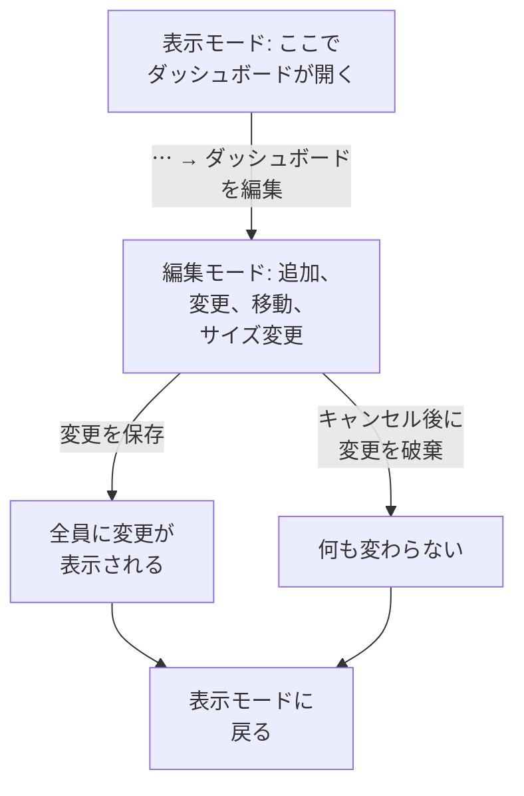

# ダッシュボードを作成する

ダッシュボードを作成するには、**製品 → ダッシュボード** を開き、**ダッシュボードを作成** をクリックします。**ダッシュボードを作成** ダイアログで、始め方を選んでから名前を付けます。**ゼロから作成** では空のダッシュボードになります。テンプレートはウィジェットを、多くの場合は変数も自動で作成し、名前も入力してくれます（プロジェクトにすでに同名のものがある場合は 「Kubernetes Dashboard 2」 のように番号が付きます）。**ダッシュボードを作成** をクリックすると、新しいダッシュボードが開きます。空のダッシュボードはキャンバスで開き、最初のウィジェット用の **ウィジェットを追加** ボタンがあります。

:::cards
- [ダッシュボードの作成](#ダッシュボードの作成): ゼロから、またはテンプレートから始めます。
- [編集と保存](#編集と保存): 変更を保存をクリックするまで、誰にとっても何も変わりません。
- [ウィジェットの追加](#ウィジェットの追加): カタログから選び、設定して、配置します。
- [急上昇部分へのズーム](#急上昇部分へのズーム): チャートをドラッグして、その瞬間のダッシュボード全体を読み取ります。
:::

## 始める前に

プロジェクトのオーナーと管理者は、すべてのダッシュボードを作成、編集できます。それ以外のユーザーにはチームの権限が必要です。ダッシュボードの作成には `CreateDashboard`、変更には `EditDashboard` が要ります。プロジェクトのメンバーと閲覧者は、どちらがなくてもダッシュボードを閲覧できます。ダッシュボードを編集できない人も **⋯** メニューは開けますが、そこでは **ダッシュボードを編集** がロックされ、必要な権限が表示されます。

## ダッシュボードの作成

:::steps
### 始め方を選ぶ

**製品 → ダッシュボード** を開き、**ダッシュボードを作成** をクリックします。**ダッシュボードを作成** ダイアログは **ゼロから作成** から始まります。自分のウィジェットを追加する空のダッシュボードです。その下の **またはテンプレートから始める** に、**おすすめ** のテンプレートが 6 個表示されます。

### テンプレートを選ぶ

テンプレートをクリックすると、追加される内容が表示されます。**ウィジェットを追加** と同じ名前のウィジェットと、ツールバーで絞り込むための変数です。ほかのテンプレートは、検索ボックスの横でカテゴリか **すべてのテンプレート** を選ぶか、**テンプレートを検索…** に入力して探します。入力した語はすべて一致する必要があります。それから **このテンプレートを使う** をクリックするか、テンプレートをダブルクリックします。検索ボックスでは矢印キーでテンプレートを選び、**Enter** で使用します。

### ダッシュボードに名前を付ける

テンプレートの名前は入力済みで、プロジェクトにすでにある名前に続く番号が付きます。**ゼロから作成** では名前が空なので、入力してください。説明は任意で、**その他の項目** の中に折りたたまれています。あとからダッシュボードの **概要** ページで追加することもできます。**戻る** で、離れたときのままのテンプレートに戻ります。

### 作成する

**ダッシュボードを作成** をクリックします。新しいダッシュボードが開きます。テンプレートならすぐにウィジェットが表示され、そうでなければ **ウィジェットを追加** のある空のキャンバスが表示されます。
:::

ピッカーが表示するカテゴリ別のテンプレートは次のとおりです。

| カテゴリ | テンプレート |
| --- | --- |
| 監視と APM | Monitor Dashboard, Metrics Dashboard, Real User Monitoring Dashboard, SLO Dashboard |
| インシデント対応 | Incident Dashboard, Alert Dashboard |
| インフラストラクチャ | Kubernetes Dashboard, Kubernetes Cost Dashboard, Hosts Dashboard, Proxmox Dashboard, VMware Dashboard, Ceph Dashboard, Storage Array Dashboard, Docker Swarm Dashboard, Network Dashboard |

**おすすめ** には Monitor Dashboard、Incident Dashboard、Alert Dashboard、Kubernetes Dashboard、Hosts Dashboard、Metrics Dashboard が入っています。テンプレートは出発点であり、つながりではありません。ダッシュボードを作成したら、自由に変更してください。あとからテンプレートがダッシュボードを更新することはありません。

## 編集と保存

ダッシュボードは閲覧用の表示モードで開きます。変更するには、ツールバーの **⋯** メニューを開いて **ダッシュボードを編集** を選びます。ツールバーの名前の横に **編集中** と表示され、時間範囲やほかのコントロールが **ウィジェットを追加**、**変数**、**キャンセル**、**変更を保存** に置き換わります。その下には、ダッシュボードの **デフォルトの時間範囲** と **デフォルトの自動更新** を設定する行が表示されます。

変更は保存するまであなただけのものです。編集中は何も保存されないため、ほかの人には元のままのダッシュボードが表示され続けます。

- **変更を保存** は、ウィジェット、その位置とサイズ、変数、デフォルトの時間範囲と自動更新をまとめて保存し、表示モードに戻ります。保存が拒否された場合（たとえばその間に権限を失った場合）、変更を保ったまま編集モードにとどまり、理由がグリッドの上に表示されます。
- **キャンセル** は変更を破棄するため、まず確認します。**変更を破棄** は保存済みのダッシュボードに戻り、**編集を続ける** は作業に戻ります。

編集中は自動更新が一時停止し、ズームした時間範囲は選択していた範囲に戻ります。

## ウィジェットの追加

:::steps
### ウィジェットカタログを開く

**ウィジェットを追加** をクリックします。編集中ならツールバーに、空のダッシュボードならキャンバスにあります。カタログはウィジェットを表示内容ごとにグループ化しています。検索ボックスに入力して名前や用途で探し ("error budget", "pods")、Enter キーを押すと最初の結果が追加されます。

### ウィジェットを選ぶ

クリックします。ウィジェットはグリッド上で収まる最初の空き位置に配置され、設定が開きます。

### 表示する内容を設定する

設定ダイアログでは、設定の上にウィジェットの **ライブプレビュー** が表示され、変更のたびにプレビューが追従します。ウィジェットが読み取る内容（メトリクスのクエリ、フィルター、テキスト）と見た目を選び、**完了** をクリックします。

### 配置する

ウィジェットをドラッグして移動し、端や角をドラッグしてサイズを変更します。[グリッド上のウィジェット](#グリッド上のウィジェット) を参照してください。
:::

[ダッシュボード ウィジェット](/docs/dashboards/widgets) で、すべてのウィジェットとその設定を説明しています。

## グリッド上のウィジェット

キャンバスは幅 12 列のグリッドです。ウィジェットはグリッドにスナップし、行を追加するとページが下に伸びます。ウィジェットをドラッグしている間は、点線の枠が配置先を列と行とともに示し、サイズを変更している間は、枠がグリッド単位のサイズを示します。邪魔になるウィジェットは横に移動するため、2 つのウィジェットが重なることはありません。

ウィジェットの種類ごとに最小サイズがあり、描画内容が読める状態に保たれます。チャートは少なくとも幅 6 列、高さ 3 行で、単一の数値は 1 マスに収まります。

グリッドは画面の幅いっぱいに広がります。狭い画面では列の幅が狭くなり、行の高さはそのまま保たれます。スマートフォンでは、ウィジェットはそれぞれ画面の幅いっぱいに縦に並び、グリッド上の順序どおりに表示されます。つまり上の行から順に、同じ行の中では左から右へ並びます。スマートフォンではチャートが高めに描画され、プロットの領域が確保されます。スマートフォンで編集するとグリッドが表示され、横にスクロールできます。

あとでウィジェットを変更するには、編集中にクリックします。設定が再び開き、下部にボタンが 2 つ追加されています。

- **ウィジェットを複製** は、同じ設定のコピーを最初の空き位置に追加します。
- **ウィジェットを削除** は、確認後にウィジェットを削除します。

## 時間範囲と自動更新

表示モードでは、ツールバーの時間範囲ピッカーが、すべてのチャート、数値、ログ、トレースのウィジェットが読み取る期間を決めます。直近 5 分から直近 3 か月までのプリセット、または任意の開始と終了を選びます。ダッシュボードはデフォルトの時間範囲で開きます。編集する人が別の範囲を設定しない限り、直近 1 時間です。

インシデント、アラート、モニター、リソースの一覧は、時間範囲にかかわらず現在の状態を表示します。

時間範囲の隣にある自動更新メニューは、5 秒、10 秒、30 秒、1 分、5 分、15 分ごとにすべてのウィジェットを読み直し、次の更新までのカウントダウンを表示します。調査中は表示が動かないよう、オフにしておいてください。ダッシュボードはデフォルトの自動更新で開きます。編集する人が別の間隔を設定しない限り、オフです。

時間範囲ピッカー、変数、自動更新は、ダッシュボードにウィジェットが 1 つでもあれば表示されます。

### ダッシュボードのデフォルト

ダッシュボードの編集中は、ツールバーのボタンの下の行で、全員がダッシュボードを開くときの設定を決めます。**デフォルトの時間範囲** は直近 5 分から直近 3 か月までのプリセットから選び、**デフォルトの自動更新** も同じ行で選びます。**変更を保存** はこれらをダッシュボードのほかの内容と一緒に保存し、チームにも公開リンクの訪問者にも同じように適用されます。任意の開始と終了はデフォルトにできません。ダッシュボードがその時点にずっと止まってしまうからです。この行は、ダッシュボードにウィジェットが 1 つでもあれば表示されます。

これらの設定より前に保存されたダッシュボードは、直近 1 時間で、それまでの自動更新のまま開きます。API と Terraform では、どちらもダッシュボードの `dashboardViewConfig` にあります。`timeRange` は API リファレンスと同じ表記のプリセット（例: `Past 1 Day`）、`refreshInterval` は `1m` などです。それ以外の値は拒否されます。

### 自分で選んだ設定

表示モードで選んだ時間範囲と自動更新はあなただけのもので、ブラウザがダッシュボードごとに記憶します。再読み込み、ブラウザの再起動、壁面スクリーンの再起動のあとも、ダッシュボードは離れたときの状態で開きます。記憶されるのはプリセットだけです。任意の範囲やズームはページを離れるまでしか続かないので、ダッシュボードが過去の時点に止まったままになることはありません。

各ピッカーの最初の項目は、デフォルト（過去 1 日）のように、ダッシュボードのデフォルトを示します。これを選ぶとデフォルトに戻ります。ブラウザはあなたの選択を忘れ、ダッシュボードは再びデフォルトに従います。あとで誰かがデフォルトを変えても同じです。自分で新しいデフォルトを保存したときは、すぐにそれが表示されます。

### 急上昇部分へのズーム

急上昇を見るために時間範囲ピッカーを使う必要はありません。折れ線グラフや面グラフの気になる区間をドラッグすると、時間範囲ピッカーで選んだときとまったく同じように、**ダッシュボード全体** がその期間に移ります。時間範囲を使うすべてのウィジェットが一緒にクエリを実行し直すため、隣と縮尺の違う 1 つのチャートではなく、ダッシュボード全体で同じ瞬間を読み取れます。ライブの一覧はいつもどおり、いま起きていることを表示し続けます。

**任意のチャートをダブルクリック** すると元に戻ります。何回ズームインしても、ダッシュボードはズームを始める前の範囲に戻ります。ズームが有効な間は時間範囲ピッカーの横に **ズームをリセット** ボタンが表示され、ズームしていないダッシュボードをダブルクリックしても何も起きません。

ズームした期間は固定されるため、自動更新がオンでも先へ進まなくなります。これは意図的な動作です。調査の途中で期間がずれていくほうが困るからです。再び進めるには、ズームをリセットします。

ズームは表示モードでのみ機能します。編集モードでは、ドラッグはウィジェットの移動とサイズ変更になります。棒グラフも同じようにズームでき（棒の上をドラッグします）、ダブルクリックするとほかのチャートと同様にダッシュボードがリセットされます。ズームするのはドラッグだけで、チャートを単にクリックしてもダッシュボードの時間範囲は変わりません。同じ操作は OneUptime 全体のチャートで使えます。[時間範囲にズームインする](/docs/telemetry/charts-and-time-ranges) を参照してください。

## 全画面

**⋯ → 全画面** は、ダッシュボードのウィジェットを画面全体に表示します。壁のディスプレイや会議に便利です。Esc キーで終了します。

## 長く使えるダッシュボードのためのヒント

- **1 つのダッシュボードに 1 つのテーマ。** 焦点を絞ったいくつかのダッシュボードのほうが、監視対象をすべて詰め込んだ 1 ページより役立ちます。
- **最も重要なウィジェットを一番上に。** 人は上から下へ読むので、最初に目に入るものが 「正常か?」 に答えるようにします。
- **テキストウィジェットでセクションに名前を付ける。** 数行ごとに短い見出し（「レイテンシ」、「エラー」、「キャパシティ」）を置くと、部屋の向こうからでもページを見渡しやすくなります。
- **コピーではなく変数を使う。** 2 つ目のサービス用に同じダッシュボードを作ろうとしているなら、代わりに `service` 変数を追加します。[ダッシュボード 変数とフィルター](/docs/dashboards/variables) を参照してください。
- **大きな変更の前にコピーを作る。** ダッシュボードの **設定** ページにある **ダッシュボードを複製** で、アイデアを試すための安全なコピーを作れます。

## 次のステップ

:::cards
- [ダッシュボード ウィジェット](/docs/dashboards/widgets): すべてのウィジェット、その設定、どれを選ぶか。
- [ダッシュボード 変数とフィルター](/docs/dashboards/variables): サービス、ホスト、顧客ごとに 1 つのダッシュボード。
- [共有と公開ダッシュボード](/docs/dashboards/sharing): チームの外にダッシュボードを共有します。
- [ダッシュボード 設定とアクセス権](/docs/dashboards/configuration): 所有者、ラベル、アーカイブ、そして誰が何をできるか。
:::
