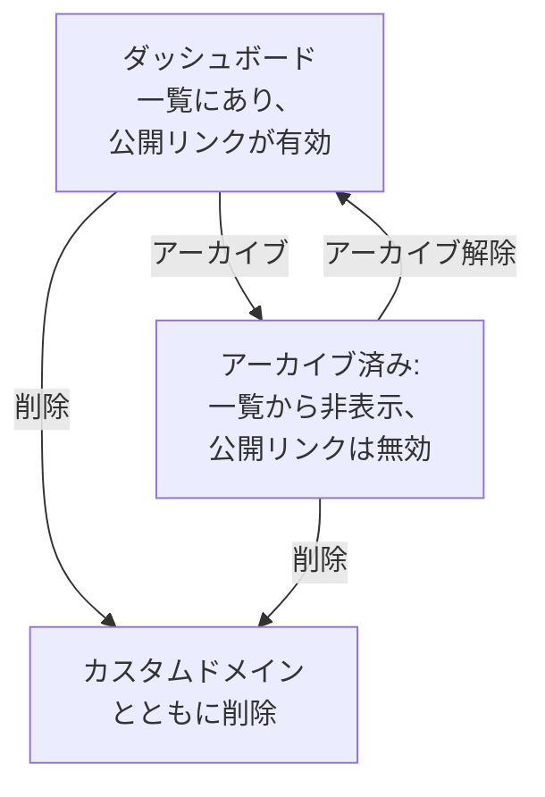

# ダッシュボード 設定とアクセス権

残しておく価値のあるダッシュボードができたら、このページで、誰がそれを閲覧、変更できるか、所有者とラベルでダッシュボードをどう整理するか、そしてダッシュボードのコピー、エクスポート、アーカイブ、削除の方法を確認してください。

:::cards
- [誰が何をできるか](#誰が何をできるか): 各操作の背後にある権限と、それを持つ人。
- [所有者](#所有者): ダッシュボードが属するユーザーとチーム。
- [ダッシュボードの複製](#ダッシュボードの複製): 番号が自動で付く、安全なコピー。
- [ダッシュボードのアーカイブ](#ダッシュボードのアーカイブ): 削除せずにダッシュボードをしまっておきます。
:::

## 誰が何をできるか

ダッシュボードはプロジェクトの [権限](/docs/permissions/index) に従います。各操作には、チームを通じて付与される次のいずれかが必要です。

| 操作 | 必要なもの |
| --- | --- |
| ダッシュボードを閲覧する | `ReadDashboard`、またはプロジェクトのロール: Project Owner、Project Admin、Project Member、Viewer、Settings のロール |
| ダッシュボードを作成する | `CreateDashboard`、Project Owner、または Project Admin |
| ダッシュボードを変更する: ウィジェット、変数、共有、ブランディング、アーカイブ | `EditDashboard`、Project Owner、または Project Admin |
| ダッシュボードを削除する | `DeleteDashboard`、Project Owner、または Project Admin |
| 所有者を追加、削除する | ダッシュボードの所有者の権限、Project Owner、Project Admin、または Project Member |
| カスタムドメインを追加、変更する | ダッシュボードのドメインの権限、Project Owner、Project Admin、Project Member、Settings Admin、または Settings Member |
| 所有者ルールとラベルルールを作成する | ルールの権限、Project Owner、または Project Admin |

つまり Project Member はすべてのダッシュボードを閲覧できますが、ダッシュボードを作るには `CreateDashboard` と `EditDashboard` が必要です。閲覧、編集、削除は、それぞれチームが所有するダッシュボード、または特定のラベルを持つダッシュボードに限定できます。[スコープ: 許可権限が及ぶ範囲](/docs/permissions/index#スコープ-許可権限が及ぶ範囲) を参照してください。

権限はチームの **権限** ページで割り当てます。**製品 → チーム** を開いて、チームを選んでください。

プロジェクトの外で誰がダッシュボードを見られるかは別の問題で、ダッシュボードの **共有設定** ページで決めます。[公開ダッシュボードへのアクセス](#公開ダッシュボードへのアクセス) を参照してください。

## 所有者

ダッシュボードの **所有者** は、そのダッシュボードが属するユーザーとチームです。ダッシュボードの **所有者** ページで追加するか、**ダッシュボード** 一覧で複数のダッシュボードを選んで、まとめて所有者を追加します。

所有者は、そう指定したときにアクセスを絞り込みます。チームが所有するダッシュボードに範囲を限定したチームの権限は、そのチーム、または操作している本人が所有者として登録されているダッシュボードにだけ及びます。所有していること自体は、何の権限も与えません。

**ダッシュボード** 一覧には各ダッシュボードの所有者が表示され、**所有者** フィルターで、ある人やチームが所有するダッシュボードを探せます。

## ラベル

ラベルは、ダッシュボードを整理するためのタグです。ダッシュボードの **概要** ページ (名前や説明もここで編集します) で追加するか、**ダッシュボード** 一覧から複数のダッシュボードにまとめて追加します。

よくあるパターン:

- **チーム別**: `team:platform`、`team:checkout`、`team:growth`。
- **環境別**: `env:prod`、`env:staging`。
- **用途別**: `purpose:oncall`、`purpose:exec`、`purpose:investigation`。

**ダッシュボード** 一覧の **ラベル** フィルターは、ダッシュボードがたくさんたまったプロジェクトで目的のものを探す最速の方法です。ラベルは権限も限定します。特定のラベルに限定したチームの権限は、そのいずれかのラベルを持つダッシュボードにだけ及びます。

## 所有者ルールとラベルルール

所有者やラベルを手で追加する代わりに、ルールに任せられます。**ダッシュボード** のサイドメニューの **設定** にある **所有者ルール** は所有者を、**ラベルルール** はラベルを、条件に一致する新しいダッシュボードに追加します。条件は、すでに付いているラベル、または名前や説明に含まれるパターンです。ルールがどう一致するか、既存のダッシュボードにルールを適用する方法は、[ラベルルールと所有者ルール](/docs/configuration/label-and-owner-rules) で説明しています。

## 公開ダッシュボードへのアクセス

プロジェクトの外で誰がダッシュボードを見られるかは、ダッシュボードの **共有設定** ページ (ダッシュボード自体の **⋯ → 共有** からも開けます。[共有と公開ダッシュボード](/docs/dashboards/sharing) を参照) での 1 つの選択です。

1. **このプロジェクトのメンバーのみ** (既定) — ダッシュボードに公開リンクはなく、公開アドレスには「見つかりません」のページが表示されます。
2. **リンクを知っている全員** — 公開リンクを知っている人なら誰でも、サインインせずに見られます。
3. **リンクとパスワードを知っている全員** — 訪問者は、ダッシュボードが表示される前にパスワードを入力します。

同じページの **その他の設定** にある **IP 許可リスト** (Scale プラン) は、リストにない IP アドレスから公開リンクへのリクエストを拒否します。最も厳重な公開設定は、**リンクとパスワードを知っている全員** と IP 許可リストの組み合わせです。両方の層が欲しいパートナーポータルなどに便利です。

## ダッシュボードの複製

ダッシュボードをコピーするには、ダッシュボードを開いて **設定** ページに移動し、**ダッシュボードを複製** をクリックします。コピーの名前は自動で入力されます。ダッシュボードの名前に、プロジェクトにすでにある名前に続く番号が付きます (「Checkout API」 のコピーは 「Checkout API 2」、そのコピーは 「Checkout API 3」 になります)。必要なら名前を変え、**ダッシュボードを複製** で確定すると、コピーが開きます。コピーには、ダッシュボードのウィジェット、変数、説明、ラベルが含まれます。ブランディングとカスタムドメインは元のダッシュボードに残り、公開共有は常にオフで始まるため、オンにするかどうかを自分で決められます。

テンプレート (たとえば「うちのオンコール用ダッシュボード」) から、特定のサービス用のコピーを派生させたいときに適した方法です。

## エクスポートとインポート

ダッシュボードは JSON で持ち運べます。

- ダッシュボードの **設定** ページにある **ダッシュボードをエクスポート** は、ダッシュボードを JSON ファイルとしてダウンロードします。複数をエクスポートするには、**ダッシュボード** 一覧で選んで **JSON をエクスポート** を選びます。
- **ダッシュボード** 一覧の上にある **JSON をインポート** は、そのようなファイルから、このプロジェクトまたは別のプロジェクトにダッシュボードを作成します。

エクスポートには、ウィジェットや変数を含むダッシュボード自身の設定が入ります。所有者とラベルは含まれません。SLO やデータソースなど、このプロジェクトのリソースを指すウィジェットでは、別のプロジェクトでそれらを選び直す必要がある場合があります。

## ダッシュボードのアーカイブ

使わなくなったものの残しておきたいダッシュボードはアーカイブします。アーカイブしたダッシュボードは **ダッシュボード** 一覧から消え、公開されていた場合は公開リンクが機能しなくなります。URL とカスタムドメインは "Dashboard not found" を返します。ウィジェット、変数、ブランディング、ドメイン、公開設定はすべて保持されるため、アーカイブを解除すると、公開リンクも含めて元どおりに戻ります。

1 つのダッシュボードをアーカイブするには、ダッシュボードを開いて **設定** ページに移動し、**アーカイブ** をクリックします。複数をアーカイブするには、**ダッシュボード** 一覧で選んで **アーカイブ** を選びます。元に戻すには、**ダッシュボード → 詳細 → アーカイブ済み** を開いて選び、**アーカイブ解除** を選ぶか、ダッシュボードを開いてページ上部のバナーにある **アーカイブ解除** をクリックします。

アーカイブは削除の代わりになる、元に戻せる操作です。迷ったら、まずアーカイブを選んでください。

## ダッシュボードの削除

ダッシュボードの **削除** ページを開きます。削除は元に戻せません。ダッシュボード、そのウィジェットと変数、そしてダッシュボードに関連付けられたすべてのカスタムドメインが削除されます。テレメトリには影響しません。

ダッシュボードがカスタムドメインで公開されている場合、削除した時点でそのアドレスは応答しなくなります。そのアドレスを引き続き提供するには、このダッシュボードを削除したあとで、ドメインを別のダッシュボードに追加してください。ドメインは、同時には 1 つのダッシュボードにしか属しません。

## 監査ログ

ダッシュボードの **監査ログ** ページには、ダッシュボードに加えられたすべての変更と、その変更者が一覧表示されます。監査ログは Enterprise プランと [エンタープライズ版](/docs/self-hosted/enterprise) の機能です。

## データの保持とバックアップ

ダッシュボード自体に期限はありません。表示するデータはプロジェクトの保持設定に従います。時間範囲を直近 3 か月にしても、ログを 15 日間保持するプロジェクトでは、表示されるのは直近 15 日分です。

OneUptime をセルフホストしている場合は、データベースを定期的にバックアップすれば十分です。ダッシュボードの設定は、プロジェクトのほかのデータと一緒に保存されています。OneUptime Cloud では、バックアップは自動で行われます。自分用のコピーが欲しい場合は、ダッシュボードを JSON でエクスポートするか、[OneUptime API](/docs/api-reference/api-reference) で読み取ってください。

## 次のステップ

:::cards
- [共有と公開ダッシュボード](/docs/dashboards/sharing): 公開リンク、パスワード、IP 許可リスト、カスタムドメイン。
- [ユーザー、チーム、権限](/docs/permissions/index): チーム、ロール、スコープ、ブロック。
- [ダッシュボード 変数とフィルター](/docs/dashboards/variables): サービスごとに 1 つのダッシュボード。
- [ダッシュボード 概要](/docs/dashboards/index): 全体像。
:::
