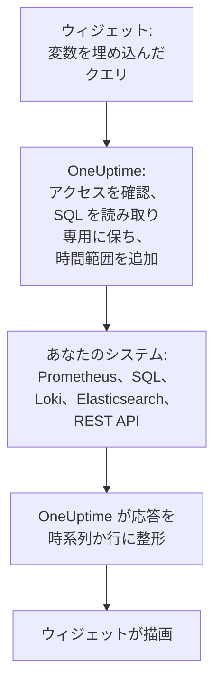

# 外部データソース

外部データソースは、Prometheus、SQL データベース、ClickHouse、Loki、Elasticsearch、REST API など、OneUptime の外にあるシステムを接続し、そのデータを自分のデータの隣にダッシュボードで表示できるようにします。システムの接続は一度だけです。その後は、各ウィジェットがそのシステム自身の言語で読み取り専用のクエリを実行します。

:::cards
- [データソースを接続する](#データソースを接続する): 種類を選び、場所とサインイン方法を指定します。
- [クエリを書く](#クエリを書く): PromQL、SQL、LogQL、Query DSL、またはリクエスト。
- [制限](#制限): 双方を守るタイムアウトと上限。
- [安全性](#安全性): 読み取り専用のクエリと、書き込み専用の認証情報。
:::

## クエリの実行の流れ

ウィジェットは、変数を埋め込んだ状態のクエリを OneUptime に送ります。OneUptime は、あなたがそのデータソースを読み取れることを確認し、時間範囲を埋め込み、保管している認証情報であなたのシステムに問い合わせます。そして応答を、ウィジェットが描画する時系列または行の形に整えます。



## 始める前に

- **それを含むプラン。** OneUptime Cloud では、データソースの作成と変更に **Growth** プランが必要です。削除はどのプランでもできます。
- **追加するための権限。** プロジェクトのオーナーと管理者はデータソースを追加できます。それ以外のユーザーには `CreateDataSource` が必要で、変更と削除には `EditDataSource` と `DeleteDataSource` が必要です。プロジェクトのデータソースを閲覧できる人 (メンバーや閲覧者を含む) は全員、そのウィジェットのデータを見られます。
- **読み取り専用のアカウント。** ダッシュボードは読み取るだけです。データベースは読み取りしかできないアカウントで、HTTP ソースはクエリしかできないトークンで接続してください。
- **到達経路。** あなたのシステムに接続するのは OneUptime の API サーバーなので、そこから到達できる必要があります。拒否されるアドレスについては [安全性](#安全性) を参照してください。

## 対応しているシステム

| 種類 | クエリ言語 | 対応先 |
| --- | --- | --- |
| Prometheus | PromQL | Prometheus, Thanos, Cortex, Mimir, VictoriaMetrics |
| PostgreSQL | SQL | PostgreSQL, TimescaleDB, CockroachDB |
| MySQL | SQL | MySQL, MariaDB |
| Microsoft SQL Server | T-SQL | SQL Server, Azure SQL |
| ClickHouse | SQL | ClickHouse (HTTP インターフェース経由) |
| Grafana Loki | LogQL | Loki と Loki 互換のエンドポイント |
| Elasticsearch | Query DSL (JSON) | Elasticsearch, OpenSearch |
| REST API | リクエスト (JSON) | JSON で応答する任意の HTTP(S) API |

## データソースを接続する

:::steps
### データソースを開く

**製品 → ダッシュボード** を開き、サイドメニューの **設定** を展開して、**データソース** をクリックします。

### 種類を選ぶ

**データソースを作成** をクリックします。**データソースの種類を選択** ダイアログでは、種類が保持する内容 (メトリクス、ログ、データベース、検索、API) ごとにグループ化されています。1 つクリックします。

### 名前を付ける

**基本情報** で **名前** (たとえば「本番 Prometheus」) を付け、必要なら **説明** も入力します。

### 場所を指定する

**接続** では、HTTP ソースには応答する **URL** を指定します。データベースには **データベースのホスト**、**データベースのポート** (5432、3306、1433、8123 なら空のままにします)、**データベース名** を指定します。

### サインイン方法を指定する

**認証** で **ユーザー名** と **パスワード** を入力します。HTTP ソースの場合は、Bearer トークンとして送られる **API トークン** を入力します。**その他の項目** には、`{ "X-Scope-OrgID": "tenant-1" }` のような **カスタム HTTP ヘッダー** と、**追加オプション** があります。追加オプションは、データベース用の `sslEnabled` と `sslRejectUnauthorized`、Elasticsearch 用の `elasticsearchIndex` です。Elasticsearch は、これを指定しないとすべてのインデックス (`*`) を読み取ります。

### テストする

**データソースを作成** をクリックし、その行の **テスト** をクリックします。OneUptime は指定した情報で接続し、成功したか、何が問題だったかを知らせます。
:::

あとでデータソースを変更するには、一覧から開きます。**データソースの詳細** の **編集** はシークレット以外をすべて変更します。**認証情報を更新** は、パスワード、トークン、ヘッダーを置き換え、空のままにしたフィールドは元のまま残します。**テスト** で再び確認できます。

## ウィジェットで使う

ダッシュボードを編集し、**ウィジェットを追加** をクリックして、外部データソース グループのウィジェット (**チャート**、**値**、**ゲージ**、**テーブル**) を選びます。設定では次のことができます。

- **データソース** を選び、**クエリ** を書きます。エディターにはクエリ言語の名前と、その種類の例が表示されます。
- チャートでは、**クエリを追加** で同じ軸にクエリを重ね、**凡例（任意）** で各系列にラベルから名前を付けます。`{{instance}} — errors` と書くと、系列の `instance` ラベルが先頭に入ります。
- 値やゲージでは、**Reduce** で点を 1 つの数値にまとめます。最新の値 (既定)、最初の値、平均、合計、最小、最大のいずれかです。**ユニット** は接尾辞を付け、既知の単位はスケールも調整します。`Bytes` は 1.5 MB、`ms` は 2.4 sec のように表示されます。
- テーブルでは、読み取り専用のクエリなら何でも使え、返ってきた行がそのまま表示されます。

## クエリを書く

種類ごとに独自の言語を使いますが、返す内容のルールは共通です。

- **チャート、値、ゲージには時系列が必要です。** SQL のクエリは、`time`、`timestamp`、`date`、`ts` のいずれかの名前の時刻列と、数値の `value` 列 (またはその最初の数値列) を返します。ほかの列はすべて系列のラベルになります。Elasticsearch には `date_histogram` 集約が、Loki には `rate()` や `count_over_time()` のようなメトリクスクエリが必要です。
- **テーブルは行を表示します。** クエリが返したとおり、SQL の行、Prometheus の系列、Loki のログ行、Elasticsearch のヒット、または REST API の `rowsPath` にあるオブジェクトです。

:::tabs
@tab Prometheus
```text title="PromQL"
sum by (job) (rate(http_requests_total{job=~"{{job}}"}[5m]))
```
@tab SQL
```sql title="SQL"
SELECT date_trunc('minute', created_at) AS time, COUNT(*) AS value
FROM orders
WHERE created_at BETWEEN $__startTime AND $__endTime
GROUP BY 1
ORDER BY 1
```
@tab Loki
```text title="LogQL"
sum by (app) (rate({app="api"} |= "error" [5m]))
```
@tab Elasticsearch
```json title="Query DSL"
{
  "query": { "range": { "@timestamp": { "gte": "$__startTime", "lte": "$__endTime" } } },
  "aggs": {
    "over_time": {
      "date_histogram": { "field": "@timestamp", "fixed_interval": "1m" }
    }
  }
}
```
@tab REST API
```json title="Request"
{
  "path": "/api/stats?from=$__startTimeMs&to=$__endTimeMs",
  "method": "GET",
  "rowsPath": "data.items",
  "timestampField": "time",
  "valueField": "count",
  "seriesField": "service"
}
```
:::

### 時間マクロ

Prometheus と Loki はリクエストのたびにダッシュボードの時間範囲を受け取るため、クエリに何も追加する必要はありません。ほかの種類では、マクロを書いた場所に時間範囲が入ります。

| マクロ | 置き換え後 | 使える種類 |
| --- | --- | --- |
| `$__startTime`, `$__endTime` | 範囲の開始と終了 (UTC)。SQL では `'2026-10-13 09:00:00'`、それ以外では ISO 8601 | SQL, Elasticsearch, REST API |
| `$__startTimeMs`, `$__endTimeMs` | 同じ値を 1970 年からのミリ秒で表したもの | SQL, Elasticsearch, REST API |
| `$__rangeSeconds` | 範囲の長さ (秒) | SQL |

SQL のマクロは UTC で書き込まれるため、データベースのセッションを UTC で実行するか、クエリ内で変換してください。

### ダッシュボード変数

クエリのどこにでも `{{name}}` と書くと、ウィジェットはクエリを送る前に、そこへ変数の値を入れます。複数選択の変数の複数の値は `|` で連結されます。これは PromQL や LogQL の正規表現マッチャーが必要とする形です (`job=~"{{job}}"`)。何も選ばれていない変数は、プレースホルダーを書いたまま残すため、エラーにその名前が出ます。変数の追加方法は [ダッシュボード 変数とフィルター](/docs/dashboards/variables) を参照してください。

## 制限

すべてのクエリには上限があり、毎分更新される 20 個のウィジェットのダッシュボードが OneUptime やあなたのシステムに過負荷をかけることはありません。

| 制限 | 値 |
| --- | --- |
| 接続 | 10 秒 |
| クエリの実行 | 30 秒 |
| 時系列の応答に含まれる点 | 11,000 |
| テーブルの行 | 1,000 |
| ひとつの応答に含まれる系列 | 100 |
| HTTP ソースからの応答 | 20 MB |

Prometheus と Loki の範囲クエリは、時間範囲全体で約 250 個の点を要求します。点の間隔は 10 秒以上、1 日以下です。

## 安全性

- **SQL は読み取り専用のままです。** クエリは、`SELECT`、`WITH`、`SHOW`、`EXPLAIN`、`DESCRIBE`、`DESC` のいずれかで始まる 1 つの文でなければなりません。`INSERT`、`UPDATE`、`DELETE`、`DROP`、`INTO`、`SET` など、書き込みやセッションの変更を行う語は、文字列と引用符で囲んだ名前の外ではどこでも拒否されるため、これらと同じ名前の列は引用符で囲んでください。文字列内の引用符は 2 つの引用符 (`''`) で書きます。引用符の前のバックスラッシュは拒否されます。PostgreSQL、MySQL、ClickHouse のセッションも読み取り専用です。SQL Server には読み取り専用のセッションがないため、読み取り専用のログインで接続してください。
- **認証情報は書き込み専用です。** **パスワード**、**API トークン**、**カスタム HTTP ヘッダー** は保存時に暗号化され、API が返すことは決してありません。あなた自身に対しても同じです。
- **アドレスは検査されます。** ループバック、リンクローカル (クラウドのメタデータがある場所) などの予約済みアドレスは、どこでも拒否されます。プライベートアドレスは OneUptime Cloud では拒否され、セルフホストのインストールでは `DATA_SOURCE_BLOCK_PRIVATE_ADDRESSES` が `true` でない限り許可されます。[プライベートネットワークへのアクセス](/docs/self-hosted/private-network-access) を参照してください。
- **公開ダッシュボードでは決して実行されません。** 外部データソースのウィジェットは、クエリごと [公開ダッシュボード](/docs/dashboards/sharing) から除かれます。

## トラブルシューティング

:::details テストで接続できないと表示される
OneUptime が動いている場所から見た URL、またはホストとポートを確認してください。ファイアウォール、OneUptime Cloud でのプライベートアドレス、自分のマシンでしか待ち受けていないデータベースは、こちらからはどれも同じに見えます。TLS が必要なデータベースでは、**追加オプション** に `{ "sslEnabled": true }` を追加します。
:::

:::details "Only read-only queries are allowed"
クエリが `SELECT`、`WITH`、`SHOW`、`EXPLAIN`、`DESCRIBE`、`DESC` のいずれでも始まっていません。読み取るだけの 1 つの文を送ってください。`;` のあとに 2 つ目の文があっても拒否され、"Only a single SQL statement is allowed per query." と表示されます。
:::

:::details "Query contains a keyword that is not allowed"
書き込みを行う語が文字列の外にあります。多くの場合は `delete` や `set` のような列名です。データベースの流儀で引用符で囲んでください。PostgreSQL では `"delete"`、SQL Server では `[delete]`、MySQL と ClickHouse ではバッククォートで囲みます。
:::

:::details チャートは空のままだが、テーブルには行が表示される
クエリは行を返していますが、時系列を返していません。SQL では時刻列に `time`、数値に `value` という名前を付け、Elasticsearch では `date_histogram` 集約を追加し、Loki のログクエリは `rate()` や `count_over_time()` でメトリクスクエリに変えます。
:::

:::details 一部のデータが欠けている
応答が [制限](#制限) に達しました。時間範囲を狭めるか、クエリで絞り込むか、より少ない系列に集約してください。
:::

## 次のステップ

:::cards
- [ダッシュボード ウィジェット](/docs/dashboards/widgets): 外部データソース グループを含む、すべてのウィジェット。
- [ダッシュボード 変数とフィルター](/docs/dashboards/variables): クエリで使う変数。
- [プライベートネットワークへのアクセス](/docs/self-hosted/private-network-access): セルフホストのインストールから、プライベートネットワーク上のシステムに到達します。
- [ダッシュボード 設定とアクセス権](/docs/dashboards/configuration): データソースを追加できる人と、それを読み取る人。
:::
