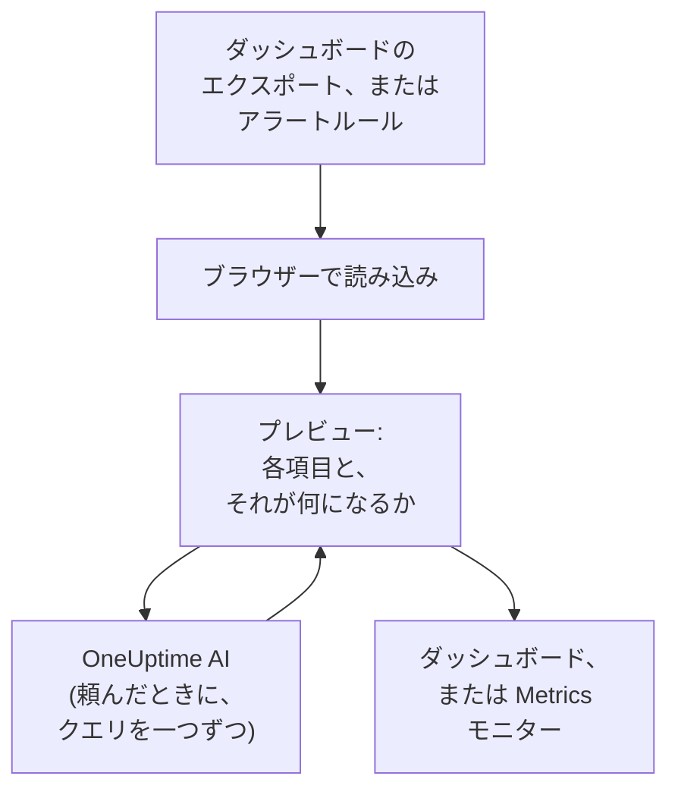

# Grafana と Datadog からのインポート

Grafana や Datadog で作ったダッシュボードや、Prometheus、Grafana、Datadog 向けに書いたアラートルールを OneUptime に取り込みます。ファイルを貼り付けるかアップロードし、各パネルと各ルールが何になるかを確認してから、ダッシュボードやモニターを作成します。

:::cards
- [ダッシュボードをインポートする](#ダッシュボードをインポートする): Grafana ダッシュボードの JSON モデル、または Datadog ダッシュボードのエクスポート。
- [アラートルールをインポートする](#アラートルールをインポートする): Prometheus のルールファイル、Grafana のアラートルール、Datadog のモニター。
- [各項目の変換のされ方](#各項目の変換のされ方): 正確に、おおよそ、または変換されないこと、そしてその理由。
- [OneUptime AI でクエリを変換する](#oneuptime-ai-でクエリを変換する): どのルールでも変換できないクエリのために。
:::

## インポートの流れ

OneUptime はブラウザーでファイルを読み、パネル、ウィジェット、変数、ルールを一つずつ変換します。プレビューには、そのすべてが何になるかとともに一覧されます。作成を選ぶまで何も作成されず、作成するときは、ダッシュボードとモニターのフォームと同じように、あなた自身の権限で作成されます。

## 始める前に

- インポートしたウィジェットとモニターは、このプロジェクト自身のメトリクスを PromQL で読みます。Prometheus remote write、OpenTelemetry、Datadog Agent で送れば、そこでの名前のまま保たれます。
- ダッシュボードのインポートにはダッシュボードを作成できるロールが、アラートルールのインポートにはモニターを作成できるロールが必要です。
- ファイルは最大 10 MB までで、そのうち最大 500 のパネルまたはルールが読み込まれます。

## ダッシュボードをインポートする

:::steps
### ダッシュボードのインポートを開く

**製品 → ダッシュボード** を開き、続けて **その他のオプション → Import from Grafana or Datadog** を選びます。

### ダッシュボードを貼り付ける

Grafana では、ダッシュボードの設定から JSON モデルをコピーします。Datadog では、ダッシュボードの JSON をエクスポートします。それを貼り付けるか **Upload a File** を選び、次に **プレビュー** を選びます。

### ダッシュボードを作成する

各パネルと各変数が何になるかを確認し、ダッシュボードに名前を付けて **ダッシュボードを作成** を選びます。新しいダッシュボードが開きます。
:::

Grafana の PromQL は書かれたとおりに保たれます。OneUptime は `$__interval`、`$__rate_interval`、`$__range` を Grafana と同じように埋め、All の変数はすべての値に一致します。Datadog のクエリは、Datadog Agent が送ったメトリクスに対する PromQL になります。`avg:system.cpu.user{host:web-1}` は `system_cpu_user{host="web-1"}` を読みます。

## アラートルールをインポートする

:::steps
### アラートのインポートを開く

**製品 → モニター** を開き、続けて **その他のオプション → Import Alerts** を選びます。

### ルールを貼り付ける

Prometheus のルールファイルか PrometheusRule リソース、Grafana のアラートルールのエクスポート、または JSON でエクスポートした Datadog のモニターを貼り付け、次に **プレビュー** を選びます。

### モニターを作成する

不要なルールのチェックを外し、**When a rule fires** で発火したルールが何を開くかを選んで、**モニターを作成** を選びます。
:::

各ルールは、PromQL クエリ一つ、ルールの条件、その時間枠を持つ Metrics モニターになります。しきい値を超えた系列ごとにアラートまたはインシデントを開き、系列が回復すると解決します。タイトルと説明は、ルールの要約またはメッセージから作られ、系列のラベルが埋め込まれます。

## 各項目の変換のされ方

| ステータス | 意味 |
| --- | --- |
| **Converted exactly** | 同じデータを読み、同じように表示します。 |
| **Converted approximately** | 作成され、その注記に違いが書かれます。 |
| **Not converted** | 何も作成されず、その注記に理由が書かれます。 |

レコーディングルール、ログに対するアラートルール、ログ・トレース・イベントを読む Datadog のウィジェット、Datadog の異常検知・外れ値・予測のモニターは変換されません。

## OneUptime AI でクエリを変換する

どのルールでも変換できないクエリには **Convert with OneUptime AI** が表示されます。使うには、プロジェクトで AI がオンである必要があります。そのクエリとダッシュボードの変数名だけが、プロジェクトの AI プロバイダーに送られます。答えは他のクエリと同じように検証されて表示されるので、使うときは **Use This Query** を選びます。ダッシュボードやモニターを作成するまで、何も作成されません。

## 次のステップ

:::cards
- [ダッシュボード ウィジェット](/docs/dashboards/widgets): インポートしたウィジェットの表示内容を変えます。
- [ダッシュボード 変数とフィルター](/docs/dashboards/variables): インポートで作られた変数。
- [メトリクス モニター](/docs/monitor/metrics-monitor): インポートで作られたモニター。
- [PromQL](/docs/telemetry/promql): インポートしたウィジェットとモニターが読む言語。
:::
