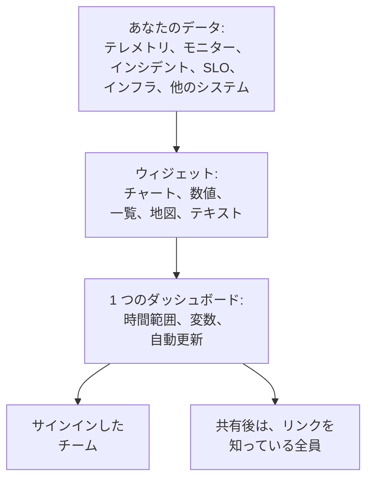

# ダッシュボード 概要

ダッシュボードは、自分で並べたウィジェットで構成される 1 枚のページです。メトリクス、ログ、トレースのチャート、インシデント、アラート、モニターの一覧、SLO やインフラストラクチャ、さらには OneUptime の外にあるシステムのデータまで載せられます。オンコール用の画面、チームの朝のチェック、顧客向けのページなどに作成し、プロジェクトのメンバーや、リンクを知っている誰とでも共有できます。

:::cards
- [ダッシュボードの仕組み](#ダッシュボードの仕組み): データの出どころと、誰がそれを見るか。
- [ダッシュボードを探す](#ダッシュボードを探す): ダッシュボード一覧と、各ダッシュボードのページ。
- [最初のダッシュボードを作る](#最初のダッシュボードを作る): テンプレートから共有ページまでの 5 つのステップ。
- [例: オンコール用ダッシュボード](#例-オンコール用ダッシュボード): どのサービスにも使える 1 枚のページ。
:::

## ダッシュボードの仕組み

各ウィジェットは 1 つのソースから、ダッシュボードの時間範囲の中で、変数で絞り込んだデータを読み取ります。ダッシュボードを開く人は全員同じウィジェットを見ます。チームのメンバーはサインインして、訪問者は共有された公開リンクから見ます。

| 用語 | 意味 |
| --- | --- |
| ダッシュボード | ひとつのページ: 名前、ウィジェットのグリッド、時間範囲、変数、自動更新の設定。 |
| ウィジェット | グリッド上のひとつのタイル: チャート、数値、一覧、地図、時計、またはテキストのブロック。 |
| 変数 | ツールバーのピッカー。対応するすべてのウィジェットをひとつのサービス、ホスト、顧客に絞り込みます。 |
| 時間範囲 | すべてのチャートと数値が読み取る期間。ダッシュボードはデフォルトで開き、編集する人が別の範囲を設定しない限り直近一時間です。閲覧者はそれぞれ自分で選べます。 |
| 自動更新 | ウィジェットがデータを読み直す頻度: オフ、または 5 秒ごとから 15 分ごとまで。 |
| 表示と編集 | ダッシュボードは閲覧用に開きます。編集は別のステップで、変更の保存または破棄で終わります。 |

## ダッシュボードが役立つ場面

- **「すべて正常か」を確かめるページ。** オンコール担当者、チームのスタンドアップ、壁の画面に。
- **関連を見る:** CPU の急上昇、レイテンシの増加、未解決のインシデントが並んでいれば 1 ページで一目瞭然ですが、3 ページに分かれていると見落としがちです。
- **調査:** 何度も開き直すチャートを並べて置き、急上昇の部分をドラッグすると、その瞬間のすべてのウィジェットを読めます。
- **チーム外との共有:** 顧客やパートナー向けのパフォーマンスページ。必要ならパスワードや IP 許可リストで保護できます。

## ダッシュボードを探す

**製品 → ダッシュボード** を開きます。**ダッシュボード** 一覧には、プロジェクトのダッシュボードが説明、ラベル、所有者とともに表示されます。名前や説明で検索したり、**所有者** と **ラベル** のフィルターで絞り込んだり、複数のダッシュボードを選んでラベルや所有者の変更、アーカイブ、JSON へのエクスポートを行ったりできます。

一覧のサイドメニューには、すべてのダッシュボードを管理するページがあります。

| ページ | そこで行うこと |
| --- | --- |
| **ダッシュボード** | プロジェクトのダッシュボード。新しく作成するか、**JSON をインポート** でダッシュボードを取り込みます。 |
| **ダッシュボード → プレイリスト** | NOC の壁面ディスプレイなどの画面に、[ダッシュボードを順番に表示](/docs/dashboards/playlists) します。 |
| **設定 → 所有者ルール** | 新しいダッシュボードに所有者を自動で追加します。 |
| **設定 → ラベルルール** | 新しいダッシュボードにラベルを自動で追加します。 |
| **設定 → データソース** | Prometheus、SQL データベース、ClickHouse、Loki、Elasticsearch、REST API を接続します。 |
| **詳細 → アーカイブ済み** | アーカイブしたダッシュボード。ここからアーカイブを解除します。 |

ダッシュボードを開くと、そのダッシュボード自身のサイドメニューに次のページがあります。**基本** 以外のセクションは折りたたまれた状態で始まります。タイトルをクリックすると開きます。

| ページ | そこで行うこと |
| --- | --- |
| **ダッシュボード** | ダッシュボードそのもの。閲覧するか、**⋯** メニューから編集します。 |
| **概要** | 名前、説明、ラベル。 |
| **共有設定** | 閲覧できる人、公開リンク、その他の設定にある IP 許可リスト。 |
| **所有者** | ダッシュボードを所有するユーザーとチーム。 |
| **ブランディング** | 公開ダッシュボードのページタイトル、説明、ロゴ、テーマ、ファビコン。 |
| **カスタムドメイン** | 公開ダッシュボードを独自のドメインでホストします。 |
| **設定** | ダッシュボードの複製、エクスポート、アーカイブ。 |
| **監査ログ** | ダッシュボードに加えられたすべての変更と、その変更者。 |
| **削除** | ダッシュボードを完全に削除します。 |

## 最初のダッシュボードを作る

:::steps
1. **作成** — テンプレートか **ゼロから作成** を選びます。テンプレートは名前を入力済みで、ウィジェット付きで開きます。ゼロから作成したダッシュボードは何もない状態で開き、キャンバスに **ウィジェットを追加** があります。
2. **ウィジェットを追加する** — カタログからウィジェットを選び、設定で読み取る内容を決めてから、ドラッグして配置し、サイズを変更します。
3. **必要なら変数を追加する** — たとえば `service` 変数を使うと、1 つのダッシュボードで任意のサービスを表示できます。
4. **保存** — **変更を保存** をクリックします。そうするまで、編集中の変更は保持されません。
5. **（任意）公開する** — ダッシュボードで **⋯ → 共有** を選び、閲覧できる人を決めます。リンクを知っている全員、またはリンクとパスワードを知っている全員です。
:::

[ダッシュボードを作成する](/docs/dashboards/authoring) で各ステップを詳しく説明しています。

## 例: オンコール用ダッシュボード

目標は、checkout サービスのレイテンシ、エラー率、未解決のインシデント、最新のログを 1 ページにまとめ、ほかのどのサービスにも使えるようにすることです。

1. **ダッシュボードを作成** をクリックし、**ゼロから作成** を選んで、「Checkout オンコール」という名前を付けます。
2. **ウィジェットを追加** をクリックし、リクエストのレイテンシのメトリクスを P95 で集計した **チャート** を追加します。
3. その横に、エラー率の **値** を追加し、警告のしきい値を 1、重大のしきい値を 5 にします。
4. その下に、未解決のインシデントで絞り込んだ **インシデント一覧** と、サービスのログの **ログストリーム** を追加します。
5. **変数** を開き、ソースを Telemetry Attribute、属性キーを `service.name` とした `service` という名前の変数を追加し、デフォルトを `checkout` にします。
6. **変更を保存** をクリックします。ツールバーの `service` ピッカーで `payments` を選ぶと、チャート、値、ログストリームが payments サービスに切り替わり、インシデント一覧は引き続きすべての未解決のインシデントを表示します。

## OneUptime のほかの機能との関係

- **モニターとテレメトリ** がデータの出どころです。送信したメトリクス、ログ、トレースはすべてウィジェットに載せられます。
- **インシデントとアラート** は **インシデント一覧** と **アラート一覧** のウィジェットに表示されます。ダッシュボードは表示するだけで、対応はそれぞれのページで行います。
- **ステータスページ** は、サービスが稼働しているかを顧客に伝えます。ダッシュボードは、サービスの振る舞いを詳しく示します。両者は並んで機能します。
- **ワークフロー** は起きたことに対処します。ダッシュボードは、それを読み取る場所です。

## 次のステップ

:::cards
- [ダッシュボードを作成する](/docs/dashboards/authoring): ダッシュボードを作成し、編集して、変更を保存します。
- [ダッシュボード ウィジェット](/docs/dashboards/widgets): すべてのウィジェットと、どれを選ぶか。
- [ダッシュボード 変数とフィルター](/docs/dashboards/variables): サービス、ホスト、顧客ごとに 1 つのダッシュボード。
- [共有と公開ダッシュボード](/docs/dashboards/sharing): 公開リンク、パスワード、IP 許可リスト、カスタムドメイン。
:::
