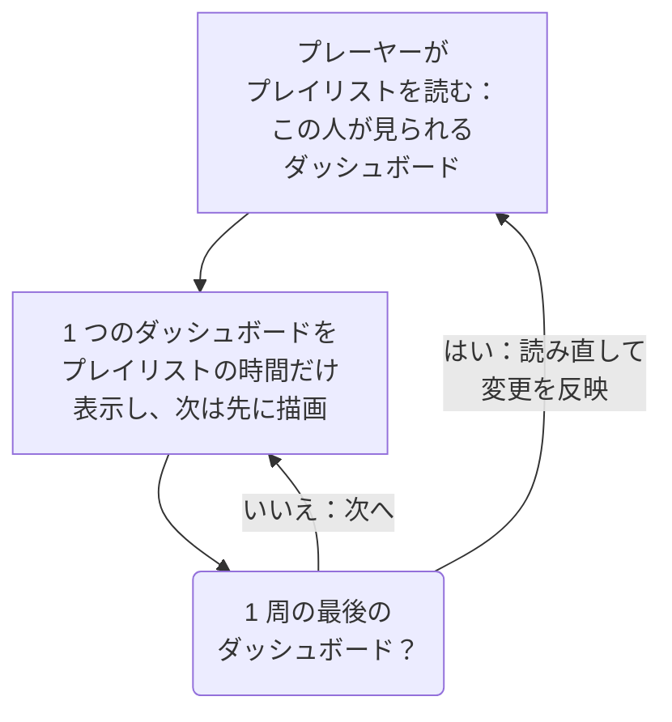

# ダッシュボード プレイリスト

プレイリストは、NOC の壁面ディスプレイやチームのテレビのように誰も操作しない画面に、複数のダッシュボードを順番に表示します。各ダッシュボードを選んだ時間だけ表示し、誰かが一時停止するまで繰り返します。プレイリストを一度作成し、そのプレーヤーを画面で開けば、あとは流し続けるだけです。

:::cards
- [プレイリストの再生のしかた](#プレイリストの再生のしかた): 順番、表示の回り方、各ダッシュボードに表示される内容。
- [プレイリストを作成する](#プレイリストを作成する): 名前、順番に並べたダッシュボード、それぞれの表示時間。
- [画面で再生する](#画面で再生する): プレーヤーのバー、ボタン、キー。
- [誰が何を見られるか](#誰が何を見られるか): 権限と、閲覧者が読めないダッシュボード。
:::

## プレイリストの再生のしかた

プレーヤーはプレイリストの最初のダッシュボードを表示し、その時間が終わると次のダッシュボードを表示し、最後まで行くと最初に戻ります。各ダッシュボードは、編集者が保存したとおりに開きます。プレーヤーのアドレスに何が書かれていても、そのダッシュボード自身の既定の時間範囲、自動更新、変数で表示されます。1 つのダッシュボードが画面に出ている間に、プレーヤーは次のダッシュボードを見えないところで描画しておくため、切り替わりの間に画面が空白になることはありません。

プレイリストはダッシュボードを指し示すだけで、コピーはしません。編集者がダッシュボードに保存した変更は、そのダッシュボードの次の順番で画面に表示されます。プレーヤーは 1 周ごとにプレイリストを読み直すため、追加、移動、削除したダッシュボードは、画面を再読み込みしなくても 1 周以内に反映されます。読み直しに失敗した場合は、手元の 1 周をもう一度再生します。

## プレイリストを作成する

:::steps
### プレイリストを開く
**製品 → ダッシュボード** を開き、サイドメニューで **プレイリスト** を開きます。一覧には、各プレイリストのダッシュボードの数と、それぞれの表示時間が表示され、どの行にも **再生** があります。

### 名前を付ける
**プレイリストを作成** をクリックし、どこで流すのかがわかる **名前** を付けます。たとえば「NOC ウォール」です。

### ダッシュボードを追加する
**ダッシュボード** で、画面に表示する順番に **ダッシュボードを追加** から 1 つずつ選びます。ダッシュボードの行にあるボタンで、上や下に移動したり、取り除いたりできます。アーカイブ済みのダッシュボードは候補に出ません。

### 表示時間を選ぶ
**各ダッシュボードの表示時間** は 1 分から始まります。15 秒から 1 時間までの時間を選びます。**プレイリストを作成** をクリックします。
:::

プレイリストのページには、ダッシュボードが順番に並び、それぞれの表示時間と **プレーヤーのリンク** が表示されます。**プレイリストを編集** では、名前、ダッシュボード、その順番、表示時間を変更できます。ページの下部にある **ダッシュボードのプレイリストを削除** はプレイリストを削除しますが、ダッシュボードは削除しません。

API と Terraform では、プレイリストは `name`、表示する順番に並べた `[{"dashboardId": "<id>"}]` のようなリストの `dashboards` (最大 100 件)、そして 10 から 86400 (1 日) までの任意の整数の秒数である `intervalInSeconds` で表されます。この範囲を外れる値は、何が問題かを示して拒否されます。

## 画面で再生する

プレイリストの行かページで **再生** をクリックします。プレーヤーは OneUptime のほかの部分の上に、ブラウザーのウィンドウいっぱいに広がります。**全画面** にすると画面全体に広がります。画面を単独で起動するには、その画面で **プレーヤーのリンク** を開いてブックマークします。このリンクを開くと、すぐにプレーヤーが開きます。

プレーヤーのバーには、画面に出ているダッシュボード、プレイリスト、1 周の中の位置 (「2 / 5」)、次に来るダッシュボードが表示されます。ダッシュボードの順番の間、バーの下の線が伸びていきます。バーのボタンで前のダッシュボードに戻る、一時停止または再生する、次のダッシュボードに進む、の操作ができます。コンピューターでは、次のキーでも同じ操作ができます。

| キー | 動作 |
| --- | --- |
| `Space` | **一時停止または再生**。一時停止中はダッシュボードが画面に残り、バーに **一時停止中** と表示されます。 |
| `Right Arrow` | **次のダッシュボード**。 |
| `Left Arrow` | **前のダッシュボード**。 |
| `F` | **全画面**、またはその解除。 |
| `Esc` | **プレーヤーを終了** し、プレイリストのページに戻ります。全画面のときは、最初の `Esc` で全画面が解除されるだけです。 |
| `?` | **キーボードショートカットを表示**。 |

次や前に移動したダッシュボードは、まるごと 1 回分の時間表示されます。ペルシャ語のように右から左へ読むページでは矢印が入れ替わり、`Left Arrow` で次のダッシュボードに進みます。再生中、ブラウザーが許す場合は、プレーヤーが画面のスリープを防ぎます。

## 誰が何を見られるか

プレイリストには独自の権限があり、ダッシュボードの権限と同じようにチームを通じて付与されます。

| 操作 | 必要なもの |
| --- | --- |
| プレイリストを表示、再生する | `ReadDashboardPlaylist`、またはプロジェクトのロール: Project Owner、Project Admin、Project Member、Viewer、Settings のロール |
| プレイリストを作成する | `CreateDashboardPlaylist`、Project Owner、または Project Admin |
| プレイリストを変更する: 名前、ダッシュボード、表示時間 | `EditDashboardPlaylist`、Project Owner、または Project Admin |
| プレイリストを削除する | `DeleteDashboardPlaylist`、Project Owner、または Project Admin |

プレイリストが、読む権限のない人にダッシュボードを見せることはありません。プレーヤーは、画面でサインインしている人が読めて、アーカイブされていないダッシュボードだけを再生し、それ以外は飛ばします。削除されたダッシュボード、アーカイブ済みのダッシュボード、権限で見られないダッシュボードが該当します。プレイリストのページには、それぞれを飛ばす理由が表示されます。プレイリストを保存しても、編集者自身が見られないダッシュボードはそのまま残るため、ほかの人が入れたものが失われることはありません。

| プレーヤーが見つけたもの | 表示 |
| --- | --- |
| 表示できるダッシュボード | 順番に一つずつ。 |
| 表示できるダッシュボードがない | **まだ表示するものはありません**。毎分もう一度確認します。 |
| プレイリストが削除された、またはその人が読めない | **プレイリストが見つかりません**。 |
| 読み込みに失敗した | **このプレイリストを読み込めませんでした**。毎分再試行し、**再試行** でもすぐに再試行します。 |

> [!NOTE]
> プレーヤーは OneUptime にサインインしている人のためのものです。画面でプレイリストを流すには、その画面で、プレイリストとそのダッシュボードを読めるアカウント (たとえば Viewer ロールのチームメンバー) でサインインします。

## 次のステップ

:::cards
- [ダッシュボードを作成する](/docs/dashboards/authoring): プレイリストで表示するダッシュボードを作成します。
- [ダッシュボード 変数とフィルター](/docs/dashboards/variables): 各ダッシュボードが開くときの保存済みの選択。
- [共有と公開ダッシュボード](/docs/dashboards/sharing): サインインしない人に 1 つのダッシュボードを見せます。
- [ダッシュボード 設定とアクセス権](/docs/dashboards/configuration): 所有者、ラベル、ダッシュボードを読める人。
:::
