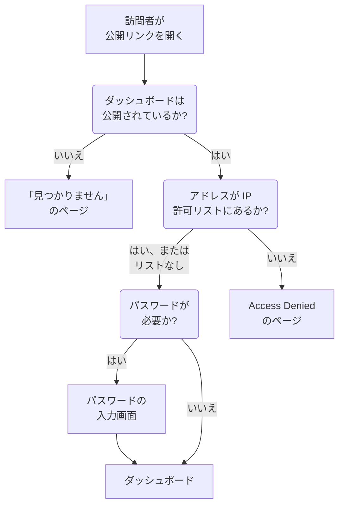

# 共有と公開ダッシュボード

ダッシュボードは既定でプロジェクト内に限定され、プロジェクトにサインインする人だけが見られます。公開リンクで共有したり、そのリンクをパスワードで保護したり、特定の IP アドレスに限定したり、独自のドメインでホストしたりすることもできます。このページでは、その 4 つすべてを説明します。

:::cards
- [ダッシュボードを閲覧できる人](#ダッシュボードを閲覧できる人): 3 つから 1 つを選び、それぞれに必要なプランがあります。
- [パスワード付きで共有する](#パスワード付きで共有する): 見るべき人にリンクを、続けてパスワードを共有します。
- [IP 許可リスト](#ip-許可リスト): 公開リンクをオフィスや VPN からだけ開けるようにします。
- [カスタムドメイン](#カスタムドメイン): 無料の証明書付きで、独自のドメインでダッシュボードを提供します。
:::

## 訪問者がたどる流れ

ダッシュボードの公開リンクを開いた訪問者は、次のチェックを順番に通過します。OneUptime にサインインするプロジェクトのメンバーは、ここでの選択にかかわらず、製品の中でダッシュボードを見られます。



## ダッシュボードを閲覧できる人

ダッシュボードを開いて **⋯ → 共有** を選ぶか、ダッシュボードのサイドメニューで **共有設定** を開きます。**このダッシュボードを表示できる人** カードは、1 つを選ぶ選択肢です。

- **このプロジェクトのメンバーのみ** (既定): メンバーは OneUptime にサインインするとダッシュボードを見られます。公開リンクはありません。公開アドレスには、ダッシュボードのないアドレスと同じ「見つかりません」のページが表示され、名前を含め、ダッシュボードについては何も表示されません。
- **リンクを知っている全員**: ダッシュボードは公開されます。リンクを知っている人なら誰でも、サインインせずに見られます。
- **リンクとパスワードを知っている全員**: 訪問者はリンクを開き、あなたが共有した 1 つのパスワードを入力します。アカウントは誰にも要りません。

選択肢を選ぶと、訪問者にとって何が変わるかを示す確認があり、その後すぐに適用されます。ダッシュボードにパスワードがない状態で **リンクとパスワードを知っている全員** を選ぶと、同じダイアログでパスワードを求められます。その選択の間は、**パスワードを変更** でパスワードを置き換えられます。ダッシュボードが公開されている間は、訪問者がダッシュボードを開くアドレスが選択肢の下に表示されます。先にカスタムドメイン、次に公開リンクが並び、それぞれに **リンクをコピー** があります。まだ公開されていないカスタムドメインには **準備中** とその理由が表示されます。

プロジェクト内で誰が何を見られるかは、所有者とラベルで制御します。[ダッシュボード 設定とアクセス権](/docs/dashboards/configuration) を参照してください。ダッシュボードを見られても編集できない人は、選択肢を見て公開リンクをコピーできますが、選択を変えることはできません。

OneUptime Cloud では、ダッシュボードの共有には **Growth** プランが必要です。下位のプランでは、2 つの公開の選択肢に必要なプランが表示され、選べません。ダッシュボードを非公開に戻す (**このプロジェクトのメンバーのみ**) ことはどのプランでもできるため、トライアル終了時や下位プランへの変更後に公開のまま残ったダッシュボードも、いつでも共有を止められます。ダイアログには、再び共有するには **Growth** が必要だと表示されます。**リンクを知っている全員** と **リンクとパスワードを知っている全員** の切り替えや、パスワードの変更は、どのプランでもできます。API や Terraform で作成したダッシュボードにも同じプランが適用されます。公開で作成するには **Growth** が、IP 許可リスト付きで作成するには **Scale** が必要です。

選択は 3 つの列に保存され、API と Terraform はこれまでどおり読み書きします。`isPublicDashboard`、`enableMasterPassword`、`masterPassword` です。公開リンクがあるのは公開ダッシュボードだけで、`enableMasterPassword` がオンの間は訪問者にパスワードが求められます。`enableMasterPassword` がオンなのにパスワードが設定されていない公開ダッシュボードは、公開リンクから誰も入れません。**共有設定** ページはそれを **リンクとパスワードを知っている全員** として表示し、まだ誰もリンクを開けないことを伝え、**パスワードを設定** を提示します。**このプロジェクトのメンバーのみ** を選ぶと `enableMasterPassword` もオフになり、パスワードは保持されるため、再びパスワード付きで共有するときに使い回せます。

## 公開ダッシュボード

公開ダッシュボードは次のとおりです。

- 常に閲覧用に開きます。訪問者は編集できず、編集用のコントロールが表示されることもありません。
- 追加した変数を含みます。訪問者はチームと同じピッカーで選べ、時間範囲の変更、ズーム、自動更新の有効化、全画面表示もできます。ダッシュボードのデフォルトの時間範囲と自動更新で開き、各訪問者のブラウザが自分で選んだ設定を記憶します。
- 訪問者もチームと同じように、列の見出しをクリックして [リストと表を並べ替え](/docs/dashboards/widgets#リストと表の並べ替え)できます。並べ替えは訪問者ごとにブラウザが記憶し、OneUptime がリスト全体を自ら並べ替えます。使うのは常にウィジェット自身の列のいずれかです。
- ダッシュボードの **ブランディング** ページで設定したブランディング (ページタイトル、説明、ロゴ、テーマ、ファビコン) を使います。
- ツールバーにある太陽または月のボタンで、訪問者はそれぞれ明るいダッシュボードと暗いダッシュボードを切り替えられます。詳しくは [テーマ](#テーマ) を参照してください。

ダッシュボードの共有は、Web ページの公開と同じように扱ってください。そこにあるすべてのウィジェットが、リンクを知っている誰にでも読めるようになります。共有する前に、キャンバスに何があるかを確認してください。

各ウィジェットは、描画する内容だけを、設定された対象のリソースについてだけ公開します。たとえば SLO ウィジェットは、その SLO の主要な数値を公開しますが、定義は決して公開しません。[SLO](/docs/dashboards/widgets#slo) を参照してください。例外は外部の **データソース** ウィジェットです。設定がクエリそのものであるため、描画されるのではなく、公開ダッシュボードから完全に除かれます。ほかにもいくつかのウィジェットはサインインしたセッションがないと表示できず、その場所でそう伝えます。一覧は [公開ダッシュボードでの表示](/docs/dashboards/widgets#公開ダッシュボードでの表示) にあります。

## パスワード付きで共有する

**リンクとパスワードを知っている全員** を選び、ダイアログでパスワードを入力します。訪問者には、ダッシュボードが表示される前にパスワードの入力画面が表示されます。入力画面に表示されるのはダッシュボードの名前、ページタイトル、ファビコンだけで、ダッシュボードのテーマで描画されます。説明、ロゴ、ウィジェットはパスワードの入力後に表示されます。パスワードはハッシュとして保存され、誰も読み戻せません。新しいパスワードはすぐに有効になります。古いパスワードを入力した人は、最長 7 日間ダッシュボードを見続けられます。

パスワードは次のような場合に使います。

- パートナーや顧客と共有したいが、URL が漏れても役に立たないようにしたい場合。
- ダッシュボードが「半公開」の場合。閲覧者全員をチームメンバーとして招待したくはないが、インターネットに公開するほどオープンでもない場合です。

さらに厳しく管理したい場合 (閲覧者ごとの個別アカウント、誰が何を見たかの監査証跡) は、ダッシュボードを **このプロジェクトのメンバーのみ** のままにし、閲覧者を読み取り専用のチームメンバーとして招待してください。

## IP 許可リスト

**共有設定** ページの **その他の設定** にある **IP 許可リスト** セクション (`ipWhitelist` 列) は、公開リンクを、列挙した IP アドレスまたは IPv4 範囲に限定します。1 行に 1 つずつ、たとえば `203.0.113.7` や `10.0.0.0/8` のように書きます。パスワードの有無にかかわらず適用され、サインインするプロジェクトのメンバーには影響しません。空のままにすると、すべてのアドレスを許可します。選択とは別に単独で保存され、OneUptime Cloud で変更するには **Scale** プランが必要です。空にするのはどのプランでもできます。リストが有効な間は、折りたたまれた **その他の設定** の見出しに、**IP 許可リスト** とその件数が表示されます。セルフホストでは、変更は Enterprise Edition の一部です。Community Edition では、すでに設定されたリストは引き続き適用され、削除することだけができます。

次のような場合に使います。

- ダッシュボードにオフィスや VPN からだけアクセスできるようにしたい場合。
- ベンダーポータルに、そのベンダーの既知の IP からだけアクセスできるようにしたい場合。
- パスワードに加えて、さらに保護を重ねたい場合。

ほかの IP からのリクエストは、ダッシュボードについて何も表示しない **Access Denied** ページで拒否されます。名前も、ブランディングも、パスワードの入力画面も表示されません。IP アドレスでも IPv4 範囲でもない行は、サーバーが読み飛ばしてしまうため、保存時に拒否されます。

## カスタムドメイン

初期状態では、公開ダッシュボードは OneUptime 自身のアドレスにある公開リンクで提供されます。`dashboard.acme.com` のような独自のサブドメインでホストするには、ダッシュボードのサイドメニューで **ブランディング → カスタムドメイン** を開きます。ステータスページの **カスタムドメイン** ページとまったく同じように動作します。

カードのタイトルは **カスタムドメイン** で、やるべきことが書かれています。各ドメインの CNAME レコードを、インストールのダッシュボード用 CNAME レコードに向けると、OneUptime がそのドメインの SSL 証明書を発行し、更新も行います。テーブルには **ドメイン** と **ステータス** の 2 列があります。

ダッシュボードを独自のドメインに置くには 3 つのステップがあり、あなたが行うのは最初の 2 つだけです。

1. **ドメインを追加する**: サブドメインと、確認済みのドメインの 1 つ。
2. **その CNAME レコードを追加する**: DNS プロバイダーで追加します。ドメインを追加するとすぐに、レコードを表示した **DNS 設定** ダイアログが開きます。
3. **無料の SSL 証明書は自動で発行されます**: レコードが見つかるとすぐに発行されます。押すボタンはありません。

確認が済むと、ダッシュボードにはカスタムドメインと元の URL の両方でアクセスできます。

### ドメインを追加する

**ダッシュボードのドメインを作成** をクリックします。ダイアログは 1 ページです。

- **サブドメイン**: ラベル部分だけで、プレースホルダーは `dashboard (leave blank for root)` です。ホスト名全体ではなく `dashboard` だけを入力します。ルート (apex) ドメインを使うには、空のままにするか `@` を入力します。
- **ドメイン**: **プロジェクト設定 → 詳細 → ドメイン** で確認済みのドメインです。そこでは TXT レコードでドメインの所有を証明します。確認していないドメインは拒否されるため、一覧に表示されません。フィールドの横の **ドメインを追加** リンクで、そのページが新しいタブで開きます。
- **その他の項目**: 折りたたまれています。折りたたまれている間は、ドメインが使う証明書が見出しに表示されます。「このドメインの無料 SSL 証明書を発行し、自動的に更新します。」 独自の証明書を使う場合にだけ開いてください (後述)。

**ダッシュボードのドメインを作成** をクリックします。ダイアログが閉じ、新しいドメインの **DNS 設定** が開きます。ドメインの完全な名前は追加時に固定されるため、**編集** で変えられるのは証明書だけです。別のサブドメインを使うには、そのドメインを追加して古いものを削除します。

### DNS 設定と今すぐ確認

**DNS 設定** ダイアログには、DNS プロバイダーで追加するレコードが、1 行に 1 フィールドずつ、それぞれコピーボタン付きで表示されます。**種類** は `CNAME`、**名前** は追加したドメインの完全な名前、**値** はインストールのダッシュボード用 CNAME レコードです。サブドメインのないルートドメインの場合、ダイアログには注記が加わります。多くの DNS プロバイダーではそこに CNAME レコードを置けないため、代わりにプロバイダーの ALIAS、ANAME、CNAME フラット化のレコードを同じ値で使ってください。

OneUptime は未確認のドメインを 15 分ごとにチェックし、レコードが見つかると、あなたが戻ってくるかどうかにかかわらず、同じチェックの中でそのドメインの無料の Let's Encrypt 証明書を注文します。すぐに確認するには、**今すぐ確認** をクリックします。

- **レコードがまだ見つからない場合。** ダイアログは開いたままで、探したレコードが表示されます。新しい DNS レコードが反映されるまでには時間がかかることがあります。あとでもう一度 **今すぐ確認** をクリックするか、15 分ごとのチェックに任せてください。
- **レコードが見つかった場合。** ダイアログに 「CNAME レコードが確認されました。」 と、証明書の次の状況が表示されます。無料の証明書はその時点で注文され、通常 15 分以内に有効になります。

ドメインが確認され証明書が配置されるまでは、その行に同じダイアログを開く **DNS 設定** アクションがあります。証明書の注文が失敗し続けている、または証明書の期限が切れた確認済みのドメインでは、そこで **今すぐ確認** を押すと再注文し、前回の注文が失敗した理由を表示します。注文は 1 つのドメインにつき 15 分に最大 1 回です。その間も OneUptime は自動で再試行を続け、連続して失敗するたびに少しずつ待ち時間を延ばします。更新は証明書の期限切れよりずっと前に自動で行われ、DNS のチェックに失敗しても、まだ有効な証明書が削除されることはありません。

### ステータス列の読み方

**ステータス** 列は、各ドメインが HTTPS に至る過程のどこにいるかを、ステータスページと同じ 8 つの状態のいずれかで示します。注文が失敗した場合は、その理由が下の行に表示されます。

| ステータス列の表示 | 意味 |
| --- | --- |
| DNS 待ち: CNAME レコードを追加してください。 | CNAME レコードがまだ見つかりません。**DNS 設定** を開いてレコードを確認し、DNS プロバイダーで追加してから、**今すぐ確認** をクリックするか、15 分ごとのチェックを待ちます。 |
| 無料の証明書を発行しています。通常 15 分以内に完了します。 | レコードは確認済みで、証明書の注文または書き出しの最中です。何もする必要はありません。 |
| 無料の証明書をまだ発行できていません。引き続き試行します。 | レコードは確認済みですが、下の行に示す理由で証明書の注文に失敗しました。原因を直してから **DNS 設定** を開き、**今すぐ確認** をクリックすると、すぐに再注文します。 |
| 証明書の有効期限が切れています。引き続き更新を試行します。 | 更新に失敗したため、ドメインの証明書の期限が切れました。**DNS 設定** を開いて **今すぐ確認** をクリックすると、すぐに更新を試み、理由を確認できます。 |
| 証明書は発行済みで、自動的に更新されます。 | 完了です。ドメインは HTTPS で証明書を提供し、OneUptime が更新します。 |
| 証明書は発行済みですが、更新に失敗しました。引き続き試行します。 | ドメインはまだ有効な証明書を提供していますが、下の行に示す理由で前回の更新に失敗しました。OneUptime は証明書の期限が切れるずっと前に再試行します。 |
| アップロード済みの証明書を使用しています。 | レコードは確認済みで、アップロードした証明書でドメインが提供されています。 |
| 確認済みです。独自のプロキシの HTTPS を使用しています。 | Let's Encrypt のアカウントキーがないセルフホストのインストールで、レコードは確認済みで、ドメインは利用可能です。証明書をアップロードしない限り、その HTTPS は独自のプロキシが担います。 |

注文が失敗する主な原因は、`letsencrypt.org` を許可していない CAA レコードがドメインにあること、そしてセルフホストのインストールでは Let's Encrypt がポート 80 でサーバーに到達できないことです。

### 独自の証明書と再発行

代わりに独自の証明書を使うには、ドメインの追加時に **その他の項目** を開き、**カスタム証明書をアップロード** をオンにして、**証明書** とその **証明書の秘密鍵** を貼り付けます。OneUptime は Let's Encrypt の証明書を注文する代わりに、15 分以内にそれを提供し、ドメインが以前持っていた Let's Encrypt の証明書は置き換えられます。アップロードした証明書の更新はあなたが行います。ドメインを編集して新しい証明書を貼り付けてください。ドメインに以前無料の証明書があった場合、あなたの証明書を使っている間も OneUptime はそれを更新し続けるため、すぐに元に戻せます。

ドメインの無料の証明書が注文されると、その行に **SSL を再発行** が表示されます。自動更新より前に新しい証明書が必要なとき、Let's Encrypt にまったく新しい証明書を要求します。各ドメインの再発行は 24 時間に 1 回までです。

セルフホストのインストールでは、ダッシュボードのカスタムドメインは環境変数 `DASHBOARD_CNAME_RECORD` (Helm チャートでは `dashboard.cnameRecord`) で有効になります。これは CNAME レコードが向く先です。設定されていない場合、カードと **DNS 設定** ダイアログにはレコードの代わりに "Custom Domains not enabled for this OneUptime installation" と表示され、OneUptime はダッシュボードのドメインの確認も証明書の注文も行いません。Let's Encrypt のアカウントキー（`LETS_ENCRYPT_ACCOUNT_KEY`、Helm チャートでは `letsEncrypt.accountKey`）がないインストールでは証明書は注文されません。ダッシュボードのドメインはレコードが確認された時点で利用可能になり、独自のプロキシの HTTPS か、アップロードした証明書で提供されます。

### 確認と再発行ができる人

**今すぐ確認**、ドメインの証明書の注文、**SSL を再発行** はドメインを変更するため、ドメインを編集する権限が必要です。**Edit Dashboard Domain**、またはそれを含むロール (Project Owner、Project Admin、Project Member、Settings Admin、Settings Member) です。

ドメインの読み取りしかできない人 (Viewer や Settings Viewer など) にも、**ステータス** 列と、**DNS 設定** の追加すべきレコードは表示されます。その人には **今すぐ確認** と **SSL を再発行** がロックされ、必要な権限が表示されます。いずれにしても、OneUptime は自動ですべてのドメインを確認し、証明書を注文し続けます。

API キーも同じです。ダッシュボードのドメインを読み取ることしかできないキーは、`/dashboard-domain` の `verify-cname`、`order-ssl`、`reissue-ssl` を呼び出せません。必要なら **Read Dashboard Domain** と **Edit Dashboard Domain** を付与してください。

ドメインは、同時にはプロジェクト内の 1 つのダッシュボードにしか属しません。同じ内容を複数の相手に提供する場合は、1 つのダッシュボードに複数のカスタムドメインを関連付けられます。自社ブランドの顧客向けダッシュボード、共同ブランドのパートナー向けダッシュボード、独自の URL を持つ公開ヘルスページなどです。 ステータスページやフォームがすでに使っている名前は、どのプロジェクトのものでも拒否されます。1 つのドメインが表示するのは、1 つのステータスページ、ダッシュボード、またはフォームだけです。

## ブランディング

ダッシュボードの **ブランディング** ページでは、次の設定ができます。

- **ページタイトル** — ブラウザーのタブとページ上部に表示される内容。
- **ページの説明** — 検索エンジンや SNS のプレビューで使われる説明。
- **ロゴ** — 公開ダッシュボードのヘッダーに表示される画像。
- **テーマ** — ライト、ダーク、または各訪問者のデバイスの設定どおり。[テーマ](#テーマ) を参照してください。
- **ファビコン** — ブラウザーのタブに表示される小さなアイコン。

ロゴとファビコンはダッシュボード自身のプロジェクトにアップロードされたファイルで、ダッシュボード、API、Terraform、ワークフローのどこから保存しても、そのたびに確認されます。別のプロジェクトでアップロードされたファイルは、もう存在しないファイルと同じ文言で拒否されます。"The logo's file could not be found. Upload the logo again." または "The favicon's file could not be found. Upload the favicon again." です。公開ダッシュボードは、自身のプロジェクトの画像だけを表示します。

ページタイトルと説明は、チーム向けのダッシュボードのツールバーの先頭にも、名前と説明の代わりに表示されます。ロゴ、テーマ、ファビコンは公開ダッシュボードにだけ適用されます。

訪問者がブランディングを見られるのは、ダッシュボードの閲覧を許可されてからです。パスワード付きで共有したダッシュボードは、パスワードの入力前にはページタイトル、ファビコン、テーマだけを表示し、検索エンジンやリンクのプレビューにはページタイトルは見えてもページの説明は見えません。IP 許可リストのあるダッシュボードは、リストにあるアドレスにだけブランディングを表示し、検索エンジンやリンクのプレビューにはまったく見えません。

### テーマ

ロゴのすぐ下にある **テーマ** カードで、訪問者に公開ダッシュボードがどう見えるかを決めます。3 つの選択肢から 1 つを選ぶとすぐに保存されます。**編集** ボタンはありません。

| 選択肢 | 訪問者に見えるもの |
| ------ | ----------------- |
| **ライト** | デバイスの設定にかかわらず、明るいダッシュボード。この設定ができる前に作られたダッシュボードは **ライト** なので、これまでどおりの見た目です。 |
| **ダーク** | デバイスの設定にかかわらず、暗いダッシュボード。 |
| **訪問者のデバイスに合わせる** | デバイスの設定どおりに明るいダッシュボードか暗いダッシュボードになり、ダッシュボードを開いている間もデバイスに合わせて切り替わります。 |

どれを選んでも、ダッシュボードのツールバーにある太陽または月のボタンで、訪問者はそれぞれ明るいダッシュボードか暗いダッシュボードに切り替えたり、あなたが設定したテーマに戻したりできます。その選択はブラウザーに記憶され、同じアドレスのすべての公開ダッシュボードに適用されます。暗いダッシュボードでは、ロゴは明るい背景の上に置かれるため、白いページ用に作られたロゴでもはっきり見えます。

今後作成するダッシュボードは **訪問者のデバイスに合わせる** で始まります。API と Terraform ではフィールドは `theme` で、値は `Light`、`Dark`、`System`（**訪問者のデバイスに合わせる**）のいずれかを、このとおりに書きます。それ以外の値は拒否されます。`theme` を指定しない Terraform の構成には `Light` が設定されるため、この設定より前に書かれた構成が、管理しているダッシュボードに変更を計画することはありません。

テーマはダッシュボードの HTML に含まれているため、ダッシュボードは最初からそのテーマで描画されます。暗いダッシュボードが読み込み中に白く光ることはなく、パスワードの入力画面もそのテーマで描画されます。すべてのウィジェットがテーマに従います。HTML ウィジェットは独自のコードで暗いテーマのスタイルを指定できます。詳しくは [HTML](/docs/dashboards/widgets#html) を参照してください。**Access Denied** のページと「見つかりません」のページはダッシュボードについて何も表示しないため、訪問者に従います。つまり訪問者自身の選択、それがなければそのデバイスです。

## 埋め込み

公開ダッシュボードは、公開リンクまたはカスタムドメインの 1 つを使って、iframe で自分のサイトに埋め込めます。

```html title="embed.html"
<iframe
  src="https://dashboard.acme.com"
  width="100%"
  height="800"
  frameborder="0"
></iframe>
```

ダッシュボードをパスワード付きで共有している場合、訪問者には iframe の中にパスワードの入力画面が表示されます。

埋め込んだダッシュボードをサイトの見た目に合わせるには、`https://dashboard.acme.com/?theme=dark` のように、アドレスに `?theme=light` または `?theme=dark` を追加します。そのアドレスを開く全員に対して、ダッシュボード自身のテーマや訪問者の選択にかかわらず、ダッシュボードはそのテーマで描画され、ツールバーにはテーマのボタンが表示されません。`?theme=system` は各訪問者のデバイスに従います。テーマはパスワードの入力画面を通っても保たれます。

## リンクを送る

公開リンクは、保存されたデフォルトの状態でダッシュボードを開きます。特定の値で開くリンクを送るには、訪問者が値を選んだときにアドレスバーが行うのと同じように、`?var-<name>=<value>` の形で変数をリンクに追加します。複数の値はカンマで区切ります。時間範囲や自動更新を指定して開くには、同じように `range` と `refresh` を追加します。`?range=1d&refresh=1m` なら、壁面スクリーン向けに直近 1 日を 1 分ごとに更新して開きます。`range` には `5m`、`15m`、`30m`、`1h`、`2h`、`3h`、`1d`、`2d`、`7d`、`14d`、`1mo`、`3mo` のいずれか、`refresh` には `off`、`5s`、`10s`、`30s`、`1m`、`5m`、`15m` のいずれかを指定します。これらはダッシュボードのデフォルトや訪問者自身の選択より優先されますが、訪問者はあとから変更できます。ダッシュボードを特定のテーマで開くには、[埋め込み](#埋め込み) で説明しているように、`theme=light`、`theme=dark`、`theme=system` のいずれかを追加します。

## 次のステップ

:::cards
- [ダッシュボード 設定とアクセス権](/docs/dashboards/configuration): 所有者、ラベル、そして共有設定を変更できる人。
- [ダッシュボード 変数とフィルター](/docs/dashboards/variables): 訪問者が使うピッカーと、選択を保つリンク。
- [ダッシュボード ウィジェット](/docs/dashboards/widgets): 各ウィジェットが公開ダッシュボードで公開する内容。
- [ステータス ページ 概要](/docs/status-pages/index): サービスが稼働しているかを顧客に伝えます。
:::
