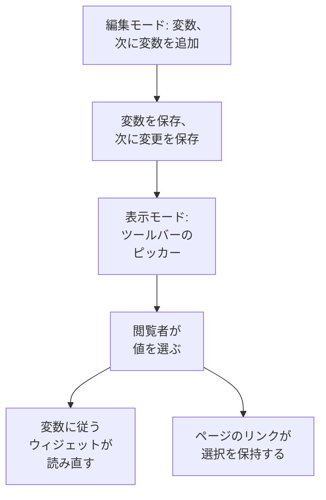

# ダッシュボード 変数とフィルター

変数は、ダッシュボードのツールバーにあるピッカーです。`service` 変数を追加すると、同じチャートで `checkout`、`payments`、`search` を表示できます。ほとんど同じダッシュボードを 3 つ作る代わりに、閲覧者がツールバーで選びます。

:::cards
- [変数を追加する](#変数を追加する): 名前を付け、値の出どころを選び、保存します。
- [変数のソース](#変数のソース): Telemetry Attribute、Project Labels、Custom List、Text Input。
- [ウィジェットによる変数の使い方](#ウィジェットによる変数の使い方): どのウィジェットがどの変数に従うか。
- [選択を保つリンク](#選択を保つリンク): 同じサービスで開くリンクを送ります。
:::

## 変数の仕組み

変数はダッシュボードの編集中に定義し、ダッシュボードとともに保存されます。表示モードでは、各変数はツールバーのピッカーになります。閲覧者が値を選ぶと、その変数に従うすべてのウィジェットがデータを読み直し、ページのリンクが選択を保持します。



## 変数を追加する

:::steps
### 変数ダイアログを開く

ダッシュボードを開き、**⋯ → ダッシュボードを編集** を選んで、ツールバーの **変数** をクリックします。**ダッシュボード変数** ダイアログにダッシュボードの変数が一覧表示され、ツールバーのボタンにはその数が表示されます。

### 変数を 1 つ追加する

**変数を追加** をクリックします。新しい変数はテレメトリの属性を読み取ります。必要なら別の **ソース** を選んでください。

### 内容を入力する

ウィジェットやリンクが使う **名前** を付けます (たとえば `service`)。使えるのは英字、数字、アンダースコアで、英字かアンダースコアで始まり、ダッシュボードのほかの名前と重複しないものです。必要ならツールバー用の **ラベル** と、最初に選ばれる **デフォルト** を設定し、閲覧者が複数の値を選べるようにするには **複数選択を許可** をオンにします。

### 保存する

**変数を保存** をクリックしてから、ツールバーの **変更を保存** をクリックします。ダッシュボードが表示モードに戻ると、変数のピッカーがツールバーに表示されます。
:::

あとで変数を変更または削除するには、ダイアログを再び開き、フィールドを変更するか、横のゴミ箱をクリックします。

## 変数のソース

**ソース** は、変数の値がどこから来るか、そしてどのウィジェットがその変数に従うかを決めます。

| ソース | 値の出どころ | 複数選択 |
| --- | --- | --- |
| Telemetry Attribute | メトリクス内のひとつの属性キーの値 (たとえば `service.name`) | はい |
| Project Labels | 許可したプロジェクトラベル (1 から 1,000 個) | はい |
| Custom List | カンマ区切りで入力した値 (たとえば `prod, staging`) | はい |
| Text Input | 閲覧者が入力した内容 | いいえ |

### Telemetry Attribute

**属性キー** を設定します (たとえば `service.name`、`host.name`、`k8s.namespace.name`)。フィールドには、テレメトリに含まれるキーが候補として表示されます。ピッカーは、直近 1 日のメトリクスから読み取ったそのキーの値を最大 100 個提示するため、新しいサービスはダッシュボードを編集しなくてもピッカーに現れます。

独自のリストが要らないため、最もよく使われるソースです。値は、すでに送信しているものそのものです。

### Project Labels

既存のプロジェクトラベルを選び、ダッシュボードのドロップダウンとして提示します。たとえば `UNIT` という名前の変数を作り、ソースを **プロジェクトラベル** にして、ラベル `0660` と `0661` を選びます。

ダッシュボードは、選んだラベルの ID と表示名を保存します。絞り込みには ID が使われるため、プロジェクトラベルの名前を変えても紐付けは壊れません。表示名はダッシュボードとともに保存されます。名前を変えたラベルの表示名を更新するには、変数エディターでそのラベルを選び直してください。公開ダッシュボードにも、保存されたこれらの選択肢が表示されます。

**モニター一覧** ウィジェットで **フィルター → ラベル変数** を開き、`UNIT` を選びます。これで `0660` を選ぶと、そのラベルを持つモニターが表示されます。ほかのウィジェットは、その変数を明示的にサポートして紐付けない限り影響を受けません。**SLO の一覧** にも同じ **ラベル変数** の設定があります。

ウィジェットの固定フィルターは引き続き有効です。たとえば固定ラベル `network` があり、`UNIT` が `0660` のとき、モニターには両方のラベルが必要です。複数の単位を選ぶと、そのいずれかに一致します。**すべて** を選ぶと変数の条件だけが外れ、ラベル、ステータス、モニターの種類の固定フィルターは残ります。

変数が存在しない場合や、設定された選択肢以外が選ばれている場合はエラーになります。一致するモニターのないラベルを選ぶと、一覧は空になります。紐付けが不要になったら、ウィジェットから明示的に外してください。

### Custom List と Text Input

Custom List は、カンマ区切りで入力した値を提示します。Text Input では、IP アドレスやリクエスト ID など、閲覧者が任意の値を入力できます。どちらもそれだけではウィジェットを絞り込みません。値は `{{name}}` と書いた場所に入ります (後述)。

古いダッシュボードの Query 変数はそのまま残り、ツールバーにテキストボックスを表示します。OneUptime はもうクエリから値を読み込みません。

## 複数選択とデフォルト

**複数選択を許可** がオンのとき、閲覧者は 1 つ以上の値を選び、ウィジェットはそのいずれかに一致するものを表示します。空の選択は **すべて** を意味し、複数選択の変数は常に **すべて** から始まるため、その **デフォルト** はグレーアウトされます。

単一選択の変数は **デフォルト** から始まり、デフォルトがなければ **すべて** から始まります。**すべて** は変数の絞り込みを外すので、ウィジェットはすべてを表示します。

複数選択は、ダッシュボードを離れずに「checkout と payments をまとめて」比較するときに使います。平均の平均のように、値をまたいで数値を足し合わせられない場合は避けてください。

## ウィジェットによる変数の使い方

ソースごとに、ウィジェットへの届き方が異なります。

- **テレメトリ属性** の変数は、ウィジェット側で何も設定しなくても絞り込みます。メトリクスのすべてのチャート、値、ゲージ、テーブル。**ログチャート**、**ログストリーム**、**トレースチャート**、**トレーステーブル**。そして、リソースがその属性を持つインフラストラクチャの一覧 (ホストの一覧の `host.name`、Kubernetes の一覧の `k8s.namespace.name` など) です。その属性を持たないメトリクスのチャートは、値が選ばれている間はデータを表示しません。再び表示するには **すべて** を選びます。**トレース一覧** と、インシデントやアラートの一覧は従いません。
- **プロジェクトラベル** の変数は、**ラベル変数** でその変数を指定した **モニター一覧** または **SLO の一覧** を絞り込みます。
- **どの変数** も `{{name}}` としてテキストに書き込めます。[HTML ウィジェット](/docs/dashboards/widgets#html)、[外部データソース](/docs/dashboards/data-sources) のクエリ、**モニター一覧** や **SLO の一覧** のタイトルです。`{{UNIT}} NETWORK` のようなタイトルは、`0660 NETWORK`、`0660, 0661 NETWORK`、`All NETWORK` と表示されます。タイトルは表示されるテキストを決めるだけです。モニターのクエリを絞り込むには **ラベル変数** を設定してください。

[SLO ウィジェット](/docs/dashboards/widgets#slo) は、`sloName` キーの Telemetry Attribute 変数に従えるため、閲覧者が表示する SLO を選べます。

## 選択を保つリンク

ページのリンクは各変数の選択を `?var-<name>=<value>` の形で持ち、複数の値はカンマで区切られます。そのため、コピーしたリンクは明示的な **すべて** も含めて同じ選択で開きます。次のようなリンクは payments サービスで開きます。

```text title="A dashboard link with a variable"
https://oneuptime.com/dashboard/<project-id>/dashboards/<dashboard-id>?var-service=payments
```

リンクには、選んだ時間範囲と自動更新も `range` と `refresh` として含まれるので、送った相手にも同じ表示が見えます。値の一覧は [リンクを送る](/docs/dashboards/sharing#リンクを送る) にあります。

## 例: サービスごとに 1 つのダッシュボード

サービス用のダッシュボードには、たいてい次のものがあります。

1. `service` 変数。ソースは Telemetry Attribute、属性キーは `service.name`、デフォルトは最も忙しいサービスです。チャートが 1 度に 1 つのサービスを表示するよう、複数選択はオフのままにします。
2. `namespace` 変数。ソースは Telemetry Attribute、属性キーは `k8s.namespace.name` で、Namespace を比較できるよう複数選択をオンにします。
3. `environment` 変数。ソースは Custom List、値は `prod, staging` で、データソースのクエリで `{{environment}}` として使います。
4. それらの属性を読み取るウィジェット。サービスのメトリクスのチャートと値、ログストリーム、Kubernetes の Pod の一覧です。

結果として、上部に 3 つのピッカーを持つ、サービスごとに使える 1 つのダッシュボードができます。

## 次のステップ

:::cards
- [ダッシュボード ウィジェット](/docs/dashboards/widgets): どのウィジェットがどの変数に従うか。
- [外部データソース](/docs/dashboards/data-sources): PromQL や SQL のクエリに変数を入れます。
- [共有と公開ダッシュボード](/docs/dashboards/sharing): 公開ダッシュボードでの変数。
- [ダッシュボードを作成する](/docs/dashboards/authoring): 編集モード、保存、時間範囲。
:::
