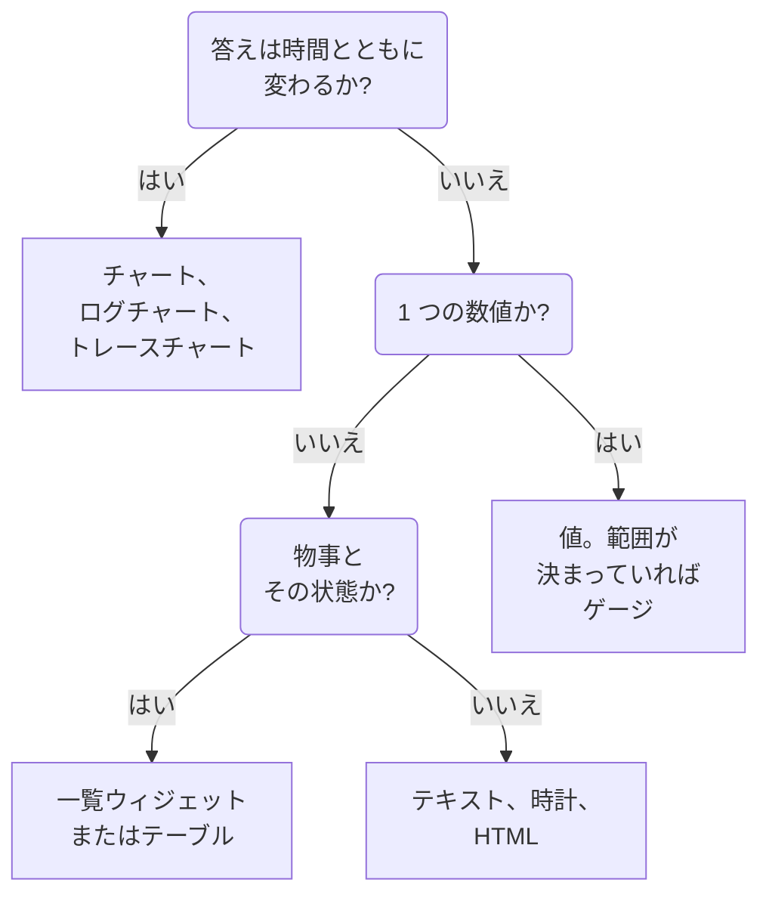

# ダッシュボード ウィジェット

ウィジェットはダッシュボード上の 1 つのタイルです。このページでは、**ウィジェットを追加** カタログのすべてのウィジェットについて、表示内容と重要な設定を、カタログ自身のグループごとに説明します。ウィジェットをグリッドに配置して保存する方法は、[ダッシュボードを作成する](/docs/dashboards/authoring) を参照してください。

:::cards
- [どのウィジェットを使うべきか](#どのウィジェットを使うべきか): タイルが答える問いで選びます。
- [チャートと数値](#チャートと数値): メトリクスのクエリから作るチャート、値、ゲージ、テーブル。
- [ログ、トレース、セキュリティ](#ログトレースセキュリティ): 量のチャート、ライブストリーム、一覧。
- [リストと表の並べ替え](#リストと表の並べ替え): 列で並べ替え、全員に表示される順序を決めます。
- [ウィジェットを表示できない場合](#ウィジェットを表示できない場合): 壊れたウィジェットの表示と、その直し方。
:::

## どのウィジェットを使うべきか

タイルが答えるべき問いから始めます。

| 問い | ウィジェット |
| --- | --- |
| メトリクスは時間とともにどう変化したか? | **チャート** |
| どの重大度のログが、時間とともにどれだけ出たか? | **ログチャート** |
| リクエストの速さと失敗数は、時間とともにどう推移したか? | **トレースチャート** |
| 今この瞬間のひとつの数値は? | **値**。範囲が決まっているなら **ゲージ** |
| どのホスト、サービス、エンドポイントが目立つか? | **テーブル** または **トレーステーブル** |
| 今まさに何が起きているか? | **ログストリーム**、**トレース一覧**、**インシデント一覧**、**アラート一覧** |
| すべてのサイトは稼働しているか? | **モニター一覧** |
| 約束した信頼性を守れているか? | **SLO** または **SLO の一覧** |
| クラスターやホストはどんな状態か? | インフラストラクチャ グループのウィジェット |
| ネットワークは世界のどこにあり、何がダウンしているか? | **ネットワークマップ** |
| 見出し、メモ、別のオフィスの時刻は? | **テキスト** または **時計** |
| OneUptime の外にあるデータは? | 外部データソース グループのウィジェット |
| どのウィジェットにもないものは? | **HTML**。ほかのウィジェットでは無理だと確かめてから |



たいていのダッシュボードはいくつかを組み合わせます。上にチャート、その横に値を 1、2 個、テキストの見出し、下に一覧を 1、2 個といった具合です。

## チャートと数値

この 4 つのウィジェットは、メトリクスエクスプローラーと同じ方法で組み立てたメトリクスのクエリを読み取ります。メトリクスと集計方法を選び、属性フィルターを追加し、属性でグループ化すると値ごとに 1 本の系列になります。

### チャート

ダッシュボードの時間範囲における、1 つ以上のメトリクスのクエリの時系列です。**Chart Type** で折れ線、棒、面、積み上げ面、円グラフとして描きます。**Additional Queries** は同じ軸にほかのメトリクスを重ね、**数式** は `+`、`-`、`*`、`/`、`%`、`^` と括弧でそれらを組み合わせます (`(1 - a) * 100` のように)。各クエリの表示設定では、凡例と単位、色、警告と重大のライン、そして増える一方のカウンター向けの毎秒レートを追加できます。

線の形が状況を物語るときに使います。レイテンシ、エラー、スループット、キューの深さなどです。

### 値

スパークライン付きの大きな 1 つの数値です。時間範囲全体におけるクエリの値で、合計や件数なら合計、最大なら最大値、最小なら最小値、それ以外は平均です。矢印は範囲の後半と前半を、それぞれ同じ方法で求めて比較し、**Trend Direction** に従って色が付きます。値が高いほうが良いか悪いか、またはメトリクス名から判断します。矢印にポインターを合わせると両方の半分の値が、スパークラインに合わせると任意の点の値と時刻が表示されます。値が **警告のしきい値** に達すると背景が黄色に、**重大のしきい値** に達すると赤になります。

1 つの数値で問いに答えられるときに使います。エラー率、P95 レイテンシ、今日処理したリクエスト数などです。

### ゲージ

最小値と最大値の間の目盛りで、設定しなければ 0 と 100 です。**警告のしきい値** から黄色のゾーン、**重大のしきい値** から赤のゾーンになります。

値が決まった範囲に収まるときに使います。CPU やディスクの使用率 (パーセント)、キューの容量などです。

### テーブル

メトリクスの値を行として表示します。**グループ化の属性** を指定すると値ごとに 1 行になります (たとえば `host.name` ごとに 1 行)。指定しなければ、各行は時間の区切りです。**Metrics & Columns** で列を設定します。メトリクスと、それらに対する数式 (たとえばパーセントで表した可用性) です。グループ化するときは、**Reduce across time** が各行の系列を 1 つの値にまとめます。最新の値、平均、合計、最小、最大のいずれかです。

傾向ではなく内訳を見たいときに使います。ノイズの多いホスト、サービスごとのエラー、エンドポイントごとのリクエストなどです。

## テキスト、時計、HTML

これらのウィジェットにはデータソースが要りません。

### テキスト

見出し、メモ、ランブックへのリンクに使う、1 行またはひとまとまりのテキストです。**Markdown** をオンにすると、見出し、リンク、リスト、コード、テーブルを描画できます。オフのときは入力したとおりに表示され、必要なら太字、斜体、下線にできます。

### 時計

任意のタイムゾーンの現在時刻を、数字またはアナログの文字盤で表示し、「シドニーオフィス」のようなラベルを付けられます。タイムゾーンを指定しなければ、閲覧者それぞれのタイムゾーンを表示します。オフィスごとに 1 つ追加すれば、誰が起きているかがわかります。

### HTML

独自の HTML、CSS、JavaScript をウィジェットとして描画します。設定は、HTML 本体、任意のスタイルシート、任意のスクリプト、3 つの権限スイッチです。

組み込みのウィジェットではまかなえないものが必要なときに使います。サードパーティのバッジの埋め込み、社内 API から取得したテーブル、独自の凡例、自分のツールへのスタイル付きリンク集などです。

#### できることとできないこと

ウィジェットは、独自に分離されたオリジン上のサンドボックス化されたフレームで描画されます。そのフレームの中では、コードはほぼ何でもできます。DOM の構築、タイマーの実行、任意の URL からの取得、canvas への描画などです。

できないのは、周囲の OneUptime のページに触れることです。ダッシュボードの DOM、Cookie、ローカルストレージ、API セッションにはアクセスできず、ブラウザーのタブをほかのページへ移動させることもできません。これはダッシュボードが非公開でも公開でも同じです。

何かを貼り付ける前に知っておきたい点が 2 つあります。

- ウィジェットからの `fetch` は不透明なオリジンからのクロスオリジンリクエストなので、呼び出す先のサーバーが CORS で許可する必要があります。ここから OneUptime の API を呼び出すことはサポートされていません。
- ウィジェットは最初は透明です。カードを塗りつぶしたい場合は、CSS で `body` に背景を設定してください。暗いテーマでは文字が明るい色で始まり、`<html>` 要素に `dark` クラスが付きます。暗いテーマだけにスタイルを適用するには、CSS のルールを `html.dark` で始めてください。

#### ダッシュボード変数の使用

HTML、CSS、JavaScript のどこにでも `{{variableName}}` と書くと、ウィジェットの描画前にその変数の現在の値に置き換えられます。新しい値を選ぶとウィジェットが再描画されます。存在しない変数を指すプレースホルダーはそのまま残ります。

スクリプトは、同じ値とダッシュボードの時間範囲を `window.ONEUPTIME` で受け取ります。

```javascript title="window.ONEUPTIME"
window.ONEUPTIME.variables.environment; // current value, or "" if unset
window.ONEUPTIME.startDate; // ISO 8601 string, start of the dashboard's time range
window.ONEUPTIME.endDate; // ISO 8601 string, end of it
```

ウィジェットはダッシュボードが更新されるたびに再読み込みされるため、自分でデータを取得するウィジェットも更新間隔に追従します。

#### 権限

**Run JavaScript** (既定でオン) はスクリプトを実行します。オフにするとマークアップとスタイルだけを描画し、スクリプトは単にブロックされるのではなく、ウィジェットから完全に除かれます。

**Open links in a new tab** (既定でオン) は、リンクと `window.open` でブラウザーのタブを開けるようにします。リンクは常に新しいタブで開き、ウィジェットがダッシュボード自体を移動させることはできません。

**Allow forms to submit** (既定でオフ) は、ウィジェット内の `<form>` の送信を許可します。

このウィジェットが何を実行するかはダッシュボードを編集できる人が決め、ダッシュボードを見る人は全員それを実行します。公開ダッシュボードでは匿名の訪問者も含まれます。HTML ウィジェットのあるダッシュボードの編集権限は、リリースするほかのコードへのアクセス権と同じように扱ってください。

## ログ、トレース、セキュリティ

| ウィジェット | 表示内容 | 重要な設定 |
| --- | --- | --- |
| **ログチャート** | 時間ごとのログの量。重大度ごとにひとつの系列で、棒、線、面のいずれかで描きます。 | 重大度、本文に含まれるテキスト、属性フィルター。 |
| **ログストリーム** | フィルターに一致する最新のログ行。 | 重大度、本文に含まれるテキスト、`@service.name:checkout` のような属性フィルター、行数。 |
| **トレースチャート** | 時間ごとのリクエスト数、エラー数、応答時間 (平均、最小、最大、P50 から P99)。 | メトリクス、数えるスパン、系列を分ける属性。 |
| **トレース一覧** | 最新のトレースと、その所要時間とステータス。 | ステータス、行数。 |
| **トレーステーブル** | リクエスト数の多いスパン名、ステータス、属性値と、その応答時間の中央値、平均、最小、最大。 | 行をグループ化する項目と、数えるスパン。 |
| **セキュリティイベント** | 最新のセキュリティイベントと、その重大度、イベントクラス、ホスト。 | 重大度、イベントクラス、メッセージに含まれるテキスト。 |
| **セキュリティイベントのフロー** | 発生元からイベントクラスを経て重大度へ至る、セキュリティイベントの流れ。 | 重大度、イベント数。 |

トレース系のウィジェットは、トレースエクスプローラーと同じくルートスパンだけを数えます。設定で子スパンを含めた場合は別です。よくあるパターンは、上にレイテンシのチャート、その下に遅いトレースの一覧を置く構成です。

## インシデント、アラート、モニター

| ウィジェット | 表示内容 | フィルター |
| --- | --- | --- |
| **インシデント一覧** | インシデントと、その状態と重大度。 | 未解決、確認済み、解決済み。重大度、状態、モニター、ラベル。 |
| **アラート一覧** | アラートと、その状態と重大度。 | 未解決、確認済み、解決済み。重大度、状態、モニター、ラベル。 |
| **モニター一覧** | モニターと、その現在のステータス。 | 稼働中かどうか、ステータス、モニターの種類、ラベル、または閲覧者がツールバーで選ぶ **ラベル変数**。 |

ほとんどの一覧ウィジェットと同じく、この 3 つはテーブルの代わりに、ステータスで色分けしたセルのハニカムを描けます。**表示モード** で選択してください。表示されるのは、ダッシュボードの時間範囲にかかわらず現在の状態です。

## サービスレベル目標

### SLO

1 つのサービスレベル目標を、単一の数値または時間とともに推移する線で描きます。

**設定**: どの SLO か (またはダッシュボード変数で選んだ SLO)、3 つの数値のうちどれか (SLI、Error Budget Remaining、Burn Rate)、Tile と チャート のどちらで表示するか、任意のタイトル。

- **Tile** は現在の数値と、該当する場合は 2 行目を表示します。SLI の下に目標、エラーバジェットの下に残り時間 (分) です。ステータスのピルが全体に色を付けます。
- **チャート** は同じ数値をダッシュボードの時間範囲にわたって描き、SLI の系列には目標を破線で示します。履歴は評価ワーカーが数分ごとに書き込むため、作成したばかりの SLO は初めて評価されるまでチャートが空のままです。

ダッシュボードが「いま何が起きているか」ではなく「約束を守れているか」に答えるときに使います。

SLO ウィジェットは [公開ダッシュボード](/docs/dashboards/sharing) で機能します。公開されるのは SLO の主要な数値 (名前、目標、現在の SLI、残りのエラーバジェット、バーンレート、ステータス) で、ウィジェットがどれを描いているかには関係ありません。定義は非公開のままです。監視しているモニター、ラベル、説明、クエリ、評価スケジュールが公開閲覧者に送られることはありません。Tile ウィジェットが公開するのは現在の数値だけで、チャート ウィジェットは描いている 1 本の系列の履歴も公開しますが、それ以外は公開しません。

### SLO の一覧

すべての SLO を、ステータス、SLI、エラーバジェット、バーンレートとともに、残りのバジェットが少ない順に並べます。ステータスやラベル、または閲覧者がツールバーで選ぶ **ラベル変数** で絞り込めます。[SLO のメトリクスとダッシュボード](/docs/slo/metrics) で、2 つの SLO ウィジェットの使用例を紹介しています。

## インフラストラクチャ

これらのウィジェットは、エージェントやコレクターが OneUptime に報告するリソースを一覧表示します。フィルターでクラスター、ホスト、Namespace ごとに絞り込み、一覧またはハニカムで表示します。

| グループ | ウィジェット | データの送り元 |
| --- | --- | --- |
| **ホスト** | **ホスト**。接続ステータス、OS、CPU、メモリ付き | `host.name` を送る任意の OpenTelemetry コレクター |
| **Kubernetes** | **Pod**、**ノード**、**Namespace**、**Deployment**、**StatefulSets**、**DaemonSets**、**Job**、**CronJobs** | [Kubernetes エージェント](/docs/monitor/kubernetes-agent) |
| **Docker** | **ホスト**、**コンテナ**、**イメージ**、**ネットワーク**、**ボリューム** | Docker エージェント |
| **Docker Swarm** | **ノード**、**サービス** | Docker Swarm エージェント |
| **Podman** | **ホスト**、**コンテナ**、**イメージ**、**ネットワーク**、**ボリューム** | Podman エージェント |
| **Proxmox** | **ノード**、**ゲスト** | Proxmox エージェント |
| **VMware** | **ホスト**、**仮想マシン** | VMware エージェント、または接続した vCenter |
| **Ceph** | 状態で色分けした壁として表示する **OSD** と、**プール** | Ceph エージェント |
| **ストレージアレイ** | **ボリューム** と、ステータスで色分けした壁として表示する **ハードウェア** | Storage Array エージェント |

インフラストラクチャの状態と、その上で動くワークロードのテレメトリを 1 ページにまとめたいときに使います。

### ネットワークマップ

ネットワークのサイトを世界地図上に描きます。各サイトは自身の緯度と経度に置かれ、集約されたモニターのステータスで色分けされます。近くにあるサイトは 1 つのマーカーを共有し、中に件数が表示されます。ちょうど 1 つのサイトを表すマーカーをクリックすると、そのサイトが開きます。

地図は描いたサイトに合わせて自動で枠を決めます。1 つの国の中のネットワークならその国が枠いっぱいに表示され、複数の大陸にまたがるなら世界全体で開きます。ズームやパンの操作はありません。ダッシュボードのタイルは 1 枚の絵であり、階層をたどるのは Network の下の Network Map ページです。

地図の上には、ダウンしているサイトの数が表示されます。200 個の緑の点の中にある 2 ピクセルの赤い点は、ダッシュボードを眺める距離では誰にも読めないからです。下には、地図に表示されていないものを示すカバレッジの行があります。座標のないサイトと、行数の上限に達したかどうかです。

**設定**: タイトル、地図表示か一覧表示か、描画するサイトの最大数、サイト名を表示するかどうか、サイトの種類とステータスによるフィルター。地図が混み合って読めなくなると、サイト名は自動で非表示になります。ツールチップには引き続きすべてのマーカーの名前が表示されます。

サイトが表示されるのは座標がある場合だけです。サイトに緯度と経度を追加する (または CSV からインポートする) と、地図上に置かれます。

## 外部データソース

外部データソース グループは、OneUptime の外にあるシステム (Prometheus、PostgreSQL、MySQL、SQL Server、ClickHouse、Loki、Elasticsearch、任意の REST API) のデータから **チャート**、**値**、**ゲージ**、**テーブル** を描きます。システムを一度接続すれば、あとは各ウィジェットのクエリをそのシステム自身の言語で書きます。方法は [外部データソース](/docs/dashboards/data-sources) を参照してください。

## リストと表の並べ替え

列の見出しをクリックすると、リストや表をその列で並べ替えられます。最初のクリックで下の表のとおりに並べ替え、次のクリックで逆順に、その次のクリックでウィジェット本来の順序に戻ります。ウィジェットがすでにその列で並んでいる場合は、クリックすると逆順になります。行を並べている列には矢印が付きます。

| 列 | 最初のクリック | 次のクリック |
| --- | --- | --- |
| ステータス、状態、重大度 | 悪い順 | 良い順 |
| 時刻 | 新しい順 | 古い順 |
| 数値 | 高い順 | 低い順 |
| テキスト | A→Z | Z→A |

何が悪いかはプロジェクト自身の順序に従います。モニターのステータスはその優先度、インシデントやアラートの重大度と状態はプロジェクトで並べている順序で決まり、停止中、準備未完了、電源オフのリソースは正常なリソースより先に並びます。Pod のフェーズは Failed、Unknown、Pending、Running と Succeeded の順に並びます。SLO の SLI とエラーバジェット、Proxmox ゲストの VMID は低い順に並びます。

並べ替えるのは画面上の行だけでなくリスト全体です。25 行を表示するリストを悪い順に並べると、全体の中で最も悪い 25 件が表示されます。値が同じ行はウィジェット本来の順序を保ちます。セキュリティイベントのメッセージのように、リスト全体を並べ替えられない列には並べ替えがありません。

### 自分だけの並べ替え

並べ替えはあなただけのものです。ブラウザがそのダッシュボードのそのウィジェットについて記憶するので、再読み込みや壁面スクリーンの再起動のあとも残り、ほかの人には見えません。ウィジェット本来の順序に戻すクリックで並べ替えは忘れられ、以後ウィジェットは本来の順序に従います。あとで編集者がその順序を変えた場合も同じです。

### 全員に表示される順序

ウィジェットを全員に対して開く順序を決めるには、ウィジェットを編集して **並べ替え** で順序を選ぶか、その **ライブプレビュー** で列の見出しをクリックしてから、**変更を保存** をクリックします。新しい順序はすぐに表示されます。ウィジェットを自分で並べ替えた閲覧者は、その並べ替えのままです。

ダッシュボードテンプレートは、ホスト、ノード、Pod、Swarm サービス、ネットワークデバイスのリストを悪い順で開きます。

API と Terraform では、順序はウィジェットの `arguments.sort` です。列と方向で、たとえば `status:desc` のように書きます。リストのウィジェットは持っていない列を拒否し、エラーには使える並べ替えが列挙されます。

## 公開ダッシュボードでの表示

[公開ダッシュボード](/docs/dashboards/sharing) は、ほとんどのウィジェットを訪問者向けに描画し、各ウィジェットは設定された内容だけを表示します。いくつかのウィジェットは、サインインしたセッションがないと表示できません。

- **ログチャート**、**トレースチャート**、**トレーステーブル**、**セキュリティイベント**、**セキュリティイベントのフロー** は、その場所に、公開ダッシュボードでは利用できないことを表示します。
- 外部データソースのウィジェットは、設定がクエリそのものであるため、公開ダッシュボードからは完全に除かれます。

## ウィジェットを表示できない場合

描画できないウィジェットは、その場所に **このウィジェットを表示できませんでした** と表示し、ダッシュボードのほかの部分は動作し続けます。これは、OneUptime にその種類のウィジェットがない場合 (削除された、API でダッシュボードを書いたときに綴りを間違えた、新しいバージョンで追加された) や、描画中にウィジェットが失敗した場合 (たとえば保存された設定が不完全な場合) に起こります。

ダッシュボードを編集できる場合は、そのウィジェットの **ウィジェットを編集** をクリックします。ダッシュボードが編集モードに切り替わり、そのウィジェットの設定が開きます。設定を直すか、**ウィジェットを削除** をクリックしてから、**変更を保存** をクリックします。描画中に失敗したウィジェットには **再試行** もあり、次の自動更新時や時間範囲を変更したときに再び描画されます。

公開ダッシュボードの訪問者には、ウィジェットを表示できなかったことだけが伝えられます。

## 次のステップ

:::cards
- [ダッシュボード 変数とフィルター](/docs/dashboards/variables): 閲覧者がウィジェットの対象をサービス、ホスト、顧客に切り替えられるようにします。
- [外部データソース](/docs/dashboards/data-sources): Prometheus、SQL、Loki などを自分のデータの隣にグラフ化します。
- [ダッシュボードを作成する](/docs/dashboards/authoring): ウィジェットを追加、配置、保存します。
- [共有と公開ダッシュボード](/docs/dashboards/sharing): チームの外にダッシュボードを共有します。
:::
