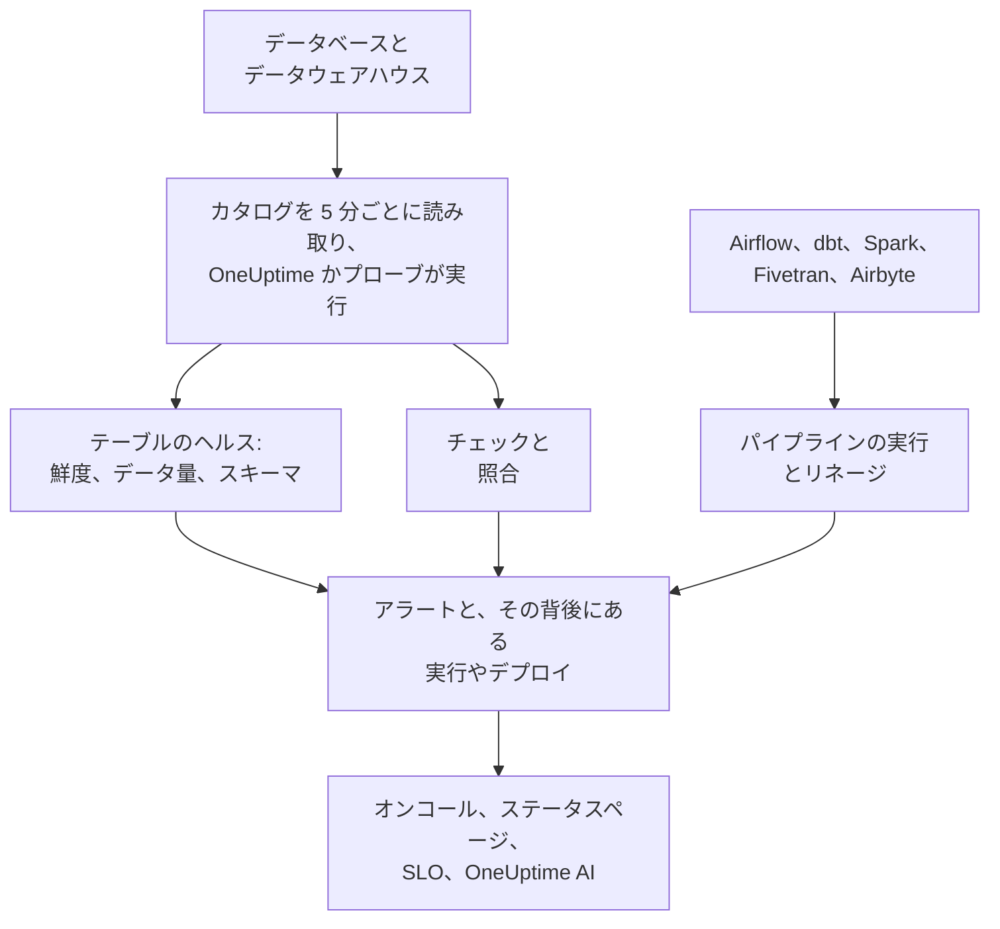

# データオブザーバビリティ

データオブザーバビリティは、PostgreSQL、MySQL、SQL Server、Redshift、Snowflake、BigQuery、ClickHouse、Databricks にある、会社が頼りにしているテーブルを見守り、データが遅れている、欠けている、間違っている、壊れているときに、それを使う人が気づく前に知らせます。各テーブルの更新のリズムを自動で学習し、各データベースのカタログだけを読んで行は決して読まず、あらゆるデータの問題を、その背後にあるパイプラインの実行、デプロイ、上流のテーブルに結び付けます。

次の 4 つの問いに答えます。

:::cards
- [データは新しいか？](/docs/data-observability/table-health): すべてのテーブルの最終変更、行数、サイズ、列を 5 分ごとに読み取り、テーブルが遅れたとき、縮んだとき、形が変わったときにアラートを出します。
- [データは正しいか？](/docs/data-observability/checks): テーブルの中身に対するチェック、テーブルとそのコピーの照合、そして dbt のテスト。失敗するとアラートを出します。
- [データはどこから来て、何に使われるか？](/docs/data-observability/lineage-and-pipelines): パイプライン、dbt、Fivetran、Airbyte、ビュー、そしてデータベース自身のクエリ履歴から得るリネージ。1 つの問題で開くアラートは 1 件だけです。
- [使う人はデータを信頼できるか？](/docs/data-observability/data-products): 鮮度 SLA を持つデータプロダクト。ステータスページに表示され、SLO として追跡され、「data as of」バッジが付きます。
:::

## 仕組み

1. 読み取り専用のログインで **データベースを接続します**。データセキュリティがすでに把握しているデータベースは何もしなくても監視され、Google Cloud 接続が見つけたすべての BigQuery データセットも同様です。プライベートネットワーク内のデータベースは、そこで実行するプローブが読み取ります。
2. **5 分ごとに**、OneUptime は各データベースのカタログと統計情報を読み取ります: すべてのテーブルとビュー、その列、行数、サイズ、そして最後に変更された日時です。テーブルをスキャンすることも、行を読むこともありません。
3. **各テーブルのリズムを学習します**: ふだんどのくらいの頻度で変更されるかです。リズムを外れたテーブルは遅延となり、行数が減ったテーブルや列が変わったテーブルは、そのことを知らせます。
4. **推奨アラート** は、これらをそれぞれ、必要なものだけ選んで追加できるモニターにします。追加したチェックは、テーブルの中身を読み取ります。
5. **リネージ** は、どのテーブルがどのテーブルにデータを渡しているかを示します。そのため、ソースが先に壊れたテーブルのアラートは、そのソースの結果として扱われます: 開くのは 10 件ではなく 1 件です。

## ほかとの違い

- **OneUptime のほかの機能と一体です。** データのアラートは通常のアラートです: オンコールで呼び出し、インシデントを開き、ステータスページに表示され、SLO に計上されます。トレースからテーブルに書き込んでいるとわかるサービスと、そのデプロイが、すべてのテーブルアラートの横に表示されます。
- **テーブルごとの設定は不要です。** リズム、スケジュール、通常の実行時間は、各テーブルと各パイプラインの実際の動きから学習されます。データベースに推奨されたモニターは、後から作成されたテーブルも含め、その中のすべてのテーブルを対象にします。
- **原因ごとにアラートは 1 件。** 上流のテーブル、パイプライン、データベースですでにアラートが開いている場合、新しいアラートはその結果としてそのアラートに加わり、最初から確認済みになります。そのため、壊れたロードで呼び出されるのは 1 回だけです。
- **OneUptime AI はデータを知っています。** データアラートの調査は、テーブルの書き込み元、実行、上流のテーブルから始まります。AI に質問、Slack、Microsoft Teams、AI エージェントから、テーブルが新しいかどうかを尋ねることができ、チェックは 1 文から作成できます。 [OneUptime AI と API](/docs/data-observability/ai-and-api) を参照してください。

## 始める前に

- **設定できるロール。** データベースを接続できるのは Project Owner、Project Admin、Telemetry Admin です。データ資産を編集できる人は誰でもチェック、照合、データプロダクトを追加でき、Viewer は見つかったものを閲覧します。 [権限リファレンス](/docs/permissions/reference) を参照してください。
- **各データベースの読み取り専用のログイン。** 各エンジンに最低限必要なものは [データベースを接続する](/docs/data-observability/connect) に一覧されています。

## クイックスタート

:::steps
### データベースを接続する

**データオブザーバビリティ** を開き、 **データベース** に移動して **Connect a Database** を選びます。エンジンを選び、読み取り専用の接続文字列か、プローブがそれを読み取る環境変数の名前を指定します。各エンジンのログインは [データベースを接続する](/docs/data-observability/connect) で説明しています。

### テーブルを確認する

5 分以内に、そのテーブルが **テーブル** の下に表示され、それぞれの行数、サイズ、最終変更日時がわかります。テーブルが 2 回変更されると鮮度がわかります: リズムを保っている間は **Fresh**、リズムを外れると **Late** です。

### 推奨アラートを追加する

**データベース** で、そのデータベースの **Recommended Alerts** を選び、必要なものを追加します: 遅延しているテーブル、行数が急減したか異常に少ないテーブル、列が変わったテーブル、そして報告が止まったデータベースです。どれも通常のモニターです: オンコール、所有者、メンテナンスウィンドウ、ステータスページは、ほかのモニターと同じように機能します。
:::

## 次のステップ

:::cards
- [データベースを接続する](/docs/data-observability/connect): 各エンジンの最小権限のログインと、プライベートネットワーク向けのプローブ。
- [テーブルのヘルス](/docs/data-observability/table-health): 鮮度、データ量、スキーマの変更、未使用のテーブル、そしてすべてのテーブルが書き込むメトリクス。
- [チェックと照合](/docs/data-observability/checks): テーブルの値に対するルール、テーブルとそのコピーの比較、dbt のテスト。
- [リネージとパイプライン](/docs/data-observability/lineage-and-pipelines): OpenLineage、dbt、Fivetran、Airbyte、そして原因ごとに 1 件のアラート。
- [データプロダクト](/docs/data-observability/data-products): データを使う人のための鮮度 SLA。ステータスページに表示し、SLO として追跡します。
- [OneUptime AI と API](/docs/data-observability/ai-and-api): 調査、1 文からのチェック、AI エージェント向けの鮮度、そしてすべてのエンドポイント。
:::
