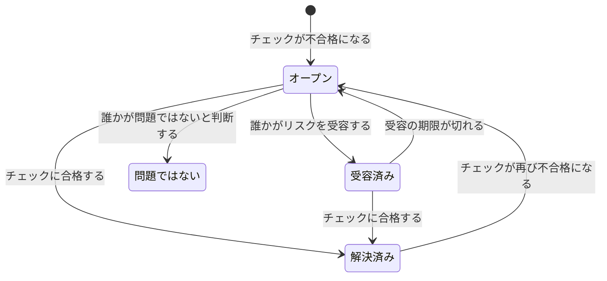

# データセキュリティのチェックと問題

データセキュリティは、すべてのデータストアに対して、9 つのグループに分かれた 32 のチェックを実行します。チェックは 1 つのデータストアについてわかっていること (どう設定されているか、その中で何が見つかったか、誰がアクセスできるか、どこにあるか) を読み取り、合格、不合格、または判断できないと答えます。不合格になったチェックはそのデータストアに問題を 1 つ開き、その問題はチェックに合格すると自動でクローズされます。このページでは、すべてのチェックを一覧し、問題の重大度とリスクスコアがどう決まるか、そして問題がどのような流れをたどるかを説明します。

:::cards
- [チェックの判定のしかた](#チェックの判定のしかた): 合格、不合格、判断できない、そして不合格がどれほど深刻か。
- [すべてのチェック](#すべてのチェック): 32 個すべてと、それぞれがチェックする内容と修正方法。
- [リスクスコア](#リスクスコア): 同じ重大度の中で問題がどう並ぶか。
- [問題がたどる流れ](#問題がたどる流れ): オープン、解決済み、受容済み、問題ではない。
- [ここで修正](#ここで修正): 公開バケットのブロックや、スナップショットの共有の停止をワンクリックで。
:::

## チェックの判定のしかた

各チェックはデータストアについての事実を読み取り、次の 4 通りのいずれかで答えます。

| 答え | 意味 | 問題がどうなるか |
| --- | --- | --- |
| 合格 | チェックで不備が見つかりません。 | オープンまたは受容済みの問題は解決済みになります。 |
| 不合格 | チェックが不備を見つけ、見たものを 1 文で示します: これが問題の証拠になります。 | 問題が開くか、すでにオープンの問題が最新の状態に更新されます。 |
| 判断できない | 事実を読み取れませんでした: ロールにない権限や、失敗した呼び出しなどです。 | 何も変わりません: OneUptime が確認できなかったのに不備が修正されたと結論づけることは誰にもできないため、オープンの問題はオープンのままです。 |
| 該当しない | データストアの種類に、そのような設定がありません。 | オープンの問題は解決済みになります。 |

### 重大度はデータで決まる

同じ不備でも、機密度の高いデータほど深刻になります。すべてのチェックは機密度のレベルごとに重大度を定めており、問題にはそのデータストアに当てはまる重大度が付きます: カード番号が入った公開バケットは「重大」、ウェブサイトの画像が入った公開バケットは「低」で済みます。ダッシュ (—) は、問題がまったく開かないことを意味します。データストアの機密度はその検出結果から決まるので ( [機密データタイプ](/docs/data-security/data-types#機密度) を参照)、コンテンツのサンプルがあると重大度が正確になります。

機密度ではなく、見つけたものから重大度を決めるチェックもいくつかあります。 **シークレットが保存されている** は、どのデータストアでも「高」、公開されているデータストアや他のアカウントと共有されているデータストアでは「重大」になります。

## すべてのチェック

重大度は、制限、機密、社内、公開のデータについて、この順に示します。各問題のページには、そのデータストア向けの完全な修正方法 (コンソールでの手順、CLI コマンド、そして当てはまる場合は Terraform) が、データストアの名前とリージョンを入力済みの状態で表示されます。

### 露出

| チェック | 対象 | チェックする内容 | 重大度 | 修正方法 |
| --- | --- | --- | --- | --- |
| インターネット上の誰でも読み取れる (`public-read`) | オブジェクトストレージ、ウェアハウス、検索 | データストアのポリシー、ACL、または IAM バインディングにより、誰でもサインインせずにそのデータを読み取れます。 | 重大 / 重大 / 高 / 低 | 匿名のプリンシパルや、認証済みの全員を表すプリンシパルへの付与をすべて削除します。公開しなければならないファイルは、ほかに何も保持しない、 **意図的に公開** とマークしたデータストアに置きます。 |
| インターネット上の誰でも変更できる (`public-write`) | オブジェクトストレージ、ウェアハウス、検索 | データストアのポリシー、ACL、または IAM バインディングにより、誰でもそのデータを書き込んだり削除したりできます。 | 重大 / 重大 / 重大 / 高 | 匿名のプリンシパルや、認証済みの全員を表すプリンシパルへの、書き込みと削除の付与をすべて削除します。 |
| パブリックアクセスがブロックされていない (`public-access-not-blocked`) | AWS S3 Bucket | バケットまたはそのアカウントで S3 Block Public Access が完全にはオンになっていないため、ポリシーを 1 つ変更するだけで公開されるおそれがあります。 | 高 / 中 / 低 / — | バケットの 4 つの Block Public Access 設定をすべてオンにします。 |
| データベースがインターネットからの接続を受け付ける (`internet-reachable`) | データベース、ウェアハウス、検索、キャッシュ | データベースにパブリックエンドポイントがあるか、パブリックネットワークアクセスがオンになっています。 | 高 / 高 / 中 / 低 | パブリックエンドポイントをオフにし、プライベートネットワークまたは踏み台サーバーを経由してデータベースにアクセスします。 |
| ファイアウォールがすべてのアドレスを通す (`open-to-all-addresses`) | データベース、ウェアハウス、検索、キャッシュ | ファイアウォールルールまたは承認済みネットワークが、0.0.0.0/0 またはアドレス範囲全体を許可しています。 | 重大 / 重大 / 高 / 中 | すべてを許可するルールを、アクセスが必要なアドレスまたはネットワークに置き換えます。 |
| スナップショットを誰でも復元できる (`snapshot-public`) | データベース、スナップショット | データベースのスナップショットがパブリックに共有されているため、どのクラウドアカウントでも完全なコピーを復元できます。 | 重大 / 重大 / 重大 / 高 | スナップショットを非公開にします。 |
| スナップショットが他のアカウントと共有されている (`snapshot-shared-externally`) | データベース、スナップショット | データベースのスナップショットが、接続済みのアカウント以外のアカウントと共有されています。 | 高 / 高 / 中 / 低 | スナップショットを持つべきでないアカウントとの共有を停止します。 |
| 組織外のアカウントがアクセスできる (`shared-with-external-accounts`) | テレメトリ以外のすべてのデータストア | データストアのポリシーが、OneUptime に接続されていないアカウント、テナント、またはプロジェクトにアクセスを付与しています。 | 高 / 高 / 中 / 低 | 外部のプリンシパルをそれぞれ確認し、アクセスが不要なものを削除します。 |

### 暗号化

| チェック | 対象 | チェックする内容 | 重大度 | 修正方法 |
| --- | --- | --- | --- | --- |
| データが保存時に暗号化されていない (`not-encrypted-at-rest`) | テレメトリ以外のすべてのデータストア | ストレージの暗号化がオフになっています。 | 高 / 中 / 低 / — | 保存時の暗号化をオンにします。RDS インスタンスはその場で暗号化できないので、そのスナップショットの暗号化されたコピーを復元します。 |
| 制限データが自分のキーで保護されていない (`no-customer-managed-key`) | テレメトリ以外のすべてのデータストア | データストアは制限データを保持していますが、カスタマーマネージドキーではなく、プロバイダーのデフォルトのキーで暗号化されています。 | 中 / — / — / — | キーサービスで自分が管理するキーを使って、データストアを暗号化します。 |
| 暗号化されていない接続が許可されている (`encryption-in-transit-not-enforced`) | テレメトリ以外のすべてのデータストア | データストアが TLS を使わない接続を受け付けます。 | 高 / 中 / 低 / — | すべての接続で TLS を必須にします。S3 では、 `aws:SecureTransport` が false のリクエストをすべて拒否します。 |
| 1.2 より古い TLS を受け付ける (`weak-tls`) | テレメトリ以外のすべてのデータストア | TLS の最小バージョンが 1.0 または 1.1 です。 | 中 / 中 / 低 / — | TLS の最小バージョンを 1.2 以降に設定します。 |

### 復旧

| チェック | 対象 | チェックする内容 | 重大度 | 修正方法 |
| --- | --- | --- | --- | --- |
| バックアップがない、または 7 日未満しか保持しない (`no-backups`) | データベース、ウェアハウス | 自動バックアップがオフになっているか、保持期間が 7 日未満です。 | 高 / 中 / 低 / — | 自動バックアップをオンにし、少なくとも 7 日間保持します。 |
| ポイントインタイムリカバリがオフになっている (`no-point-in-time-recovery`) | AWS DynamoDB Table、Azure Cosmos DB Account | テーブルやデータベースを、誤操作の前の時点に復元できません。 | 中 / 低 / — / — | ポイントインタイムリカバリをオンにします。 |
| 1 回の操作で削除できる (`deletion-protection-off`) | データベース、ウェアハウス | 削除保護がオフになっています。 | 中 / 低 / — / — | 削除保護をオンにします。 |
| 削除または上書きされたファイルを復旧できない (`deleted-data-not-recoverable`) | オブジェクトストレージ | バージョニングとソフト削除がどちらもオフになっています。 | 中 / 低 / — / — | バージョニングまたはソフト削除をオンにします。 |

### 可視性

| チェック | 対象 | チェックする内容 | 重大度 | 修正方法 |
| --- | --- | --- | --- | --- |
| 誰が読み取ったのか誰にもわからない (`access-not-logged`) | テレメトリ以外のすべてのデータストア | データストアの読み取りがログに記録されていません: アクセスログも、データアクセスの監査ログもありません。 | 高 / 中 / 低 / — | 読み取りのアクセスログまたは監査ログをオンにします: S3 のサーバーアクセスログまたは CloudTrail のデータイベント、Azure の StorageRead 診断ログ、Cloud Storage のデータアクセス監査ログです。 |

### アクセス

| チェック | 対象 | チェックする内容 | 重大度 | 修正方法 |
| --- | --- | --- | --- | --- |
| アカウントキーを持つ人なら誰でもすべてを読み取れる (`shared-key-access`) | Azure Storage Account | ストレージアカウントが共有キーによるアクセスを許可しています。これは Microsoft Entra ID を迂回し、個人ごとの監査証跡を残しません。 | 中 / 低 / — / — | アプリケーションを Microsoft Entra ID に移行してから、ストレージアカウントキーによるアクセスをオフにします。 |
| オブジェクトが独自のアクセスルールを持てる (`object-acls-enabled`) | AWS S3 Bucket、Google Cloud Storage Bucket | オブジェクト ACL がオンになっているため、バケットが非公開に見えていても、1 つのオブジェクトを公開にできます。 | 低 / 低 / — / — | S3 では、オブジェクト所有者を「バケット所有者の強制」に設定します。Cloud Storage では、均一なバケットレベルのアクセスをオンにします。 |
| 25 を超える ID が制限データを読み取れる (`many-readers`) | テレメトリ以外のすべてのデータストア | ほとんどのチームが確認しきれないほど多くの ID が、データストアへの読み取りアクセスを持っています。 | 中 / — / — / — | データストアの **アクセスできる人** ページを開き、使われていないアクセスや、必要以上に広いアクセスを削除します。 |

### データの衛生管理

| チェック | 対象 | チェックする内容 | 重大度 | 修正方法 |
| --- | --- | --- | --- | --- |
| シークレットが保存されている (`secrets-stored`) | テレメトリ以外のすべてのデータストア | データストアのデータに、パスワード、API キー、トークン、または秘密鍵が見つかりました。 | 高 / 高 / 高 / 高 | 見つかったシークレットはすべて漏えいしたものとして扱い、ローテーションします。シークレットはシークレットマネージャーに移し、データストアから削除します。 |
| カードのセキュリティコードが保存されている (`card-security-codes-stored`) | テレメトリ以外のすべてのデータストア | CVV または CVC のコードが見つかりました。PCI DSS は、暗号化の有無にかかわらず、支払いの承認後にこれらを保持することを禁じています。 | 重大 / 重大 / 重大 / 重大 | それらを書き込むコードを止め、保存されたセキュリティコードを削除し、バックアップにも残っていないことを確認します。 |
| カード番号が読み取れる形で保存されている (`card-numbers-readable`) | テレメトリ以外のすべてのデータストア | 完全なカード番号が読み取れる形で見つかりました。PCI DSS は、カード番号をどこに保存する場合でも読み取れない状態にすることを求めています。 | 高 / 高 / 高 / 高 | 決済プロバイダーでカード番号をトークン化するか、フィールドレベルで暗号化し、読み取れるコピーを削除します。 |
| パスワードが平文で保存されている (`plaintext-passwords`) | テレメトリ以外のすべてのデータストア | パスワードのフィールドに、パスワードハッシュ (bcrypt、argon2、scrypt、または PBKDF2) ではない値が入っています。 | 重大 / 重大 / 重大 / 重大 | bcrypt、scrypt、または argon2 でパスワードをハッシュ化し、保存済みのパスワードを移行して、すべてのアカウントにパスワードをリセットさせます。 |
| 本番データが本番以外のデータストアにコピーされた (`production-data-in-non-production`) | テレメトリ以外のすべてのデータストア | 本番のデータストアで見つかった値が、ここ (開発、テスト、またはステージングのデータストア) でも見つかりました。 | 高 / 中 / — / — | コピーをマスクしたデータまたは合成データに置き換え、本番以外のデータストアから実データを削除します。 |
| 90 日間誰も使っていない機密データ (`stale-sensitive-data`) | テレメトリ以外のすべてのデータストア | データストアが機密データを保持しており、90 日間読み取りも書き込みもありません。 | 中 / 低 / — / — | データがもう必要ないことを確認してから、保持期限を付けてアーカイブするか、削除します。 |
| この機密データストアには所有者がいない (`no-owner`) | すべてのデータストア | データストアが機密データを保持しており、所有者がいません。 | 中 / 低 / — / — | データストアの **所有者** ページで所有者を追加するか、そのタグに一致する所有者ルールを追加します。 |

### テレメトリ

| チェック | 対象 | チェックする内容 | 重大度 | 修正方法 |
| --- | --- | --- | --- | --- |
| 機密データがテレメトリに届いている (`sensitive-data-in-telemetry`) | テレメトリ | ログ、トレース、例外、リプレイ、または AI の会話に、どのスクラブルールでもマスクされていない機密データが含まれています。 | 高 / 中 / 低 / — | 各検出結果で **スクラブ** を押して取り込み時にデータをマスクし、そのうえで、データを書き込んでいるコードを修正します。 |
| シークレットがテレメトリに届いている (`secrets-in-telemetry`) | テレメトリ | パスワード、API キー、またはトークンが、ログ、トレース、例外、または AI の会話に現れています。 | 重大 / 重大 / 重大 / 重大 | まずシークレットをローテーションしてから、 **スクラブ** を押し、それを書き込んでいるコードを修正します。 |

### データ所在地

| チェック | 対象 | チェックする内容 | 重大度 | 修正方法 |
| --- | --- | --- | --- | --- |
| 許可されたリージョンの外にデータが保存されている (`residency-violation`) | テレメトリ以外のすべてのデータストア | データストアのリージョン、またはそのデータのレプリケーション先のリージョンが、データ所在地ルールに違反しています。 | 高 / 高 / 中 / — | データを許可されたリージョンに移すか、もう一方のリージョンへのコピーを停止します。移転が適法な場合は、問題を受容し、その理由を記録します。 |

### AI

| チェック | 対象 | チェックする内容 | 重大度 | 修正方法 |
| --- | --- | --- | --- | --- |
| 機密データが AI プロバイダーに送信されている (`sensitive-data-to-ai`) | AI の会話 | OneUptime に記録された AI の会話が、機密データをモデルプロバイダーに運んでいます。 | 重大 / 高 / 低 / — | プロンプトを送信する前に機密の値を伏せるか、これらの呼び出しを自分でホストするモデルに送ります。 |
| 制限データが AI に使われるデータストアにある (`sensitive-data-in-ai-store`) | テレメトリ以外のすべてのデータストア | AI の学習用または検索用のデータとしてタグ付けされたデータストアが、制限データを保持しています。 | 高 / 中 / — / — | モデルの学習やグラウンディングに使う前に、制限データを削除またはマスクします。 |

## リスクスコア

重大度は、問題がどれほど深刻かを示します。0 から 100 までのリスクスコアは、同じ不備をさらに悪化させる要素をもとに、同じ重大度の問題に順位を付けます。

```text
risk = severity + 10 × exposure + 6 × volume + 5 × activity + 4 × production, at most 100
```

| 要素 | ポイント |
| --- | --- |
| 重大度 | 「重大」は 75、「高」は 50、「中」は 25、「低」は 0 |
| 露出 | 「公開」は 10、「他のアカウント」は 8、「インターネットから到達可能」は 6、「不明」は 3、「非公開」は 0 |
| 量 | データストアの機密レコードの推定数に応じて、対数スケールで最大 6: 10 件で 1、1,000 件で 3、100 万件で 5、1,000 万件以上で 6 |
| アクティビティ | 直近 1 週間に、セキュリティオペレーションがそのデータストアで検出を確認した場合は 5 |
| 本番 | 本番環境のデータストアは 4 |

追加の要素で加わるのは最大 25 ポイントなので、問題のスコアが、より低い重大度の問題のスコアを下回ることはありません。制限データを 100 万件保持する本番環境の公開バケットは、重大度が「重大」の問題で 75 + 10 + 5 + 4 = 94 になります。各問題には、スコアを押し上げた要素がそのポイントとともに一覧され、データストアには、オープンの問題のうち最も深刻なもののスコアが表示されます。

データストアの環境 (本番、ステージング、開発、テスト、または不明) は、そのタグ (`env`、`environment`、`stage`、`tier` など) から、タグがない場合は `prod`、`staging`、`dev`、`qa` などの名前に含まれる語から決まります。どちらからもわからない場合は、データストアで設定します。

## 問題がたどる流れ



OneUptime は、チェックの実行に合わせて問題を開き、更新し、解決します。人が問題に対して行うのは、次に何が起きるかを決めることです。

| ステータス | その状態になる経緯 | その後 |
| --- | --- | --- |
| **オープン** | そのチェックが、現在そのデータストアで不合格になっています。 | チェックに合格するまで、概要、データストアのサマリー、コンプライアンスで数えられます。 |
| **解決済み** | そのチェックが後の実行で合格したか、当てはまらなくなったか、オフにされたか、またはそのデータストアがアーカイブされました。人が **解決済みにする** を選ぶこともできます: その場合、データストアはすぐに再チェックされます。 | チェックが再び不合格になると再びオープンになり、問題には再オープンした回数が記録されます。 |
| **受容済み** | 人が **リスクを受容** を選び、 **理由** と、最長 1 年先までの日付を **受容期限** に入力しました。 | その日付まではクローズされたままで、その時点でまだチェックが不合格なら再びオープンになります。理由がまだ当てはまるなら、そのときにもう一度受容します。 |
| **問題ではない** | 人が **問題ではない** を選びました: 検出結果が誤りでした。 | チェックが不合格の間も、クローズされたままです。 **再オープン** を使うとオープンに戻ります。 |

Security Member、Security Admin、Project Admin、Project Owner は、問題のステータスを変更し、 **割り当て** で人やチームに割り当てることができます。すべての変更は問題の **タイムライン** に書き込まれます: いつ開いたか、重大度の各変更、ステータスの各変更とそれを行った人、依頼された再チェック、そして連携が行ったことです。

再びオープンになった問題も、その履歴を保持します。受容されたリスクは毎日見直されるので、何もスキャンされなかったときでも、期限どおりに失効します。

## ここで修正

公開バケットや共有されたスナップショットについてのオープンの問題は、そのページから修正できます。コンソールでの手順の上にある **ここで修正** が、それを修正する変更を提示します。

| 問題 | データストア | ボタン | 変更内容 |
| --- | --- | --- | --- |
| `public-read`、`public-write`、または `public-access-not-blocked` | S3 バケット、Azure ストレージアカウント、または Cloud Storage バケット | **パブリックアクセスをブロック** | バケットの 4 つの Block Public Access 設定をオンにする、ストレージアカウントの匿名 BLOB アクセスをオフにする、またはバケットのパブリックアクセスの防止を適用する |
| `snapshot-public` または `snapshot-shared-externally` | RDS スナップショット、RDS データベース、または Aurora や DocumentDB のクラスター | **共有を取り消す** | スナップショット、またはデータベースの共有された各手動スナップショットについて、全員との共有と、接続したアカウント以外のアカウントとの共有を停止する |

実行前に確認を求め、何が変わり、何が動かなくなるかを示します。変更するのはデータストアの共有のしかただけで、データは決して変更せず、すでに閉じているものは何も変更しません。 **意図的に公開** とマークされたデータストアは、決してブロックされません。

これはデータストアのクラウド接続を通じて行われるため、接続で **データセキュリティ対応** をオンにし、そのセットアップコマンドをもう一度実行しておく必要があります ( [データセキュリティを設定する](/docs/data-security/setup#データセキュリティに露出を解消させる) を参照)。それまでは、何をオンにすればよいかがパネルに表示されます。変更の直後にデータストアが再チェックされ、チェックに合格すると問題は自動で解決します。問題の **タイムライン** とデータストアの **タイムライン** に、何が行われたか、誰が行ったかが表示されます。

## チェックの設定

**データセキュリティ → 設定 → チェック** には、すべてのチェックがグループごとに、何を探すか、そして不合格のときに各機密度で付く重大度とともに一覧されます。各チェックはプロジェクトに合わせて調整でき、変更はそのたびにすぐ保存されます。

- **スイッチ** は、チェックが自分たちの運用に合わないときに、そのチェックをオフにします。そのチェックのオープンと受容済みの問題は解決済みになり、チェックがもう実行されないことが示されます。
- **重大度** は、初期状態の **機密度別** のほか、データストアが何を保持していても、そのチェックのすべての不合格に付く 1 つの重大度にもできます。

1 つのデータストアでだけチェックを黙らせるには、そのデータストアの問題でリスクを受容するか、その問題を「問題ではない」とマークします。重要でない不備ではなく、検出結果そのものが誤っている場合は、代わりにその検出結果を機密ではないとマークします ( [機密データタイプ](/docs/data-security/data-types#機密ではない値と機密扱いしない値) を参照)。

データストアの **今すぐチェック** は、その設定を再度読み取ってチェックを実行します。 **今すぐスキャン** はそのコンテンツをサンプリングし、スキャンが終わるとチェックが実行されます。

## 次のステップ

:::cards
- [データセキュリティの連携](/docs/data-security/integrations): 問題が開いたときのセキュリティケース、アラート、所有者へのメール。
- [データフロー、アクセス、データ所在地](/docs/data-security/flows-access-residency): 複数のチェックが読み取るアクセス、コピー、リージョン。
- [データセキュリティのコンプライアンス](/docs/data-security/compliance): 各チェックが証拠となるフレームワークの要件。
:::
