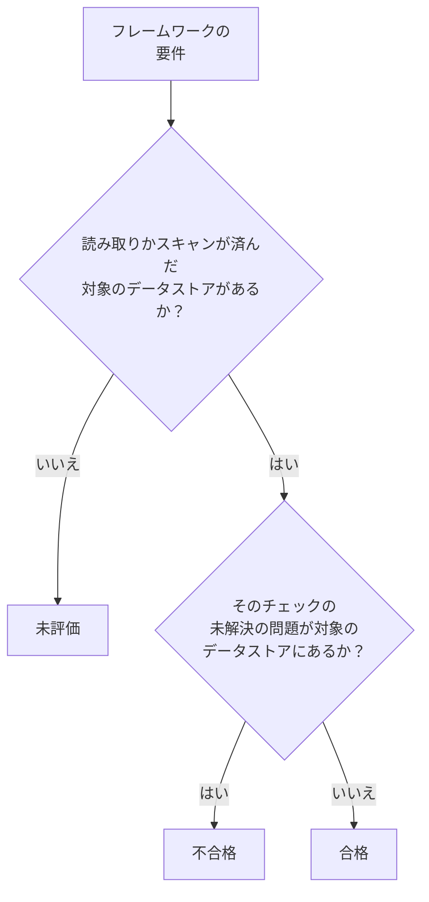

# データセキュリティのコンプライアンス

データセキュリティは、スキャンで見つかったものから 9 つのフレームワークのスコアを付けます。各フレームワークは、その規則が扱うデータストアを対象とし (GDPR は個人データを保持するデータストア、PCI DSS はカードデータが見つかったデータストア、SOC 2 はすべてのデータストア)、その各要件は、証拠となるチェックによって満たされるか、不合格になります。 **データセキュリティ → コンプライアンス** には、各フレームワークのスコア、対象のデータストアの数、そしてすべての要件と、それを不合格にしている未解決の問題の数が表示されます。スコアは監査のための証拠であって、認証ではありません: OneUptime が読み取るデータストアについて、OneUptime に見えているものを示します。

:::cards
- [フレームワーク](#フレームワーク): 9 つのフレームワークと、それぞれが対象とするデータストア。
- [フレームワークのスコアの付け方](#フレームワークのスコアの付け方): 合格、不合格、未評価の要件。
- [要件とそのチェック](#要件とそのチェック): すべての要件と、その証拠になるチェック。
- [処理の記録](#処理の記録): データストアをもとに作成する GDPR 第 30 条の記録。
:::

## フレームワーク

| フレームワーク | 正式名称 | 対象のデータストア |
| --- | --- | --- |
| GDPR | EU 一般データ保護規則 | 個人データを保持するデータストア。 |
| CCPA | カリフォルニア州消費者プライバシー法 (CPRA による改正後) | 個人情報を保持するデータストア。 |
| HIPAA | HIPAA セキュリティ規則 | 健康データを保持するデータストア。 |
| PCI DSS | PCI DSS v4.0 | カード番号が見つかったデータストア。 |
| SOC 2 | SOC 2 トラストサービス規準 | すべてのデータストア。 |
| ISO 27001 | ISO/IEC 27001:2022 | すべてのデータストア。 |
| NIST CSF | NIST サイバーセキュリティフレームワーク 2.0 | すべてのデータストア。 |
| LGPD | ブラジルの一般データ保護法 | ブラジルにいる人の個人データを保持するデータストア。 |
| DPDP | インドのデジタル個人データ保護法 (2023 年) | インドにいる人の個人データを保持するデータストア。 |

## フレームワークが対象とするデータストア

データストアがどのフレームワークの対象になるかは、その中で見つかったデータで決まるため、スキャンで見つかるものが増えるにつれて変わります。

- **SOC 2、ISO 27001、NIST CSF** はセキュリティのフレームワークです。何を保持していても、すべてのデータストアが対象です。
- **GDPR、CCPA、HIPAA、PCI DSS** は、それぞれが保護するデータタイプを保持するデータストアが対象です。個人データがあれば GDPR と CCPA、健康データがあれば HIPAA も対象になり、カード番号、カードのセキュリティコード、カードの有効期限があれば PCI DSS の対象になります。シークレットや業務文書だけを保持するデータストアは、どれの対象にもなりません。
- **LGPD と DPDP** は各国独自の法律です。ブラジルまたはインドにいる人の個人データを保持するデータストアが対象で、どの国の人のデータかは、ブラジル CPF やインド Aadhaar 番号のような、その国に属するデータタイプから読み取ります。

[機密データタイプ](/docs/data-security/data-types#組み込みデータタイプ) には、すべてのデータタイプが、その国とともに一覧されています。

## フレームワークのスコアの付け方

- **要件が合格する** のは、要件に対応付けられたチェックの未解決の問題が、フレームワークの対象のデータストアに 1 つもないときです。1 つでもあれば **不合格** になります。
- **評価されない** のは、対象のデータストアのどれも、まだ設定が読み取られておらず、コンテンツもスキャンされていないあいだです。
- **2 つの要件は、データセキュリティ自体が満たします**: GDPR 第 30 条の処理活動の記録と、ISO 27001 A.5.12 の情報の分類です。対象のすべてのデータストアが読み取りかスキャンを受けると合格し、まだのものが 1 つでもあるあいだは不合格になります。
- **スコア** は、フレームワークの評価済みの要件のうち合格したものの割合で、整数のパーセントで表します。何も評価されていないフレームワークにはスコアがありません。

数えられるのは未解決の問題だけです。リスクが受容された問題や、「問題ではない」とされた問題は、その要件を不合格にしません。そのため、受容したリスクは、監査で問題ごとに確認できる判断として残ります: 誰が、なぜ、いつまで受容したかです。

## 要件とそのチェック

### GDPR

| 要件 | 求めていること | チェック |
| --- | --- | --- |
| Art. 5(1)(c) | データの最小化 | `production-data-in-non-production`、`stale-sensitive-data`、`sensitive-data-in-telemetry`、`sensitive-data-to-ai`、`sensitive-data-in-ai-store` |
| Art. 5(1)(e) | 保存の制限 | `stale-sensitive-data` |
| Art. 25 | データ保護バイデザインとデータ保護バイデフォルト | `production-data-in-non-production`、`stale-sensitive-data`、`sensitive-data-in-telemetry`、`sensitive-data-to-ai`、`sensitive-data-in-ai-store` |
| Art. 28 | 処理者 | `sensitive-data-to-ai` |
| Art. 30 | 処理活動の記録 | データセキュリティ自体が満たす |
| Art. 32 | 処理のセキュリティ | `public-read`、`public-write`、`public-access-not-blocked`、`internet-reachable`、`open-to-all-addresses`、`snapshot-public`、`snapshot-shared-externally`、`shared-with-external-accounts`、`not-encrypted-at-rest`、`no-customer-managed-key`、`encryption-in-transit-not-enforced`、`weak-tls`、`no-backups`、`no-point-in-time-recovery`、`deletion-protection-off`、`deleted-data-not-recoverable`、`access-not-logged`、`shared-key-access`、`object-acls-enabled`、`many-readers`、`secrets-stored`、`plaintext-passwords`、`secrets-in-telemetry` |
| Arts. 44-49 | 第三国への移転 | `residency-violation` |

### CCPA

| 要件 | 求めていること | チェック |
| --- | --- | --- |
| 1798.100(c) | 必要な範囲に限った収集 | `production-data-in-non-production`、`stale-sensitive-data`、`sensitive-data-in-telemetry`、`sensitive-data-to-ai`、`sensitive-data-in-ai-store` |
| 1798.150 | 合理的なセキュリティ手続き | `public-read`、`public-write`、`public-access-not-blocked`、`internet-reachable`、`open-to-all-addresses`、`snapshot-public`、`snapshot-shared-externally`、`shared-with-external-accounts`、`shared-key-access`、`object-acls-enabled`、`many-readers` |

### HIPAA

| 要件 | 求めていること | チェック |
| --- | --- | --- |
| 164.308(a)(7) | 緊急時対応計画 | `no-backups`、`no-point-in-time-recovery`、`deletion-protection-off`、`deleted-data-not-recoverable` |
| 164.312(a)(1) | アクセス制御 | `public-read`、`public-write`、`public-access-not-blocked`、`internet-reachable`、`open-to-all-addresses`、`snapshot-public`、`snapshot-shared-externally`、`shared-with-external-accounts`、`shared-key-access`、`object-acls-enabled`、`many-readers` |
| 164.312(a)(2)(iv) | 暗号化と復号 | `not-encrypted-at-rest`、`no-customer-managed-key` |
| 164.312(b) | 監査制御 | `access-not-logged` |
| 164.312(e)(1) | 伝送のセキュリティ | `encryption-in-transit-not-enforced`、`weak-tls` |

### PCI DSS

| 要件 | 求めていること | チェック |
| --- | --- | --- |
| 3.3.1 | 機密認証データを承認後に保持しない | `card-security-codes-stored` |
| 3.4.1 | カード番号を表示するときはマスクする | `card-numbers-readable`、`sensitive-data-in-telemetry` |
| 3.5.1 | カード番号は保存されるすべての場所で読み取れないようにする | `not-encrypted-at-rest`、`no-customer-managed-key`、`card-numbers-readable` |
| 4.2.1 | 伝送中のカードデータを強力な暗号で保護する | `encryption-in-transit-not-enforced`、`weak-tls` |
| 7.2 | アクセスを必要に応じて定義し、割り当てる | `public-read`、`public-write`、`public-access-not-blocked`、`internet-reachable`、`open-to-all-addresses`、`snapshot-public`、`snapshot-shared-externally`、`shared-with-external-accounts`、`shared-key-access`、`object-acls-enabled`、`many-readers` |
| 8.3.2 | 認証要素は保存時に読み取れないようにする | `plaintext-passwords` |
| 10.2 | 監査ログでカードデータへのアクセスを記録する | `access-not-logged` |

### SOC 2

| 要件 | 求めていること | チェック |
| --- | --- | --- |
| A1.2 | バックアップと復旧 | `no-backups`、`no-point-in-time-recovery`、`deletion-protection-off`、`deleted-data-not-recoverable` |
| CC6.1 | 論理アクセスのセキュリティ | `public-read`、`public-write`、`public-access-not-blocked`、`internet-reachable`、`open-to-all-addresses`、`snapshot-public`、`snapshot-shared-externally`、`shared-with-external-accounts`、`not-encrypted-at-rest`、`no-customer-managed-key`、`shared-key-access`、`object-acls-enabled`、`many-readers`、`secrets-stored`、`plaintext-passwords`、`secrets-in-telemetry` |
| CC6.7 | 情報の伝送 | `encryption-in-transit-not-enforced`、`weak-tls` |
| CC7.2 | システムコンポーネントの監視 | `access-not-logged` |

### ISO 27001

| 要件 | 求めていること | チェック |
| --- | --- | --- |
| A.5.9 | 情報とその他の関連資産の目録 | `no-owner` |
| A.5.12 | 情報の分類 | データセキュリティ自体が満たす |
| A.5.15 | アクセス制御 | `public-read`、`public-write`、`public-access-not-blocked`、`internet-reachable`、`open-to-all-addresses`、`snapshot-public`、`snapshot-shared-externally`、`shared-with-external-accounts`、`shared-key-access`、`object-acls-enabled`、`many-readers` |
| A.5.34 | プライバシーと PII の保護 | `production-data-in-non-production`、`stale-sensitive-data`、`sensitive-data-in-telemetry`、`sensitive-data-to-ai`、`sensitive-data-in-ai-store` |
| A.8.11 | データマスキング | `production-data-in-non-production`、`stale-sensitive-data`、`sensitive-data-in-telemetry`、`sensitive-data-to-ai`、`sensitive-data-in-ai-store` |
| A.8.12 | データ漏えいの防止 | `secrets-stored`、`secrets-in-telemetry` |
| A.8.13 | 情報のバックアップ | `no-backups`、`no-point-in-time-recovery`、`deletion-protection-off`、`deleted-data-not-recoverable` |
| A.8.15 | ログ取得 | `access-not-logged` |
| A.8.24 | 暗号の利用 | `not-encrypted-at-rest`、`no-customer-managed-key`、`encryption-in-transit-not-enforced`、`weak-tls`、`plaintext-passwords` |

### NIST CSF

| 要件 | 求めていること | チェック |
| --- | --- | --- |
| ID.AM-07 | データとメタデータの目録が維持されている | `no-owner` |
| PR.AA-05 | アクセス権限が管理されている | `public-read`、`public-write`、`public-access-not-blocked`、`internet-reachable`、`open-to-all-addresses`、`snapshot-public`、`snapshot-shared-externally`、`shared-with-external-accounts`、`shared-key-access`、`object-acls-enabled`、`many-readers` |
| PR.DS-01 | 保存されたデータが保護されている | `not-encrypted-at-rest`、`no-customer-managed-key`、`secrets-stored`、`secrets-in-telemetry` |
| PR.DS-02 | 伝送中のデータが保護されている | `encryption-in-transit-not-enforced`、`weak-tls` |
| PR.DS-11 | データのバックアップが保持され、テストされている | `no-backups`、`no-point-in-time-recovery`、`deletion-protection-off`、`deleted-data-not-recoverable` |
| DE.CM-09 | データとその使用が監視されている | `access-not-logged` |

### LGPD

| 要件 | 求めていること | チェック |
| --- | --- | --- |
| Art. 6 | 必要性と目的の限定 | `production-data-in-non-production`、`stale-sensitive-data`、`sensitive-data-in-telemetry`、`sensitive-data-to-ai`、`sensitive-data-in-ai-store` |
| Art. 33 | データの国際移転 | `residency-violation` |
| Art. 46 | セキュリティ対策 | `public-read`、`public-write`、`public-access-not-blocked`、`internet-reachable`、`open-to-all-addresses`、`snapshot-public`、`snapshot-shared-externally`、`shared-with-external-accounts`、`not-encrypted-at-rest`、`no-customer-managed-key`、`shared-key-access`、`object-acls-enabled`、`many-readers` |

### DPDP

| 要件 | 求めていること | チェック |
| --- | --- | --- |
| Sec. 8(5) | 合理的なセキュリティ保護措置 | `public-read`、`public-write`、`public-access-not-blocked`、`internet-reachable`、`open-to-all-addresses`、`snapshot-public`、`snapshot-shared-externally`、`shared-with-external-accounts`、`not-encrypted-at-rest`、`no-customer-managed-key`、`shared-key-access`、`object-acls-enabled`、`many-readers` |
| Sec. 8(7) | 目的を果たしたときの消去 | `production-data-in-non-production`、`stale-sensitive-data`、`sensitive-data-in-telemetry`、`sensitive-data-to-ai`、`sensitive-data-in-ai-store` |
| Sec. 16 | インド国外への移転 | `residency-violation` |

## 処理の記録

GDPR 第 30 条は、処理活動の記録を保持するよう求めています。データセキュリティは、その記録のうち、個人データがどこに保管されているかに関する部分を作成します: 個人データを保持するデータストアごとに 1 行です。

| 列 | 情報源 |
| --- | --- |
| データストア、種類、プロバイダー、リージョン | 検出 |
| 環境 | データストアのタグか名前、または自分で設定した値 |
| 機密度、カテゴリ、データタイプ | スキャンで見つかったもの、または自分で設定した機密度 |
| 所有者 | データストアの所有者。個人と、所有者であるチームのメンバー |
| 目的 | データストアの **目的** に書いた内容: 個人データを保持する理由 |
| 保持期間 | データストアの **保持期間** に書いた内容: データをそこに保持する期間 |
| フレームワーク | そのデータタイプによって対象になるフレームワーク |

各データストアの **設定** で **目的** と **保持期間** を入力してください: この 2 つは、スキャンでは知りようがないものです。記録とスコアは、データストアを閲覧できる人なら誰でも、データセキュリティの API の `/data-security/record-of-processing` と `/data-security/compliance` からも取得できます ( [データセキュリティの連携](/docs/data-security/integrations#apiterraformmcp) を参照)。

## 次のステップ

:::cards
- [データセキュリティのチェックと問題](/docs/data-security/checks-and-issues): すべての要件の背後にあるチェックと、その修正方法。
- [データフロー、アクセス、データ所在地](/docs/data-security/flows-access-residency): GDPR、LGPD、DPDP の移転に関わるデータ所在地ルール。
- [機密データタイプ](/docs/data-security/data-types): データストアをフレームワークの対象にするデータタイプ。
:::
