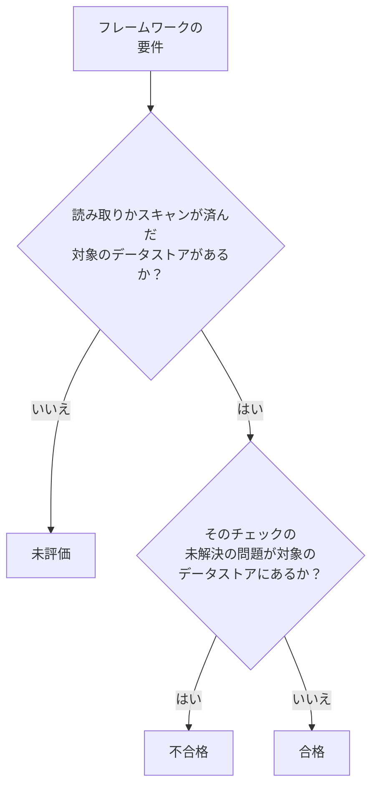

# データセキュリティのコンプライアンス

データセキュリティは、スキャンで見つかったものから 9 つのフレームワークのスコアを付けます。各フレームワークは、その規則が扱うデータストアを対象とし (GDPR は個人データを保持するデータストア、PCI DSS はカードデータが見つかったデータストア、SOC 2 はすべてのデータストア)、その各要件は、証拠となるチェックによって満たされるか、不合格になります。 **データセキュリティ → コンプライアンス** には、各フレームワークのスコア、対象のデータストアの数、そしてすべての要件と、それを不合格にしている未解決の問題の数が表示されます。データストアを持つリソース (Kubernetes クラスター、Docker または Podman ホスト、データベース、サービス、クラウドリソース) にも、それぞれ同じページがあり、そのリソースに当てはまらないものはそこでオフにできます。スコアは監査のための証拠であって、認証ではありません: OneUptime が読み取るデータストアについて、OneUptime に見えているものを示します。

:::cards
- [フレームワーク](#フレームワーク): 9 つのフレームワークと、それぞれが対象とするデータストア。
- [フレームワークのスコアの付け方](#フレームワークのスコアの付け方): 合格、不合格、未評価の要件。
- [リソースのページで](#リソースのページで): 1 つのクラスター、ホスト、データベース、サービス、クラウドリソースのコンプライアンスと、そこでオフにされているもの。
- [要件とそのチェック](#要件とそのチェック): すべての要件と、その証拠になるチェック。
- [処理の記録](#処理の記録): データストアをもとに作成する GDPR 第 30 条の記録と、あなたの確認を待つ OneUptime AI の下書き。
- [影響評価](#影響評価): 評価が必要な各データストアのデータ保護影響評価。
- [監査証拠](#監査証拠): 監査人が各要件の下で読む内容。処理の記録と問題の履歴とともにエクスポートされます。
:::

## フレームワーク

| フレームワーク | 正式名称 | 対象のデータストア |
| --- | --- | --- |
| GDPR | EU 一般データ保護規則 | 個人データを保持するデータストア。 |
| CCPA | カリフォルニア州消費者プライバシー法 (CPRA による改正後) | 個人情報を保持するデータストア。 |
| HIPAA | HIPAA セキュリティ規則 | 健康データを保持するデータストア。 |
| PCI DSS | PCI DSS v4.0 | カード番号が見つかったデータストア。 |
| SOC 2 | SOC 2 トラストサービス規準 | すべてのデータストア。 |
| ISO 27001 | ISO/IEC 27001:2022 | すべてのデータストア。 |
| NIST CSF | NIST サイバーセキュリティフレームワーク 2.0 | すべてのデータストア。 |
| LGPD | ブラジルの一般データ保護法 | ブラジルにいる人の個人データを保持するデータストア。 |
| DPDP | インドのデジタル個人データ保護法 (2023 年) | インドにいる人の個人データを保持するデータストア。 |

## フレームワークが対象とするデータストア

データストアがどのフレームワークの対象になるかは、その中で見つかったデータで決まるため、スキャンで見つかるものが増えるにつれて変わります。

- **SOC 2、ISO 27001、NIST CSF** はセキュリティのフレームワークです。何を保持していても、すべてのデータストアが対象です。
- **GDPR、CCPA、HIPAA、PCI DSS** は、それぞれが保護するデータタイプを保持するデータストアが対象です。個人データがあれば GDPR と CCPA、健康データがあれば HIPAA も対象になり、カード番号、カードのセキュリティコード、カードの有効期限があれば PCI DSS の対象になります。シークレットや業務文書だけを保持するデータストアは、どれの対象にもなりません。
- **LGPD と DPDP** は各国独自の法律です。ブラジルまたはインドにいる人の個人データを保持するデータストアが対象で、どの国の人のデータかは、ブラジル CPF やインド Aadhaar 番号のような、その国に属するデータタイプから読み取ります。

[機密データタイプ](/docs/data-security/data-types#組み込みデータタイプ) には、すべてのデータタイプが、その国とともに一覧されています。

## フレームワークのスコアの付け方

- **要件が合格する** のは、要件に対応付けられたチェックの未解決の問題が、フレームワークの対象のデータストアに 1 つもないときです。1 つでもあれば **不合格** になります。
- **評価されない** のは、対象のデータストアのどれも、まだ設定が読み取られておらず、コンテンツもスキャンされていないあいだです。
- **2 つの要件は、データセキュリティ自体が満たします**: GDPR 第 30 条の処理活動の記録と、ISO 27001 A.5.12 の情報の分類です。対象のすべてのデータストアが読み取りかスキャンを受けると合格し、まだのものが 1 つでもあるあいだは不合格になります。
- **オフになる** のは、対象のすべてのデータストアが、その要件をオフにしたリソースに属しているときです ( [リソースのページで](#リソースのページで) を参照)。
- **スコア** は、フレームワークの評価済みの要件のうち合格したものの割合で、整数のパーセントで表します: オフになっている要件は、合格にも不合格にも数えられません。何も評価されていないフレームワークにはスコアがありません。

数えられるのは未解決の問題だけです。リスクが受容された問題や、「問題ではない」とされた問題は、その要件を不合格にしません。そのため、受容したリスクは、監査で問題ごとに確認できる判断として残ります: 誰が、なぜ、いつまで受容したかです。

## リソースのページで

データセキュリティを使用しているプロジェクトで、データセキュリティが把握しているデータストアをリソースが持つようになると、データストアを閲覧できる人には、そのリソースのメニューに **セキュリティ** セクションが表示されます (開くまでは折りたたまれています)。各リソースのデータストアは次のとおりです。

| リソース | そのデータストア |
| --- | --- |
| Kubernetes クラスター | その上で動作しているデータベース |
| Docker または Podman ホスト | その上で動作しているデータベース |
| データベース | そのデータベース自体 |
| サービス | そのテレメトリ: サービスが送信するログ、トレース、例外 |
| クラウドリソース | リソース自体であるバケット、データベース、データウェアハウス |

- **データセキュリティ** には、それらのデータストアが、リスクの高いものから順に、そこにある未解決の問題とともに一覧されます。それぞれデータセキュリティで開き、そこで対応します。
- **コンプライアンス** は、それらのデータストアだけを対象にフレームワークのスコアを付けます。それらのデータによって対象になるフレームワークが先に並び、オフにされたものと、どのデータストアも該当するデータを保持していないものは、その下に折りたたまれます。

各フレームワークには **ここに適用** というスイッチがあり、その要件にもそれぞれあります。オフにすると、そのリソースのデータストアは、リソースのページでも、リソース側でオフにされたデータストアの数を示す **データセキュリティ → コンプライアンス** でも、そのフレームワーク (またはその要件) の対象から外れます。オンに戻すと、対象に戻ります。スイッチはどれもすぐに保存され、変更はそのつどプロジェクトの [監査ログ](/docs/configuration/audit-logs) に記録されます。

スイッチをオフにすると、続いてその下に **ここに適用されないのはなぜですか？** という質問が表示されます。理由は任意です: 短い理由を書いて **理由を保存** を選ぶか、書かない場合は **あとで** を選びます。それ以降は、誰がいつオフにしたかと、その理由が表示され、あとから **理由を追加** または **理由を編集** で書いたり変更したりできます。理由も、スイッチと同じく監査ログに記録されます。

**データセキュリティ → コンプライアンス** には、すべてのリソースについて同じことが表示されます。フレームワークを選ぶと、 **フレームワーク全体でオフ** の下に、そのフレームワーク全体をオフにしたリソースが一覧され、各要件のステータスの下には、その要件をオフにしたリソースが示されます。どのリソースもそれぞれのコンプライアンスのページにリンクされ、誰が、いつ、なぜオフにしたかが添えられます。このページの **CSV をエクスポート** では `Turned Off On` 列に、 **JSON をエクスポート** では `turnedOff` リストに含まれます。

データストアが従うのは、1 つのリソースのスイッチだけです。Kubernetes クラスター上や、Docker または Podman ホスト上で動作しているデータベースは、そのクラスターまたはホストのスイッチに従います: クラスターでフレームワークをオフにすると、その上のすべてのデータベースでオフになります。データベース自体のコンプライアンスのページでは、そのことが示されてそちらへのリンクが表示され、スイッチはロックされています。

フレームワークと要件のオンとオフを切り替えられるのは、チェックを調整できるのと同じく、セキュリティメンバー、セキュリティ管理者、プロジェクト管理者、プロジェクト所有者です。セキュリティ閲覧者には、何がオフになっているかと、その理由が表示されます。

## 要件とそのチェック

### GDPR

| 要件 | 求めていること | チェック |
| --- | --- | --- |
| Art. 5(1)(c) | データの最小化 | `production-data-in-non-production`、`stale-sensitive-data`, `new-personal-data-column`、`sensitive-data-in-telemetry`、`sensitive-data-to-ai`、`sensitive-data-in-ai-store` |
| Art. 5(1)(e) | 保存の制限 | `stale-sensitive-data` |
| Art. 25 | データ保護バイデザインとデータ保護バイデフォルト | `production-data-in-non-production`、`stale-sensitive-data`, `new-personal-data-column`、`sensitive-data-in-telemetry`、`sensitive-data-to-ai`、`sensitive-data-in-ai-store` |
| Art. 28 | 処理者 | `sensitive-data-to-ai` |
| Art. 30 | 処理活動の記録 | データセキュリティ自体が満たす |
| Art. 32 | 処理のセキュリティ | `public-read`、`public-write`、`public-access-not-blocked`、`internet-reachable`、`open-to-all-addresses`、`snapshot-public`、`snapshot-shared-externally`、`shared-with-external-accounts`、`readable-without-credentials`、`not-encrypted-at-rest`、`no-customer-managed-key`、`encryption-in-transit-not-enforced`、`weak-tls`、`no-backups`、`no-point-in-time-recovery`、`deletion-protection-off`、`deleted-data-not-recoverable`、`access-not-logged`、`shared-key-access`、`object-acls-enabled`、`many-readers`、`unused-access`、`secrets-stored`、`plaintext-passwords`、`secrets-in-telemetry` |
| Arts. 44-49 | 第三国への移転 | `residency-violation` |

### CCPA

| 要件 | 求めていること | チェック |
| --- | --- | --- |
| 1798.100(c) | 必要な範囲に限った収集 | `production-data-in-non-production`、`stale-sensitive-data`, `new-personal-data-column`、`sensitive-data-in-telemetry`、`sensitive-data-to-ai`、`sensitive-data-in-ai-store` |
| 1798.150 | 合理的なセキュリティ手続き | `public-read`、`public-write`、`public-access-not-blocked`、`internet-reachable`、`open-to-all-addresses`、`snapshot-public`、`snapshot-shared-externally`、`shared-with-external-accounts`、`readable-without-credentials`、`shared-key-access`、`object-acls-enabled`、`many-readers` |

### HIPAA

| 要件 | 求めていること | チェック |
| --- | --- | --- |
| 164.308(a)(4) | 情報アクセスの管理 | `unused-access` |
| 164.308(a)(7) | 緊急時対応計画 | `no-backups`、`no-point-in-time-recovery`、`deletion-protection-off`、`deleted-data-not-recoverable` |
| 164.312(a)(1) | アクセス制御 | `public-read`、`public-write`、`public-access-not-blocked`、`internet-reachable`、`open-to-all-addresses`、`snapshot-public`、`snapshot-shared-externally`、`shared-with-external-accounts`、`readable-without-credentials`、`shared-key-access`、`object-acls-enabled`、`many-readers` |
| 164.312(a)(2)(iv) | 暗号化と復号 | `not-encrypted-at-rest`、`no-customer-managed-key` |
| 164.312(b) | 監査制御 | `access-not-logged` |
| 164.312(e)(1) | 伝送のセキュリティ | `encryption-in-transit-not-enforced`、`weak-tls` |

### PCI DSS

| 要件 | 求めていること | チェック |
| --- | --- | --- |
| 3.3.1 | 機密認証データを承認後に保持しない | `card-security-codes-stored` |
| 3.4.1 | カード番号を表示するときはマスクする | `card-numbers-readable`、`sensitive-data-in-telemetry` |
| 3.5.1 | カード番号は保存されるすべての場所で読み取れないようにする | `not-encrypted-at-rest`、`no-customer-managed-key`、`card-numbers-readable` |
| 4.2.1 | 伝送中のカードデータを強力な暗号で保護する | `encryption-in-transit-not-enforced`、`weak-tls` |
| 7.2 | アクセスを必要に応じて定義し、割り当てる | `public-read`、`public-write`、`public-access-not-blocked`、`internet-reachable`、`open-to-all-addresses`、`snapshot-public`、`snapshot-shared-externally`、`shared-with-external-accounts`、`readable-without-credentials`、`shared-key-access`、`object-acls-enabled`、`many-readers` |
| 7.2.4 | アカウントとそのアクセスを見直す | `unused-access` |
| 8.3.2 | 認証要素は保存時に読み取れないようにする | `plaintext-passwords` |
| 10.2 | 監査ログでカードデータへのアクセスを記録する | `access-not-logged` |

### SOC 2

| 要件 | 求めていること | チェック |
| --- | --- | --- |
| A1.2 | バックアップと復旧 | `no-backups`、`no-point-in-time-recovery`、`deletion-protection-off`、`deleted-data-not-recoverable` |
| CC6.1 | 論理アクセスのセキュリティ | `public-read`、`public-write`、`public-access-not-blocked`、`internet-reachable`、`open-to-all-addresses`、`snapshot-public`、`snapshot-shared-externally`、`shared-with-external-accounts`、`readable-without-credentials`、`not-encrypted-at-rest`、`no-customer-managed-key`、`shared-key-access`、`object-acls-enabled`、`many-readers`、`secrets-stored`、`plaintext-passwords`、`secrets-in-telemetry` |
| CC6.2 | 不要になったアクセスを削除する | `unused-access` |
| CC6.7 | 情報の伝送 | `encryption-in-transit-not-enforced`、`weak-tls` |
| CC7.2 | システムコンポーネントの監視 | `access-not-logged` |

### ISO 27001

| 要件 | 求めていること | チェック |
| --- | --- | --- |
| A.5.9 | 情報とその他の関連資産の目録 | `no-owner` |
| A.5.12 | 情報の分類 | データセキュリティ自体が満たす |
| A.5.15 | アクセス制御 | `public-read`、`public-write`、`public-access-not-blocked`、`internet-reachable`、`open-to-all-addresses`、`snapshot-public`、`snapshot-shared-externally`、`shared-with-external-accounts`、`readable-without-credentials`、`shared-key-access`、`object-acls-enabled`、`many-readers` |
| A.5.18 | アクセス権 | `unused-access` |
| A.5.34 | プライバシーと PII の保護 | `production-data-in-non-production`、`stale-sensitive-data`, `new-personal-data-column`、`sensitive-data-in-telemetry`、`sensitive-data-to-ai`、`sensitive-data-in-ai-store` |
| A.8.11 | データマスキング | `production-data-in-non-production`、`stale-sensitive-data`, `new-personal-data-column`、`sensitive-data-in-telemetry`、`sensitive-data-to-ai`、`sensitive-data-in-ai-store` |
| A.8.12 | データ漏えいの防止 | `secrets-stored`、`secrets-in-telemetry` |
| A.8.13 | 情報のバックアップ | `no-backups`、`no-point-in-time-recovery`、`deletion-protection-off`、`deleted-data-not-recoverable` |
| A.8.15 | ログ取得 | `access-not-logged` |
| A.8.24 | 暗号の利用 | `not-encrypted-at-rest`、`no-customer-managed-key`、`encryption-in-transit-not-enforced`、`weak-tls`、`plaintext-passwords` |

### NIST CSF

| 要件 | 求めていること | チェック |
| --- | --- | --- |
| ID.AM-07 | データとメタデータの目録が維持されている | `no-owner` |
| PR.AA-05 | アクセス権限が管理されている | `public-read`、`public-write`、`public-access-not-blocked`、`internet-reachable`、`open-to-all-addresses`、`snapshot-public`、`snapshot-shared-externally`、`shared-with-external-accounts`、`readable-without-credentials`、`shared-key-access`、`object-acls-enabled`、`many-readers`、`unused-access` |
| PR.DS-01 | 保存されたデータが保護されている | `not-encrypted-at-rest`、`no-customer-managed-key`、`secrets-stored`、`secrets-in-telemetry` |
| PR.DS-02 | 伝送中のデータが保護されている | `encryption-in-transit-not-enforced`、`weak-tls` |
| PR.DS-11 | データのバックアップが保持され、テストされている | `no-backups`、`no-point-in-time-recovery`、`deletion-protection-off`、`deleted-data-not-recoverable` |
| DE.CM-09 | データとその使用が監視されている | `access-not-logged` |

### LGPD

| 要件 | 求めていること | チェック |
| --- | --- | --- |
| Art. 6 | 必要性と目的の限定 | `production-data-in-non-production`、`stale-sensitive-data`, `new-personal-data-column`、`sensitive-data-in-telemetry`、`sensitive-data-to-ai`、`sensitive-data-in-ai-store` |
| Art. 33 | データの国際移転 | `residency-violation` |
| Art. 46 | セキュリティ対策 | `public-read`、`public-write`、`public-access-not-blocked`、`internet-reachable`、`open-to-all-addresses`、`snapshot-public`、`snapshot-shared-externally`、`shared-with-external-accounts`、`readable-without-credentials`、`not-encrypted-at-rest`、`no-customer-managed-key`、`shared-key-access`、`object-acls-enabled`、`many-readers` |

### DPDP

| 要件 | 求めていること | チェック |
| --- | --- | --- |
| Sec. 8(5) | 合理的なセキュリティ保護措置 | `public-read`、`public-write`、`public-access-not-blocked`、`internet-reachable`、`open-to-all-addresses`、`snapshot-public`、`snapshot-shared-externally`、`shared-with-external-accounts`、`readable-without-credentials`、`not-encrypted-at-rest`、`no-customer-managed-key`、`shared-key-access`、`object-acls-enabled`、`many-readers` |
| Sec. 8(7) | 目的を果たしたときの消去 | `production-data-in-non-production`、`stale-sensitive-data`, `new-personal-data-column`、`sensitive-data-in-telemetry`、`sensitive-data-to-ai`、`sensitive-data-in-ai-store` |
| Sec. 16 | インド国外への移転 | `residency-violation` |

## 処理の記録

GDPR 第 30 条は、処理活動の記録を保持するよう求めています。データセキュリティは、その記録のうち、個人データがどこに保管されているかに関する部分を作成します: 個人データを保持するデータストアごとに 1 行です。**データセキュリティ → コンプライアンス** の最後にある **処理記録** カードで、**CSV をエクスポート** と **JSON をエクスポート** を使えます。

| 列 | 情報源 |
| --- | --- |
| データストア、種類、プロバイダー、リージョン | 検出 |
| 環境 | データストアのタグか名前、または自分で設定した値 |
| 機密度、カテゴリ、データタイプ | スキャンで見つかったもの、または自分で設定した機密度 |
| 所有者 | データストアの所有者。個人と、所有者であるチームのメンバー |
| 目的 | データストアの **目的** に書いた内容、または確認した内容: 個人データを保持する理由。OneUptime がセキュリティのために保持するデータストアでは、OneUptime が入力します |
| 保持期間 | データストアの **保持期間** に書いた内容、または確認した内容: データをそこに保持する期間。OneUptime がセキュリティのために保持するデータストアでは OneUptime が入力し、サービスのテレメトリではプロジェクトのテレメトリの保持期間から入力されます |
| 閲覧できるユーザー | OneUptime がセキュリティのために保持するデータストアを閲覧できるユーザー |
| フレームワーク | そのデータタイプによって対象になるフレームワーク |
| 宣言元 | OneUptime がセキュリティのために保持するデータストアでは OneUptime |
| 法的根拠 | 書いた内容、または確認した内容: GDPR 第 6 条に基づくデータストアの法的根拠で、同意、契約、法的義務、生命に関する利益、公共の利益のための職務、正当な利益のいずれかです。OneUptime がセキュリティのために保持するデータストアでは正当な利益です |
| データ主体 | 書いた内容、または確認した内容: データストアのデータが誰に関するものか。顧客、ユーザー、従業員、患者など |
| 受領者 | データストアのデータフローから算出: データの送信先である外部ホストと AI プロバイダー、およびそのコピーを保持するデータストア |
| 移転 | データストアのリージョン、クラウドによるコピー先のリージョン、コピーのリージョンを、データ主体のいる国と照らし合わせて算出: それらの国の外への各移転、または不明である理由 |
| 影響評価 | データストアにデータ保護影響評価が必要かどうかと、その状況: 不要、必要、下書き済み、編集済み |
| レビュー待ち | 下書きが人の確認を待っているフィールド。下書きは、誰かが確認するまで、記録にもそのエクスポートにも含まれません |

データセキュリティが見つけたデータストアについては、個人データを保持する理由、保持期間、法的根拠、誰に関するデータかを、どのスキャンも知りようがありません: その **設定** で書くか、OneUptime AI の下書きを確認してください。記録とスコアは、データストアを閲覧できる人なら誰でも、データセキュリティの API の `/data-security/record-of-processing`、`/data-security/compliance`、そして 1 つのリソースについては `/data-security/resource-compliance` からも取得できます ( [データセキュリティの連携](/docs/data-security/integrations#apiterraformmcp) を参照)。

### OneUptime AI の下書き

OneUptime AI は、データセキュリティがデータストアについて知っていることから、その **目的**、**保持期間**、**法的根拠**、**データ主体** を下書きします: 見つかったデータタイプ、名前、タグ、説明、それを使うサービスとそのチームが書いたサービスの用途、データの送信先と保管場所です。データの値を見ることは決してありません ( [データセキュリティの OneUptime AI](/docs/data-security/ai) を参照)。

- **下書きには「下書き」の印が付き**、その理由が示され、根拠となる事実はクリック 1 つで表示できます。**確認** を押すか、**編集** して自分の言葉にするまで、記録には入りません。
- **あなたの言葉が下書きで上書きされることはありません。** 自分で書いたフィールドが再び下書きされることはありません。確認した下書きが再び下書きされるのは、その根拠となる事実が変わったときだけで、そのときも適用されるのではなく提案されます: **変更の提案あり** と表示され、変わった内容と、**新しい下書きを使用** と **現在の内容を維持** が示されます。
- **処理記録** カードの **下書きをレビュー** では、下書きがあなたを待っているデータストアを 1 つずつ順に見ていけます。データストアの **設定** にも同じフィールドがあり、空のフィールドには **OneUptime AI で下書き** があります。
- **自動で**、OneUptime AI は、**データセキュリティ → AI** で **新しい問題に対応する** がオンの間、AI ルールが許す範囲で、最もリスクの高いデータストアの空のフィールドを 1 日 1 回下書きします。

サービスのテレメトリの保持期間、受領者、移転は通常のコードで算出され、下書きされることはありません。下書きは出発点であり、法的助言ではありません: コンプライアンスの責任者に確認してもらってください。

### OneUptime がセキュリティのために保持するデータストア

4 つのデータストアは、ネットワークを守るために意図して IP アドレスとユーザー名を保持しています: **セキュリティイベント**、**ネットワークフロー**、**セキュリティアドレス保管庫**、**セキュリティユーザー保管庫** です。記録には、プロジェクトにあるものがそれぞれ載ります。OneUptime はこれらを見つけるのではなく宣言します: 何を保持しているかは設計上わかっているため、スキャンで読むことはなく、チェックも適用されず、これらのアドレスや名前を保持していても問題にはなりません。それがこれらの目的だからです。**データストア** では **OneUptime による宣言** と表示され、**概要** とフレームワークのスコアからは除かれます。

| データストア | 保持しているもの | 保持期間 | 閲覧できるユーザー |
| --- | --- | --- | --- |
| セキュリティイベント | 操作した人と操作された対象の IP アドレス、ユーザー名、メールアドレス | プロジェクトの [テレメトリの保持期間](/docs/telemetry/data-retention)。記録を読むたびに読み直すため、変更はすぐに反映されます | プロジェクト所有者、プロジェクト管理者、セキュリティ管理者、セキュリティメンバー、セキュリティ閲覧者、Read Security Event を持つユーザー |
| ネットワークフロー | 通信した相手同士の IP アドレス | フローが届いてから 30 日 | ネットワークデバイスを閲覧できるユーザー |
| セキュリティアドレス保管庫 | [セキュリティイベント](/docs/telemetry/security-events) が読むログとトレースに、ハッシュする IP アドレスのルールが残した各トークンの背後にある IP アドレス | アドレスが最後に確認されてから 30 日 | OneUptime 内のセキュリティイベントのスキャンだけ: 人、ページ、エクスポート、API、AI ツールのいずれも読めません |
| セキュリティユーザー保管庫 | [セキュリティイベント](/docs/telemetry/security-events) がログとトレースでユーザーを読む箇所に、ハッシュするルールが残した各トークンの背後にあるユーザー | ユーザーが最後に確認されてから 30 日 | OneUptime 内のセキュリティイベントのスキャンだけ: 人、ページ、エクスポート、API、AI ツールのいずれも読めません |

それぞれの目的は「ネットワークと情報のセキュリティ (GDPR 前文 49)」です。独自の目的や保持期間を書くには、データストアの **設定** にある **記録を編集** を使います: 空のままのフィールドは OneUptime の内容を保ちます。

データストアは、プロジェクトがそのデータを保持している間、記録に載ります: アドレス保管庫は、有効な IP アドレスのルールがセキュリティイベントの読むログまたはトレースをハッシュしている間、ユーザー保管庫は、ほかのパターンの有効なルールがそうしている間で、どちらもその後 31 日間です ( [機密データをスクラブする](/docs/telemetry/drop-filters-and-scrub-rules#機密データをスクラブする) を参照)。データがなくなるとデータストアはアーカイブされ、データが戻ると、あなたの目的と保持期間とともに戻ります。

「セキュリティユーザー保管庫」から、またそれを通じてその人の名前を示すイベントとケースから 1 人を消去するには、消去リクエストを登録します。[個人を消去する](/docs/telemetry/security-events#個人を消去する) を参照してください。

## 影響評価

GDPR 第 35 条は、高いリスクをもたらすおそれのある処理の前に、データ保護影響評価を行うよう求めています。データセキュリティは、どのデータストアに評価が必要かを示します: 健康データのような特別カテゴリのデータ、多数の人のデータ (約 10 万件以上のレコード)、またはデータ主体のいる国の外に出るデータを保持するデータストアです。

データストアのメニューで **設定** の下にある **影響評価** は、そのデータストアに評価が必要な理由、または不要であることを示します。**評価を下書き** は、データストアの記録、オープンな問題と最近修正された問題、露出の程度、アクセスできる人の数、暗号化をもとに、第 35 条第 7 項が求める 4 つの部分を OneUptime AI に依頼します:

| 部分 | 条項 |
| --- | --- |
| 処理とその目的 | Art. 35(7)(a) |
| 必要性と比例性 | Art. 35(7)(b) |
| データ主体へのリスク | Art. 35(7)(c) |
| リスクに対処する措置 | Art. 35(7)(d) |

各部分には、誰がいつ書いたかと、下書きされた部分の根拠となる事実が示されます。**編集** すると、その部分はあなたのものになり、再び下書きされることはありません。**下書きし直す** は、誰も編集していない部分だけを下書きし直します。書かれた後に根拠となる事実が変わった部分には、そのことが示されます。**PDF をエクスポート** と **Markdown をエクスポート** で評価をダウンロードできます。

## 監査証拠

**データセキュリティ → コンプライアンス** で選んだフレームワークの **監査証拠** は、過去 30、90、180、365 日間について、監査人がその各要件の下で読む内容です:

- 対象範囲内のデータストアと、そのチェックの状況
- 期間内にオープンされた、または修正されたチェックの問題と、修正までの速さ
- 要件のもとで受容されたリスクと、その理由と有効期限
- 要件をオフにしたリソースと、その理由

**証拠を下書き** は、各要件の下に置く段落を、それらの事実に基づいて OneUptime AI に依頼します。**編集** すると段落はあなたのものになり、再び下書きされることはありません。段落のない要件には、その証拠がそのまま表示されます。**PDF をエクスポート** と **Markdown をエクスポート** では、2 つの付録とともに証拠をダウンロードできます: 対象範囲内のデータストアの処理記録と、証拠が引用する問題の履歴です。

## 次のステップ

:::cards
- [データセキュリティのチェックと問題](/docs/data-security/checks-and-issues): すべての要件の背後にあるチェックと、その修正方法。
- [データフロー、アクセス、データ所在地](/docs/data-security/flows-access-residency): GDPR、LGPD、DPDP の移転に関わるデータ所在地ルール。
- [機密データタイプ](/docs/data-security/data-types): データストアをフレームワークの対象にするデータタイプ。
:::
